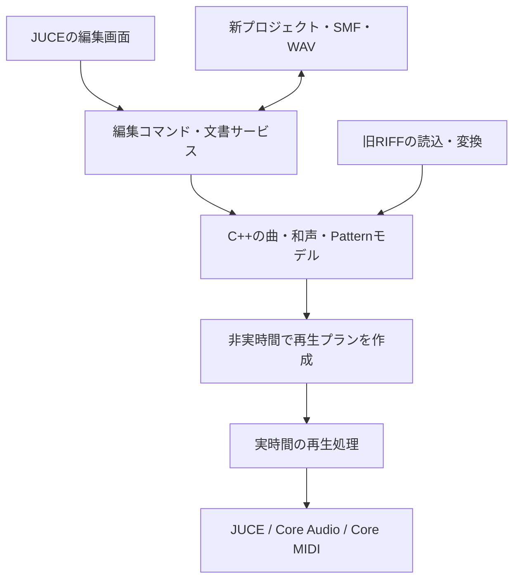

# macOS移行と音楽オーサリングツールの技術スタック調査

調査日：2026-11-10（日本時間）

対象リビジョン：`b03d995`

位置付け：新しい開発方針に対する技術提案。依存ライブラリの導入・アプリの移植はまだ実施していない。

配置変更後の注記：本文のソース評価・configure結果は配置変更前の調査記録。参照リンクは`legacy/windows/`へ更新した。現在の開発入口は[リポジトリ構成](../architecture/repository-layout.md)と[開発環境](../development/building.md)を参照する。本文の工程案は実施計画書の正本ではない。

**採用状況：2026-11-10、ユーザーがC++20＋JUCE 9＋CMakeを軸とする推奨案の採用を決定。** 本文の代替案比較は選定時の調査として保持する。本文中の工程案は調査時のたたき台であり、実施計画書は後の工程で別途作成する。リポジトリ構成については[構造調整の提案](../proposals/repository-structure-proposal-2026-11-10.md)を参照する。

## 推奨する構成

**C++20＋JUCE 9＋CMakeを軸に、macOSのCore Audio／Core MIDIを利用するデスクトップアプリを育てる。** 最初の製品単位は、内蔵音源で発音し、音符を編集して保存・再読込できる小さなMIDIシーケンサーとする。その上に、DirectMusic Producerから受け継ぐPattern、和声、Variation、音楽の遷移を加える。

JUCEはデバイス、MIDI、GUI、DSP、プラグイン接続の基盤として使う。曲のモデル、編集規則、時間の扱い、音楽生成はアプリ側で所有する。JUCEを導入するだけでDAWの再生エンジンやピアノロールが完成するわけではない。

一般的なDAW機能を早く増やす場合の有力な対案は**JUCE＋Tracktion Engine**。録音、長尺オーディオ、複雑なミキサーが早期の中心要件になるなら、独自エンジンを拡大する前にこちらを評価する。現時点では、既存C++と独自の音楽オーサリングを活かすJUCE単体案を第一候補にする。

JUCEの公開条件または商用契約がプロジェクトの方針に合うことが採用条件となる。ソース公開方針や予算は未指定のため、条件を満たすと断定せず、代案も残す。今回、リポジトリのライセンスを変更したり、契約を締結したりはしない。

## 1. 開発目標をどう置き換えるか

今回のユーザー指示により、目標を「Windows版の機能・外観・操作を可能な限り再現する」から、「既存の知見を活かし、macOSで継続的に使える音楽制作・オーサリング環境を作る」へ変更する。

旧計画の40モジュールや原版UI一致は、過去の調査を読むための分類として残す。新しいアプリの完成条件には直接引き継がない。一方、破損入力の拒否、保存の安全性、Undo／Redo、発音中の停止、別プロセスでの復元などの品質基準は活かす。

| 受け継ぐ考え方 | 現代のアプリでの形 |
| --- | --- |
| Segmentを組み合わせて音楽を構成する | 再利用可能なClip／Sectionと、その配置・遷移 |
| Style、Pattern、Variation | 編集可能なパターン、条件付き選択、再現可能な変化 |
| Chord／ChordMapに演奏が追従する | 和声トラックと、度数・音域・声部進行を考慮した音符生成 |
| Motif、Command、境界での切替 | 小節・拍に同期したフレーズ起動とシーン遷移 |
| Band、PChannel、AudioPath | 楽器割当、トラック、バス、センドの明示的なルーティング |
| ゲーム向けの音楽オーサリング | 制作中の試聴、生成結果の固定、MIDI／音声／将来のイベント定義の出力 |

原版のCOM構成、DLL分割、32bit ABI、ダイアログ配置を新アプリの内部構造には持ち込まない。生成結果を通常の音符として編集できることを重視し、実時間の演奏とオフライン書出しを同じ音楽モデルにつなぐ。

## 2. リポジトリとmacOS環境の確認結果

以下はソースを読んだ結果と、このMacで実行した確認である。Windows上の過去の成功記録とは区別する。

| 確認対象 | 現状と移行への影響 |
| --- | --- |
| [ルートCMake](../../CMakeLists.txt) | `LANGUAGES CXX RC`、Windows x86を要求する判定、`cxx_std_17`。`producer_core`も`winmm`、`ole32`、`dxguid`、`xaudio2`などに依存する |
| [CMakePresets.json](../../CMakePresets.json) | Visual Studio 2022／Win32専用。macOS用presetはない |
| [riff.cpp](../../legacy/windows/src/producer/riff.cpp) | RIFF木の解析・未知chunk／padding保持に価値がある。ファイル保存は`CreateFileW`／`MoveFileExW`。文字列codecはUTF-16のcode unitと`wchar_t`を結び付けている |
| [sequence.cpp](../../legacy/windows/src/producer/sequence.cpp)、[document.h](../../legacy/windows/src/producer/document.h) | 音符・CC・範囲編集、履歴、保存の規則がある。`DWORD`／`GUID`、RIFFに結び付いた編集モデルから切り出しが必要 |
| [timeline.cpp](../../legacy/windows/src/producer/timeline.cpp)、[拍子モデル](../../legacy/windows/src/time_signature/time_signature_map.h) | 小節／拍／tick、グリッドの知見を再利用できる。拍子モデルの型はWindows互換ヘッダーを通じている |
| [MIDI import](../../legacy/windows/src/producer/midi_import.cpp) | 入力の検証や変換規則を利用できる。現実装は元のdivisionから768 PPQの32bit時刻へ丸める |
| [conductor.cpp](../../legacy/windows/src/producer/conductor.cpp)、[midi_input.cpp](../../legacy/windows/src/producer/midi_input.cpp) | DirectMusic／DirectSound／COM、WinMMが中心。macOSではバックエンドを新設する |
| [chord_composition.cpp](../../legacy/windows/src/producer/chord_composition.cpp)、[style_player.h](../../legacy/windows/src/producer/style_player.h) | 生成処理をOSのDirectMusic Composerに委ねている。Style／ChordMapの読込資産があっても、自前の生成エンジンが完成しているとはいえない |
| [main.cpp](../../legacy/windows/src/producer/main.cpp)、各`*_editor.cpp` | Win32のメッセージ、ウィンドウ、描画、コントロールに依存する。操作の知見を参考に新UIへ置き換える |
| [core_tests.cpp](../../legacy/windows/tests/producer/core_tests.cpp)、[scripts](../../legacy/windows/scripts) | 「core」の試験もWindows SDKや再生処理と混在。試験を移植可能なモデル／互換形式／OS実行へ分ける。既存スクリプトにはPowerShellとWindowsの画面操作が多い |
| 解析資料 | [旧計画](../../legacy/windows/docs/analysis-plan.md)、[Style契約](../../legacy/windows/docs/analysis/style-contract.md)、[再生契約](../../legacy/windows/docs/analysis/playback-contract.md)、[引継ぎ](../../legacy/windows/docs/analysis/product-host.md)などに観測・制約が蓄積されている |
| ローカル素材 | このcheckoutにはGit対象外の`work/`、`artifacts/`、`screenshot/`が存在しない。過去の録音・原版入力・生成物をこのMacで再確認した状態ではない |

調査時の環境はApple Silicon `arm64`、macOS 15.6.1、Xcode 26.2、Apple Clang 17.0.0、CMake 4.0.1、Ninja 1.13.1だった。

現行ソースを変更せず、比較ツールとcore試験を無効にしてconfigureを試した。

```sh
cmake -S . -B /private/tmp/directmusic-macos-stack-audit-20261110 \
  -G Ninja \
  -DPRODUCER_BUILD_REFERENCE_TOOLS=OFF \
  -DPRODUCER_BUILD_CORE_TESTS=OFF
```

結果はexit 1。`CMakeLists.txt:2`の`project()`で`No CMAKE_RC_COMPILER could be found`となった。これが最初に現れた障害であり、その後にも明示的なWindows x86制約とWindowsライブラリ依存がある。RCの指定を外すだけでは移植にならない。アプリのコンパイル・起動・音声試験には到達していない。

型については、このMacで`sizeof(wchar_t)=4`、`sizeof(long)=8`、ポインター幅8を確認した。Windows互換の32bit整数を`long`へ機械的に置き換えるとファイル形式が変わる。UTF-16LEは`char16_t`等と明示的なcodecで扱い、GUIDのシリアライズもホスト構造体のメモリ配置に依存させない。

## 3. 候補の比較

重視する順序は、既存C++の活用、実時間の音声・MIDI、編集体験、継続保守、配布条件。以下は資料と実装構造からの設計評価であり、各候補を実装して計測したベンチマークではない。

| 候補 | 既存資産との接続 | 得意なこと | 自分たちで負担すること | 判断 |
| --- | --- | --- | --- | --- |
| **A. C++20＋JUCE** | 高い。CMakeとC++を継続できる | 音声・MIDI・DSP・GUI・プラグイン接続を一つの基盤に揃える | 曲モデル、スケジューラー、ピアノロール、録音等の製品機能 | **第一候補**。初期の自作範囲を限定する |
| **B. C++20＋JUCE＋Tracktion Engine** | 高いが、既存モデルとの変換が必要 | マルチトラック、クリップ、MIDI、録音、ミキシング等のDAW基盤 | Engineのモデルへの適合、独自生成との接続、二つのライセンス管理 | DAW機能の早期充実を優先する場合の対抗案 |
| **C. SwiftUI／AppKit＋C++＋Apple音声API** | C++は残せる。Swiftとの境界が増える | macOS標準の文書・メニュー・アクセシビリティとの統合 | タイムライン描画、音楽エンジン、他OS向け実装 | Mac専用と標準UIを最優先するなら有力 |
| **D. C++＋Qt 6＋音声・MIDI基盤** | 高い | 複雑な編集画面、ツリー、プロパティ、QMLによるUI | 音声・MIDI・プラグインの別統合、依存物とイベントループの整理 | JUCEの条件が合わない場合の代案 |
| **E. Rust＋Tauri／Web UI＋ネイティブ音声** | FFIまたは大きな書換えが必要 | Web技術で作るUI、Rust側のアプリ処理 | 音声エンジン、C++との境界、IPC、プラグイン画面の統合 | 今回の初期構成では優先しない |

JUCEはCMakeとの統合と主要OSへの展開を備える。Tracktion EngineはJUCEを土台にするDAWエンジンで、独立した製品UIは必要になる。[JUCE公式リポジトリ](https://github.com/juce-framework/JUCE)、[Tracktion Engine公式](https://engine.tracktion.com/)。

AppleのAVAudioEngineは音声処理グラフ、MIDI、サンプラー、オフライン処理の候補になる。SwiftとC++も直接連携できるが、対応する言語機能には制約がある。C案を「C++が使えないから不採用」とはしない。今回はGUIと音声の統合、および将来の他OS展開余地を優先してA案を推す。[Apple Audio Engine](https://developer.apple.com/documentation/avfaudio/audio-engine)、[Swift公式のC++連携](https://www.swift.org/documentation/cxx-interop/)。

Qt QuickはQMLとC++双方からUIを構築できる。Qt Multimediaの一般的な音声入出力・再生機能だけで、必要なシーケンサー機能が揃うとは判断しない。D案ではCore Audio／Core MIDIの直接利用、またはminiaudio／RtMidi等を別途評価する。RtMidiには出力タイミングをスケジュールする機能がないため、その部分も設計対象となる。[Qt Quick](https://doc.qt.io/qt-6/qtquick-index.html)、[Qt Multimedia](https://doc.qt.io/qt-6/qtmultimedia-index.html)、[miniaudio](https://miniaud.io/)、[RtMidi公式](https://github.com/thestk/rtmidi)。

TauriはRustのCoreプロセスとWebViewを分ける構成を取る。Web UIでも音楽アプリは構築できるが、発音の締切はUIのIPCから切り離す必要がある。これは実装上の評価であり、「Web技術では音楽アプリを作れない」という制約ではない。[Tauri Process Model](https://v2.tauri.app/concept/process-model/)。

### Tracktion Engineをどう扱うか

Tracktion Engineの公式READMEはC++20を要求し、JUCEのライセンスとは別であることを明記している。録音・オーディオ編集・プラグインホストまでをすべて自作する負担を減らす候補として評価する。[Tracktion Engine README](https://raw.githubusercontent.com/Tracktion/tracktion_engine/master/README.md)。

初期の小さな試作で、同じ8小節のMIDI、テンポ変更、ループ、保存／復元をA・B両案で比較すると判断しやすい。Bではさらに、和声から生成した音符の投入、編集履歴との接続、音声書出しを確認する。採用するEngineのcommitとJUCE 9の組合せが動くかも確認し、最新版同士なら動くと推測しない。

**一般的なDAW編集が主役になり、B案でこれらを無理なく実現できるなら、オーディオ機能を拡大する前にBへ切り替える。** Pattern／和声／遷移の独自モデルが中心で、初期はMIDI主体ならAを継続する。後から容易にEngineを交換できるとは約束しない。永続形式と編集履歴が大きくなる前の判断点にする。

## 4. 推奨スタックの具体像

| 層 | 推奨 | 適用方針 |
| --- | --- | --- |
| 言語 | 新規コードはC++20 | 既存WindowsターゲットのC++17は当面維持。選んだソースから移植する |
| アプリ基盤 | JUCE 9 | 調査時の最新安定リリースは**9.0.5**。評価開始時はこのタグとcommitを固定する |
| GUI | JUCE Components／Graphics | ピアノロールとタイムラインは専用描画。標準メニュー、ファイルダイアログ、キーボード操作を整える |
| 音声入出力 | JUCE AudioDeviceManager→Core Audio | 最初は内蔵出力、ステレオ。音声入力は録音導入時に追加する |
| MIDI入出力 | JUCEのMIDI API→Core MIDI | MIDI 1.0のノート／CC／ピッチベンドから。端末IDとチャンネルを文書モデルと分離する |
| 初期音源 | 小さな内蔵シンセ | 自作または利用可能なコードから構成し、外部音源なしで動作確認できるようにする |
| 音楽／再生モデル | アプリ所有のC++モデル＋限定した再生エンジン | テンポマップ、イベント列、Transport、ループ、音符生成を明示する |
| 音声処理 | float32のバッファ、JUCE DSP | 最初は音量・パン・メトロノーム。大規模ミキサーは後続段階 |
| ファイル | 新規プロジェクト形式＋SMF／WAV＋旧形式import | 新規文書を旧RIFFの制約に縛らない。旧データは変換レポート付きで取り込む |
| JSON | nlohmann/jsonを候補とする | 非実時間の保存層だけで使用。採用版を固定する |
| プラグイン | AUv2ホストを先行評価、VST3を後続評価 | 初期シーケンサーの必須依存にはしない |
| ビルド | CMake＋Ninja、調査・デバッグはXcode／LLDB | `CMakePresets.json`にMac向けDebug／Releaseを追加する設計 |
| 検証 | CTest、既存試験の分離、ASan／UBSan、音声レンダリング比較 | 音符・時刻・保存と、実機I/Oの確認を分ける |
| 補助処理 | Python 3 | fixture生成、音声解析、移行レポート。再生時の必須依存にはしない |
| 配布 | macOS `.app` | 最初はローカル開発。外部配布時に署名・notarizationを整える |

リリース番号は[JUCE 9.0.5](https://github.com/juce-framework/JUCE/releases/tag/9.0.5)で確認した。JUCE 9.0.5のCMake APIは**CMake 3.22以上**を要求するため、現行の最低3.21はMac向け構成を追加する段階で見直す。[固定版CMake API](https://raw.githubusercontent.com/juce-framework/JUCE/9.0.5/docs/CMake%20API.md)。nlohmann/jsonのライセンスは[MIT](https://raw.githubusercontent.com/nlohmann/json/develop/LICENSE.MIT)。

初期の実機受入は、手元のApple Silicon Macを対象にする。deployment targetはmacOS 14を仮置きし、固定したJUCE・SDK・採用APIで確認してから宣言する。macOS 14での実行やIntel対応を今回確認したわけではない。Universal Binaryは配布対象が必要になった時点で追加し、arm64プロセスにIntel専用プラグインをそのまま読み込めるとは扱わない。

## 5. コードの境界と再利用方針

既存の`producer_core`は名前に反してWindows依存を含む。これを丸ごと新アプリにリンクする構成は避け、移植可能な単位を抽出する。以下は将来の責務・ディレクトリ案であり、今回作成したターゲットではない。



| 候補となる単位 | 対応する資産 | 移行方法 |
| --- | --- | --- |
| `music_core` | tempo、meter、timeline、sequence編集、和声のデータ | 固定幅整数とOS非依存型へ変換。新規コードの公開ヘッダーにはJUCE／Windows SDKを出さない |
| `legacy_directmusic` | riff、document、style、band、dls、chordmap、各trackのcodec | 旧文書の読込、未知データ保持、変換可能性の診断を所有する |
| `project_store` | Frameworkの参照管理・保存・失敗時復元の知見 | ファイルI/O、参照解決、履歴から切り出す。WindowsのFILETIME等を新文書の意味にしない |
| `audio_engine` | playback契約、停止／再開／ループ等の試験意図 | ConductorのCOM呼出しは置換。小規模スケジューラーまたは評価後のTracktionへ接続する |
| `music_generation` | Style／Variation／ChordMapの観測とデータ | OS Composerの代わりを実装する。最初は限定した音符生成と小節境界遷移から始める |
| `platform_juce` | MIDI入力・デバイス設定・ファイル選択等の機能要件 | WinMM／Win32／COMをJUCEまたは少量のObjective-C++に置き換える |
| `app_desktop` | 既存の編集機能、選択、dirty、Undoの操作知識 | Win32 UIの外観・ハンドル管理を継承せず、新たな画面に接続する |
| `legacy_windows`相当の既存ターゲット | 現在のWin32本体、DLL、比較プローブ | 旧環境で参照できる状態を維持。新しいMacの通常ビルドから分離する |

最初に切り出す候補は、RIFFのメモリ上のparse／encode、テンポのcodec、音符の基本編集。ファイルI/O、GUID生成、文字コードを小さい境界にする。TimeSigは`compat/time_signature.h`経由のWindows型を除去してから扱う。

`std::filesystem::path`でOSのパスを扱い、プロジェクト内の参照は相対パスと安定したIDを使う。旧ファイル内のUTF-16LEと、新プロジェクト内のUTF-8を明示的に変換する。日本語・絵文字、大小文字の差、Unicode表現の差を含むパスを確認する。C++20では`path::u8string()`の型も変わるため、既存ソース全体の標準指定だけを一括変更しない。

## 6. 音が安定して鳴るための設計

### 編集状態と発音状態を分ける

編集側は可変の曲モデルとUndoを持つ。ワーカースレッドで検証済みの再生プランを作り、オーディオ側はブロック境界でそのプランを受け取る。読み終えたプランの解放も非実時間側で行い、参照カウントの最終解放や大きなデストラクターが音声コールバックで走らないようにする。

音声コールバックでは、ヒープ確保、ファイル操作、JSON解析、GUI呼出し、待機するロック、ログ出力を行わない方針とする。MIDI入力が別スレッドから来る場合は容量を決めたキューへ渡し、満杯時の処理を定義する。SPSCキューを使うなら、単一のproducerへ集約し、複数のMIDI入力スレッドから同じキューへ直接書き込まない。

JUCEの[AudioDeviceManager](https://docs.juce.com/master/classjuce_1_1AudioDeviceManager.html)は音声コールバックとデバイス設定を提供する。[MidiBuffer](https://docs.juce.com/master/classjuce_1_1MidiBuffer.html)はブロック内のサンプル位置付きイベントを扱える。これらを土台とし、再生計画や上記のスレッド規則はアプリ側で設計する。

### 音楽の時刻と音声の時刻を分ける

内部では`MusicalTime`、`SampleFrame`、外部MIDIのホスト時刻を異なる型として扱う。音楽位置は64bit tick＋明示したPPQを候補とし、元ファイルの時刻と変換規則を保持する。既存の768 PPQは旧形式の境界に閉じ込め、新規モデルの暗黙の定数にしない。SMFの異なるdivisionを取り込む場合は、丸め誤差を報告できるようにする。

テンポマップから音楽位置とサンプル位置を変換し、発音イベントを各ブロック内の位置に配置する。まずは区分一定のテンポ変更から始める。UI更新タイマーは表示用とし、音符の発音時刻には使わない。外部MIDI出力はCore MIDI等の時刻系と合わせ、内蔵音源のサンプル位置精度と同じ保証をそのまま約束しない。

停止ではサステイン状態と発音中の音符を処理し、通常停止時のリリース／残響と緊急のPanicを区別する。ループ折返し、シーク、プラン差替え、デバイス切断時にも発音所有権を明確にする。スリープ復帰やsample rate変更後には再準備する。

初期設定は48 kHz／256 framesを出発点とし、利用可能なデバイス設定に合わせる。256 framesは約5.33 msの1ブロック時間で、入出力を含む全体のレイテンシではない。44.1／48 kHz、128／256／512 framesで試験し、低い値へ固定することを品質目標にしない。

### 再生と書出しを同じ経路で確認する

内蔵シンセのような決定的な音源では、同じ曲・seed・設定から実時間用とオフライン用のレンダリングを照合する。停止後の残音、音符間隔、音高、ループ境界を数値でも確認し、実機Core Audio出力も短い試聴や必要な録音で確認する。オフラインWAVの成功だけではデバイス出力を確認したことにしない。

外部プラグインや実機MIDIでは完全なPCM一致が成立しない場合があるため、イベント時刻、許容誤差、音源版を別に記録する。TSan等の診断実行と、Release版のリアルタイム性能測定も分ける。

## 7. 保存形式と旧データの扱い

新規プロジェクトは、**version付きJSON＋音声資産を置くディレクトリ**を推奨する。初期は通常のフォルダーとして扱い、拡張子付きmacOSパッケージやZIPへの梱包は後から追加できる。JSONにはトラック／Clip／音符／テンポ／拍子／楽器割当と安定IDを保存する。音声をBase64化して全てJSONへ埋め込まない。

保存は新しい資産を先に確定し、最後にmanifestを同一ファイルシステム上で置き換える。manifestのatomic renameだけで複数ファイルのトランザクションが成立したとは扱わず、保存途中で終了しても以前のmanifestと資産が読める構成にする。不要資産の削除は保存確定後に行う。自動保存と通常保存を区別し、失敗時に現在の文書を壊さない。

既存のRIFF全バイトを持つ履歴は、旧形式を失わず扱う層で活かす。新規文書は編集コマンドと必要な差分を履歴にし、大きなPCMや曲全体のシリアライズを毎回複製しない。現在のRIFF readerの64 MiB制限を単に引き上げてDAWの長尺音声に使う構成にはせず、音声資産のストリーミングを後続段階で設計する。

| 入出力 | 最初の対応方針 |
| --- | --- |
| 新規プロジェクト | 新形式を正本にする。schema versionと移行規則を持つ |
| Standard MIDI File | format 0／1、PPQベースの対応範囲から。非対応メタイベント・SMPTE division等は保持／拒否／通知の規則を定める |
| WAV | PCMの読込・レンダリング出力から。実機入力の録音は別段階 |
| Segment／Style／Band／DLS等の旧形式 | 対応できる項目を新規文書へimport。元ファイルは変更せず、未対応機能・不足音源・参照を一覧化する |
| 原版形式への書出し | 当面の完成条件から外す。既存の保持・再保存機能と、新モデルからの互換exportを区別する |

旧データの未知chunkを保存してあることと、その機能を演奏できることは別である。取り込めないイベントを黙って捨てず、ユーザーが変換の影響を把握できるようにする。Git対象外の原版素材は必要なものを所在・hash・利用条件付きで引き継ぎ、新しい自動試験には小さな合成fixtureを優先する。

## 8. 音源、プラグイン、生成機能の順序

初期は内蔵シンセでノート・CC・ピッチベンドを検証する。次に利用条件の明確なPCM素材と小さなサンプラーを追加する。JUCEに汎用の音声・サンプラー部品があることを、DLSやSoundFont全仕様の対応と読み替えない。

DLSは既存の解析・編集資産をimport層で保持するが、WindowsのGM音源や原版と同じ音色をMacで当然利用できるとは考えない。音源エンジンとサンプル素材の配布条件も別に管理する。DLSの全articulation再現は初期シーケンサーの前提にしない。

プラグインはAUv2の音源・エフェクト各1種類からホスト機能を評価し、その後VST3へ広げる。ロード、パラメーター、GUI、状態保存、欠落時の復元、レイテンシ補正を確認する。AUv3は非同期生成などの追加条件を踏まえて別途扱う。[JUCE AudioPluginFormatManager](https://docs.juce.com/master/classjuce_1_1AudioPluginFormatManager.html)、[AudioProcessor](https://docs.juce.com/master/classjuce_1_1AudioProcessor.html)。

プラグイン対応ではスキャンの失敗をアプリ起動と分け、別プロセスのスキャナーと失敗リストを導入する設計にする。ただし、スキャンを分離しても再生中のプラグインまでクラッシュから隔離されるわけではない。再生処理のプロセス分離は別の大きな開発項目として扱う。

音楽生成は、固定seedのPattern選択、コードに対する音高変換、小節境界のSection遷移から始める。「同じ条件で再現」「生成結果をMIDI Clipへ固定」「元へ戻す」を揃える。旧Script／VBScript／Active Scriptingの実行互換は持ち込まず、まず宣言的なイベントと条件で表現する。埋込言語が必要になったときは、非実時間側の拡張として別途選定する。

MIDI 2.0／UMP／MPEは拡張候補とし、初期にはMIDI 1.0を優先する。Core MIDIにはMIDI 2対応があるが、採用するJUCE経路・機器・ファイル形式まで一括で対応済みとは扱わない。[AppleのMIDI 2導入資料](https://developer.apple.com/documentation/coremidi/incorporating-midi-2-into-your-apps)。

## 9. 現代の制作体験として整える点

画面はプロジェクト／素材一覧、中央のアレンジとピアノロール、選択対象のInspector、Transportを基本とする。原版のMDIウィンドウや多数のプロパティダイアログをそのまま再現せず、実際の制作タスクに沿って整理する。

Commandキーを使う標準ショートカット、Retina表示、拡大縮小、トラックパッド、キーボードだけでの編集、見やすい選択表示を初期から確認する。カスタム描画のタイムラインにもアクセシビリティ上の名前・状態・操作を用意し、JUCEを使うだけで自動的に完了するとはしない。

保存失敗、欠落音源、MIDI機器の切断は作業を回復できる形で示す。通常画面に比較用GUIDや診断ログを並べる構成にはせず、診断は専用の画面やログへ置く。制作と試聴・保存はローカルで完結させ、ネットワークサービスを必須にしない。

## 10. ライセンスと継続コスト

現checkoutのルートにはプロジェクト全体の`LICENSE`が見当たらない。公開リポジトリであることだけを根拠に、任意のOSSライセンスを付与できるとは判断しない。既存コードと移植する資産の由来を確認した上で、プロジェクトの公開・配布方針を決める。

| 対象 | 調査時の条件 | 選定への影響 |
| --- | --- | --- |
| JUCE 9.0.5 | AGPLv3／商用JUCEライセンスの二重ライセンス | AGPL対応で公開するか、該当するJUCE契約を使うかを選ぶ。MIT／BSD相当の条件ではない |
| JUCE 8系 | 確認した8.0.17-securityもAGPLv3／商用 | 8系へ戻すだけではAGPLの論点は解消しない。商用契約は版ごとに確認する |
| Tracktion Engine | GPLv3／商用。JUCEとは別の契約 | 二つを組み合わせた全体の条件と費用を確認する |
| Qt | LGPLv3／GPL／商用。モジュールごとに差がある | 動的リンクだけで全ての条件が自動的に満たされるとは扱わない |
| miniaudio／RtMidi | 前者はpublic domain／MIT-0、後者は公式の独自ライセンス文を確認する | JUCEを使わない場合の基盤候補。組合せの開発・保守費用も比較する |
| VST3 SDK | VST 3.8以降はMITへ移行 | 古い「常にGPLか専用契約」という前提を使わない。固定SDKと付属物・商標条件を確認する |
| サンプル・フォント・原版素材 | エンジンとは別の権利・条件 | Microsoft配布物やGM音源を新アプリへ無条件に同梱しない |

条件の根拠：[JUCE 9.0.5 LICENSE](https://raw.githubusercontent.com/juce-framework/JUCE/9.0.5/LICENSE.md)、[JUCE 8.0.17-security LICENSE](https://raw.githubusercontent.com/juce-framework/JUCE/8.0.17-security/LICENSE.md)、[Tracktion Engine契約](https://engine.tracktion.com/agreement)、[Qt Licensing](https://doc.qt.io/qt-6/licensing.html)、[miniaudio](https://miniaud.io/)、[RtMidi](https://github.com/thestk/rtmidi)、[Steinberg VST 3.8の変更](https://steinbergmedia.github.io/vst3_dev_portal/pages/Versions/Version%2B3.8.0.html)。

JUCEの商用条件は、Starterが所定の収益・資金条件まで無料、Indieが月額40 USD／人または買切り800 USD／人、Proが月額175 USD／人または買切り3,500 USD／人という体系だった。適用範囲、最低契約期間、配布継続の条件も確認する。開発期間の月額だけで費用を算定しない。[JUCE料金・FAQ](https://juce.com/get-juce/)、[JUCE 9 EULA](https://juce.com/legal/juce-9-licence/)。

収益・資金の集計方法、必要席数、製品生成機能の扱いもEULAで定義されている。MIDI／WAVの書出しと、JUCEを組み込んだ実行可能なアプリ／プラグインの生成を同じものとして設計しない。後者へ進む場合は適用条件を再確認する。今回の通常の音楽書出しに特別契約が必要だと判断したわけではない。

ライセンス、依存commit、同梱物、noticeを一覧化し、更新時に見直す。公開方針または継続費用がA案に合わなければ、D案やMac専用のC案に切り替える。これは技術選定の判断点として記録し、今回の調査作業を止める承認待ちにはしない。

## 11. 段階的な実装と受入条件

日付の約束よりも、各段階で使える機能と検証結果を増やす。以下は未実施の計画であり、全ての段階が完了した状態を示すものではない。

| 段階 | 実装する範囲 | 終了条件 |
| --- | --- | --- |
| **M0：開発基盤と選定の確認** | MacターゲットとWindows参照ターゲットを分離、JUCE最小アプリ、内蔵音源の発音、独立したモデル試験。Tracktionの短い比較試作 | Macのクリーンconfigure／build／起動／正常終了、再現コマンドと固定依存を記録。A／Bの選択理由とライセンス方針を確定する |
| **M1：小さなMIDIシーケンサー** | 1文書、複数MIDIトラック、ピアノロールのCRUD、テンポ／拍子、Play／Stop／Seek／Loop、Undo／Redo、新形式保存、SMF読込／書出し | 8小節程度の曲を作り、再生・途中停止・再開・テンポ変更・ループが成立。終了後に再読込して音符／設定を復元できる |
| **M2：外部機器と音声素材** | MIDI入力・録音・出力、デバイス設定、WAV Clip、音量／パン、オフラインWAV書出し、必要なストリーミング | 実機MIDI録音の位置、書出しの音高／間隔／停止、デバイス切断と再接続、長尺素材でのメモリを確認する |
| **M3：Producer由来の独自性** | 和声トラック、Pattern、Variation、Motif相当、Sectionの境界遷移、対象を絞った旧データimport | 同じseed・条件で生成結果を再現でき、生成結果の音符固定と編集ができる。未対応データを取り込んだ場合に影響を説明できる |
| **M4：DAW基盤の拡充と配布** | AUv2／VST3、バス／センド、オートメーション、レイテンシ補正、実機の音声録音、自動保存と復旧、署名・配布 | 指定した音源・エフェクトで保存復元、欠落時の回復、録音／書出し、Release負荷試験が成立し、配布先のMacで起動する |

M0の比較でB案を選ぶ場合は、M1以降の再生・録音・履歴への接続をTracktionに合わせて改訂する。M3はアプリ独自の価値なので、M1の再生基盤が安定した後は、M2の周辺機能より先に小さく着手してもよい。

M1の最初の縦断シナリオは「新規文書→4音入力→再生→停止→1音移動→Undo／Redo→保存→終了→再読込→同じ演奏」とする。多数の画面や旧形式対応を先に作り切る計画にはしない。

## 12. 検証方法と未確定事項

新しい試験は次の三群に整理する。旧Windows試験の成功数を、新しいMac版の合格数へ移さない。

| 群 | 主な確認内容 |
| --- | --- |
| OS非依存 | RIFF境界・未知chunk保持、UTF-16LE、日本語・絵文字、tick変換、テンポ・拍子、音符編集、Undo、保存失敗時の状態保持 |
| 再生エンジン | ブロック境界の音符、同時刻イベントの順序、テンポ変更、ループ、Seek、サステイン付き停止、Panic、決定的レンダリング、キュー満杯 |
| macOS実機／UI | 内蔵と外部デバイス、MIDI録音／出力、切断、スリープ復帰、再起動復元、Commandキー、Retina、アクセシビリティ、プラグイン |

性能は、Mac機種、OS、Releaseビルド、sample rate、buffer size、トラック／ボイス数を固定して記録する。例として48 kHz／256 frames、8 MIDIトラック、64同時発音の内蔵音源でコールバック所要時間と締切超過を測る。初期目標は通常負荷に余裕を残し、10分の操作試験で締切超過と音切れを発生させないこと。これは未測定の目標であり、任意のプラグインでの性能保証ではない。

| 未確定事項 | 当面の仮定／見直す時点 |
| --- | --- |
| OSSか非公開配布か、商用契約の予算 | どちらとも断定しない。JUCE依存を追加するM0で決める |
| JUCE単体かTracktion採用か | Aを推奨。M0の実装比較と製品優先順位で決め、M2の拡大前に再評価する |
| 対応macOS／Intelの必要性 | 手元のarm64 Macを先行。macOS 14は仮のdeployment target。対象環境で試験してから対応を宣言する |
| 必須の旧プロジェクト・音源 | 現在のcheckout外の素材が不足。必要な少数例を引き継ぎ、M3のimport対象を定義する |
| 最初に対応する外部プラグイン／機器 | 初期は外部依存なし。M2／M4で実機リストと条件を固定する |
| 生成音楽を外部アプリで実行する形式 | 最初はMIDI／WAV。実行時SDKや専用プラグインの提供は別の設計判断とする |

## 13. 次の実装で行う変更

この調査の次はM0に進む。最初の変更は、ルートCMakeをプラットフォームに応じて構成し、Windows専用のRC言語とSDKリンクを旧ターゲット側へ閉じ込めること。その上でMac用preset、選択した移植可能ソースの小さなライブラリ、JUCEの最小アプリを追加する。

依存物はタグだけでなくcommitを固定し、通常ビルドが浮動する`master`／`develop`を取得する状態を作らない。新規の試験fixtureと実行結果をGitで追える資料へ残し、大きな音声・原版バイナリの取得を最小アプリの起動条件にしない。

今回完了したのは、ソースと公式資料の調査、現行構成がMacでconfigureできないことの確認、技術提案・移行計画の文書化である。JUCE／Tracktionの導入、両案の試作比較、macOSアプリのビルド・GUI・音声動作は次の作業となる。
