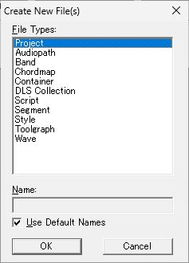
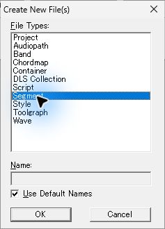
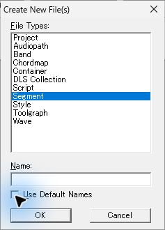
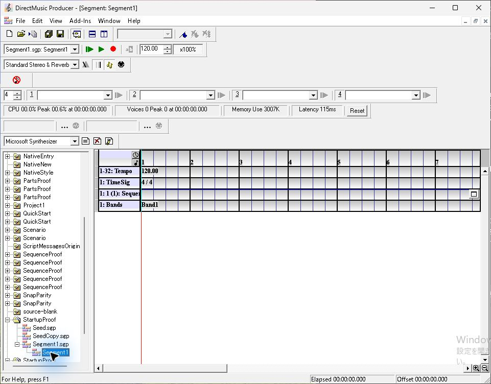
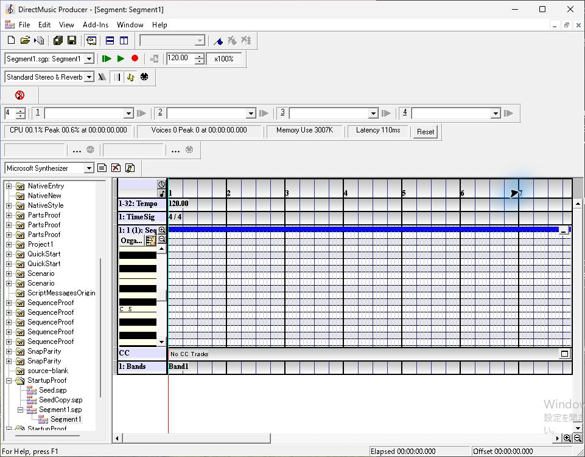
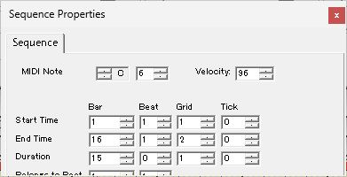

# 原版 GUI の初回観測

[調査計画](README.md)へ戻る。2026-11-11 に新規作成ダイアログを実測した。Segment の編集画面については、同じ原版の過去観測から撮影状態の例を収録した。

## SEG-01 予備観測　Create New File(s)

対象はインストール済み DirectMusic Producer 5.3.0.900。実行パスは `C:\Program Files (x86)\Microsoft DirectMusic Producer\DMUSProd.exe`。起動時の登録処理修正後の SHA-256 は `b39f9df92beef9fe455dca01ec19c357ae2da39a95989dcafc18db2280e71a0c`。実行中 PID 19376、対象の主ウィンドウは 1109×731、以下の独立ダイアログ画像は各237×330。寸法は撮影ツールの返した値。DPI とモニター全体寸法は次回採取する。

| 操作 | 観測結果 |
| --- | --- |
| Ctrl+N | `Create New File(s)` が開く。11種類の一覧の先頭 `Project` が選択され、`Use Default Names` にチェックが入っている。 `Name:` は灰色 |
| 一覧の Segment をクリック | 選択の青い帯が Segment 行へ移る。チェックと灰色の名前欄は維持される |
| Use Default Names をクリック | チェックが外れ、名前欄が白くなる。UIA で Name の編集コントロールが入力可能と表示された |
| Esc | ダイアログが閉じ、主ウィンドウの作業領域にフォーカスが戻った。作成の確定や保存は行っていない |

**Ctrl+N 直後。** 一覧の上端に Project の青い選択表示。名前欄の下に既定名のチェックボックス、その下に OK と Cancel が横並び。

**Segment 選択後。** Project の青い選択表示が消え、Segment 行が青くなる。マウス付近の青い光は操作ツールの強調表示。

**既定名を外した後。** 空の名前欄が入力可能になる。選択は Segment のまま。

今回、作業用コピーのパスで起動を要求したところ、インストール済み版のプロセスを確認した。続けて作業用コピーを絶対パスで起動した際も、コピーの編集ウィンドウは取得できなかった。コピー側の継続調査は、既存セッションと対象が重ならない状態で実行パスを再照合してから行う。今回保存した画像はダイアログ部分の取得画像。Length と Add New Tracks は次のケースで撮影する。

## SEG-02・06・07 の参考画像　過去の原版観測

2026-11-10 の [正式原版 Sequence 同入力比較](../ui-sequence-original-2026-11-10.md) より。原版 EXE SHA-256 は `fad2eec4d5dacd3bfd67694ea63ca169517902b73e30d283998cf7726e41c011`。観測環境は 1280×800・96 DPI。過去の一次記録から、埋め込まれた JPEG をそのまま抽出した。

**Segment を開いた状態。** 左に Project ツリー、上に Transport などのツールバー、右に時間ルーラーとトラック一覧。左列にグループとトラック名、時間軸側に Tempo 120.00、Time Sig 4/4、Band1 が表示される。Sequence は一行に収まり、行の右端に開閉ボタンがある。下端に横スクロールバーとズームボタンが見える。

**Sequence 展開後。** 一行だった Sequence が下へ広がり、左に鍵盤と Part の縦ズーム操作、右にピアノロール、下端に `No CC Tracks` のレーンが出る。Bands は展開領域の下へ移る。時間ルーラーとトラック名の列は同じ位置にある。

**ノート選択後の Sequence Properties。** MIDI Note と Velocity、Start Time・End Time・Duration が、Bar/Beat/Grid/Tick の列で表示される。画像の下端が切れているため、下の項目は [元の操作報告](../ui-sequence-original-2026-11-10.md) を参照し、項目全体とフォーカス順を SEG-07 で撮り直す。

## 画像の来歴

| ファイル | 元の記録 | 画像 SHA-256 |
| --- | --- | --- |
| `pilot-new-files-project.jpg` | 2026-11-11、Ctrl+N 後のダイアログ画像 | `f99f02c8ddcac488958d5dcd05805207ff0d1f47ef09b6cc489ff0dcfb00d22d` |
| `pilot-new-files-segment.jpg` | 2026-11-11、Segment 選択後 | `b16edfec75359485f23128a0ae35fd13ce36ff17be41b9ad992c816172e24650` |
| `pilot-new-files-custom-name.jpg` | 2026-11-11、Use Default Names 解除後 | `0b65deff4756d40f28bca78f5657a992b8194cdc8d15286079443f73f523c812` |
| `archive-segment-open.jpg` | [013-original-own-segment-open.json](../../../../../work/analysis/ui-sequence-original/20261109T150614000Z/013-original-own-segment-open.json)、961×752 | `d36d83e6942c5ed01e450b5b181d8c1675ff69fc6635dca70d631a75c71ea015` |
| `archive-sequence-expanded.jpg` | [014-original-sequence-expand.json](../../../../../work/analysis/ui-sequence-original/20261109T150614000Z/014-original-sequence-expand.json)、961×752 | `0c3ee47db3d4587cfffb636b595d5132719d6bed1c8277741eb1a08219e61791` |
| `archive-note-properties.jpg` | [019-original-note-properties.json](../../../../../work/analysis/ui-sequence-original/20261109T150614000Z/019-original-note-properties.json)、391×200 | `c656e1fc803a0caeafc7aee036c62424e34fb6e1abff5b9ed4497b422687bc79` |
