# SEG-01　Project と Segment の作成

[調査計画](README.md) · [同じ入力での表示範囲と文書切替](seg-02-03-viewport.md)

2026-11-11 に DirectMusic Producer 5.3.0.900 の調査用コピーで観測した。Windows 11 10.0.26200、1280×800、96 DPI。通常時の本体画像は 946×536、最大化時は 1280×752。撮影時にポインターの周りに出る青色は操作ツールによる強調表示。

既存の起動修正とローカル INI に加え、調査コピーだけで単一起動チェックの呼び出し（RVA `0x2404f`）を成功値に置き換えた。撮影ツールが同名のコピーをインストール済み版として扱ったため、実行名を `DmusGuiResearch.exe` として起動し、PID 2676・実行パス・対象ウィンドウを照合した。EXE SHA-256 は `c330bb2ca2c885f4157ec9dce060f64957e33e88192b6547630c2db5f1a65a22`。起動時の別インスタンス検出は、未改造版で調べる対象に含める。[実行記録](../../../work/original-gui/SEG-01/20261110T235055790894Z/run.json) · [表示条件](../../../work/original-gui/SEG-01/20261110T235055790894Z/environment.json) · [画像原本と対応表](../../../work/original-gui/SEG-01/20261110T235055790894Z/published-images.json)

## 1. 専用の Project を作る

1. 空の作業領域で Ctrl+N を押す。Create New File(s) で `Project` が青く選択され、`Use Default Names` がオン。
2. OK で New Project を開く。この環境では `Project2` が名前欄に選択表示され、下に `Location` と参照ボタンがある。
3. Location 欄をクリックし、Home、Shift+End で元の文字列全体を選択して、今回の `session/Project2` の絶対パスを入力する。欄の読戻しが一致してから OK。ツリーに黄色の Project2 フォルダーが1件表示され、右側は空のまま。

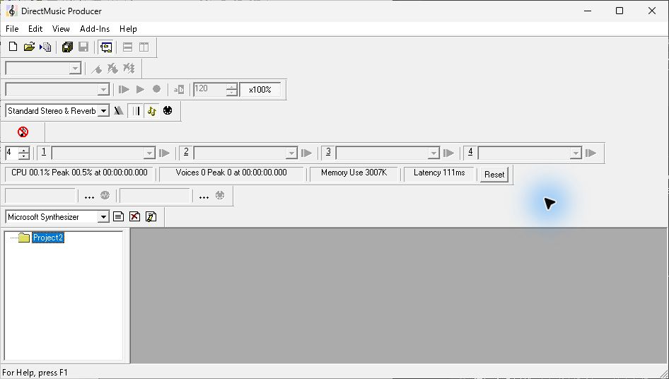

## 2. Segment Length を切り替えて取り消す

Project2 が選択された状態から Ctrl+N を押し、`Segment` を選択する。既定名がオンのまま OK を押す。

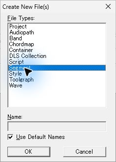

`Segment Length` が開く。背後に `Segment1.sgp` と `Segment1` がツリーに追加され、子ウィンドウは白い作業領域を表示する。ダイアログの `Number Measures` が選択され、Measures は 20、右側に `( 0:40.000 )` が表示される。Clocktime の 0分・40秒・0ミリ秒は灰色。下部に Extension bars 0 と、オフの Display pick-up bar がある。

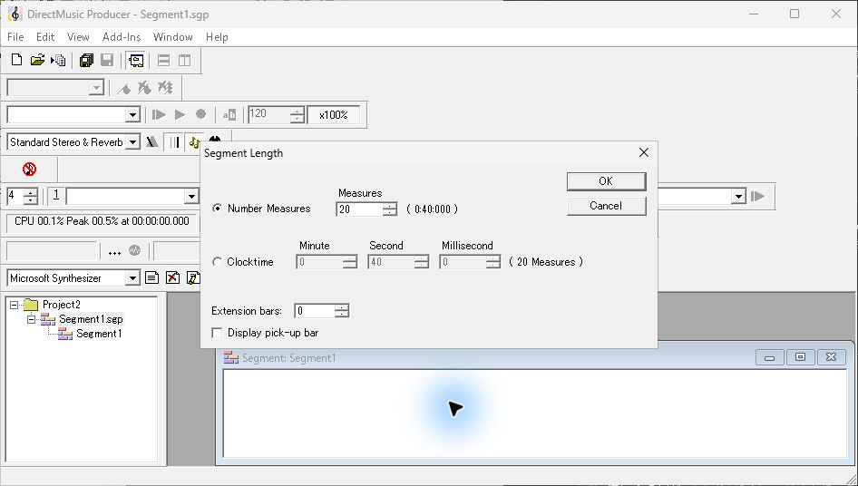

`Clocktime` をクリックすると、Measures は灰色になり、分・秒・ミリ秒の欄が操作可能になる。右側に `( 20 Measures )` が表示される。

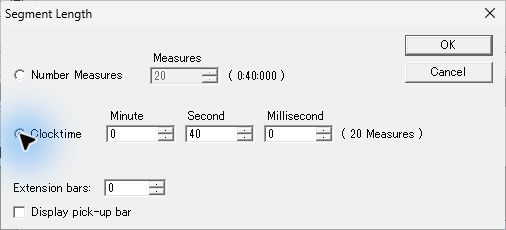

`Cancel` で Length を閉じると、Segment1 はツリーに残ったまま `Segment1 - Add New Tracks` に進む。背後では 4/4 の TimeSig ストリップが表示される。保存値から 61440 clocks（4/4 の20小節）の維持を確認した。

## 3. Add New Tracks の選択と取り消し

初期選択は先頭の Band Track。右に OK と Cancel が縦に並ぶ。一覧には次の17種類が上から表示される。

| 順位 | 表示名 |
| --- | --- |
| 1〜5 | Band Track、Chord Track、Chordmap Track、Groove Track、Lyric Track |
| 6〜10 | Marker Track、Mute Track、Parameter Control Track、Pattern Track、Script Track |
| 11〜15 | Segment Trigger Track、Sequence Track、Signpost Track、Style Track、Tempo Track |
| 16〜17 | TimeSig Track、Wave Track |

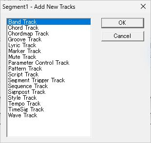

Band Track をクリックしてから Ctrl+Space を押した回では、青い選択が残った。続けて Shift+↓ を押すと、Band と隣の Chord の2行が青くなった。

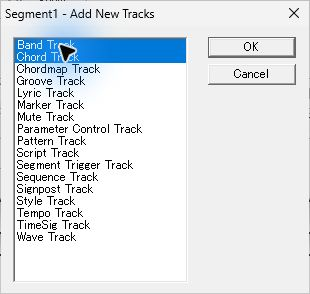

ここで Cancel をクリックすると、Segment1 は開いたまま追加の2行は作られず、初期 TimeSig 4/4 の1行が残った。ツリーは Project2 → Segment1.sgp → Segment1。上の Transport の対象は `Segment1.sgp: Segment1` に切り替わる。

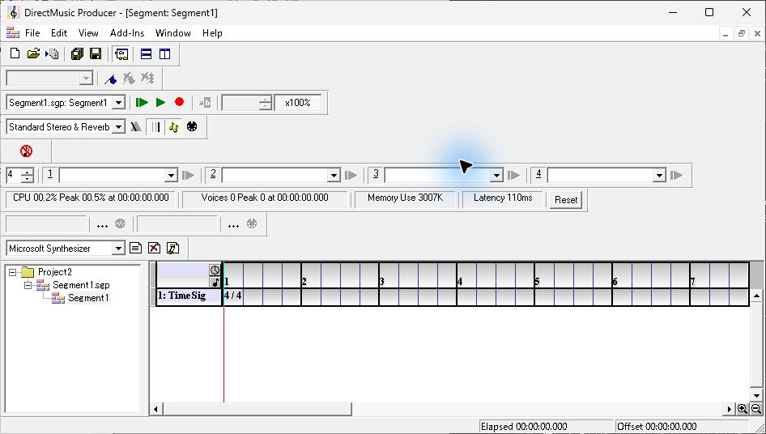

## 4. 既存の Segment へ Sequence Track を追加する

TimeSig のヘッダーを右クリックする。この時点では `Add Track(s)...`（Ctrl+Insert）、`Delete Track(s)`、`Properties`（F11）などが表示される。Cut/Copy/Paste、Insert、Delete は灰色。選択されたストリップの時間領域は薄黄色になる。

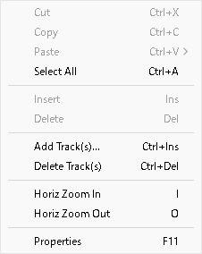

`Add Track(s)...` から開き直すと Band が初期選択。Sequence Track の行を修飾キーなしでクリックすると、青い選択が Sequence の1行だけに移る。OK で TimeSig の下に折りたたまれた Sequence が追加される。ヘッダーの長い文字列は固定幅で切り詰められ、時間領域の右端に四角い開閉ボタンが現れる。

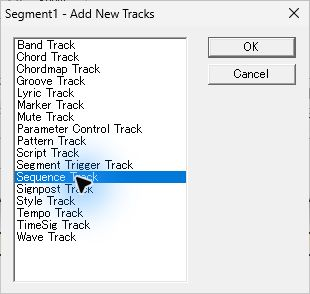

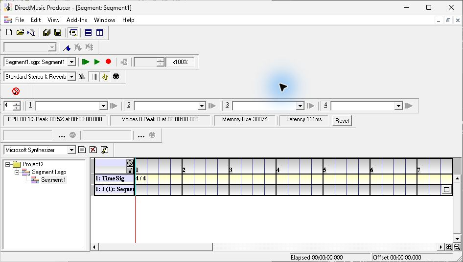

## 5. 長さと初期トラックを確定する

同じ Project2 で Segment をもう1件作る。Segment2 の Length は再び20小節。Measures の上矢印を1回クリックすると 21 になり、右の換算表示は `0:42.000` に変わった。

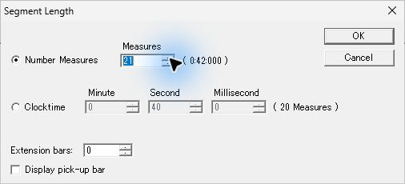

Length を OK で確定し、続く Add New Tracks でも初期選択の Band を OK で確定する。Segment2 には TimeSig 4/4 と空の `1: Bands` 行が表示された。タイトルと Transport 対象は Segment2 に切り替わり、左ツリーには Segment1 も残っている。

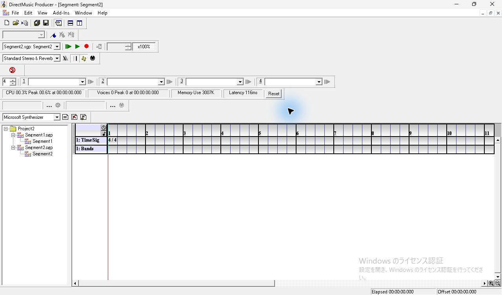

## 保存した入力と残りの確認

初期 Segment1 は Ctrl+S 後に固定し、その後の Sequence 追加で上書きされない場所へ退避した。両 Segment の保存後に File → Save Project Project2 を実行。次の調査では固定した入力から作業コピーを取る。

| 保存状態 | 観測したファイル内容 |
| --- | --- |
| TimeSig だけの Segment1 | 406 bytes、`segh` 61440 clocks、DMTK 1件の TIMS。先頭は4/4・4グリッド |
| Sequence 追加後の Segment1 | 632 bytes、61440 clocks、TIMS と `seqt` |
| Band 追加後の Segment2 | 486 bytes、64512 clocks、TIMS と DMBT |
| Project2.pro | Segment1.sgp と Segment2.sgp の参照を保存 |

[TimeSig だけの保存記録](../../../work/original-gui/SEG-01/20261110T235055790894Z/inputs/initial-timesig/manifest.json) · [2文書の保存記録](../../../work/original-gui/SEG-01/20261110T235055790894Z/inputs/sequence-and-band/manifest.json)

未観測の分岐は、作成の別入口、複数ファイル種別と指定名による確定、空選択でのトラック追加、Length の最小・最大と不正値、Extension bars と pick-up、Clocktime の値変更を確定したときの保存結果。
