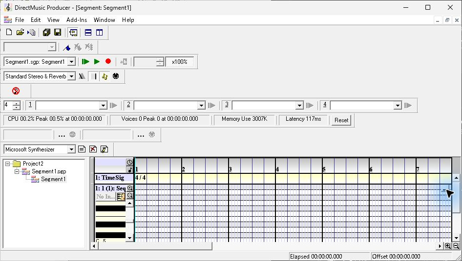
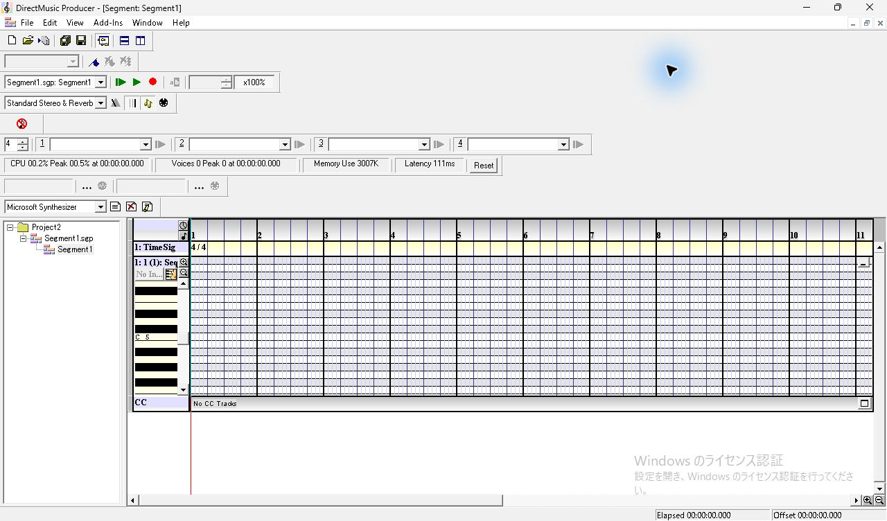
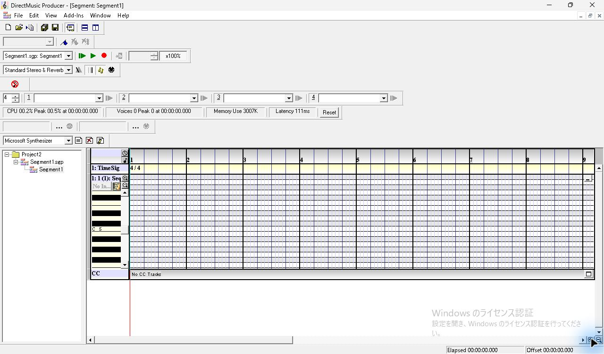
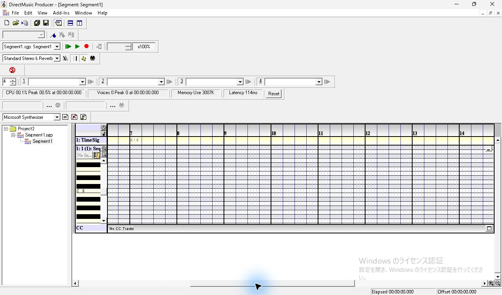
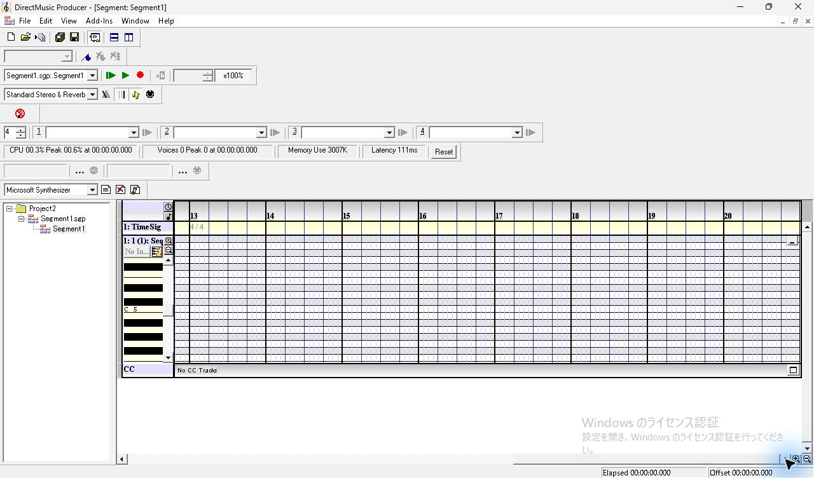
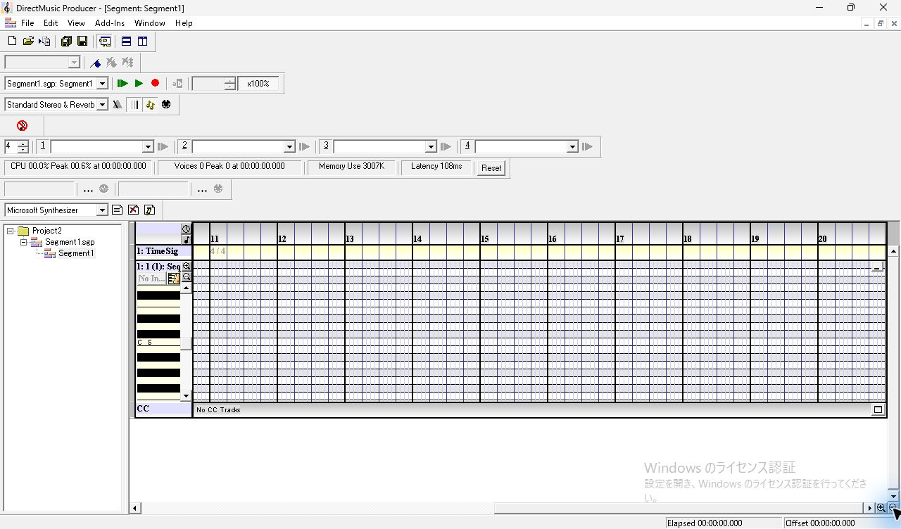
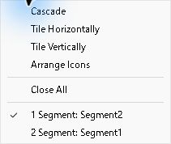
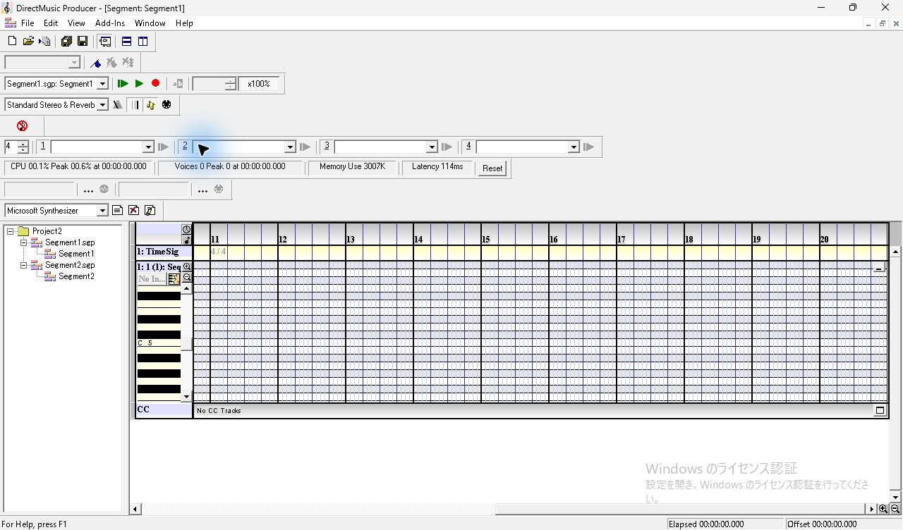

# SEG-02・03　Sequence 展開、横表示範囲と文書切替

[調査計画](README.md) · [入力と作成手順](seg-01-creation.md)

[SEG-01 の調査用コピー](../../../work/original-gui/SEG-01/20261110T235055790894Z/run.json) で作成した Project2 を使用。Windows 11、1280×800、96 DPI。通常時の本体画像は946×536、最大化時は1280×752で、最大化時のクライアント領域は1280×709。画像は撮影時の JPEG を使用しており、マウスポインターの青い強調と Windows の透かしを含む。[表示条件](../../../work/original-gui/SEG-01/20261110T235055790894Z/environment.json) · [画像原本と対応表](../../../work/original-gui/SEG-01/20261110T235055790894Z/published-images.json)

## 1. Sequence の展開と最大化

Segment1 に Sequence Track を追加した直後に、行の右端にある四角いボタンをクリックする。Sequence が縦方向に広がり、固定の左列に鍵盤と縦ズーム、時間領域にピアノロールが出る。通常サイズでは鍵盤とグリッドが途中まで見え、下は画面端に隠れる。Timeline の右には縦スクロールバーがある。

本体の最大化をクリック。左のツリーとヘッダー列はそのままで、右と下の表示範囲が広がる。ピアノロールの下に `CC` と `No CC Tracks` の行、下端に横スクロールバーと拡大・縮小ボタンが見える。1小節幅は約96ピクセルで、ルーラーに1〜11の番号が表示される。

## 2. 横ズームとスクロール

| 操作 | 観測した変化 |
| --- | --- |
| 右下の虫眼鏡の + を1回クリック | 左端は1小節目のまま、1小節幅は約96 pxから120 px。右端に見える小節番号は11から9に変わる |
| 横スクロールのつまみを右へ284 pxドラッグ | ルーラーとグリッドだけが横移動し、7が最初に見える小節番号になる。左側のトラック名と鍵盤は固定。7の先頭に薄い `4/4` が出る |
| さらに右端までドラッグ | 13〜20が表示され、20小節の終端が表示領域の右端に来る。先頭側の拍子表示は13の位置に出る |
| 右端のまま虫眼鏡の − を1回クリック | 小節幅は約96 pxに戻り、右端には引き続き20小節の終端が表示される。左側は11から見える |

**ズームイン。** 1と2の間隔が広がる。鍵盤の縦方向の表示は同じ。

**途中までスクロール。** ヘッダーと鍵盤は動かず、時間軸側だけが移動した。

**右端。** 20小節の終端が見える。

**右端からズームアウト。** 20小節の終端を表示したまま、左側に見える範囲が広がる。

## 3. 2文書を開いたまま切り替える

Segment1 を右端にスクロールしておいた状態で、Segment2 を作成する。Segment2 は1小節目を左に表示し、Transport の対象も Segment2 になる。Window メニューを開くと2文書が列挙され、アクティブな Segment2 の左にチェックがある。

メニューから Segment1 を選ぶと、タイトルと Transport が Segment1 に戻る。Sequence は展開されたままで、横表示も11〜20小節のまま。操作直後は UIA のフォーカス情報に直前の Segment2 が残ったが、画面表示と続く観測で Segment1 への切替を確認した。

この観測で確認したのは同一プロセス内の文書切替。別プロセスでの再読込、子ウィンドウ自体の移動とリサイズ、Tile/Cascade、スクロール中のドラッグポインター、ズーム最小・最大、複数拍子の境界は継続して調べる。
