# SEG-02　子ウィンドウの整列・移動・サイズ変更

[調査計画](README.md) · [前回の表示範囲と文書切替](seg-02-03-viewport.md)

2026-11-11。調査用原版コピー PID 2676、Windows 11 10.0.26200、1280×800、96 DPI。親ウィンドウは最大化したまま。入力は [固定した Project2 と2文書](../../../work/original-gui/SEG-01/20261110T235055790894Z/inputs/sequence-and-band/manifest.json)。Segment1 は Sequence 展開・11〜20小節表示、Segment2 は Bands 行を持つ。画像は [撮影原本と対応表](../../../work/original-gui/SEG-01/20261110T235055790894Z/mdi-properties-reopen-images.json) に対応する。

## 整列

親の Window メニューから操作する。子が最大化されているときは親のタイトルに `[Segment: Segment1]` が付き、メニュー行の右端に子の最小化・復元・閉じるボタンが並ぶ。子が通常状態になると親のタイトルは `Segment1.sgp` を表示し、子のタイトルバーが作業領域内に出る。

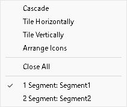

**Tile Horizontally。** Segment1 が上、Segment2 が下に並んだ。横幅は各ウィンドウが作業領域を使い、上側ではピアノロールの下部が隠れる。ツリーとツールバーの配置は維持される。

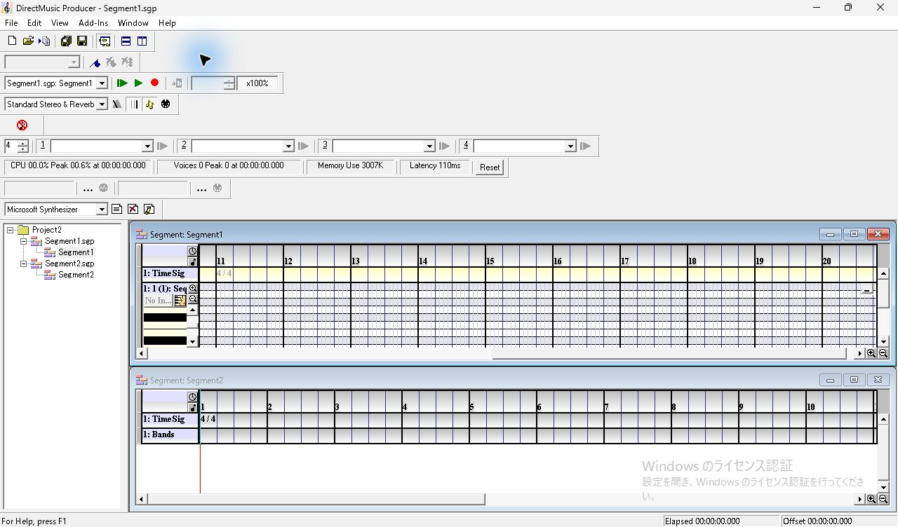

**Tile Vertically。** Segment1 が左、Segment2 が右。左側では展開した Sequence と CC 行が見える。横に見える小節は減るが、左端側の番号は Segment1 が11、Segment2 が1のまま。

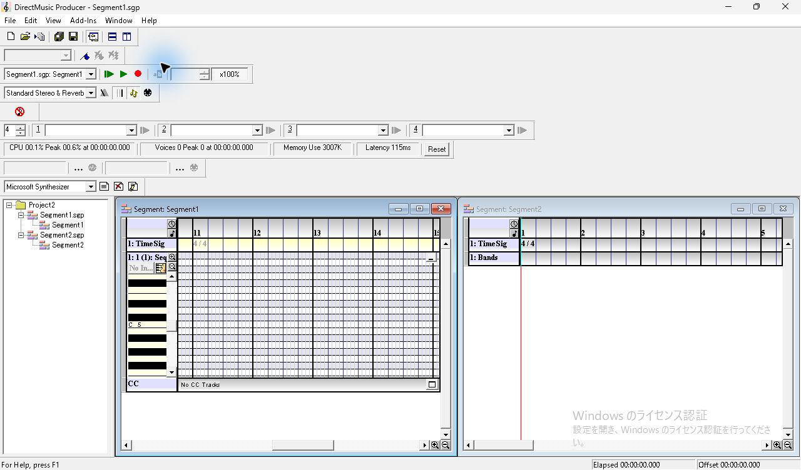

**Cascade。** Segment2 が背後、アクティブな Segment1 が右下にずれて前面に重なる。背後のタイトル文字と右上の操作ボタンは淡色。

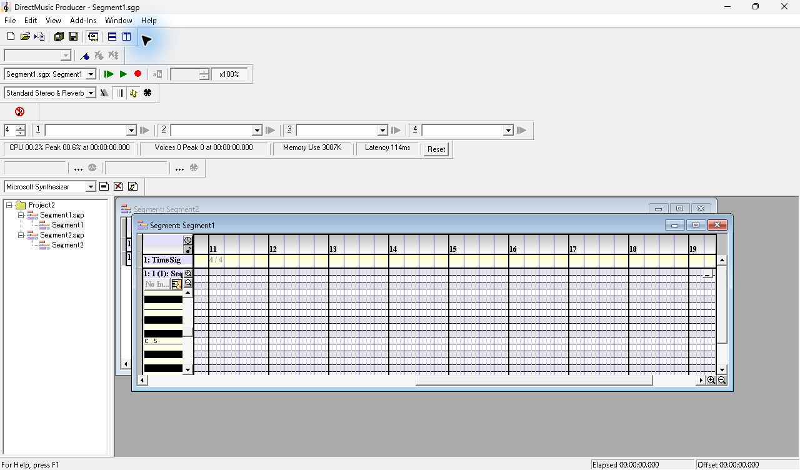

## 手動で移動・サイズ変更

1. Segment1 の子タイトルバーを作業領域内で79 px右、58 px下へドラッグした。ウィンドウ全体が移動し、背後の Segment2 の TimeSig と Bands が見える面積が増えた。
2. 外枠の下辺を61 px上へ動かすと高さだけが縮み、ピアノロールの下側が隠れた。右辺を230 px左へ動かすと幅だけが縮み、右端の小節番号が減った。
3. 右下角の外側で斜めにドラッグすると、幅と高さが同時に増えた。角の内側寄りからの最初の試行ではサイズ変化がなかった。確認できた変化は操作終了後の寸法と表示範囲。

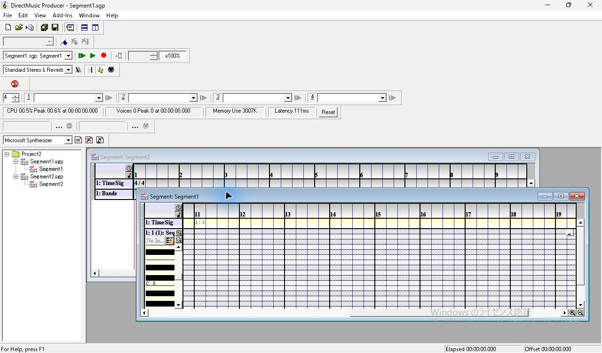

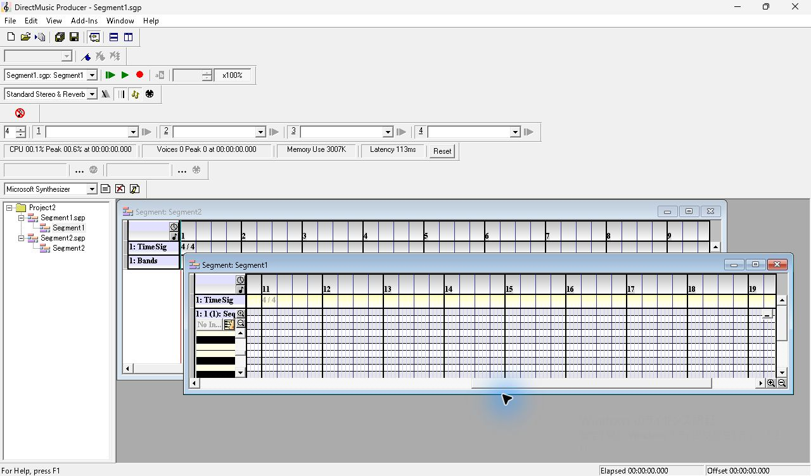

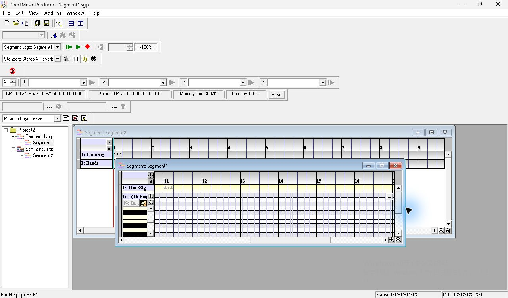

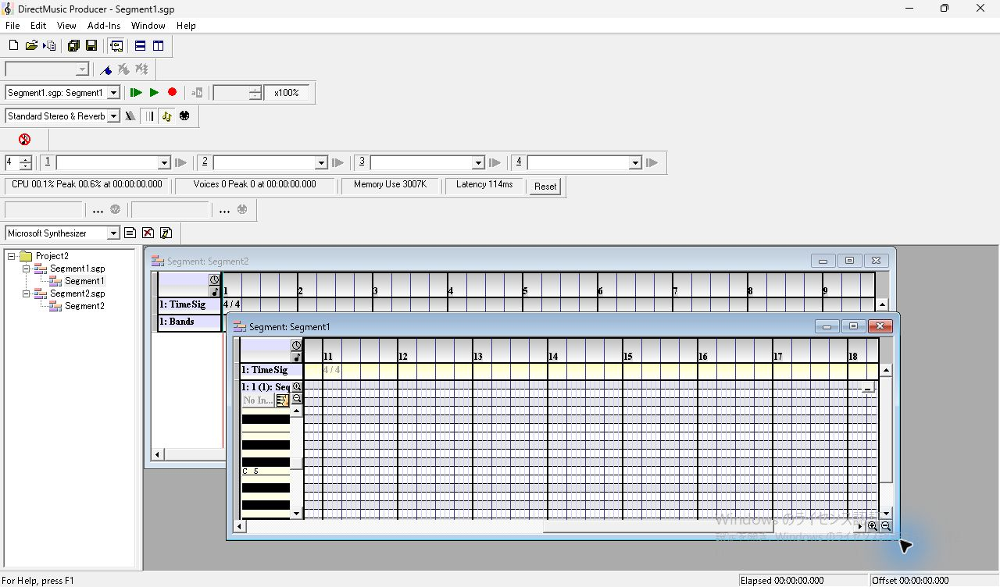

## 最小化・復元・子の最大化

Segment1 の子タイトルバーで最小化を押すと、作業領域左下に小さいタイトル枠が現れる。Segment2 がアクティブになり、親タイトルと Transport の対象も Segment2 に切り替わった。最小化した枠の復元ボタンで、Segment1 は直前の位置・大きさに戻り前面に出る。Sequence の展開と左端の横位置も維持された。

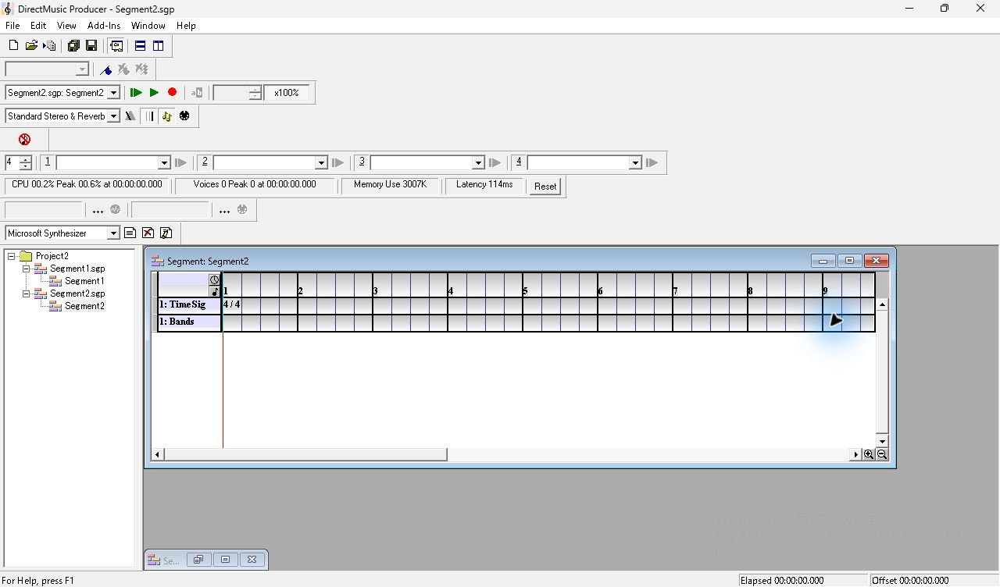

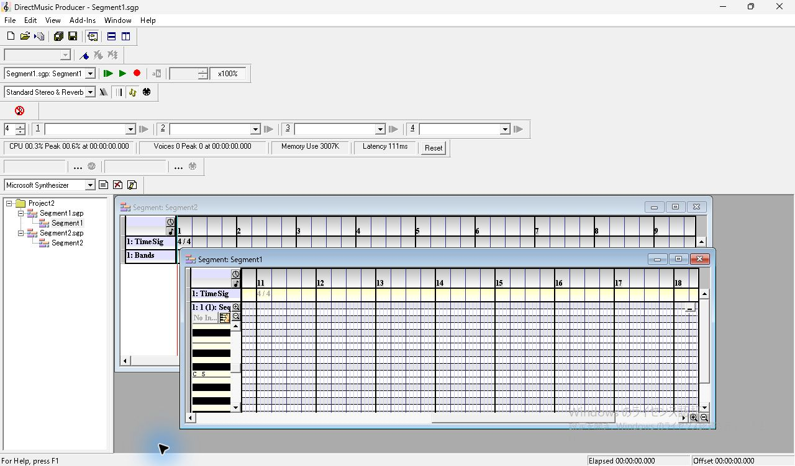

子の最大化ボタンを押すと、Segment1 が作業領域を占め、子の操作ボタンが親のメニュー行へ移る。左ツリーは引き続き表示される。

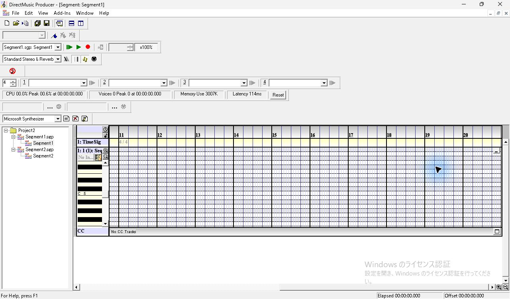

次の確認は、上辺・左辺・残りの角、最小寸法、移動できる端、ドラッグ中のポインター形状、複数の最小化ウィンドウの Arrange Icons、文書を閉じたときの切替とフォーカス。
