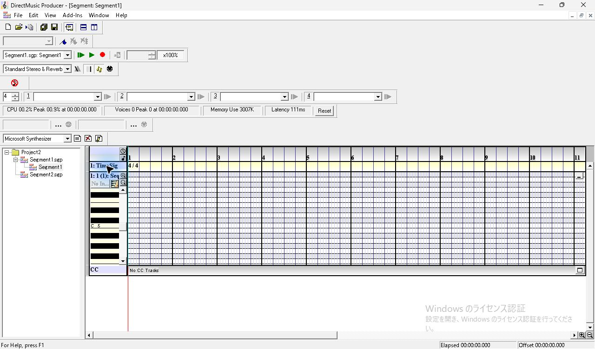
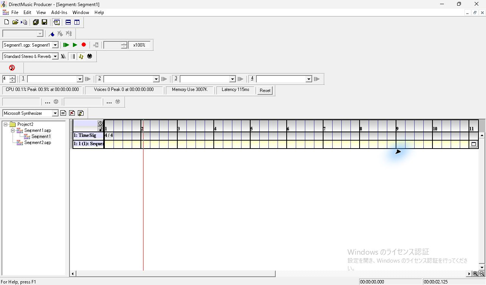
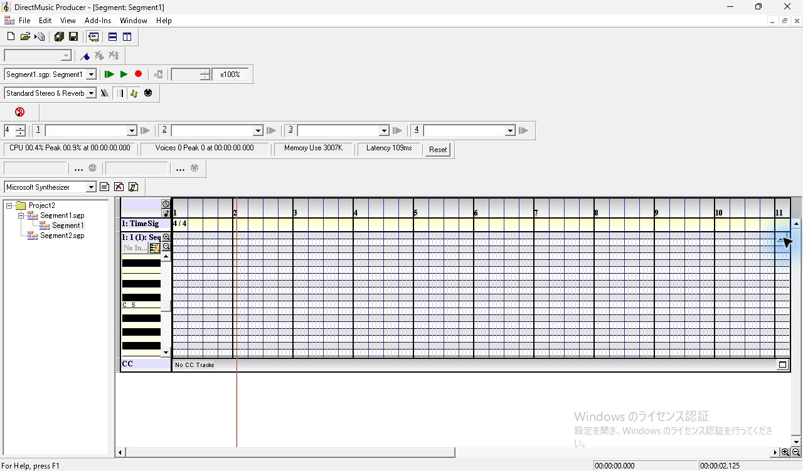
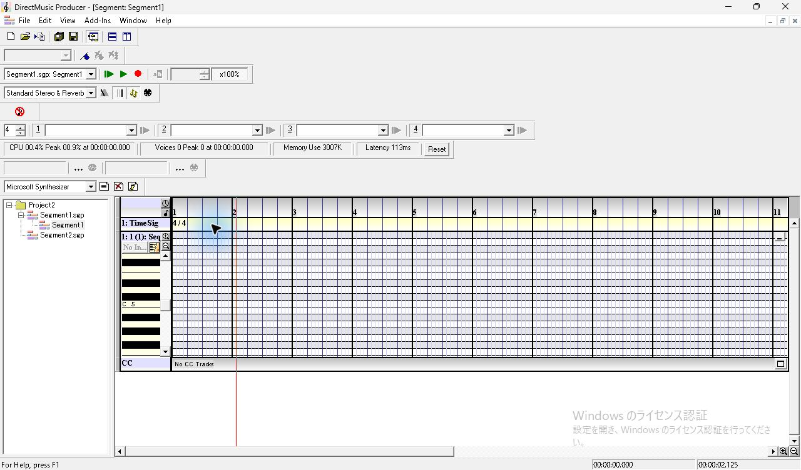
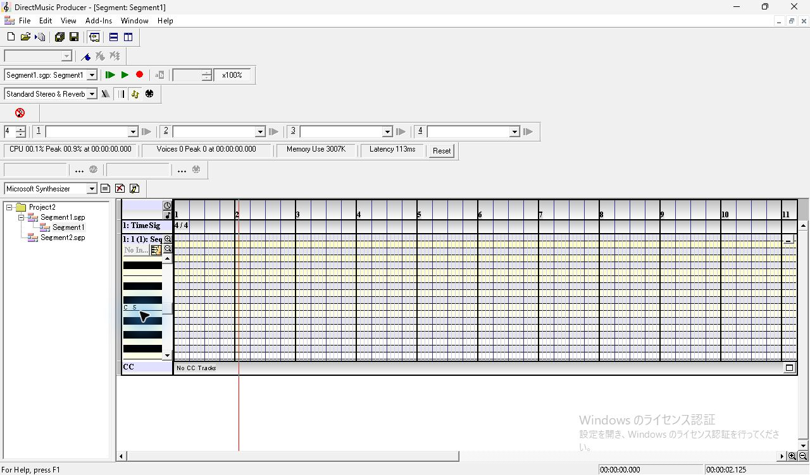
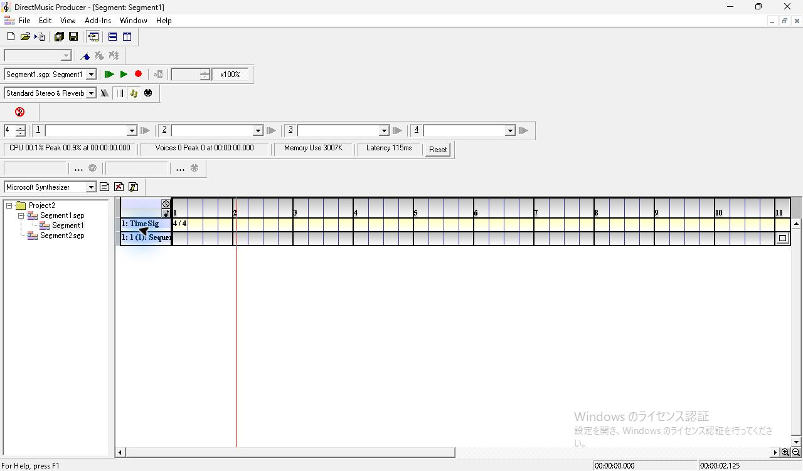

# SEG-04　トラックヘッダーと折りたたみ

[調査計画](README.md) · [選択とノート入力](seg-05-selection.md) · [貼付けと履歴](seg-05-clipboard-history.md)

2026-11-11。調査用原版コピー `DmusGuiSelection.exe`、PID 10752、Windows 11 10.0.26200、1280×800、96 DPI。親画面を最大化したときの撮影範囲は1280×752。前回の [固定入力](../../../work/original-gui/SEG-04-05/20261111T002154974839Z/inputs/manifest.json) を別の Project2 フォルダーへ複製した。Segment1 は TimeSig 4/4 と空の Sequence、Segment2 は TimeSig と空の Bands の保存ファイル。調査用 EXE の SHA-256 は `c330bb2ca2c885f4157ec9dce060f64957e33e88192b6547630c2db5f1a65a22`。起動修正、ローカル INI、単一起動チェックの差分は [前回の記録](seg-01-creation.md) と同じ。今回の実行ファイル名は、既存セッションと区別するために変更した。

[実行記録](../../../work/original-gui/SEG-04-05/20261111T002154974839Z/run.json) · [撮影環境](../../../work/original-gui/SEG-04-05/20261111T002154974839Z/environment.json) · [画像対応表](../../../work/original-gui/SEG-04-05/20261111T002154974839Z/published-images.json)

## トラック名の位置と選択表示

Timeline の左端にトラックのラベル、右側に同じ高さの時間領域が並ぶ。この入力では上から `1: TimeSig` と Sequence。Sequence のヘッダーには `1: 1 (1):` が見え、後ろの名前は欄の右端で切れる。TimeSig の名前をクリックすると、その時間領域に薄黄色の帯が出る。次の操作で確認したルーラーの黒い範囲や、ノート自体の赤い選択表示とは、場所も色も異なる。

## 開閉

Sequence の行の右端に小さな四角いボタンがある。展開時に押すと、鍵盤、ピアノロール、CC 行が隠れ、TimeSig の下に1行だけ残る。再度押すと、鍵盤と縦ズーム用の虫眼鏡、ピアノロール、`No CC Tracks` が同じ順序で戻る。今回の開閉の間、左に表示される小節は1のままだった。再展開後に小節2付近の赤い位置線も同じ横位置で表示された。

## 境界と並べ替えの試行

座標は最大化した本体画像の左上を原点とする。ここで確認したのはドラッグを離した後の状態。

| 操作 | 観測 |
| --- | --- |
| TimeSig 名の右端付近 (272, 358) → (337, 358) | ルーラーの範囲表示が消え、TimeSig 行が選択された。ヘッダーとグリッドの境界位置は維持 |
| Sequence と CC の境界付近 (220, 572) → (220, 492) | Sequence 行が選択された。鍵盤下端と CC 行の位置は維持 |
| 折りたたんだ Sequence 名を (220, 380) → (220, 354) | TimeSig の時間領域が薄黄色になった。TimeSig、Sequence の上下順は維持 |

ヘッダー幅、個別高さ、並べ替えについて、この座標からの試行では変更を観測できなかった。別のヒット領域、メニューからの変更、複数グループ、ドラッグ中とホバー時のポインターは継続して確認する。画面の青い強調表示は操作ツールによる。
