# SEG-05　ノートのコピー・切り取り・貼付けと編集履歴

[調査計画](README.md) · [選択と2音の作成](seg-05-selection.md)

2026-11-11、調査用原版コピー PID 10752。Segment1 の短い C5 と長い D5 を使った。撮影は1280×800、96 DPI。[撮影原本の対応表](../../../work/original-gui/SEG-04-05/20261111T002154974839Z/published-images.json) · [保存ファイルの比較](../../../work/original-gui/SEG-04-05/20261111T002154974839Z/saved-notes.json)

## Merge と元の2音

1. ピアノロールで Ctrl+A、Ctrl+C。4小節目の先頭付近の空セルをクリックする。元の2音は未選択の青になり、位置線が貼付け先に移る。
2. 貼付け先の右クリック → Paste で Merge と Overwrite が表示される。Merge を選ぶと元の2音は青のまま残り、貼り付いた2音が赤になる。ピッチと長さは維持。貼付け先の行の音高に置き換わる挙動はこの操作では見られなかった。

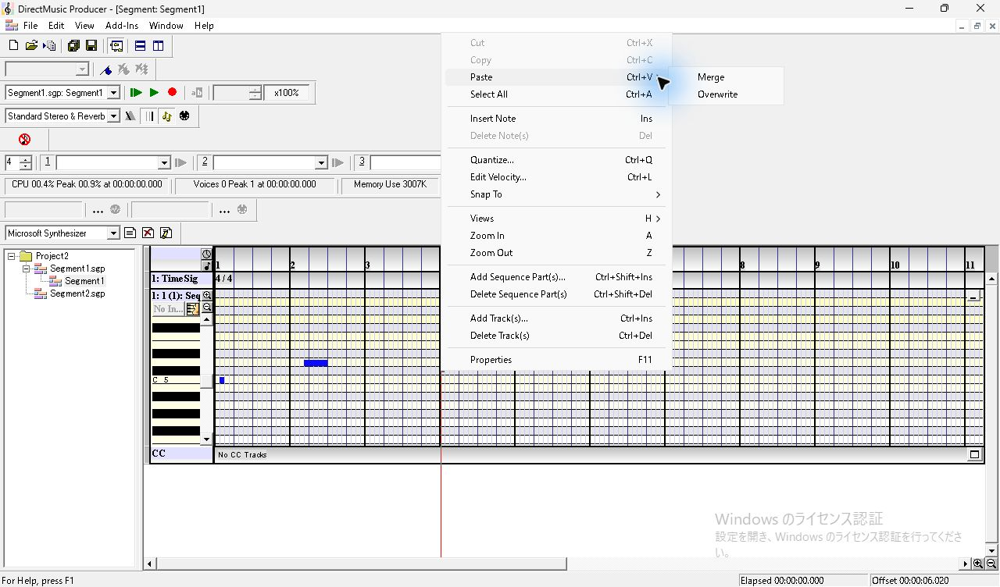

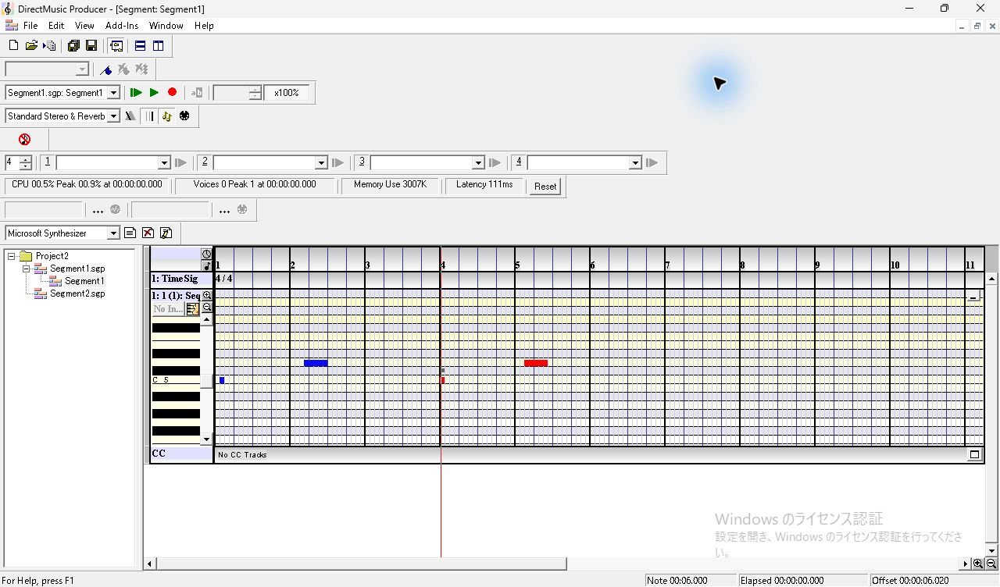

### Undo と Redo

Edit の操作名は `Undo Insert Sequence`。選択すると貼付けた2音が消え、元の2音は青いまま。続く Edit では `Redo Insert Sequence` が有効になり、その項目をクリックすると4音に戻る。再追加した2音は初回の貼付け直後と異なり青で、選択状態は戻らなかった。

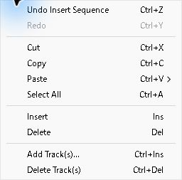

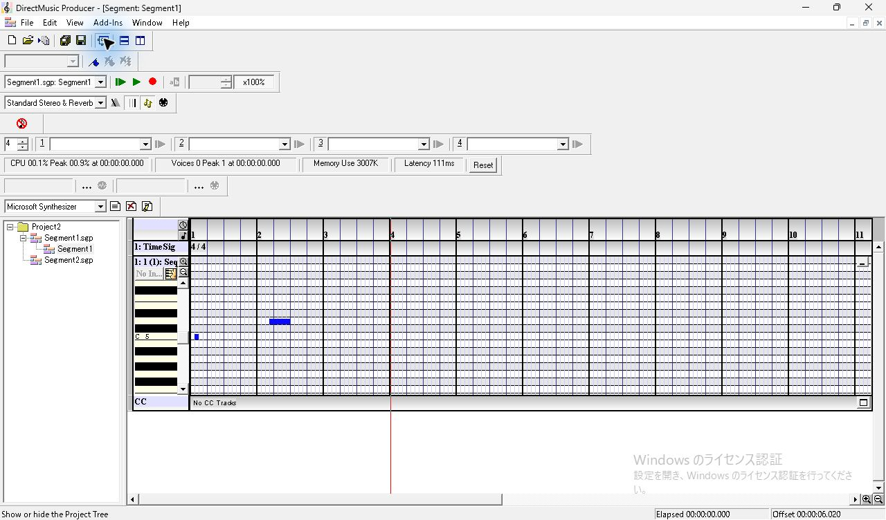

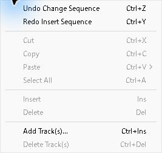

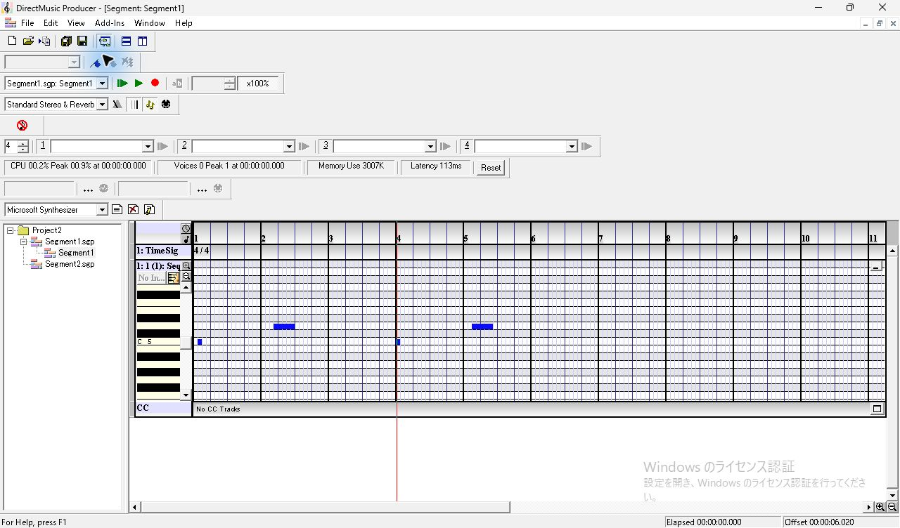

メニューを Esc で閉じた直後に Ctrl+Y を押した回は2音のままで、Redo の項目も残った。その後、Segment1 の空グリッドを明示的にクリックしてフォーカスを置いた回では、Ctrl+Z で2音、続く Ctrl+Y で4音に戻った。位置線は直前にクリックした場所に留まった。

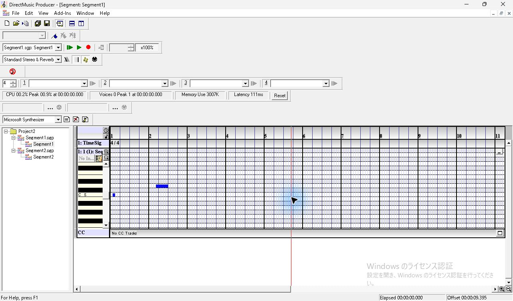

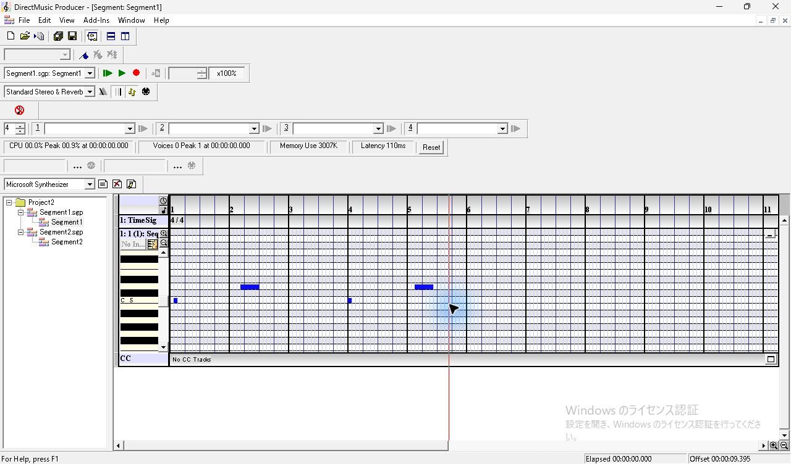

## 文書を切り替えたときの履歴

Segment1 の編集後、同じ Project2 の Segment2.sgp をダブルクリックした。保存された Segment2 には空の DMBT トラックがあるが、この再オープンでは `Segment2 - Add New Tracks` が出た。Cancel を押すと画面には TimeSig 4/4 だけが残った。操作後の Segment2 ファイルは元と全バイト一致。

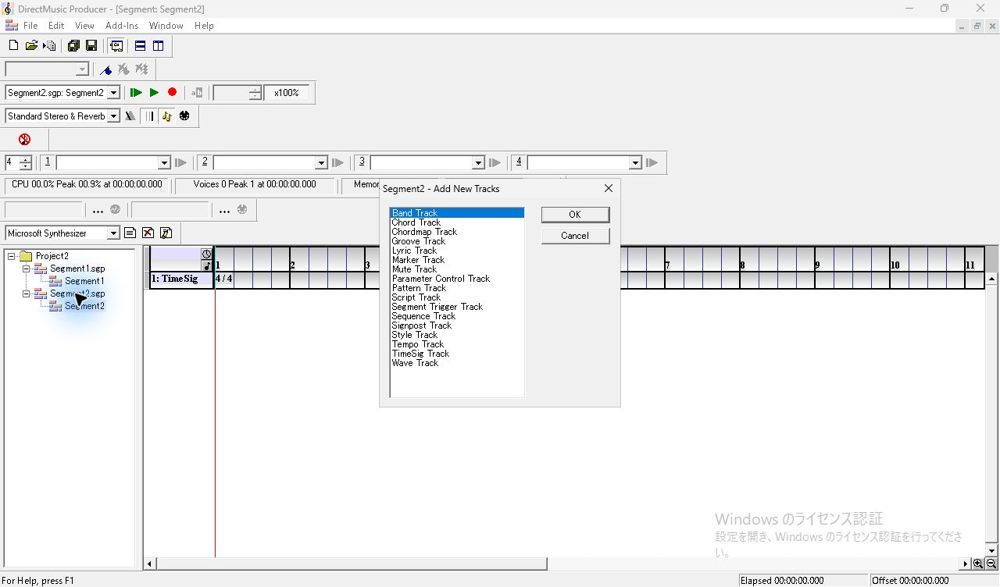

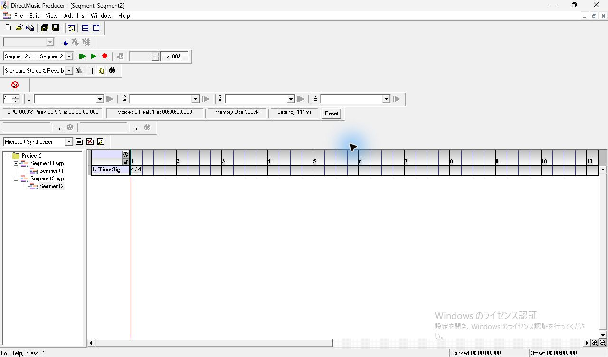

Segment2 の Edit は Undo と Redo が灰色。Edit を閉じた直後の Ctrl+Tab では画面切替を確認できなかった。Segment2 の TimeSig 行をクリックし Timeline にフォーカスを置いた後、Ctrl+Tab で Segment1 に戻り、4音が再表示された。

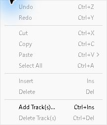

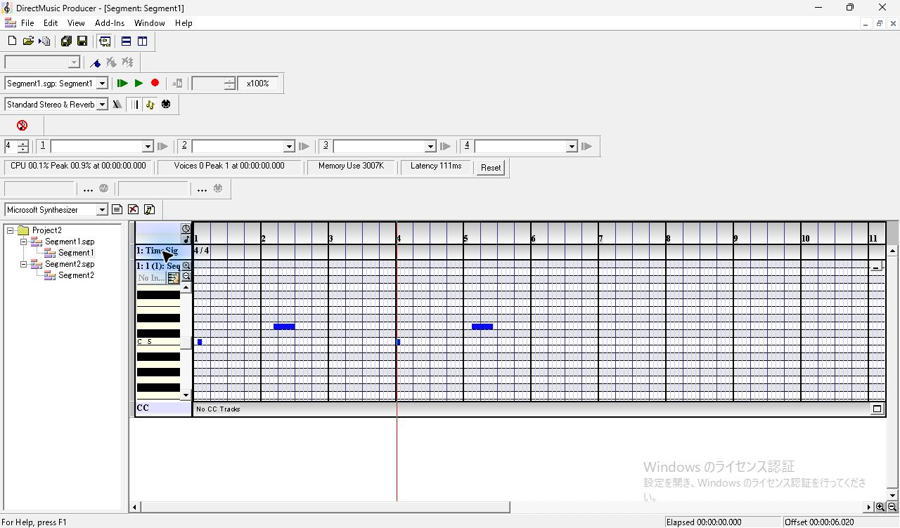

## 切り取りと Overwrite

4音のうち5小節目の長い D5 を単独選択し、Ctrl+X。D5 が消えて3音になる。先頭の C5 と同じグリッド位置で、別の音高の空セルをクリックし、右クリック → Paste → Overwrite。元の短い C5 が消え、その位置に長い D5 が赤で表示される。ほかの2音は維持された。

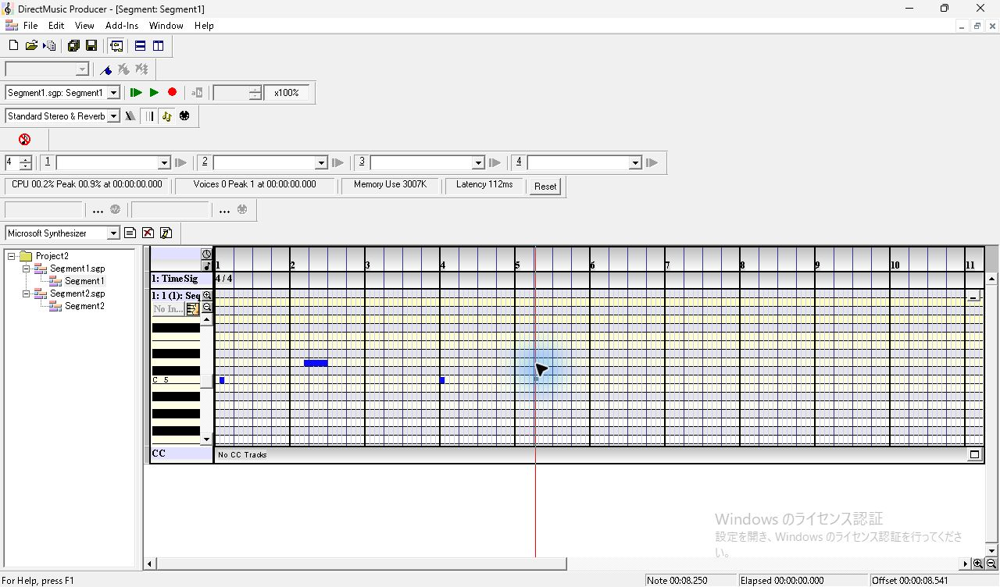

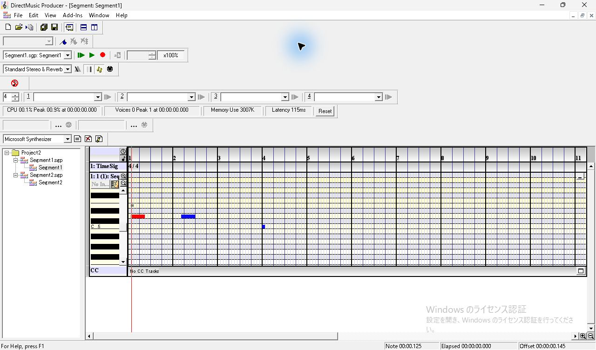

続けて Ctrl+Z を1回押すと Overwrite 前の3音へ戻り、もう1回で切り取った長音が戻る。試験の最後に Ctrl+S で4音の状態を保存した。

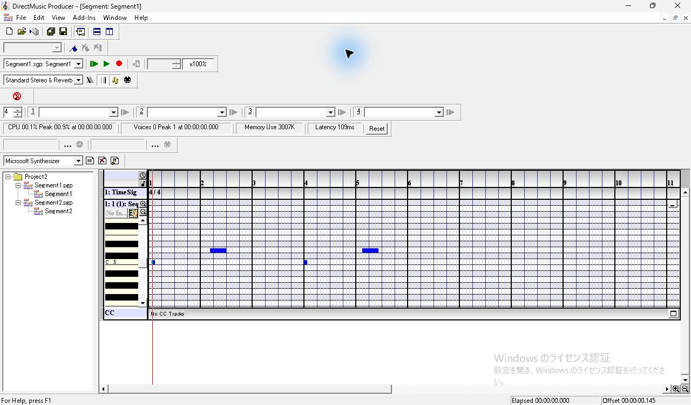

## 保存値の照合

開始は実際の再生時刻に相当する保存上の物理時刻（論理時刻＋オフセット）。単位は clocks。全音 Velocity 100、PChannel フィールド0。

| 保存した段階 | ノート（MIDI 番号 @ 開始 / 長さ） | ファイル比較 |
| --- | --- | --- |
| 貼付け前 | 60 @ 192 / 191、62 @ 3648 / 959 | 672 bytes |
| Merge 後 | 上の2音に、60 @ 9216 / 191 と 62 @ 12672 / 959 を追加 | 712 bytes |
| Merge の Undo 後 | 元の2音 | 貼付け前と全バイト一致 |
| Merge の Redo 後 | 4音 | Merge 後と全バイト一致 |
| Cut 後 | 62 @ 12672 / 959 が消える | 3音 |
| Overwrite 後 | 60 @ 192 / 191 が消え、62 @ 192 / 959 が入る | 保存値の論理時刻 −384、オフセット 576。ほかの2音は同じ |
| Overwrite と Cut を Undo 後 | 4音 | Merge 後と全バイト一致 |

確認した各段階で `guid`、`segh`、`tims`、`curl` は固定入力と一致。別文書 Segment2.sgp と Project2.pro の全バイトも固定入力と一致した。

残りは Delete キーの履歴、別トラック・別文書への貼付け、クリップの部分重複・終端、選択範囲と Overwrite の細かな消去範囲。
