# SEG-05　ルーラー・空グリッド・ノートの選択

[調査計画](README.md) · [トラックヘッダーと撮影条件](seg-04-track-headers.md) · [貼付けと履歴](seg-05-clipboard-history.md)

2026-11-11、PID 10752。作業用 Segment1 の先頭側で実施。TimeSig は4/4、横表示は約96 px/小節。操作ツールの青い光と、アプリ本体の選択色を区別する。[画像対応表](../../../work/original-gui/SEG-04-05/20261111T002154974839Z/published-images.json)

## クリックと範囲ドラッグ

| 入口 | 操作と観測 |
| --- | --- |
| トラック名 | TimeSig の名前で TimeSig 行が薄黄色になる |
| ルーラー | 3小節目後半付近をクリック。ルーラーの背景が薄黄色になり、位置線が移動。Offset は `00:00:05.000` |
| Sequence の空セル | 4小節目直後をクリック。ピアノロールが薄黄色になり、位置線が移動。Offset は `00:00:06.166`。ノートは作成されない |
| ルーラーの範囲 | 2小節目の先頭から4小節目の先頭へドラッグ。ルーラーの2〜3小節が黒く反転し、数字が白い。ピアノロールのセルは反転しない。Offset は範囲先頭側の `00:00:02.000` |
| ルーラーで Shift+右 | 黒い範囲の両端は同じ。位置線が右へ動き、Offset が `00:00:02.125` に変わる |

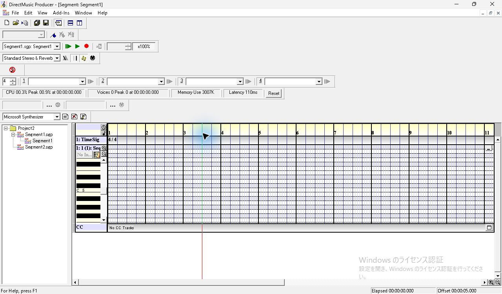

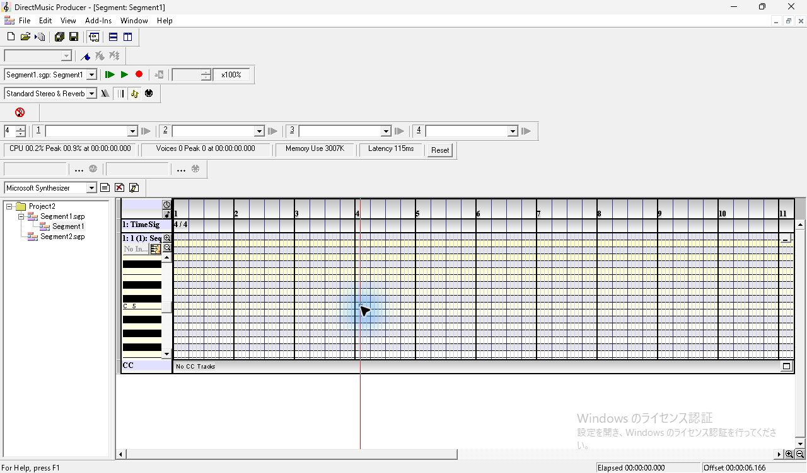

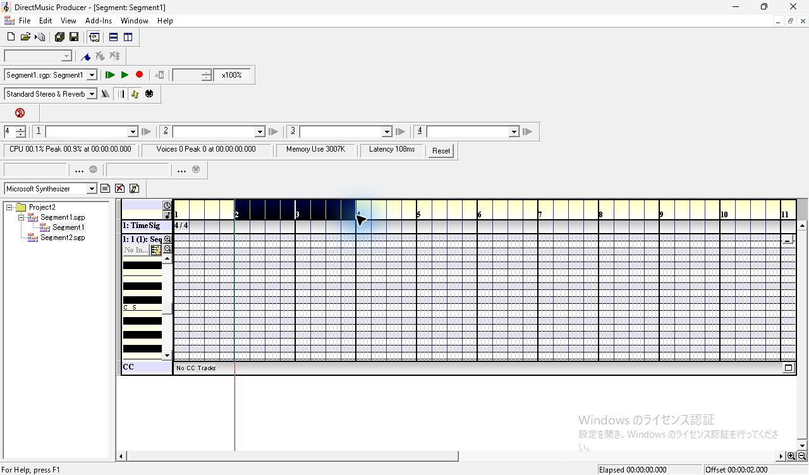

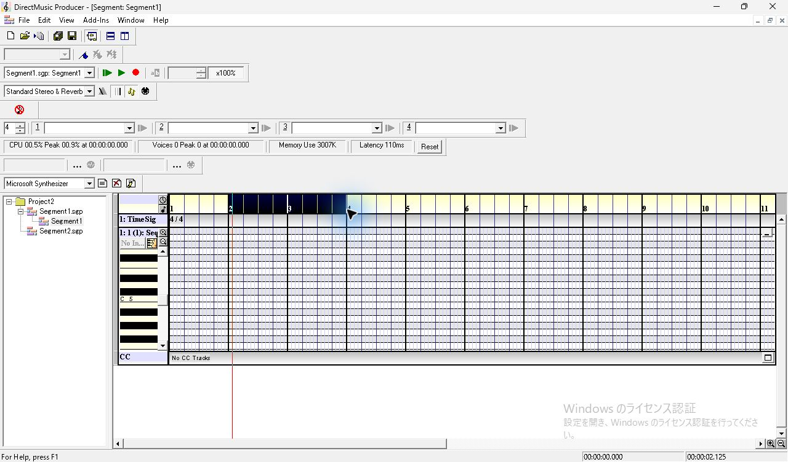

ノートがまだない空セルの右クリックでは、Cut、Copy、Paste、Select All、Delete Note(s) が灰色。Insert Note、Snap To、Views、Add Track(s) などは操作できる表示。

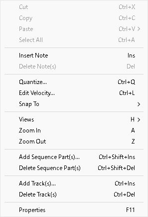

## 短音と長音を作る

1. C5 行の1小節目の先頭近くをクリックして Insert。F11 で `Sequence Properties` が開く。表示は C5、Velocity 100、Start 1:1:2:0、Duration 0:0:1:-1。
2. Properties を開いたまま2小節目の別の空セルをクリックすると、ノート選択が解除され、Properties はダッシュ表示・無効になる。
3. Insert で D5、Start 2:1:4:0 のノートを作る。Duration の Beat の上向きスピンを1回押して `0:1:1:-1` にする。End は2:3:1:-1。
4. Properties を閉じて Ctrl+S。[2音入り固定素材](../../../work/original-gui/SEG-04-05/20261111T002154974839Z/inputs/two-notes/manifest.json) として保存した。実際のノート開始時刻は192と3648 clocks、長さは191と959 clocks。MIDI ノート番号は60と62、Velocity は両方100。画面表記は C5 と D5。

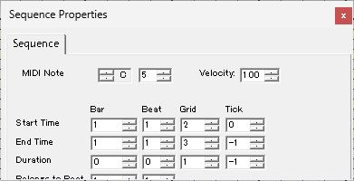

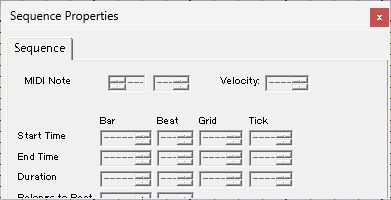

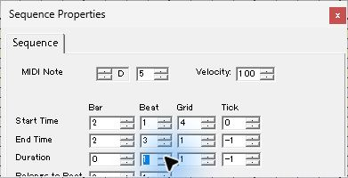

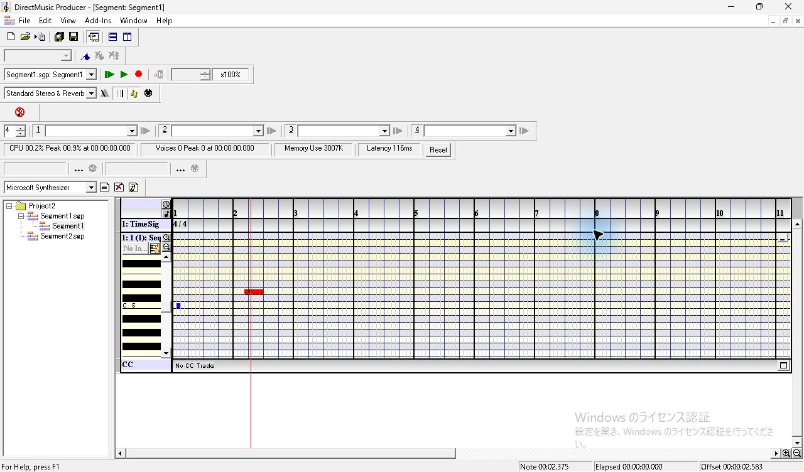

## 単独・矩形・全選択

| 操作 | 結果 |
| --- | --- |
| 空セルから2音を囲むようにドラッグ | 操作終了時に両方が赤になる。F11 の混在表示では音名、Start の Bar と Grid、Duration の Beat がダッシュ。共通するオクターブ5、Velocity 100、Start の Beat 1 と Tick 0 は表示される |
| 既に選択されている短音の中央付近をクリック | 今回の位置では両方の選択が続き、Properties の混在表示も維持 |
| 空セルをクリックした後、未選択の長音の中央をクリック | 長音だけ赤、短音は青。Properties は D5 の値を表示 |
| 長音を選んで右クリック | Cut、Copy、Select All、Delete Note(s) が有効。Paste はこの時点で灰色 |
| メニューを閉じ、ピアノロールで Ctrl+A | 両方が赤になる。クリック位置の縦線は移動しない |

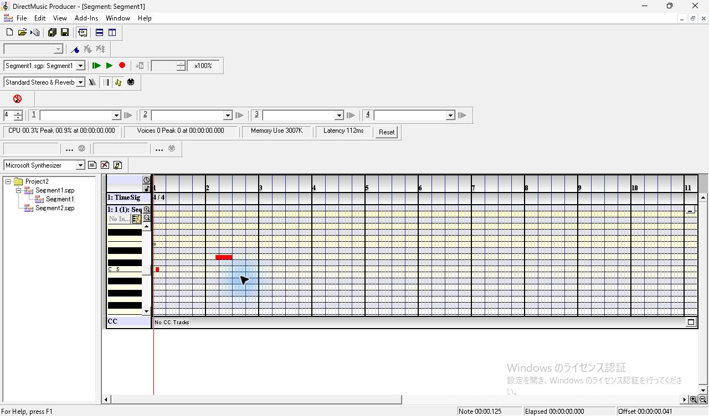

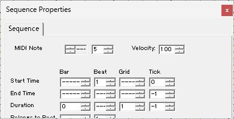

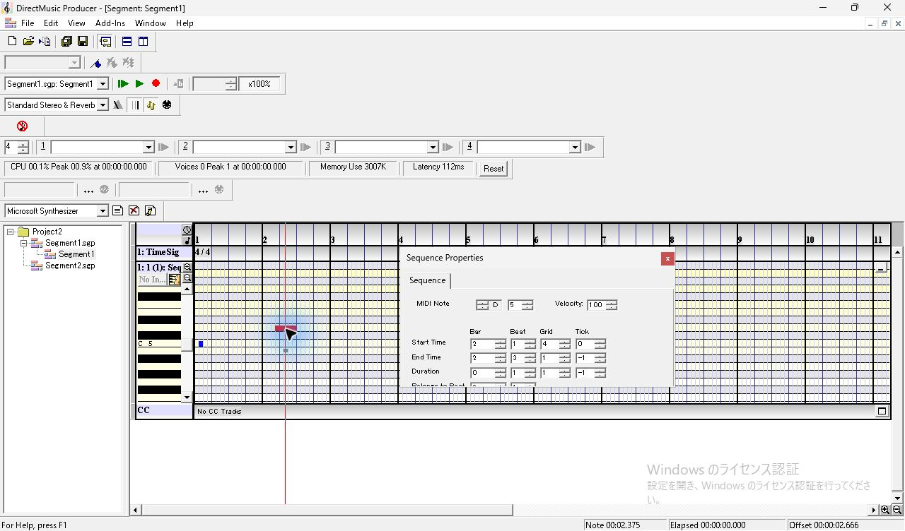

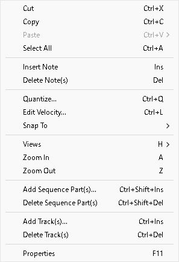

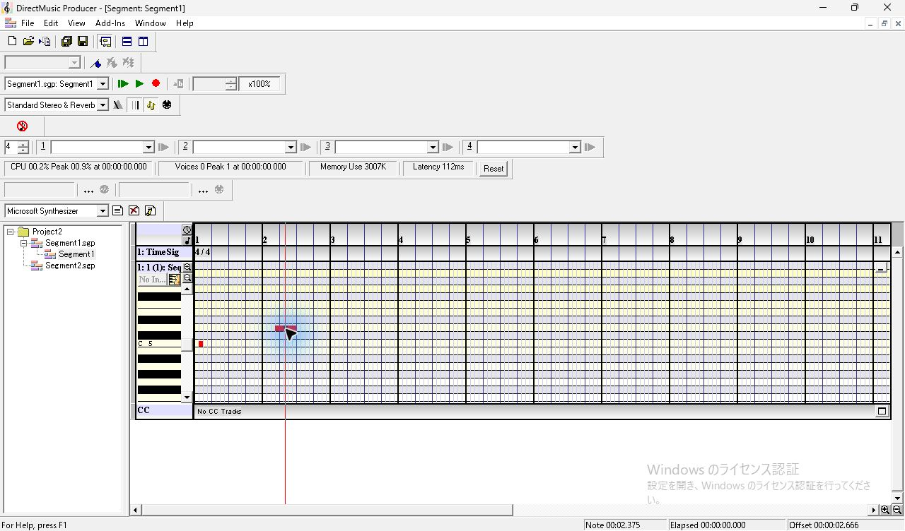

修飾キー付きクリック、範囲の端の扱い、ノートの伸縮・移動中のポインターは引き続き調べる。Properties の下端に見える Belongs to Beat は今回も一部が切れており、撮影条件を変えて確認する。
