# SEG-06　Sequence Part・ピアノロール・楽器選択

[調査計画](README.md) · [ノートのポインターと Snap](seg-07-note-gestures.md) · [Sequence の基本開閉](seg-04-track-headers.md)

2026-11-11。DirectMusic Producer 5.3.0.900 の調査用コピー `DmusGuiParts.exe`（PID 18828、SHA-256 `c330bb2ca2c885f4157ec9dce060f64957e33e88192b6547630c2db5f1a65a22`）。[前回の2音入り素材](../../../work/original-gui/SEG-04-05/20261111T002154974839Z/inputs/two-notes/manifest.json) から Project2 を複製した。Segment1 をツリーから開き、停止中・親子ウィンドウ最大化・第1小節始端で観測。Windows 11 10.0.26200、1280×800、96 DPI。親画面の撮影範囲は1280×752、クライアントは1280×709。青い光とその中央の黒い矢印は操作ツールの表示。右下の透かしは Windows の表示。

[実行記録](../../../work/original-gui/SEG-06-07/20261111T023012247347Z/run.json) · [撮影環境](../../../work/original-gui/SEG-06-07/20261111T023012247347Z/environment.json) · [画像対応表](../../../work/original-gui/SEG-06-07/20261111T023012247347Z/published-images.json) · [保存したトラックとイベント](../../../work/original-gui/SEG-06-07/20261111T023012247347Z/saved-events.json)

## 鍵盤スクロールと縦ズーム

1. ツリーの `Segment1.sgp` をダブルクリックして開く。TimeSig 4/4 の下に展開済みの Sequence があり、1小節目の C5 と2小節目の D5 は青。鍵盤の横に上下矢印とつまみがあり、その上に縦ズーム用の虫眼鏡が上下に並ぶ。左のラベルは欄の右端で切れている。
2. 鍵盤の上矢印 (265, 410) を1回押す。C5 のラベルと両ノートがそれぞれ約11 px 下に動き、上側に1半音分が入る。小節境界と CC 行の高さは同じ。
3. 上側の虫眼鏡 (265, 378) を1回押す。C5–D5 の中心間隔が約22 px から24 px に広がる。1半音あたり約11 px から12 px。横の小節幅は約96 px、下端の CC 行は同じ位置。ピアノロールには淡黄色の行が現れる。

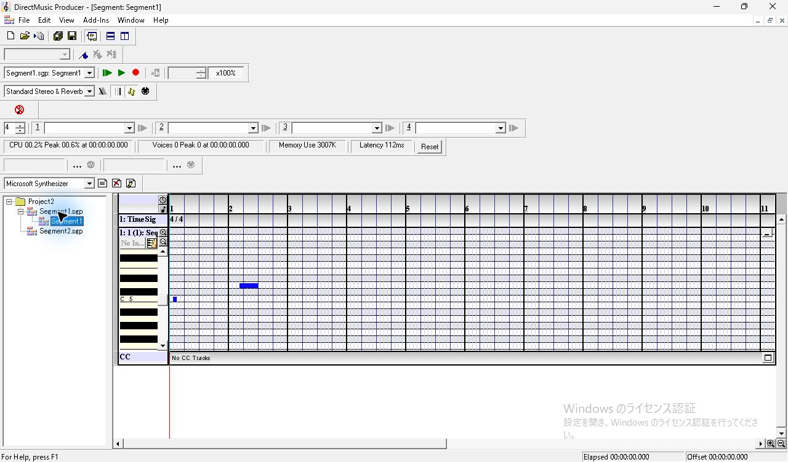

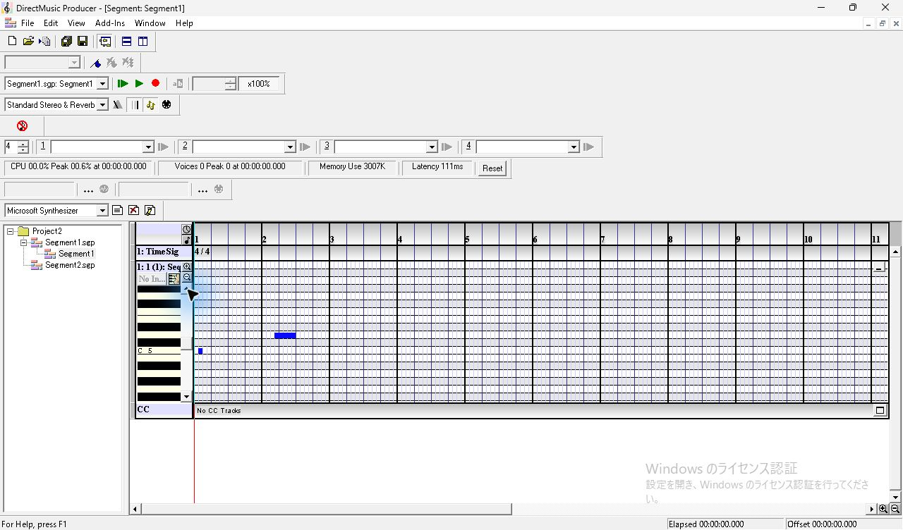

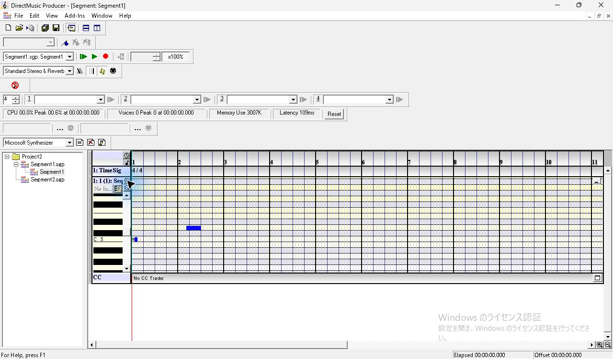

## PChannel 2 と 10 を追加

1. ピアノロールを右クリックし、`Add Sequence Part(s)...` を選ぶ。メニューには Ctrl+Shift+Ins と表示される。同じキー列を送った試行では画面の変化を確認できず、メニュー選択で `Add New Part` を開いた。
2. 既存パートが1つのとき、PChannel の数値欄は `2` が選択され、右側の欄も `2`、状態は `PChannel is unused`。数値欄のスピン下を1回押すと両欄が `1` に変わり、`PChannel is used` と出る。この画面で `Close` を押すと、追加行のない状態に戻る。使用中の番号での作成は追試待ち。
3. 同じメニューから再表示すると `2`。そのまま `Create New Part` を押す。第1パートの CC 行の下に第2パートが折りたたまれて現れる。ダイアログは開いたままで両欄が `3` に変わる。
4. 左の数値欄で Home、Shift+End の順に既存値を選び、`10` と入力。右欄も `10`、状態は `PChannel is unused`。もう一度 `Create New Part` を押すと第2パートの下に第10パートが加わり、両欄は `11` になる。最後に `Close` を押しても、作成済みの行は残る。

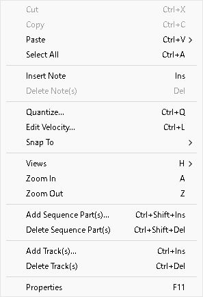

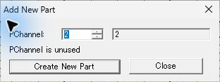

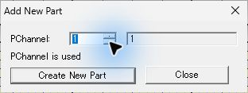

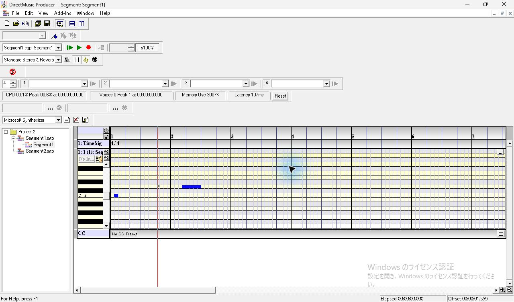

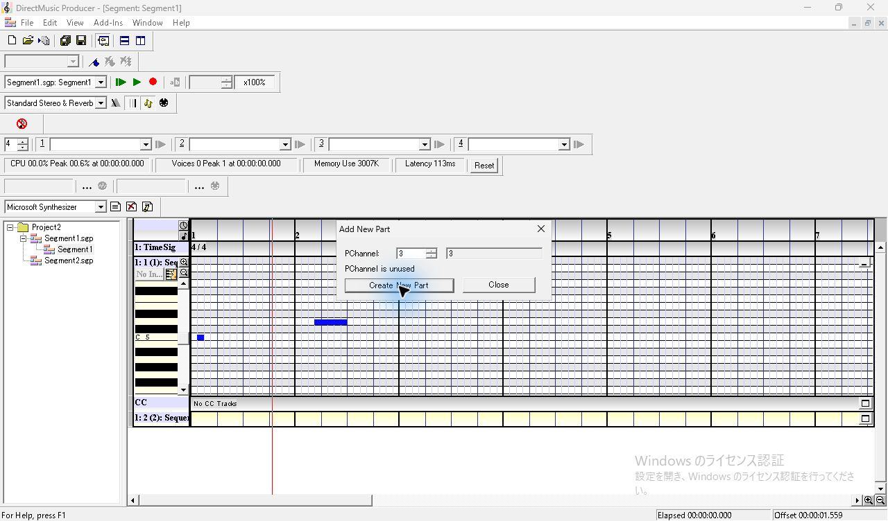

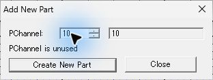

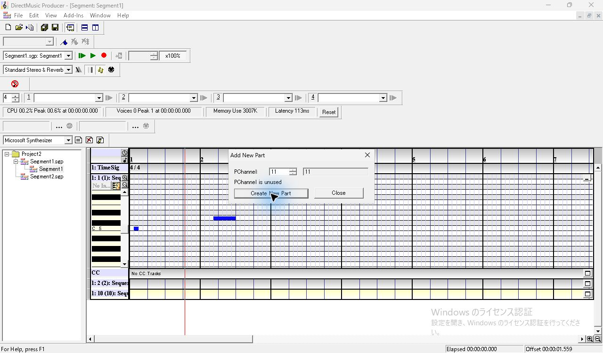

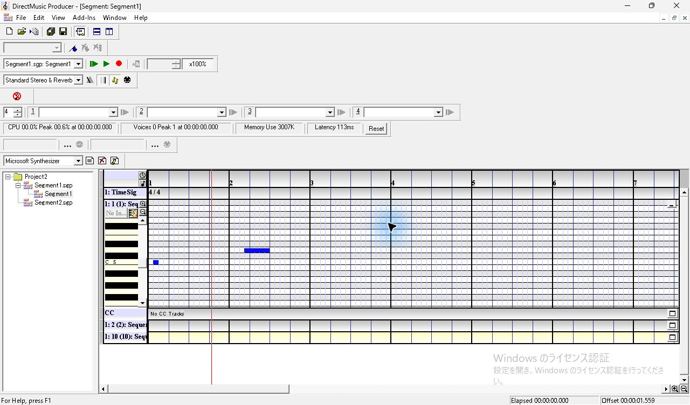

## 開閉、試聴の表示、入力先

1. 第2パート右端の四角いボタンを押すと、既に展開中の第1パートの下に第2の鍵盤とロールも開く。縦の表示範囲から第10パートは外れる。第2パート鍵盤の (220, 645) をクリックすると第2ロールが淡黄色になり、停止中の `Voices` が直前の0から1を示した。次の撮影では0に戻った。音声波形と実際の音色は未採取。
2. 第1パート右端のボタンを押して畳むと、第2パートは展開したまま上に詰まる。第1パートにあった2音は、折りたたまれた行の中で青い細線になる。ロールの開閉はパートごとに操作できる。
3. 第2パートの C5 行を小節2でクリックし、Grid で Insert。選択された赤いノートがそのロールに出る。続けて第2パートを畳むと、ノートは同じ小節位置に短い赤線として見える。
4. 第10パート右端のボタンを押すと、鍵盤に `Hi Agogo`、`Low Conga`、`Cowbell` などの打楽器名が並ぶ。C5 の行は狭い欄で `C5: Hi Bo` まで見える。同じロールで小節2の C5 に Insert すると、その行に赤いノートが出る。

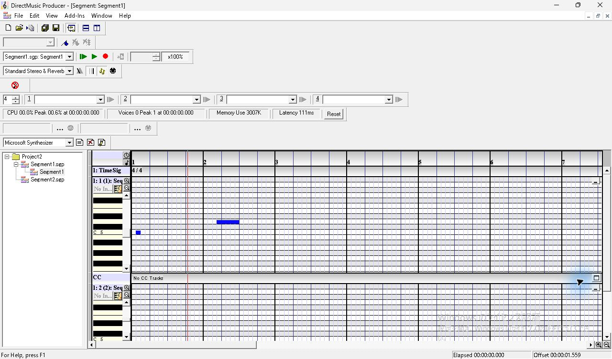

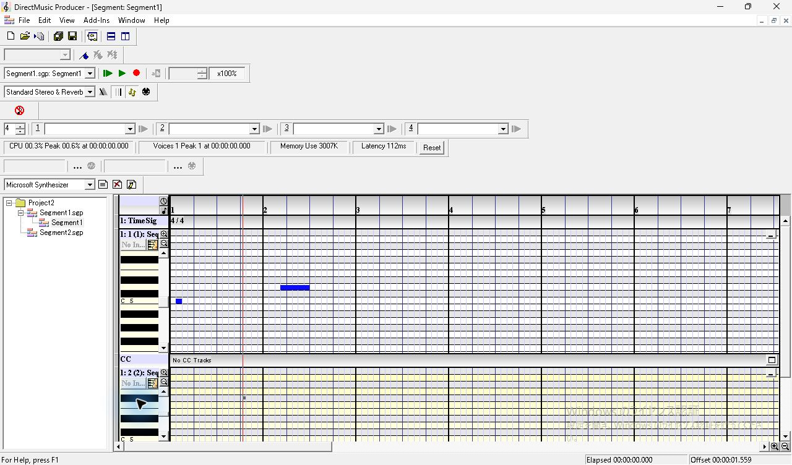

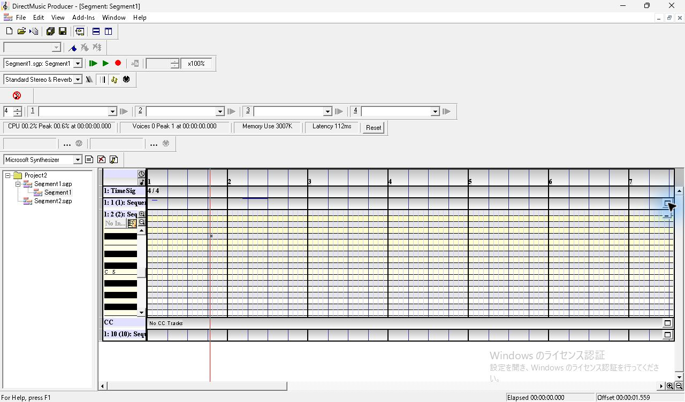

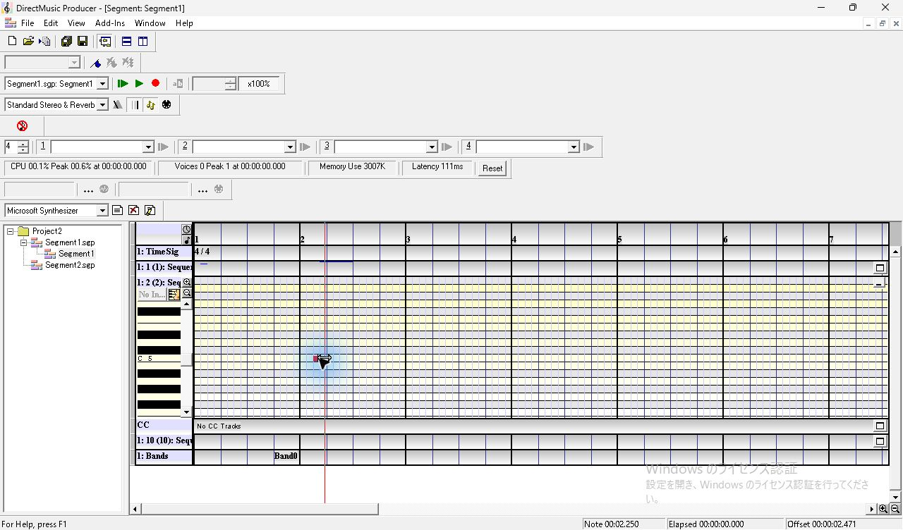

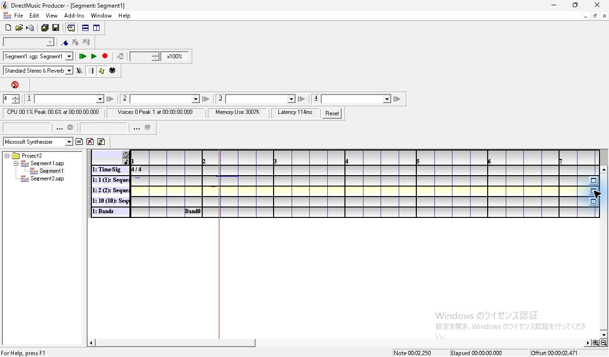

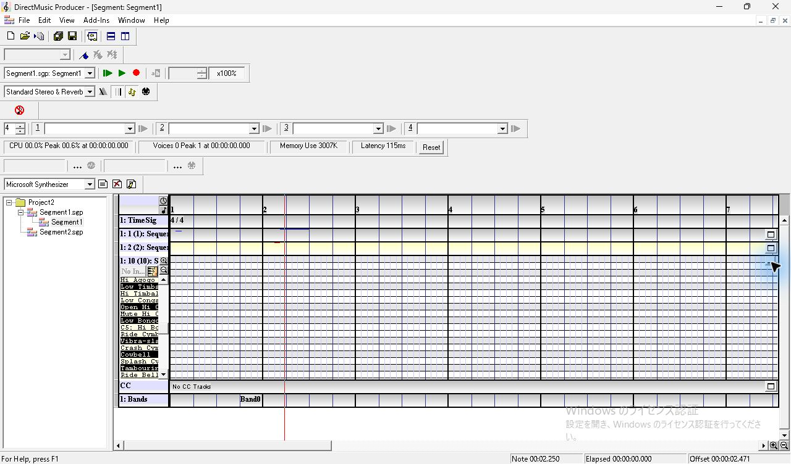

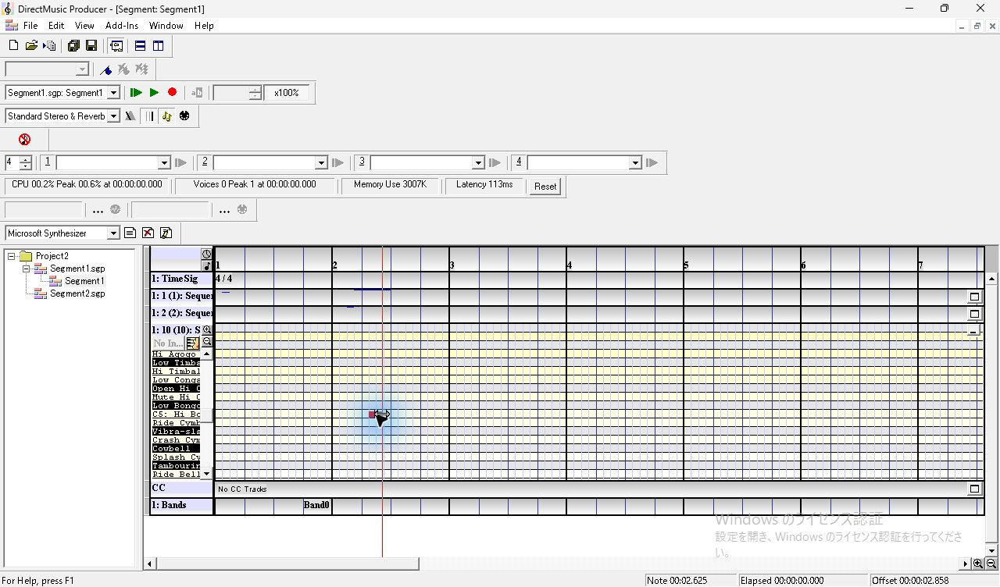

`Ctrl+S` 後の SGP には同じグループの `seqt` が3本あり、元の2音に続いて第2・第10パートのノートが各1音ある。表示上の PChannel 1、2、10 に対し、各ノートレコードのフィールドは0、1、9だった。この試験の保存結果を [次回用素材](../../../work/original-gui/SEG-06-07/20261111T023012247347Z/inputs/three-parts/manifest.json) に固定した。

| パート表示 | 保存 PChannel | MIDI ノート | 開始 clocks | 長さ clocks |
| --- | ---: | ---: | ---: | ---: |
| 1 | 0 | 60 | 192 | 191 |
| 1 | 0 | 62 | 3648 | 959 |
| 2 | 1 | 60 | 3456 | 191 |
| 10 | 9 | 60 | 4032 | 191 |

## 楽器メニューから Band0 へ

第2パートが開いているとき、`No In...` の右の楽器アイコン (247, 419) をクリック。メニューの `Open Band Editor` と `Locate Band` は灰色、`Insert New Instrument` は選べる。選ぶと、現在の赤い位置線付近に `Band0` が置かれ、最下段に `1: Bands` が増える。第2パートでメニューを開き直した時点では、先の2項目は引き続き灰色で、ラベルも `No In...` のままだった。

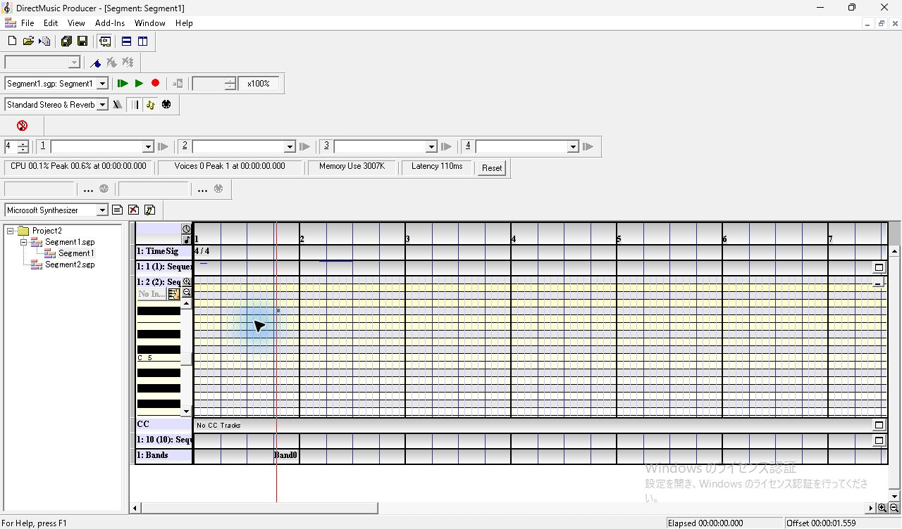

1. Bands 行の `Band0` をダブルクリックすると子ウィンドウが `Band: Segment1 - Band0` に切り替わる。今回の初期一覧は PCh# 1 の1行で、Instrument は `Piano 1`。右にはパン・音量の格子と `1` のマーカーがある。行を右クリックすると `Insert PChannel`、`Add/Remove PChannels`、`Delete PChannel(s)`、`Properties` が並ぶ。
2. `Piano 1` のセルをダブルクリックすると `Band0: PChannel(s) Properties` が開く。Instrument チェック付き、ボタンの右に `GM (0, 0, 0)`。Vol `64`、Pan `R1`、Oct `0`、Int `None`。
3. `Piano 1` ボタンを押すと、Piano から SFX までの16カテゴリと最下部の `Other DLS...`。Piano には `GS` の子メニューと Piano 1〜3、Honky-tonk、E.Piano 1・2、Harpsichord、Clav. の8項目がある。GS を開くと `Piano 1w`、`Detuned EP 1` など13項目。
4. GS から Esc を1回押すごとに Piano、楽器カテゴリ、プロパティへ1階層ずつ戻る。最後も `Piano 1` と `GM (0, 0, 0)` の表示。

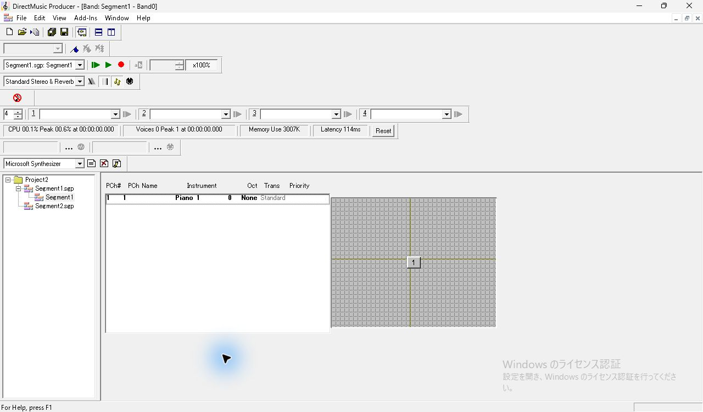

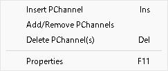

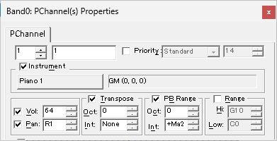

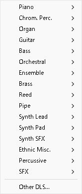

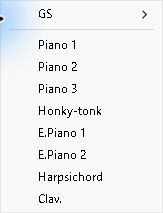

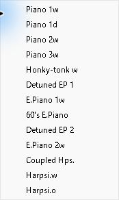

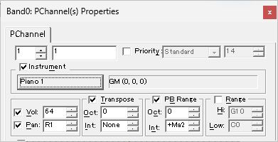

## 追試する条件

使用中の PChannel での作成、値の上下限、狭幅での開閉とパート別の縦位置保持を調べる。楽器割当は PCh# 2・10 を Band に追加して、Part 側の表示と `Open Band Editor`・`Locate Band` の有効条件、ドラムキット、DLS の選択・取消、再読込を確認する。今回の `Band0` は楽器割当前の初期状態として使える。関連する画像要件は [UI 互換性台帳](../ui-compatibility.json) の `UI02.priority-21`、`22`、`23`、`38`〜`41`。
