# SEG-07　ノートのポインター・ドラッグ・Snap

[調査計画](README.md) · [Sequence Part と鍵盤](seg-06-sequence-parts.md) · [選択と混在値](seg-05-selection.md) · [貼付けと履歴](seg-05-clipboard-history.md)

2026-11-11。[SEG-06 と同じ調査用コピー](seg-06-sequence-parts.md) の Segment1。TimeSig は4/4、Transport は停止中。元の C5 は開始192・長さ191 clocks、D5 は開始3648・長さ959 clocks。縦ズーム1段と鍵盤スクロールの後、Timeline 右下の横ズーム `+` を2回押した。小節幅は約96 pxから150 pxに広がり、長い D5 は画像内の x=453〜500、y=473〜482 に見える。

[実行記録](../../../work/original-gui/SEG-06-07/20261111T023012247347Z/run.json) · [元の2音](../../../work/original-gui/SEG-06-07/20261111T023012247347Z/inputs/manifest.json) · [操作後の保存値](../../../work/original-gui/SEG-06-07/20261111T023012247347Z/saved-events.json) · [画像対応表](../../../work/original-gui/SEG-06-07/20261111T023012247347Z/published-images.json)

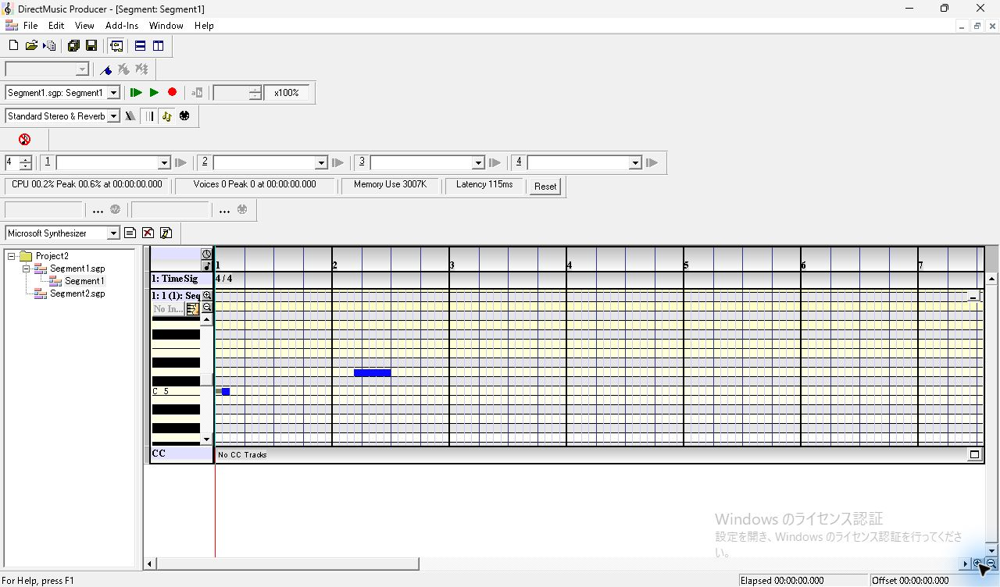

## ポインターの形状とドラッグ後

ピアノロールの空セルを右クリックし、`Snap To > Grid` を選ぶ。座標は1280×752 px の画像内。クリックを離した後に赤くなった D5 と、青い操作ツール表示の下に重なるポインターを観測した。各ドラッグは、クリック時と同じ始点から実行し、解放後に撮影した。

| D5 の位置 | クリック後に見えるポインター | ドラッグの始点 → 終点 | 解放後の画面 |
| --- | --- | --- | --- |
| 中央 | 四方向の矢印 | (477, 478) → (540, 478) | 青。開始位置と幅は見た目で同じ |
| 右端 | 水平の両矢印 | (499, 478) → (529, 478) | 青。右端は見た目で同じ |
| 左端 | 水平の両矢印 | (454, 478) → (424, 478) | 赤のまま。左端は見た目で同じ |
| 上端 | 操作ツール表示と重なり、形状を判別できない | (477, 473) → (477, 442) | 青。音高の行とノートの大きさは見た目で同じ |

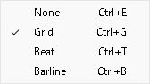

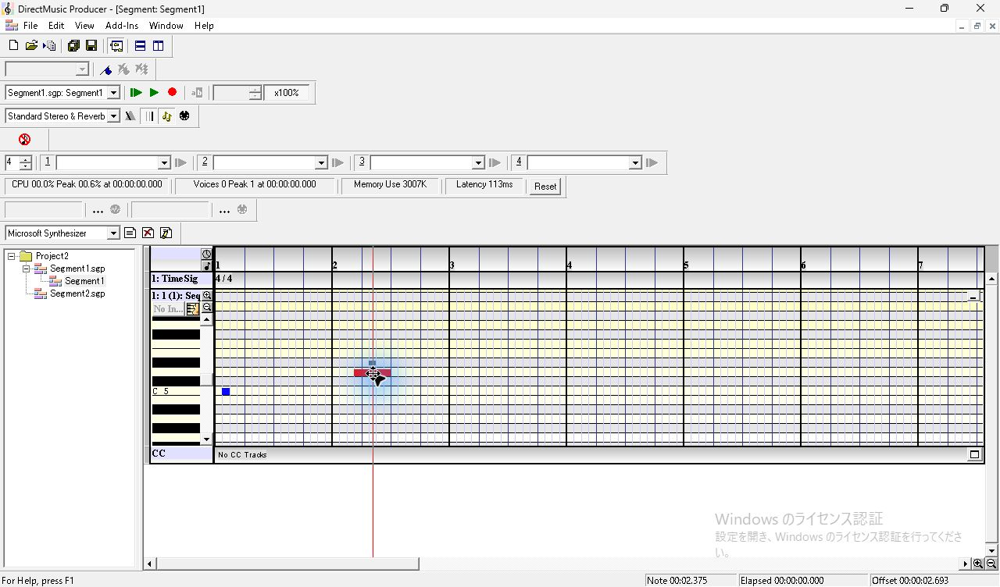

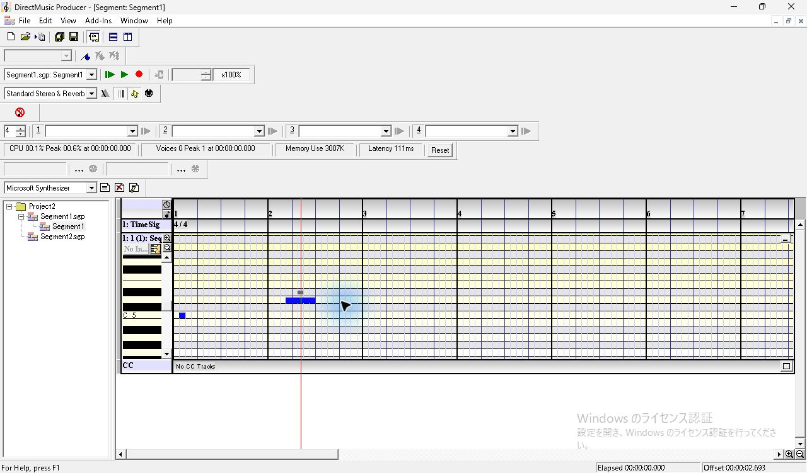

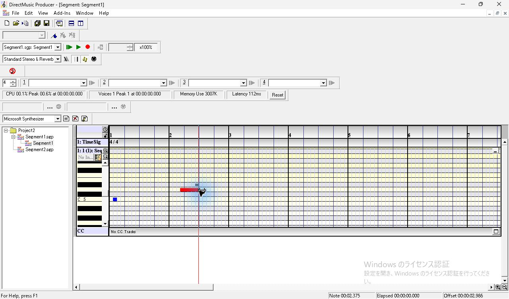

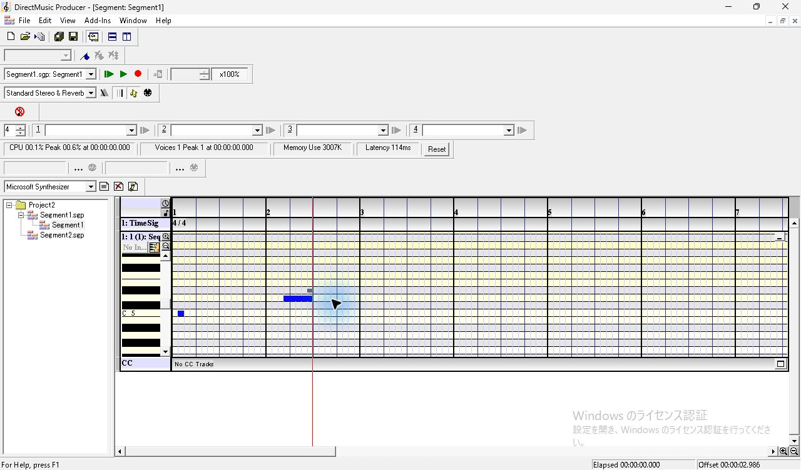

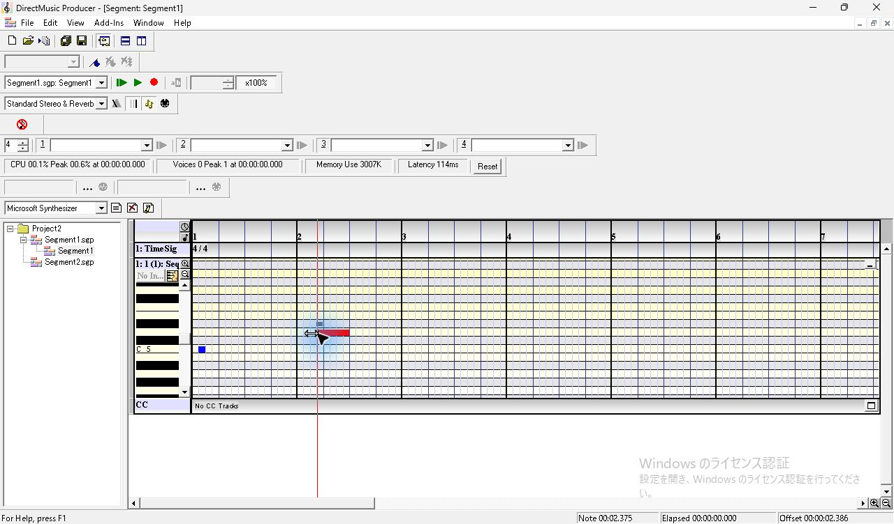

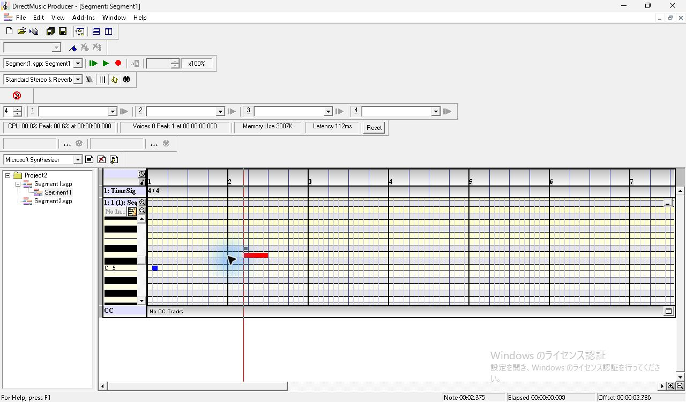

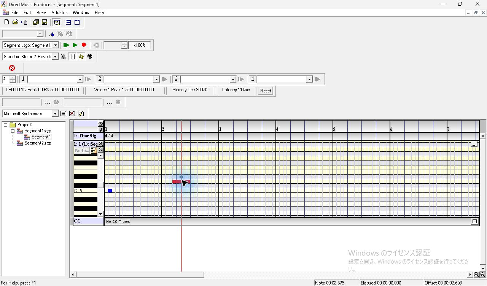

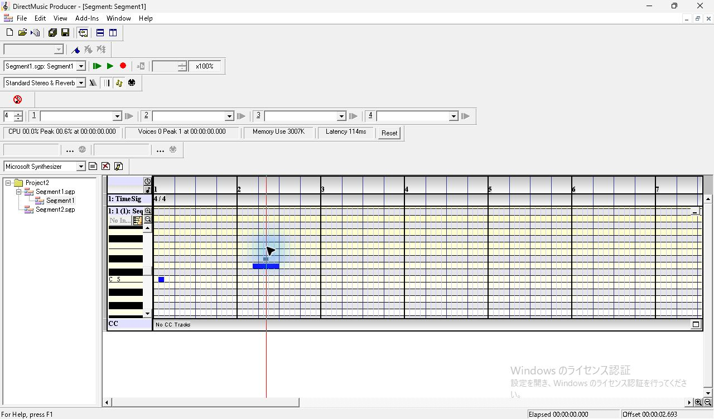

4回の試行後、Ctrl+S で保存した [SGP](../../../work/original-gui/SEG-06-07/20261111T023012247347Z/captures/after-gestures.sgp) の `seqt/evtl` を入力と照合した。2音とも開始位置、長さ、音高、ベロシティ、PChannel が一致した。この条件でのドラッグ編集は未確認。過去の試行でも中央と右端でポインターの違いが見え、値は維持された。[過去の試行](../ui-note-snap-resume-2026-10-12.md)

## 同じ時刻・音高に Grid と None で挿入

1. 第2小節のグリッド線の間、D5 の行 (550, 478) をクリックして Insert。Grid では挿入したノートのステータス表示が `Note 00:03.625`。Ctrl+S で保存する。
2. ピアノロールにフォーカスがある状態で Ctrl+Z。挿入した音が消え、縦方向の表示が元の約11 px/半音に戻る。横の小節幅は150 pxのまま。
3. Ctrl+E を押し、同じ右クリックメニューから `None` のチェックを確認する。選択肢は None、Grid、Beat、Barline の順で、右欄に Ctrl+E/G/T/B が並ぶ。
4. 縦位置の変化に合わせて D5 行の (550, 465) をクリックし、同じ x で Insert。ステータス表示は `Note 00:03.666`。Ctrl+S で保存し、Ctrl+Z で取り消す。画面に元の2音が残る。

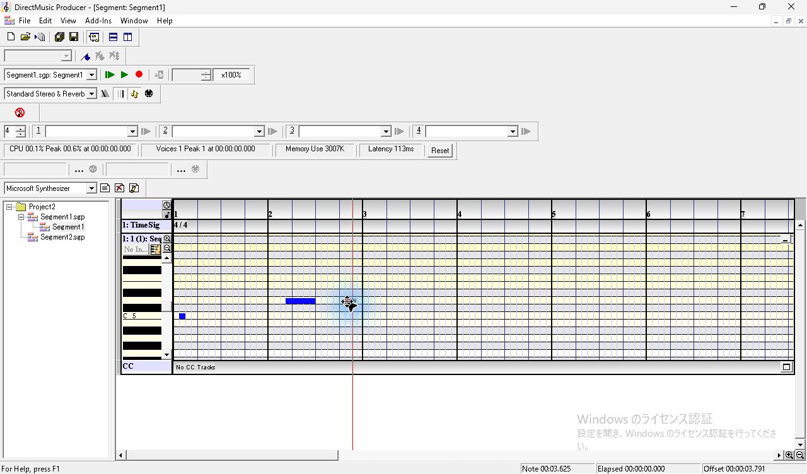

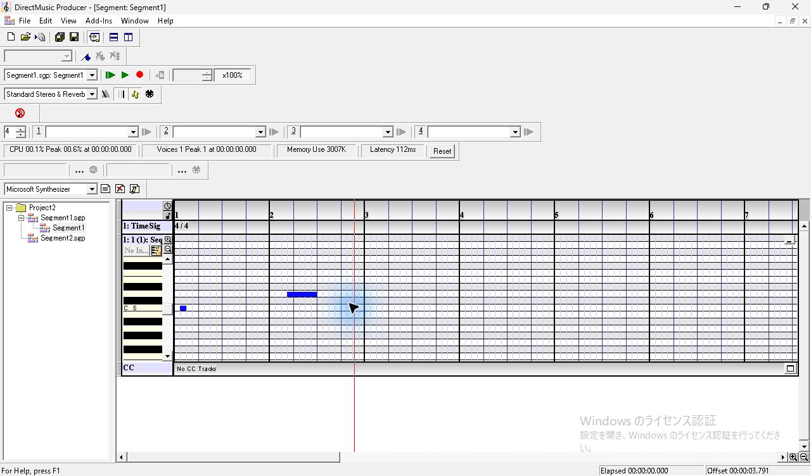

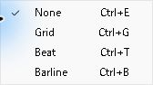

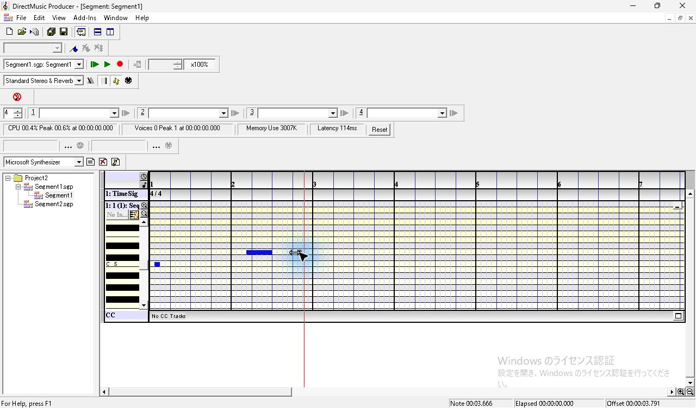

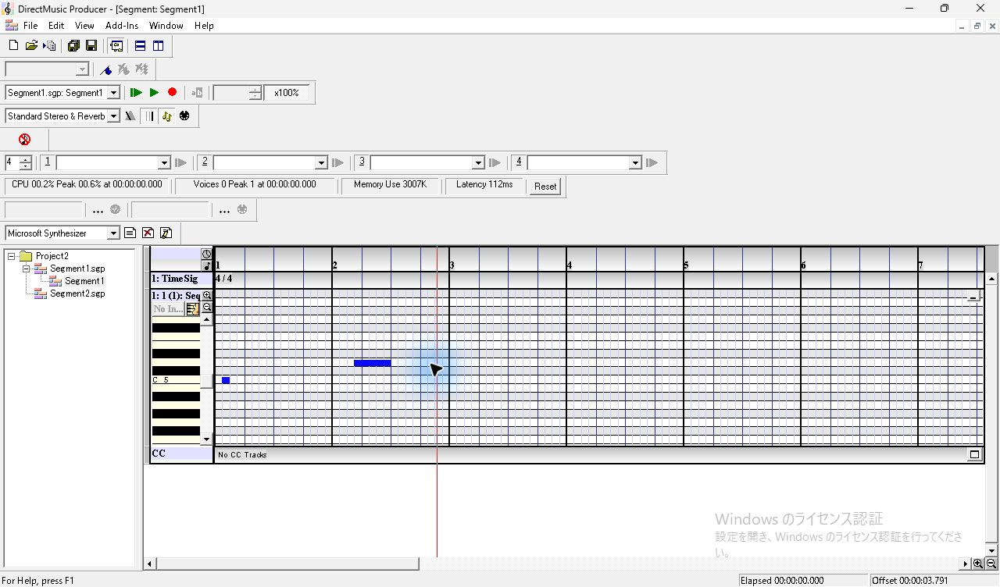

| Snap | 保存した論理開始 clocks | オフセット clocks | 実際の開始 clocks | 長さ clocks |
| --- | ---: | ---: | ---: | ---: |
| Grid | 5568 | 0 | 5568 | 191 |
| None | 5568 | 64 | 5632 | 96 |

保存した挿入音はいずれも MIDI 62、ベロシティ100、PChannel フィールド0。Grid と None の開始は64 clocks、長さは95 clocks異なる。保存した各 SGP で元の2音も照合した。[Grid の SGP](../../../work/original-gui/SEG-06-07/20261111T023012247347Z/captures/grid-insert.sgp) · [None の SGP](../../../work/original-gui/SEG-06-07/20261111T023012247347Z/captures/none-insert.sgp)

## 追試する条件

ノートを押したまま移動する間の形状を撮影し、中央・左右端・上端で開始、長さ、音高、Velocity がどう変わるか照合する。None、Beat、Barline でのドラッグ、範囲外、オートスクロールと複製も観測待ち。今回の画像はクリック解放後とドラッグ解放後。関連する画像要件は [UI 互換性台帳](../ui-compatibility.json) の `UI02.priority-17`〜`19`。
