# SEG-09　Bands と Band 子エディター

[調査計画](README.md) · [Tempo と Time Sig](seg-09-tempo-timesig.md) · [Sequence Part の楽器メニュー](seg-06-sequence-parts.md)

2026-11-11。Tempo と Time Sig に続けて、同じ [調査用コピーと撮影条件](seg-09-tempo-timesig.md) で実施。Segment1 の既存 `Band0` を使う。親の Transport は停止中。[実行記録](../../../work/original-gui/SEG-09/20261111T032540911033Z/run.json) · [画像対応表](../../../work/original-gui/SEG-09/20261111T032540911033Z/published-images.json) · [保存値](../../../work/original-gui/SEG-09/20261111T032540911033Z/saved-timed-tracks.json)

## イベント選択、時刻と親からの入口

1. Bands 行の `Band0` より前の空の拍をクリックすると、Bands 行は淡黄色、クリックした1拍は黒い。第1パートの楽器は `No In...`。Band0 の文字がある拍をクリックすると白い `Band0` に黒背景が付き、第1パートの楽器欄は `Pian...`。
2. Band0 の右クリックでは Insert と Cycle Bands が灰色、Delete と Properties が有効。Band Properties の上段は名前 `Band0`。Start Time は Bar `1`、Beat `4`、Tick `−1`。Belongs To は Bar `1`、Beat `4`。保存ファイルでは `bd2h` の論理時刻2304、実時刻2303 clocks に対応する。
3. 現在位置が Band0 より後の状態で、第1パートの楽器欄の右のアイコンをクリックすると、`Open Band Editor`、`Insert New Instrument`、`Locate Band` がすべて有効。`Locate Band` を選んだ時点では対象が画面内にあり、Bands 行は淡黄色のまま黒い選択背景が外れた。赤い位置線は同じ位置。
4. 同じ楽器メニューの `Open Band Editor` で子ウィンドウが `Band: Segment1 - Band0` に切り替わる。左に PCh#、PCh Name、Instrument、Oct、Trans、Priority の一覧、右にパン・音量の格子。初期一覧の PCh# 1 は Piano 1。

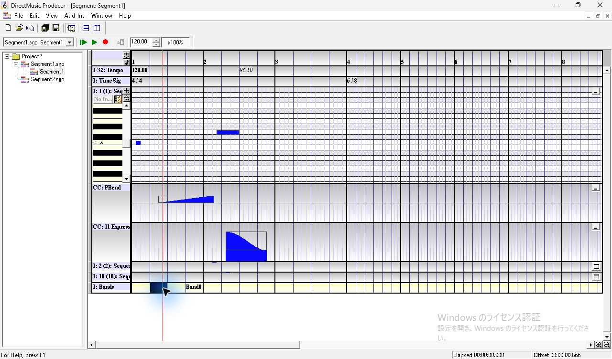

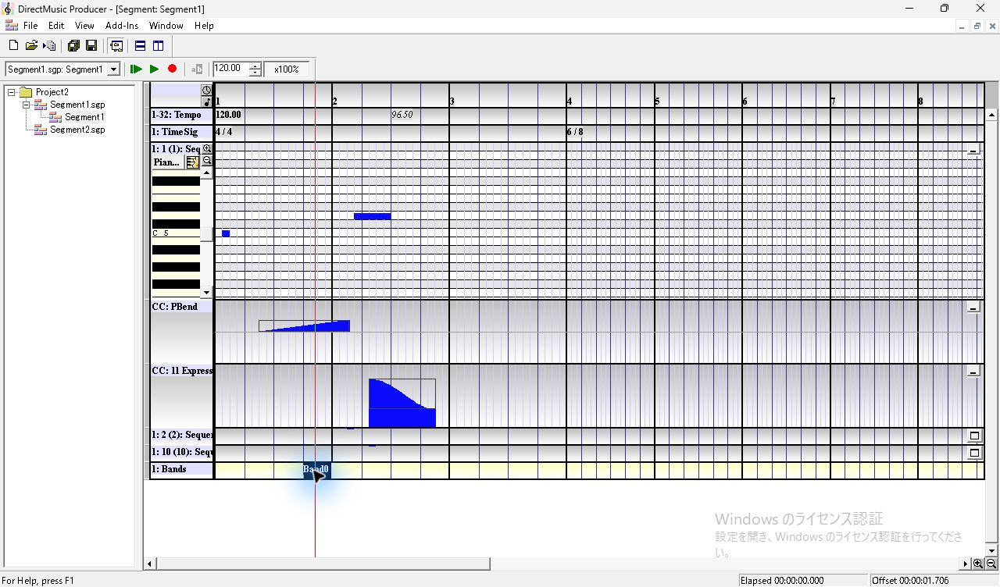

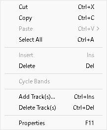

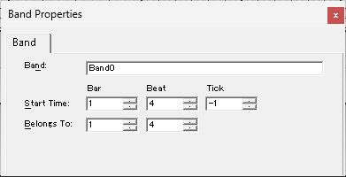

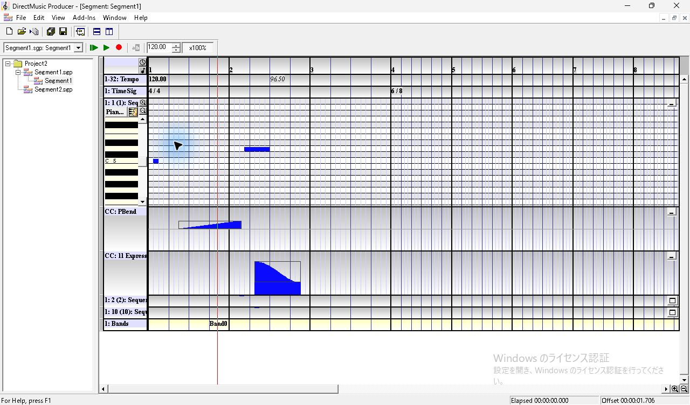

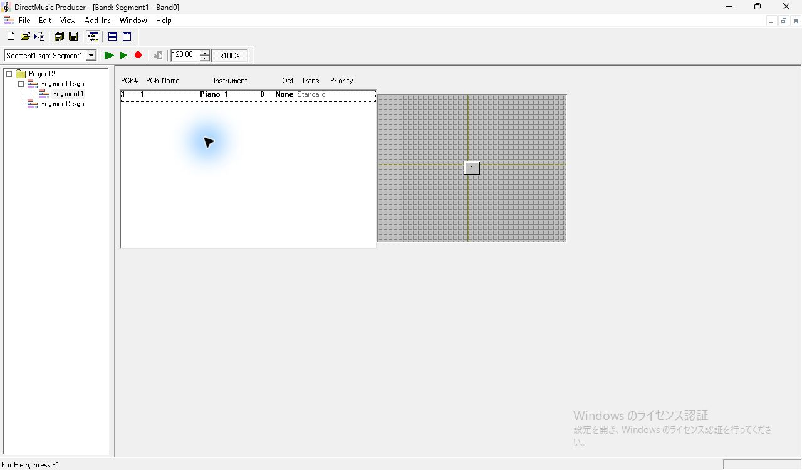

## パン・音量と Organ 1

1. 格子の中央付近でマーカー `1` (753, 269) をクリックすると、マーカーは赤、一覧の第1行は淡い選択色。そこから右上 (813, 221) へドラッグするとマーカーが追随した位置に残る。右下のステータスは `Pan R29 Vol 92`。
2. 一覧の Piano 1 をダブルクリックして PChannel(s) Properties を開く。第1パートの初期値は Pan `R1`、Vol `64` だった。移動後は Pan `R29`、Vol `92`。Pan と Vol のチェックは両方入っている。
3. Instrument 内の Piano 1 ボタンから Organ を展開し、`Organ 1` を選ぶ。プロパティの表示が `Organ 1`、`GM (0, 0, 16)` に変わり、パン・音量は移動後の値を保つ。

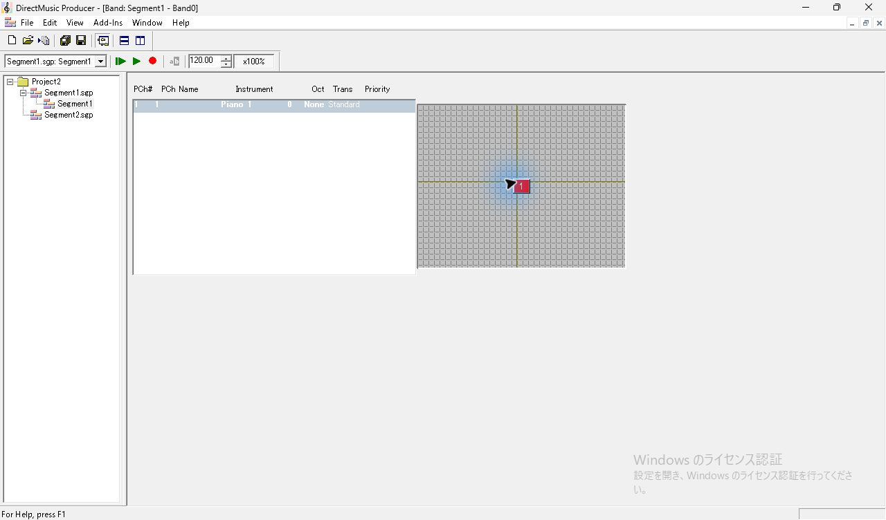

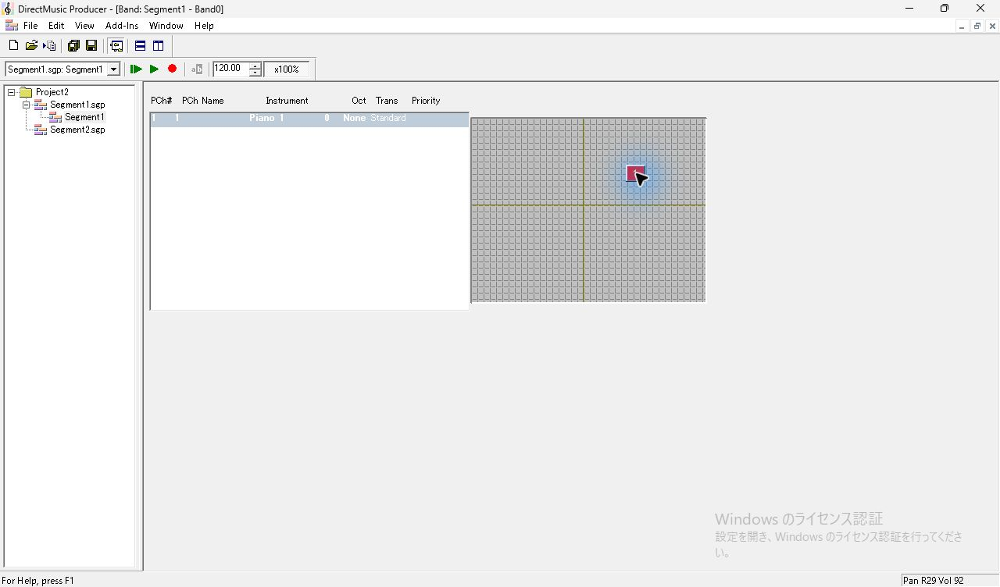

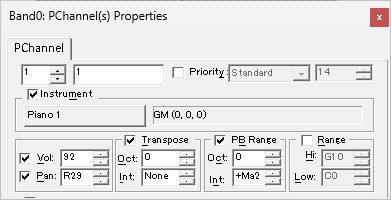

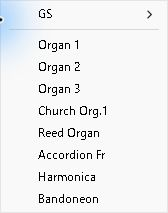

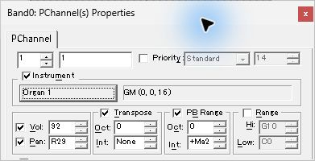

## PChannel 2・10、ドラムキットと DLS

1. Band の行を右クリックし、`Add/Remove PChannels`。初期の左一覧は `1` のみで、右の Add PChannel は `2`。Add で左一覧に2が増え、右は3になる。続けて番号を10に変更して Add すると左に `1, 2, 10`、右は `11`。OK で Band の一覧に3行が現れる。
2. 追加直後の Instrument は2が灰色の `Piano 1`、10が灰色の `Standard`。10をダブルクリックすると Instrument のチェックは外れ、ボタンは灰色。チェックを入れるとボタンが有効になる。
3. PChannel 10 の楽器ボタンには Standard、Room、Power、Electronic、TR-808、Jazz、Brush、Orchestra、SFX、Other DLS... が並ぶ。`Room` を選ぶと `GM (0, 0, 8)`。同じメニューの `Other DLS...` は `Choose DLS Instrument` を開く。この Project2 では DLS Collections と Instruments が空で、下段の Bank Hi、Bank Lo、Patch は `0, 0, 8`。Cancel で戻ると Room の割当が残る。

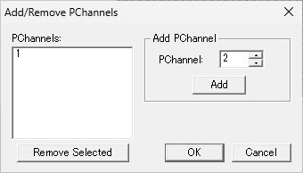

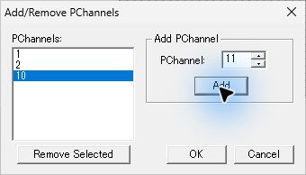

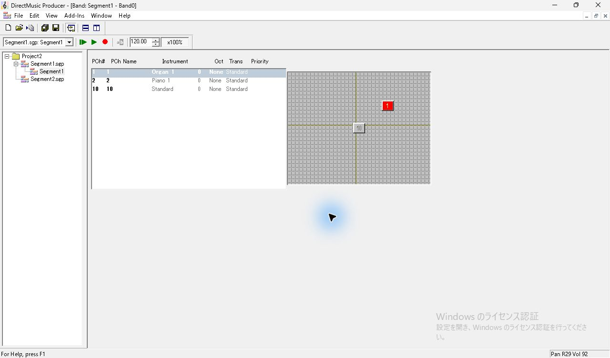

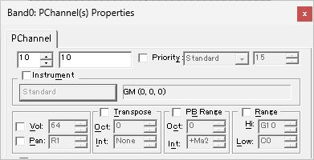

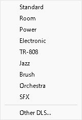

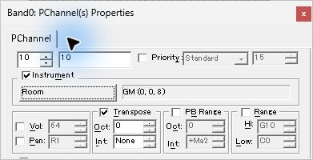

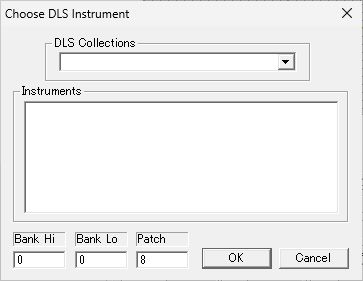

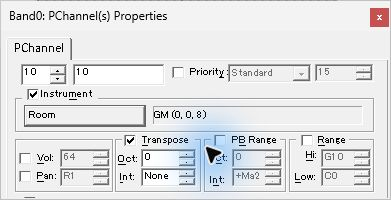

## 子ウィンドウを閉じて保存・再読込

楽器メニューから開いた Band 子ウィンドウの右上の閉じるボタンを押すと、親 Segment に戻る。第1パートのピアノロールが淡黄色になり、楽器欄は `Orga...`。Bands 行の Band0 は黒い選択背景が外れた状態。親で Ctrl+S し、通常終了する。

別プロセスで Segment1 を開いて Band0 をダブルクリックすると、Organ 1、灰色の Piano 1、Room と、動かしたマーカー1が復元された。PChannel 1 のプロパティも Pan `R29`、Vol `92`。Bands 行から開いた場合は閉じると Bands 行の Band0 選択に戻った。Band0 以降の位置で第10パートを展開すると、親の楽器欄は `Room`、鍵盤には打楽器名が並ぶ。

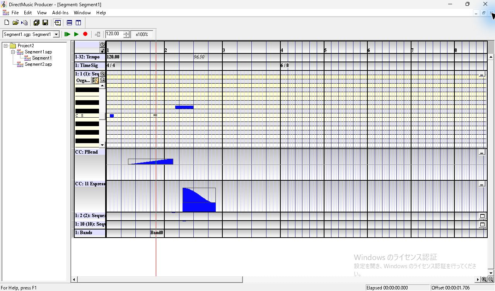

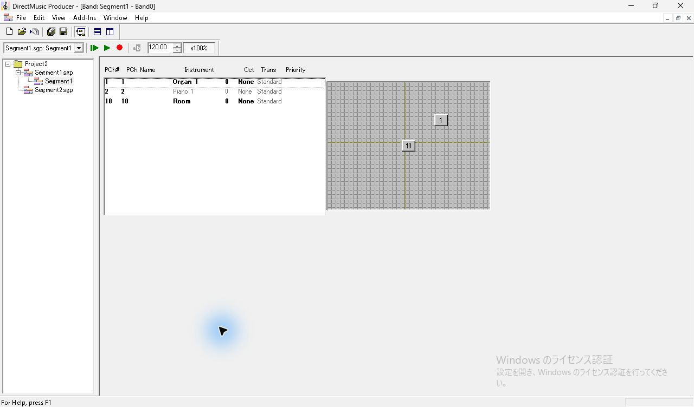

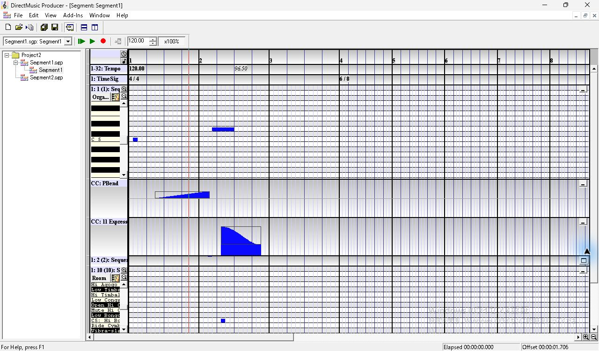

| 表示 PChannel | 保存 PChannel | patch | 保存 pan | 保存 volume |
| --- | ---: | --- | ---: | ---: |
| 1 | 0 | `0x00000010` | 92 | 92 |
| 2 | 1 | `0x00000000` | 64 | 64 |
| 10 | 9 | `0x80000008` | 64 | 64 |

SGP では Bands トラックのイベントに `DMBD` が埋め込まれており、その `bins` から値を照合した。次の再生調査には [Tempo・Time Sig・Band0 入りの素材](../../../work/original-gui/SEG-09/20261111T032540911033Z/inputs/timed-segment/manifest.json) を使う。

## 追試する条件

同じ拍の複数 Band と Cycle Bands、別文書からの参照・埋め込み、画面外の Locate Band、複数 PChannel を選択した格子操作、DLS 実データの割当と音声を調べる。今回の観測は埋め込みの Band0 と停止中の表示。[UI 互換性台帳](../ui-compatibility.json)
