# SEG-09　Tempo と Time Sig

[調査計画](README.md) · [Bands と Band エディター](seg-09-band-editor.md) · [CC レーン](seg-08-cc-curves.md)

2026-11-11。DirectMusic Producer 5.3.0.900 の調査用コピー `DmusGuiTimed.exe`（SHA-256 `c330bb2ca2c885f4157ec9dce060f64957e33e88192b6547630c2db5f1a65a22`）。[2曲線入り素材](../../../work/original-gui/SEG-08/20261111T031027800626Z/inputs/two-curves/manifest.json) を専用 Project2 に複製。Windows 11 10.0.26200、1280×800、96 DPI。親子ウィンドウ最大化、撮影は1280×752 px、[ツールバーは2段](ui-01-view-toolbars.md)。操作は停止中。座標の原点は画像の左上。青い光と黒い矢印は操作ツールの表示。

[実行記録](../../../work/original-gui/SEG-09/20261111T032540911033Z/run.json) · [撮影環境](../../../work/original-gui/SEG-09/20261111T032540911033Z/environment.json) · [画像対応表](../../../work/original-gui/SEG-09/20261111T032540911033Z/published-images.json) · [保存値](../../../work/original-gui/SEG-09/20261111T032540911033Z/saved-timed-tracks.json)

## Tempo の追加・選択・数値入力

1. 初期状態では TimeSig が最上段で、Transport のテンポ欄は空。TimeSig 行を右クリックし、`Add Track(s)...` の一覧から `Tempo Track` を選ぶ。
2. 確定すると TimeSig の上に `1-32: Tempo` が加わる。第1小節の先頭に `120.00` が入り、Transport にも `120.00` が表示される。既存 TimeSig のグループ表示は `1:`。保存後の Tempo のグループビットは `0xFFFFFFFF`、TimeSig は `0x00000001`。
3. 第2小節の第3拍で右クリックすると、行が淡黄色、対象の1拍が黒くなる。空の拍では Insert が有効、Delete と Cycle Tempos は灰色。Properties では Tempo が `None`、Measure・Beat・Tick は空で入力欄は灰色。
4. 空の拍を選んだ状態で Insert。Tempo Properties が開き、Tempo `120.00`、Measure `2`、Beat `3`、Tick `0`。Tempo 欄の値を `96.50` にして Tab で確定する。パネルを閉じると、選んだ拍に白い `96.50` と黒い背景が見え、Transport も `96.50` になる。

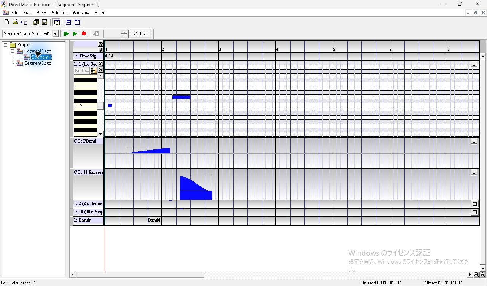

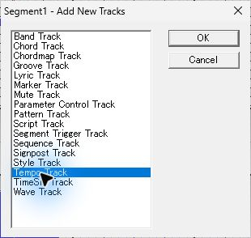

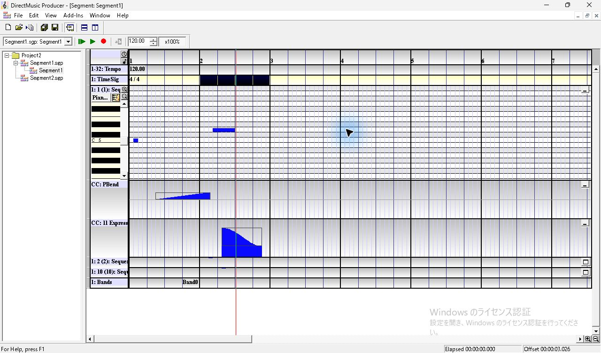

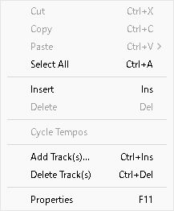

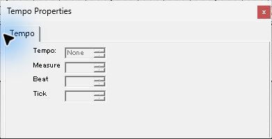

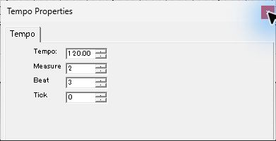

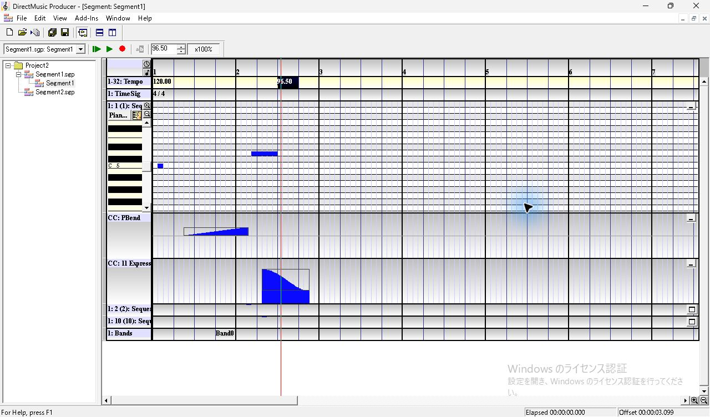

## 同じ拍の異なる Tick と Cycle Tempos

1. `96.50` がある拍の後半を右クリックすると、同じ拍のイベントが選ばれる。Insert は灰色、Delete は有効。Cycle Tempos は1件の段階では灰色。
2. 隣の第4拍の空セルで Insert。直前の値が `96.50` の時点でも新規イベントは `120.00`。Tick 欄をダブルクリックして選択し、数値キーで `300` を入力する。Beat のスピン下を押すと Beat が4から3へ移動し、Tick 300 が残る。
3. パネルを閉じると、第3拍に白い斜体の `120.00` が見える。右クリックで Cycle Tempos が有効になり、選ぶと表示が斜体の `96.50` に変わる。表示は同じ拍内の1件分。
4. ルーラーで同じ拍の Tick 300 より前 (507, 127) をクリックすると、Transport は `96.50`。Tick 300 より後 (526, 127) をクリックすると `120.00` に変わる。Tempo 行の斜体 `96.50` はその間、同じ拍に表示される。

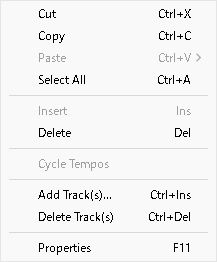

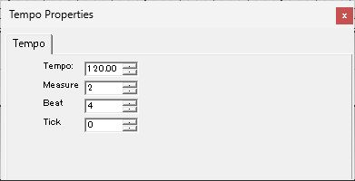

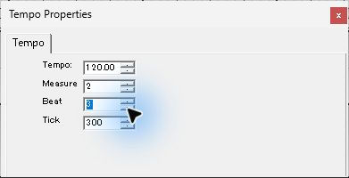

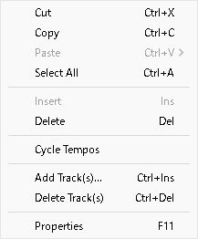

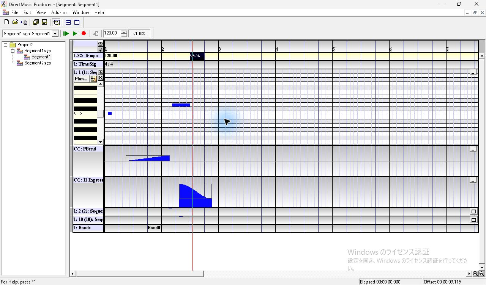

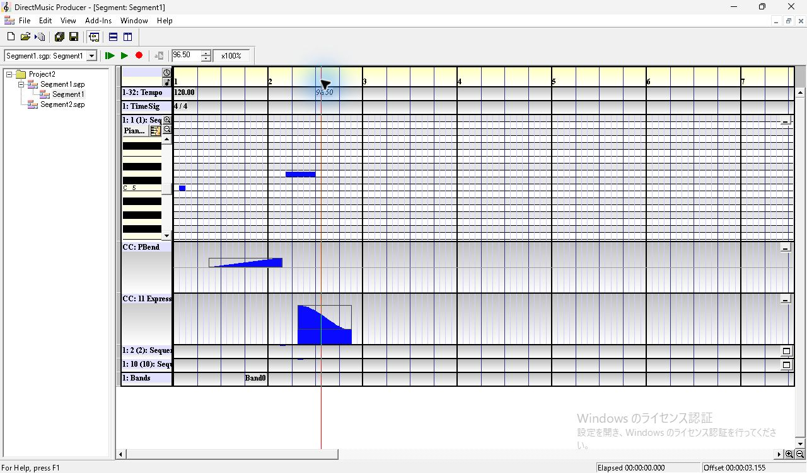

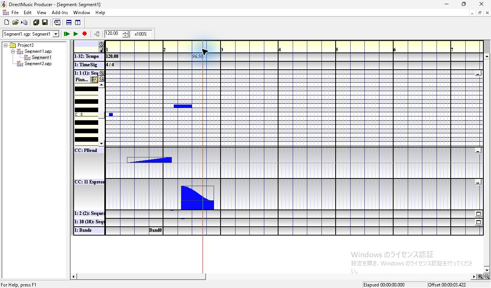

## Time Sig とグリッド

1. 第4小節の空セル (744, 170) をクリックすると、TimeSig 行は淡黄色、第4小節全体は黒。Insert で Time Signature Properties が開き、初期値は `4/4`、Measure は `4`。
2. 値の右の音符ボタンで `Change Time Signature`。上部の `Beats Per Measure` はスピン付き、`Beat` の一覧には `1, 2, 4, 8, 16, 32`。下部の `Divide Beat into` で1拍の分割を選ぶ。Beat を8にすると分割候補が数字の付いた記号になる。Beats Per Measure を6にし、分割を3にして OK。
3. 第4小節の開始線は x=725 のまま。変更前は小節幅が約150 px、変更後は第4小節以降が約112.5 px。ルーラーに8小節目が見え、ピアノロールと CC の拍・グリッドも第4小節から変わる。
4. 選択して F11 から編集を開き直し、6を5にして Cancel。Time Signature Properties に `6/8`、分割3、Measure 4 が残る。選択イベントのダブルクリックでは、この試行ではパネルは出なかった。F11 で表示できた。

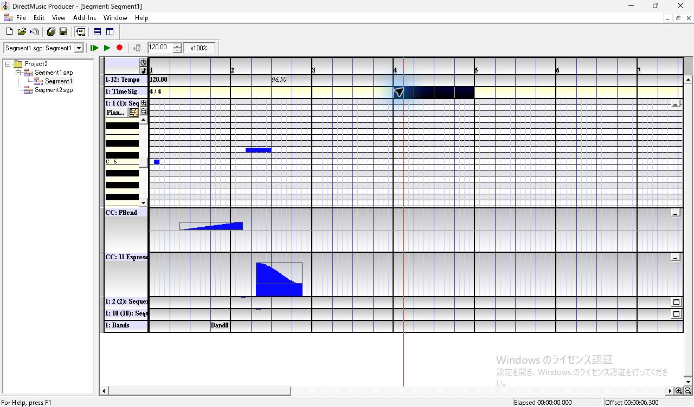

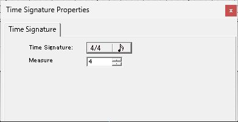

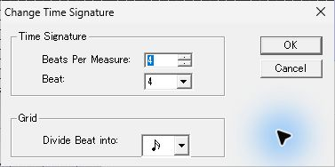

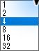

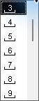

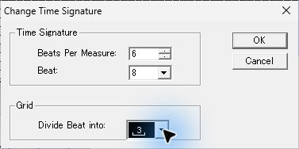

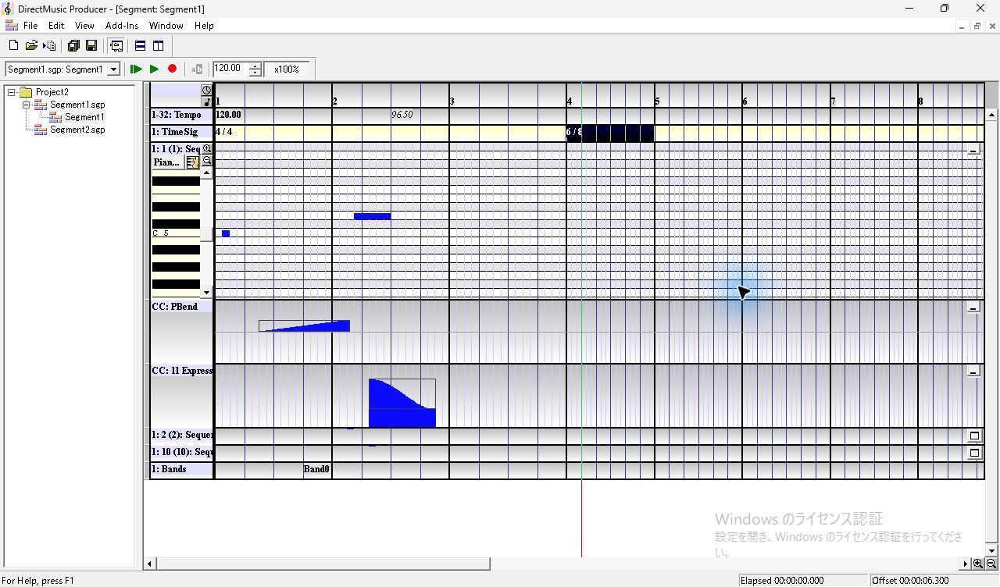

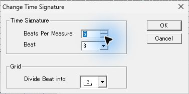

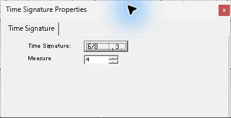

## スクロール境界と保存

横スクロールバーのつまみの右をクリックし、元イベントが画面外になるまで進める。第12小節が見える位置では、Tempo 左端に薄い `96.50`、TimeSig 行の最初の小節線付近に薄い `4/4`、Bands 左端に薄い `Band0` が出る。第12小節のルーラーをクリックした画面で、Transport は `120.00`、小節幅は第4小節以降の約112.5 px。薄いラベルの描画と、その時刻の Transport・目盛りを別の観測として扱う。

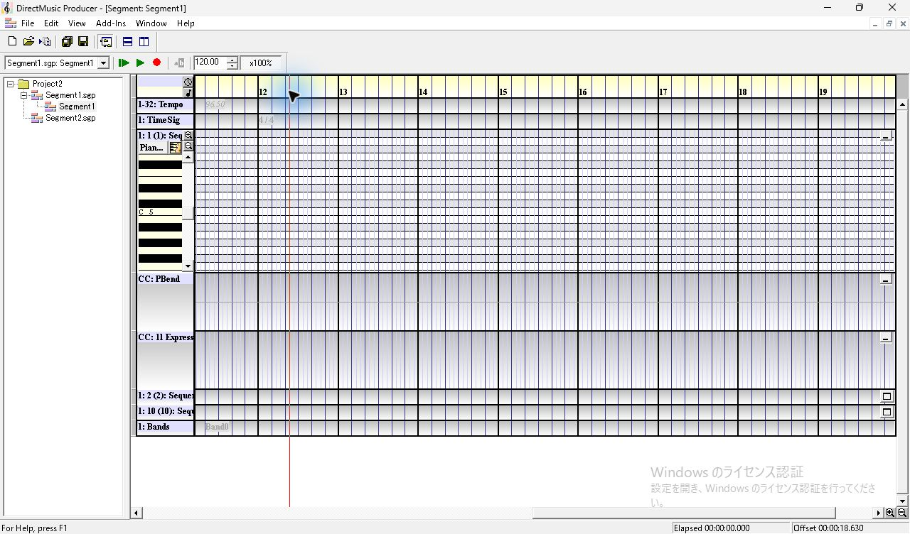

| 保存したトラック | 開始 clocks | 値 |
| --- | ---: | --- |
| Tempo | 0 | 120.00 BPM |
| Tempo | 4608 | 96.50 BPM |
| Tempo | 4908 | 120.00 BPM |
| TimeSig | 0 | 4/4、1拍4グリッド |
| TimeSig | 9216 | 6/8、1拍3グリッド |

Ctrl+S 後の SGP で `tetr` と `tims` を読み取った。後続の Band 編集後の保存でも表の値は一致し、4音と2曲線のチャンクは固定入力とバイト一致した。通常終了後に別プロセスで開くと、Tempo の第1・第2小節の表示と、第4小節からの6/8・グリッドが復元された。[Tempo・Time Sig の保存時点](../../../work/original-gui/SEG-09/20261111T032540911033Z/captures/tempo-meter.sgp) · [最終保存](../../../work/original-gui/SEG-09/20261111T032540911033Z/captures/tempo-meter-band.sgp)

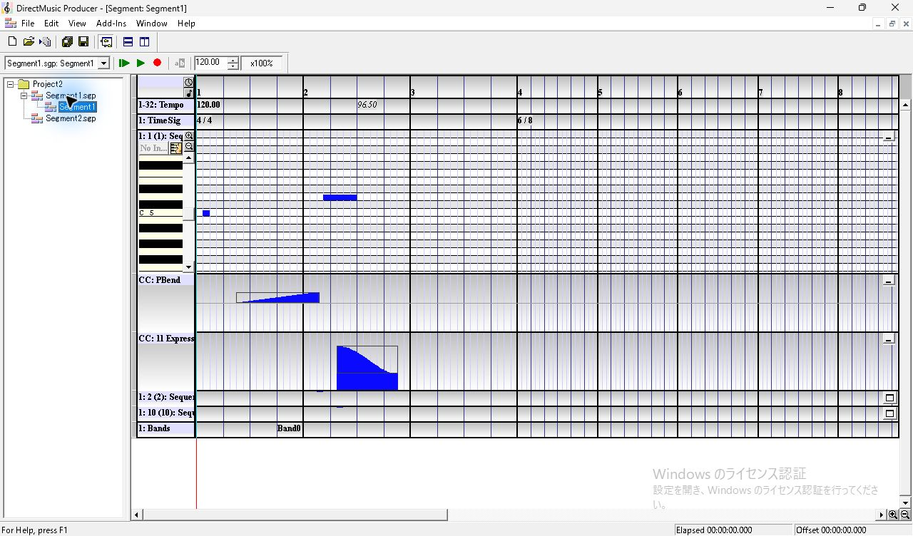

## 追試する条件

Tempo の値域と不正値、Tick 0 に完全一致する重複、複数グループの TimeSig の優先順位、薄いラベルの選定条件を調べる。再生中のテンポ切替と音声は SEG-11・12 の対象。[UI 互換性台帳](../ui-compatibility.json)
