# SEG-10　Boundary の Cut Off と再生中の切替

2026-11-12。Windows 上の DirectMusic Producer 原版コピーで、Primary と Secondary の持続音が鳴っている間に別の Segment へ切り替えた。**Use Segment’s Default** を使った4条件と、**Transition Options** で Cut Off を明示した1条件を比較した。 [実行ファイルと素材のハッシュ](../../../work/original-gui/SEG-10-boundary-cutoff/20261112T090605540726Z/run.json) · [前回の Boundary 下部と Timing の調査](seg-10-boundary-prepare-time.md)

## 検証素材

前回の Band 付き Segment から8小節の Sequence を3文書作った。全て4/4、120 BPM、繰り返し0、先頭に Band0 がある。別々の PChannel に GM の Organ 1（プログラム番号16、0起点）を割り当て、持続音を音高で識別した。Velocity は100。ピアノロールの音の長さと位置は保存ファイルの音符データと照合した。 [素材生成コード](../../../work/original-gui/SEG-10-boundary-cutoff/20261112T090605540726Z/prepare_fixture.py)

| 文書 | 役割 | PChannel | MIDI ノート番号 | 文書先頭からの発音時刻と長さ |
| --- | --- | ---: | ---: | --- |
| A-Primary | 切替元 Primary | 1 | 50 | 0秒から9秒間 |
| B-Secondary | 枠1から並行再生 | 2 | 59、55 | 0秒から8秒間、9秒から1.5秒間 |
| C-Destination | 切替先 Primary | 3 | 66 | 0秒から7秒間 |

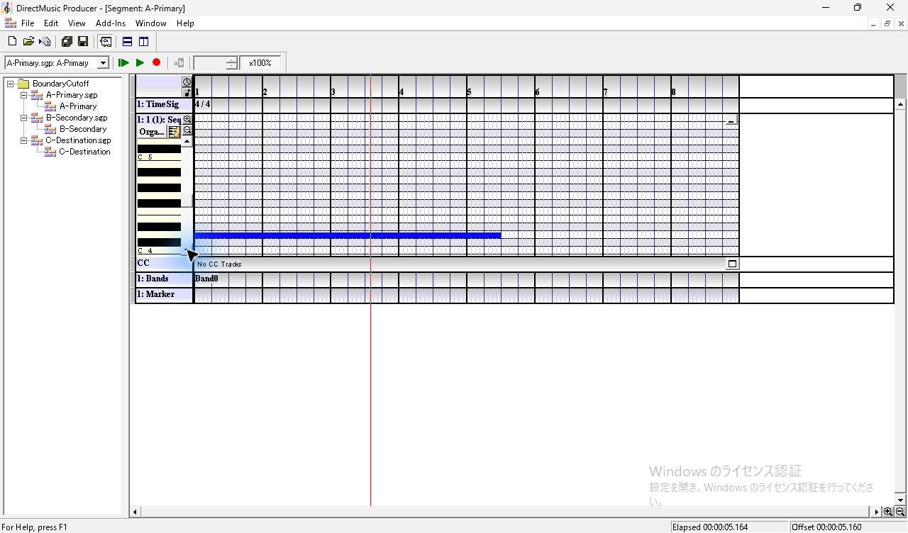

*図1 A の Sequence。縦スクロールで低い持続音を表示。*

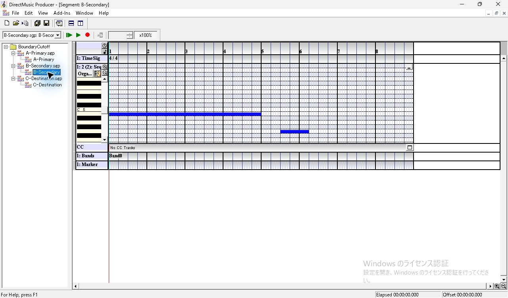

*図2 B の Sequence。先頭の持続音と、5小節目の後続音。*

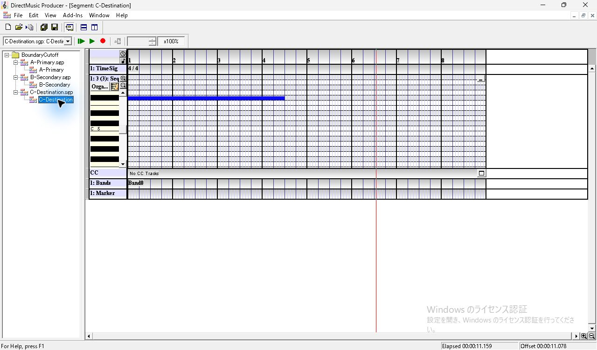

*図3 C の Sequence。PChannel 3 の先頭に別の持続音。*

## 試聴の設定と切替操作

3文書のエディターを開いて Transport の候補に入れた。**View > Secondary Segment Toolbar** を有効にすると、Transport Controls の下に約30 pxの行が増える。左端のスピンで4枠を1枠にし、枠1のコンボから B を選んだ。右端の緑の開始ボタンを右クリックし、**Secondary Segment Audition Options** を開いた。B の開始時に A の持続音を保つため、枠1は **Immediate**、**Don't Cut Off**、**Quick Response** とし、**Controlling Segment** はオフ。 [Secondary Segment Toolbar の既存調査](ui-13-transport-export-live.md#secondary-の表示候補選択)

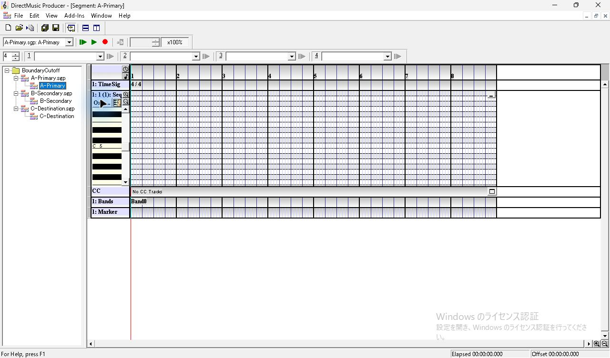

*図4 Secondary Segment Toolbar を表示すると Transport Controls の下に1行が増える。*

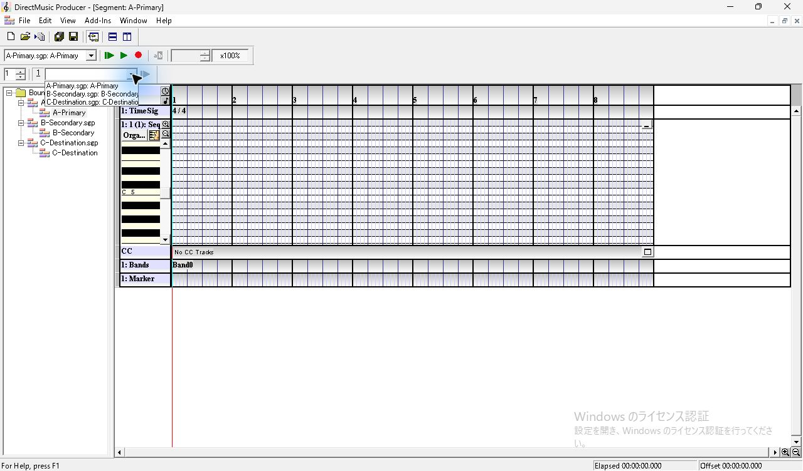

*図5 1枠に縮めた後のコンボ。開いた3文書が候補になる。*

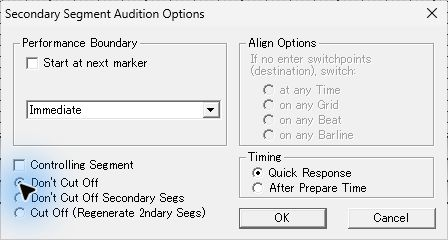

*図6 Secondary の起動設定。Immediate、Don’t Cut Off、Quick Response。*

Transport Controls の右寄りにある **Transition** を右クリックすると **Transition Options** が開く。停止中はアイコンが灰色でも右クリックできた。ダイアログは459 × 333 px。左上が Performance Boundary、左中央が Align Options、左下が Cut Off と Timing、右が Transition Segment と Transition Pattern。**Use Segment’s Default** がオンのときは境界コンボ、Cut Off、Timing が灰色。オフにすると境界コンボ、Cut Off、Timing が有効になり、Immediate では Align Options は灰色。**Transition at next marker** はオフで、Transition Segment と Transition Pattern はともに **None**。 [既定状態のアクセシビリティ記録](../../../work/original-gui/SEG-10-boundary-cutoff/20261112T090605540726Z/captures/13-transition-default-tree.json) · [明示指定時のアクセシビリティ記録](../../../work/original-gui/SEG-10-boundary-cutoff/20261112T090605540726Z/captures/73-explicit-tree.json)

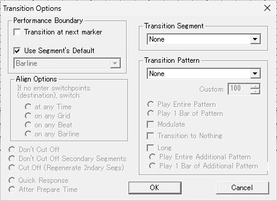

*図7 Transition Options の初期状態。Use Segment’s Default がオンで左下の選択肢は灰色。*

1. A を Transport Controls の **Play From Start** で開始。赤い位置線が進み、Primary のボタンが停止表示になる。
2. B を枠1の緑のボタンで開始。枠1のコンボが灰色になり、ボタンは暗赤色の停止表示になる。
3. Project Tree で `C-Destination.sgp` の内側にある `C-Destination` を1回クリックする。Transport のコンボは C に変わるが、表示中のエディターと赤い位置線は A のまま。この時点では A と B の持続音が続いていた。
4. 青く有効になった **Transition** をクリックする。Status Bar の案内は、現在の再生から選択中の編集対象へ切り替え、右クリックで設定を開くという内容。C の音が鳴り始めても、枠1は停止表示のままだった。
5. Secondary の後続音を収録してから **Stop Immediate**。Primary と枠1のボタンが緑に戻った。

*図8 A を Play From Start で開始。Primary 側のアイコンが停止用に変わる。*

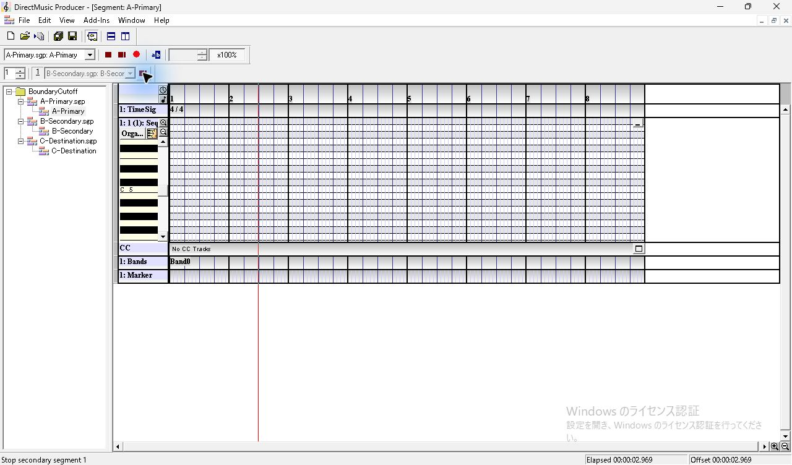

*図9 B を枠1から開始。枠のコンボが灰色、右端が停止表示になる。*

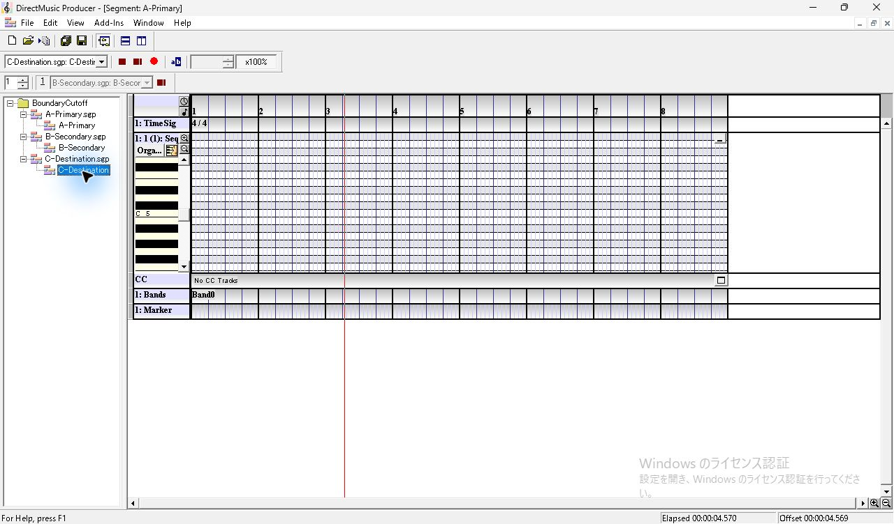

*図10 A と B の再生中に C の論理ノードをクリック。Transport の対象は C、表示エディターは A。*

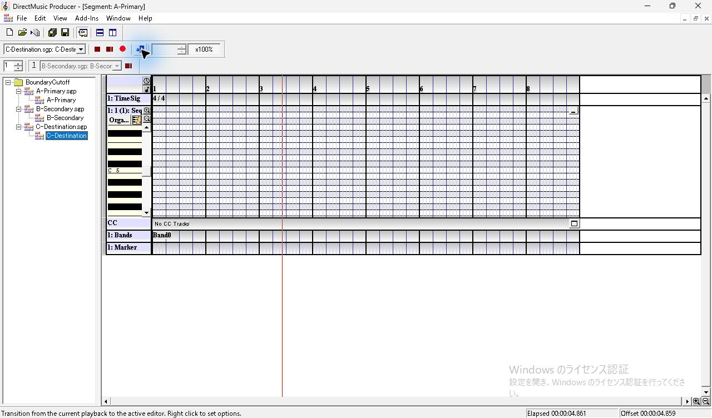

*図11 Transition 操作後。Primary と Secondary の停止ボタンが表示されている。*

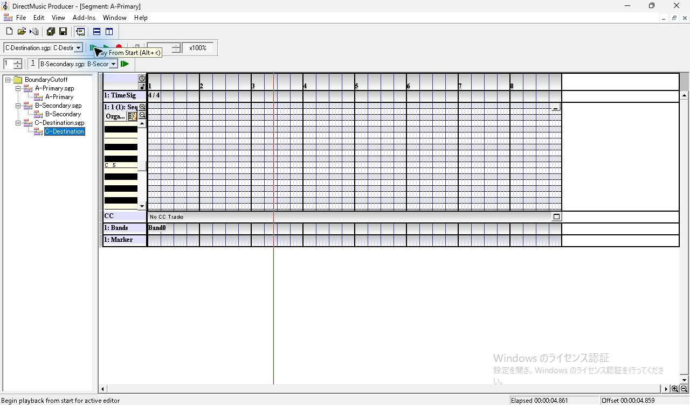

*図12 Stop Immediate の後。Secondary 枠と Primary の再生ボタンが戻る。*

## どの Cut Off が再生に使われるか

Segment の保存設定は、Project Tree の論理ノードから **Properties > Boundary** を開いて変更した。どちらの文書も Performance Boundary は **Immediate**、Timing は **Quick Response**。パネルの下端で Cut Off の3択目は見切れる。上のラジオから下矢印2回で選び、フォーカスが `Cut Off (Regenerate 2ndary Segs)` へ移ったことを確認した。各試行前に .sgp を採取した。 [3択目のフォーカス](../../../work/original-gui/SEG-10-boundary-cutoff/20261112T090605540726Z/captures/55-source-regenerate-tree.json) · [前回の Cut Off のフォーカスと保存値](seg-10-boundary-prepare-time.md#cut-off-の3択と-tab-移動)

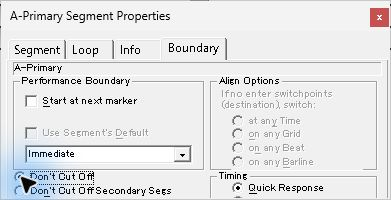

*図13 切替元 A の Boundary で Don’t Cut Off を選択。*

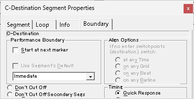

*図14 変更前の C。Cut Off の上2択の選択点が空で、3択目は下端の外。*

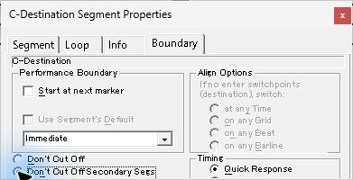

*図15 切替先 C の Don’t Cut Off Secondary Segs を選択。*

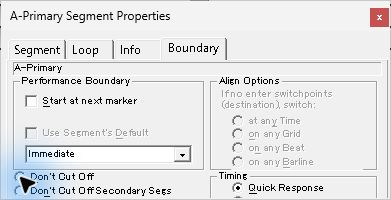

*図16 切替元 A を Cut Off に戻した状態。3択目は下端で見切れる。*

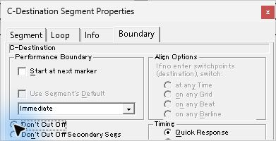

*図17 切替先 C だけを Don’t Cut Off にした対照条件。*

表の **維持** は Don't Cut Off（`0x00008000`）、**Secondary 維持** は Don't Cut Off Secondary Segs（`0x10000000`）、**Cut Off** は Cut Off (Regenerate 2ndary Segs)（`0x00000000`）。値は .sgp の `RIFF DMSG/segh` 内のオフセット20。持続音の判定には C の発音検出から0.4〜1.2秒の窓を使った。B の後続音は5回とも検出した。 [15点の .sgp と録音の照合](../../../work/original-gui/SEG-10-boundary-cutoff/20261112T090605540726Z/transition-audit.json)

| 回 | Transition Options | A の Cut Off | C の Cut Off | 切替後の A の持続音 | 切替後の B の持続音 | 録音 |
| ---: | --- | --- | --- | --- | --- | --- |
| 1 | Use Segment’s Default | 維持 | Cut Off | 途切れる | 途切れる | [WAV](../../../work/original-gui/SEG-10-boundary-cutoff/20261112T090605540726Z/audio/keep-all/output.wav) |
| 2 | Use Segment’s Default | 維持 | 維持 | 続く | 続く | [WAV](../../../work/original-gui/SEG-10-boundary-cutoff/20261112T090605540726Z/audio/both-keep/output.wav) |
| 3 | Use Segment’s Default | 維持 | Secondary 維持 | 途切れる | 続く | [WAV](../../../work/original-gui/SEG-10-boundary-cutoff/20261112T090605540726Z/audio/keep-secondary/output.wav) |
| 4 | Use Segment’s Default | Cut Off | 維持 | 続く | 続く | [WAV](../../../work/original-gui/SEG-10-boundary-cutoff/20261112T090605540726Z/audio/destination-only-keep/output.wav) |
| 5 | Immediate、Cut Off、Quick Response | Cut Off | 維持 | 途切れる | 途切れる | [WAV](../../../work/original-gui/SEG-10-boundary-cutoff/20261112T090605540726Z/audio/explicit-override/output.wav) |

既定設定を使った4回では、C の Cut Off に応じて切替時の持続音が変わった。A と C の設定を反対にした1回目と4回目も、結果は C の設定と一致した。5回目では、4回目と同じ .sgp を使い、試聴ダイアログで明示した Cut Off の結果が出た。Cut Off で B の持続音が途切れた後も、B の再生位置は進み、9秒の位置の別の音が鳴った。この Cut Off の比較は両文書を Immediate とした条件。後続試験では切替元・切替先の Performance Boundary を入れ替え、After Prepare Time とピックアップの有無を比較した。 [切替位置とピックアップの録音](seg-10-transition-pickup.md) [原版ヘルプの Cut Off](../../../../../work/analysis/original-manual-session/20261010T031624075Z/help-extracted/htm/transitionoptionsdontcutoff.htm) · [原版ヘルプの Performance Boundary](../../../../../work/analysis/original-manual-session/20261010T031624075Z/help-extracted/htm/transitionoptionsperformanceboundary.htm)

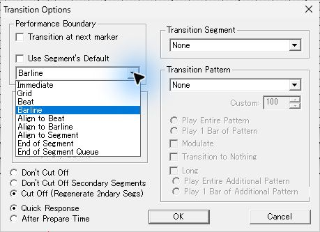

*図18 Use Segment’s Default を外したときの境界候補。*

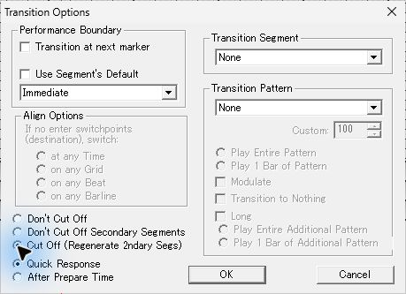

*図19 Transition Options で Immediate、Cut Off、Quick Response を明示指定。*

## 録音の確認方法

Windows の既定出力を WASAPI ループバックで48 kHz、ステレオ、32-bit float で記録した。A、B、C の持続音は80 ms、B の後続音は240 msの窓で基音の振幅を求め、10 ms刻みの記録にした。B の後続音には長い窓を使い、C の Organ 1 に含まれる近い周波数成分と区別した。A、B の各持続音が続いたときは、切替後の中央値が切替前の90%以上。途切れたときは5%未満。C の基音と B の後続音は全条件で検出した。録音のタイムスタンプエラーは0で、不連続フラグは各ファイルの開始直後、A の開始前に1件だった。 [録音解析](../../../work/original-gui/SEG-10-boundary-cutoff/20261112T090605540726Z/measure.py) · [時刻と振幅の測定結果](../../../work/original-gui/SEG-10-boundary-cutoff/20261112T090605540726Z/transition-measurements.json) · [第3回の音高別振幅 CSV](../../../work/original-gui/SEG-10-boundary-cutoff/20261112T090605540726Z/audio/keep-secondary/pitch-profile.csv) · [照合コード](../../../work/original-gui/SEG-10-boundary-cutoff/20261112T090605540726Z/audit.py)

## 終了時と復旧

検証後、Transition Options と Secondary の試聴設定を開始時の値へ戻し、枠数を4に戻して Secondary Segment Toolbar を非表示にした。子エディターを **Window > Close All** で閉じてから Project を閉じると、作業用の B に保存確認が出た。**No All** で閉じた後、Project Tree が空になったが、ウィンドウは応答なしになった。対象プロセス1件の応答状態を確認して終了し、対象プロセスと Producer ウィンドウが0件になってから同じ実行ファイルを1件起動した。復旧後は Project を閉じた待機状態で、**Project Tree、Standard Toolbar、Status Bar、Transport Controls** を表示。作業コピーの3つの .sgp は最後の検証前スナップショットと一致した。 [応答しなかったプロセスの記録](../../../work/original-gui/SEG-10-boundary-cutoff/20261112T090605540726Z/captures/106-unresponsive-process.json) · [復旧後のウィンドウ一覧](../../../work/original-gui/SEG-10-boundary-cutoff/20261112T090605540726Z/captures/111-end-windows.json)

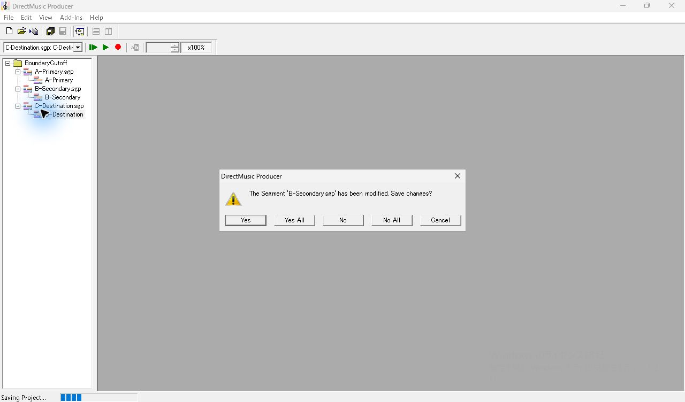

*図20 子エディターを閉じた後、Project を閉じる際の保存確認。*

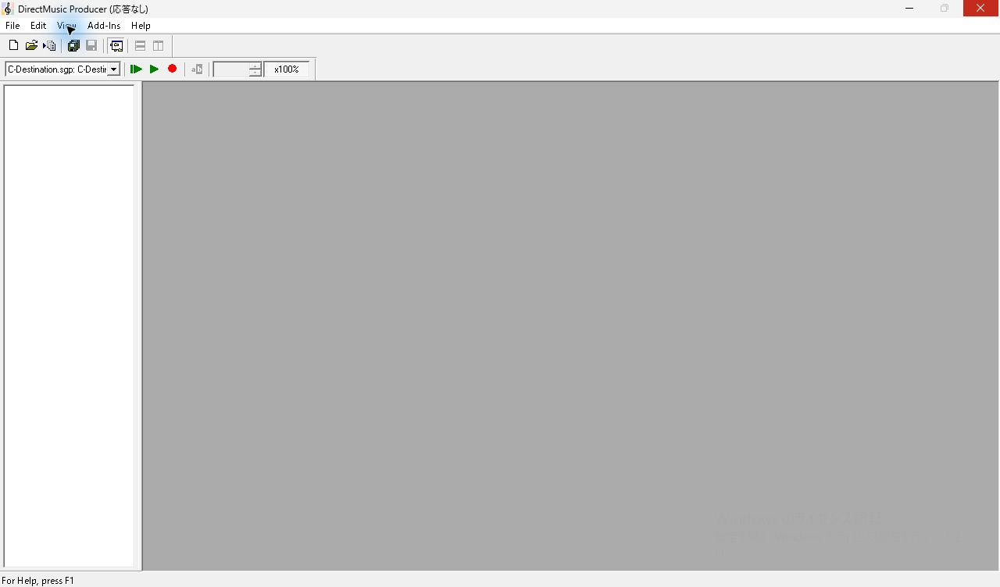

*図21 Project Tree が空になった後にタイトルバーへ応答なしと表示。*

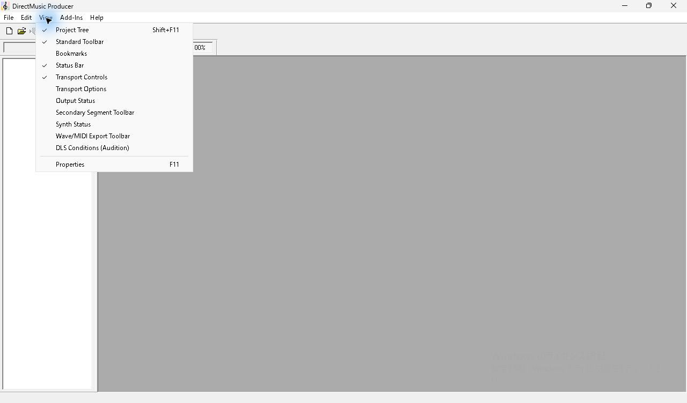

*図22 復旧後の View。基準の4項目が有効。*

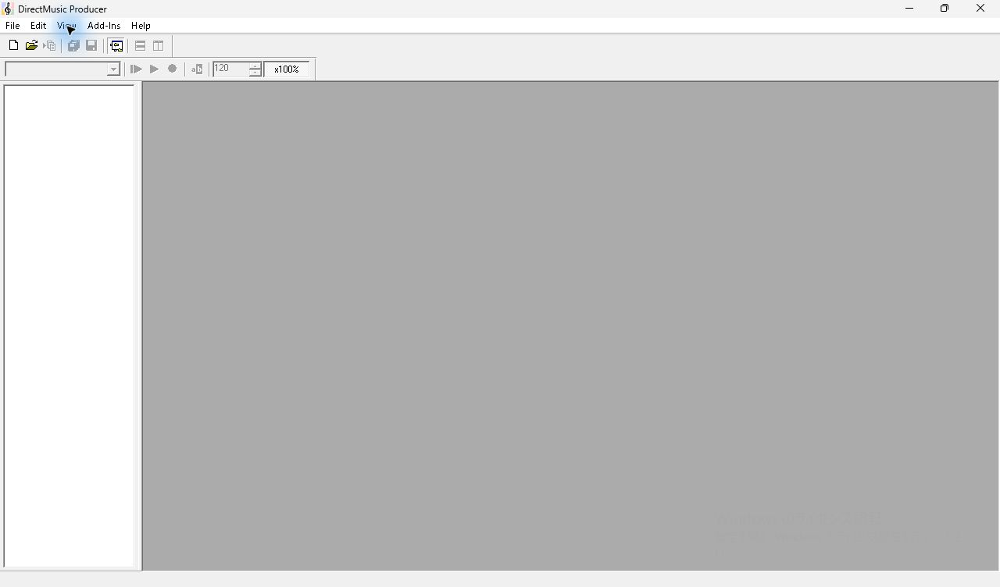

*図23 復旧後の原版コピー1件。Project を閉じた待機画面。*
