# SEG-10　Boundary の Timing とピックアップ再生

2026-11-12。Windows の DirectMusic Producer 原版コピーで調査した。先頭再生時の **Quick Response** と **After Prepare Time** を各2回比較し、パネル下端のラジオボタンを操作した。表示中のツールバーなどは View の Project Tree、Standard Toolbar、Status Bar、Transport Controls。 [実行ファイルと素材のハッシュ](../../../work/original-gui/SEG-10-boundary-pickup/20261112T085202853616Z/recording-environment.json) · [開始時のウィンドウ一覧](../../../work/original-gui/SEG-10-boundary-pickup/20261112T085202853616Z/captures/00-start-windows.json)

## 検証用 Sequence と楽器

[追加小節の検証素材](seg-10-length-pickup.md) を複製し、Project と Segment に別 GUID を振った。4/4、4小節、120 BPM 相当、開始位置0、繰り返し0。Sequence Part のピックアップと末尾の追加小節は各1。音の識別用に `seqt/evtl` の3音を下表の音程と位置に差し替えた。右の追加小節には音を置いていない。 [素材生成コード](../../../work/original-gui/SEG-10-boundary-pickup/20261112T085202853616Z/prepare_fixture.py) · [入力の Segment1.sgp](../../../work/original-gui/SEG-10-boundary-pickup/20261112T085202853616Z/inputs/BoundaryPickup/Segment1.sgp)

| 音 | MIDI ノート番号 | 第1小節先頭からの時刻 | 長さ |
| --- | ---: | ---: | ---: |
| ピックアップの前の音 | 67 | −960 clocks（−0.625秒） | 96 clocks |
| ピックアップの後の音 | 73 | −192 clocks（−0.125秒） | 96 clocks |
| 本体の音 | 60 | +768 clocks（+0.500秒） | 191 clocks |

3音とも PChannel 1、Velocity 100。Sequence を開き、左ヘッダーの楽器アイコンから **Insert New Instrument** を選んだ。小節1の先頭に Bands 行と `Band0` が現れ、Sequence の楽器欄は `No In...` から `Pian...` になった。Bands 行の `Band0` をダブルクリックした子エディターでは、`PCh#` 1 に `Piano 1` が入っていた。

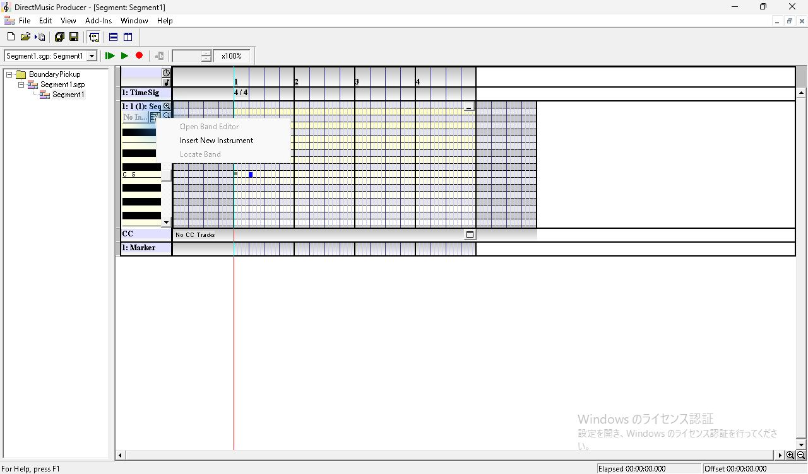

*図1 Sequence の楽器メニュー。Band を入れる前は Insert New Instrument を選択できる。*

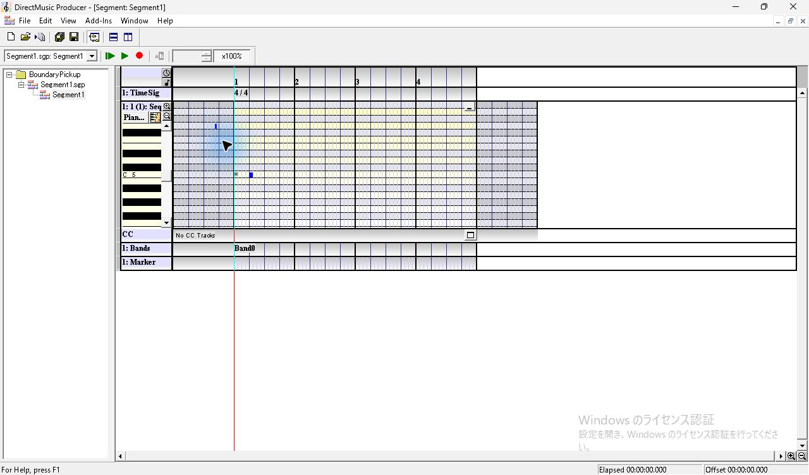

*図2 楽器追加後。Sequence ヘッダーの Pian... と先頭の Band0。*

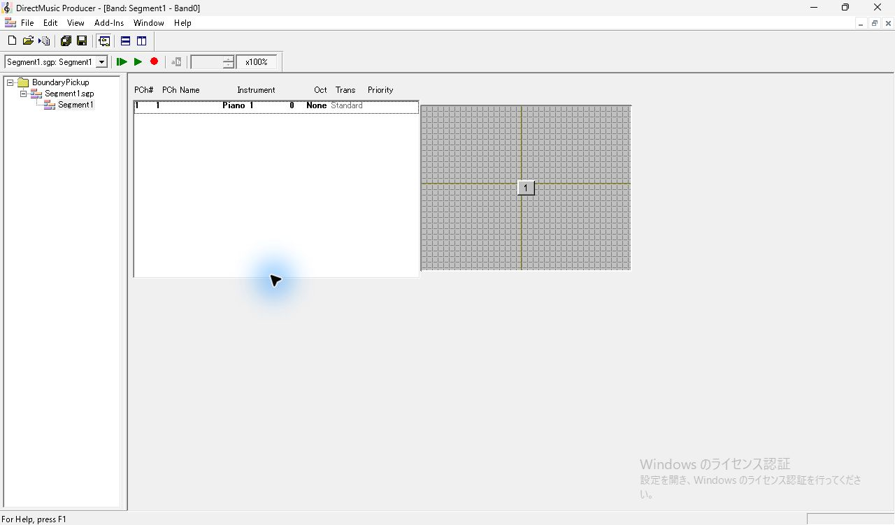

*図3 Band0 子エディター。PCh# 1 に Piano 1。*

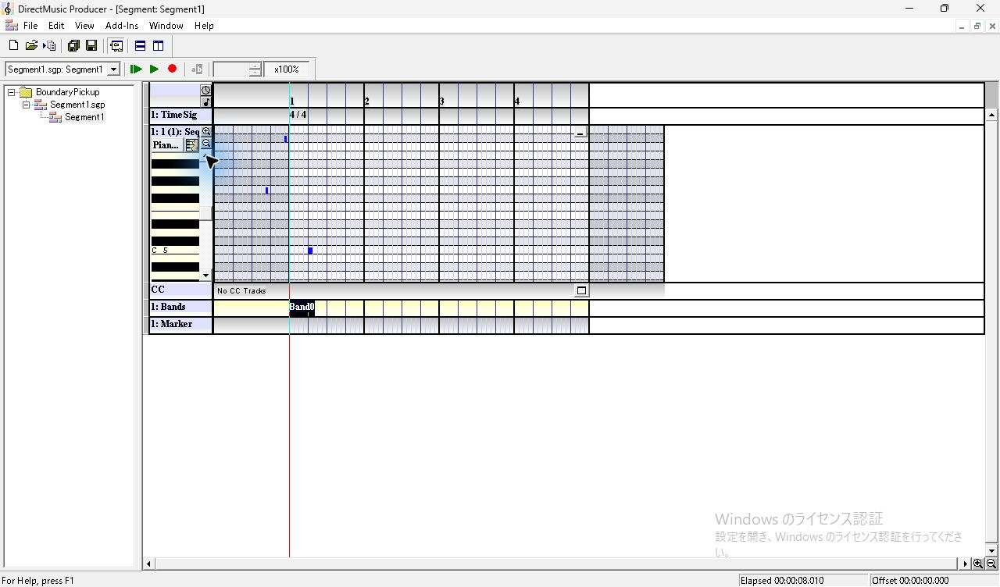

*図4 ピアノロールを縦にスクロールした状態。小節1より左に2音、右に1音。*

## Boundary 下部の表示とキー操作

Project Tree の `Segment1.sgp` 内側にある `Segment1` を右クリックして **Properties** を選び、**Boundary** タブを開く。パネル単体は391 × 200 px。左に Performance Boundary、右に Align Options、その下に Cut Off の選択肢と Timing が並ぶ。左は上2択、右は Quick Response が読める。左の3択目と右の2択目のラベルは下端で見切れている。矢印キーで見切れた項目へ移っても、パネルのサイズは変わらず、下端の項目は表示領域に入らなかった。

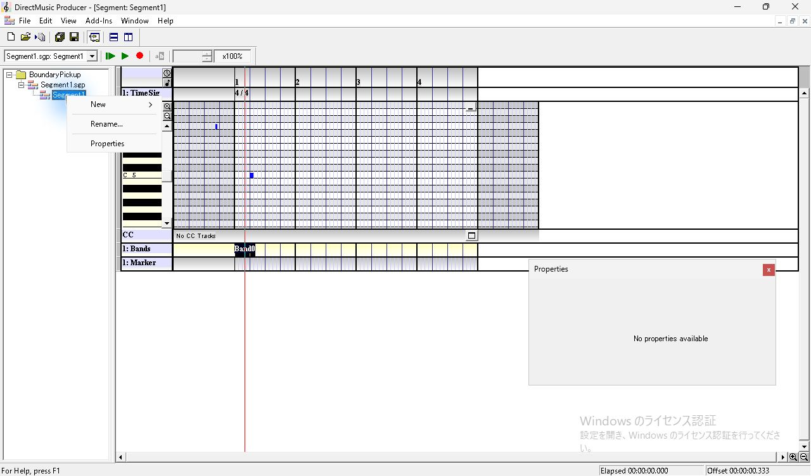

*図5 Project Tree 内側の Segment1 の右クリックメニュー。*

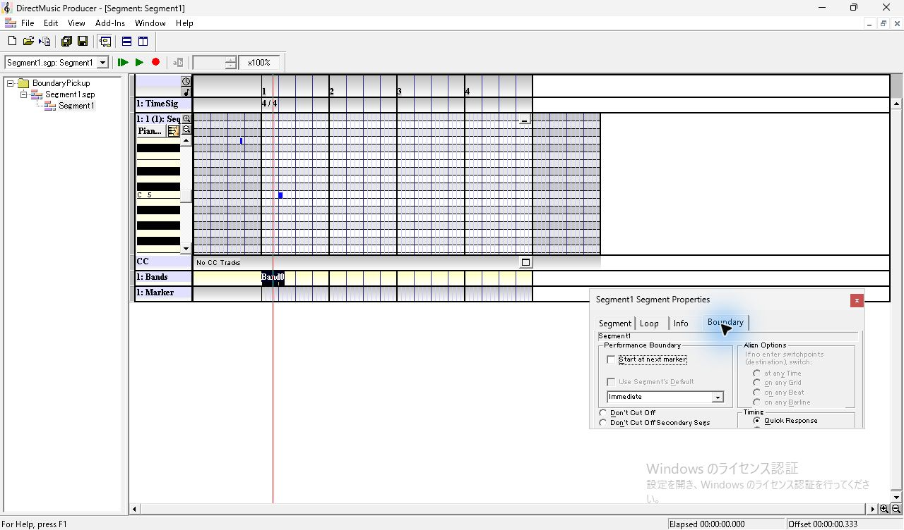

*図6 Boundary を選んだ全体画面。プロパティはエディター右下に浮く。*

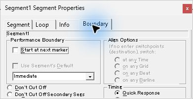

*図7 初期状態のプロパティ単体。Immediate と Quick Response が表示される。*

Performance Boundary が **Immediate** の状態で **Quick Response** をクリックし、下矢印を1回押す。上のラジオの黒い点が消え、フォーカスは `After Prepare Time`（ID 511）へ移る。Timing 内で上矢印を押すと Quick Response（ID 510）へ戻り、黒い点が再び見える。After Prepare Time の選択はパネルを閉じる前に反映され、閉じて Ctrl+S で保存できた。 [初期状態のアクセシビリティ記録](../../../work/original-gui/SEG-10-boundary-pickup/20261112T085202853616Z/captures/24-boundary-tree.json) · [下矢印の後のフォーカス](../../../work/original-gui/SEG-10-boundary-pickup/20261112T085202853616Z/captures/33-after-tree.json) · [上矢印の後のフォーカス](../../../work/original-gui/SEG-10-boundary-pickup/20261112T085202853616Z/captures/62-quick-tree.json)

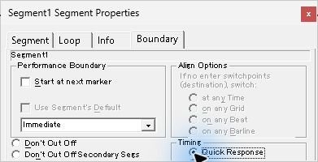

*図8 Quick Response のラジオボタンをクリックした状態。*

*図9 下矢印を押した後。Quick Response の選択点が外れ、移動先のラベルは下端の外。*

## 先頭再生の録音比較

どちらも **Immediate**、Cut Off の選択は基準のまま。Transport Controls の **Play From Start** を押し、自然終了まで待った。停止中は緑の再生ボタン、再生中は赤い停止ボタンと進む赤い位置線。自然終了後は緑に戻り、Offset は `00:00:00.000`。画面の Elapsed は約8秒だった。録音上の操作からの待ち時間と、ステータスバーの Elapsed は別に記録した。

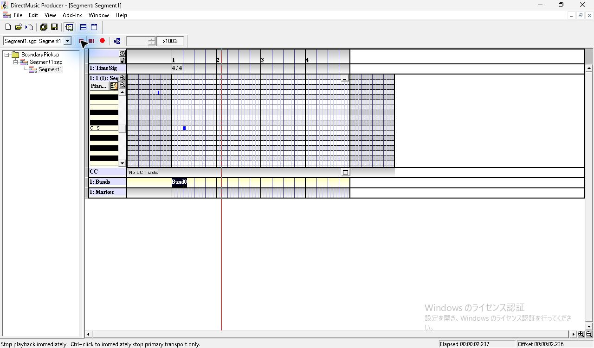

*図10 Quick Response の1回目の再生中。赤い位置線と Transport の停止ボタン。*

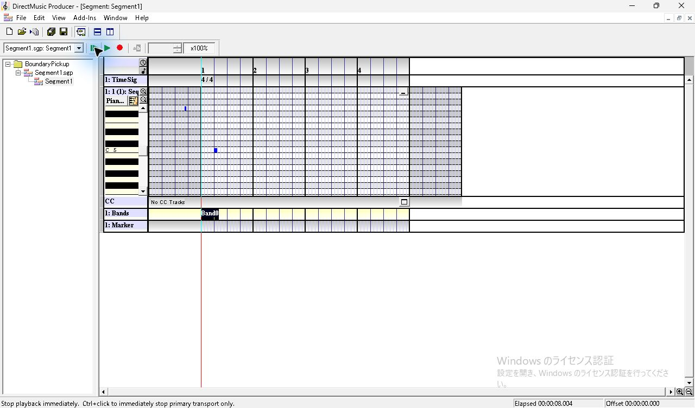

*図11 Quick Response の自然終了。位置線は第1小節へ戻る。*

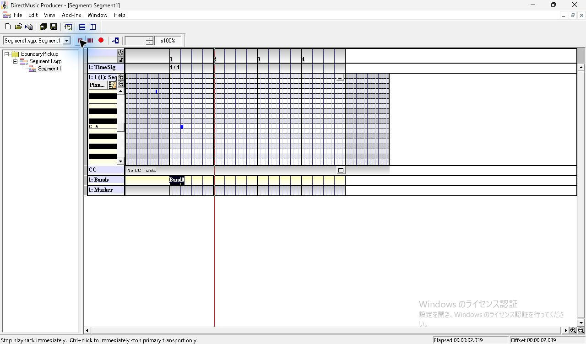

*図12 After Prepare Time の1回目の再生中。*

*図13 After Prepare Time の自然終了。*

既定の Windows 出力を WASAPI ループバックで 48 kHz、ステレオ、32-bit float の WAV に記録した。各 WAV は同じ設定での2回分。表の時刻は操作ツールがクリックを要求した時刻から、WAV 上で検出した立ち上がりまで。5 ms 刻みでピークを拾い、立ち上がりから48 msの窓で3音の基音を照合した。クリック処理には要求から完了まで94〜134 msの幅がある。 [Quick Response の WAV](../../../work/original-gui/SEG-10-boundary-pickup/20261112T085202853616Z/audio/quick/output.wav) · [After Prepare Time の WAV](../../../work/original-gui/SEG-10-boundary-pickup/20261112T085202853616Z/audio/prepare/output.wav) · [録音と照合のコード](../../../work/original-gui/SEG-10-boundary-pickup/20261112T085202853616Z/measure.py) · [照合結果](../../../work/original-gui/SEG-10-boundary-pickup/20261112T085202853616Z/boundary-audit.json)

| 設定 | 回 | MIDI 67 | MIDI 73 | MIDI 60 |
| --- | ---: | ---: | ---: | ---: |
| Quick Response | 1 | 検出なし | 検出なし | 0.761秒 |
| Quick Response | 2 | 検出なし | 検出なし | 0.720秒 |
| After Prepare Time | 1 | 0.429秒 | 0.929秒 | 1.554秒 |
| After Prepare Time | 2 | 0.496秒 | 0.996秒 | 1.621秒 |

After Prepare Time の2回とも、2つのピックアップ音の間は0.500秒、後のピックアップ音から本体音までは0.625秒。保存済みの音符間隔と一致した。Quick Response の2回は本体音だけを検出した。どちらの録音も時刻エラーは0で、パケットの不連続フラグは再生操作より前の録音開始直後に1件。ローカルの既定出力で確認し、物理スピーカーでの聴取は測定範囲外。原版ヘルプにも、ピックアップ音の再生に準備時間が関わると記載されている。 [原版ヘルプの Timing](../../../../../work/analysis/original-manual-session/20261010T031624075Z/help-extracted/htm/timingoptions.htm) · [原版ヘルプの Extra Measures](../../../../../work/analysis/original-manual-session/20261010T031624075Z/help-extracted/htm/extrameasures.htm)

## Cut Off の3択と Tab 移動

左の **Don't Cut Off**（ID 1216）をクリックし、下矢印を押すと **Don't Cut Off Secondary Segs**（ID 1217）。もう1回押すと **Cut Off (Regenerate 2ndary Segs)**（ID 1218）。3択目は画面上でラベルが見えないが、アクセシビリティ記録でフォーカスが一致した。この Immediate の状態で1択目または3択目から Tab を押すと、右の Timing で現在選択中の **After Prepare Time** へ移った。 [2択目のフォーカス](../../../work/original-gui/SEG-10-boundary-pickup/20261112T085202853616Z/captures/44-cutoff-second-tree.json) · [3択目のフォーカス](../../../work/original-gui/SEG-10-boundary-pickup/20261112T085202853616Z/captures/46-cutoff-third-tree.json) · [Tab 移動後のフォーカス](../../../work/original-gui/SEG-10-boundary-pickup/20261112T085202853616Z/captures/48-tab-to-timing-tree.json)

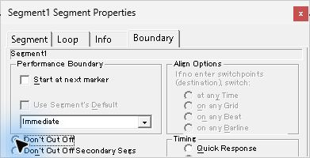

*図14 左の最上段の Don’t Cut Off にマウスで移動。*

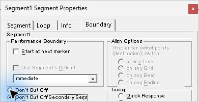

*図15 下矢印1回で2番目に移る。2番目のラベルに点線のフォーカス枠が見える。*

*図16 下矢印2回で3番目に移る。ラベルは見切れたまま。*

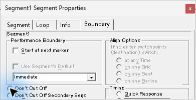

*図17 Tab で右の Timing グループへ移った直後。*

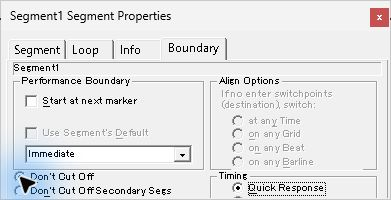

*図18 Timing で上矢印を押し Quick Response に戻った状態。*

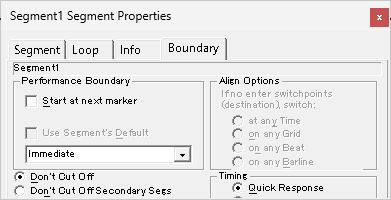

*図19 保存後にパネルを開き直した状態。Don’t Cut Off と Quick Response に選択点。*

## 保存値

保存済みの .sgp 6点はすべて1060バイト。Band0 を入れた直後からのファイル差分は `RIFF DMSG/segh` 内のオフセット20の DWORD だけだった。長さ12288 clocks、開始位置0、3音の位置と長さ、Band を含むトラックのデータは一致した。組み合わせごとの値は以下のとおり。 [保存した6点の照合結果](../../../work/original-gui/SEG-10-boundary-pickup/20261112T085202853616Z/boundary-audit.json)

| 保存時の操作 | Timing | DWORD |
| --- | --- | --- |
| Band0 作成直後と基準の再生前（各1点） | Quick Response | `0x00000000` |
| Timing のみ切替 | After Prepare Time | `0x00000400` |
| 左3択目を明示選択 | After Prepare Time | `0x00000400` |
| Don't Cut Off Secondary Segs を選択 | After Prepare Time | `0x10000400` |
| Don't Cut Off を選択し、Timing を戻す | Quick Response | `0x00008000` |

保存後にプロパティを開き直すと **Don't Cut Off** と **Quick Response** に選択点があった。表示確認後、鍵盤を上へスクロールして3音が見える画面を撮影した。子エディターを **Window > Close All** で閉じてから Project を閉じると、保存確認が表示された。撮影後の変更は **No** で破棄した。終了時に実ファイルが最後の保存スナップショットと一致し、Project を閉じた状態で開始時と同じ原版コピー1件であることを確認した。 [保存確認の画面](../../../work/original-gui/SEG-10-boundary-pickup/20261112T085202853616Z/captures/78-idle-0.jpg) · [終了時のウィンドウ一覧](../../../work/original-gui/SEG-10-boundary-pickup/20261112T085202853616Z/captures/80-end-windows.json)

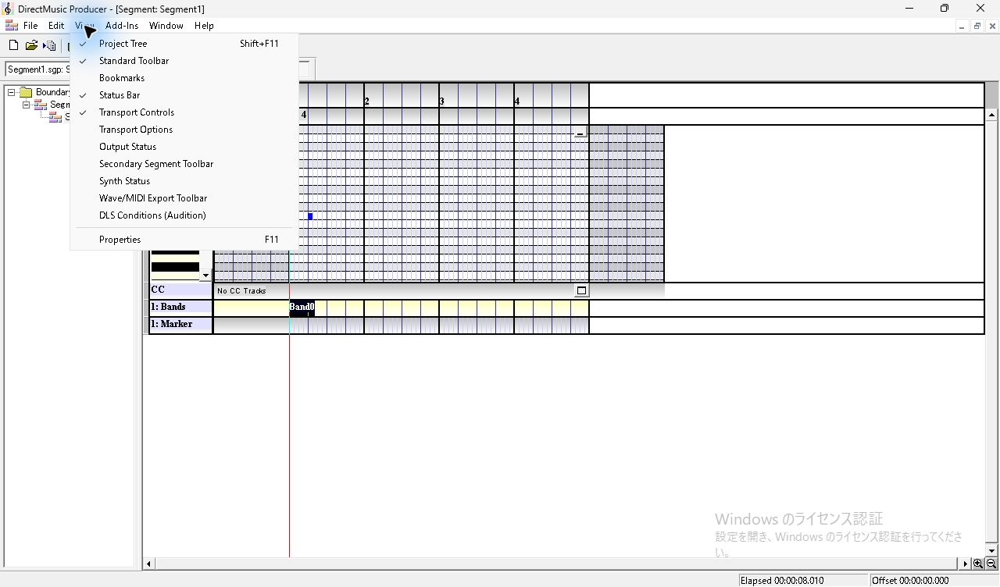

*図20 View の表示項目は Project Tree、Standard Toolbar、Status Bar、Transport Controls の4つ。*

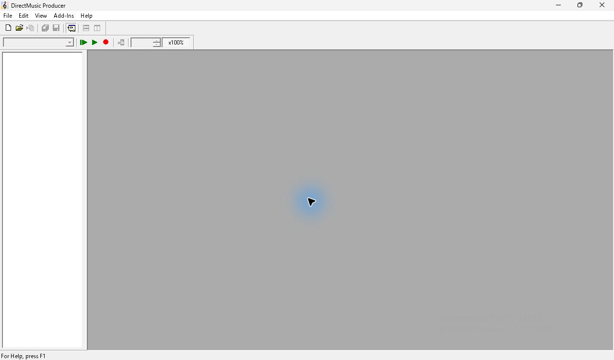

*図21 Project を閉じた原版コピー。*

後続の再生検証では、Primary と Secondary の持続音を鳴らして Transition をかけ、Cut Off の3択による発音差を録音した。末尾の追加小節とピックアップは、自然終了・有限 Repeat・Infinite での発音を録音した。別 Segment からの直接切替では、Immediate・Barline、Quick Response・After Prepare Time と要求位置によるピックアップの違いを録音した。 [Cut Off と切替時の発音](seg-10-boundary-cutoff.md) · [先頭再生とループ時の録音](seg-10-extra-bar-playback.md) · [切替位置とピックアップの録音](seg-10-transition-pickup.md)
