# SEG-10・12　ピックアップと末尾の追加小節の再生

2026-11-12。Windows 上の DirectMusic Producer 原版コピーで、同じ Sequence を7条件で先頭から再生した。ピックアップ、本体、末尾の追加小節のノートを区別できるようにし、発音時刻、再生位置線、保存値を照合した。 [実行ファイルと素材のハッシュ](../../../work/original-gui/SEG-10-extra-bar-playback/20261112T092438914057Z/run.json) · [ピックアップと追加小節の編集調査](seg-10-length-pickup.md)

## 検証素材

[After Prepare Time を保存した Sequence](seg-10-boundary-prepare-time.md) を複製し、Project と Segment に別 GUID を振った。4/4、120 BPM、1拍768 clocks。**Segment Length** は4小節、**Extension bars** は1、**Display pick-up bar** はオン。**Start at** は `1:1:1:0`。**Boundary** は **Immediate**、**After Prepare Time**。PChannel 1 は先頭の Band0 の **Piano 1**。発音を識別するため、素材作成時に `seqt/evtl` を以下の6音に差し替えた。長さは各144 clocks、Velocity 100。 [素材生成コード](../../../work/original-gui/SEG-10-extra-bar-playback/20261112T092438914057Z/prepare_fixture.py) · [入力の Segment1.sgp](../../../work/original-gui/SEG-10-extra-bar-playback/20261112T092438914057Z/inputs/ExtraBarPlayback/Segment1.sgp)

| 描画位置 | MIDI ノート | 保存した発音位置 | 本体先頭からの時刻 |
| --- | ---: | ---: | ---: |
| 左のピックアップ | 67 | −960 clocks（論理0、Offset −960） | −0.625秒 |
| 本体の第1小節 | 60 | 768 clocks | 0.500秒 |
| 本体の第2小節 | 63 | 3840 clocks | 2.500秒 |
| 本体の第4小節 | 65 | 11136 clocks | 7.250秒 |
| 右の追加小節の前の音 | 69 | 12672 clocks | 8.250秒 |
| 右の追加小節の後の音 | 71 | 13440 clocks | 8.750秒 |

ピアノロールの左端の縦スクロールを上げると、画面外にあった高い末尾音も見える。本体の小節番号は1〜4。前後の灰色の小節には Sequence の格子とノートが描かれる。TimeSig、Bands、Marker の格子は本体の端まで。

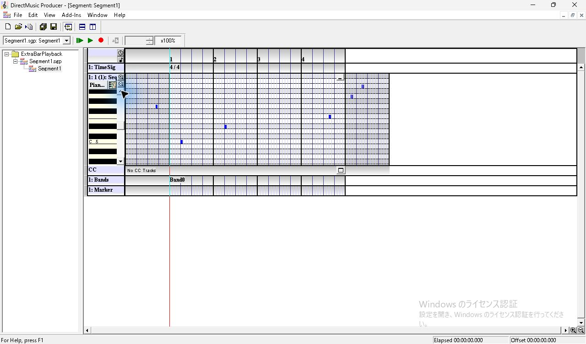

*図1 ピアノロールを縦にスクロールした状態。左の灰色に1音、本体に3音、右の灰色に2音。*

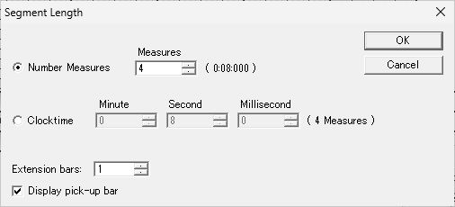

*図2 4小節、Extension bars 1、Display pick-up bar オン。*

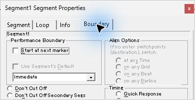

*図3 Performance Boundary は Immediate。After Prepare Time の選択欄はパネル下端で見切れている。*

## Repeat 0 と自然終了

**Properties > Loop** の **Repeat** は0、**Infinite** はオフ。**Play From Start** を押すと、ピックアップの MIDI 67 と本体の3音が鳴った。第4小節の後で Transport が緑の再生ボタンに戻り、赤い位置線と Offset は先頭へ戻った。末尾2音の予定時刻も録音した。 [Repeat 0 の WAV](../../../work/original-gui/SEG-10-extra-bar-playback/20261112T092438914057Z/audio/zero/output.wav)

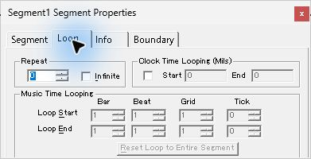

*図4 Repeat 0。Music Time Looping の端点とリセットボタンは灰色。*

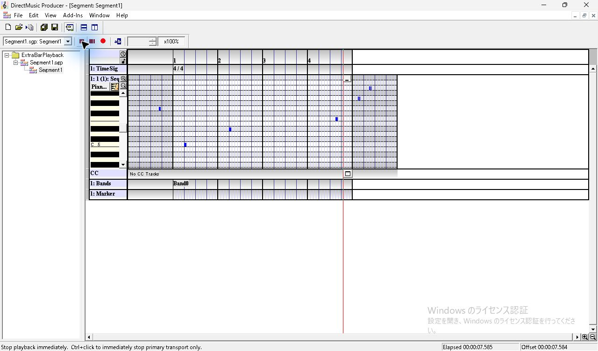

*図5 Repeat 0 の終盤。赤い再生位置が第4小節にある。*

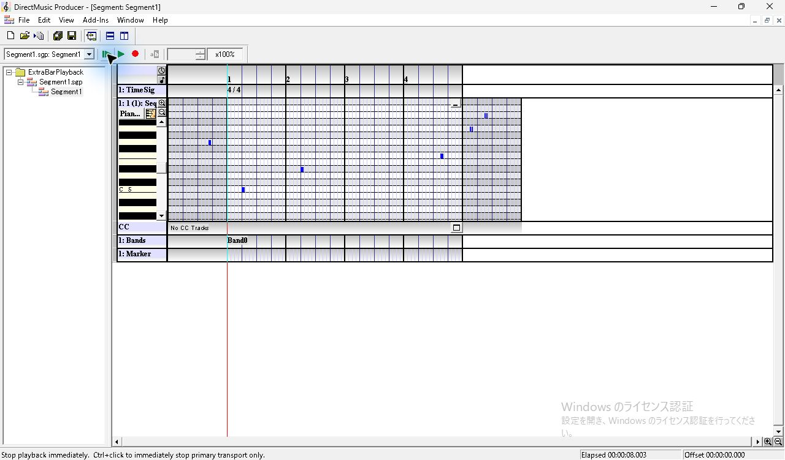

*図6 第4小節の後に Transport が停止し、Elapsed 8.003秒、Offset 0に戻る。*

## 有限リピート

Repeat の上向きスピンを1回押すと **Repeat 1** になり、**Music Time Looping** の端点を編集できる。**Reset Loop to Entire Segment** を押した場合は、Loop Start が `1:1:1:0`、Loop End が `5:1:1:0`。この Loop End は本体の終端を指す。再生時は赤い位置線が第4小節から第1小節へ折り返し、Elapsed は加算、Offset は約8秒分戻った。ピックアップは初回だけ、本体の3音は2周分が鳴った。 [全区間リピートの WAV](../../../work/original-gui/SEG-10-extra-bar-playback/20261112T092438914057Z/audio/finite-full/output.wav)

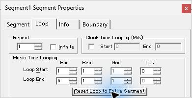

*図7 Repeat 1。Reset Loop to Entire Segment 後の端点は1:1:1:0と5:1:1:0。*

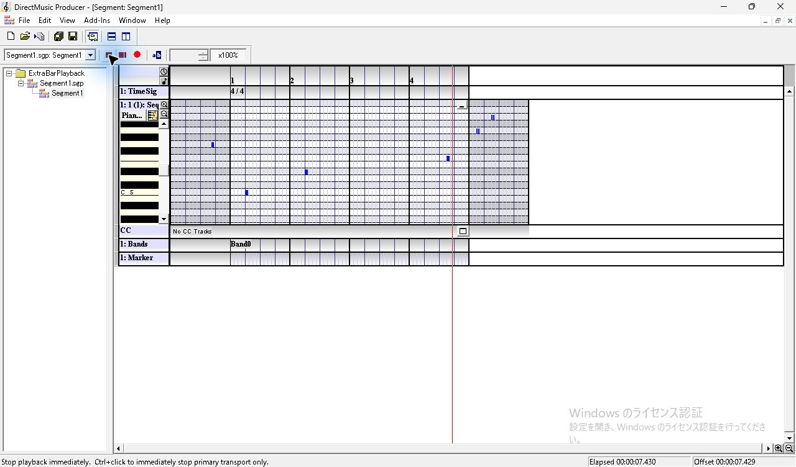

*図8 全区間リピートの折り返し前。Elapsed 7.430秒、Offset 7.429秒。*

*図9 2周目の第1小節。Elapsed 9.166秒、Offset 1.164秒。*

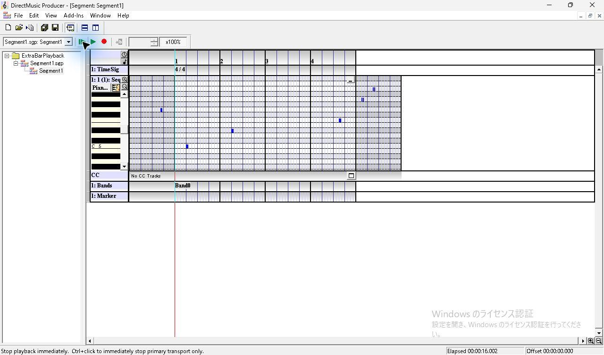

*図10 全区間を2周した後の自然終了。Elapsed 16.002秒。*

Loop Start を `2:1:1:0`、Loop End を `4:1:1:0` にすると、第2・第3小節を1回繰り返す。Play From Start は本体の先頭から進み、第4小節の直前で第2小節へ戻った。第1小節と第4小節の音は各1回。第2小節の MIDI 63 は2.500秒と6.500秒の2回。ループを抜けた後、第4小節の音が11.250秒で鳴り、画面上は約12秒で自然終了した。 [部分リピートの WAV](../../../work/original-gui/SEG-10-extra-bar-playback/20261112T092438914057Z/audio/finite-partial/output.wav)

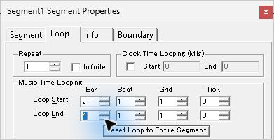

*図11 Repeat 1。Loop Start 2:1:1:0、Loop End 4:1:1:0。*

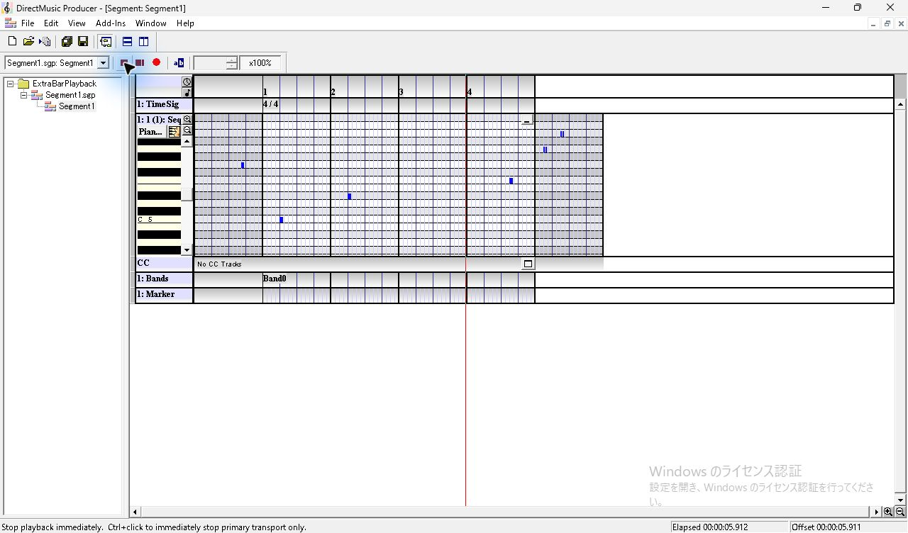

*図12 部分ループの折り返し前。位置線は第4小節の直前。*

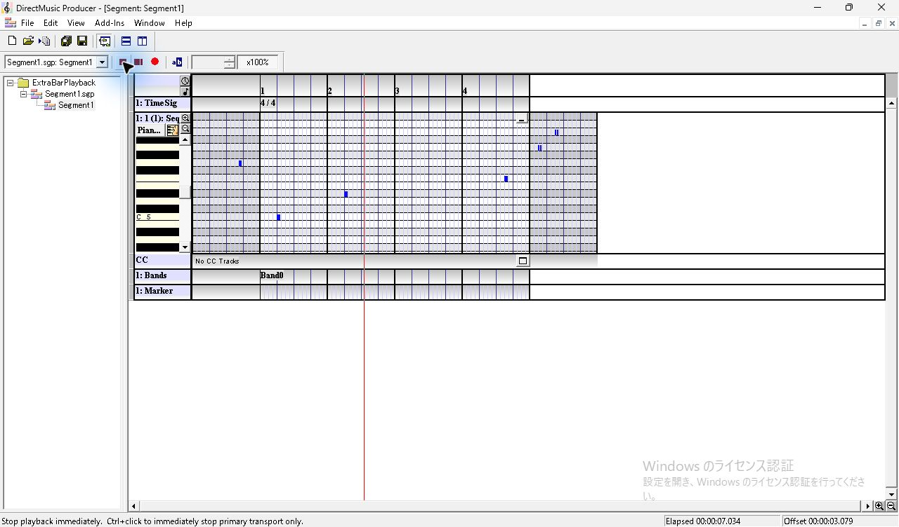

*図13 部分ループで第2小節に戻った後。Elapsed 7.034秒、Offset 3.079秒。*

*図14 部分ループを抜けて第4小節まで再生した後。Elapsed 12.009秒。*

## Infinite と手動停止

端点を全区間に戻し、**Infinite** をオンにすると Repeat の入力が灰色になった。再生は16秒を過ぎて3周目へ入り、初回以降のピックアップ音は検出しなかった。3周目の第2小節の音まで録音し、**Stop Immediate** で停止した。停止後の画面は Elapsed 20.088秒、Offset 3.990秒。位置線は停止位置に残った。保存後に Infinite を解除したときは **Repeat 0** に戻った。 [Infinite の WAV](../../../work/original-gui/SEG-10-extra-bar-playback/20261112T092438914057Z/audio/infinite/output.wav)

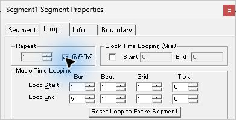

*図15 Infinite を選択。Repeat の入力は灰色で、音楽時刻の端点は有効。*

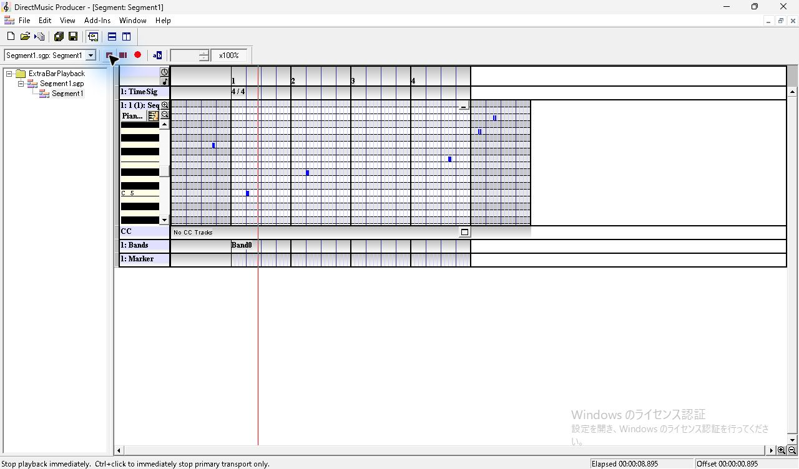

*図16 Infinite の2周目。再生ボタンは停止表示のまま。*

*図17 3周目の第1小節。Elapsed 17.298秒、Offset 1.296秒。*

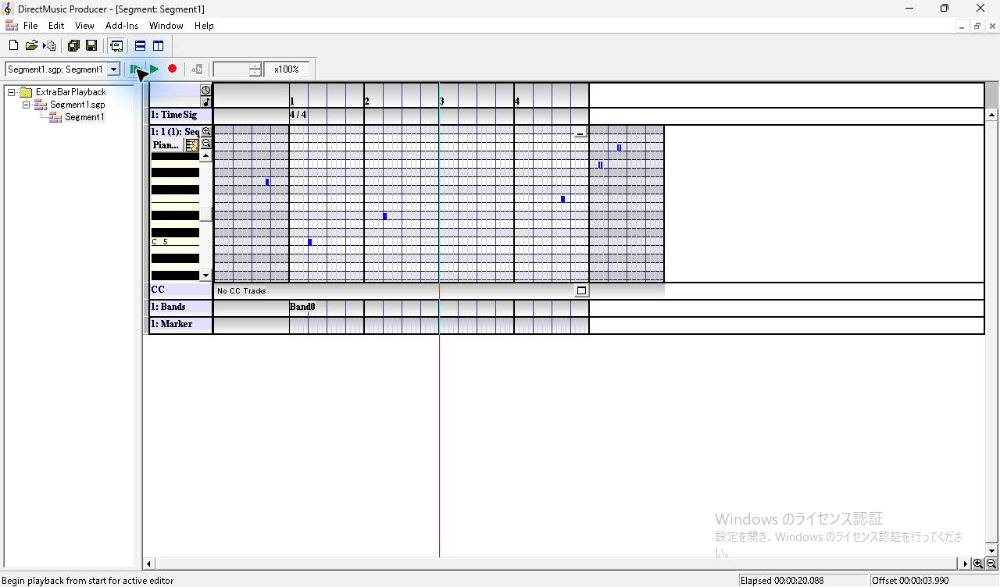

*図18 Stop Immediate を押した後。位置線は停止位置に残り、再生ボタンが緑に戻る。*

## Clocktime と、末尾2音を本体に入れた比較

Repeat 0 で **Segment Length > Clocktime** を選び、0分8秒0ミリ秒で確定した。Segment タブの Length ボタンが `4 Bars` から `0:08:000` に変わった。録音は小節指定の Repeat 0 と同じ4音だった。

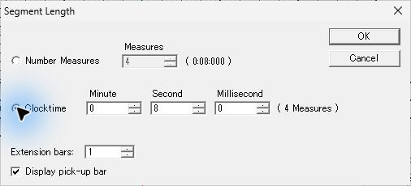

*図19 Clocktime 0分8秒0ミリ秒。右の表示は4 Measures。*

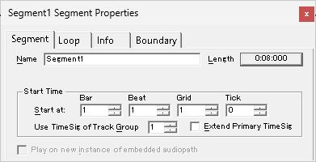

*図20 Length のボタンが 0:08:000 に変わった状態。*

*図21 Clocktime 8秒の自然終了。Elapsed 8.005秒。*

次に Number Measures に戻して本体だけを **5小節** に延ばした。MIDI 69 と71は画面上も同じ横位置にあり、灰色の追加小節の代わりに白い第5小節の中に入る。赤い再生位置線は第5小節まで進み、2音とも8.250秒と8.750秒で鳴った。4小節へ戻すと、ノートは再び灰色の追加小節に描かれ、録音では検出されなかった。8点の保存済み .sgp のトラックデータはバイト単位で一致した。 [5小節の保存ファイル](../../../work/original-gui/SEG-10-extra-bar-playback/20261112T092438914057Z/captures/65-five-bar-control-Segment1.sgp) · [4小節へ戻した保存ファイル](../../../work/original-gui/SEG-10-extra-bar-playback/20261112T092438914057Z/captures/75-return-four-Segment1.sgp)

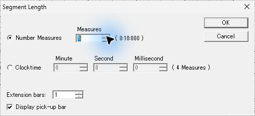

*図22 対照試験の Number Measures 5。Extension bars とピックアップは設定済み。*

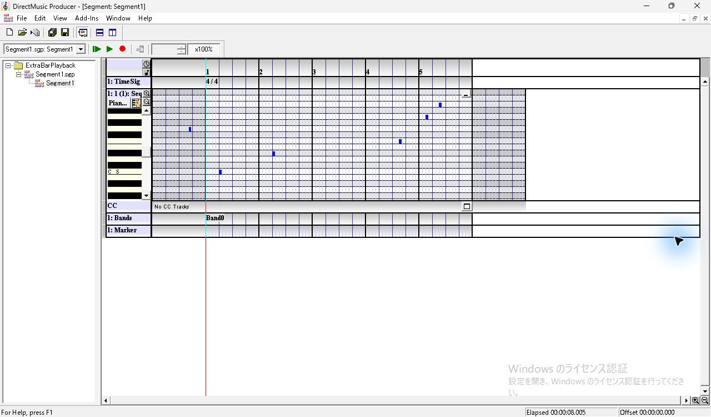

*図23 右の2音は同じ横位置で白い第5小節に入った。灰色の追加小節はその右へ移る。*

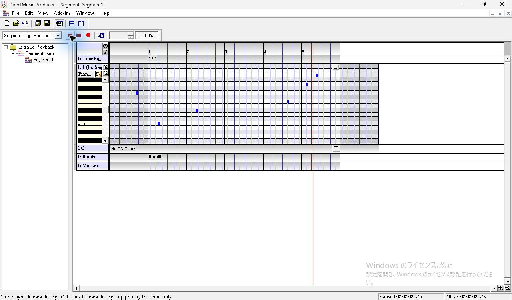

*図24 再生位置が第5小節に進んだ。Elapsed 8.579秒、Offset 8.578秒。*

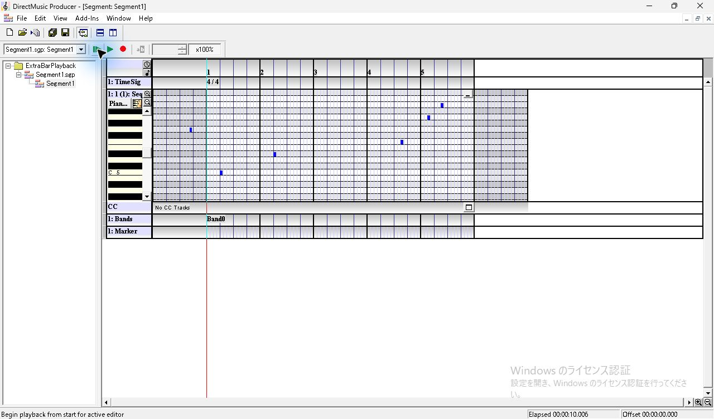

*図25 本体5小節の自然終了。Elapsed 10.006秒。*

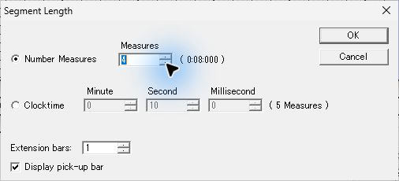

*図26 Number Measures を4へ戻す。*

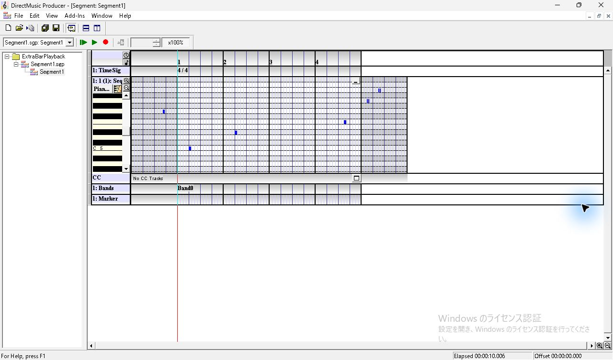

*図27 同じ2音が再び右の灰色の追加小節に入った。*

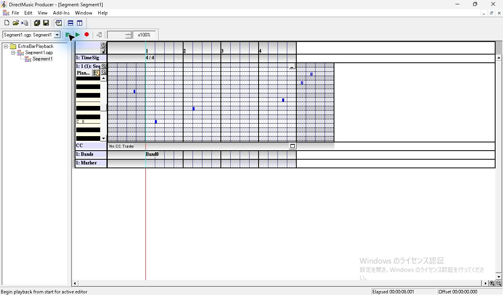

*図28 4小節へ戻した条件の自然終了。Elapsed 8.001秒。*

## 録音と保存値の照合

表の発音時刻は、最初の本体音 MIDI 60 の立ち上がりから0.500秒を引いた位置を原点とする。リピートで増えた実再生時間を含めた秒数で、ステータスバーの **Elapsed** は終了後の表示値。Repeat 1 の2条件はともに自然終了。Infinite は手動停止。

| 条件 | MIDI 67 | MIDI 60 | MIDI 63 | MIDI 65 | MIDI 69、71 | 終了時 Elapsed | 録音 |
| --- | --- | --- | --- | --- | --- | ---: | --- |
| 4小節・Repeat 0 | −0.625 | 0.500 | 2.500 | 7.250 | 検出なし | 8.003秒 | [WAV](../../../work/original-gui/SEG-10-extra-bar-playback/20261112T092438914057Z/audio/zero/output.wav) |
| 4小節・全区間 Repeat 1 | −0.625 | 0.500、8.500 | 2.500、10.500 | 7.250、15.250 | 検出なし | 16.002秒 | [WAV](../../../work/original-gui/SEG-10-extra-bar-playback/20261112T092438914057Z/audio/finite-full/output.wav) |
| 4小節・部分 Repeat 1 | −0.625 | 0.500 | 2.500、6.500 | 11.250 | 検出なし | 12.009秒 | [WAV](../../../work/original-gui/SEG-10-extra-bar-playback/20261112T092438914057Z/audio/finite-partial/output.wav) |
| 4小節・全区間 Infinite | −0.625 | 0.500、8.500、16.500 | 2.500、10.500、18.500 | 7.250、15.250 | 停止まで検出なし | 20.088秒 | [WAV](../../../work/original-gui/SEG-10-extra-bar-playback/20261112T092438914057Z/audio/infinite/output.wav) |
| Clocktime 8秒・Repeat 0 | −0.625 | 0.500 | 2.500 | 7.250 | 検出なし | 8.005秒 | [WAV](../../../work/original-gui/SEG-10-extra-bar-playback/20261112T092438914057Z/audio/clocktime/output.wav) |
| 5小節・Repeat 0 | −0.625 | 0.500 | 2.500 | 7.250 | 8.250、8.750 | 10.006秒 | [WAV](../../../work/original-gui/SEG-10-extra-bar-playback/20261112T092438914057Z/audio/five-bar/output.wav) |
| 4小節へ復帰・Repeat 0 | −0.625 | 0.500 | 2.500 | 7.250 | 検出なし | 8.001秒 | [WAV](../../../work/original-gui/SEG-10-extra-bar-playback/20261112T092438914057Z/audio/return-four/output.wav) |

Windows の既定出力を WASAPI ループバックで記録した。48 kHz、ステレオ、32-bit float。5 ms刻みで立ち上がりを探し、60 msの窓で各音の基音を照合した。末尾2音の予定時刻前後のピークは、4小節相当の自然終了5条件で最大0.000065、5小節の対照条件では0.046〜0.047。録音の時刻エラーは全条件0。各録音に1件の不連続フラグがあり、いずれも再生操作より前だった。 [解析コード](../../../work/original-gui/SEG-10-extra-bar-playback/20261112T092438914057Z/measure.py) · [録音ごとの発音時刻とピーク](../../../work/original-gui/SEG-10-extra-bar-playback/20261112T092438914057Z/playback-measurements.json)

原版ヘルプは、末尾の追加小節の音は Segment が自然終了するときに鳴ると説明している。今回の Sequence では、4小節で自然終了した5条件の録音に末尾2音はなく、本体の第5小節に含めた対照条件で2音を確認した。確認した再生入口は **Play From Start**。Pattern Part、別 Segment からの切替、Runtime の再生は追試範囲。 [原版ヘルプの Extra Measures](../../../../../work/analysis/original-manual-session/20261010T031624075Z/help-extracted/htm/extrameasures.htm)

| 条件 | Repeat | 音楽長 | 音楽ループの開始〜終了 | 参照時刻長 |
| --- | ---: | ---: | --- | ---: |
| 4小節・Repeat 0 | 0 | 12288 | 0〜0 | 0 |
| 全区間 Repeat 1 | 1 | 12288 | 0〜12288 | 0 |
| 部分 Repeat 1 | 1 | 12288 | 3072〜9216 | 0 |
| 全区間 Infinite | `0xffffffff` | 12288 | 0〜12288 | 0 |
| Clocktime 8秒 | 0 | 12288 | 0〜0 | 80000000 |
| 5小節・Repeat 0 | 0 | 15360 | 0〜0 | 0 |

音楽時刻は clocks、参照時刻は100 ns単位。Clocktime の場合は参照時刻長フラグ1。保存した全条件で `segh` の Start は0、Boundary フラグは `0x00000400`、`psqc` の Extension と Pickup は各1。4小節へ戻したスナップショットと終了時のファイルは、最初の保存ファイルとバイト単位で一致した。 [照合コード](../../../work/original-gui/SEG-10-extra-bar-playback/20261112T092438914057Z/audit.py) · [8点の .sgp と7回の録音の照合結果](../../../work/original-gui/SEG-10-extra-bar-playback/20261112T092438914057Z/extra-bar-playback-audit.json)

終了時は **Window > Close All** で子エディターを閉じ、Project の保存確認で **Yes** を選んだ。原版コピー1件で Project を閉じた待機状態になり、View で Project Tree、Standard Toolbar、Status Bar、Transport Controls の4項目を確認した。 [終了時のウィンドウ一覧](../../../work/original-gui/SEG-10-extra-bar-playback/20261112T092438914057Z/captures/88-end-windows.json)

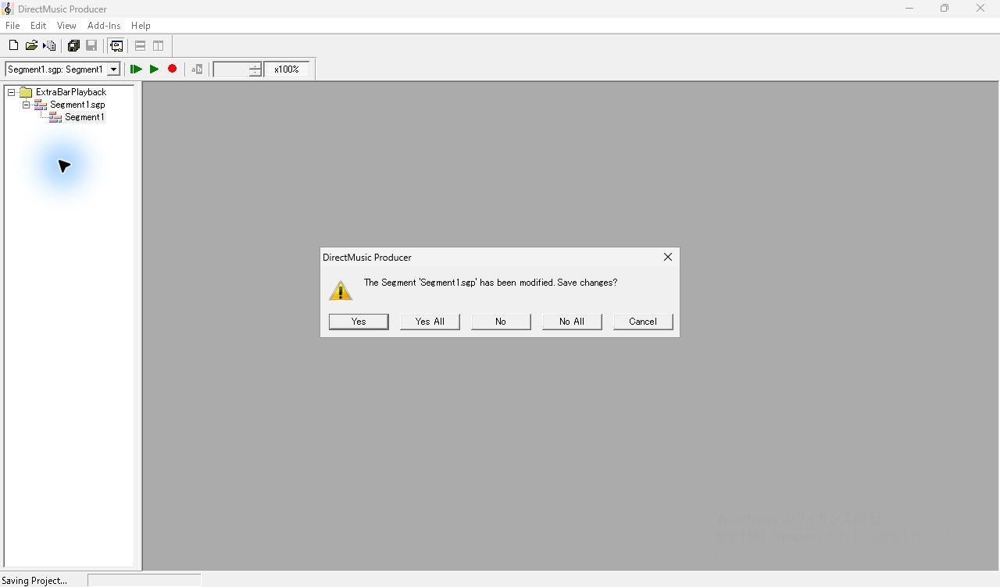

*図29 子エディターを閉じた後、Project の終了時に表示された保存確認。*

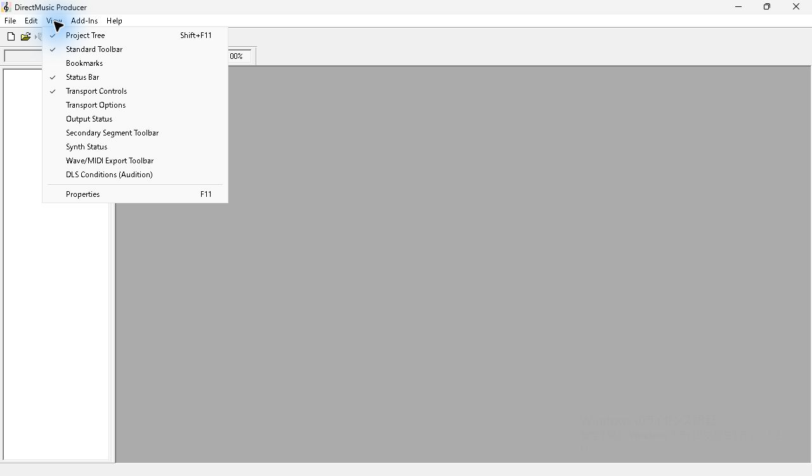

*図30 Project を閉じた後の View。基準の4項目にチェック。*
