# SEG-10　Segment Properties の Tab 順と Info・GUID

2026-11-12。Windows 上の DirectMusic Producer 原版コピーで、4タブのキーボード操作と Info の保存を調査した。前回の Sequence を別の作業用 Project に複製し、Segment1 と照合用 PeerSegment を用意した。Project と両 Segment には素材作成時に別 GUID を割り当てた。Segment1 は4/4の4小節、先頭の Band と Sequence を含む。View は Project Tree、Standard Toolbar、Status Bar、Transport Controls を表示。 [実行ファイルと素材のハッシュ](../../../work/original-gui/SEG-10-info-keyboard/20261112T094110711524Z/run.json) · [素材生成コード](../../../work/original-gui/SEG-10-info-keyboard/20261112T094110711524Z/prepare_fixture.py)

## Segment Properties のフォーカス順

Project Tree で `Segment1.sgp` の内側にある `Segment1` を右クリックして **Properties** を開く。右下の浮動パネルは391 × 200 px。表の矢印は Tab を1回押したときの移動。各行の末尾の **タブ見出し** からさらに Tab を押すと先頭に戻る。Shift+Tab の逆順は Segment、Loop の音楽時刻、Info、Boundary の2条件で一周を確認した。ラジオグループは現在選択中の項目にフォーカスが入り、グループ内を矢印キーで移動できる。

| ページと条件 | Tab 順 | 操作記録 |
| --- | --- | --- |
| Segment | Name → Length → Start at の Bar・Beat・Grid・Tick → Use TimeSig of Track Group → Extend Primary TimeSig → タブ見出し | [順方向](../../../work/original-gui/SEG-10-info-keyboard/20261112T094110711524Z/captures/24-segment-tab-trace.json) · [逆方向](../../../work/original-gui/SEG-10-info-keyboard/20261112T094110711524Z/captures/25-segment-reverse-trace.json) |
| Loop・Repeat 0 | Repeat → Infinite → Clock Time Looping のチェック → タブ見出し | [順方向](../../../work/original-gui/SEG-10-info-keyboard/20261112T094110711524Z/captures/28-loop-zero-tab-trace.json) |
| Loop・Repeat 1・Music Time | Repeat → Infinite → Clock Time Looping のチェック → Loop Start の Bar・Beat・Grid・Tick → Loop End の Bar・Beat・Grid・Tick → Reset Loop to Entire Segment → タブ見出し | [順方向](../../../work/original-gui/SEG-10-info-keyboard/20261112T094110711524Z/captures/32-loop-music-tab-trace.json) · [逆方向](../../../work/original-gui/SEG-10-info-keyboard/20261112T094110711524Z/captures/33-loop-music-reverse-trace.json) |
| Loop・Repeat 1・Clock Time | Repeat → Infinite → Clock Time Looping のチェック → ミリ秒 Start → ミリ秒 End → Reset Loop to Entire Segment → タブ見出し | [順方向](../../../work/original-gui/SEG-10-info-keyboard/20261112T094110711524Z/captures/37-loop-clock-tab-trace.json) |
| Loop・Infinite・Music Time | Infinite → Clock Time Looping のチェック → Loop Start の4欄 → Loop End の4欄 → Reset Loop to Entire Segment → タブ見出し | [順方向](../../../work/original-gui/SEG-10-info-keyboard/20261112T094110711524Z/captures/41-loop-infinite-tab-trace.json) |
| Info | Subject → Author → Copyright → Version の4欄を左から順に → Information → Edit GUID → タブ見出し | [順方向](../../../work/original-gui/SEG-10-info-keyboard/20261112T094110711524Z/captures/45-info-tab-trace.json) · [逆方向](../../../work/original-gui/SEG-10-info-keyboard/20261112T094110711524Z/captures/46-info-reverse-trace.json) |
| Boundary・Immediate | Start at next marker → 境界コンボ → Cut Off の選択中ラジオ → Timing の選択中ラジオ → タブ見出し | [順方向](../../../work/original-gui/SEG-10-info-keyboard/20261112T094110711524Z/captures/49-boundary-immediate-tab-trace.json) · [逆方向](../../../work/original-gui/SEG-10-info-keyboard/20261112T094110711524Z/captures/50-boundary-immediate-reverse-trace.json) |
| Boundary・Align to Barline | 境界コンボ → Cut Off の選択中ラジオ → Align Options の選択中ラジオ → Timing の選択中ラジオ → タブ見出し | [順方向](../../../work/original-gui/SEG-10-info-keyboard/20261112T094110711524Z/captures/54-boundary-align-tab-trace.json) · [逆方向](../../../work/original-gui/SEG-10-info-keyboard/20261112T094110711524Z/captures/55-boundary-align-reverse-trace.json) |

Segment の **Length** は順方向の画面で点線枠が付き、逆方向のアクセシビリティ記録でもボタンにフォーカスが入った。順方向のこのフレームのアクセシビリティ記録には直前の Name が返った。各スピンの数値欄にフォーカスが入り、上下ボタンは個別の Tab 停止点として現れなかった。この素材の **Play on new instance of embedded audiopath** は灰色で Tab が通過した。

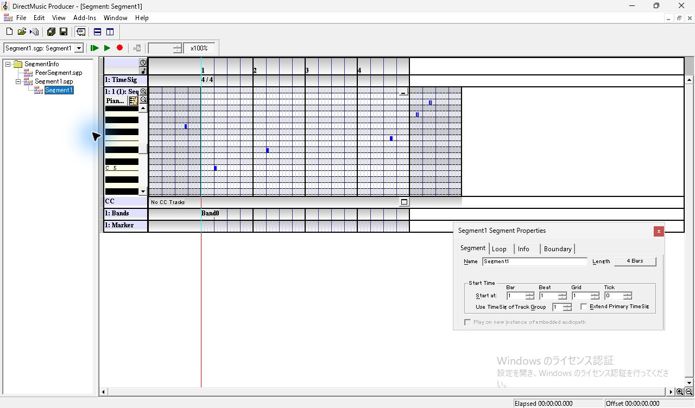

*図1 Segment Properties 全体。4タブと右下の浮動パネル。*

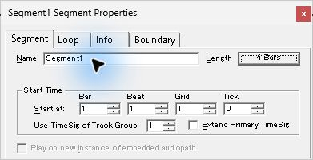

*図2 Name の次に Length ボタンへ移動。4 Bars に点線枠。*

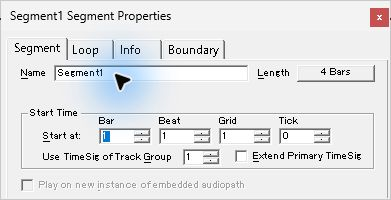

*図3 Length の次に Start at の Bar。数値を選択した状態。*

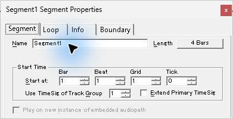

*図4 最後の有効なチェック欄からタブ見出しに戻った状態。*

Loop の **Repeat 0** でも Clock Time Looping のチェックはフォーカス順に入る。Clock Time Looping を選んだ Repeat 1 では、ミリ秒の2欄が有効になり、音楽時刻の8欄は灰色になる。**Reset Loop to Entire Segment** はフォーカス順に残る。Infinite を選ぶと Repeat の編集欄は灰色。今回のように同じパネルで Infinite をオンからオフへ戻すと、直前の Repeat 1 の編集欄が戻った。 [ループ再生と保存の調査](seg-10-extra-bar-playback.md)

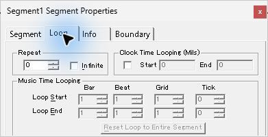

*図5 Repeat 0。灰色の時刻入力を飛ばし Clock Time Looping のチェック欄にフォーカス。*

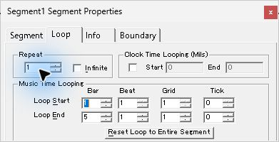

*図6 Repeat 1、音楽時刻。Loop Start の Bar にフォーカス。*

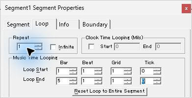

*図7 Loop End の最後の Tick。*

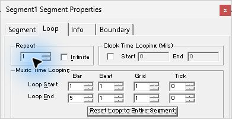

*図8 Loop End の次は Reset Loop to Entire Segment。*

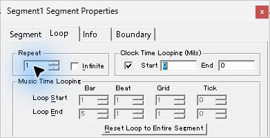

*図9 Clock Time Looping をオンにしたときの Start。*

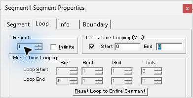

*図10 ミリ秒の End。音楽時刻の欄は灰色。*

*図11 Infinite 選択後。Repeat の編集欄は灰色。*

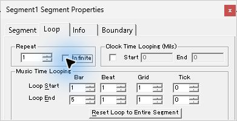

*図12 同じパネルで Infinite を外すと Repeat 1 の編集欄が戻る。*

Info の最初のフォーカスは Subject。**Edit GUID** ボタンは見た目では Version と同じ高さにあり、Tab 順では複数行の **Information** の後に来る。

*図13 Info タブに切り替えた直後の Subject。*

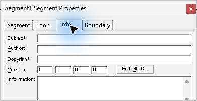

*図14 4つ目の Version の次に複数行 Information。*

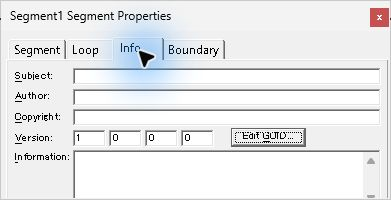

*図15 Information の次に Edit GUID ボタン。*

Boundary の Immediate では Align Options が灰色。Cut Off は3択目、Timing は After Prepare Time が選択されており、どちらもラベルが下端で見切れたまま Tab でフォーカスが移った。**Align to Barline** に切り替えると **Start at next marker** が灰色になり、右の **at any Time** がフォーカス順に入る。この Segment の **Use Segment’s Default** は両条件で灰色。境界を Immediate に戻してから Shift+Tab でタブ見出しに戻り、左矢印で Boundary から Info へ切り替えた。切替直後は見出しに点線枠があり、次の Tab で Subject に入った。 [下端のラジオボタンの操作](seg-10-boundary-prepare-time.md)

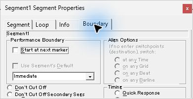

*図16 Immediate の最初のフォーカスは Start at next marker。*

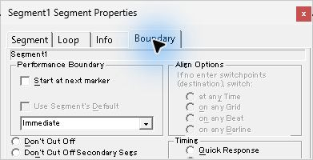

*図17 境界コンボの次は見切れた Cut Off の3択目。*

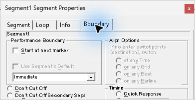

*図18 次は見切れた After Prepare Time。*

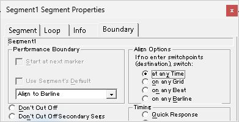

*図19 Align to Barline では右の at any Time にもフォーカスが移る。*

*図20 タブ見出しにフォーカスして左矢印。Boundary から Info へ切り替わる。*

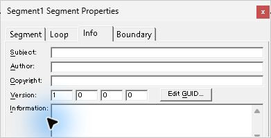

*図21 見出しから Tab を押して Info の Subject へ移動。*

## Edit Guid の入力、確定、取消し

Info の **Edit GUID...** は別のモーダルを開く。タイトルは `Edit Guid`。入力欄の下に左から **Create New GUID**、**Cancel**、**OK**。最初は現在の GUID が波括弧付きの大文字で表示され、OK は灰色。入力欄から Home、Shift+End で全体を選択し、表の値を入力して OK の状態を確認した。

*図22 Edit Guid の初期状態。波括弧付き大文字の現在値と灰色の OK。*

| 試した入力 | OK | 確認した動作 |
| --- | --- | --- |
| 空欄 | 無効 | 入力欄が空のまま。 [画面の記録](../../../work/original-gui/SEG-10-info-keyboard/20261112T094110711524Z/captures/68-guid-empty-guid-state.json) |
| 16進数以外の G を含む | 無効 | 入力文字列は表示された。 [画面の記録](../../../work/original-gui/SEG-10-info-keyboard/20261112T094110711524Z/captures/69-guid-bad-hex-guid-state.json) |
| 波括弧を省く | 無効 | 桁とハイフン位置が合っていても無効。 [画面の記録](../../../work/original-gui/SEG-10-info-keyboard/20261112T094110711524Z/captures/70-guid-unbraced-guid-state.json) |
| 波括弧付きで新しい値を小文字で入力 | 有効 | 入力中は小文字で表示され、Enter で確定できた。 [画面の記録](../../../work/original-gui/SEG-10-info-keyboard/20261112T094110711524Z/captures/91-manual-before-enter-guid-state.json) |
| 現在の値を小文字で入力 | 無効 | 表記の大小を変えても同じ値として扱われた。 [画面の記録](../../../work/original-gui/SEG-10-info-keyboard/20261112T094110711524Z/captures/72-guid-same-lower-guid-state.json) |
| 全ゼロ | 有効 | OK の状態を確認し、別の値に置き換えた。 [画面の記録](../../../work/original-gui/SEG-10-info-keyboard/20261112T094110711524Z/captures/73-guid-null-guid-state.json) |
| 末尾に文字を足す、前後に空白を足す、ハイフンを省く | 無効 | 3試行で確認。 [末尾の文字](../../../work/original-gui/SEG-10-info-keyboard/20261112T094110711524Z/captures/74-guid-suffix-guid-state.json) · [前後の空白](../../../work/original-gui/SEG-10-info-keyboard/20261112T094110711524Z/captures/75-guid-spaces-guid-state.json) · [ハイフンなし](../../../work/original-gui/SEG-10-info-keyboard/20261112T094110711524Z/captures/76-guid-no-hyphens-guid-state.json) |
| 桁数不足 | 無効 | Enter を押してもダイアログが開いたまま。 [画面の記録](../../../work/original-gui/SEG-10-info-keyboard/20261112T094110711524Z/captures/78-guid-invalid-enter-guid-state.json) |

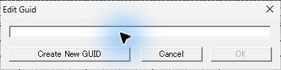

*図23 空欄では OK が灰色。*

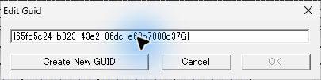

*図24 16進数以外の文字を入れた試行。*

*図25 波括弧を省いた形式。*

*図26 別の値を波括弧付き小文字で入力すると OK が有効。*

*図27 現在値の文字の大小だけを変更した場合は OK が灰色。*

*図28 全ゼロは OK が有効になった。画面の確認まで行った。*

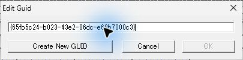

*図29 桁数不足のまま Enter を押した後。ダイアログが開いたまま。*

OK が灰色の初期状態では、入力欄から Create New GUID、次に Cancel へフォーカスが移る画面を撮影した。有効な値を入れると **入力欄 → Create New GUID → OK → Cancel → 入力欄** の順。左・右・中央の順で3ボタンを通る。最後に入力欄へ戻ると GUID 全体が青く選択された。モーダル内でフォーカスを表す点線枠を撮影した。アクセシビリティではこのときモーダル全体がフォーカス先として報告された。

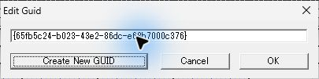

*図30 有効な値の入力欄から最初の Tab で Create New GUID。*

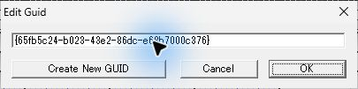

*図31 次の Tab は、右端の OK。*

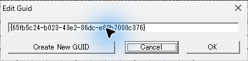

*図32 さらに Tab で中央の Cancel。*

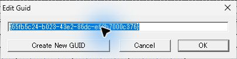

*図33 次の Tab で入力欄に戻り、文字列全体が選択される。*

有効な新しい値の入力後に **Escape** を押すと閉じる。開き直すと元の GUID が表示され、保存ファイルにも元の GUID が入っていた。もう一度小文字で新しい値を入力し、入力欄にフォーカスを置いて **Enter** を押すと確定。保存した `guid` は入力した値で、開き直したダイアログでは大文字になった。 [取消し後の保存ファイル](../../../work/original-gui/SEG-10-info-keyboard/20261112T094110711524Z/captures/86-after-cancel-Segment1.sgp) · [手入力を確定した保存ファイル](../../../work/original-gui/SEG-10-info-keyboard/20261112T094110711524Z/captures/94-manual-accepted-Segment1.sgp)

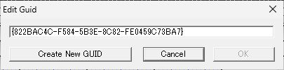

*図34 Escape で取り消して開き直した現在値。*

PeerSegment を開いてその GUID を確認し、同じ値を Segment1 に入れた。OK は有効で、押すと警告を挟まず Info に戻った。Ctrl+S で保存した2つの .sgp は同じ GUID を持っていた。重複の状態はスナップショットに採取した。作業用の Segment1 には後続の試験で新しい GUID を割り当てた。重複した2ファイルを別プロセスで同時に開く挙動は追試範囲。 [重複時の Segment1.sgp](../../../work/original-gui/SEG-10-info-keyboard/20261112T094110711524Z/captures/112-duplicate-accepted-Segment1.sgp) · [同じ GUID の PeerSegment.sgp](../../../work/original-gui/SEG-10-info-keyboard/20261112T094110711524Z/captures/112-duplicate-accepted-PeerSegment.sgp)

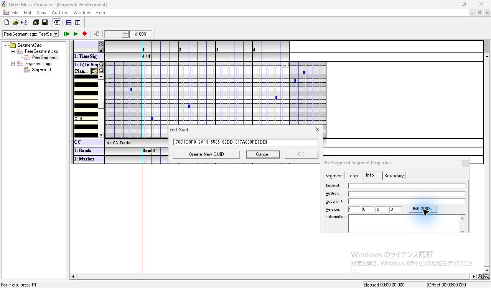

*図35 開いている PeerSegment の GUID。*

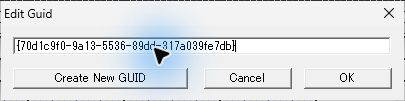

*図36 Segment1 に PeerSegment の値を入れても OK が有効。*

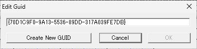

*図37 保存後に開き直した Segment1 の GUID。*

**Create New GUID** を押すと、大文字・波括弧付きの新しい値に置き換わり、OK が有効になる。1回目は Cancel を押すと、開き直した時に生成前の値を表示した。2回目は OK で確定し、保存した値を別プロセスで読み戻した。原版ヘルプは GUID の更新に生成ボタンを案内している。 [原版ヘルプの Edit GUID](../../../../../work/analysis/original-manual-session/20261010T031624075Z/help-extracted/htm/editguiddialogbox.htm)

*図38 Create New GUID で値を生成した直後。今回は Cancel。*

*図39 開き直すと、生成前の値が表示される。*

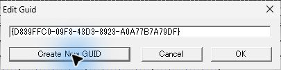

*図40 2回目の Create New GUID で生成した値。今回は OK。*

## Info の編集と別プロセスでの読み戻し

Subject に「境界の記録」、Author に「検証担当」、Copyright に `DirectMusic UI fixture`、Information に「一行目」と `Second line` を2行で入力した。Version の4欄に左から2、17、257、65535を入力した。第4欄の表示と保存値は6553。Information は改行を含んだまま、Tab で Edit GUID ボタンへ移動した。 [原版ヘルプの Info](../../../../../work/analysis/original-manual-session/20261010T031624075Z/help-extracted/htm/infotab.htm)

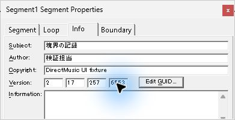

*図41 Version の第4欄に65535を入力した直後の表示。*

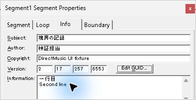

*図42 日本語、ASCII、4つの Version と Information の2行。*

Ctrl+S で保存後、子エディターと Project を閉じた。通常終了後に原版が0件になったことを確認し、同じ実行ファイルを1件起動して保存済みの Project を開いた。Info の各文字列、Version 2・17・257・6553、生成した GUID が再表示された。 [通常終了後のウィンドウ一覧](../../../work/original-gui/SEG-10-info-keyboard/20261112T094110711524Z/captures/153-zero-windows.json) · [再起動の記録](../../../work/original-gui/SEG-10-info-keyboard/20261112T094110711524Z/captures/154-reload-process.json) · [再読込時のアクセシビリティ記録](../../../work/original-gui/SEG-10-info-keyboard/20261112T094110711524Z/captures/171-reload-accessibility.json)

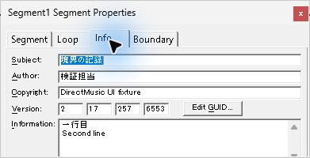

*図43 別プロセスで再読込した Info。*

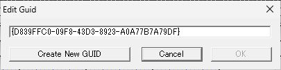

*図44 別プロセスで再表示した生成 GUID と灰色の OK。*

14点の .sgp を照合した。Segment1 はキーボード調査で設定した Repeat 1・本体全区間を保持して保存した。GUID は `DMSG/guid` の16バイト、Version は `vers` の2 DWORD の上位・下位各16ビット。Subject、Author、Copyright、Information は `LIST UNFO` の `USBJ`、`UART`、`UCOP`、`UCMT` に UTF-16LE で入った。日本語を含む文字列は最初の NUL までを読むと画面と一致した。Author の NUL の後には、Ctrl+S 直後のファイルで `nt1` を含む8バイト、Project を閉じる際の再保存でゼロ8バイトが入った。閉じる前後の差分はこの8バイトの範囲に収まった。再読込前後のファイルは全バイトが一致し、PeerSegment は全スナップショットで元のファイルと一致した。 [照合コード](../../../work/original-gui/SEG-10-info-keyboard/20261112T094110711524Z/audit.py) · [保存値と操作の照合結果](../../../work/original-gui/SEG-10-info-keyboard/20261112T094110711524Z/info-keyboard-audit.json)

## 初回の異常終了と終了状態

最初に Segment1 を開いたとき、子エディターが白いままになり、原版が終了した。Application ログの Event 1000 には `SegmentDesigner.ocx`、例外 `0xc0000005` と `0xc000041d`、オフセット `0x0002b8a5` が残った。原版が0件になったことを確認して同じコピーを1件起動し、同じ Project を再度開くと表示できた。調査終了時は原版コピー1件が応答し、Project を閉じた状態で基準の4項目を表示。 [最初の異常終了の記録](../../../work/original-gui/SEG-10-info-keyboard/20261112T094110711524Z/captures/10-startup-event.json) · [終了時のウィンドウ一覧](../../../work/original-gui/SEG-10-info-keyboard/20261112T094110711524Z/captures/185-end-windows.json)

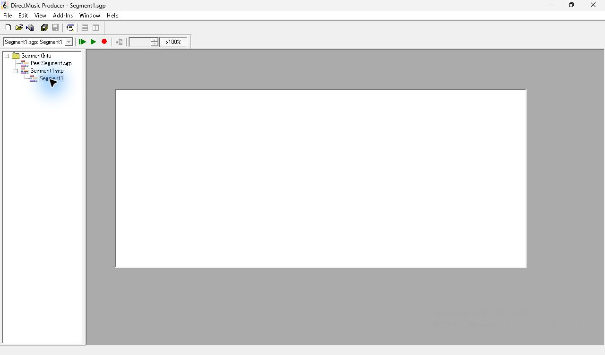

*図45 初回にエディター領域が白くなった状態。直後に原版が終了した。*

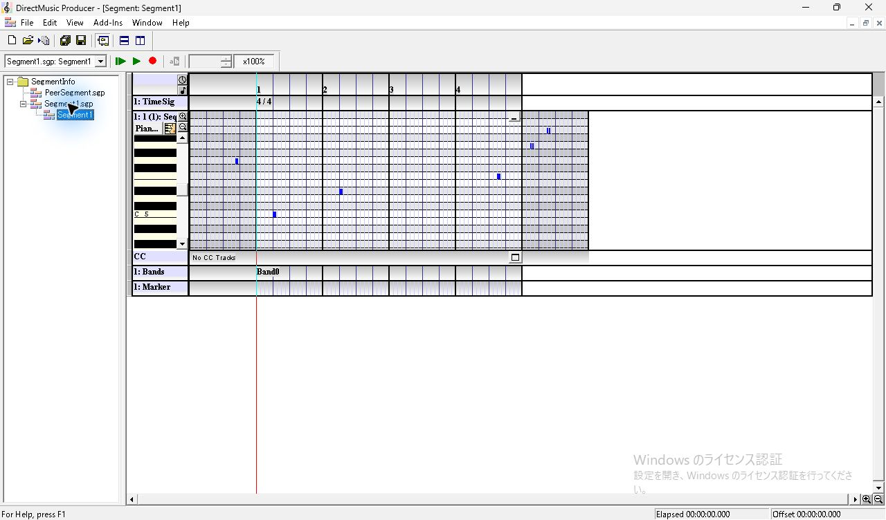

*図46 同じ作業用素材を再起動後に開いた画面。*

*図47 終了時の View。4項目を表示し、Project は閉じている。*
