# SEG-10 Segment Length の Extension bars と Display pick-up bar

観測日 2026-11-12。DirectMusic Producer 5.3.0.900 の原版コピーで、Segment Length の追加小節とピックアップを変更した。TimeSig と Marker だけの Segment では設定が残らず、Sequence Track を追加するとそのパートに値が保存された。追加範囲にノートがある場合は、表示範囲を縮めても、そのノートを表示できる最小の範囲が残った。複数パートでは、Segment Length で変更した項目だけが両方に反映された。 [Segment Properties の4ページ](seg-10-properties.md) · [Length と Loop の入力境界](seg-10-properties-bounds.md) · [Sequence Part とピアノロール](seg-06-sequence-parts.md)

## 素材と操作

作業用 Project **PickupLength** は20小節の原版採取素材を4小節へ調整した。TimeSig は4/4、1拍4グリッド、1拍768クロック、1小節3072クロック。Tempo Track は無く、ダイアログの換算は4小節で8秒。Segment を開くときに **Add New Tracks** から空の **Marker Track** を追加し、後半では **Sequence Track** を加えた。Tree 内側の `Segment1` を選び、F11 で Properties を表示し、Segment タブの Length ボタンを押す。掲載は49枚で、全体画面とダイアログ・Properties のキャプチャを使う。黒い矢印と青い光は操作ツールの表示。 [入力の来歴とハッシュ](../../../work/original-gui/SEG-10-length-pickup/20261112T082148848173Z/run.json) · [素材作成コード](../../../work/original-gui/SEG-10-length-pickup/20261112T082148848173Z/prepare.py) · [画像の出典とハッシュ](../../../work/original-gui/SEG-10-length-pickup/20261112T082148848173Z/published-figures.json)

## ダイアログの上下限と Cancel

初期値は **Extension bars 0**、**Display pick-up bar** はオフ。Extension bars の下向きスピンを0で押すと32767。32767で上向きスピンを押すと0に戻る。`-1` は編集中に表示されるが、Tab で欄を離れると0。9999を入力して確定し、上向きスピンを1回押すと10000。9999999999を入力した試行の確定値は32767だった。上端はダイアログ内で確認した。

32767にしてピックアップをオンにした状態で **Cancel** を押すと、ルーラーはそのまま。ダイアログを開き直すと0・オフ。Extension bars を変更しても、ダイアログに出る **4 Measures** と **0:08:000** の換算は変わらなかった。

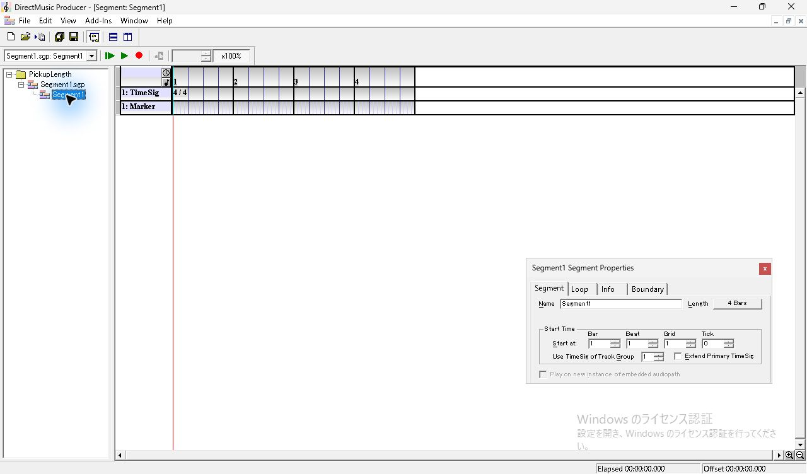

*図1 基準の Segment。Length は4 Bars、ルーラーは1〜4小節、Start at は1:1:1:0。*

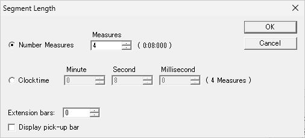

*図2 Segment Length の初期状態。Extension bars 0、Display pick-up bar はオフ。*

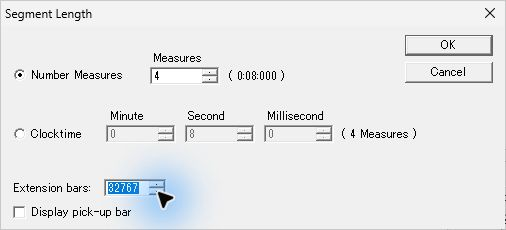

*図3 0で下向きスピンを押した直後は32767。*

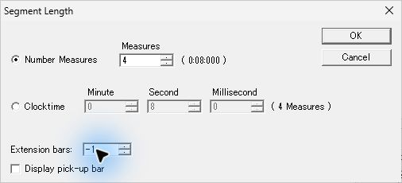

*図4 入力中は-1を表示できる。*

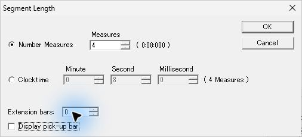

*図5 -1の入力欄から Tab で離れると0になり、次のチェック欄へ移る。*

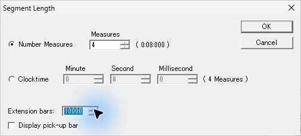

*図6 9999を確定して上向きスピンを1回押すと10000。*

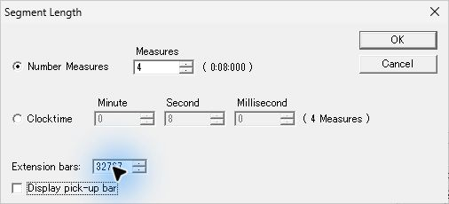

*図7 9999999999を入力した試行の確定値は32767。*

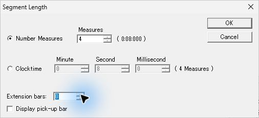

*図8 32767で上向きスピンを押した直後は0。*

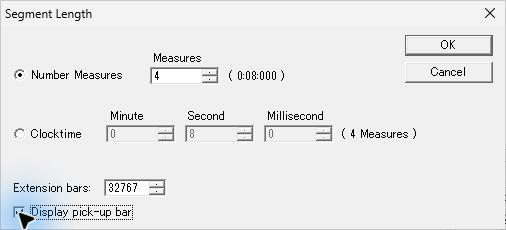

*図9 32767とピックアップをダイアログ内で指定してから Cancel。*

*図10 開き直したときの値は0とオフ。*

## Sequence Track の有無で変わる保存と表示

TimeSig と Marker だけの状態で、Extension bars を2にして OK、次にピックアップをオンにして OK を別々に試した。どちらもルーラーとトラック行の格子は4小節まで。各試行で保存し、Length を開き直すと0・オフだった。2つの保存ファイルは変更前の TimeSig と Marker の状態と全バイト一致した。 [TimeSig と Marker の基準](../../../work/original-gui/SEG-10-length-pickup/20261112T082148848173Z/captures/11-baseline-Segment1.sgp) · [追加2を試した保存](../../../work/original-gui/SEG-10-length-pickup/20261112T082148848173Z/captures/51-extension-two-Segment1.sgp) · [ピックアップを試した保存](../../../work/original-gui/SEG-10-length-pickup/20261112T082148848173Z/captures/58-no-sequence-pickup-Segment1.sgp)

Sequence Track を追加すると、**Sequence Track Properties > Part** の **Extra Bars** に0 Pickup Bars、0 Extension Bars が出る。Segment Length で Extension bars を2にして OK を押すと、この行だけが4小節の終端より右へ2小節伸び、Part の欄は2 Extension Bars に変わった。上端ルーラー、TimeSig と Marker の行の格子は1〜4小節。次にピックアップをオンにすると1小節目の左に無番号の領域が1小節分できる。この画面では1小節目の始点が約96 px右へ移った。Sequence のみ、その左側にも格子が現れた。展開するとピアノロールの本体は明るく、前後の追加範囲は灰色で、小節番号は付かない。

Segment の Length は4 Bars、Start at の Bar 1 で下向きスピンを押しても1。0を入力して Tab を押しても1に補正された。Loop の Repeat を1にして **Reset Loop to Entire Segment** を押すと、範囲は1:1:1:0〜5:1:1:0。保存した音楽長は12288クロック、Start は0、Loop は0〜12288。 [追加2のみの保存](../../../work/original-gui/SEG-10-length-pickup/20261112T082148848173Z/captures/77-sequence-extension-Segment1.sgp) · [両方を有効にした保存](../../../work/original-gui/SEG-10-length-pickup/20261112T082148848173Z/captures/86-both-Segment1.sgp) · [Loop 全長の保存](../../../work/original-gui/SEG-10-length-pickup/20261112T082148848173Z/captures/96-loop-range-Segment1.sgp)

追加範囲の概要は同梱ヘルプにも記載がある。今回の比較は Segment Length と Sequence Track の範囲を扱った。 [原版ヘルプ Extra Measures](../../../../../work/analysis/original-manual-session/20261010T031624075Z/help-extracted/htm/extrameasures.htm)

*図11 TimeSig と Marker のみで Extension bars 2 を入力。*

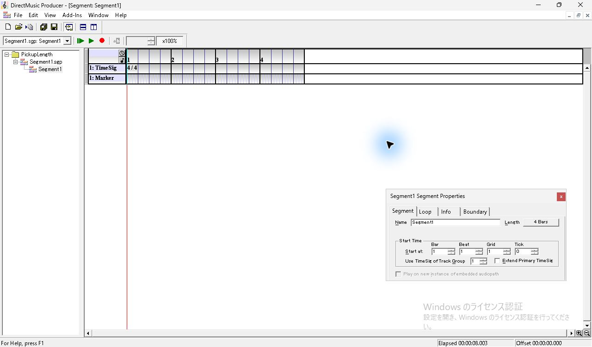

*図12 確定後も、TimeSig と Marker の格子は4小節まで。*

*図13 Sequence がない状態で開き直すと、Extension bars は0。*

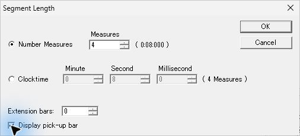

*図14 Sequence がない状態でもチェック欄は操作できる。*

*図15 ピックアップを確定して開き直すとチェックが外れている。*

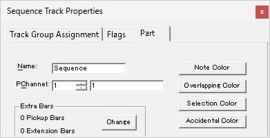

*図16 追加した PChannel 1 の Sequence Part は Pickup 0、Extension 0。*

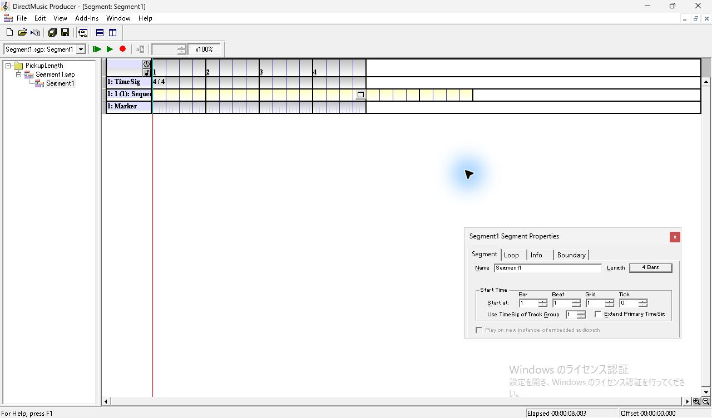

*図17 Extension 2 の確定後、Sequence の行だけが4小節の終端より右へ2小節伸びる。*

*図18 Sequence Track Properties の Part に 2 Extension Bars。*

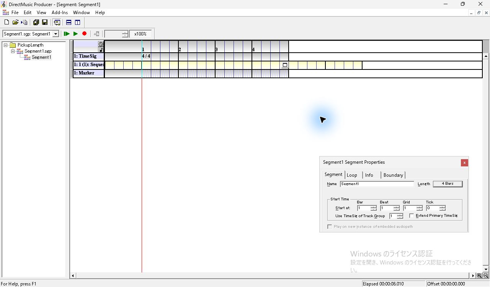

*図19 ピックアップが1小節目の左に入り、4小節のルーラーと各行が右へずれる。*

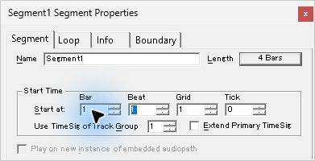

*図20 Segment の Start at に Bar 0 を入れて Tab を押しても Bar は1。*

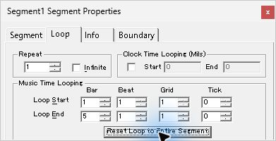

*図21 Repeat 1 の Reset 後は1:1:1:0〜5:1:1:0。*

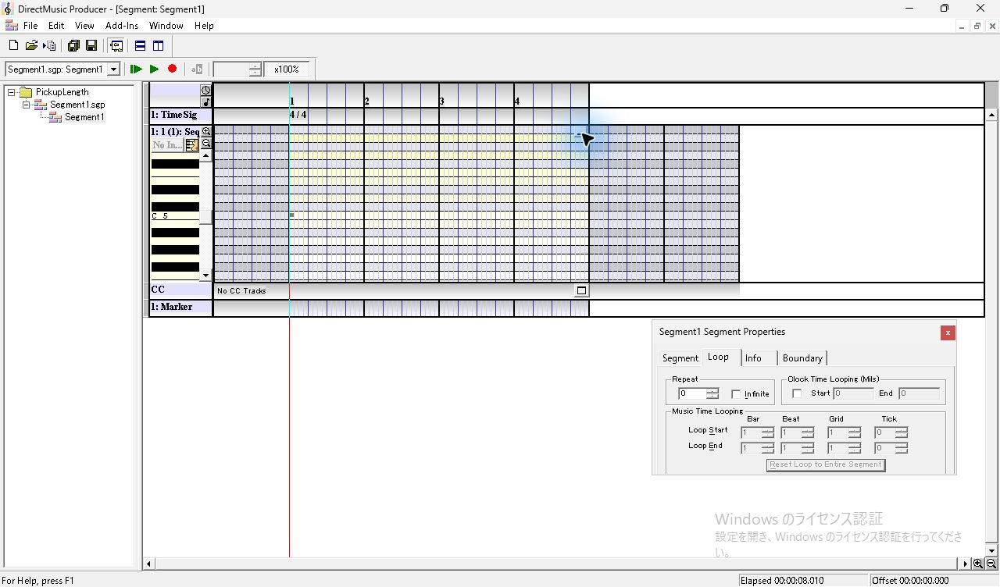

*図22 展開したピアノロール。ピックアップと追加小節に灰色の格子が出る。*

## ピックアップと追加小節での編集

Loop の Repeat を0に戻した。Sequence の四角いボタンでピアノロールを展開し、目的のセルをクリックして **Insert**。ピックアップでは C5 が Bar 0 に入り、ステータスの Note は負の時刻。右側の追加範囲では B4 が Bar 5 に入った。追加範囲より右の白い部分の右クリックメニューにも有効な **Insert** があった。この試行で押すと右側の白い位置には増えず、B4 が1小節目の頭に入った。 [前後に挿入した2音](../../../work/original-gui/SEG-10-length-pickup/20261112T082148848173Z/captures/112-two-extra-notes-Segment1.sgp) · [白い領域のメニューから挿入した後](../../../work/original-gui/SEG-10-length-pickup/20261112T082148848173Z/captures/117-three-notes-Segment1.sgp)

| 挿入した操作 | 表示の Start Time | 保存論理時刻 | Offset | 実開始クロック |
| --- | --- | ---: | ---: | ---: |
| ピックアップの C5 | 0:3:4:0 | 0 | -960 | -960 |
| 1つ目の追加小節の B4 | 5:2:1:0 | 13056 | 0 | 13056 |
| 白い領域の Insert で増えた B4 | 1:1:1:0 | 0 | 0 | 0 |

3音とも保存時の長さは191クロック、ベロシティ100。**Play From Start** の自然終了時の Elapsed は、TimeSig と Marker の基準が8.003秒、空の Sequence に追加2を設定した状態が8.010秒、前後に音符を置いた状態が8.003秒。Sequence に楽器を割り当てていないため、ここでは Transport の表示時間を記録した。後続の試験では Piano 1 を割り当て、Timing を切り替えて先頭のピックアップ音を録音した。さらに、同じ Sequence を7条件で録音し、本体外に描画される末尾2音と、その2音を本体に含めた場合を比較した。 [Boundary の Timing とピックアップ再生](seg-10-boundary-prepare-time.md) · [先頭再生とループ時の録音](seg-10-extra-bar-playback.md) · [基準の自然終了](../../../work/original-gui/SEG-10-length-pickup/20261112T082148848173Z/captures/15-baseline-end-0.jpg) · [追加2・空の Sequence の自然終了](../../../work/original-gui/SEG-10-length-pickup/20261112T082148848173Z/captures/80-extension-two-end-0.jpg)

**Sequence Track Properties > Part > Change** から **Set Extra Bar Length** を開くと、同じ Extension bars と Display pick-up bar が表示された。前後にノートがある状態で Segment Length から **0・オフ** を確定すると、警告を挟まず、右の灰色の範囲は2から1小節へ減り、左の1小節は残った。Length の再表示も1・オン。3音の保存値は一致した。Clocktime へ切り替えて8秒で保存すると、音楽長12288クロックに加えて参照時間長80000000が保存され、再読込後も追加1・ピックアップありと3音を確認した。 [縮小後の保存](../../../work/original-gui/SEG-10-length-pickup/20261112T082148848173Z/captures/134-limited-reduction-Segment1.sgp) · [Clocktime の再読込](../../../work/original-gui/SEG-10-length-pickup/20261112T082148848173Z/captures/154-clocktime-reopened-Segment1.sgp)

ピックアップの C5 を選び、Sequence Properties の Start Time の Bar を0から1へ上げた。追加範囲の B4 は5から4へ下げた。保存された実開始はそれぞれ2112、9984クロック。移動した時点では表示用の追加範囲が残った。Segment Length で改めて0・オフを確定すると、前後の格子が消えて3音は本体内に残った。 [3音を本体内へ移した保存](../../../work/original-gui/SEG-10-length-pickup/20261112T082148848173Z/captures/164-notes-in-main-Segment1.sgp) · [追加範囲を無くした保存](../../../work/original-gui/SEG-10-length-pickup/20261112T082148848173Z/captures/171-extras-removed-Segment1.sgp)

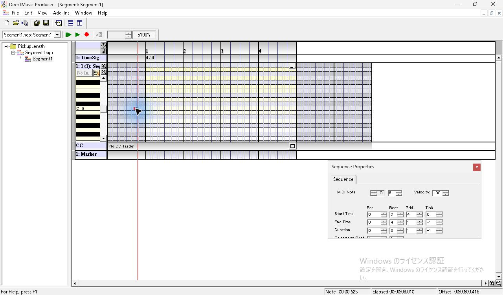

*図23 ピックアップの C5。Start Time は0:3:4:0。*

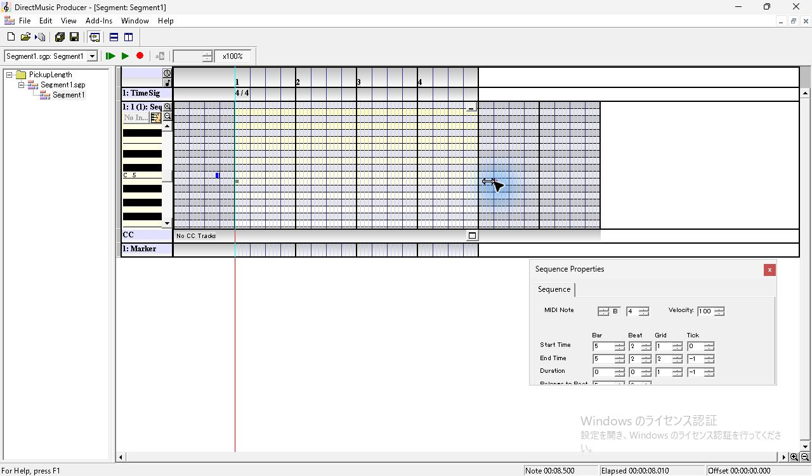

*図24 追加範囲の B4。Start Time は5:2:1:0。*

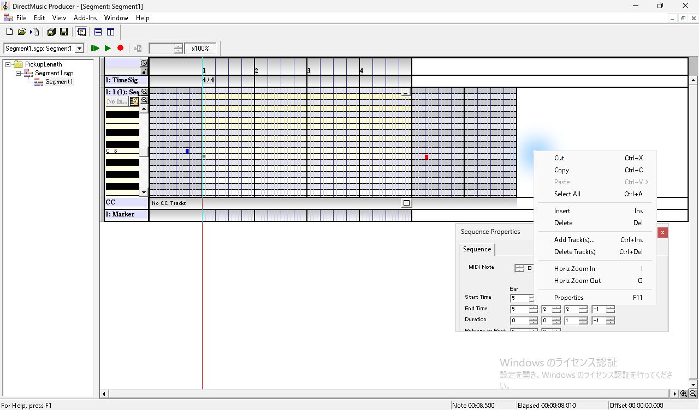

*図25 追加範囲より右の白い領域にも、Insert が有効なメニューが出る。*

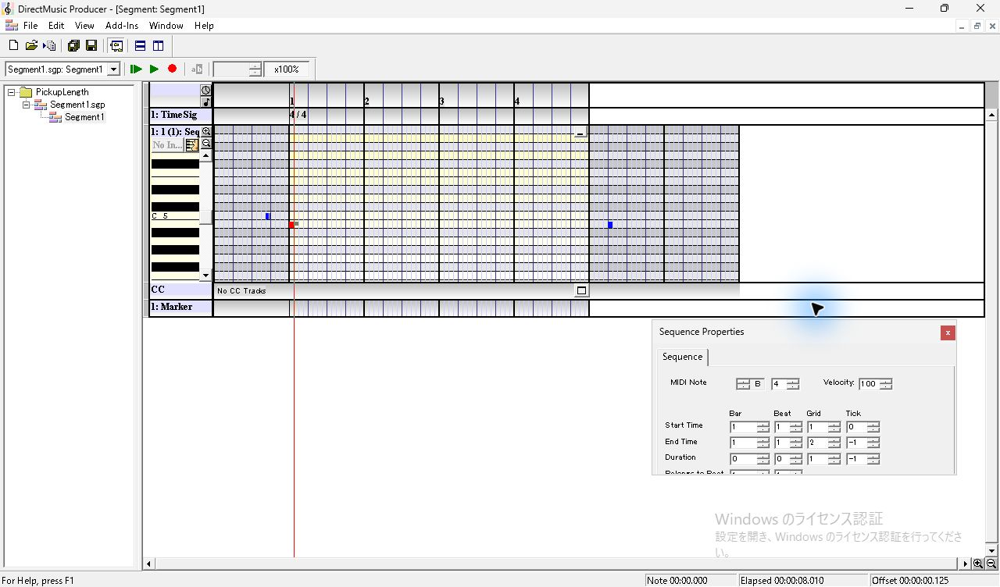

*図26 その Insert で増えたノートは1:1:1:0に入る。*

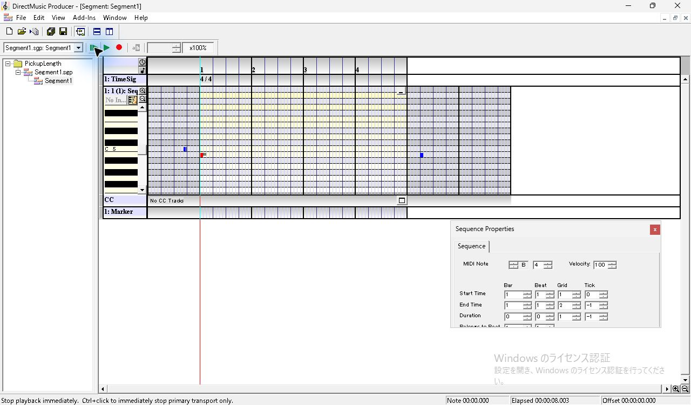

*図27 3音のある状態で先頭再生が終了。Elapsed は8.003秒。*

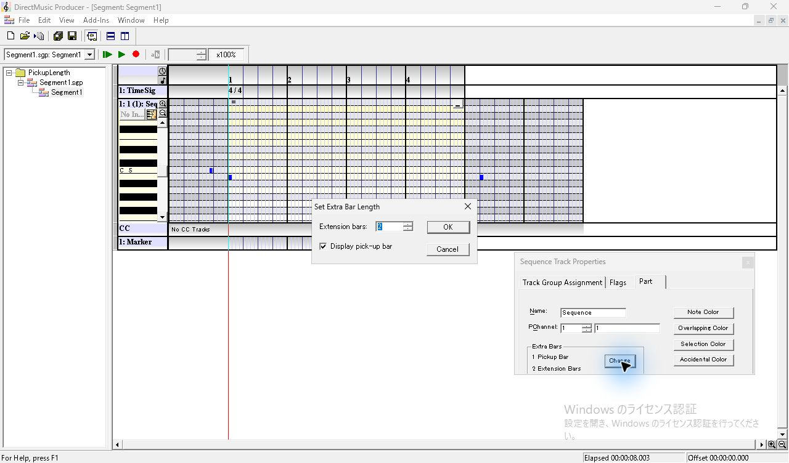

*図28 Part の Change から開く Set Extra Bar Length。値は2とオン。*

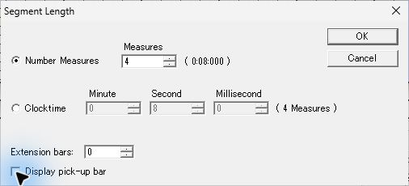

*図29 既存ノートがある状態で0とオフを指定。*

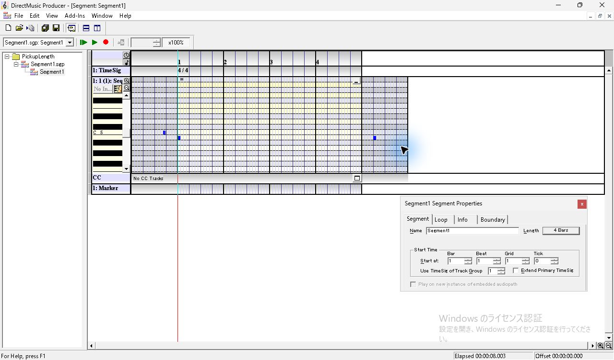

*図30 確定後も両端の音が残り、右側の灰色領域は1小節になる。*

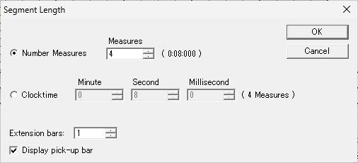

*図31 開き直すと Extension bars 1、Display pick-up bar はオン。*

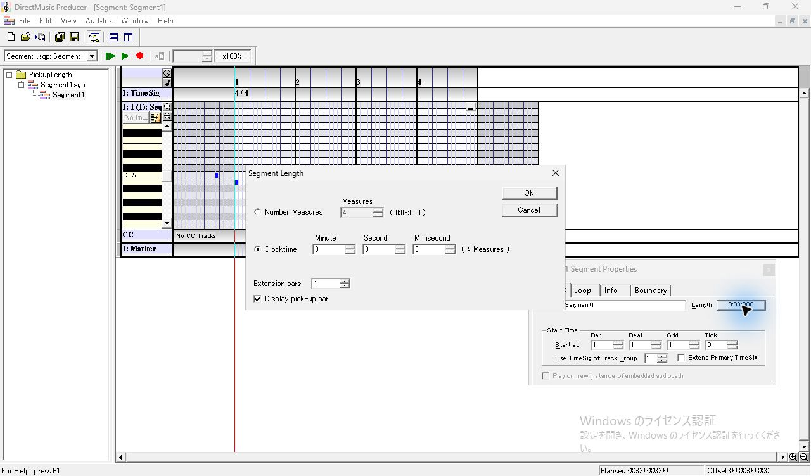

*図32 Project を開き直すと Clocktime 8秒、追加1、ピックアップあり。*

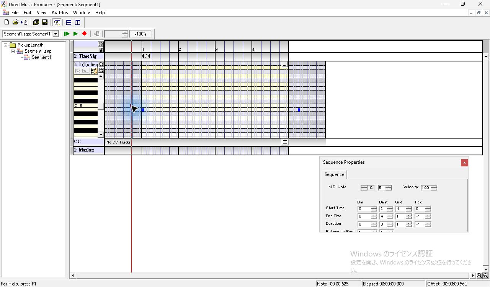

*図33 再読込したピックアップの音符を選ぶと Bar 0 の Start Time が出る。*

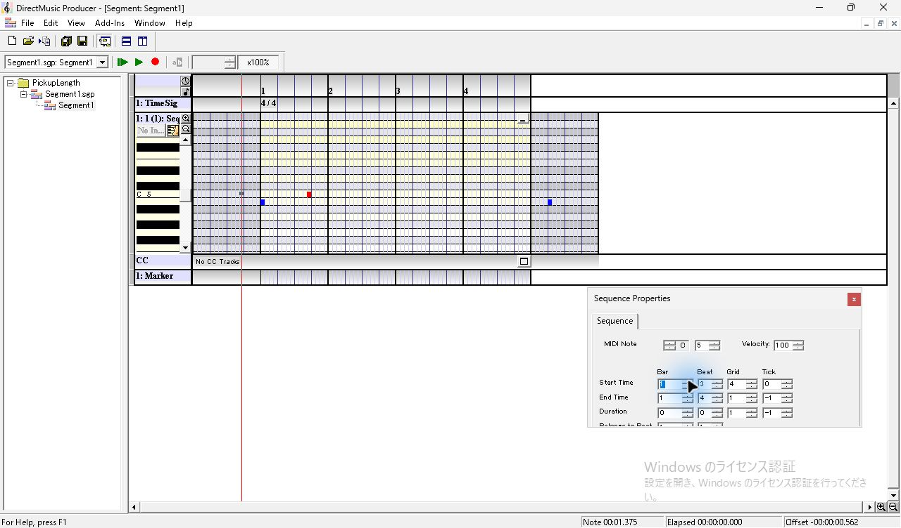

*図34 ノートの Start Time の Bar を上げて、ピックアップから1小節目へ移動。*

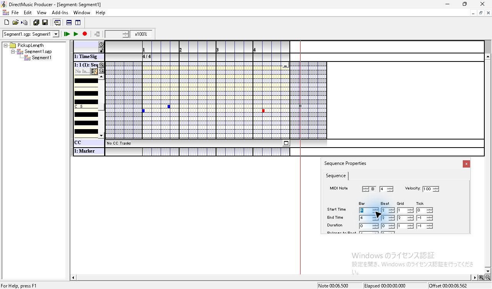

*図35 追加範囲のノートを Bar 5 から Bar 4 へ移動。*

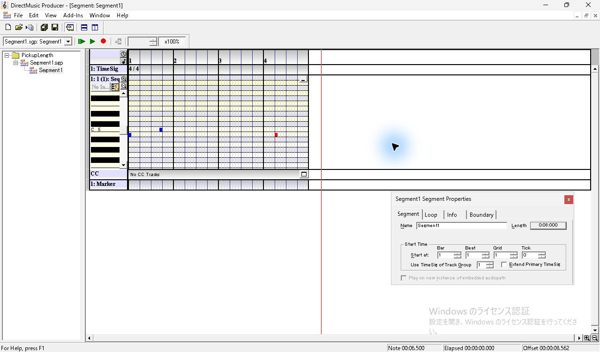

*図36 3音が本体内にある状態で追加0・ピックアップなしを確定すると、両側の格子が消える。*

## 2つの Sequence Part での表示と反映

**Add Sequence Part(s)…** で PChannel 2 を追加し、Part ごとの Change を使って値を分けた。表の各パートの値は **Extension bars／Pickup Bars** の順。

| PChannel 1 | PChannel 2 | Segment Length の表示 | 確認操作 |
| --- | --- | --- | --- |
| 0／0 | 3／1 | 3・オン | 変更せず OK。両パートの設定と .sgp は一致 |
| 4／0 | 3／1 | ダッシュ・オン | 変更せず OK。両パートの設定と .sgp は一致 |
| 4／0 | 3／1 | ダッシュ・オン | Extension bars に2を入力。両方が2、Pickup は0と1のまま |
| 2／0 | 0／1 | 2・オン | ピックアップだけをオフ。両方が0、Extension は2と0のまま |

今回、追加小節が片方だけ0の場合、Segment Length にはもう片方の値が出た。異なる正の値を持つ場合はダッシュになった。ピックアップが第2パートだけにある場合でも、Segment Length はオンを表示した。変更を確定した項目だけが両パートへ反映された。設定を変更していない項目と、3音の時刻、長さ、音高は保存値が一致した。 [最初の混在状態](../../../work/original-gui/SEG-10-length-pickup/20261112T082148848173Z/captures/188-mixed-parts-Segment1.sgp) · [正の追加小節数が異なる状態](../../../work/original-gui/SEG-10-length-pickup/20261112T082148848173Z/captures/201-crossed-settings-Segment1.sgp) · [追加だけ全体で変更](../../../work/original-gui/SEG-10-length-pickup/20261112T082148848173Z/captures/212-global-extension-only-Segment1.sgp) · [ピックアップだけ全体で解除](../../../work/original-gui/SEG-10-length-pickup/20261112T082148848173Z/captures/229-global-pickup-only-Segment1.sgp)

保存後に **Close PickupLength** を選ぶと、1回目は Producer が異常終了した。Windows の Application Error イベント1000に `ntdll.dll`、例外 `0xc0000005`、オフセット `0x0004f2c9` が記録された。原因は未特定。対象が0件であることを確認してから同じ実行ファイルを起動し、同じ Project を開いた。追加2・0とピックアップなし、8秒の Length、3音を再読込できた。ファイルは最終保存と全バイト一致し、この再読込後は Project を閉じられた。 [Windows のエラー記録](../../../work/original-gui/SEG-10-length-pickup/20261112T082148848173Z/captures/238-application-errors.json) · [再起動直前の0件](../../../work/original-gui/SEG-10-length-pickup/20261112T082148848173Z/captures/239-before-recovery.json) · [再読込した保存ファイル](../../../work/original-gui/SEG-10-length-pickup/20261112T082148848173Z/captures/253-final-reopened-Segment1.sgp)

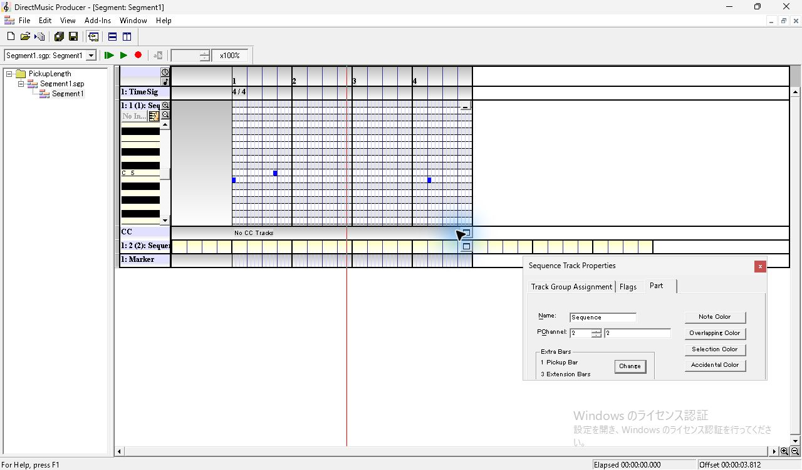

*図37 第2パートだけをピックアップ1・追加3にした状態。*

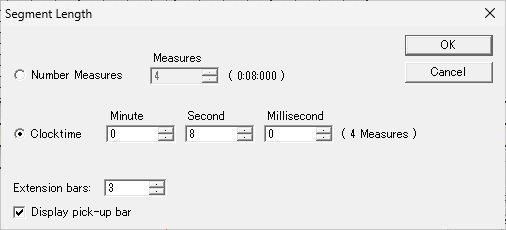

*図38 第1パート0、第2パート3のとき、Segment Length の Extension bars は3。*

*図39 値を編集せず OK を押した後も、第1パートは0・0。*

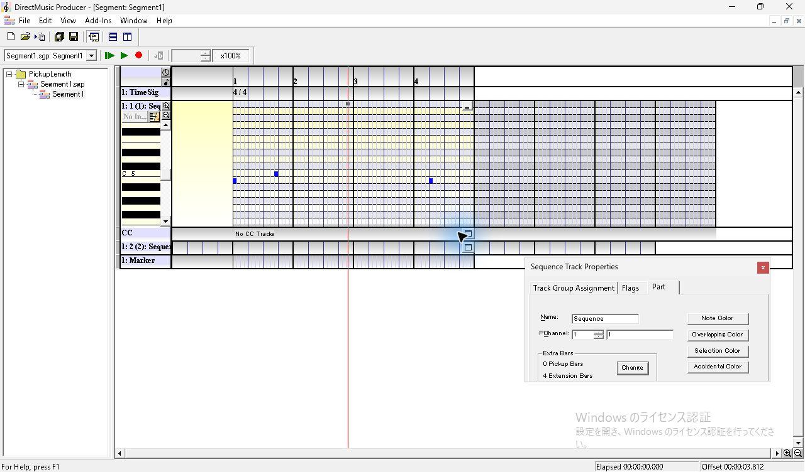

*図40 第1パートは追加4・ピックアップなし。第2パートは追加3・ピックアップあり。*

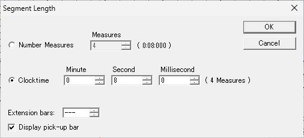

*図41 追加4と3が混在すると Extension bars はダッシュ。チェックはオン。*

*図42 Segment Length で追加を2にすると、第1パートは追加2・ピックアップなし。*

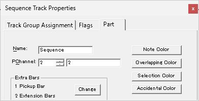

*図43 第2パートも追加2になり、ピックアップはオンのまま。*

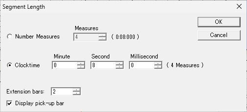

*図44 第1パート2、第2パート0のとき、Segment Length の Extension bars は2。*

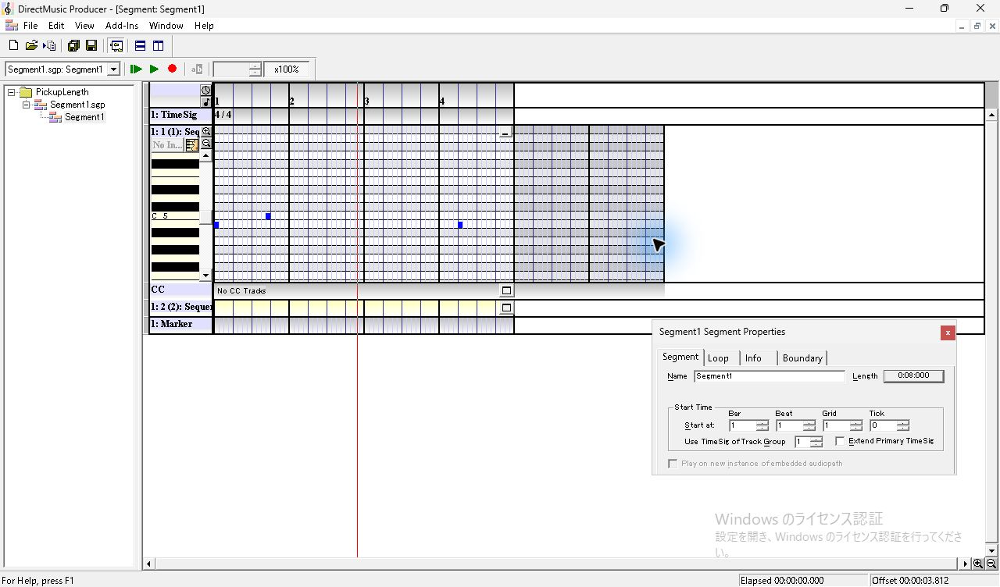

*図45 ピックアップだけを解除すると、左の範囲が消え、追加小節は第1パートに残る。*

*図46 再起動後の第1パートは追加2・ピックアップなし。*

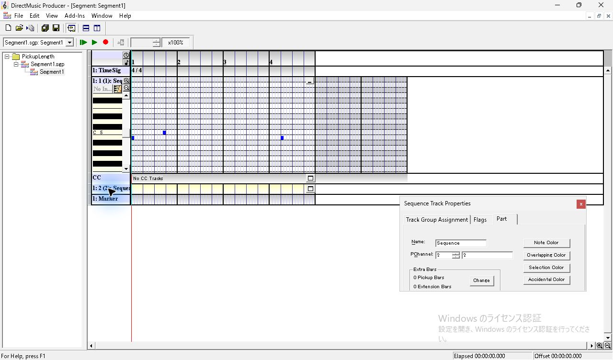

*図47 再起動後の第2パートは追加0・ピックアップなし。*

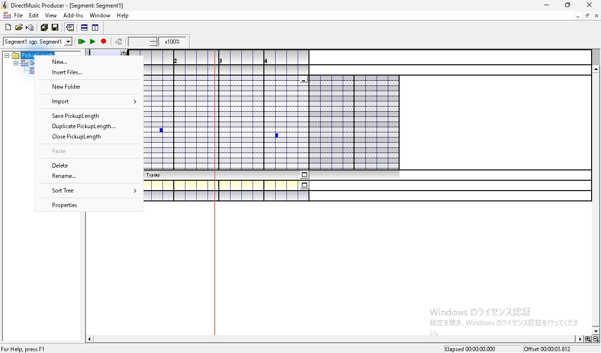

*図48 保存後に Close PickupLength を選ぶ直前。*

## 保存値の照合

22点の .sgp を確認した。各 Sequence の `psql/psqc` は、今回のファイルではオフセット44に Extension bars、48に Pickup Bars が入り、ノートは `seqt/evtl` に入った。全時点の `segh` の音楽長は12288、Segment の開始位置は0。TimeSig Track は入力と一致した。Marker は空で、再読込後に保存した段階で空の `LIST MARK` が2件から3件になった。 [照合コード](../../../work/original-gui/SEG-10-length-pickup/20261112T082148848173Z/audit.py) · [保存値と実行記録の照合結果](../../../work/original-gui/SEG-10-length-pickup/20261112T082148848173Z/segment-length-pickup-audit.json)

終了時は Project を閉じた状態で原版コピー1件。View の **Project Tree、Standard Toolbar、Status Bar、Transport Controls** を確認した。 [終了時のウィンドウ一覧](../../../work/original-gui/SEG-10-length-pickup/20261112T082148848173Z/captures/end-windows.json)

*図49 復旧と再読込を終えた View。空の Project Tree と4項目のチェック。*
