# SEG-10　拍子に応じた Start at と Clocktime の丸め

2026-11-12。Windows 上の DirectMusic Producer 原版コピーで、拍子とグリッド分割が Start at に与える影響、Clocktime の1 ms刻みの丸め、保存・再読込と先頭再生を調べた。View は Project Tree、Standard Toolbar、Status Bar、Transport Controls の4項目。 [実行ファイルと素材のハッシュ](../../../work/original-gui/SEG-10-meter-clock/20261112T100701212166Z/run.json) · [既存の4/4の入力境界](seg-10-properties-bounds.md)

## 素材と基準時刻

既存の TimeSig だけを含む Segment から、拍子の異なる2文書を作った。どちらも Track Group 1、繰り返し0、四分音符768クロック、Tempo Track を持たない。Length の画面に表示される換算値は120 BPM相当。初回に **Add New Tracks** が開いたので、両文書に空の Marker を追加した。 [素材生成コード](../../../work/original-gui/SEG-10-meter-clock/20261112T100701212166Z/prepare_fixture.py)

| 文書 | 小節 | 拍子 | 1拍の分割 | 小節先頭のクロック |
| --- | --- | --- | ---: | ---: |
| Segment1 | 1〜4 | 6/8 | 3 | 0（第1小節） |
| MixedMeter | 1〜2 | 4/4 | 4 | 0（第1小節） |
| MixedMeter | 3〜4 | 6/8 | 3 | 6144（第3小節） |
| MixedMeter | 5〜6 | 3/4 | 2 | 10752（第5小節） |

## Start at の上限と拍子変更

Project Tree の論理ノードから **Properties > Segment** を開いた。**Start at** の Bar、Beat、Grid、Tick に数値を入力し、Tab で離れると補正された。6/8・1拍3分割では1拍384クロック、1グリッド128クロック。Beat 99、Grid 99、Tick 999 の確定値は6、3、127。4小節で Bar 99 を確定すると4。最後の Tick 127 で上向きスピンを押しても値は127だった。保存した Start は9215クロックで、長さ9216の1クロック手前。 [6/8の最終 Tick を保存したファイル](../../../work/original-gui/SEG-10-meter-clock/20261112T100701212166Z/captures/26-fixed-max-start-Segment1.sgp)

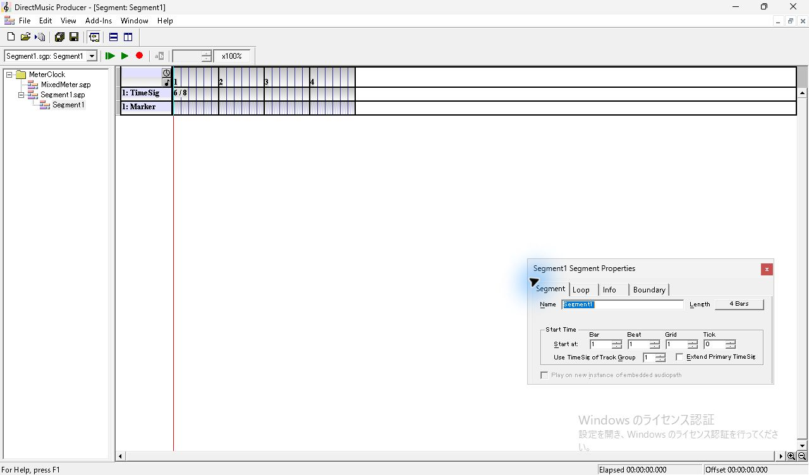

*図1 6/8 固定の4小節。TimeSig の下に空の Marker。*

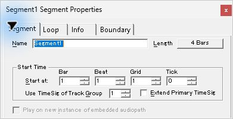

*図2 Segment タブの4つの Start at 入力欄。*

*図3 6/8 の Beat に99を入力した直後。*

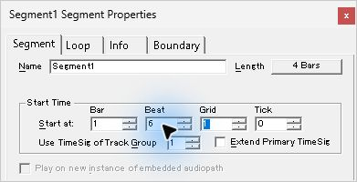

*図4 Tab で Beat を確定すると6。*

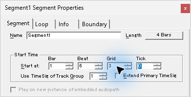

*図5 1拍3分割の Grid は3に補正。*

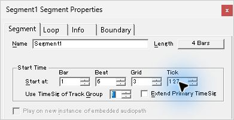

*図6 128クロックのグリッドで Tick は127に補正。*

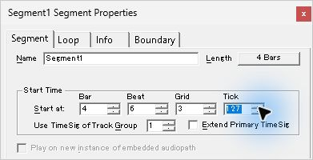

*図7 6/8の4小節目の最終 Tick。Tick 上向きスピンの後も4:6:3:127。*

MixedMeter はルーラーの第3小節から小節幅と拍の間隔が変わり、第5小節で拍の間隔が再び変わる。Start at の Bar を変えると、変更先の拍子に合わせて Beat、Grid、Tick を補正する。2→3では上向きスピン、4→5では直接入力と Tab を使った。

| 操作 | 表示 | 保存 Start（クロック） | 保存ファイル |
| --- | --- | ---: | --- |
| 第2小節で Beat・Grid・Tick に上限を超える値を入力 | `2:4:4:191` | 6143 | [.sgp](../../../work/original-gui/SEG-10-meter-clock/20261112T100701212166Z/captures/87-mixed-before-6-8-MixedMeter.sgp) |
| Bar を1回上げ、6/8に入る | `3:4:3:127` | 7679 | [.sgp](../../../work/original-gui/SEG-10-meter-clock/20261112T100701212166Z/captures/91-mixed-into-6-8-MixedMeter.sgp) |
| 第4小節にし、Beat に99を入力 | `4:6:3:127` | 10751 | [.sgp](../../../work/original-gui/SEG-10-meter-clock/20261112T100701212166Z/captures/96-mixed-before-3-4-MixedMeter.sgp) |
| Bar に5と入力し、3/4に入る | `5:3:2:127` | 12799 | [.sgp](../../../work/original-gui/SEG-10-meter-clock/20261112T100701212166Z/captures/100-mixed-into-3-4-MixedMeter.sgp) |
| 第5小節で Tick に999を入力 | `5:3:2:383` | 13055 | [.sgp](../../../work/original-gui/SEG-10-meter-clock/20261112T100701212166Z/captures/104-mixed-3-4-max-MixedMeter.sgp) |

6/8へ移ると、Beat 4は維持され、Grid 4は3、Tick 191は127に補正された。3/4へ移ると Beat 6は3、Grid 3は2、Tick 127はその範囲内だった。3/4の1拍は768クロック、2分割なので Tick の範囲は0〜383。

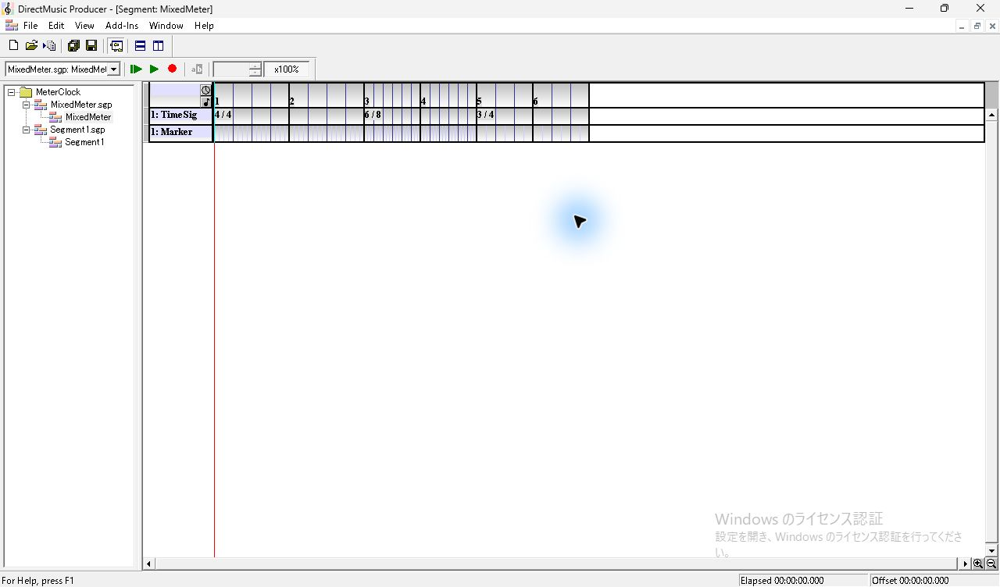

*図8 4/4、6/8、3/4の順に並ぶ6小節。*

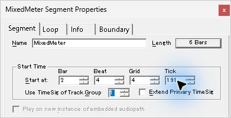

*図9 4/4の第2小節の最後。2:4:4:191。*

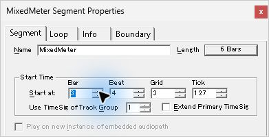

*図10 Bar の上向きスピン1回で6/8の第3小節へ移動。3:4:3:127。*

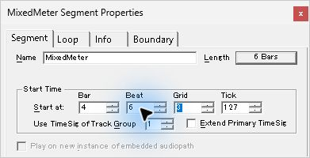

*図11 6/8の第4小節の最後。4:6:3:127。*

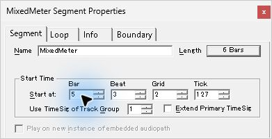

*図12 Bar に5と入力して Tab。3/4の Beat 3・Grid 2へ補正され、Tick 127は表示に残る。*

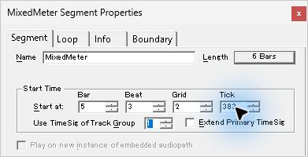

*図13 1拍2分割の3/4では Tick の上限が383。*

## Clocktime の1 ms刻みと参考小節数

**Segment Length** で **Clocktime** を選ぶと、Minute、Second、Millisecond の入力が有効になる。まず6/8固定の Start at を `1:1:1:0` に戻し、第1小節の終端1.500秒の前後を保存した。1.500秒の直接入力を試した1回は、Tab 後の表示と保存が1.499秒のままだった。確定値の比較ではミリ秒スピンを使って500と501の表示を確認した。 [直接入力を試した後のファイル](../../../work/original-gui/SEG-10-meter-clock/20261112T100701212166Z/captures/41-fixed-1500-Segment1.sgp)

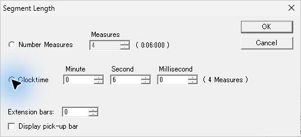

*図14 6/8の4小節を Clocktime に切り替えた直後。0分6秒0ミリ秒。*

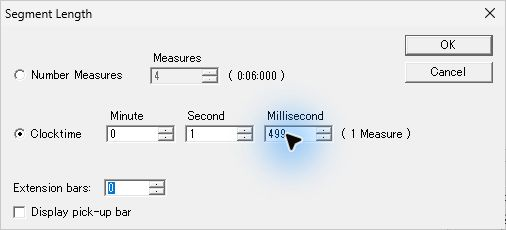

*図15 1.499秒の参考表示は1 Measure。*

*図16 ミリ秒を500と直接入力した試行の Tab 後。表示は499に戻った。*

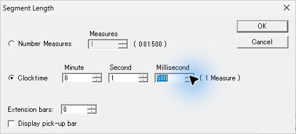

*図17 ミリ秒の上向きスピンで1.500秒。1 Measure。*

*図18 1.501秒では参考表示が2 Measures。*

1.501秒では参考表示が2 Measures。ここで Bar、Beat、Grid、Tick に上限を超える値を入れると `2:6:3:127` になり、Start 4607クロックを保存できた。Length は2306クロックで、第2小節の先頭2304から2クロックの位置。フォームでは第2小節の最後まで指定できた。 [終端を越えた Start の保存ファイル](../../../work/original-gui/SEG-10-meter-clock/20261112T100701212166Z/captures/61-fixed-short-max-start-Segment1.sgp)

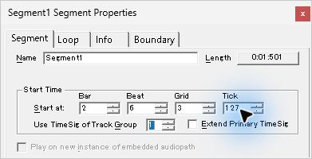

*図19 Length 1.501秒でも、Start at は第2小節の最後2:6:3:127まで入力できた。*

0分59秒999ミリ秒からミリ秒スピンを1回上げると、1分0秒0ミリ秒。下向きスピン1回で元に戻った。Minute に12345を入力した試行では123と表示された。これらの試行は Cancel で閉じ、Length ボタンの1.501秒を再確認した。

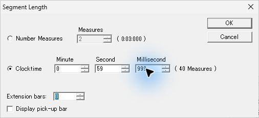

*図20 ミリ秒スピンの直前。0分59秒999ミリ秒。*

*図21 上向きスピン1回で1分0秒0ミリ秒。*

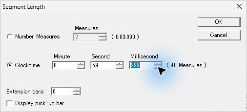

*図22 下向きスピン1回で0分59秒999ミリ秒へ戻る。*

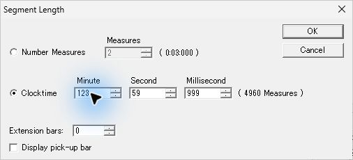

*図23 Minute に12345を入力した試行の確定前。表示は123。*

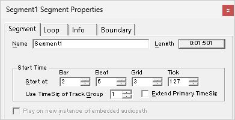

*図24 桁上がりと長い分数を試した後に Cancel。Length は1.501秒。*

MixedMeter では Start at を `1:1:1:0` に戻し、第3小節が始まる4.000秒の前後を保存した。3.999秒と4.000秒では2 Measures、4.001秒で3 Measures。4.001秒を保存して Length を開き直し、**Number Measures** を選んだときの換算は3小節で5.500秒。ここでは Cancel し、4.001秒を維持した。

*図25 拍子混在の6小節は、Clocktime の初期換算で10秒。*

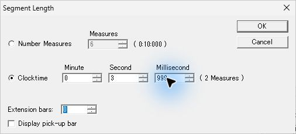

*図26 3.999秒の参考表示は2 Measures。*

*図27 ミリ秒スピンで4.000秒へ繰り上がっても2 Measures。*

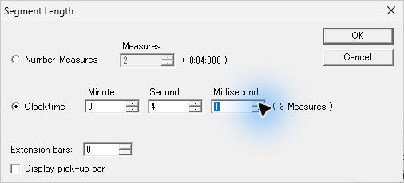

*図28 4.001秒では3 Measures。*

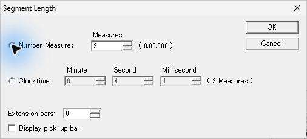

*図29 Number Measures へ切り替えた試行。3小節の時間換算は5.500秒。*

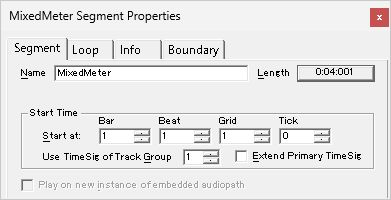

*図30 Cancel 後の Length は4.001秒。*

| 素材 | 入力 | 参考小節数 | 音楽長（クロック） | 参照時刻長（100 ns単位） | 保存ファイル |
| --- | ---: | ---: | ---: | ---: | --- |
| 6/8固定 | 1.499秒 | 1 | 2302 | 14990000 | [.sgp](../../../work/original-gui/SEG-10-meter-clock/20261112T100701212166Z/captures/37-fixed-1499-Segment1.sgp) |
| 6/8固定 | 1.500秒 | 1 | 2304 | 15000000 | [.sgp](../../../work/original-gui/SEG-10-meter-clock/20261112T100701212166Z/captures/46-fixed-1500-spin-Segment1.sgp) |
| 6/8固定 | 1.501秒 | 2 | 2306 | 15010000 | [.sgp](../../../work/original-gui/SEG-10-meter-clock/20261112T100701212166Z/captures/51-fixed-1501-Segment1.sgp) |
| 拍子混在 | 3.999秒 | 2 | 6142 | 39990000 | [.sgp](../../../work/original-gui/SEG-10-meter-clock/20261112T100701212166Z/captures/116-mixed-3999-MixedMeter.sgp) |
| 拍子混在 | 4.000秒 | 2 | 6144 | 40000000 | [.sgp](../../../work/original-gui/SEG-10-meter-clock/20261112T100701212166Z/captures/121-mixed-4000-MixedMeter.sgp) |
| 拍子混在 | 4.001秒 | 3 | 6146 | 40010000 | [.sgp](../../../work/original-gui/SEG-10-meter-clock/20261112T100701212166Z/captures/126-mixed-4001-MixedMeter.sgp) |

6点とも入力ミリ秒が参照時刻長に保存され、音楽長は120 BPM相当で最も近いクロックに丸めた値と一致した。参考小節数は、拍子変更を含めて端数の小節を1小節に数えた結果と一致。Clocktime の参照時刻長フラグは1。短縮後の表示範囲に収まらない TimeSig イベントも `tims` に残り、2文書の TimeSig Track は全保存時点で固定入力とバイト単位で一致した。 [40点の保存値と換算の照合結果](../../../work/original-gui/SEG-10-meter-clock/20261112T100701212166Z/meter-clock-audit.json)

## 別プロセスでの再読込と先頭再生

Project を閉じて通常終了し、原版が0件になったことを確認して同じ実行ファイルを1件起動した。MixedMeter は4.001秒と3 Measures、Segment1 は1.501秒・2 Measuresと `2:6:3:127` を再表示した。再起動前と再読込直後の2つの .sgp はそれぞれ同一。 [通常終了](../../../work/original-gui/SEG-10-meter-clock/20261112T100701212166Z/captures/141-normal-exit.json) · [再起動](../../../work/original-gui/SEG-10-meter-clock/20261112T100701212166Z/captures/142-reload-process.json)

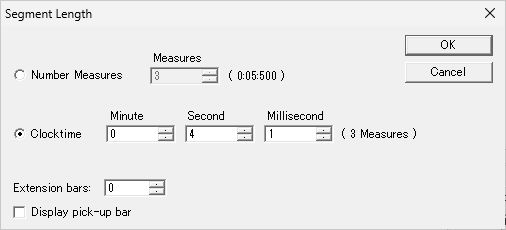

*図31 別プロセスで読み戻した4.001秒と3 Measures。*

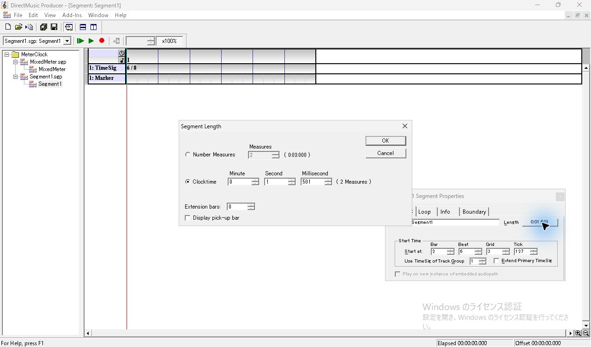

*図32 別プロセスでも1.501秒と、終端を越えた Start at 2:6:3:127を表示。*

保存上の Start が終端を越えた Segment1 で **Play From Start** を押すと、赤い位置線が本体内を進み、Elapsed 1.501秒で停止した。続いて Start at を `1:3:1:0`（768クロック、0.500秒）に直すと、Clocktime 1.501秒の再生は約1.5秒だった。そこで、同じ Start と音楽長2304クロックを持つ **Number Measures 1** と **Clocktime 1.500秒** を保存して比較した。 [同じ Start の小節指定](../../../work/original-gui/SEG-10-meter-clock/20261112T100701212166Z/captures/186-musical-control-Segment1.sgp) · [同じ Start の Clocktime 指定](../../../work/original-gui/SEG-10-meter-clock/20261112T100701212166Z/captures/196-clock-control-Segment1.sgp)

| 再生条件 | 保存 Start（クロック） | 再生中の Elapsed / Offset | 自然終了時 Elapsed |
| --- | ---: | --- | ---: |
| Clocktime 1.501秒、終端を越えた開始位置 | 4607 | 1.213秒 / 1.211秒 | 1.501秒 |
| Clocktime 1.501秒、有効な開始位置 | 768 | 1.357秒 / 1.356秒 | 1.506秒 |
| Number Measures 1、音楽長2304 | 768 | 0.954秒 / 1.454秒 | 1.009秒 |
| Clocktime 1.500秒、音楽長2304 | 768 | 1.264秒 / 1.263秒 | 1.504秒 |

Number Measures では Offset が Elapsed より0.500秒先行し、指定した開始位置からの残り約1.0秒を再生した。Clocktime では、同じ有効な Start を保存していても Offset は Elapsed とほぼ同じで、全長約1.5秒を再生した。今回の確認は **Play From Start** の Transport 表示と位置線。素材は TimeSig と空の Marker で、音の再生範囲は今後の試験で確認する。

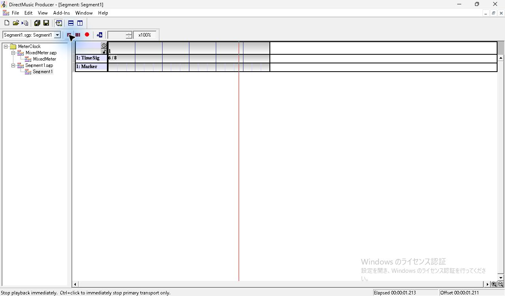

*図33 終端を越えた Start at の再生中。位置線は本体内で Offset 1.211秒。*

*図34 終端を越えた開始位置の条件で、画面の Elapsed は1.501秒。*

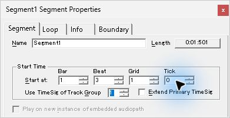

*図35 同じ1.501秒に、有効な Start at 1:3:1:0 を指定。*

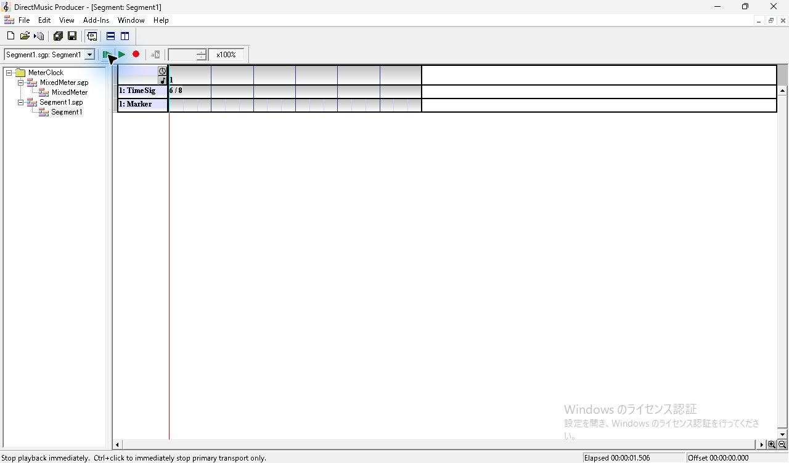

*図36 Clocktime 1.501秒・Start 768の再生後。Elapsed 1.506秒。*

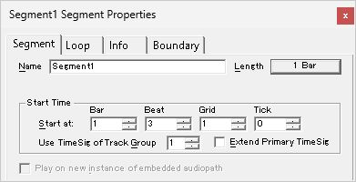

*図37 Number Measures 1。Start at は1:3:1:0。*

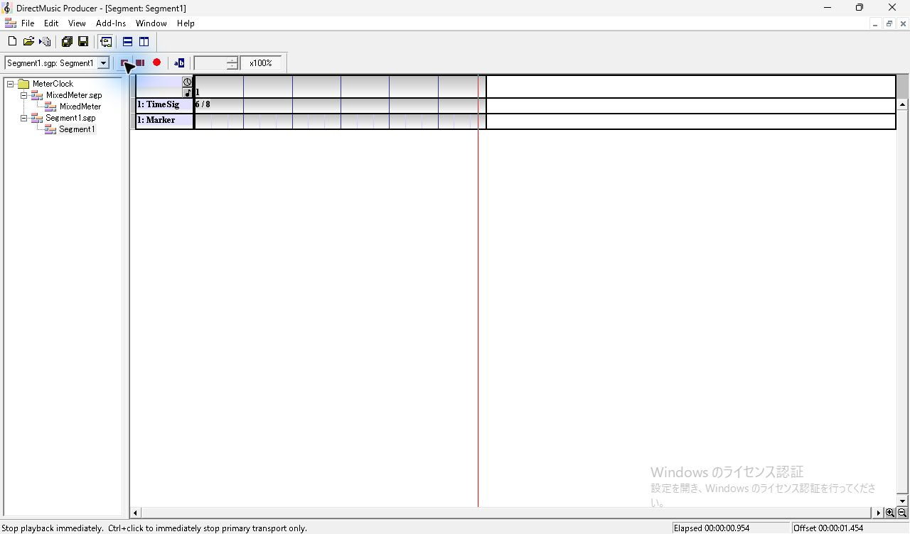

*図38 小節指定の再生中。Elapsed 0.954秒、Offset 1.454秒。*

*図39 小節指定の自然終了。Elapsed 1.009秒。*

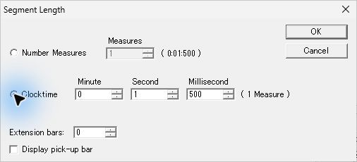

*図40 同じ1小節を Clocktime 1.500秒へ切り替える。*

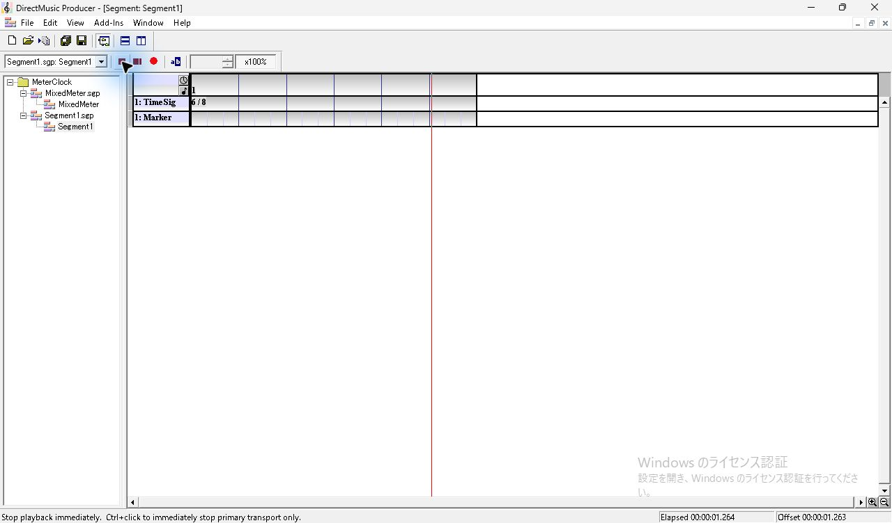

*図41 Clocktime 指定の再生中。Elapsed 1.264秒、Offset 1.263秒。*

*図42 Clocktime 指定の自然終了。Elapsed 1.504秒。*

調査後は Clocktime 1.500秒・Start 768の対照条件を Segment1 に保存した。終端を越えた開始位置はスナップショットに保存済み。Project を閉じた状態で原版コピー1件と基準の4項目を確認した。 [照合コード](../../../work/original-gui/SEG-10-meter-clock/20261112T100701212166Z/audit.py) · [終了時のウィンドウ一覧](../../../work/original-gui/SEG-10-meter-clock/20261112T100701212166Z/captures/207-end-windows.json)

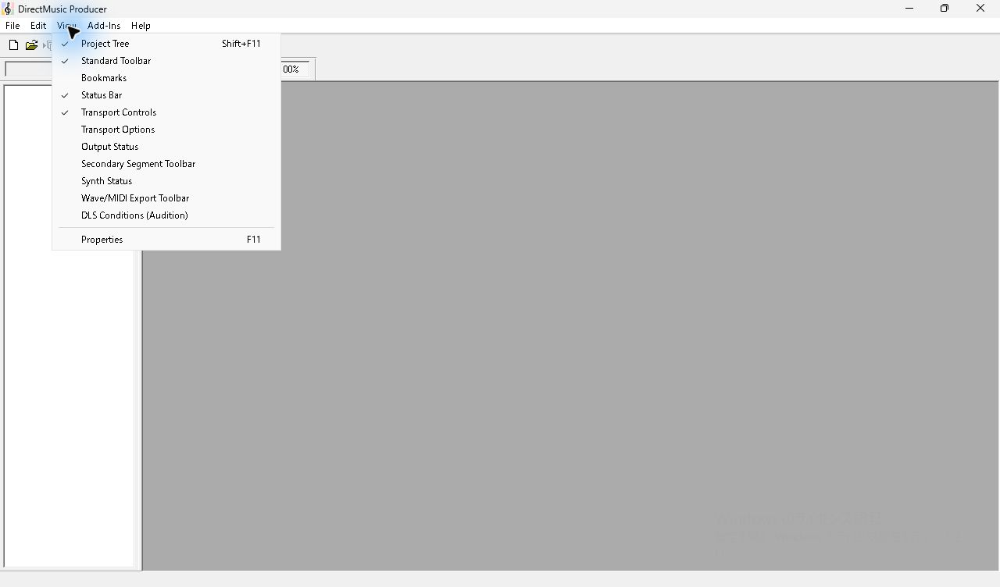

*図43 Project を閉じた後の View。基準の4項目にチェック。*
