# SEG-10 Segment Properties の Length、Start Time、Loop の入力境界

観測日 2026-11-12。DirectMusic Producer 5.3.0.900 の原版コピーで、4/4の Segment に境界値を入れ、入力欄、フォーカス移動、保存ファイル、別 Project での再読込を比較した。小節指定の Length は1〜999小節。Clocktime の Length はゼロも保存できた。短縮後の Start Time は画面で終端内に表示されても、保存値に短縮前の位置が残る。Clock Time Looping では逆順と範囲外の端点が保存され、大きなミリ秒値では保存値が折り返した。 [Segment Properties の4ページ](seg-10-properties.md) · [ループと境界停止の実測](seg-12-loop-boundary.md)

## 素材と手順

以前の20小節の `Segment1.sgp` を `SegmentBounds` の作業コピーに用いた。TimeSig は4/4、1拍4グリッド、1拍768クロックで、1小節は3072クロック。Tempo Track は無く、Length の時間換算は1小節2秒。エディターを開く際に **Add New Tracks** が出た場合は **Cancel**。Tree 内側の `Segment1` を選び、**F11** で Segment Properties を出した。入力欄の値を置き換えるときは **Home、Shift+End** で全体を選び、Tab または画面にある確定操作で反映した。初回の Ctrl+A は数値全体を選ばず、既存値に文字が追加された。 [素材の来歴とハッシュ](../../../work/original-gui/SEG-10-properties-bounds/20261112T073637845193Z/run.json) · [素材作成コード](../../../work/original-gui/SEG-10-properties-bounds/20261112T073637845193Z/prepare.py) · [画像の出典とハッシュ](../../../work/original-gui/SEG-10-properties-bounds/20261112T073637845193Z/published-figures.json)

掲載は44枚。全体画面は1280×752 px、浮動 Properties は391×200 px。応答なしの画面は1280×753 px。黒い矢印や青い光は操作ツールの表示。

## Length

**Segment** タブの Length ボタンから **Segment Length** を開く。**Number Measures** を選ぶと Measures と時間の換算が見える。値を0にすると入力中は0を表示でき、Tab で1へ補正された。0を入力してすぐ **OK** を押した試行でも Length は **1 Bar**。Measures に `9999` を入力すると `999` まで入り、Tab 後も999。999で上向き、1で下向きのスピンを押しても値が変わらない。999小節と1小節の保存値は、それぞれ3068928クロックと3072クロック。 [999小節の保存](../../../work/original-gui/SEG-10-properties-bounds/20261112T073637845193Z/captures/35-max-Segment1.sgp) · [1小節の保存](../../../work/original-gui/SEG-10-properties-bounds/20261112T073637845193Z/captures/41-min-Segment1.sgp)

**Clocktime** を選ぶと Minute、Second、Millisecond が有効になり、右に参考の小節数が出る。Second に60を入れてフォーカスを移すと **1分0秒**。Millisecond に1000を入力した試行では3桁の100になった。Minute、Second、Millisecond がすべて0のとき、ダイアログの参考値は **1 Measure**。OK 後は Length が **0:00:000** となり、`segh` の音楽長と参照時間長はともに0。再読込した E の Length も0。3秒250ミリ秒は **2 Measures** と換算表示され、保存値は音楽長4992クロックと参照時間長32500000。F でこの時間指定を読み戻した。Number Measures へ戻したときは Measures 2、時間換算0:04:000が表示された。 [Clocktime ゼロの保存](../../../work/original-gui/SEG-10-properties-bounds/20261112T073637845193Z/captures/60-clock-zero-Segment1.sgp) · [3.250秒の保存](../../../work/original-gui/SEG-10-properties-bounds/20261112T073637845193Z/captures/75-clock-3250-Segment1.sgp) · [小節指定に戻した表示](../../../work/original-gui/SEG-10-properties-bounds/20261112T073637845193Z/captures/78-length-measures-return-0.jpg)

Clocktime のゼロを確定したときにタイムラインの目盛りと TimeSig の値表示が消えた。時間を増やし、小節指定に戻しても同じ画面では空のまま。ゼロを保存した時点から、`sgdl/segd` のオフセット16にある倍精度値が正の無限大になり、後続の保存にも残った。F でも目盛りは空で、横ズーム縮小1回では表示が戻らなかった。表示用の倍精度値だけを元の0.03125に戻した H はエディターを開く途中で異常終了し、この比較では目盛りの復元まで確認できなかった。比較結果は下の表にまとめた。

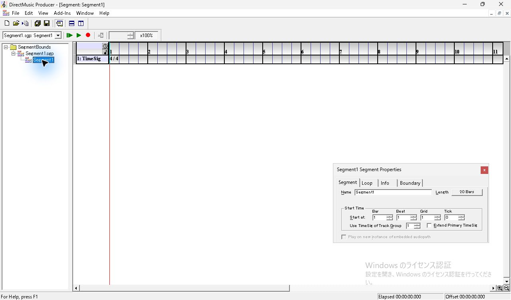

*図1 20小節・4/4の初期 Segment。Start at は1:1:1:0。*

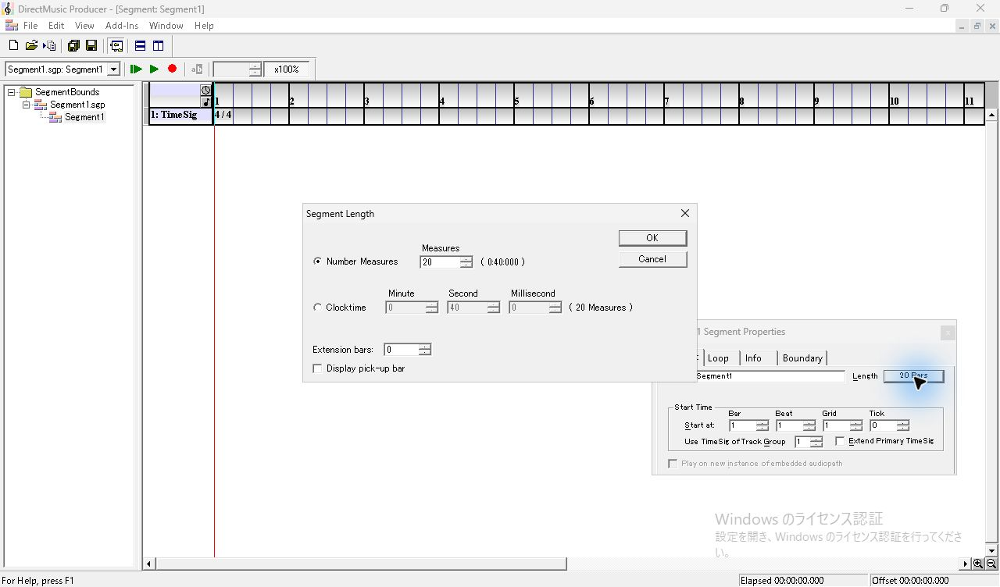

*図2 Segment Length の初期表示。Number Measures の20小節は0:40:000。*

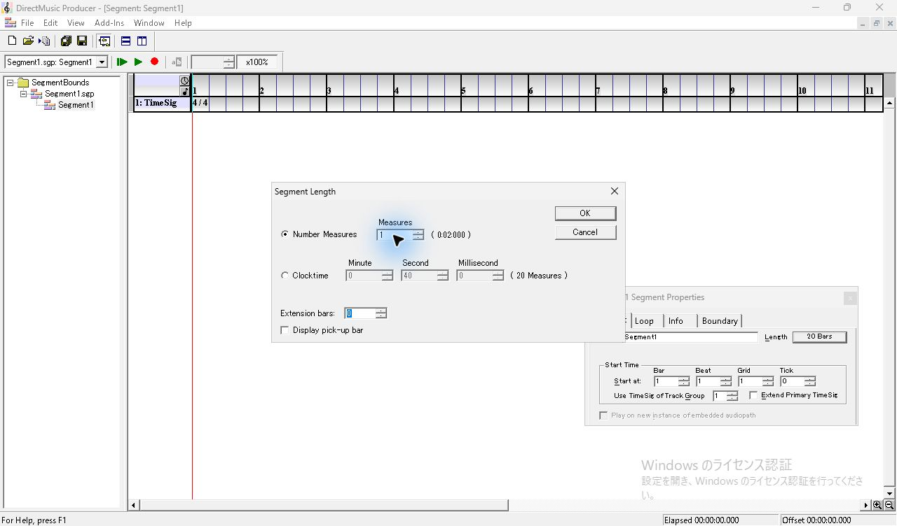

*図3 Measures に0を入力して Tab を押すと1になり、換算表示は0:02:000。*

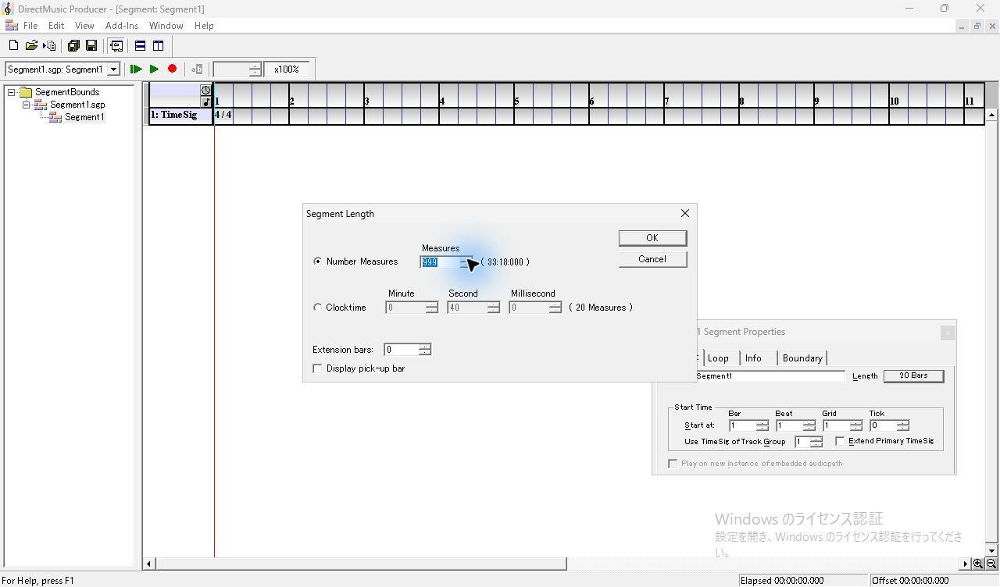

*図4 Measures の上端は999。上向きスピンを押しても999のまま。*

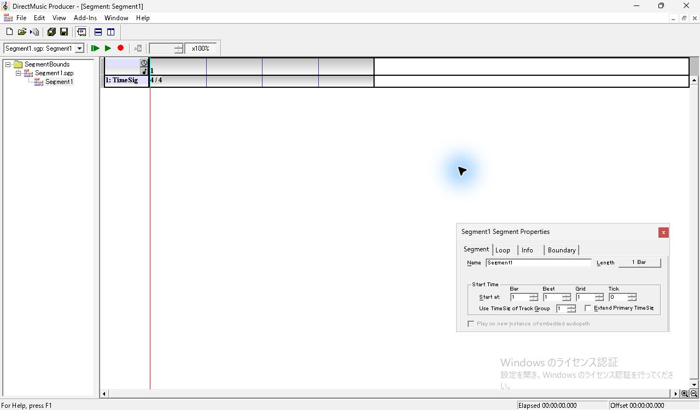

*図5 0を直接 OK で確定した場合も、Length は1 Bar。*

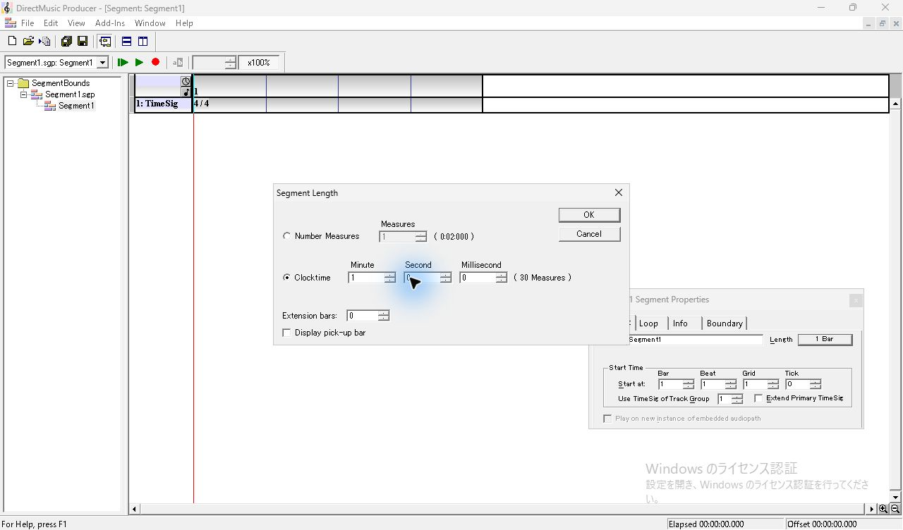

*図6 Second の60は Minute 1、Second 0 に繰り上がる。*

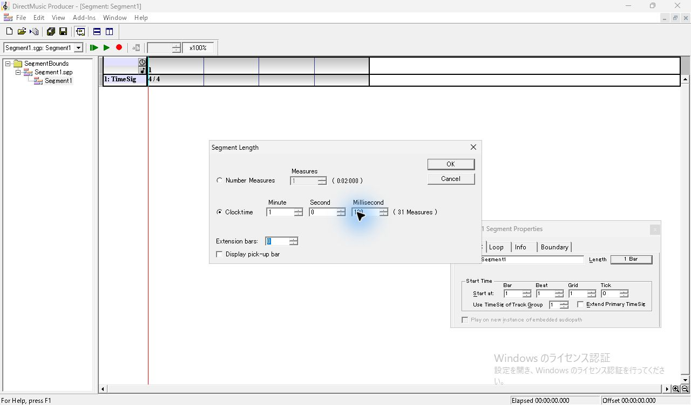

*図7 Millisecond に1000を入力した結果は100。*

*図8 Clocktime はすべて0でも、参考換算は1 Measure と表示する。*

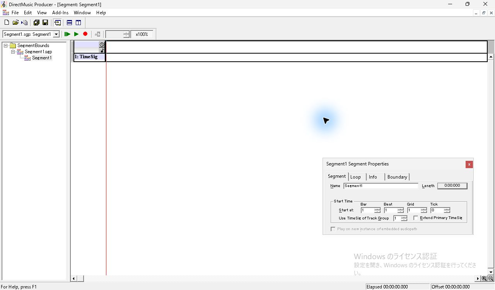

*図9 Clocktime の0を確定。Length は0:00:000で、小節の目盛りが消える。*

*図10 3.250秒に変更後も、同じエディターの小節の目盛りは空。*

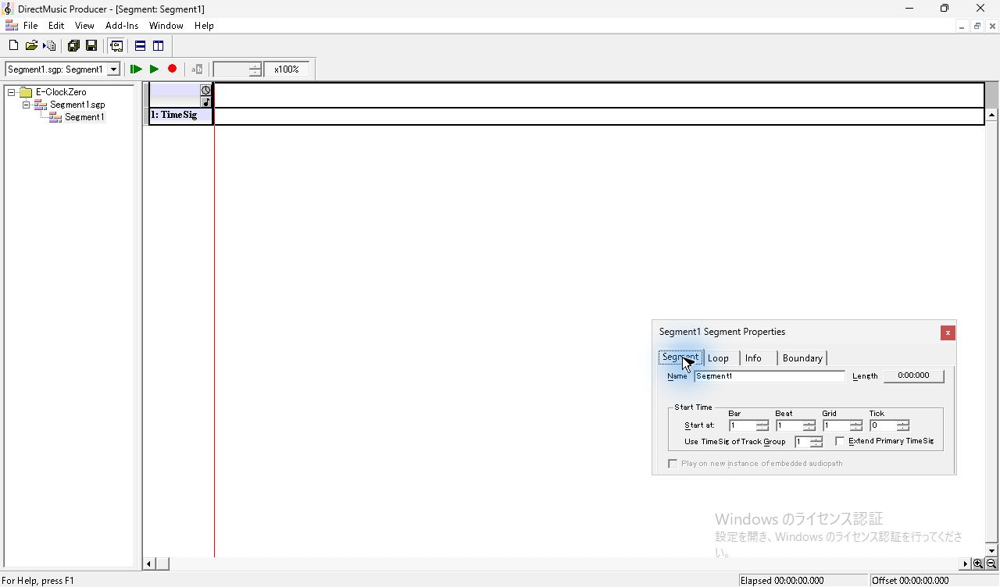

*図11 別 Project で再読込したゼロ時間の Length は0:00:000。*

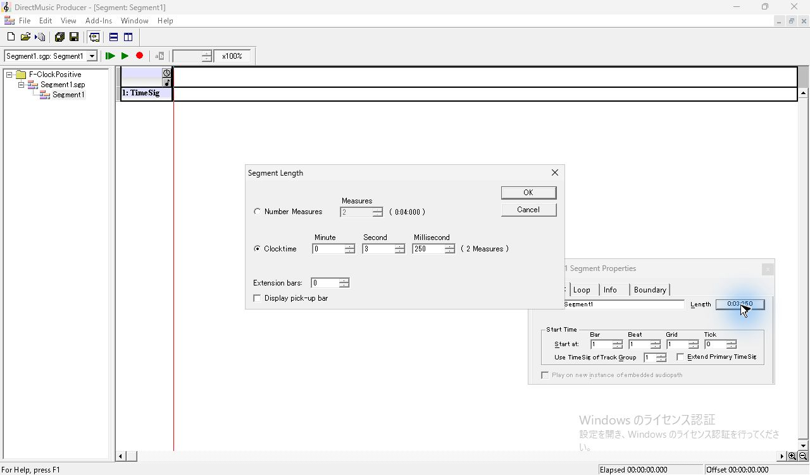

*図12 別 Project で再読込した Clocktime は0分3秒250ミリ秒。*

## Start Time

**Segment** タブの **Start at** を4小節の4/4で調べた。入力時に範囲外の値が表示され、Tab で補正された。

| 欄 | 下端 | 範囲外の試行 | 確定後の上端 |
| --- | ---: | ---: | ---: |
| Bar | 1 | 99 | 4 |
| Beat | 1 | 9 | 4 |
| Grid | 1 | 9 | 4 |
| Tick | 0 | 999 | 191 |

1:1:1:0の各下向きスピン、4:4:4:191の各上向きスピンで値は折り返さなかった。4:4:4:191を保存すると Start は12287クロックで、長さ12288クロックの1 Tick 手前。

Length を2小節へ短縮すると **表示** は2:4:4:191になったが、保存値は **長さ6144、Start 12287**。A はその保存値を持つ対照で、再読込後の表示も2:4:4:191。そこで Tick の下向きスピンを1回押すと、画面は2:4:4:190になり、保存値は12286に減った。B では開始位置のフィールドをあらかじめ6143に置き換えており、同じ2:4:4:191の表示で開けた。 [4小節の最終 Tick の保存](../../../work/original-gui/SEG-10-properties-bounds/20261112T073637845193Z/captures/105-start-max-Segment1.sgp) · [2小節に短縮した保存](../../../work/original-gui/SEG-10-properties-bounds/20261112T073637845193Z/captures/111-start-shortened-Segment1.sgp) · [再読込後に Tick を下げた保存](../../../work/original-gui/SEG-10-properties-bounds/20261112T073637845193Z/captures/257-case-a-edited-start-Segment1.sgp)

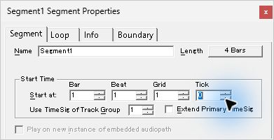

*図13 Start at の4つの下向きスピンを押した後も1:1:1:0。*

*図14 範囲外の Bar を入力した直後。編集中は入力値を表示する。*

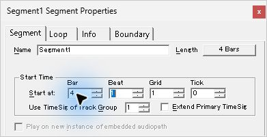

*図15 Tab 後は4小節の上端の Bar 4。次の Beat が選択される。*

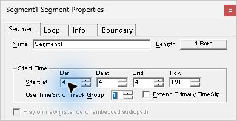

*図16 Beat 9、Grid 9、Tick 999 を順に確定した結果は4:4:4:191。*

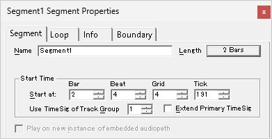

*図17 2小節へ短縮した直後の表示は2:4:4:191。*

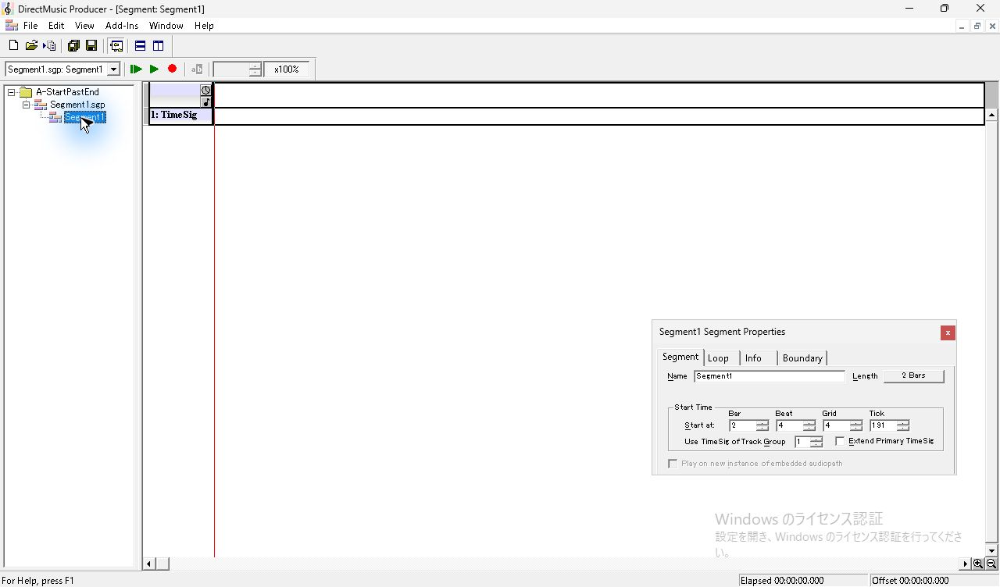

*図18 保存値が12287の対照を再読込しても、Properties の表示は2:4:4:191。*

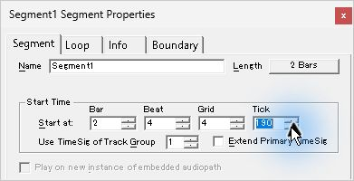

*図19 Tick を1下げた後の表示は2:4:4:190。保存値は12286。*

## Loop

### Repeat と Music Time Looping

Repeat の下限は0。0で下向きスピンを押しても変わらず、端点欄と Reset は灰色。大きな数値を入力し、フォーカスを移すと32767で確定した。32767の上向きスピンでも変わらない。2小節で Repeat を有効にすると、全長の端点は **1:1:1:0〜3:1:1:0**。Infinite を選ぶと数値欄が無効になり、このとき32767が残って見えた。有限32767は `0x00007fff`、Infinite は `0xffffffff` として保存された。保存後に Infinite を解除すると0だった。別の試行で Repeat 1から保存を挟まず Infinite をオン・オフすると1に戻った。 [有限 Repeat 上端の保存](../../../work/original-gui/SEG-10-properties-bounds/20261112T073637845193Z/captures/122-repeat-max-Segment1.sgp) · [Infinite の保存](../../../work/original-gui/SEG-10-properties-bounds/20261112T073637845193Z/captures/125-infinite-Segment1.sgp)

2小節・Repeat 1で端点が交差する操作を比較した。

| 操作 | 操作前の端点 | 確定後の端点 | 保存したクロック |
| --- | --- | --- | --- |
| End の Bar を1にして Tab | Start 2:1:1:0、End 3:1:1:0 | Start 1:1:1:0、End 1:1:1:1 | 0、1 |
| 続けて Start の Bar をスピンで2へ | Start 1:1:1:0、End 1:1:1:1 | Start 2:1:1:0、End 2:1:1:1 | 3072、3073 |
| Reset Loop to Entire Segment | Start 2:1:1:0、End 2:1:1:1 | Start 1:1:1:0、End 3:1:1:0 | 0、6144 |

全長の Loop End で Bar の上向きスピンを押しても3:1:1:0。これらの操作で Repeat は1だった。 [End を前へ動かした保存](../../../work/original-gui/SEG-10-properties-bounds/20261112T073637845193Z/captures/139-music-end-cross-Segment1.sgp) · [Start を後ろへ動かした保存](../../../work/original-gui/SEG-10-properties-bounds/20261112T073637845193Z/captures/142-music-start-cross-Segment1.sgp) · [Reset 後の保存](../../../work/original-gui/SEG-10-properties-bounds/20261112T073637845193Z/captures/147-music-reset-Segment1.sgp)

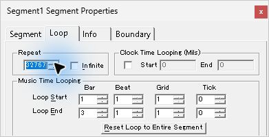

*図20 Repeat の32767で上向きスピンを押しても値が変わらない。*

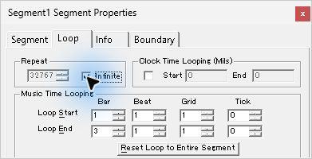

*図21 Infinite を選んだ直後は、灰色の数値欄に32767が残る。*

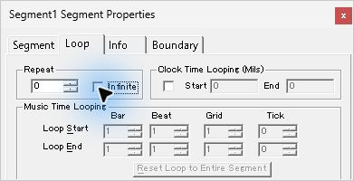

*図22 Infinite を保存してから解除すると Repeat は0。*

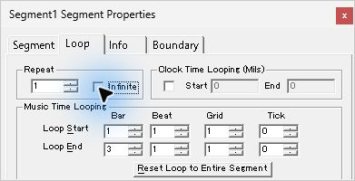

*図23 Repeat 1から、保存せずに Infinite をオン・オフすると1に戻る。*

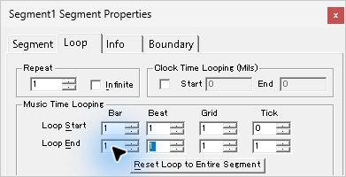

*図24 Loop End を Start より前へ動かすと、両端が1小節目の先頭と1 Tick 後になる。*

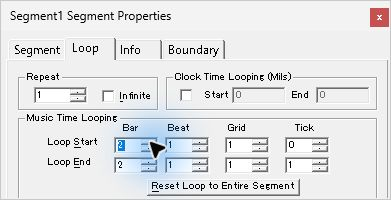

*図25 Loop Start を End より後ろへ動かすと、End が Start の1 Tick 後になる。*

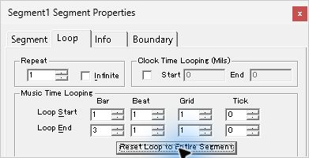

*図26 Reset で、2小節の Loop End は3:1:1:0に戻る。*

### Clock Time Looping

**Clock Time Looping (Mils)** をオンにすると Start と End のテキスト欄が有効になり、Music Time のスピンは灰色になる。オン直後の時間欄は0・0。Start に1000、End に500を入れて Tab で確定すると逆順のまま残り、`segh` に10000000と5000000が保存された。End に5000を入れると、2小節の換算4000 msを超えても5000のまま保存できた。C の再読込でも1000・5000だった。Start に `-1` を入力して Tab を押すと **正の数値を入力してください。** の警告が出る。OK 後は入力欄に戻り、`-1` が選択された。0を入力すると確定できた。 [逆順の保存](../../../work/original-gui/SEG-10-properties-bounds/20261112T073637845193Z/captures/156-clock-reversed-Segment1.sgp) · [5000 msの保存](../../../work/original-gui/SEG-10-properties-bounds/20261112T073637845193Z/captures/160-clock-end-over-Segment1.sgp)

Clock Time Looping を一度オフにし、Music Time の Start を2小節目に設定してからオンに戻した。**Reset Loop to Entire Segment** を押すと、灰色の Music Time 側だけが1小節目の頭〜3小節目の頭へ戻り、時間側の1000・5000は残った。

End のミリ秒値と、`segh` の100 ns単位の保存値を比べた。次の値は Tab で確定し、Save で採取した。

| End の入力（ms） | 保存値（100 ns） |
| ---: | ---: |
| 429496 | 4294960000 |
| 429497 | 2704 |
| 2147483647 | 4294957296 |
| 2147483648 | 0 |

4例とも、ミリ秒値を10000倍した値の下位32ビットと一致した。429497を入力した直後は欄に429497があり、保存後に **Segment** タブへ移動して **Loop** に戻ると0と表示された。時間欄の最大入力値と、これらの端点での再生は追試対象。 [429496 msの保存](../../../work/original-gui/SEG-10-properties-bounds/20261112T073637845193Z/captures/226-case-c-before-wrap-Segment1.sgp) · [429497 msの保存](../../../work/original-gui/SEG-10-properties-bounds/20261112T073637845193Z/captures/231-case-c-after-wrap-Segment1.sgp) · [全保存値](../../../work/original-gui/SEG-10-properties-bounds/20261112T073637845193Z/segment-properties-bounds-audit.json)

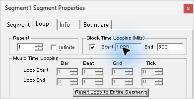

*図27 Clock Time Looping では1000 msと500 msの逆順が表示される。*

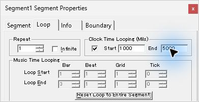

*図28 2小節を超える End 5000 msを入力しても表示値が残る。*

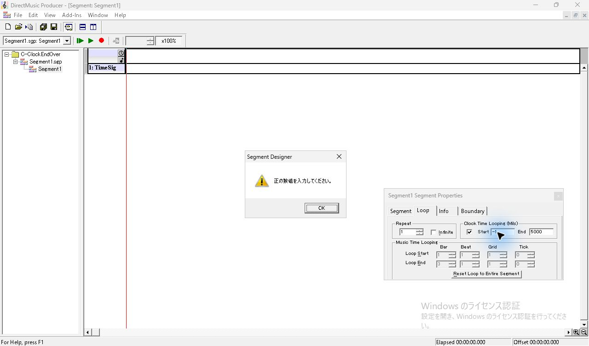

*図29 Start に-1を入力して Tab を押すと正の数値を求める警告が出る。*

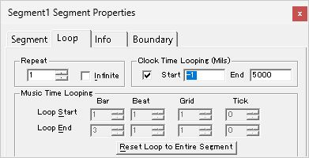

*図30 警告を閉じると入力欄にフォーカスが戻り、-1が選択される。*

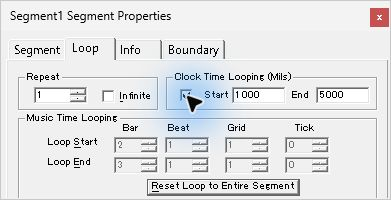

*図31 Reset 前は時間指定1000・5000、灰色の Music Time の Loop Start は2小節目。*

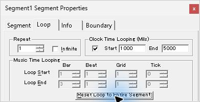

*図32 Clock Time Looping をオンにしたまま Reset。時間指定は1000・5000、Music Time の Loop Start は1小節目。*

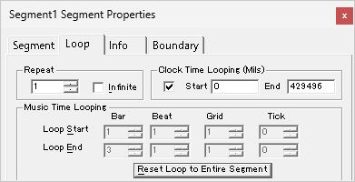

*図33 End 429496 msは確定後も表示される。*

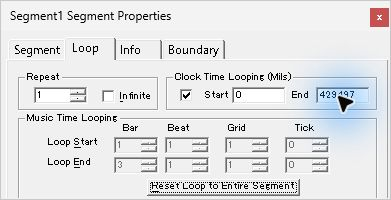

*図34 End 429497 msも入力を確定できる。*

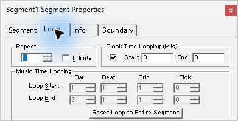

*図35 保存後に Loop タブを開き直すと End は0と表示される。*

## 再読込の比較と異常終了

実際に保存した .sgp から、各 Project と Segment の GUID を変えた8組を作った。表の「開始位置修正」は、Start の4バイトだけを6143に替えた条件。H は F と同じ Length ヘッダーで、GUID のほかに `sgdl/segd` の倍精度値だけを元に戻した。各対照の TimeSig Track とその他の安定したチャンクを照合した。 [再読込素材の作成コード](../../../work/original-gui/SEG-10-properties-bounds/20261112T073637845193Z/prepare_reopen.py) · [各ケースの元の保存状態、差分とハッシュ](../../../work/original-gui/SEG-10-properties-bounds/20261112T073637845193Z/reopen-cases.json)

| 対照 | 開いた条件 | 結果 |
| --- | --- | --- |
| A | 長さ6144、Start 12287、Repeat 0 | Properties まで開き、画面は2:4:4:191。Tick を1下げると12286を保存 |
| B | A の開始位置修正 | Properties まで開き、画面は2:4:4:191 |
| C | 長さ6144、開始位置修正、Clock Loop 1000〜5000 ms | Loop まで開き、1000・5000を表示。その後の桁あふれ試験を経て、Project を閉じる途中で応答停止 |
| D | 長さ6144、開始位置修正、Clock Loop 1000〜500 ms | Project Tree は開いた。Segment を開く途中に異常終了 |
| E | Clocktime 長さ0、Repeat 0 | Properties まで開き、0:00:000 |
| F | Clocktime 長さ3.250秒、Repeat 0 | Length ダイアログまで開き、0分3秒250ミリ秒。横ズーム縮小後、Project を閉じる途中に異常終了 |
| G | 長さ6144、Start 12287、Clock Loop 1000〜5000 ms | 最初の保存ファイルと同じ `segh` で Segment と Loop ページを開けた |
| H | F と同じ `segh`、表示用倍精度値を0.03125へ戻した素材 | Project Tree は開いた。Segment を開く途中に異常終了 |

最初に操作した `SegmentBounds` では、長さ6144・Start 12287・Clock Loop 1000〜5000 msを保存した後、Project を開き直して Segment を開く途中に異常終了した。G では同じ `segh` で開けたため、発生条件は再試験を要する。Windows の Application Error イベント1000では、最初の再読込、D、H に `SegmentDesigner.ocx` の例外 `0xc0000005`、オフセット `0x0002b8a5` が記録された。F の終了時は `ntdll.dll` の例外 `0xc0000005`、オフセット `0x0004f2c9`。C は保存済みの調査用プロセスの応答停止を確認して終了した。各再起動前に対象が0件であることを確認し、同じ実行ファイルを1件ずつ使った。 [Windows のエラー記録](../../../work/original-gui/SEG-10-properties-bounds/20261112T073637845193Z/captures/328-application-errors.json) · [C の応答停止時のウィンドウ](../../../work/original-gui/SEG-10-properties-bounds/20261112T073637845193Z/captures/241-case-c-close-hung-windows.json) · [照合コード](../../../work/original-gui/SEG-10-properties-bounds/20261112T073637845193Z/audit.py)

照合した .sgp の控えは22点。入力、TimeSig Track、数値ヘッダーと表示用データを保存した。今回の境界は4/4・1拍4グリッド・Tempo Track なしの素材で確認した。Length の Extension bars とピックアップは、Sequence Part の有無と複数パートを使って後続試験で比較した。別の拍子、入力欄の残りの境界、異常終了の再現性と発音は追試対象。 [追加小節とピックアップ](seg-10-length-pickup.md)

復旧後は調査用 Project を閉じた状態で Producer が1件。View の **Project Tree、Standard Toolbar、Status Bar、Transport Controls** を確認した。 [最終ウィンドウ一覧](../../../work/original-gui/SEG-10-properties-bounds/20261112T073637845193Z/captures/end-final-windows.json)

*図36 開始位置だけを6143に直した対照が開き、Start at は2:4:4:191。*

*図37 開始位置を範囲内にした対照で、Clock Time Looping の1000・5000を読み戻せる。*

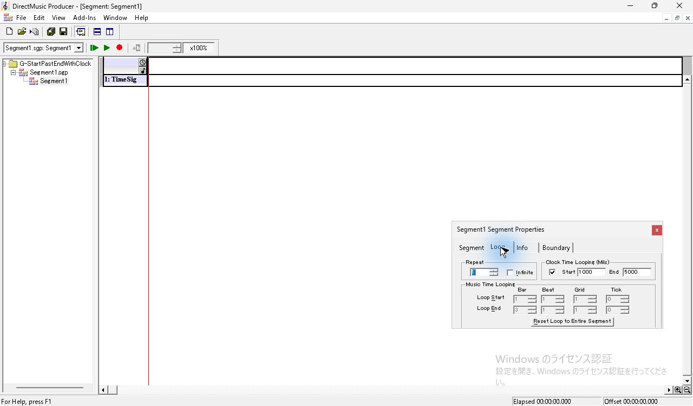

*図38 初回に異常終了したファイルと同じヘッダーを別 Project に置いた対照。Loop ページまで開けた。*

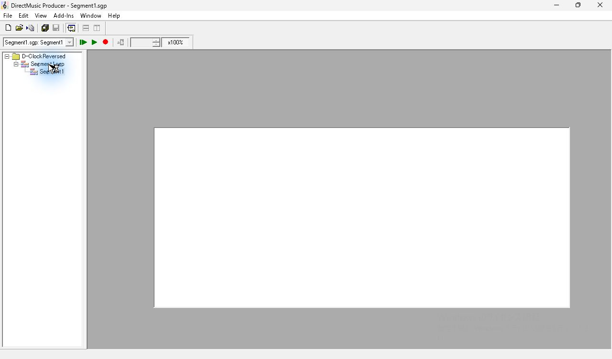

*図39 逆順 Loop の Segment を開く途中。子ウィンドウが白く表示され、この後に Producer が異常終了。*

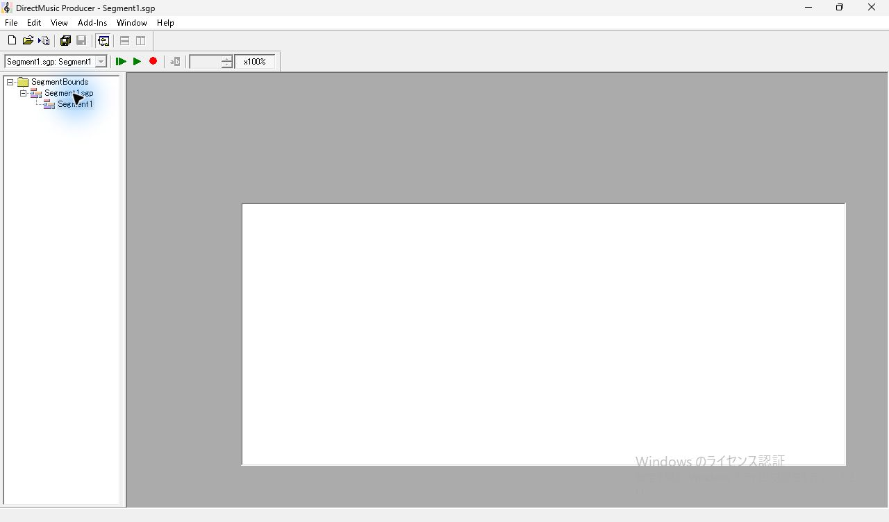

*図40 最初の保存 Project を再読込した直後。エディターの白い領域が出た後に Producer が異常終了。*

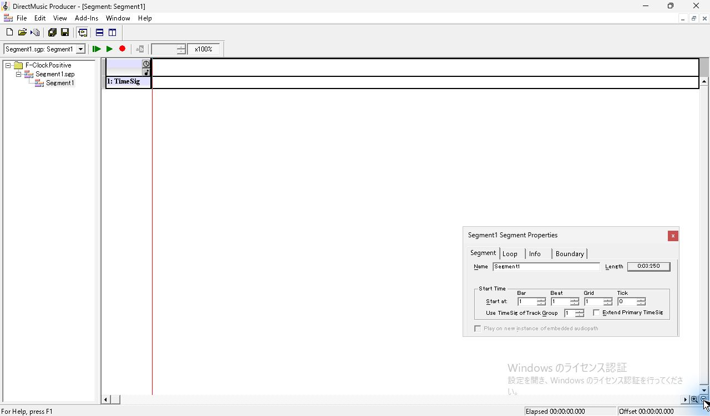

*図41 3.250秒の対照で横ズーム縮小を1回押した後も、小節の目盛りは空。*

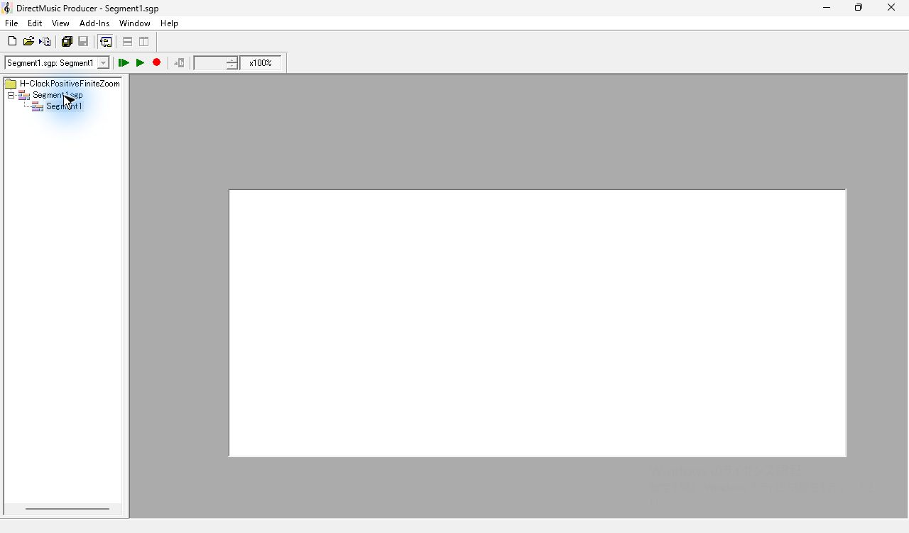

*図42 表示用数値を有限値に戻した対照も、子ウィンドウが白く表示された後に異常終了。*

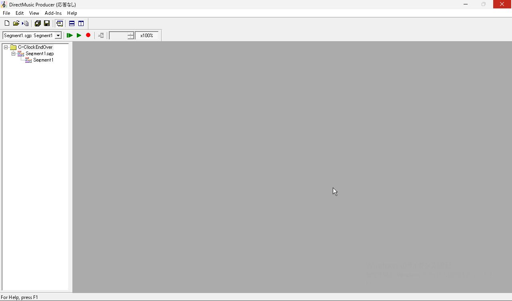

*図43 End の桁あふれ試験後、Project を閉じる途中で本体が応答なしになった。*

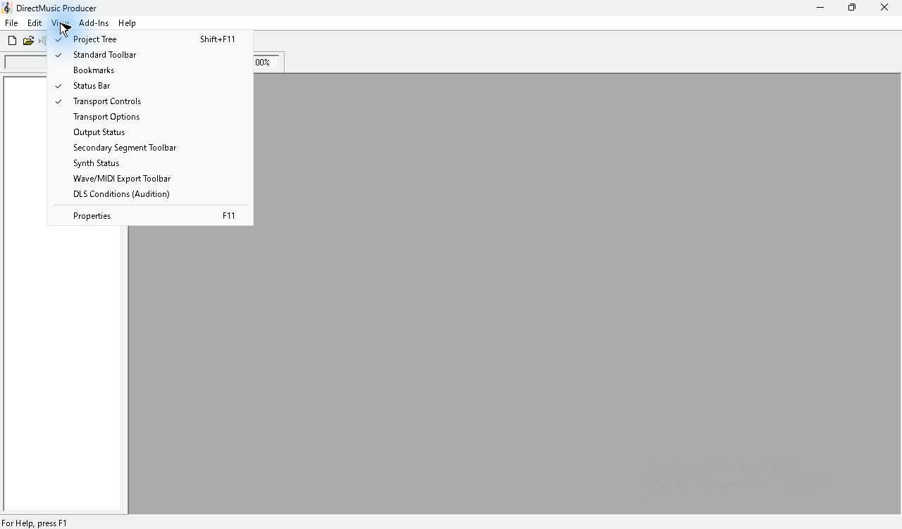

*図44 復旧後の待機画面。空の Project Tree と、View の指定4項目を確認。*

後続の試験では6/8と混在拍子を使い、Bar を移したときの Beat・Grid・Tick の補正、1 ms刻みの参照時刻と音楽長、端数小節の開始位置を比較した。同じ長さと開始位置を小節指定と時間指定で保存し、先頭再生時の Elapsed と Offset も採取した。 [拍子に応じた Start at と Clocktime の丸め](seg-10-meter-clock.md)
