# SEG-10　Segment Properties の4ページ

[調査計画](README.md) · [ループと境界停止の実測](seg-12-loop-boundary.md) · [別プロセスでの復元](seg-13-reopen.md)

2026-11-11。調査用原版コピー PID 2676 の Project2 で観測。編集は作業用 Segment1 に行った。[実行環境](../../../work/original-gui/SEG-01/20261110T235055790894Z/environment.json) · [撮影原本と対応表](../../../work/original-gui/SEG-01/20261110T235055790894Z/mdi-properties-reopen-images.json) · [保存値の照合](../../../work/original-gui/SEG-01/20261110T235055790894Z/inputs/properties-saved/manifest.json)

## 入口と Segment ページ

ツリーの `Segment1.sgp` の内側にある `Segment1` を右クリックし、Properties を選ぶ。プロパティウィンドウは本体の上に浮かび、上端に Segment、Loop、Info、Boundary の4タブが左から並ぶ。タイトルは `Segment1 Segment Properties`。

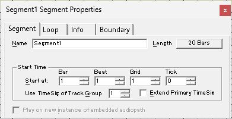

Segment ページの最上段は Name と Length。Start Time の入力は Bar、Beat、Grid、Tick の順で、初期値は1・1・1・0。Use TimeSig of Track Group は1。Extend Primary TimeSig はオフ。下段の Play on new instance of embedded audiopath は灰色。

- Bar の上向きスピンを1回押すと1から2へ進み、値が選択表示される。続く Tab で Beat にフォーカスが移り、Beat の1が選択される。
- `20 Bars` のボタンを押すと、親ページが操作不可になり、Segment Length が開く。Measures を21へ増やしてから Cancel すると、親ページは20 Bars のまま、先に編集した Start at の2・1・1・0は残る。

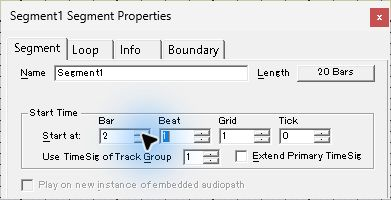

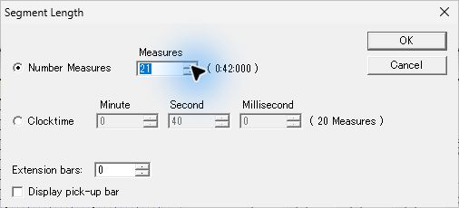

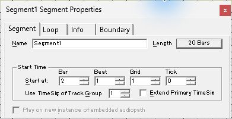

## Loop ページ

| 状態 | 観測した表示と操作可否 |
| --- | --- |
| 初期 Repeat 0 | 数値欄にフォーカスが入る。Music Time の Start/End と Reset は無効。Clock Time の Start/End は0・0で灰色 |
| Repeat 上矢印を1回 | Repeat が1。Music Time の Start が1:1:1:0、End が21:1:1:0になり、入力欄と Reset が有効 |
| Infinite をオン | Repeat の数値欄が無効になり、その場では1が残って表示される。Music Time の欄は引き続き有効 |
| Clock Time Looping をオン | Clock Time の Start/End が有効になり、Music Time の Start/End は表示値を保ったまま無効。Reset は有効のまま |

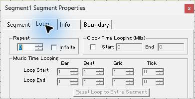

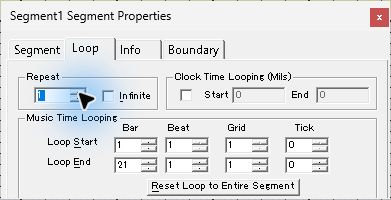

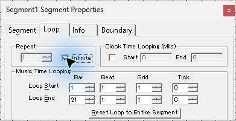

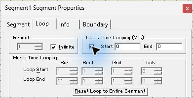

## Info ページ

Subject、Author、Copyright の3欄、Version の4欄、Information の複数行欄が並ぶ。Version は初期1・0・0・0。Info をクリックした直後のフォーカスは Subject。試験値 `GUI Study` を入力して Boundary に移動し、保存後に再表示を確認した。

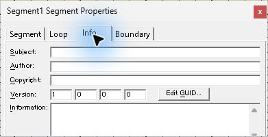

Edit GUID を押すと独立したモーダルが開き、現在の GUID が表示される。初期の OK は灰色。`Create New GUID` を押すと文字列が変わり OK が有効になった。Cancel で Info に戻り、保存した Segment1 の `guid` が元と一致することを照合した。

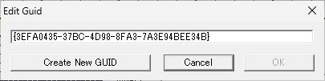

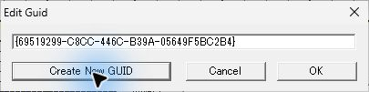

## Boundary ページ

初期は Performance Boundary が `Immediate`。Start at next marker は操作可能、Use Segment's Default と Align Options の4項目は無効。Timing は画像内で Quick Response が選択されている。ドロップダウンには次の9項目が並ぶ。

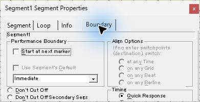

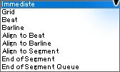

`Align to Beat` を選ぶと、Align Options の at any Time、on any Grid、on any Beat、on any Barline が有効になる。初期選択は at any Time。Start at next marker は灰色に変わった。その後 on any Barline を選択した。

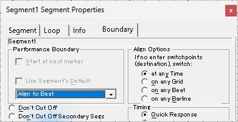

Boundary の下部は391×200のウィンドウ下端で切れていた。UIA では Cut Off (Regenerate 2ndary Segs) と After Prepare Time の存在を確認できた。右下の外枠を101 px右、88 px下へドラッグした試行では、ウィンドウの位置が移動し、撮影寸法とクリップは同じだった。

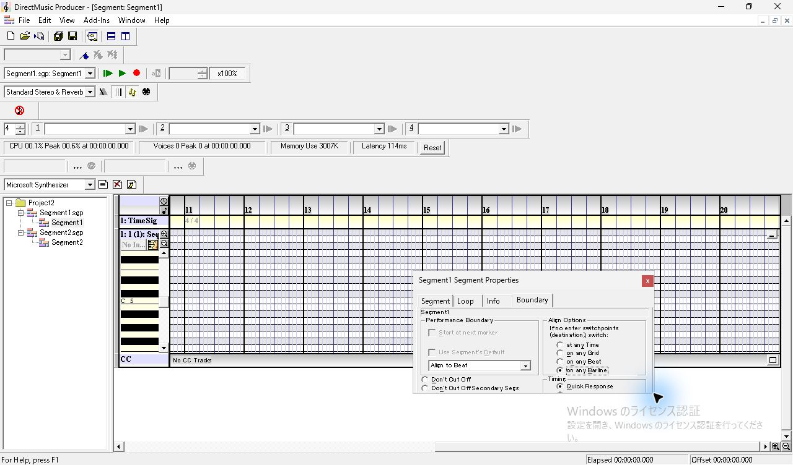

## 選択、フォーカスと再表示

Properties を開いたままツリー内側の Segment2 をクリックすると、Boundary タブを開いたまま `Segment2 Segment Properties` へ切り替わり、値は Segment2 の Immediate になる。Transport 対象も Segment2 に変わるが、主タイトルと表示中のエディターは Segment1 のまま。ツリーで Segment1 に戻ると Align to Beat と on any Barline が再表示された。

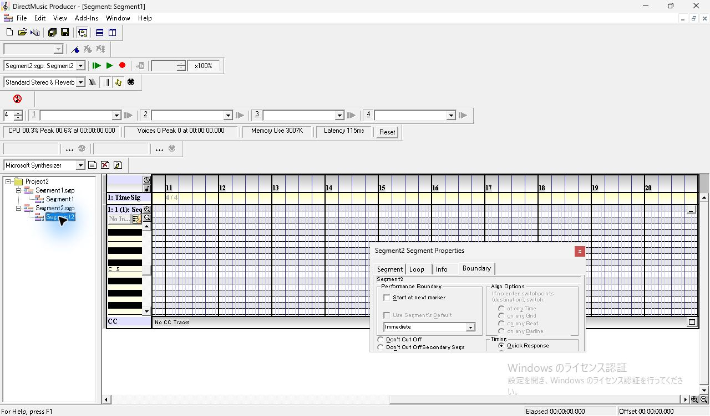

ツリー選択中に F11 でパネルを閉じると、フォーカスが Timeline に戻った。そのまま F11 をもう一度押したところ、表示中の TimeSig 行に対応した `TimeSig Track Properties` が開いた。ツリー内側の Segment1 をクリックすると、再び Segment Properties の Boundary が開く。

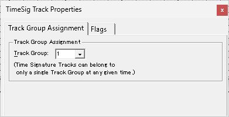

## 保存で確認した結果

Ctrl+S で保存した Segment1 の `segh` は20小節・61440 clocks、Start 3072 clocks、繰り返し `0xffffffff`、Music Time のループ端 0〜61440 clocks。`USBJ` は `GUI Study`。GUID と `tims`・`seqt`、別文書 Segment2 の全バイトは編集前の固定入力と一致した。Clock Time Looping と Boundary は [別プロセスの画面](seg-13-reopen.md) でも読み戻した。

Length の小節・時間指定、Start Time、Loop の入力境界、Reset、保存値と再読込は後続試験で記録した。 [Length・Start Time・Loop の入力境界](seg-10-properties-bounds.md)

Extension bars と Display pick-up bar は、Sequence Part ごとの保存、前後の音符の編集、複数パートを比較した。 [追加小節とピックアップ](seg-10-length-pickup.md)

Boundary 下端の Timing と Cut Off の選択は、キー操作・保存値と照合した。楽器を割り当てた Sequence の先頭再生では、After Prepare Time でピックアップ音を録音した。 [Boundary の Timing とピックアップ再生](seg-10-boundary-prepare-time.md)

Cut Off は Immediate・Quick Response での切替時に3択を録音で比較した。4ページの Tab 順、GUID の入力・確定・取消しと Info の別プロセスでの再読込は後続試験に記録した。6/8と混在拍子の Start at、Clocktime の1 ms刻みの丸め、同じ開始位置での小節指定と時間指定の先頭再生を比較した。直接 Transition の Immediate・Barline と Timing は録音で比較した。追試は、Marker や Align を使う切替、テンポ変化を含む時間指定や分欄の極値、重複した GUID を持つ文書の別プロセスでの読み込み。 [切替位置とピックアップの録音](seg-10-transition-pickup.md) [拍子と Clocktime の境界](seg-10-meter-clock.md) [Cut Off と切替時の発音](seg-10-boundary-cutoff.md) · [Tab 順と Info・GUID](seg-10-info-keyboard.md)
