# SEG-10　Transition の Boundary・Timing とピックアップ

2026-11-12。Windows 上の DirectMusic Producer 原版コピーで、再生中の A-Primary から C-Pickup へ切り替えた。切替元と切替先の保存済み Boundary を入れ替え、Transition Options の明示指定と比べた。録音8回から、切替先の本体開始位置とピックアップの発音を特定した。 [実行ファイルと素材のハッシュ](../../../work/original-gui/SEG-10-transition-pickup/20261112T102847678332Z/run.json) · [先頭再生のピックアップ調査](seg-10-boundary-prepare-time.md) · [切替時の Cut Off の調査](seg-10-boundary-cutoff.md)

## 素材と共通操作

両方とも4/4、120 BPM、Repeat 0。1小節は2秒。A は8小節で、PChannel 1 の Organ 1 に MIDI 50 を先頭から9秒間置いた。C は4小節で、PChannel 3 の Piano 1 に下表の3音を置いた。ピックアップの灰色の小節は1小節。先頭の Band0 に別々の楽器と PChannel が入る。 [素材生成コード](../../../work/original-gui/SEG-10-transition-pickup/20261112T102847678332Z/prepare_fixture.py)

| C-Pickup の音 | MIDI ノート番号 | C 本体先頭からの保存位置 | 長さ |
| --- | ---: | ---: | ---: |
| 前のピックアップ | 67 | −960クロック、−0.625秒 | 96クロック |
| 後のピックアップ | 73 | −192クロック、−0.125秒 | 96クロック |
| 本体の音 | 60 | +768クロック、+0.500秒 | 191クロック |

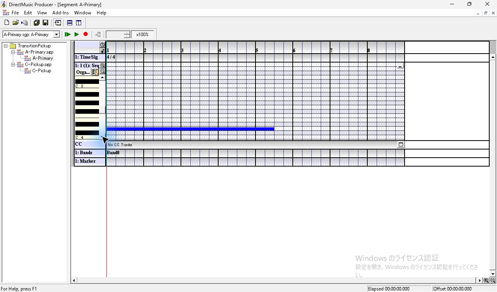

*図1 A-Primary の Sequence。PChannel 1 の持続音を縦スクロールで表示。*

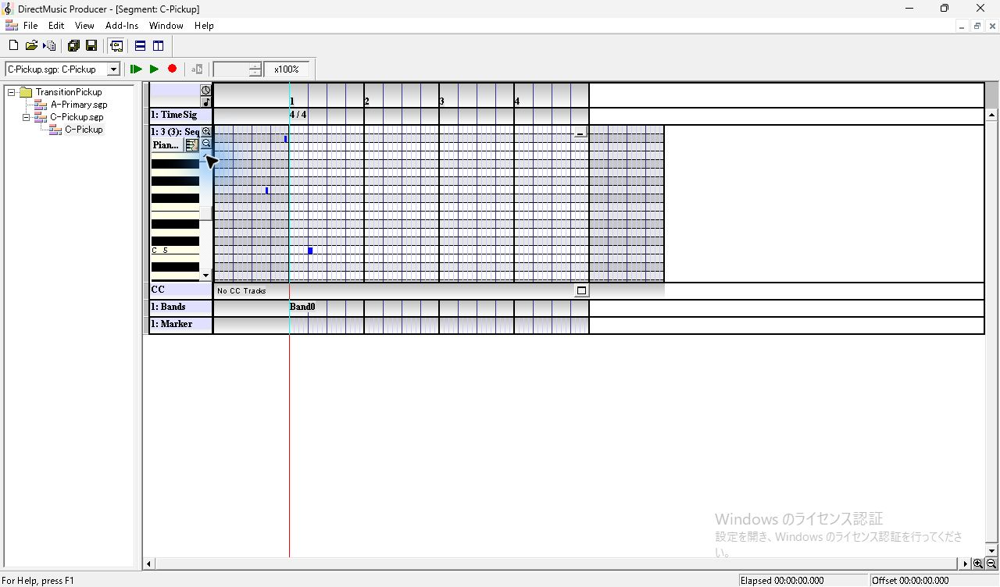

*図2 C-Pickup の Sequence。小節1の左にピックアップ2音、右に本体音1音。*

両方の子エディターを開く。A を **Play From Start** で再生し、Project Tree で C の論理ノードを1回クリックする。Transport のコンボは C に変わり、表示中のエディターと進む位置線は A のまま。**Transition** ボタンを左クリックすると切替を要求する。切替が終わった後も A のエディターは表示され、位置線は切替付近に残った。録音した後に **Stop Immediate** で停止した。

**Transition** ボタンは停止中でも右クリックで **Transition Options** を開ける。**Use Segment’s Default** がオンのとき、境界コンボ、Cut Off、Timing は灰色。オフにすると明示指定できる。全条件で **Transition at next marker** はオフ、Transition Segment と Transition Pattern は **None**。明示指定時の Cut Off は **Cut Off (Regenerate 2ndary Segs)**。

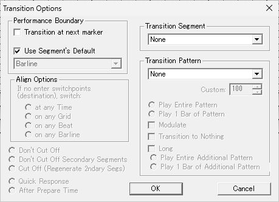

*図3 初期状態の Transition Options。Use Segment’s Default がオンで境界と Timing が灰色。*

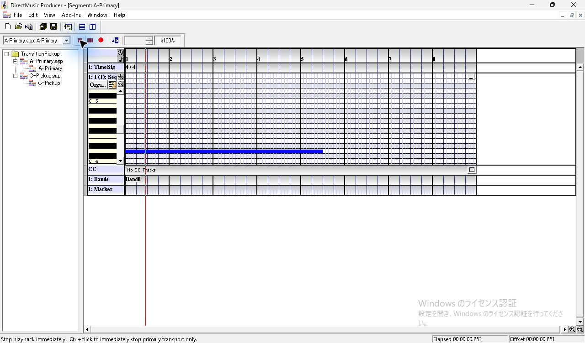

*図4 A を Play From Start で再生。緑の再生ボタンが赤い停止表示になる。*

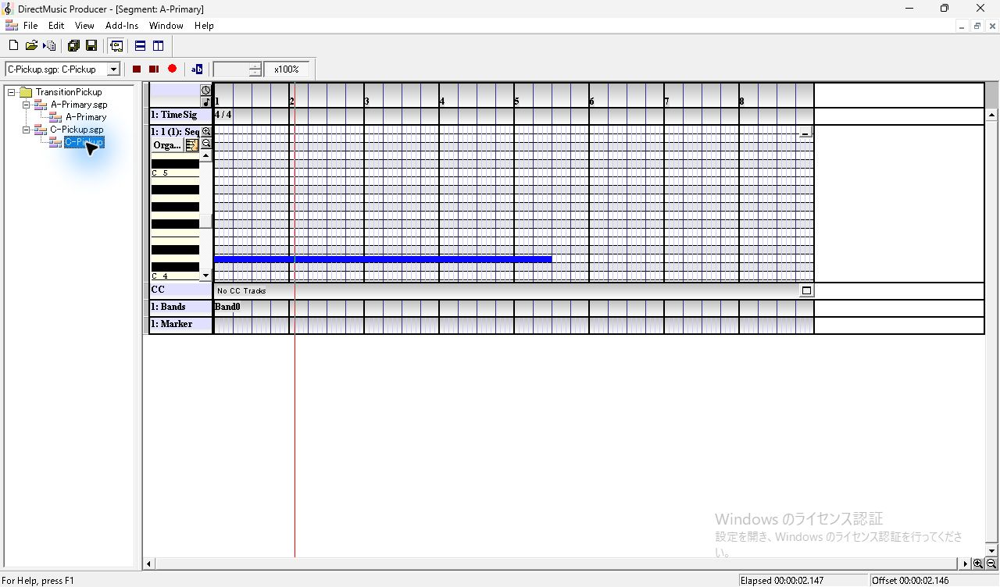

*図5 C の論理ノードを1回クリックした状態。Transport の選択先は C、表示中のエディターは A。*

*図6 再生中の青い Transition ボタンを押す。下端に操作案内。*

## 保存済みの設定を使う切替

最初は A を **Barline・Quick Response**、C を **Immediate・Quick Response** にした。A の再生開始から3.477秒付近で切替を要求すると、C 本体の開始は A 側の3.730秒。小節途中で切り替わった。次に A を **Immediate**、C を **Barline** に入れ替え、ほぼ同じ位置で要求すると、C 本体の開始は A 側の4.005秒。第3小節の先頭に合った。C の MIDI 73 は鳴り、さらに前にある MIDI 67 は検出しなかった。

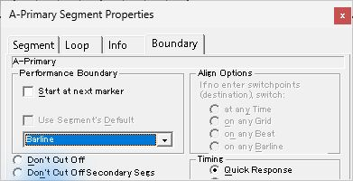

*図7 切替元 A の Boundary を Barline に設定。*

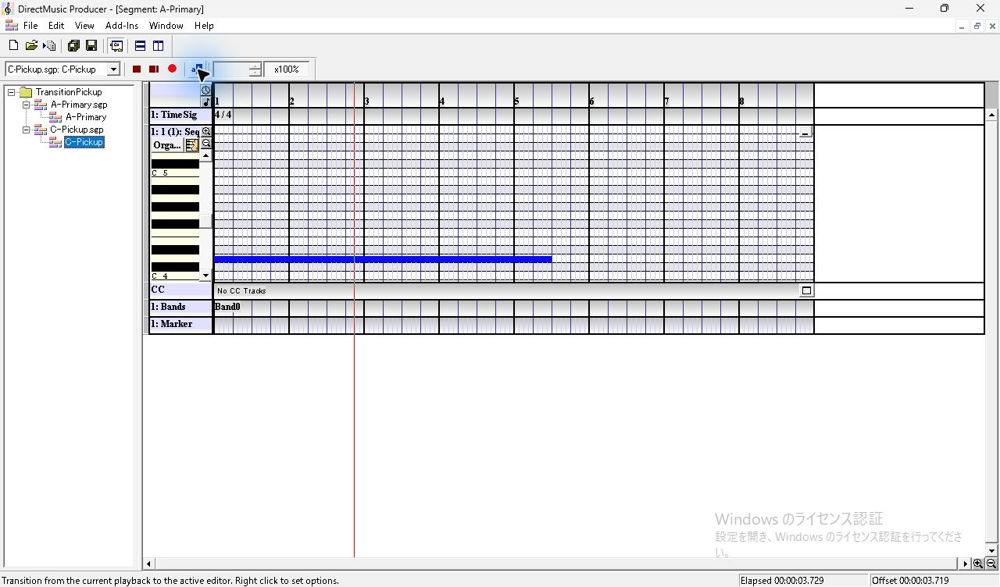

*図8 切替元だけが Barline の試行。A の位置線は第3小節の少し手前に残った。*

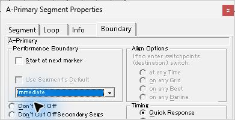

*図9 切替元を Immediate に戻した状態。*

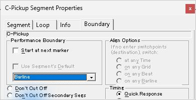

*図10 切替先 C の Boundary を Barline・Quick Response に設定。*

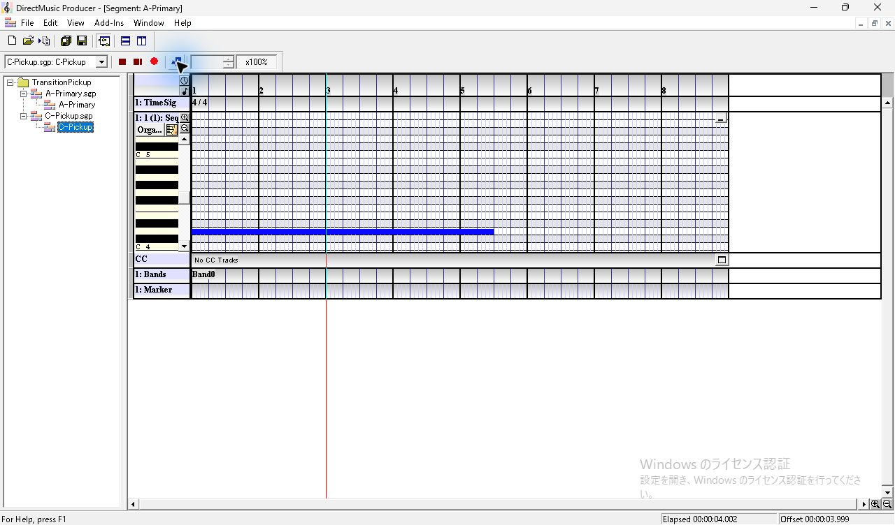

*図11 切替先が Barline・Quick Response の試行。A の位置線が第3小節の小節線に残る。*

C の **Boundary** で見えている **Quick Response** をクリックし、下矢印を押して **After Prepare Time** にした。ラベルはパネル下端で見切れている。フォーカスは ID 511 へ移り、保存した C の `segh` のオフセット20は `0x00002000` から `0x00002400` になった。A は Immediate・Quick Response のまま。前とほぼ同じ3.483秒で切替を要求すると、A の4秒の小節線を越えて6.010秒に切り替わり、ピックアップ2音が鳴った。 [下矢印後のフォーカス](../../../work/original-gui/SEG-10-transition-pickup/20261112T102847678332Z/captures/52-destination-timing-tree.json) · [C の After Prepare Time を保存した .sgp](../../../work/original-gui/SEG-10-transition-pickup/20261112T102847678332Z/captures/54-destination-after-C-Pickup.sgp)

*図12 Quick Response から下矢印を押した直後。下の選択肢は見切れている。*

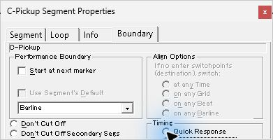

*図13 切替先の After Prepare Time を選択。フォーカス先はアクセシビリティでも確認。*

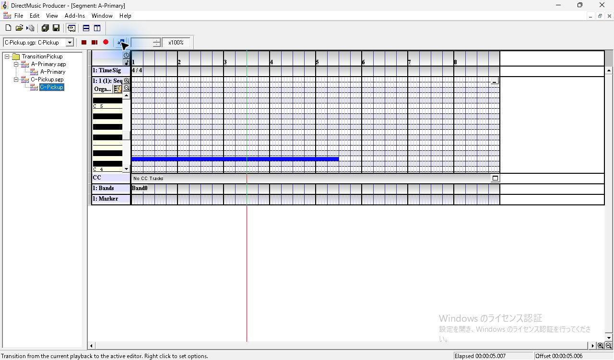

*図14 Barline・After Prepare Time で切替を待っている間。A の位置線は第3小節内を進む。*

*図15 同じ試行の切替後。A の位置線が第4小節の小節線に残る。*

原版ヘルプの **Use Segment’s Default** は、切替元の Performance Boundary を使うと説明している。今回の直接切替で Immediate と Barline を入れ替えた2条件は、切替先に保存した境界と一致した。 [原版ヘルプの Performance Boundary](../../../../../work/analysis/original-manual-session/20261010T031624075Z/help-extracted/htm/transitionoptionsperformanceboundary.htm)

## Transition Options での明示指定

**Use Segment’s Default** をオフにして、C の保存済み Barline・After Prepare Time に対する試聴指定を切り替えた。**Immediate・Quick Response** では3.755秒で切り替わり、ピックアップ音は検出しなかった。境界を Immediate にしたまま **After Prepare Time** に変えると、要求から1.135秒後の4.590秒に本体が始まり、ピックアップ2音が鳴った。

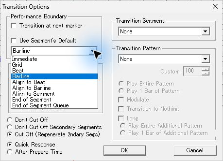

*図16 Use Segment’s Default を外して境界コンボを開いた状態。*

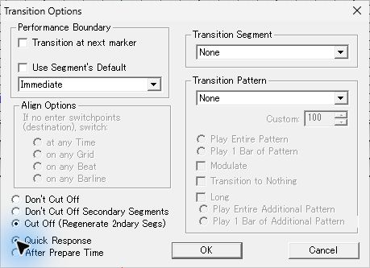

*図17 試聴の明示指定。Immediate・Quick Response。*

*図18 明示した Immediate・Quick Response の試行。A の位置線は第3小節の手前。*

*図19 同じ Immediate で After Prepare Time を選択。*

*図20 Immediate・After Prepare Time の試行。A の位置線は第3小節内に残る。*

**Barline・Quick Response** の設定を変えず、要求時刻だけを比較した。A 側の3.474秒で要求したときは、C 本体は4.005秒から、ピックアップは後の1音。2.538秒で要求したときも C 本体は4.005秒からで、ピックアップ2音が鳴った。要求を約0.94秒早めたことで、前のピックアップが入る時間ができた。

*図21 明示した Barline・Quick Response。2つの要求時刻で使った設定。*

*図22 遅い要求の試行。第3小節線に近い位置で Transition。*

*図23 遅い要求の切替後。位置線は第3小節線。*

*図24 早い要求の試行。同じ設定で第2小節の早い位置から Transition。*

*図25 早い要求でも切替後の位置線は第3小節線。*

**Barline・After Prepare Time** を明示し、A 側の3.468秒で要求すると、C 本体は6.005秒からで、ピックアップ2音が鳴った。今回の素材では、同じ Barline でも Timing と要求位置の組合せで、使う小節線と鳴るピックアップが変わった。 [原版ヘルプの Timing](../../../../../work/analysis/original-manual-session/20261010T031624075Z/help-extracted/htm/transitionoptionsresponsetime.htm) · [原版ヘルプのピックアップ](../../../../../work/analysis/original-manual-session/20261010T031624075Z/help-extracted/htm/extrameasures.htm)

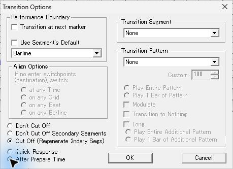

*図26 明示した Barline・After Prepare Time。*

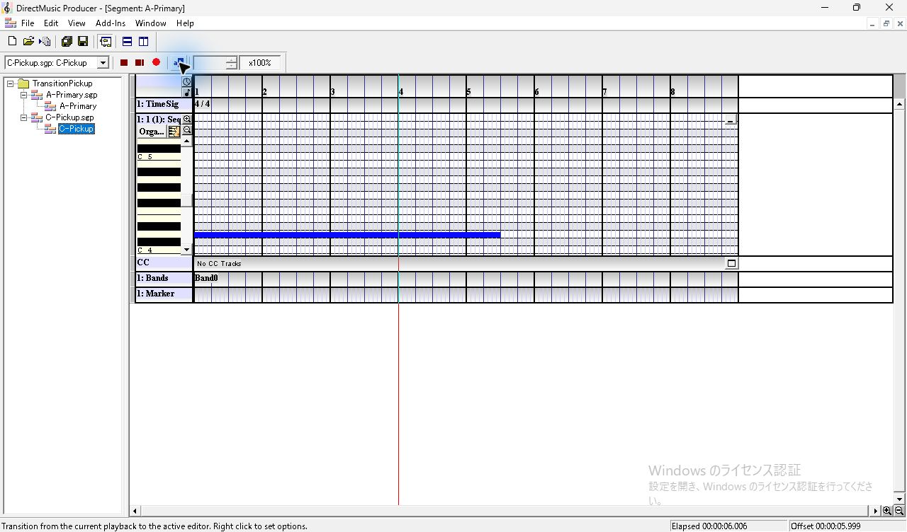

*図27 明示した Barline・After Prepare Time でも第4小節線まで進んだ。*

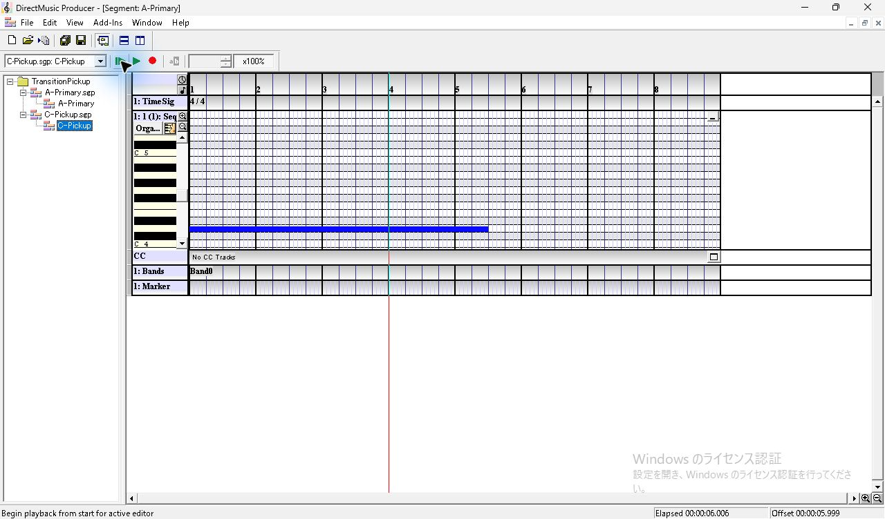

*図28 観測後に Stop Immediate。緑の再生ボタンに戻る。*

## 録音8回の比較

「要求」と「C 開始」は A の最初の持続音の検出を原点にした秒数。「要求から」は操作ツールが Transition クリックを要求した時刻から C 本体先頭の推定まで。クリック処理に約0.1秒の幅がある。C 本体先頭は MIDI 60 の立ち上がりから0.500秒を引いて求めた。

| 回 | A の保存設定 | C の保存設定 | Transition Options | 要求 | C 開始 | 要求から | MIDI 67 | MIDI 73 | 録音 |
| ---: | --- | --- | --- | ---: | ---: | ---: | --- | --- | --- |
| 1 | Barline・Quick | Immediate・Quick | Use Segment’s Default | 3.477 | 3.730 | 0.253 | 検出なし | 検出なし | [WAV](../../../work/original-gui/SEG-10-transition-pickup/20261112T102847678332Z/audio/source-barline/output.wav) |
| 2 | Immediate・Quick | Barline・Quick | Use Segment’s Default | 3.478 | 4.005 | 0.527 | 検出なし | 発音 | [WAV](../../../work/original-gui/SEG-10-transition-pickup/20261112T102847678332Z/audio/destination-barline-quick/output.wav) |
| 3 | Immediate・Quick | Barline・After | Use Segment’s Default | 3.483 | 6.010 | 2.527 | 発音 | 発音 | [WAV](../../../work/original-gui/SEG-10-transition-pickup/20261112T102847678332Z/audio/destination-barline-after/output.wav) |
| 4 | Immediate・Quick | Barline・After | Immediate・Quick | 3.488 | 3.755 | 0.267 | 検出なし | 検出なし | [WAV](../../../work/original-gui/SEG-10-transition-pickup/20261112T102847678332Z/audio/explicit-immediate-quick/output.wav) |
| 5 | Immediate・Quick | Barline・After | Immediate・After | 3.455 | 4.590 | 1.135 | 発音 | 発音 | [WAV](../../../work/original-gui/SEG-10-transition-pickup/20261112T102847678332Z/audio/explicit-immediate-after/output.wav) |
| 6 | Immediate・Quick | Barline・After | Barline・Quick | 3.474 | 4.005 | 0.531 | 検出なし | 発音 | [WAV](../../../work/original-gui/SEG-10-transition-pickup/20261112T102847678332Z/audio/explicit-barline-quick-late/output.wav) |
| 7 | Immediate・Quick | Barline・After | Barline・Quick | 2.538 | 4.005 | 1.467 | 発音 | 発音 | [WAV](../../../work/original-gui/SEG-10-transition-pickup/20261112T102847678332Z/audio/explicit-barline-quick-early/output.wav) |
| 8 | Immediate・Quick | Barline・After | Barline・After | 3.468 | 6.005 | 2.537 | 発音 | 発音 | [WAV](../../../work/original-gui/SEG-10-transition-pickup/20261112T102847678332Z/audio/explicit-barline-after/output.wav) |

Quick は **Quick Response**、After は **After Prepare Time**。WASAPI ループバックで Windows の既定出力を48 kHz、ステレオ、32-bit float で記録。50 msの窓を5 ms刻みで動かし、4音の基音を比較した。検出したピックアップの立ち上がりは C 本体の約0.64秒前と約0.13秒前。検出した全ピックアップの発音中に、A の MIDI 50 も検出した。8本とも時刻エラーは0で、不連続フラグは再生操作より前の開始直後に1件。 [測定結果](../../../work/original-gui/SEG-10-transition-pickup/20261112T102847678332Z/transition-pickup-measurements.json) · [第7回の音高別の振幅 CSV](../../../work/original-gui/SEG-10-transition-pickup/20261112T102847678332Z/audio/explicit-barline-quick-early/pitch-profile.csv) · [解析コード](../../../work/original-gui/SEG-10-transition-pickup/20261112T102847678332Z/measure.py)

18点の .sgp を照合した。Boundary の保存値は Immediate・Quick Response が `0x00000000`、Barline・Quick Response が `0x00002000`、Barline・After Prepare Time が `0x00002400`。第3回以降の A と C の .sgp はそれぞれ全バイト一致。明示指定は試聴側の操作として扱えた。今回の範囲は4/4・120 BPM、マーカーと中間の Transition Segment・Pattern を使わない直接切替。 [保存値と録音の照合結果](../../../work/original-gui/SEG-10-transition-pickup/20261112T102847678332Z/transition-pickup-audit.json) · [照合コード](../../../work/original-gui/SEG-10-transition-pickup/20261112T102847678332Z/audit.py)

## 初回の異常終了と復旧

最初に C-Pickup を開いたとき、子エディターが白い状態で原版が異常終了した。Application の Event 1000 は `SegmentDesigner.ocx`、例外 `0xc0000005` と `0xc000041d`、オフセット `0x0002b8a5`。原版が0件になったことを確認して同じコピーを1件起動すると、同じ Project と C-Pickup を開けた。試験後は Transition Options を最初の状態に戻し、子エディターと Project を閉じた。View は Project Tree、Standard Toolbar、Status Bar、Transport Controls の4項目、原版コピーは1件。 [異常終了の記録](../../../work/original-gui/SEG-10-transition-pickup/20261112T102847678332Z/captures/10-initial-fault.json) · [再起動の記録](../../../work/original-gui/SEG-10-transition-pickup/20261112T102847678332Z/captures/11-recovery-process.json) · [終了時のウィンドウ一覧](../../../work/original-gui/SEG-10-transition-pickup/20261112T102847678332Z/captures/97-end-windows.json)

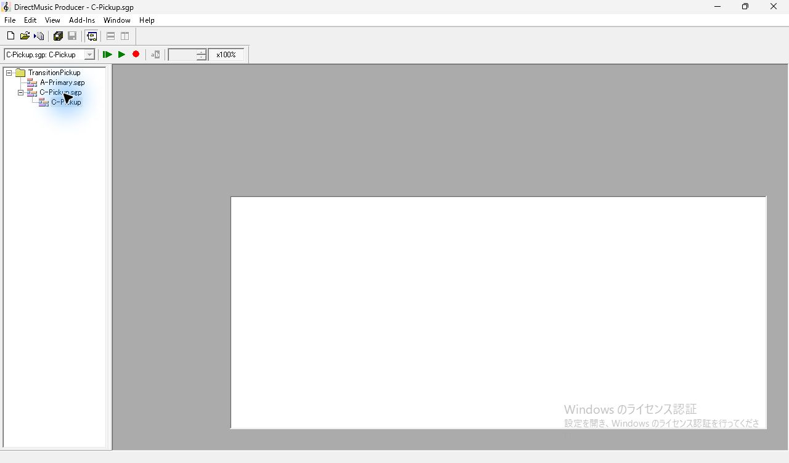

*図29 初回に C の子エディターが白くなった状態。直後に原版が異常終了。*

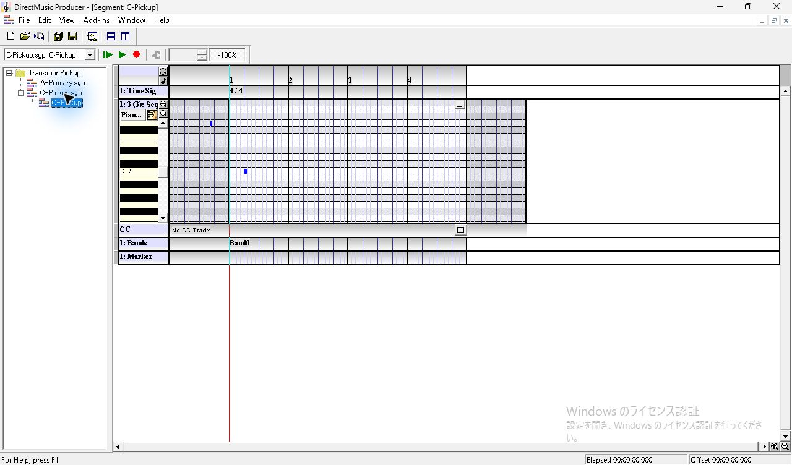

*図30 再起動後に同じ C-Pickup を開いた画面。*

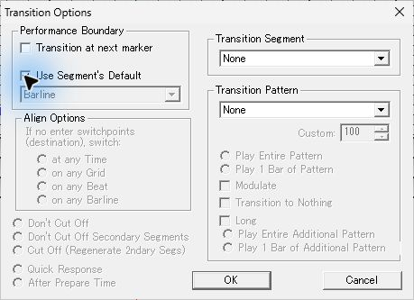

*図31 終了前に Use Segment’s Default をオンに戻した状態。*

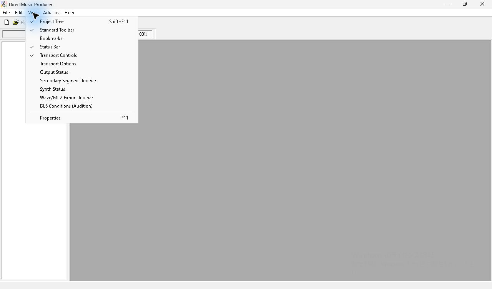

*図32 Project を閉じた後の View。指定の4表示項目を確認。*
