# SEG-11　再生・停止・位置と表示範囲

[調査計画](README.md) · [ループと境界停止](seg-12-loop-boundary.md) · [Tempo と Time Sig](seg-09-tempo-timesig.md)

2026-11-11。DirectMusic Producer 5.3.0.900 の調査用コピー `DmusGuiTransport.exe`（SHA-256 `c330bb2ca2c885f4157ec9dce060f64957e33e88192b6547630c2db5f1a65a22`）で、[Tempo・Time Sig・Band0 入り素材](../../../work/original-gui/SEG-09/20261111T032540911033Z/inputs/timed-segment/manifest.json) を専用 Project2 に複製。Segment1 は20小節・48384 clocks、開始0、Repeat 0。Windows 11 10.0.26200、1280×800、96 DPI。親子ウィンドウ最大化、撮影1280×752 px。座標は画像左上を原点とする。青い光と黒い矢印は操作ツールの表示。

[実行記録](../../../work/original-gui/SEG-11-12/20261111T034632165034Z/run.json) · [撮影環境](../../../work/original-gui/SEG-11-12/20261111T034632165034Z/environment.json) · [画像対応表](../../../work/original-gui/SEG-11-12/20261111T034632165034Z/published-images.json) · [原版ヘルプ Transport Controls](../../../work/original-gui/SEG-11-12/20261111T034632165034Z/help/transportcontrols.htm)

## 停止中の表示と2つの再生ボタン

ツールバー2段の基本表示で Segment1 を開くと、左から対象リスト、縦棒付きの緑の三角（Play From Start）、緑の三角（Play）、赤い録音ボタンが並ぶ。再生中は、2つの緑の三角が左の赤い四角（Stop Immediate）と右の境界付きの赤い四角（Stop at Boundary）に置き換わる。左ボタン付近には状態に応じた説明がステータスバーとツールチップに出る。

Play Cursor を観測する回は、View の Transport Options を表示した。AudioPath は `Standard Stereo & Reverb`、速度表示は `x100%`。Play Cursor は AudioPath の右側にあるボタンのうち左から2番目 (191, 118)。Timeline の上端は y=105 から y=135 へ移動した。

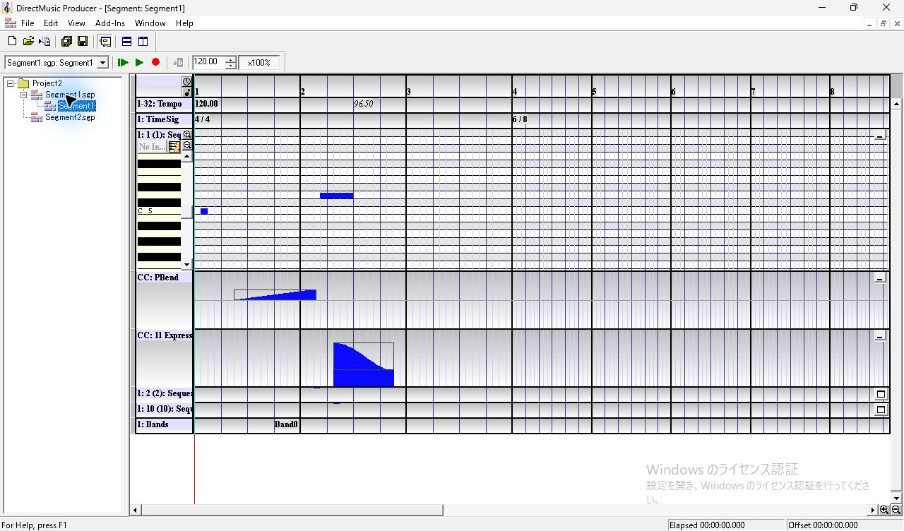

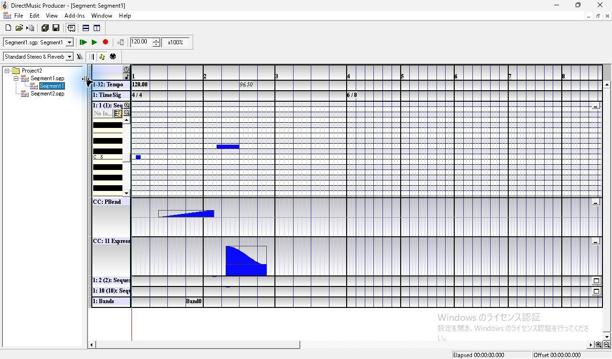

## 先頭からの再生・テンポ・画面の追従

ルーラーの (370, 158) をクリックすると、ルーラーが淡黄色、位置線が第1小節の途中に移り、Elapsed は `0.000`、Offset は `1.250` 秒。Play From Start (174, 88) の後は、最初のフレームで Elapsed と Offset がともに約1.08秒。指定した編集位置を足した値より前で、再生位置はこの設定の Segment 先頭を基準に進んだ。

[連続撮影ログ](../../../work/original-gui/SEG-11-12/20261111T034632165034Z/captures/play-natural-series.json) のホスト時刻は、クリック要求から撮影要求・応答までを記録している。下表の Elapsed と Offset はスクリーンショットのステータス表示から読んだ値。小節は画像の位置線とルーラーの境界を照合した。

| 画像 | Elapsed 秒 | Offset 秒 | 状態 |
| --- | ---: | ---: | --- |
| `play-natural-01` | 1.079 | 1.078 | 停止ボタンに切替。第1小節後半 |
| `play-natural-05` | 3.040 | 3.039 | 第2小節第3拍、現在テンポ96.50 |
| `play-natural-06` | 3.434 | 3.493 | 同じ拍の後側、現在テンポ120.00 |
| `play-natural-08` | 6.203 | 6.202 | 第4小節の6/8側へ進む |
| `play-natural-09` | 11.270 | 11.269 | 先頭が見えたまま、線は第7小節内 x≈1117 |
| `play-natural-10` | 12.299 | 12.298 | 表示範囲が横に移り、最初の完全な小節は7。線は第8小節 x≈509 |
| `play-natural-16` | 31.478 | 31.477 | 第20小節終端付近、線は x≈1252 |
| `play-natural-17` | 31.559 | 0.000 | 自然終了。再生ボタン・第1小節・先頭の線が戻る |

追従では、位置線が画面右端に達する前に横スクロールバーとルーラーが移動した。スクロール後は Tempo 120.00、6/8、Band0 の薄いラベルが左端付近に出た。[停止中の手動スクロールで見えたラベル](seg-09-tempo-timesig.md#スクロール境界と保存) と条件が異なる。

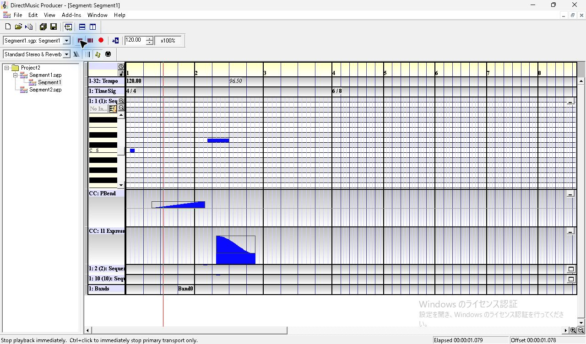

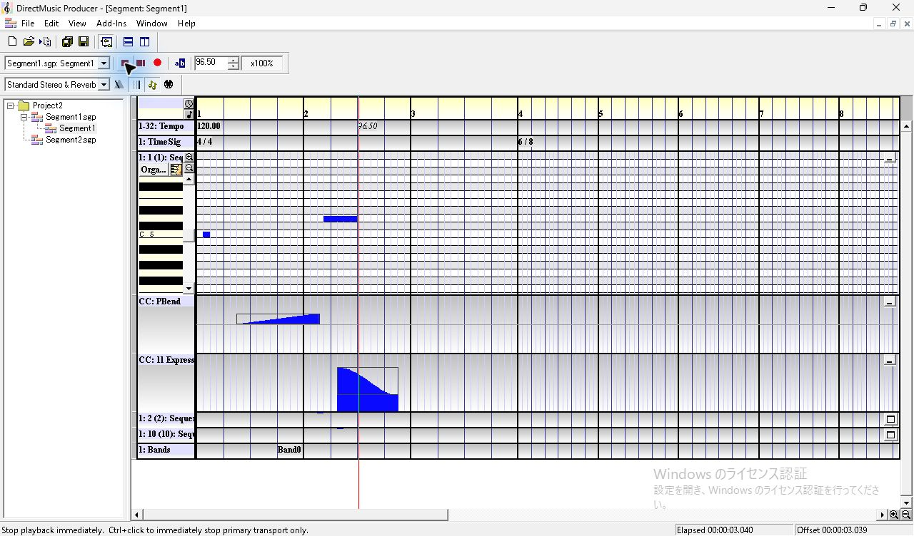

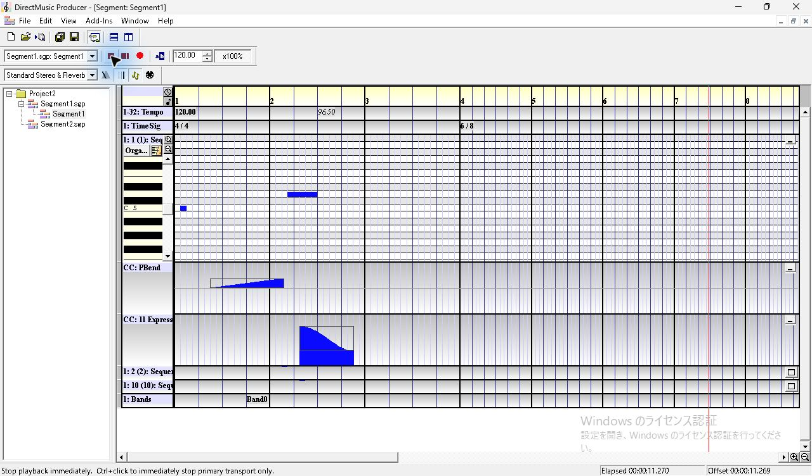

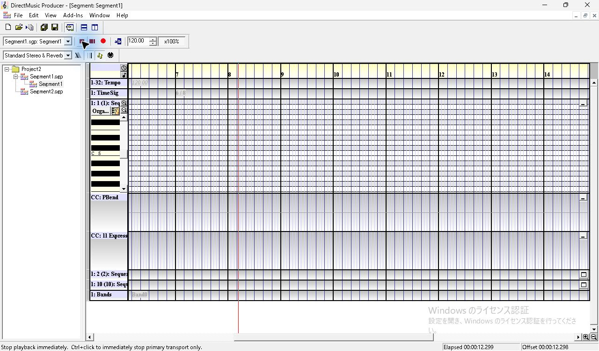

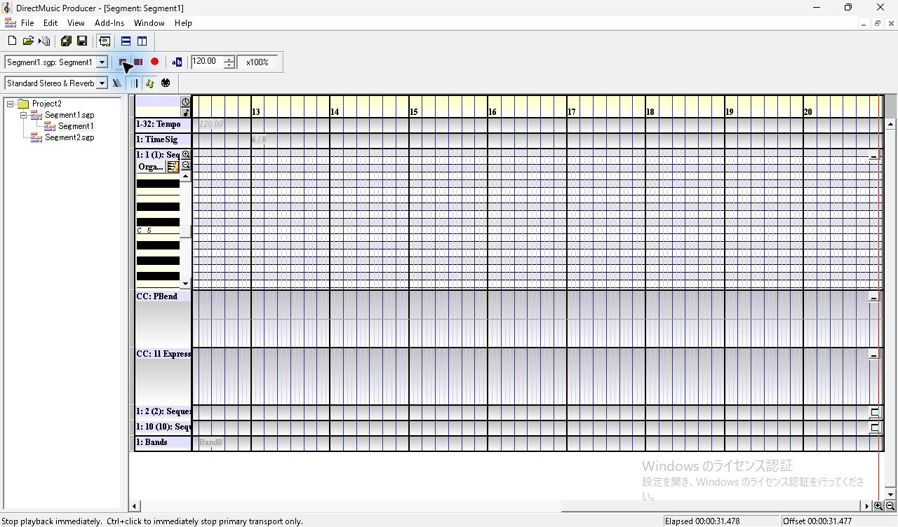

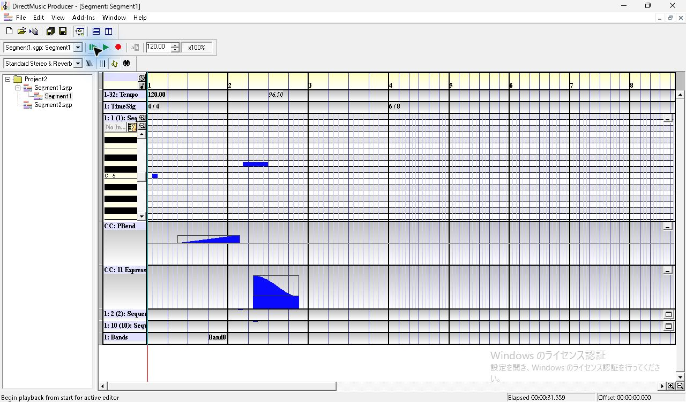

## 現在位置からの Play と停止

1. ルーラーの第3小節途中で Offset を `5.047` 秒にし、右の Play (197, 88)。最初の撮影は Elapsed `0.509`、Offset `5.556` 秒。位置線は選んだ位置より後から進む。
2. 再生中に左の Stop Immediate。撮影時点で緑の再生ボタンへ戻り、Elapsed `8.930`、Offset `13.887` 秒。右にスクロールした範囲と停止位置が後の撮影でも残った。
3. そのまま Play を押した試行は、入力後約1.5秒の3フレームで停止表示のままだった。ルーラーで同じ付近を明示的にクリックし、Offset を `13.880` 秒にして Play を押すと再開。最初のフレームは Elapsed `0.398`、Offset `14.278` 秒。この差の再現条件は追試する。
4. 別の停止後に横スクロールバーで先頭側の表示へ戻したときは、Offset `25.950` 秒を保ったまま位置線が表示範囲外になった。表示範囲を動かす操作とルーラーをクリックする操作は、Offset で照合できる。

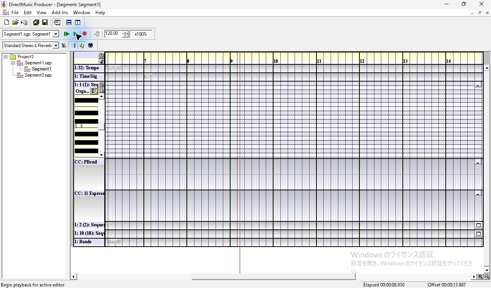

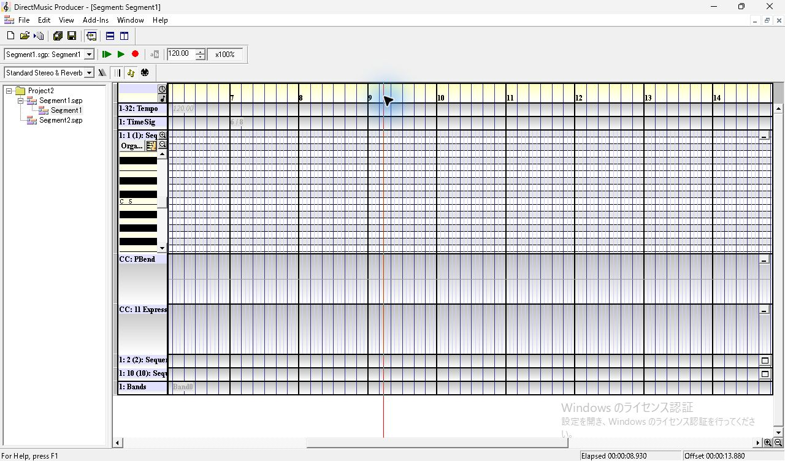

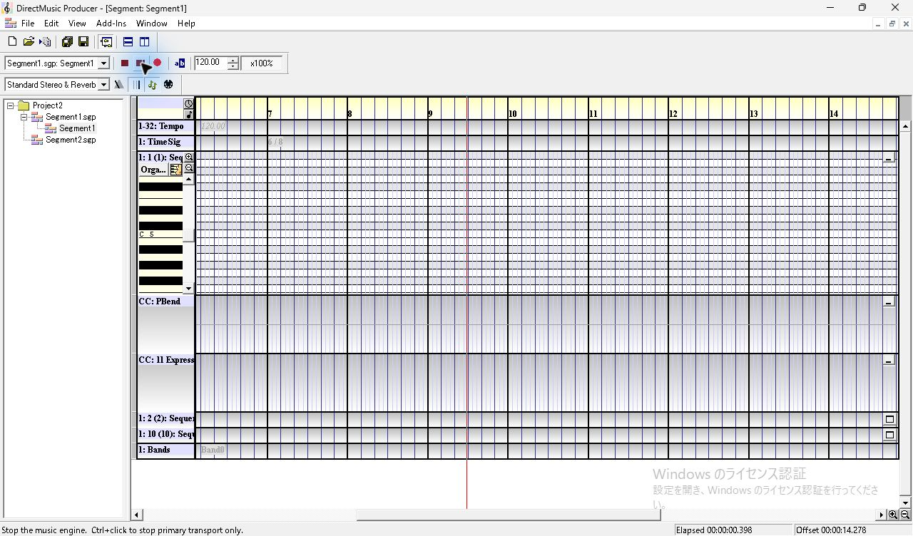

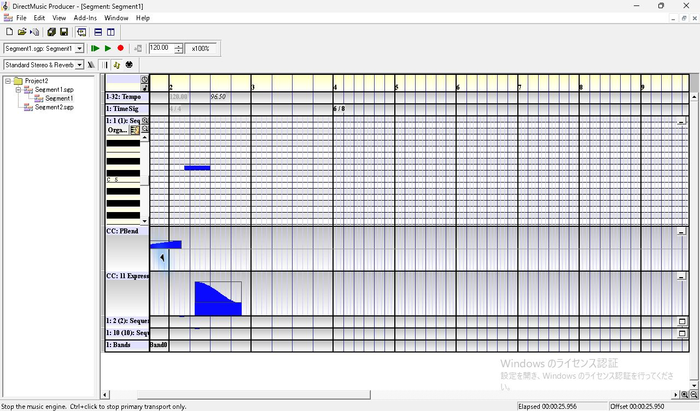

## Play Cursor を解除したまま編集位置を動かす

1. 停止中に Toggle Play Cursor を解除し、Play From Start。第1小節先頭に表示が戻り、停止ボタンが出る。1枚目とクリック要求から約3.8秒後の3枚目は、位置線が先頭、Elapsed `25.957` 秒（直前の停止値）、Offset `0.000` 秒で一致した。
2. 再生中にルーラー (535, 158) をクリックすると、編集位置線が第2小節の後半へ移る。Elapsed `9.760`、Offset `3.547` 秒が表示され、入力を加えずに採った次の画像でも同じ値。赤い停止ボタンは両方の画像に出た。
3. Toggle Play Cursor をオンへ戻すと、第20小節付近に表示範囲と位置線が移り、Elapsed `30.498`、Offset `30.497` 秒。後続フレームでも位置線が進んだ。

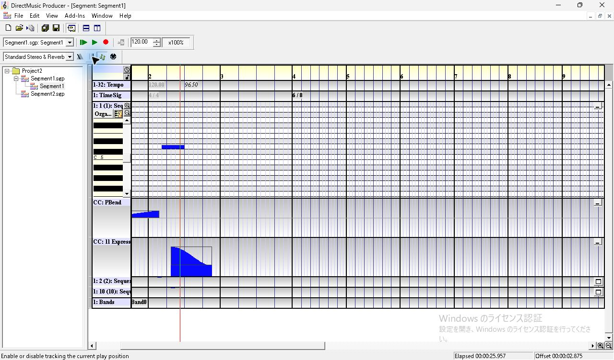

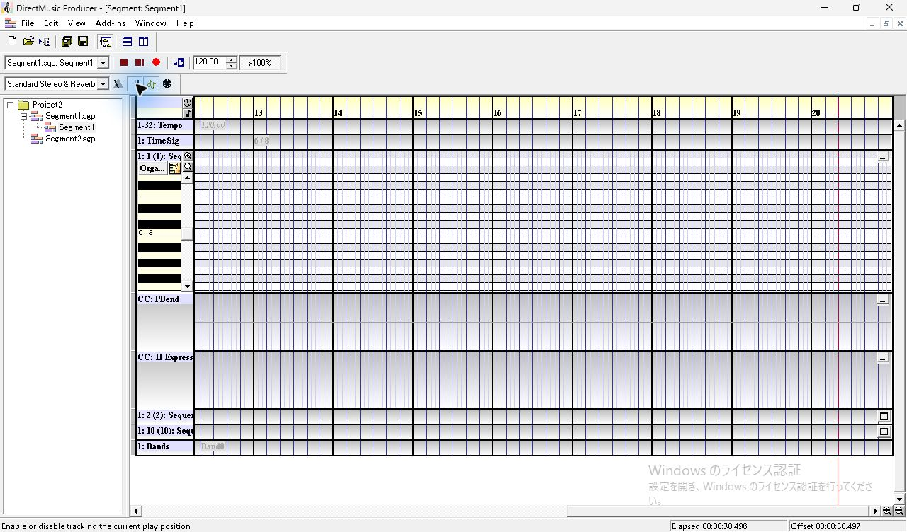

[追従オフの撮影ログ](../../../work/original-gui/SEG-11-12/20261111T034632165034Z/captures/play-cursor-off-series.json) · [追従オンに戻した撮影ログ](../../../work/original-gui/SEG-11-12/20261111T034632165034Z/captures/play-cursor-restored-series.json) · [原版ヘルプ Toggle Play Cursor](../../../work/original-gui/SEG-11-12/20261111T034632165034Z/help/toggleplaycursorbutton.htm)

再生のみを試した段階で、専用 Project2 の3ファイルの SHA-256 は固定入力と一致した。音声出力は未収録。次に、再開時のフォーカス条件、追従オフでの手動スクロール、他文書や Secondary Segment との同時再生を調べる。
