# SEG-12　ループ・端点・境界停止

[調査計画](README.md) · [再生・停止・位置](seg-11-transport-position.md) · [Segment Properties](seg-10-properties.md)

2026-11-11。[SEG-11 と同じ調査用コピー・素材・撮影条件](seg-11-transport-position.md)。専用 Segment1 を編集し、途中で保存した各 SGP を記録した。再生は Play Cursor オン、AudioPath `Standard Stereo & Reverb`、`x100%`。時刻表の Elapsed、Offset は画面表示。撮影要求・応答の時刻は各連続撮影ログにある。

[実行記録](../../../work/original-gui/SEG-11-12/20261111T034632165034Z/run.json) · [保存値の照合](../../../work/original-gui/SEG-11-12/20261111T034632165034Z/saved-loop-values.json) · [画像対応表](../../../work/original-gui/SEG-11-12/20261111T034632165034Z/published-images.json)

## 再生開始点と有限ループ

1. Project2 の内側の `Segment1` ノードから Segment Properties を開き、Segment タブの Start at の Bar を2にする。Beat、Grid、Tick は `1:1:0`。
2. Loop タブで Repeat を0から1にすると、Music Time Looping の入力が有効になり、Loop End は `21:1:1:0`。Loop Start を `2:1:1:0`、Loop End を `4:3:1:0` にして保存した。第4小節は6/8。SGP の開始位置とループ始点は3072、ループ終点は9984 clocks。
3. 設定した始点付近のルーラーを右クリックすると Realtime Display、Snap To、トラック操作、横ズームが表示された。今回の画面とメニューからは、独立したループ端点ハンドルを識別できなかった。
4. 停止中の編集位置は Offset `0.875` 秒。Play From Start 直後の最初のフレームは Elapsed `0.668`、Offset `2.667` 秒で、第2小節内。設定した Start at から進んでいる。

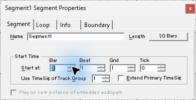

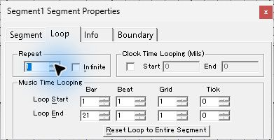

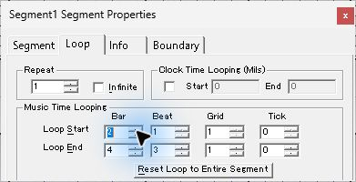

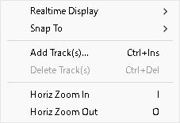

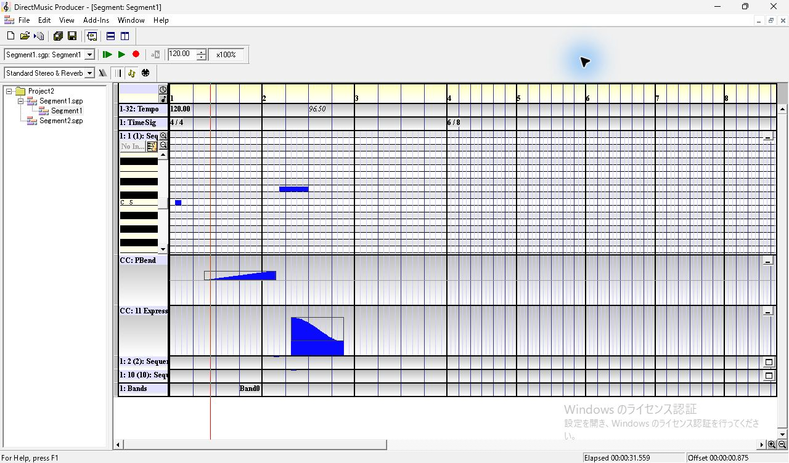

| Elapsed 秒 | Offset 秒 | 観測 |
| ---: | ---: | --- |
| 1.135 | 3.134 | 1周目、第2小節第3拍で96.50 BPM |
| 4.434 | 6.434 | 1周目、第4小節のループ終点手前 |
| 4.668 | 2.120 | 第2小節の始点側に折り返す |
| 5.676 | 3.127 | 2周目も第2小節第3拍で96.50 BPM |
| 8.906 | 6.358 | 2周目、同じループ終点の手前 |
| 9.272 | 6.724 | 終点より先へ進み、折り返しは1回 |
| 34.100 | 0.000 | 自然終了。緑の再生ボタンと先頭側表示に戻る |

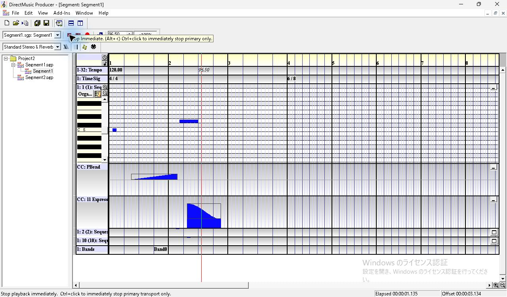

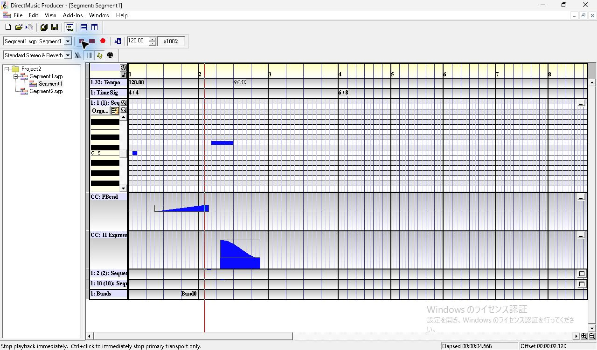

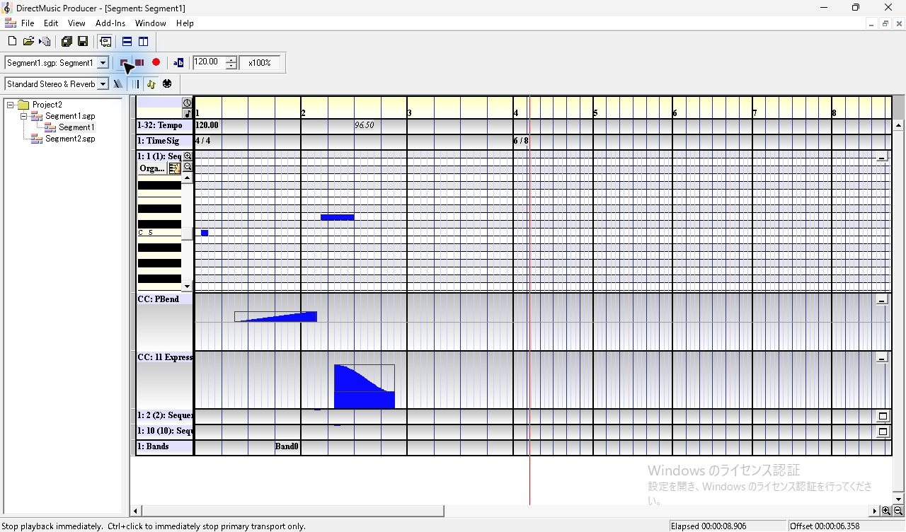

[連続撮影ログ](../../../work/original-gui/SEG-11-12/20261111T034632165034Z/captures/loop-repeat-one-series.json) · [有限ループの SGP](../../../work/original-gui/SEG-11-12/20261111T034632165034Z/captures/finite-music-loop.sgp)

## 始点より前の終点を入れる

Loop Start `2:1:1:0` の状態で End の Bar を4から1へ入力し、Tab で確定した。画面では End が `1:3:1:0`、Start が `1:2:4:191` に変わった。元の4/4・1拍4グリッドでこの Start 表示を換算すると1535 clocks。保存した `segh` の Start は1727、End は1536 clocks で、画面から換算した値と保存値に差が残った。この逆順の保存状態は再生せず、Timeline にフォーカスして Ctrl+Z で元の端点に戻した。保存した別プロセスでの再表示は追試する。

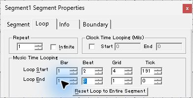

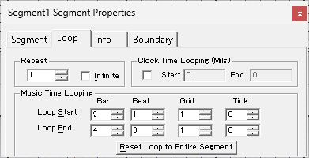

[範囲外入力後に保存した SGP](../../../work/original-gui/SEG-11-12/20261111T034632165034Z/captures/clamped-music-loop.sgp)

## Clock Time の入力と折り返し

Clock Time Looping をオンにすると、Start と End のミリ秒欄が有効になり、Music Time の欄は値を表示したまま灰色になる。Repeat 1 のまま `3000`〜`5000` ms を入力し、Tab で確定して保存した。長さと各トラックは同じ音楽時刻の素材を使った。SGP の `segh` はフラグ2、参照時刻30000000〜50000000（100 ns単位）、参照時刻の長さ0。音楽時刻の Start at 3072 と両端点も保持された。

この素材で Play From Start の最初の画像は Elapsed `0.210`、Offset `0.209` 秒。音楽時刻で設定した第2小節より前が見える。Elapsed `4.744` 秒で Offset `4.791` 秒、次の Elapsed `5.076` 秒で Offset `3.075` 秒へ戻った。Elapsed `7.003` 秒で自然終了し、Offset は `0.000`。音楽時刻の有限ループで観測した曲末までの進行と異なる。参照時刻で長さや各トラックも設定した素材で追試する。[原版ヘルプ Loop タブ](../../../work/original-gui/SEG-11-12/20261111T034632165034Z/help/looptab.htm)

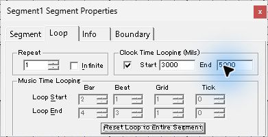

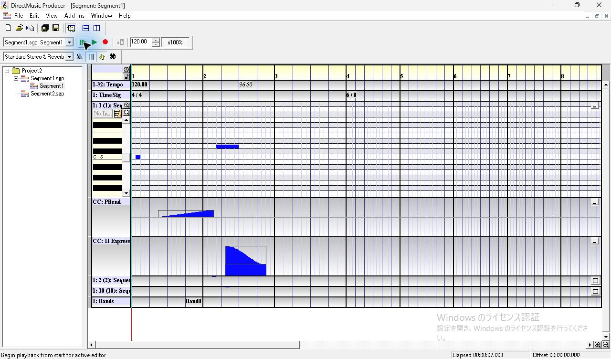

[連続撮影ログ](../../../work/original-gui/SEG-11-12/20261111T034632165034Z/captures/loop-clock-mixed-series.json) · [Clock Time を設定した SGP](../../../work/original-gui/SEG-11-12/20261111T034632165034Z/captures/clock-time-loop.sgp)

## Infinite と Barline 停止

1. Clock Time Looping をオフにし、同じ Music Time 範囲で Infinite をオンにする。Repeat の入力は灰色になり、表示値1はその場で残る。Boundary タブの Performance Boundary を Immediate から `Barline` に切り替えて保存。
2. Play From Start の後、Elapsed `8.709` 秒・Offset `6.160` 秒から、Elapsed `9.509` 秒・Offset `2.414` 秒へ移動した。有限反復の同じ区間は2周目で終点を越えていた。Infinite は Elapsed `14.303` 秒にも同じ区間で再生を続けた。
3. 再生中の右側の Stop at Boundary (197, 88) を押す。要求から約0.99秒以内に取得した画像は停止ボタン表示のままで、Elapsed `32.592`、Offset `2.757` 秒。その後 Elapsed `33.197`、Offset `3.409` 秒でも進行。約2.32秒以内に取得した次の画像では緑の再生ボタンに戻り、Elapsed `33.837`、Offset `4.046` 秒、位置線は第3小節の先頭。ここで停止した時刻は一例で、ホスト撮影時刻はクリックと停止の間隔の上限・下限を示すために使う。

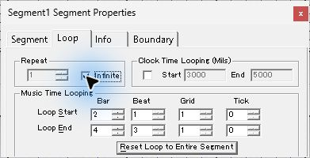

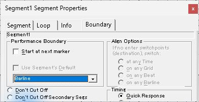

[Infinite の連続撮影ログ](../../../work/original-gui/SEG-11-12/20261111T034632165034Z/captures/loop-infinite-series.json) · [停止要求後の連続撮影ログ](../../../work/original-gui/SEG-11-12/20261111T034632165034Z/captures/loop-stop-barline-series.json) · [原版ヘルプ Stop at Boundary](../../../work/original-gui/SEG-11-12/20261111T034632165034Z/help/stopatboundarybutton.htm)

## 保存・別プロセスでの復元

Infinite と Barline を保存後、Transport Options を非表示に戻し、調査用コピーを通常終了した。Producer が0プロセスであることを確認して同じ EXE を起動し、専用 Project2 の Segment1 を再度開いた。Start at は2:1:1:0、Infinite はオン、Music Time は2:1:1:0〜4:3:1:0、Clock Time の3000〜5000 msは灰色、Boundary は Barline。保存値の Repeat は `0xFFFFFFFF`。試験間で全トラックの RIFF データが一致した。

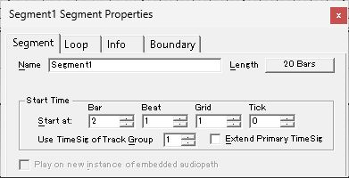

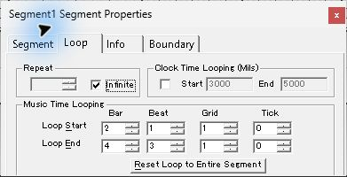

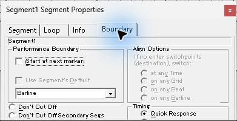

[Infinite と Barline を保存した SGP](../../../work/original-gui/SEG-11-12/20261111T034632165034Z/captures/infinite-barline-loop.sgp)

追試はループ端点ハンドルの入口と操作、端点の保存と再表示が食い違う条件、Reset、他の停止境界や Transition、参照時刻を全トラックに設定した素材、実際の音声出力。
