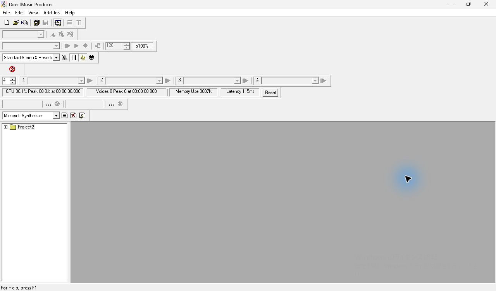
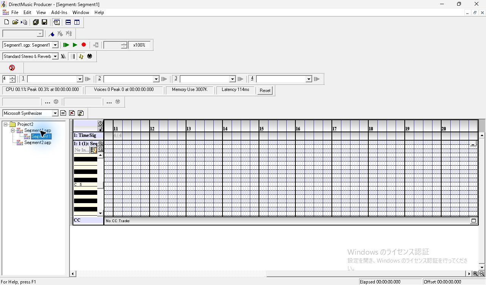
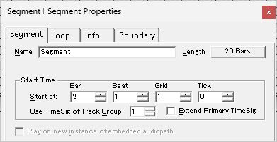
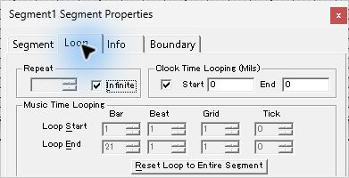
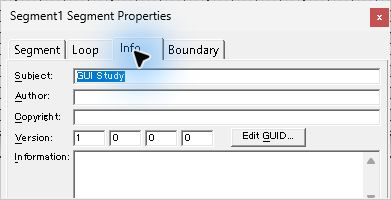
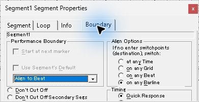

# SEG-13　保存・終了と別プロセスでの再読込

[調査計画](README.md) · [編集操作](seg-10-properties.md)

2026-11-11。調査用原版コピーで、保存した Project2 と2文書を再読込した。Windows 11、1280×800、96 DPI。編集前は [固定した2文書](../../../work/original-gui/SEG-01/20261110T235055790894Z/inputs/sequence-and-band/manifest.json)、再起動前の正本は [編集済みの保存スナップショット](../../../work/original-gui/SEG-01/20261110T235055790894Z/inputs/properties-saved/manifest.json)。

## 終了と起動直後

1. PID 2676 で Segment1 を Ctrl+S、続いて File → Save Project Project2。親の閉じるボタンで終了した。[終了コード0](../../../work/original-gui/SEG-01/20261110T235055790894Z/properties-exit.json) を確認。
2. 同じ実行ファイル、プロジェクト3ファイルと調査用 INI のハッシュを照合し、引数なしで起動。別 PID 3836 のウィンドウを特定した。
3. Project2 は自動でツリーに戻り、ルートは閉じた状態。Segment エディターは開いていない。直前に表示していた Properties 枠は同じ位置に現れ、選択された Project2 の `Project Properties` を表示した。
4. Project Properties を閉じると、右に灰色の空の作業領域が見える。ルートを展開すると Segment1.sgp と Segment2.sgp が表示される。

起動直後の原本には Project File の絶対パスと Last Modified By が写るため、この資料にはダイアログを閉じた後の画面を掲載した。[撮影原本と対応表](../../../work/original-gui/SEG-01/20261110T235055790894Z/mdi-properties-reopen-images.json)

## Segment1 の表示と入力値

ツリーの Segment1.sgp をダブルクリックした。Sequence は展開済みで、小節11〜20が表示される。保存前に薄黄色だった TimeSig 行は通常色。ツリーでは Segment1 の内側ノードが青く選択される。

ツリーにフォーカスがある状態で F11 を押すと、Segment Properties の Segment タブから開く。前回の Boundary タブはこの起動では選ばれていない。Length は20 Bars、Start at は2:1:1:0。

Loop に切り替えると Infinite と Clock Time Looping がオンで、Clock Time の Start/End は0・0。無効な Repeat 欄は空白。編集直後には無効欄に1が残っていたため、両状態を区別する。

Info の Subject は `GUI Study`。Boundary は Align to Beat と on any Barline が選択された状態に戻る。

## 再保存との照合

Segment1 を選び Ctrl+S。更新時刻の変化を確認し、再保存した `Segment1.sgp` の660バイトが再起動前の固定ファイルと一致した。Project2.pro と Segment2.sgp も、この再保存操作の前後で固定ファイルに一致した。[再読込と再保存の照合](../../../work/original-gui/SEG-01/20261110T235055790894Z/properties-reopen.json)

このケースは既存の調査用 INI による Project の自動再オープンと、Segment の明示的な再オープン。Save As、別パスでの参照復元、編集後に閉じるときの保存・破棄・取消し、履歴の再起動時の扱いは別ケースとして続ける。
