# SEG-14　Chord Path の接続、Cadence 2件と発音

2026-11-12。DirectMusic Producer 5.3.0.900 の既存ウィンドウ1件を使い、[前回の Project2](../../../work/original-gui/SEG-14-chord-path/20261111T163112782207Z/inputs/compose-followup-observed/manifest.json) を複製して調査した。撮影267枚から33枚を掲載。画面は1280×752 px、座標の原点は左上。青い光と太い黒矢印は操作ツールの表示。View の標準4項目に加え、MIDI 収録中だけ **Wave/MIDI Export Toolbar** を表示した。 [実行記録](../../../work/original-gui/SEG-14-chord-path/20261111T163112782207Z/run.json) · [画像の出典と寸法](../../../work/original-gui/SEG-14-chord-path/20261111T163112782207Z/published-chord-path-figures.json) · [前回の自動生成の調査](seg-14-compose-chords-followup.md)

## 開始・終了 Signpost と中間コードを置く

1. Project Tree の **Chordmap1** を開く。右の Signpost 表には **2CM** と **1BM**。F に両方、1 に **1BM** が属する。左の Chord Path は空。
2. 右の **1BM** の SP セル（`853,151`）を右クリックし、**Insert into Chordmap**。第1小節に緑の三角付きの開始ノードが現れる。保存した ChordMap には同じコードの開始・終了ペアがあり、終了側は初期の表示範囲の外にある。
3. 左の第3小節頭付近（`473,251`）を右クリックし、**Insert**。既定の **2CM** が赤い選択状態で置かれる。そのノードを右クリックし、**Toggle End Signpost**。左端に赤いひし形が付き、右の表の 2CM の文字も斜体から太字に変わった。
4. 左のパレットから **D M**（`214,465`）を第2小節の頭付近（`376,198`）へドラッグする。中間コード **2DM** が表示され、赤く選択された。Signpost 表の 1BM を直接ドラッグした最初の試行では、セルが選択されて左のノードは増えなかった。 [同梱ヘルプの Signpost ペア](../../../../../work/analysis/original-manual-session/20261010T031624075Z/help-extracted/htm/insertingsignpostpairs.htm) · [コードの挿入](../../../../../work/analysis/original-manual-session/20261010T031624075Z/help-extracted/htm/insertingchordsinthechordpathwindow.htm) · [Signpost 表からのドラッグ試行](../../../work/original-gui/SEG-14-chord-path/20261111T163112782207Z/captures/08-drag-b-to-path-0.jpg)

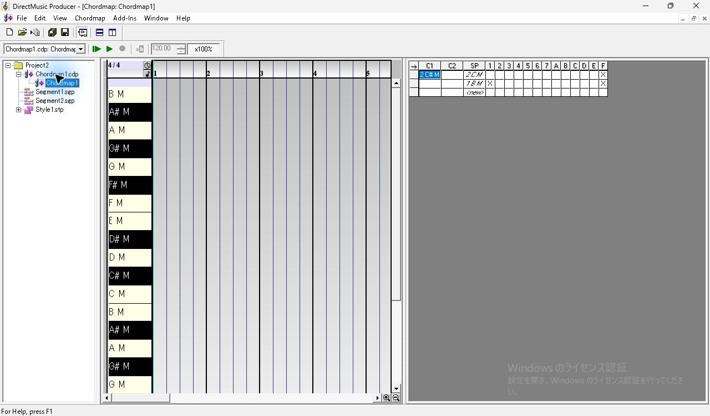

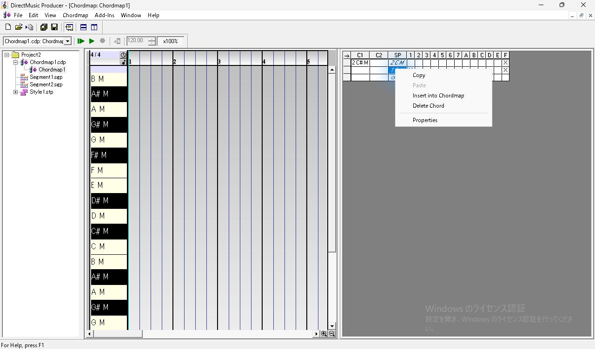

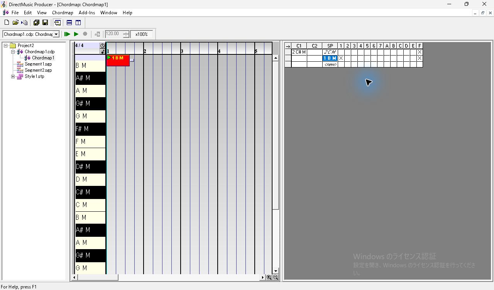

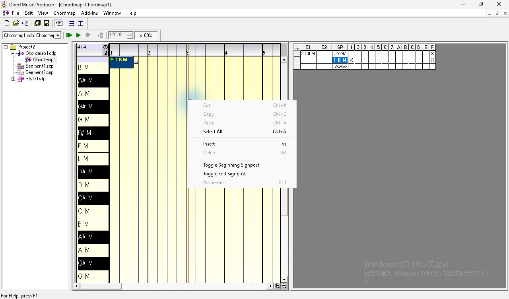

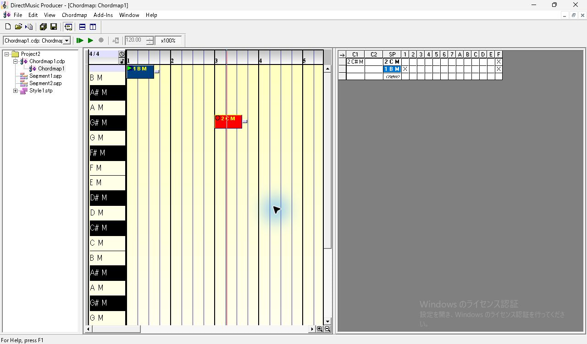

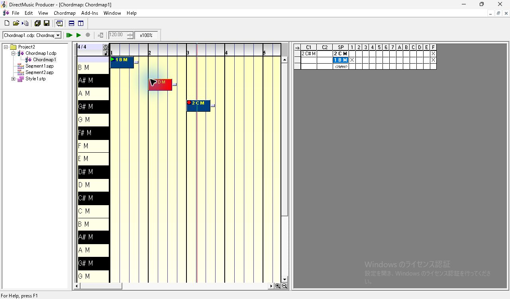

## 接続と固定長の比較

開始 1BM の右端の小さい接続ボックス（`343,156`）を 2DM 本体へドラッグする。接続線が赤く選択され、1BM の右端にもう1つボックスが増える。続けて 2DM のボックス（`438,212`）を終了 2CM 本体へドラッグすると、今度はその線が赤くなり、先の線は黒くなった。F11 で Properties を表示してから使用中のボックスをクリックすると **Connection Properties**。**Connection Weight** は既定の **50**、固定長の間は **Min Beats / Max Beats** が灰色。保存した2本は各4拍。 [固定長8拍の ChordMap](../../../work/original-gui/SEG-14-chord-path/20261111T163112782207Z/captures/fixed-path-Chordmap1.cdp) · [同梱ヘルプの接続操作](../../../../../work/analysis/original-manual-session/20261010T031624075Z/help-extracted/htm/drawingconnectionsbetweenchords.htm)

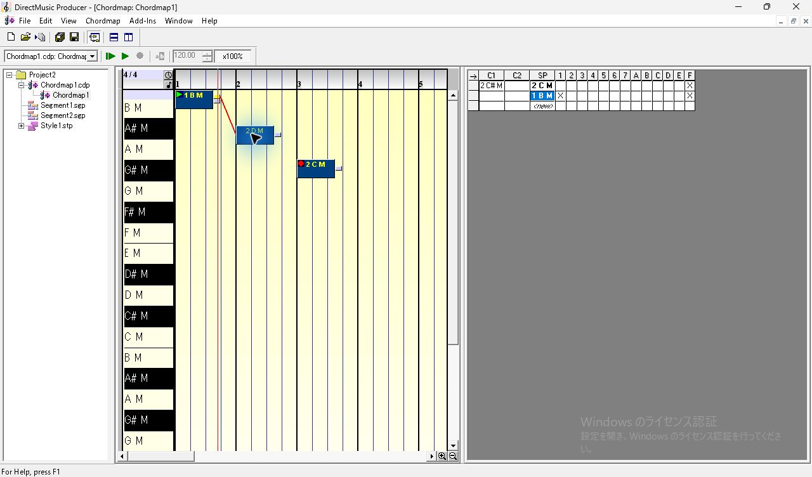

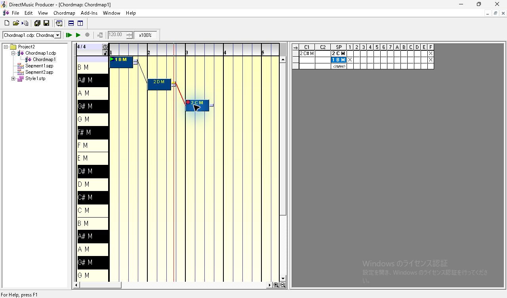

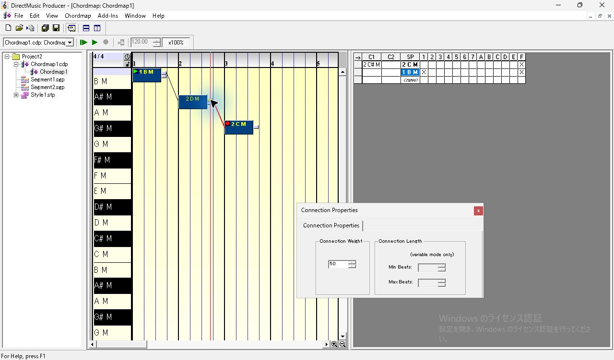

**Segment2** は4/4。Signposts の第2小節 **F**、第3小節 **1**、第5小節 **F** のうち、第5小節の **Precede Signpost with Cadence** をオフにした。第3〜5小節の間隔は8拍。ヘッダーの **Compose Chords** を押すと、第2小節 2CM、第3小節 1BM、第4小節 **2DM**、第5小節 **2CM**。F に属する2候補のうち、第5小節では経路の終点にある 2CM が入った。 [8拍の生成結果](../../../work/original-gui/SEG-14-chord-path/20261111T163112782207Z/captures/style-fixed-match-Segment2.sgp)

12拍の対照では、Chord Path の第4小節に別の **2CM** を Insert し、**Toggle End Signpost**。2DM の**使用中の**接続ボックス（`438,208`）を新しい終点までドラッグすると、元の終点への線が消えて接続先が変わった。元の 2CM ノードは第3小節に残る。終了ノード自体をドラッグした試行では選択色と Properties が変わり、位置は動かなかった。接続を **4 + 8拍** にした保存版で Segment2 を生成すると、中間の 2DM が消え、第2・3・5小節の3件になった。 [終了ノードをドラッグした試行](../../../work/original-gui/SEG-14-chord-path/20261111T163112782207Z/captures/31-move-end-diagonal-0.jpg) · [固定長12拍の ChordMap](../../../work/original-gui/SEG-14-chord-path/20261111T163112782207Z/captures/fixed-long-path-Chordmap1.cdp) · [8拍の区間での生成結果](../../../work/original-gui/SEG-14-chord-path/20261111T163112782207Z/captures/style-fixed-mismatch-Segment2.sgp)

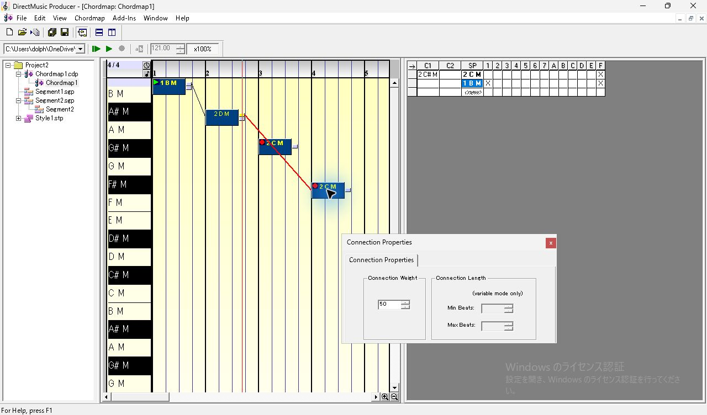

## 可変長と Connection Weight 0

ChordMap の子ノードを選び、**Chordmap Properties > Chordmap > Edit Mode** を **Variable** に変更。同じ接続ボックスを選び直すと **Min Beats / Max Beats** が有効になる。前半の初期値 **1〜4** をスピンで **3〜3** にし、後半は **1〜8** のまま。Chord Path のノード位置は変わらず、Segment2 の再生成では **2DM** が第3小節第4拍（8448 clocks）に入った。前半の3拍と後半の5拍で、マーカー間の8拍を埋めた。 [可変長の ChordMap](../../../work/original-gui/SEG-14-chord-path/20261111T163112782207Z/captures/variable-path-Chordmap1.cdp) · [可変長の生成結果](../../../work/original-gui/SEG-14-chord-path/20261111T163112782207Z/captures/style-variable-Segment2.sgp) · [同梱ヘルプの固定長と可変長](../../../../../work/analysis/original-manual-session/20261010T031624075Z/help-extracted/htm/fixedandvariableconnectionlengths.htm)

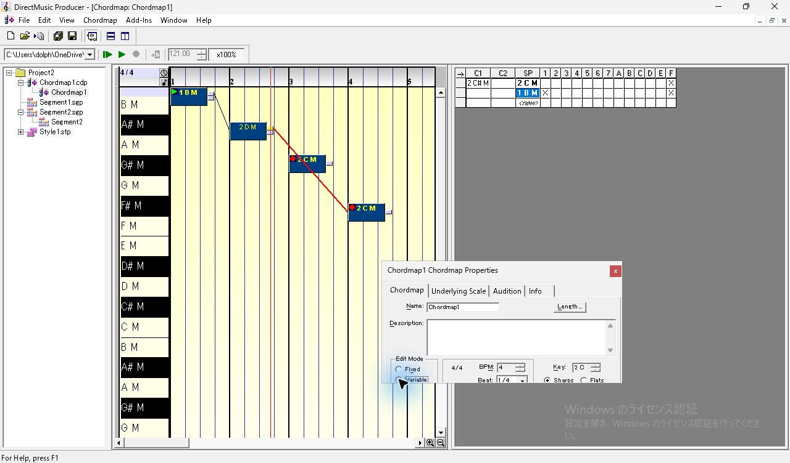

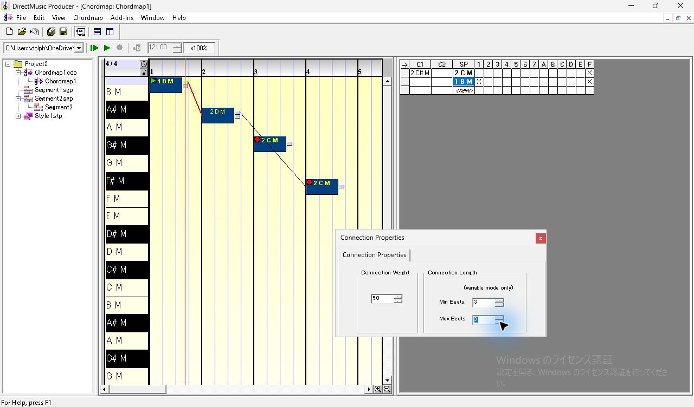

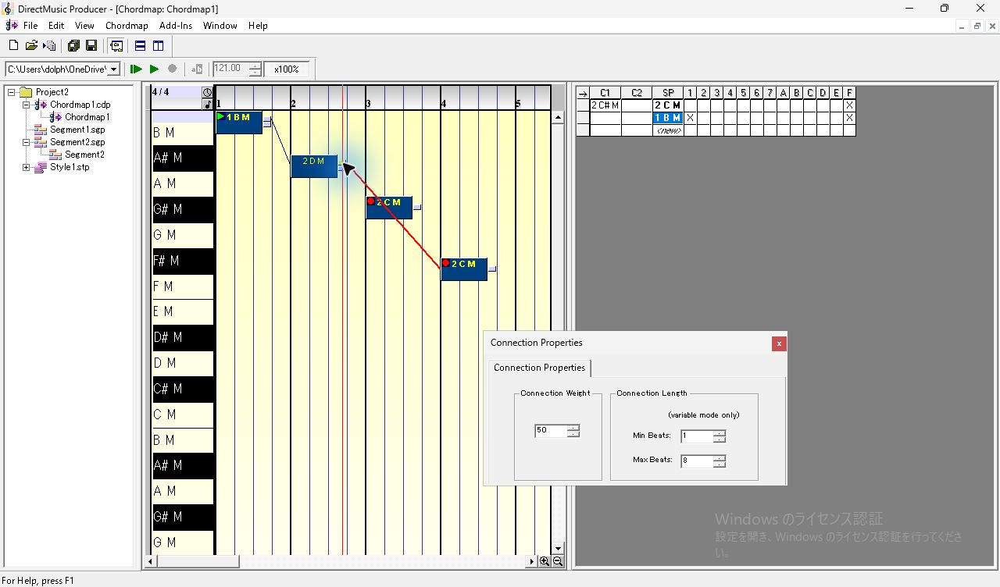

最初の接続の **Weight 50** をダブルクリックで選択し、**0** を入力して Tab。図では線が残り、保存でも接続先と長さは同じ。Segment2 を生成すると **2DM** は入らなかった。重み付きの経路が複数ある場合の優先順や、分岐を追加する下側ボックスは追試に残る。 [重み0の ChordMap](../../../work/original-gui/SEG-14-chord-path/20261111T163112782207Z/captures/variable-zero-weight-Chordmap1.cdp) · [生成結果](../../../work/original-gui/SEG-14-chord-path/20261111T163112782207Z/captures/style-weight-zero-Segment2.sgp) · [同梱ヘルプの Connection Properties](../../../../../work/analysis/original-manual-session/20261010T031624075Z/help-extracted/htm/connectionproperties.htm)

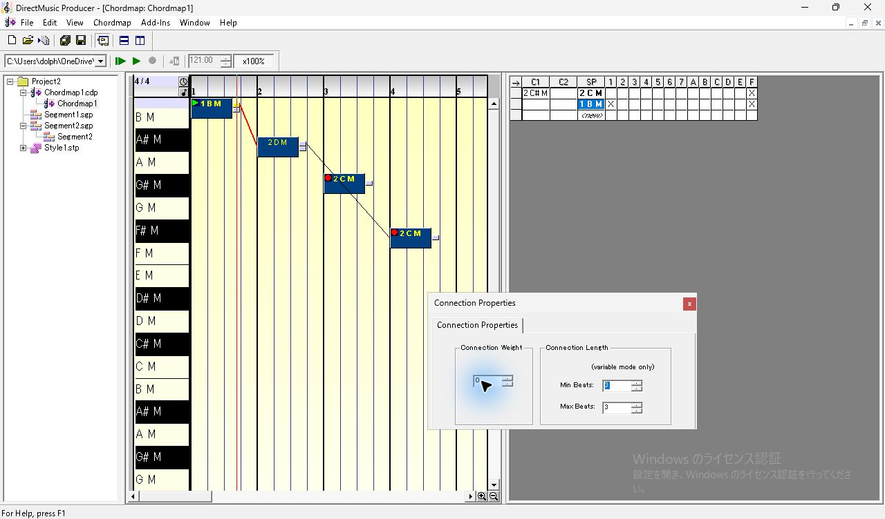

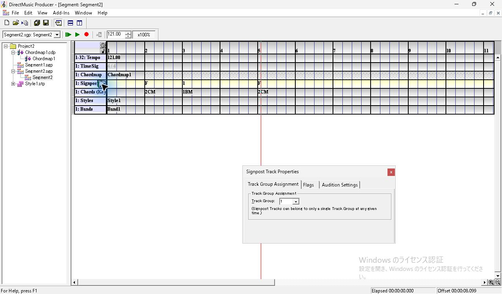

## C1 と C2 を同じ小節に入れる

重み0のまま、Signpost 表の **2CM** の行で空の **C2** をクリック。既定の 2CM が入り、開いていた Properties は **Signpost Chord Scale/Inversion Properties** になる。上スピン3回で **2D♯M** にした。C1 は前回作成した **2C♯M**。Segment2 の第5小節の F を選び直し Cadence をオンにして **^F** にする。Compose 後は C1 が第4小節の第1拍、C2 が第3拍に入り、第5小節は 2CM。内蔵 Pattern の **Segment1** でも、6/8 の第4小節の第1拍と第3拍に同じ2コードが入った。 [C1 と C2 の ChordMap](../../../work/original-gui/SEG-14-chord-path/20261111T163112782207Z/captures/two-cadences-Chordmap1.cdp) · [Style の生成版](../../../work/original-gui/SEG-14-chord-path/20261111T163112782207Z/captures/style-two-cadences-Segment2.sgp) · [Pattern の生成版](../../../work/original-gui/SEG-14-chord-path/20261111T163112782207Z/captures/pattern-two-cadences-Segment1.sgp)

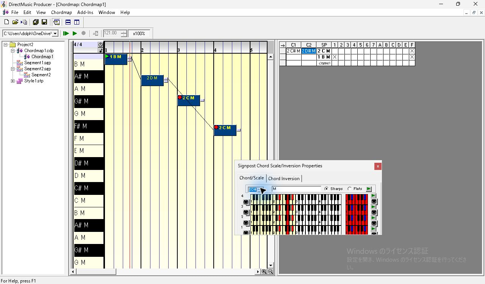

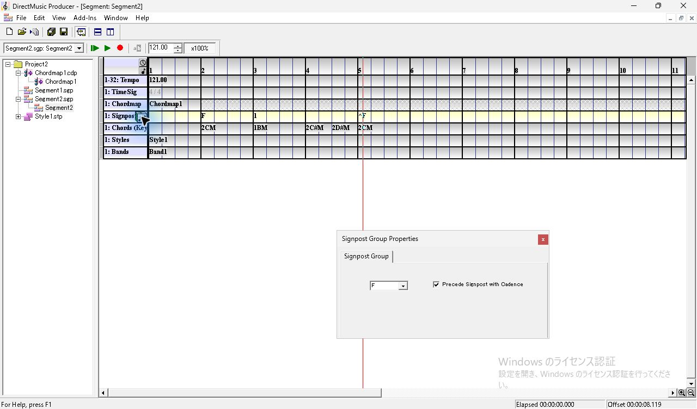

| 生成コード | Style の時刻 | 内蔵 Pattern の時刻 |
| --- | ---: | ---: |
| 第4小節第1拍の C1、root 13 | 9216 clocks | 9216 clocks |
| 第4小節第3拍の C2、root 15 | 10752 clocks | 9984 clocks |
| 第5小節先頭の 2CM、root 12 | 12288 clocks | 11520 clocks |

## 同じノートで再生出力を比較

Style1 のツリーで **Patterns > Pattern1** を開き、折りたたまれていた Part を右端の四角で展開。1小節の Pattern の第1拍と第3拍で、C5 の同じ高さを選んで Insert。既定の **Chord/Scale**、**Chord Level 1**、**PChannel 1** を使用した。2音とも全32 Variation に属し、長さ191 clocks。Segment2 の **Repeat** を0にして、Style とノートを共通にしたまま第5小節の Cadence オンとオフを比較した。 [ノート入りの Style1](../../../work/original-gui/SEG-14-chord-path/20261111T163112782207Z/captures/style-audible-notes-Style1.stp) · [Cadence オフの Segment2](../../../work/original-gui/SEG-14-chord-path/20261111T163112782207Z/captures/style-audio-control-Segment2.sgp)

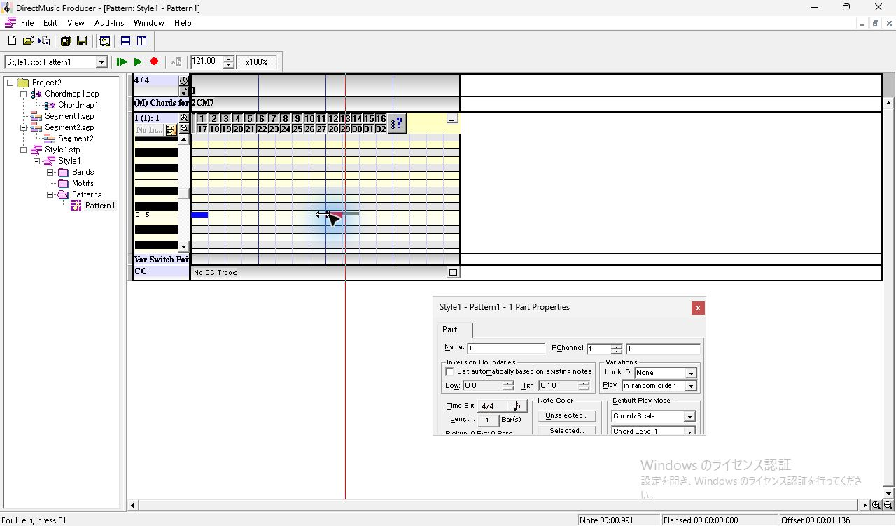

**View > Wave/MIDI Export Toolbar** を表示。右半分の **…** で保存名を指定し、右端の赤いボタンを押して待機させる。**Play From Start** で再生を開始し、第4小節を通過した後に Transport の停止ボタンを押す。停止すると出力名が空になった。出力 MIDI の分解能は **768 ticks/四分音符**。Style の2条件は、同時に既定出力から WASAPI ループバックでも収録した。 [書き出しツールバーの調査](ui-13-transport-export-live.md#midi-の出力先待機収録)

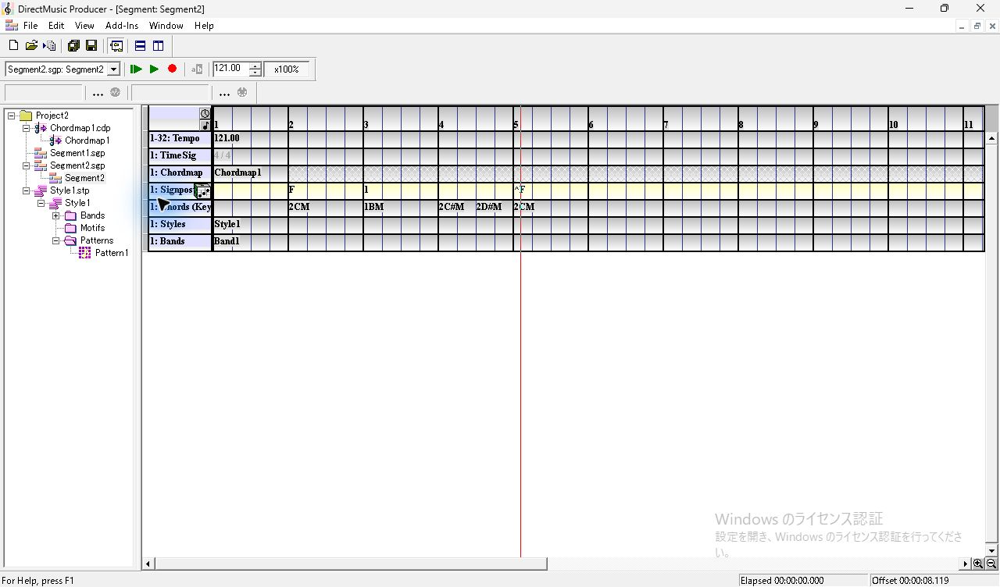

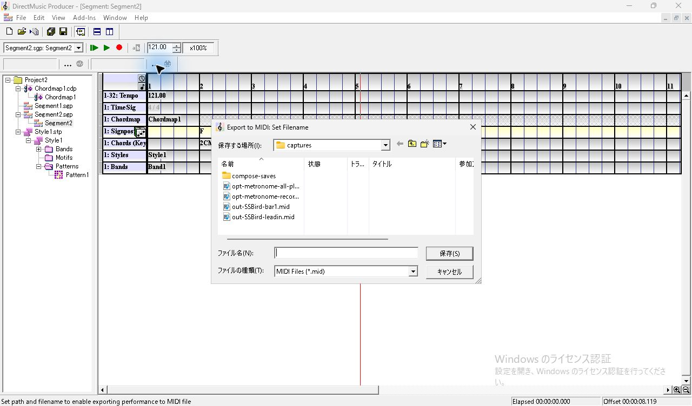

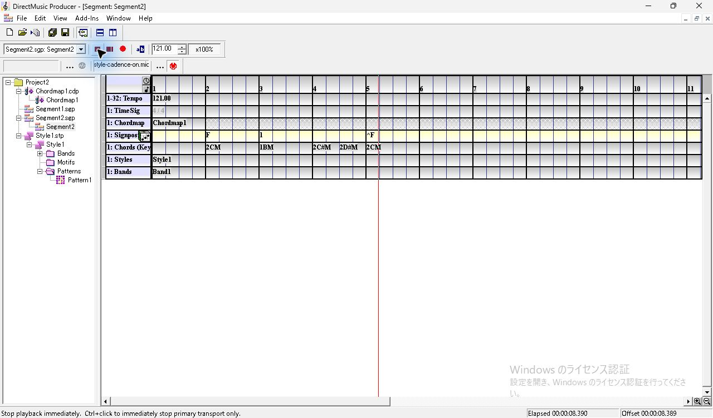

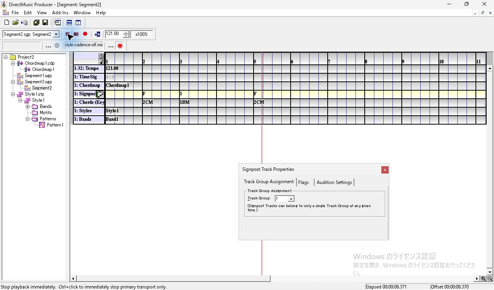

内蔵 Pattern の Segment1 は第4小節が6/8。**Keep Constant > Functionality** にして、Cadence オフの状態で第4小節第1拍と第4拍に同じ高さの2音を入れた。録音の2条件とも Repeat 0。MIDI 収録で選ばれた Variation はオフ時22、オン時4。比較用の2音は Variation 1 を除く31個に属するので、どちらの試行にも含まれる。オン・オフの保存版で既存1音と追加2音の全音符レコードは一致した。 [Cadence オフの Segment1](../../../work/original-gui/SEG-14-chord-path/20261111T163112782207Z/captures/pattern-audio-control-Segment1.sgp) · [Cadence オンの Segment1](../../../work/original-gui/SEG-14-chord-path/20261111T163112782207Z/captures/pattern-two-cadences-Segment1.sgp)

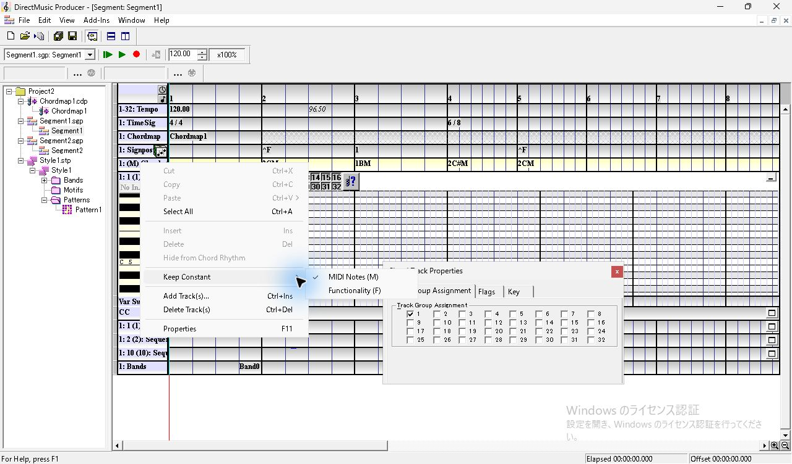

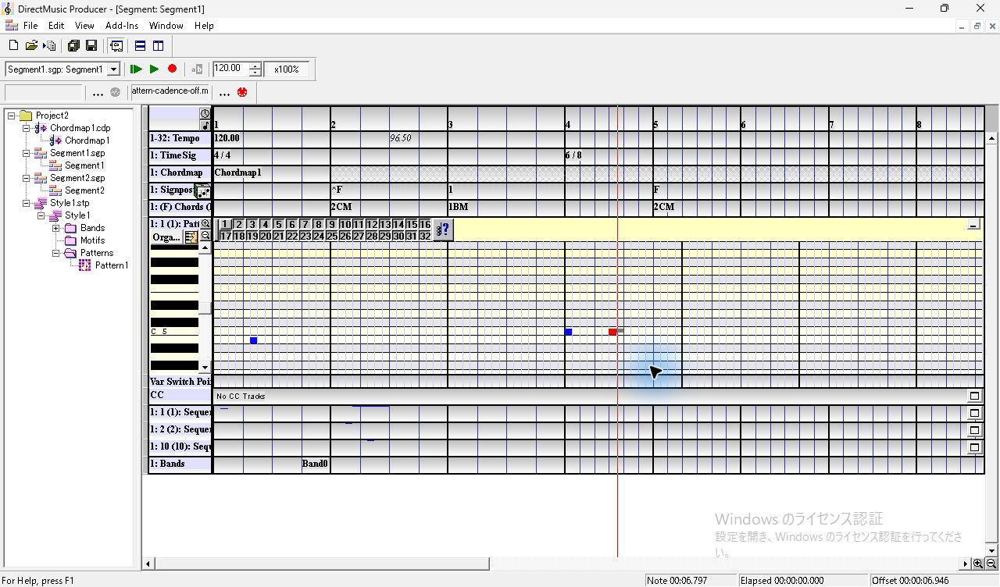

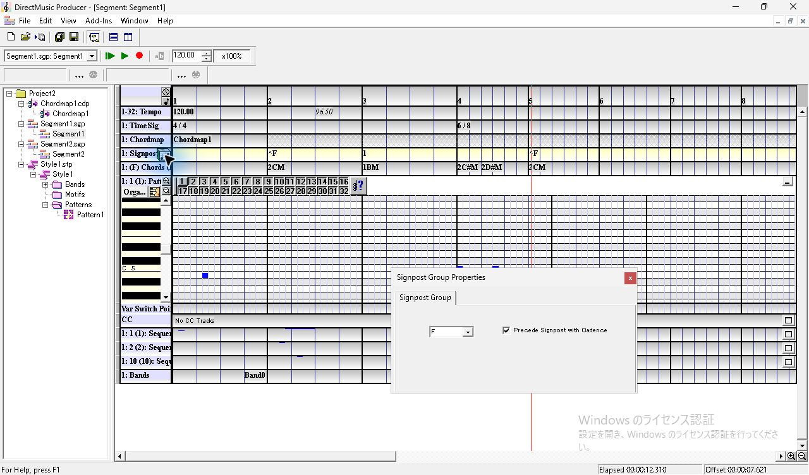

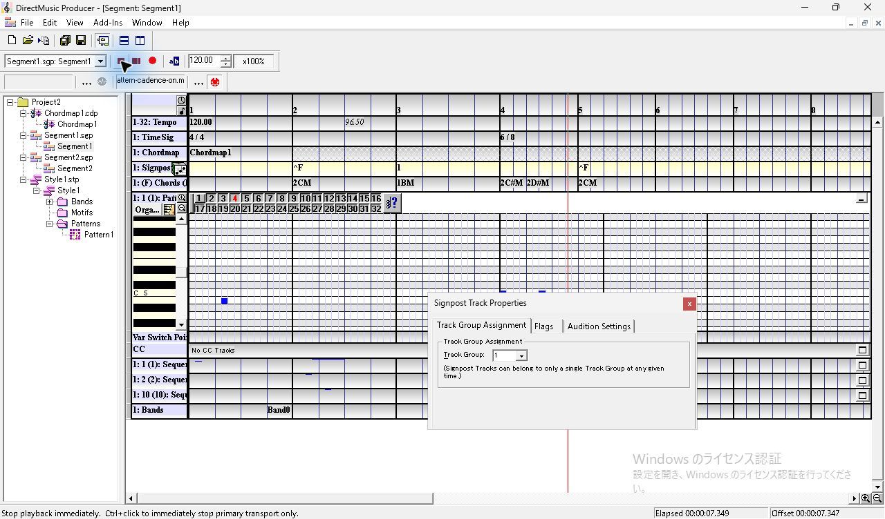

| 素材と観測位置 | Cadence オフの MIDI Note On | Cadence オンの MIDI Note On |
| --- | --- | --- |
| Style、9216 と10752 ticks（第4小節第1・3拍） | 59、59 | 61、63 |
| 内蔵 Pattern、9216 と10368 ticks（第4小節第1・4拍） | 60、60 | 64、65 |

全4試行とも対象のイベントは MIDI チャンネル1。内蔵 Pattern の2音目は第3拍の C2 が始まった後、第4拍で鳴る。オフとオンの出力でその位置は一致した。 [Style オフ MIDI](../../../work/original-gui/SEG-14-chord-path/20261111T163112782207Z/captures/style-cadence-off.mid) · [Style オン MIDI](../../../work/original-gui/SEG-14-chord-path/20261111T163112782207Z/captures/style-cadence-on.mid) · [Pattern オフ MIDI](../../../work/original-gui/SEG-14-chord-path/20261111T163112782207Z/captures/pattern-cadence-off.mid) · [Pattern オン MIDI](../../../work/original-gui/SEG-14-chord-path/20261111T163112782207Z/captures/pattern-cadence-on.mid)

Style の WAV は各30秒、48 kHz、32-bit float、ステレオ。再生クリックの時刻と最初の発音で整列し、第4小節の2音について、各開始25 ms 後から150 ms の左チャンネルを比較した。MIDI 57〜64 に相当する周波数で最も強かった成分は、オフが **246.9 Hz、246.9 Hz**、オンが **277.2 Hz、311.1 Hz**。MIDI の各 Note On と一致した。内蔵 Pattern のオン・オフ比較は MIDI で照合した。 [Style オフの WAV](../../../work/original-gui/SEG-14-chord-path/20261111T163112782207Z/captures/audio-style-control/output.wav) · [Style オンの WAV](../../../work/original-gui/SEG-14-chord-path/20261111T163112782207Z/captures/audio-style-cadence/output.wav) · [保存値、MIDI、WAV の照合](../../../work/original-gui/SEG-14-chord-path/20261111T163112782207Z/chord-path-audit.json)

収録後は Wave/MIDI Export を隠した。Project を閉じたときの未保存確認では **No All** を選び、比較に使った保存版を保持した。終了時は開始時と同じ Producer が1件、Project を閉じた停止状態で View の標準4項目。終了後に Project2 の5ファイルを凍結した。Chord Path の各条件を再現する ChordMap と Segment の保存版は上記の各手順から参照できる。 [終了時のウィンドウ](../../../work/original-gui/SEG-14-chord-path/20261111T163112782207Z/captures/147-final-windows.json) · [終了時の Project2](../../../work/original-gui/SEG-14-chord-path/20261111T163112782207Z/inputs/chord-path-observed/manifest.json)

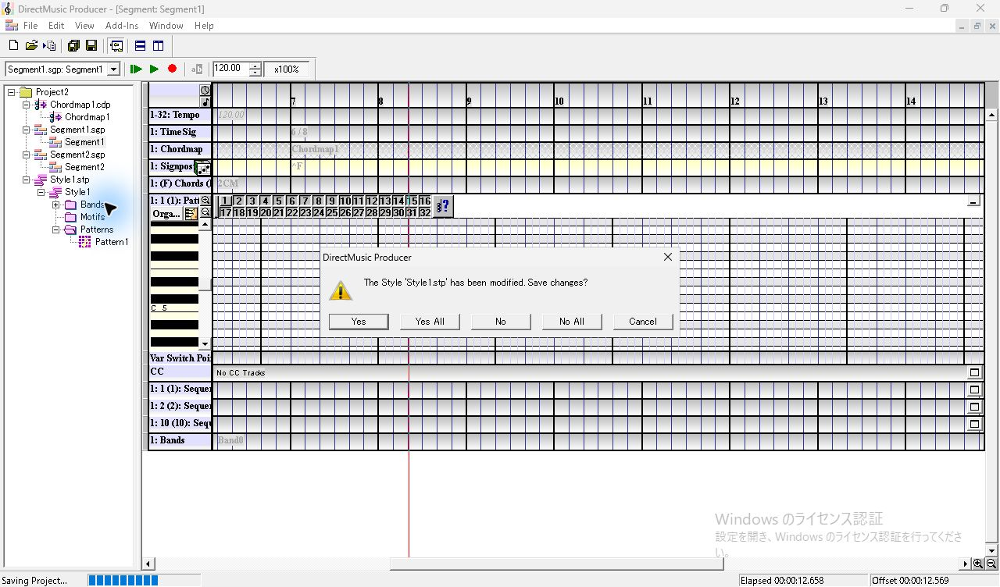

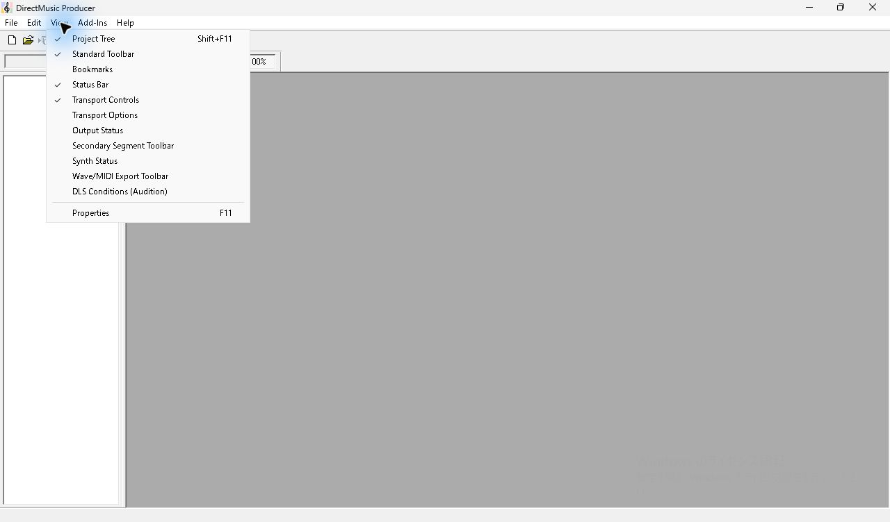

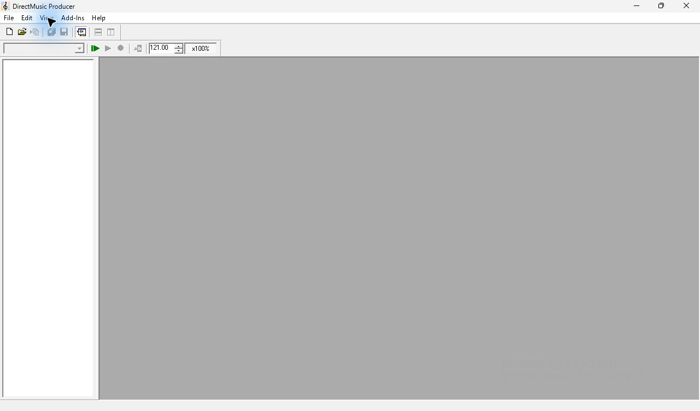
