# SEG-14　Chord の拍セルと鍵盤

[調査計画](README.md) · [Chordmap 参照と Signpost](seg-14-chordmap-signpost.md)

2026-11-11。DirectMusic Producer 5.3.0.900 の調査用コピー `DmusGuiHarmony.exe`（SHA-256 `c330bb2ca2c885f4157ec9dce060f64957e33e88192b6547630c2db5f1a65a22`）。[Tempo・Time Sig・Band0 入り素材](../../../work/original-gui/SEG-09/20261111T032540911033Z/inputs/timed-segment/manifest.json) から専用 Project2 を作成した。Windows 11 25H2、1280×800、96 DPI。親子ウィンドウは最大化し、[ツールバーは2段](ui-01-view-toolbars.md)。本体画像は1280×752 px。座標の原点は各画像の左上。青い光と黒い矢印は操作ツールの表示。編集は停止中に行った。

[実行記録](../../../work/original-gui/SEG-14-harmony/20261111T044759384015Z/run.json) · [画像対応表](../../../work/original-gui/SEG-14-harmony/20261111T044759384015Z/published-images.json) · [保存値](../../../work/original-gui/SEG-14-harmony/20261111T044759384015Z/saved-harmony-tracks.json) · [追試用の凍結素材](../../../work/original-gui/SEG-14-harmony/20261111T044759384015Z/inputs/harmony-segment/manifest.json)

## 追加と拍単位の挿入

1. `Segment1.sgp` を開き、最初の Sequence の右端のボタンでピアノロールを閉じる。ルーラーを右クリックし、`Add Track(s)...` を選ぶ。
2. `Add New Tracks` で `Chord Track` を選び、Shift+↓で隣の `Chordmap Track` を選択に含める。OK 後は TimeSig の下に Chordmap、Chords の順で入る。同じメニューから `Signpost Track` を追加すると、Chordmap と Chords の間に入る。各行のグループは1。
3. `1: Chords (Key…` の第2小節第2拍（x≈481、y≈236）を右クリックする。選択した1拍が黒くなり、行全体は淡黄色。空セルのメニューでは Insert が有効で、Delete と `Hide from Chord Rhythm` は灰色。
4. Insert を選ぶと、その拍の `Chord Properties` が開く。ウィンドウは391×200 px、モデルレス。最初の `Chord/Scale` ではルート `2C`、名前 `M`、`Sharps` が初期表示。Chords のラベルは拍先頭に置かれる。

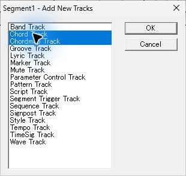

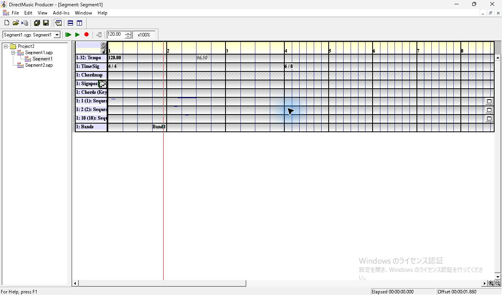

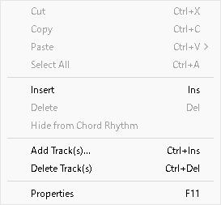

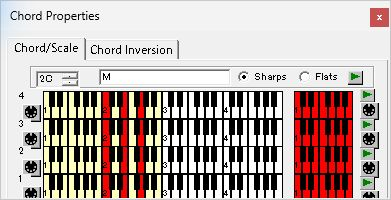

## Chord/Scale と Chord Inversion

`Chord/Scale` は上部にルートのスピン、名前欄、Sharps・Flats のラジオ、緑の再生ボタン。下部は上から 4、3、2、1 の鍵盤4段。左側の横長の鍵盤は白黒の鍵と淡黄色の範囲に赤い音を表示し、右側にも各段の鍵盤と小さいボタンが並ぶ。最下段のボタンはこの寸法で下端にかかる。

| 操作 | 観測 |
| --- | --- |
| ルートの上スピン（x≈70、y≈72）を1回 | `2C` が `2C#` に変わり、赤い鍵が隣の音位置に移る |
| `Flats` をクリック | ルート表示が `2Db`。名前は `M` のまま |
| 左鍵盤の最上段の白鍵（x≈124、y≈111）をクリック | その段の鍵が赤くなる。保存ファイルでも第4段と他の段の Chord Pattern が異なる |
| `Chord Inversion` をクリック | 各段に左右の短い鍵盤、中央の `Next`、右端の `Legal?` と緑の再生ボタン。最初に見えている4段はいずれも Legal? がオン |
| 第4段の `Next`（x≈185、y≈100）を1回 | 右側の赤い鍵の位置が変わる。この候補の `Legal?` をクリックすると第4段だけオフにできる |
| 右上の × で閉じる | 第2小節第2拍に `2DbM` が白字で出る。黒い選択はその1拍 |

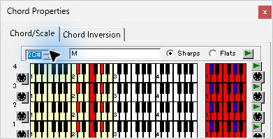

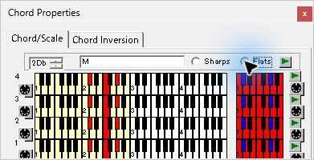

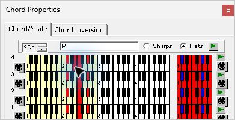

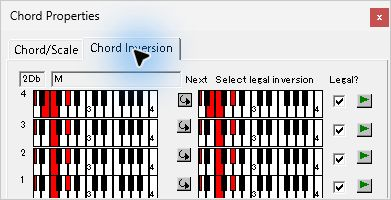

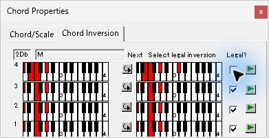

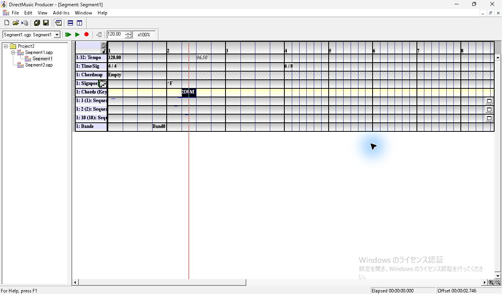

## Hide from Chord Rhythm と取り消し

`2DbM` を右クリックすると Insert が灰色、Delete と `Hide from Chord Rhythm` が有効。Hide を選ぶと同じセルの文字が `(2DbM)` になる。Ctrl+Z 後は括弧が消え、黒い拍選択も解除される。Chord は元の拍に残る。

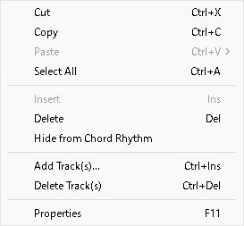

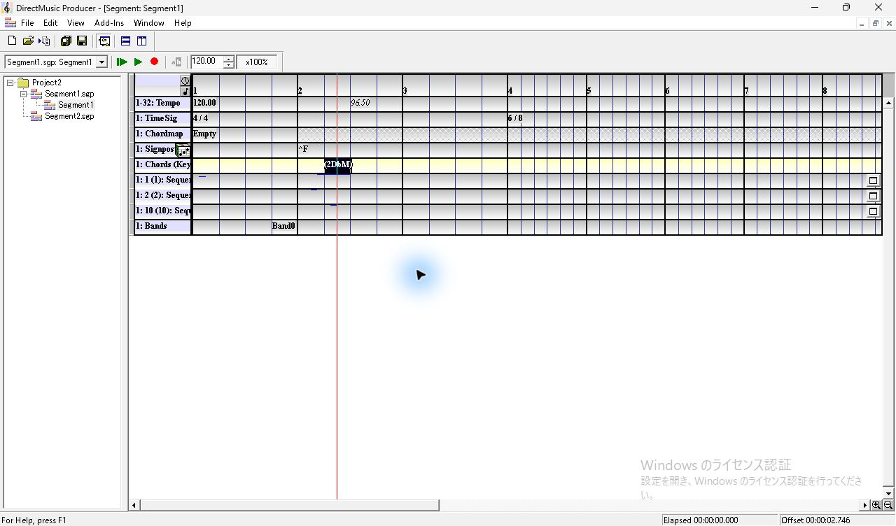

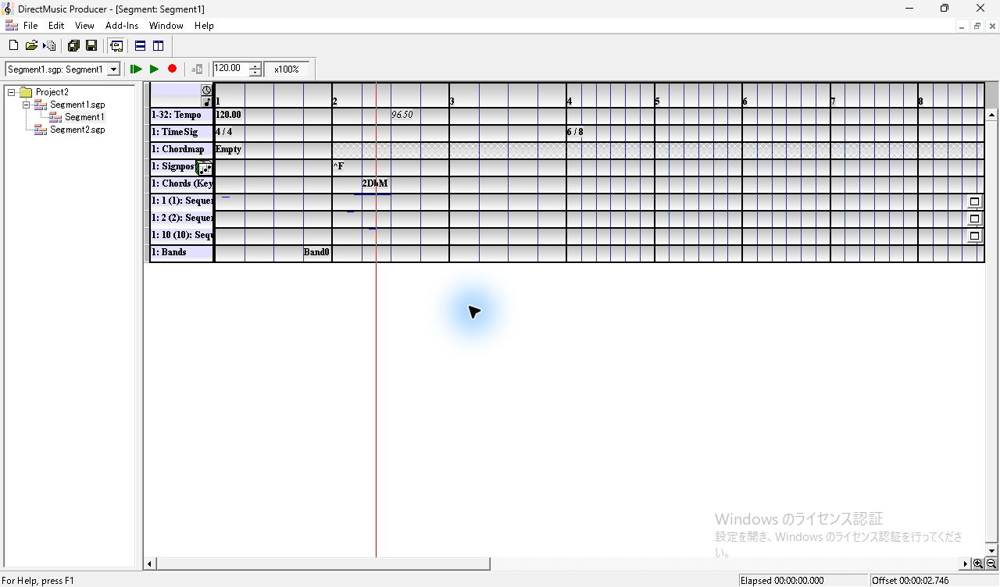

## トラックの Key とイベントの設定

Chord 行のヘッダーをクリックして F11 を押すと `Chord Track Properties` に切り替わる。タブは `Track Group Assignment`、`Flags`、`Key`。Group には1〜32のチェック欄が並び、1だけオン。Flags ではこの状態で `Enable Control`、`Send Notifications` がオン。Key の初期値は `C` と `0 #'s`。Key Root の上スピンを1回押すと `C#`、`b's` を選ぶと `Db` になる。Key Signature を1にして `1 b's` を表示しても、既存のイベントのラベルは `2DbM` のままだった。Key はトラック側の欄で、イベントの Chord/Scale と別の入口を持つ。

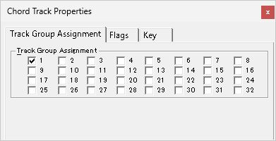

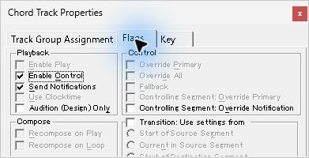

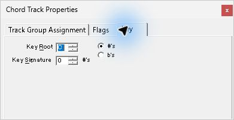

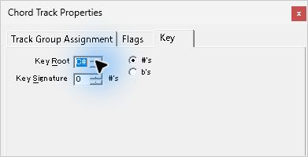

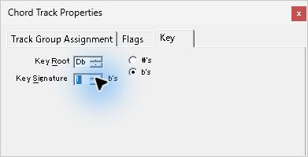

## 別起動と保存値

保存して通常終了し、専用コピーを別プロセスで起動した。Segment を開くと第2小節第2拍に `2DbM`。F11 の Chord/Scale は `2Db`、`M`、Flats。Chord Inversion で第4段の Next を1回押すと保存時と同じ候補が出て、Legal? はオフ。トラックの Key は `Db` と `1 b's` が戻る。

保存した `cord/crdb` の名前は `M`、開始は3840 clocks、0起点の小節・拍は1・1。4個のサブコードの root は13。パターンの格納値は第1〜3段が `0x91`、第4段が `0x99`。第4段の転回位置の格納値は `0x00ff0ff0`。Chordmap を割り当てる前後でこのトラックの内容は同一だった。

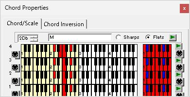

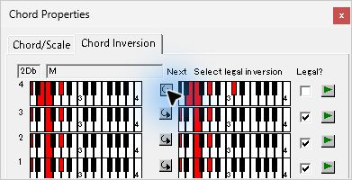

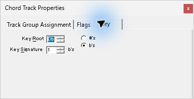

追試項目は Chord の複数選択とドラッグ、鍵盤のホバー・押下中と右側の Scale、試聴と実音声、Key を変えたときのピッチ表示、グループと Flags の変更、Pattern・Style と組み合わせた Chord Rhythm。
