# SEG-14　Chordmap 参照と Signpost

[調査計画](README.md) · [Chord の拍セルと鍵盤・トラック追加](seg-14-chord.md)

2026-11-11。DirectMusic Producer 5.3.0.900 の調査用コピー `DmusGuiHarmony.exe`（SHA-256 `c330bb2ca2c885f4157ec9dce060f64957e33e88192b6547630c2db5f1a65a22`）。[Tempo・Time Sig・Band0 入り素材](../../../work/original-gui/SEG-09/20261111T032540911033Z/inputs/timed-segment/manifest.json) から専用 Project2 を作成した。Windows 11 25H2、1280×800、96 DPI。親子ウィンドウは最大化し、[ツールバーは2段](ui-01-view-toolbars.md)。本体画像は1280×752 px。座標の原点は各画像の左上。青い光と黒い矢印は操作ツールの表示。編集は停止中に行った。

[実行記録](../../../work/original-gui/SEG-14-harmony/20261111T044759384015Z/run.json) · [画像対応表](../../../work/original-gui/SEG-14-harmony/20261111T044759384015Z/published-images.json) · [保存値](../../../work/original-gui/SEG-14-harmony/20261111T044759384015Z/saved-harmony-tracks.json) · [追試用の凍結素材](../../../work/original-gui/SEG-14-harmony/20261111T044759384015Z/inputs/harmony-segment/manifest.json)

## Chordmap の空行と参照セル

1. `Chordmap Track` を追加すると、約22 px 高の `1: Chordmap` が TimeSig の下に入る。第1小節は通常のセル、第2小節以降は縦の拍線を残した網掛け。第2小節を右クリックすると行が淡黄色になり、赤い位置線はクリック位置へ移る。この操作ではメニューは開かなかった。
2. 第1小節（x≈300、y≈192）を右クリックするとメニューが出る。初回は Insert が有効、Delete は灰色。Insert 後に391×200 px のモデルレス `Chordmap Properties` が開く。タブは `Chordmap` のみで、候補はプロジェクト内の ChordMap 文書。文書が無い場合もドロップダウンは展開し、空白のリストになる。
3. Esc で空の一覧を閉じ、モデルレスを × で閉じる。第1小節の先頭に `Empty` が出て、その小節全体が黒くなる。Insert 前のラベルなしと、Insert 後の `Empty` は見分けられる。
4. 行のヘッダーを選び F11 で `Chordmap Track Properties`。1〜32のグループ欄では1だけオン。Flags には `Enable Control` と `Audition (Design) Only` があり、後者は未選択。セルを選んだ場合は参照設定に戻る。

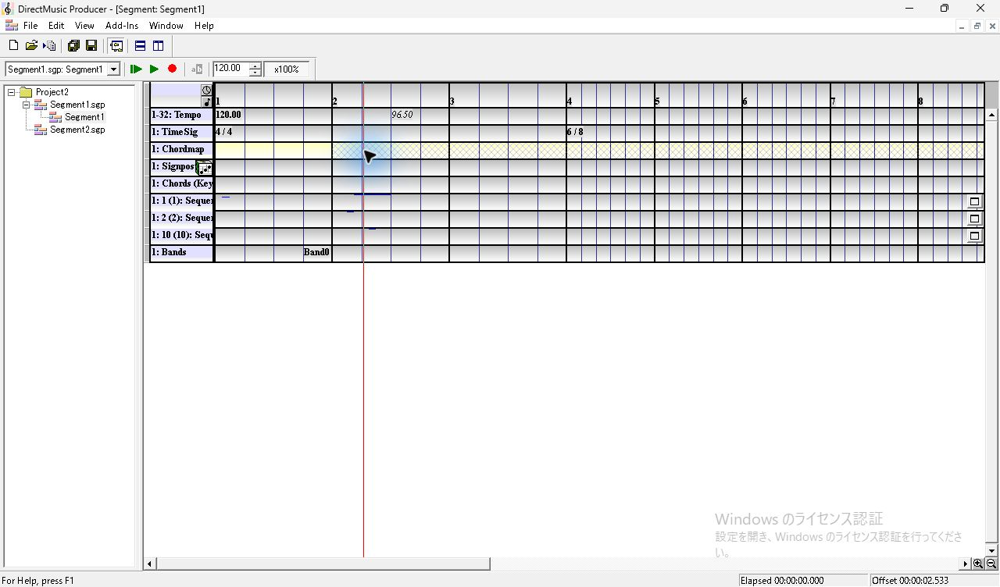

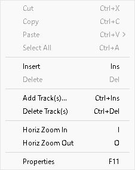

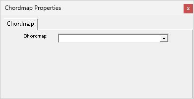

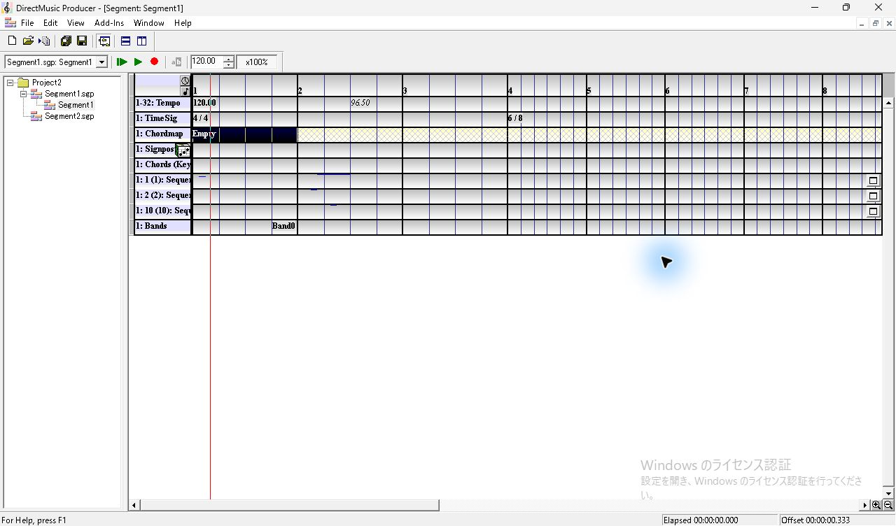

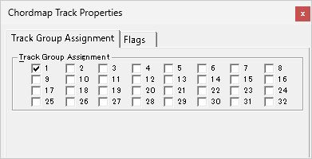

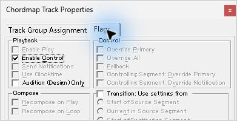

## 参照先の作成、Esc と Undo/Redo

1. Ctrl+N の `Create New File(s)` で `Chordmap` を選び、`Use Default Names` をオンにして OK。Project2 に `Chordmap1.cdp` と子ノード `Chordmap1` ができ、ChordMap Designer が開く。Ctrl+S で文書を保存する。
2. Project Tree の `Segment1` 子ノードをダブルクリックして戻る。ファイルノード `Segment1.sgp` をダブルクリックした回ではツリーの展開が変わり、ChordMap Designer が前面に残った。
3. `Empty` を左クリックして F11。候補を開くと `Project2: Chordmap1 Major` が出る。↓で候補が青くなり、Esc で一覧を閉じた後も参照欄に同じ名前が残った。モデルレスの × で閉じると、第1小節のラベルは `Chordmap1`。
4. Ctrl+Z で `Empty` に戻る。Ctrl+Y で `Chordmap1` が戻る。この試行で変更を戻す入口は Undo だった。参照ラベルのダブルクリックでは選択セルが黒くなり、Segment エディターが前面のままだった。
5. 別起動後に Tree から `Chordmap1.cdp` をダブルクリックすると子ノードが選択され、Transport の対象が切り替わった。子ノード `Chordmap1` をダブルクリックすると ChordMap Designer が前面に出た。左に Chord Path のルーラーと鍵名付きパレット、右に Signpost の表。空の文書では表の `SP` 列に `(new)` 行がある。左右の間に縦の分割線がある。

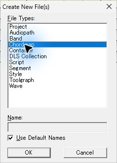

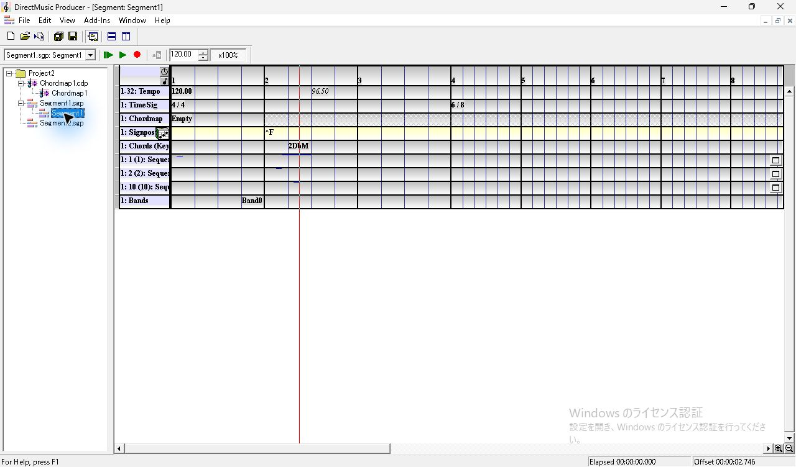

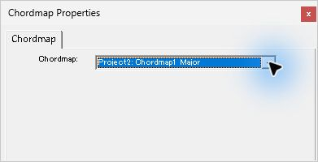

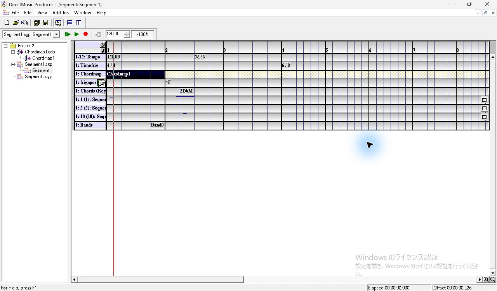

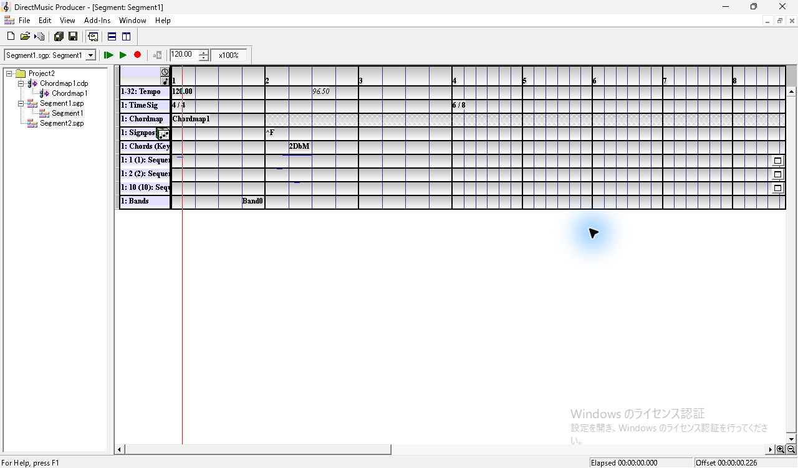

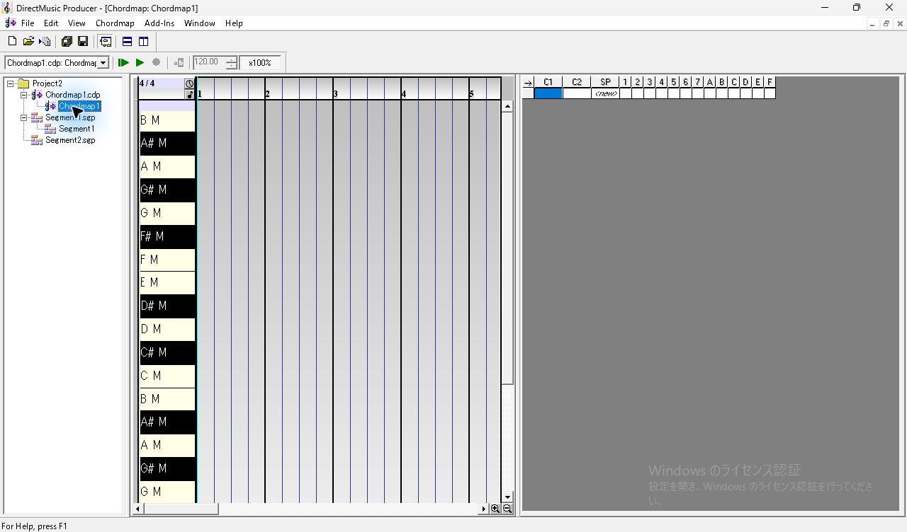

## Signpost の挿入、Cadence、トラック設定

1. `Signpost Track` を追加すると Chordmap と Chords の間に `1: Signposts`。ヘッダーの右に音符入りの `Compose Chords` ボタン（x≈260、y≈214）がある。
2. 第2小節第2拍の位置（x≈482、y≈213）で右クリックし、Insert。モデルレス `Signpost Group Properties` は、初期のグループ1と、未選択の `Precede Signpost with Cadence` を表示する。ドロップダウンの選択肢は 1〜7、A〜F。End で末尾 F を表示し Enter で確定できる。
3. Cadence をオンにして × で閉じると、第2小節の先頭に白字 `^F`、背景はその小節全体が黒。赤い位置線はクリックした第2拍の位置に残る。第2小節先頭の `^F`（x≈433）から第3小節の左寄り（x≈590）へ1回ドラッグした試行では、解放後もラベルと選択は第2小節に残った。
4. ヘッダーで F11 を押すか、モデルレスを開いたままヘッダーを選ぶと `Signpost Track Properties`。グループはドロップダウンで1つ選ぶ。Flags の初期表示は `Enable Play` と `Send Notifications` がオン。`Audition Settings` の Activity Level は初期値が `Bypass Activity`。候補は `High`、`Medium High`、`Medium Low`、`Low`、`Bypass Activity` の順。今回は `Medium High` を保存した。
5. ヘッダーの Compose Chords は、参照を `Empty` のまま押した回と `Chordmap1` を設定してから押した回で、同じ警告 `Unable to compose chords.` を表示した。メッセージでは ChordMap が割り当てられた Chordmap Track に加え、Style が割り当てられた Style Track または Pattern Track を求めていた。OK 後に Signpost 行と既存 Chord は維持された。

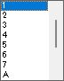

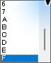

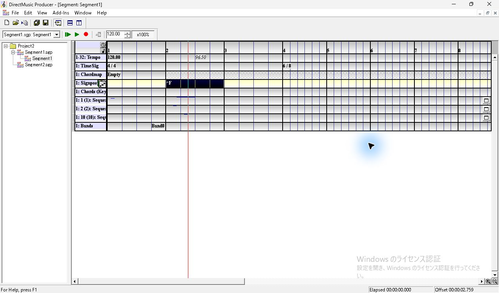

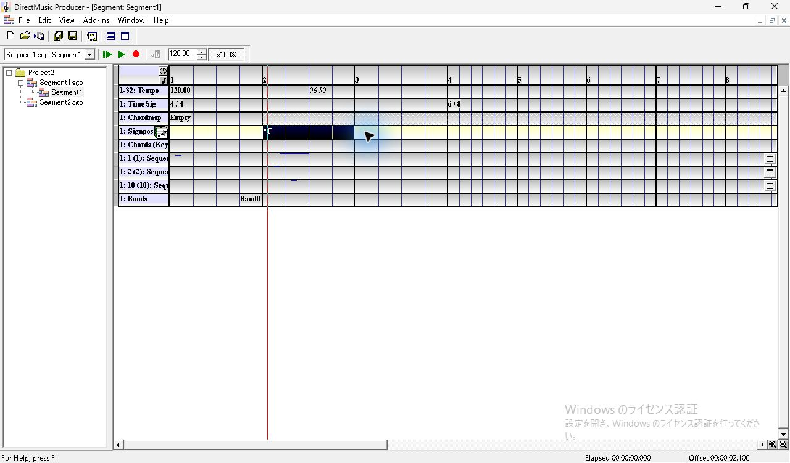

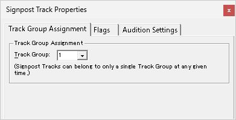

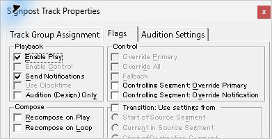

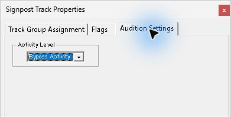

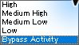

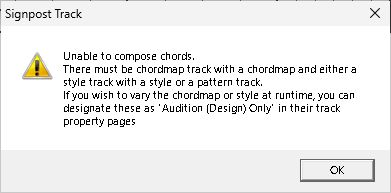

## 保存と別起動

参照設定前の Segment を保存してから参照を確定し、再度 Ctrl+S。通常終了し、同じ専用コピーを単独で再起動した。Project2 を展開すると Chordmap1.cdp と2本の Segment が表示された。Segment1 を開くと Chordmap 行の第1小節に `Chordmap1`、Signposts 行の第2小節先頭に `^F`、Chords 行の同小節第2拍に `2DbM`。F11 で開いたモデルレスは、セル・ヘッダーの選択に追従し、参照名・グループ F・Cadence オン・`Medium High` を確認できた。

- `pftr/pfrf` の参照時刻は0 clocks。参照前は `stmp` のみ、参照後は `DMRF` とデザイン用の `jzfr` が加わる。`DMRF` の名前は `Chordmap1`、ファイル名は `Chordmap1.cdp`、GUID は参照先文書と一致。
- `sgnp` の Signpost は3072 clocks、0起点の小節は1、グループと Cadence の格納値は `0x8020`。Activity Level のデザイン用 `pspd` は1。
- 別起動で開いた Segment は保存直後の2442 bytes と SHA-256 が一致した。既存トラックの末端チャンクは Sequence の表示設定 `psqc` を除き、入力と同一だった。

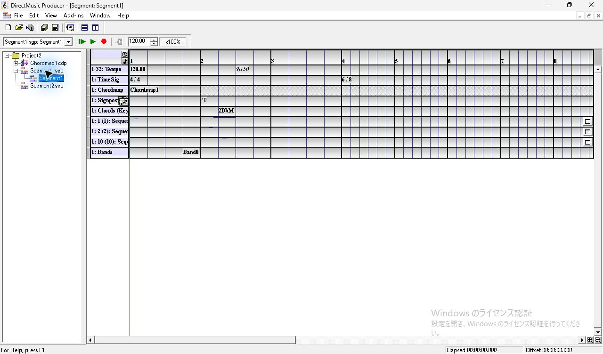

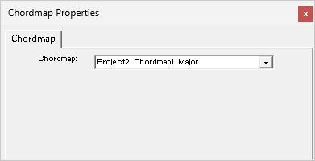

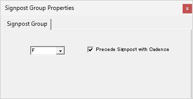

追試項目は参照先の複数候補と欠損、`Audition (Design) Only` と実行用ファイル、Signpost の移動・複数選択とコピー、ChordMap Designer のパレット・節点・リンク・Signpost Group の編集、Style/Pattern があるときの Compose Chords の確定と取り消し。今回の Chordmap1 は既定文書のまま保存した。
