# SEG-14　複数 Signpost、Cadence、再生時の Compose Chords

2026-11-12。DirectMusic Producer 5.3.0.900 の作業コピーで、前回の生成後に保存した Project2 の5ファイルを複製。内蔵 Pattern の **Segment1** と Style1 参照の **Segment2** を比較した。実機撮影237枚から33枚を掲載。親画面は1280×752 px。View は Project Tree、Standard Toolbar、Status Bar、Transport Controls の4項目。座標の原点は画面左上。青い光と太い黒矢印は操作ツールの表示。 [入力と実行環境](../../../work/original-gui/SEG-14-compose-followup/20261111T160834141890Z/run.json) · [画像の出典・寸法](../../../work/original-gui/SEG-14-compose-followup/20261111T160834141890Z/published-compose-followup-figures.json) · [前回の単一 Signpost の調査](seg-14-compose-chords.md)

## ChordMap にグループ1と F を用意する

Project Tree の **Chordmap1.cdp** をダブルクリックし、子の **Chordmap1** で Designer を前面に出す。左の Chord Path は空。右の Signpost 表には **C1、C2、SP、1〜7、A〜F** の列があり、初期状態は F に割り当てた **2CM** が1件。

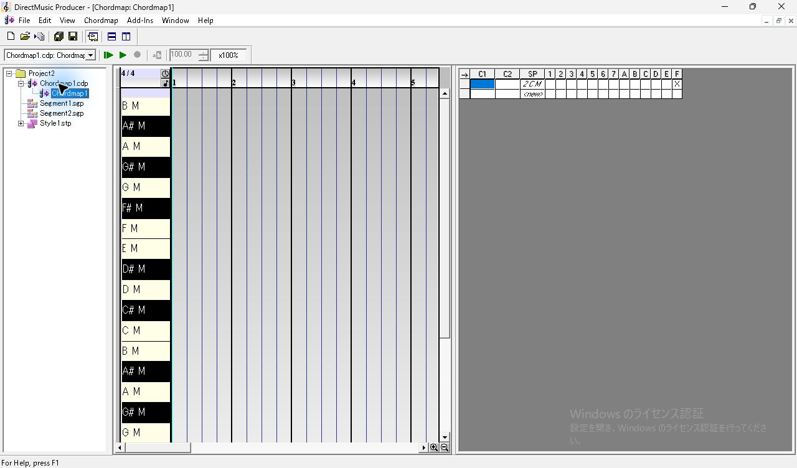

1. 既存の行の **C1**（初期画面の `774,134` 付近）をクリックすると、既定値 **2CM** が入る。F11 でモデルレス Properties を開き、C1 セルを選び直すと **Signpost Chord Scale/Inversion Properties** に切り替わる。
2. **Chord/Scale** タブ左上のルートの上スピン（`687,497`）を1回押す。右の表の C1 と Properties の鍵盤が更新され、C1 は **2C♯M**、SP は **2CM**。
3. 次の行の **SP** 列の `<new>` をクリックすると、既定の **2CM** が新しい行に入る。下スピン1回で **1BM** にし、同じ行の **1** 列をクリックして **X** を付ける。Ctrl+S で保存する。最初の比較では、F の候補が 2CM、1 の候補が 1BM の各1件。C2 は空。 [グループごとに1候補の保存版](../../../work/original-gui/SEG-14-compose-followup/20261111T160834141890Z/captures/map-two-groups-Chordmap1.cdp) · [同梱ヘルプの Cadence Chords](../../../../../work/analysis/original-manual-session/20261010T031624075Z/help-extracted/htm/cadencechords.htm)

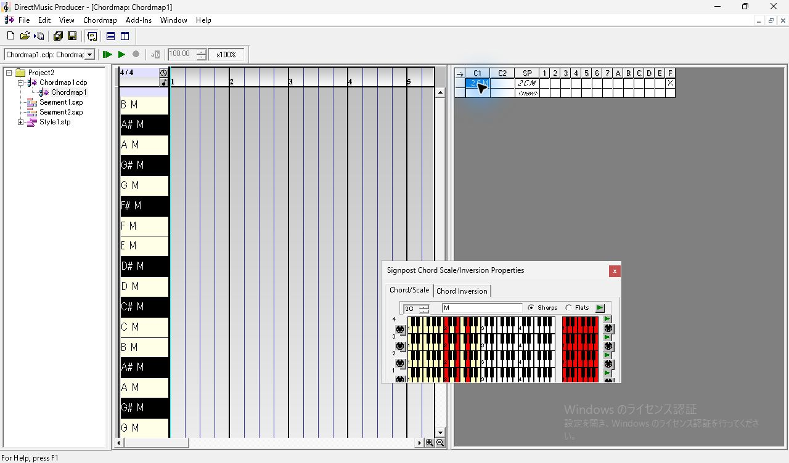

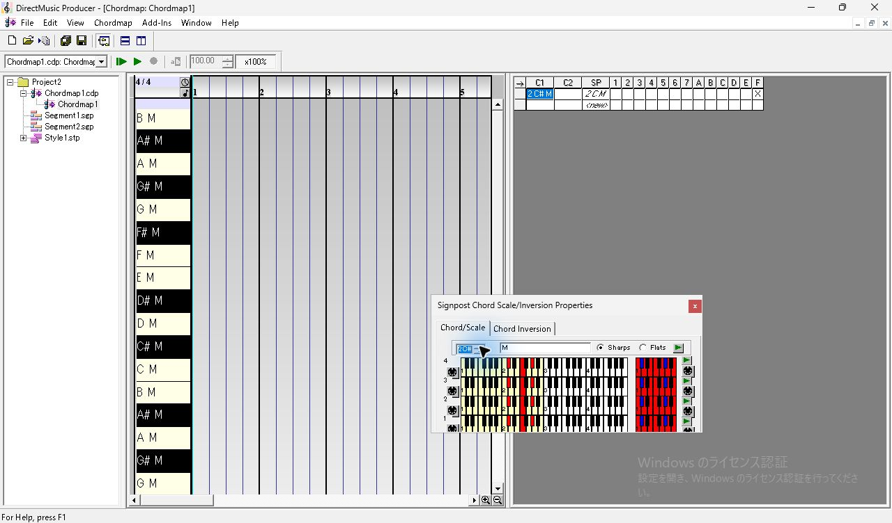

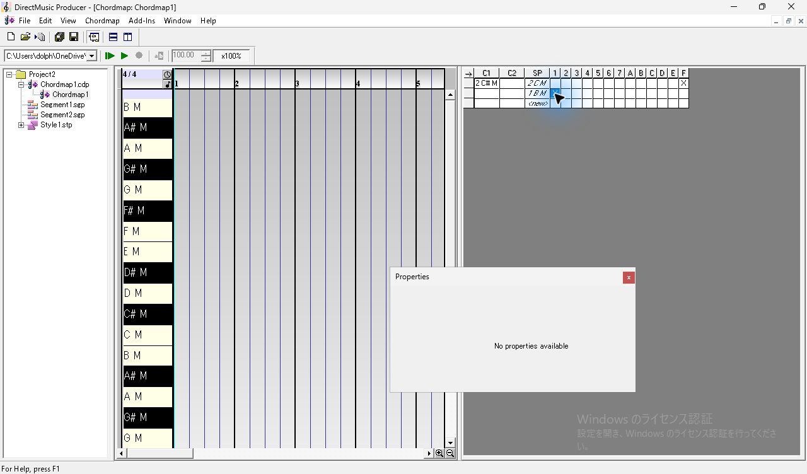

## Pattern の手動生成と、選択中のマーカーだけに適用される Cadence

Segment1 の Signposts 行で、第3小節内をクリックして Insert。全小節が濃い選択帯になり、既定のグループ **1** が入る。既存の第2小節 **^F** と合わせ、左の音符ボタン **Compose Chords**（`259,215`）を押すと、対応する小節の先頭に **2CM、1BM** が表示された。続けて第5小節に Insert し、ドロップダウンを開いて End → Enter で **F** にした。

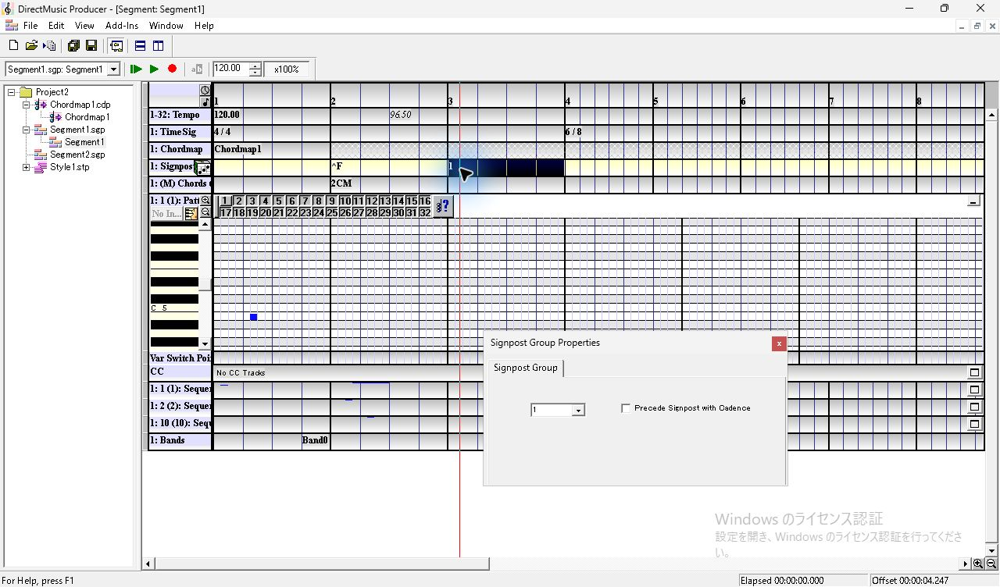

第5小節の Cadence をオフにして Compose を押すと、Chord 行は第2・3・5小節の3件。Compose の後はマーカーの選択帯が消え、モデルレス Properties には直前のグループ F が残った。この状態で **Precede Signpost with Cadence** をクリックすると欄にはチェックが見えたが、Timeline の第5小節は **F** のまま。再生成・保存してもオフの保存版と全バイト一致した。

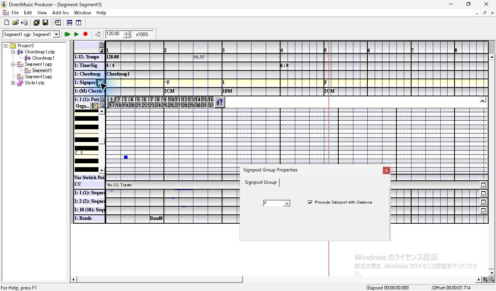

第5小節をクリックし直すとチェックが外れ、選択帯が戻った。この状態でチェックを付けると、セルの表記が **^F** に変わる。Compose を押すと、第5小節の **2CM** に先立ち、第4小節の第1拍に **2C♯M** が入った。第2小節の既存 **^F** には、この試行で前置コードが入らなかった。 [オフの保存版](../../../work/original-gui/SEG-14-compose-followup/20261111T160834141890Z/captures/cadence-off-Segment1.sgp) · [^F が確定した生成版](../../../work/original-gui/SEG-14-compose-followup/20261111T160834141890Z/captures/cadence-generated-Segment1.sgp)

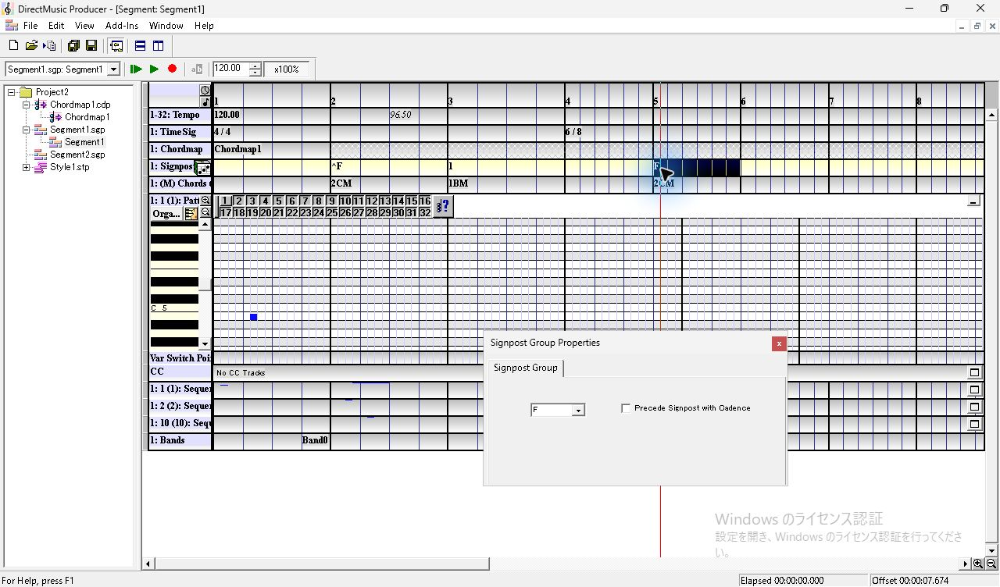

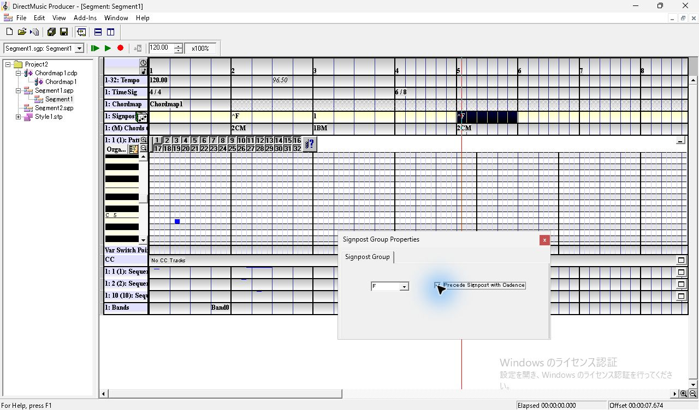

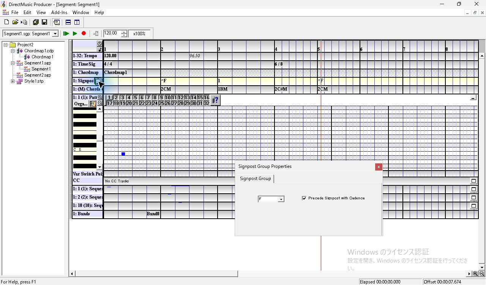

## Pattern の Recompose on Play と Recompose on Loop

第3小節の **1BM** を選択し、Chord Properties のルートの上スピンを1回押して **2CM** に変更し、比較の基準として保存した。Signposts ヘッダーを選択して F11 を押すと **Signpost Track Properties** が開く。**Flags** タブの左下 **Compose** には **Recompose on Play** と **Recompose on Loop** が別々のチェックとして並ぶ。両方オフで **Play From Start**（`174,88`）を押した対照では、第3小節を過ぎて停止した後も 2CM だった。 [オフで停止した撮影](../../../work/original-gui/SEG-14-compose-followup/20261111T160834141890Z/captures/44-flags-off-stopped-0.jpg) · [同梱ヘルプの Flags タブ](../../../../../work/analysis/original-manual-session/20261010T031624075Z/help-extracted/htm/flagstab.htm)

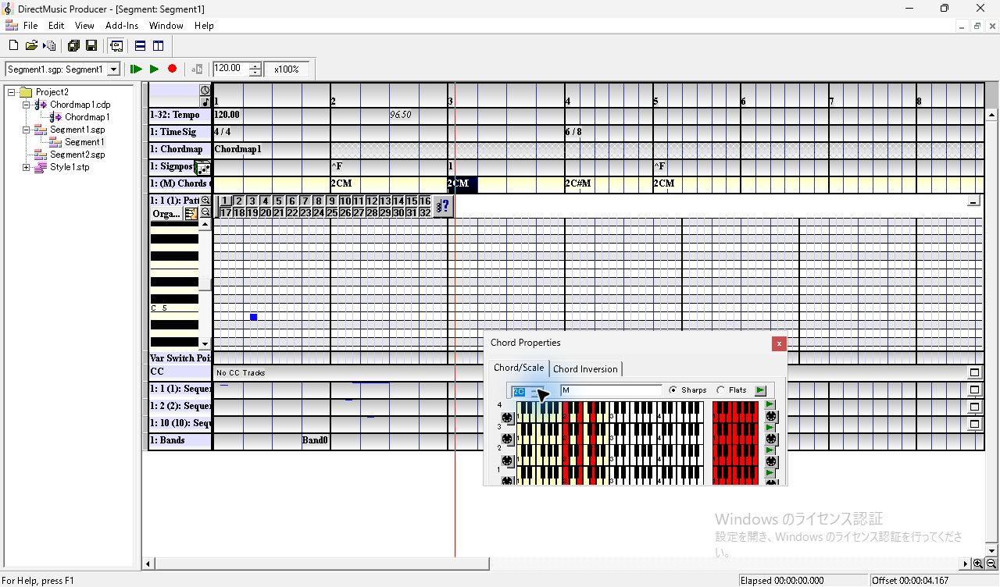

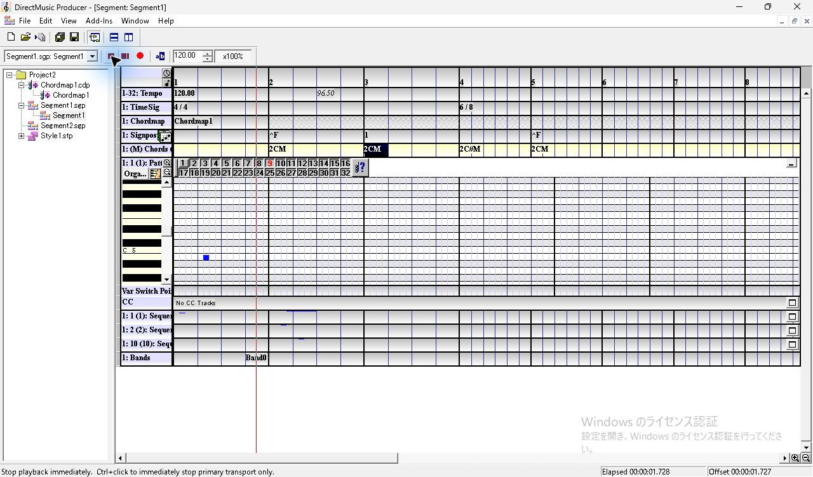

**Play だけをオン**にして保存し、Play From Start。再生中の Elapsed **4.414 s** の時点で第3小節は **1BM** に変わっていた。停止後も残り、Ctrl+S 後の保存値も 1BM。前後の保存版では同じ Play フラグが立ち、第3小節の4つのサブコードの root は **12 → 11**。第2・4・5小節のコードは小節・拍・root が一致した。 [Play 前](../../../work/original-gui/SEG-14-compose-followup/20261111T160834141890Z/captures/play-flag-before-Segment1.sgp) · [Play 後](../../../work/original-gui/SEG-14-compose-followup/20261111T160834141890Z/captures/play-flag-after-Segment1.sgp)

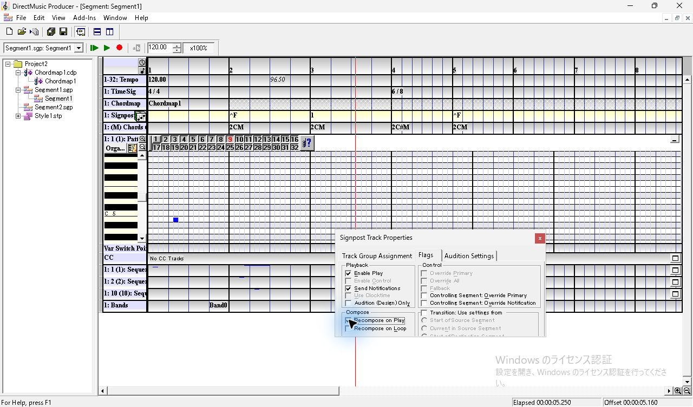

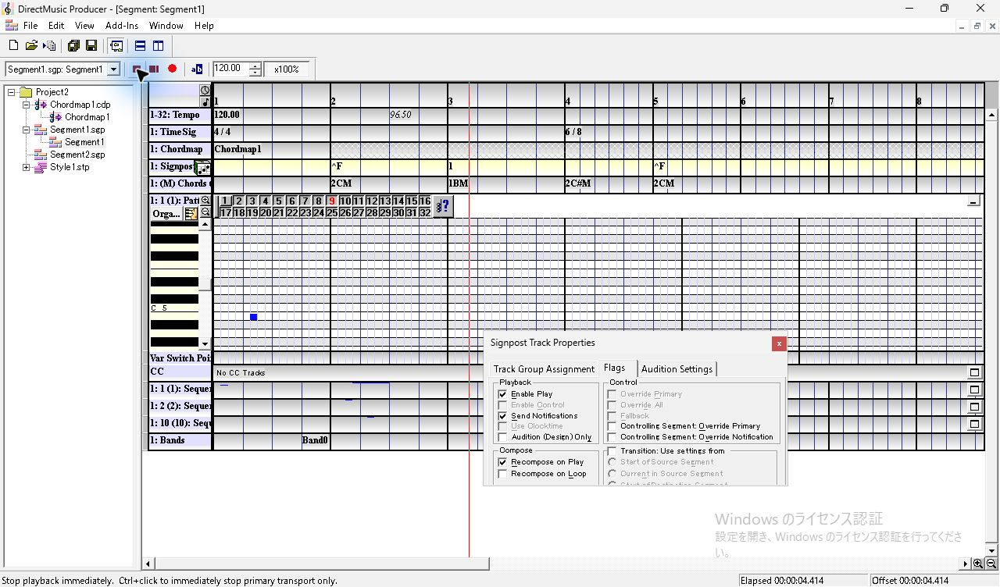

次に第3小節を 2CM に戻し、**Play をオフ、Loop をオン**。Segment の子ノードで **Segment Properties > Loop** を開き、**Repeat 1**、Start **1:1:1:0**、End **4:1:1:0** にした。Loop End の Bar は既存の2桁を Home → Shift+End で選んで数字キーで入力し、Tab で確定。保存のループ端点は **0〜9216 clocks**。

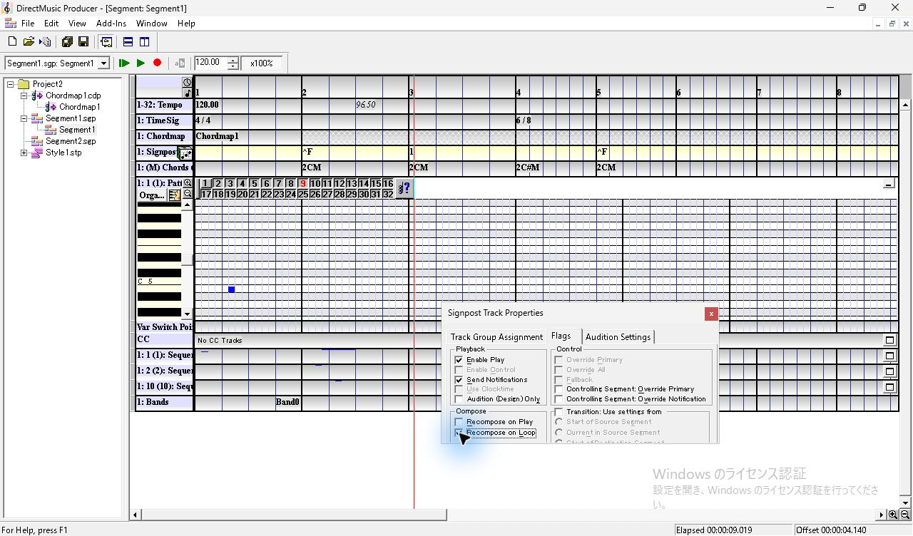

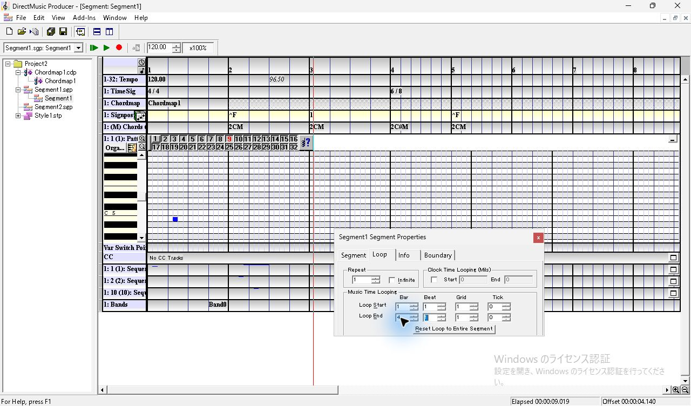

| Pattern の撮影点 | Elapsed | Offset | 第3小節 |
| --- | ---: | ---: | --- |
| 初回通過 | 4.095 s | 4.094 s | 2CM |
| 第1小節側に折り返した後 | 7.368 s | 1.319 s | 1BM |
| 停止して保存 | 11.510 s | 5.382 s | 1BM |

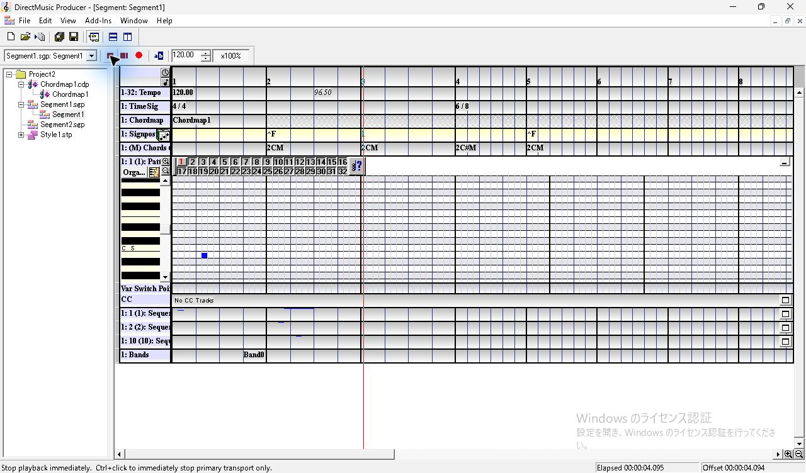

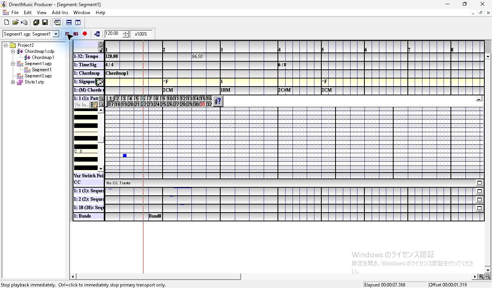

## Style の自動生成と同じグループの複数候補

Segment2 では既存の第2小節 **F** に、第3小節 **1** と第5小節 **^F** を追加。最初の Chords 行には第2小節の **2CM** だけがある。ヘッダーから **Recompose on Play** をオンにし、Play From Start。Elapsed **2.641 s** で、第3小節 **1BM**、第4小節 **2C♯M**、第5小節 **2CM** が増えた。停止・保存後にも4件。Tempo **121.00**、**Style1** と **Band1** はそのまま表示された。 [Style の Play 前](../../../work/original-gui/SEG-14-compose-followup/20261111T160834141890Z/captures/style-play-before-Segment2.sgp) · [Play 後](../../../work/original-gui/SEG-14-compose-followup/20261111T160834141890Z/captures/style-play-after-Segment2.sgp)

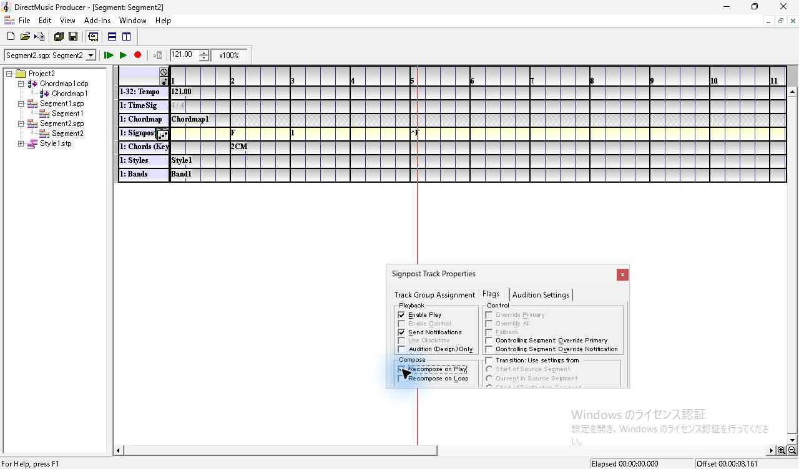

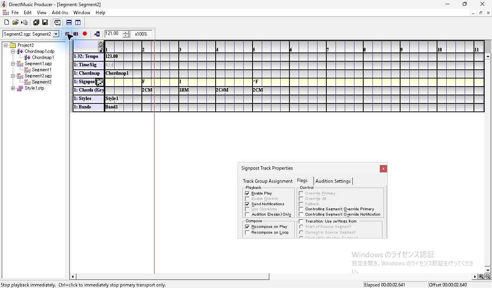

ChordMap の 1BM の行に **F** も付け、同じグループから選べるコードを **2CM と 1BM** の2件にした。Segment2 で手動 Compose を3回押した。この3回はいずれも第2・5小節に **2CM**、第3小節に **1BM**、第4小節に **2C♯M**。1回目と3回目に保存したファイルは全バイト一致した。別の追試で接続を1経路加え、長さと重みによる中間コードの変化、および C2 の位置を確認した。複数経路の優先順は追試する。 [2候補の ChordMap](../../../work/original-gui/SEG-14-compose-followup/20261111T160834141890Z/captures/map-two-f-candidates-Chordmap1.cdp) · [1回目の保存](../../../work/original-gui/SEG-14-compose-followup/20261111T160834141890Z/captures/style-candidate-one-Segment2.sgp) · [3回目の保存](../../../work/original-gui/SEG-14-compose-followup/20261111T160834141890Z/captures/style-candidate-three-Segment2.sgp) · [Chord Path と発音の比較](seg-14-chord-path.md)

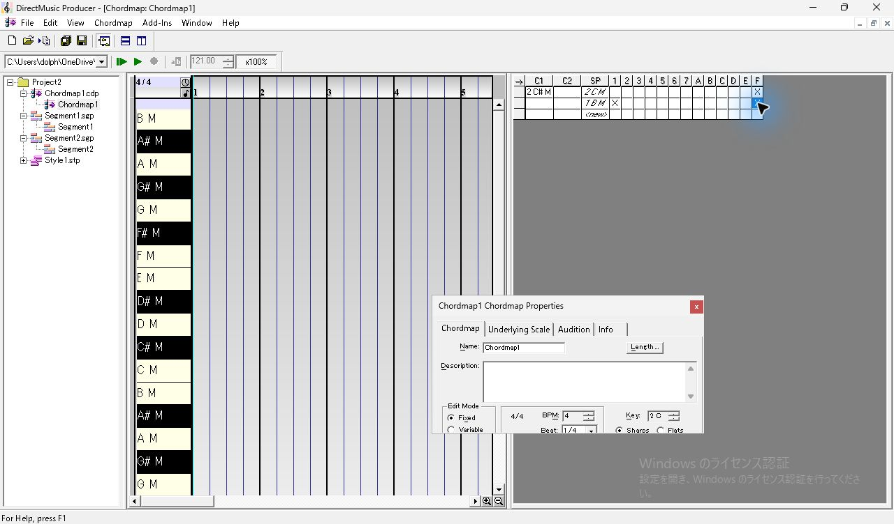

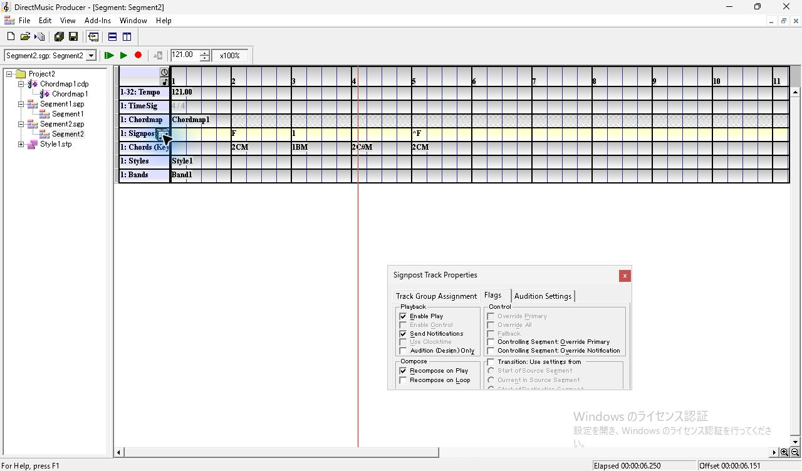

## 別起動での復元と、Style のループ試験

File > Exit で終了し、ChordMap 更新後の保存確認は作業コピーに対して **Yes All**。Producer が0件であることを確認して同じ EXE を再起動し、新しいウィンドウ1件で Project2 を開いた。第2〜5小節のコードとマーカーの表示、Pattern の **Loop**、Style の **Play** のチェックを確認した。 [通常終了後の0件](../../../work/original-gui/SEG-14-compose-followup/20261111T160834141890Z/captures/101-exited.json) · [再起動前後の記録](../../../work/original-gui/SEG-14-compose-followup/20261111T160834141890Z/captures/103-sky-relaunch.json)

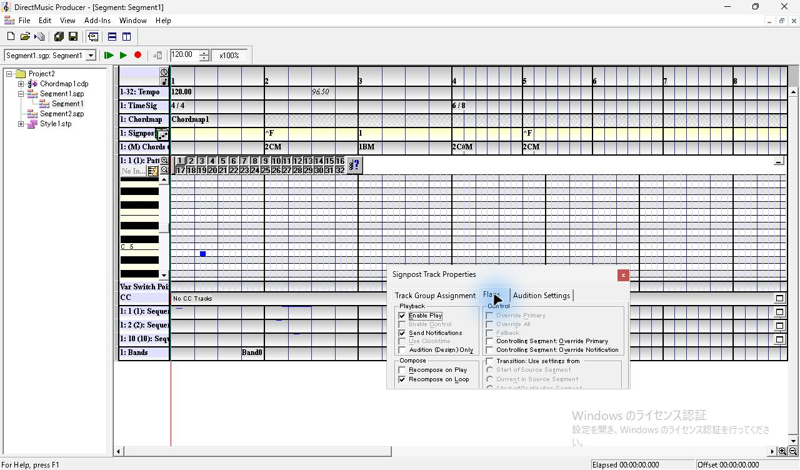

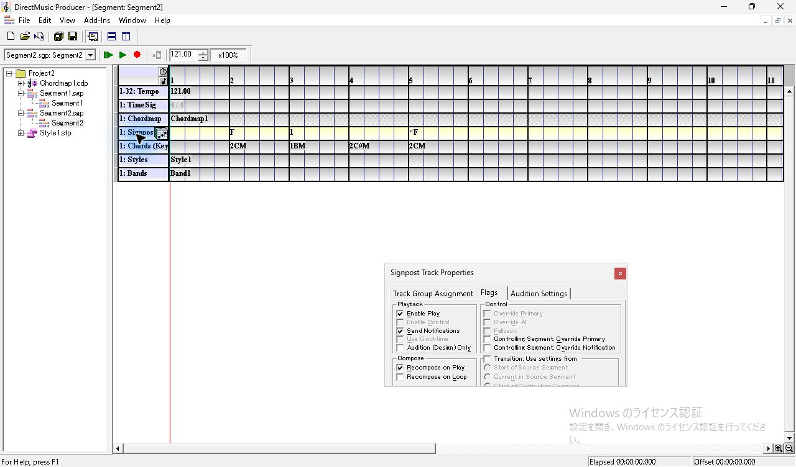

別起動後の Style で、同じ比較を実施。Play をオフ、Loop をオン、第3小節は手入力の 2CM。ループは **Repeat 1、1:1:1:0〜4:1:1:0** にした。Style の Loop End の Bar はダブルクリックで既存値を選択してから **4** を入力し、Tab。Elapsed **3.590 s**／Offset **3.589 s** の初回は 2CM。Elapsed **6.843 s**／Offset **0.892 s** へ折り返した画面で 1BM に更新。Ctrl+S の前後比較でも、第3小節の root が **12 → 11** に変わった。 [Style の Loop 前](../../../work/original-gui/SEG-14-compose-followup/20261111T160834141890Z/captures/style-loop-before-Segment2.sgp) · [Loop 後](../../../work/original-gui/SEG-14-compose-followup/20261111T160834141890Z/captures/style-loop-after-Segment2.sgp)

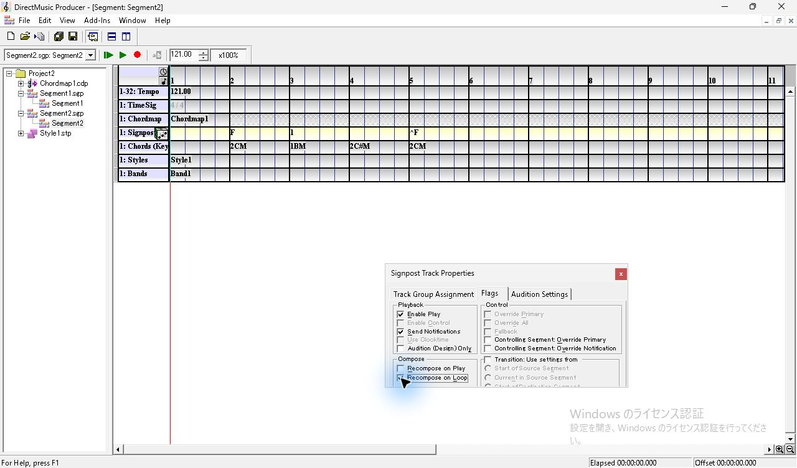

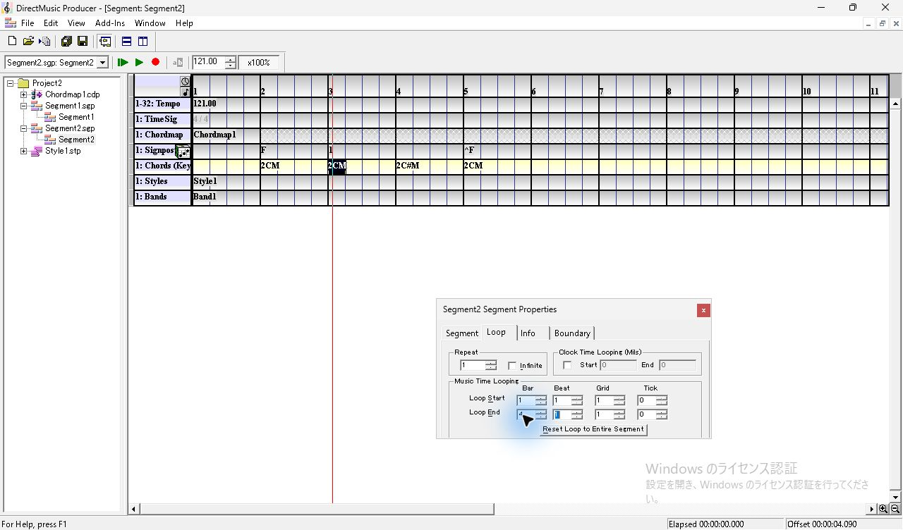

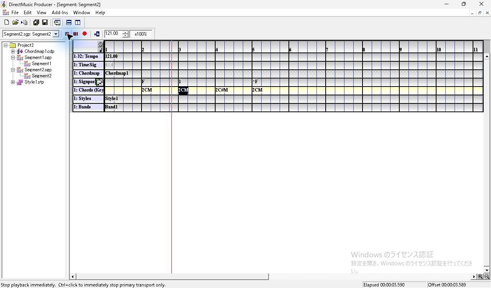

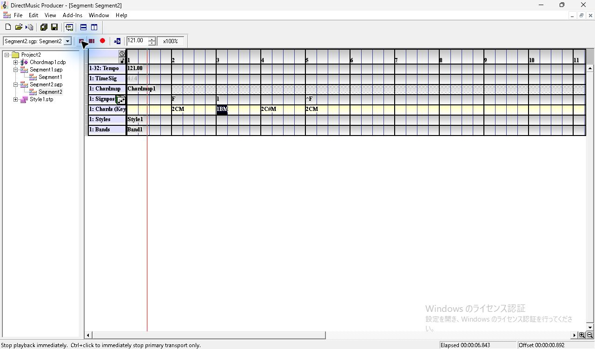

ChordMap でも、再起動後の C1 と2候補の割り当てを照合した。録音試行後に Project を閉じると Segment1 の保存確認が出たため、今回比較した保存版を保持するため **No All** を選んだ。Producer は1件で、Project を閉じた停止状態。 [終了時のウィンドウ](../../../work/original-gui/SEG-14-compose-followup/20261111T160834141890Z/captures/139-final-windows.json) · [次の試験用に凍結した5ファイル](../../../work/original-gui/SEG-14-compose-followup/20261111T160834141890Z/inputs/compose-followup-observed/manifest.json)

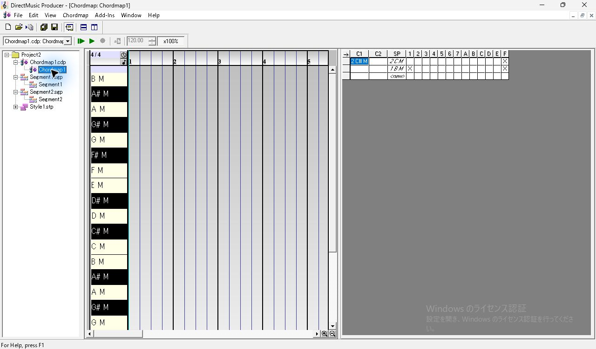

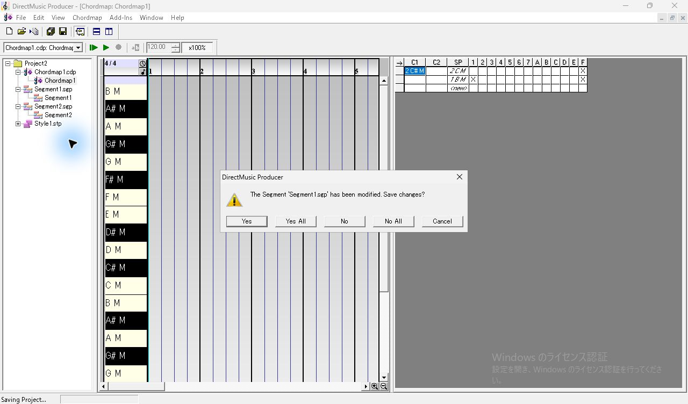

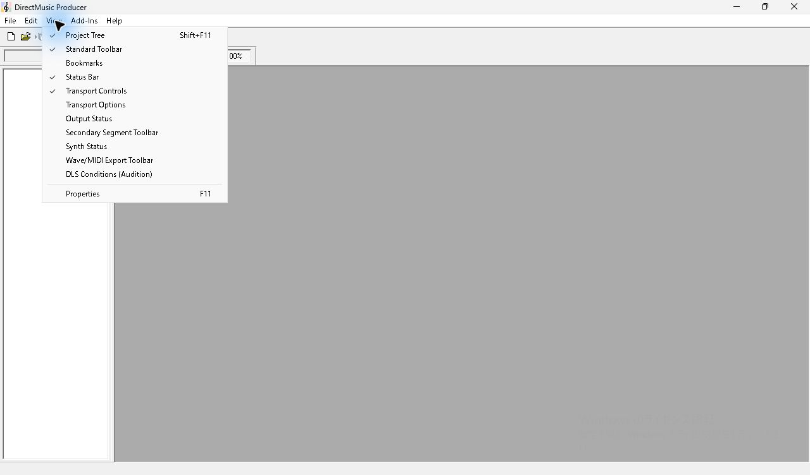

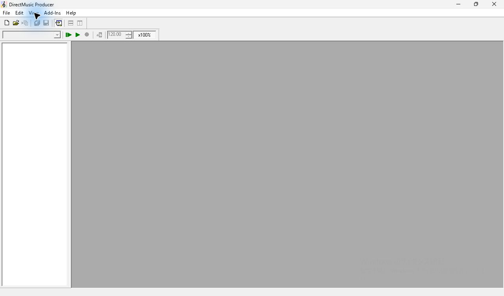

## 保存値と録音の照合

| 項目 | Pattern の Segment1 | Style の Segment2 |
| --- | --- | --- |
| Signpost の位置と表示 | 3072 **^F**、6144 **1**、11520 **^F** | 3072 **F**、6144 **1**、12288 **^F** |
| 生成後の Chord の位置と root | 3072 → 12、6144 → 11、9216 → 13、11520 → 12 | 3072 → 12、6144 → 11、9216 → 13、12288 → 12 |
| 第5小節の時刻の違い | 第4小節で 4/4 から 6/8 へ切替 | 4/4 |
| `trkx` の第1フィールド | 既定 **0x230**、Play のみ **0x2B0**、Loop のみ **0x330** | 同じ3値 |
| 第5小節のマーカー `sgnp` のフラグ | F は **0x0020**、^F は **0x8020** | ^F は **0x8020** |

録音は既定出力の WASAPI ループバックで、各22秒、48 kHz、32-bit float、2チャンネル。Pattern の試行は再生操作後に信号が始まり、ピーク絶対値は **0.322**。録音終了直前まで信号があり、停止後の余韻は未収録。Style の試行は全サンプルが0。今回の Style1 の Pattern には Part が1件あり、保存ファイルに音符レコードはなかった。後続の追試で同じ Style1 のコピーにノートを入れ、生成したコードによる音高差を MIDI と録音で照合した。 [Pattern の録音](../../../work/original-gui/SEG-14-compose-followup/20261111T160834141890Z/captures/audio-pattern-loop/output.wav) · [Style の録音](../../../work/original-gui/SEG-14-compose-followup/20261111T160834141890Z/captures/audio-style-loop/output.wav) · [16版の保存データ、ChordMap、録音の照合](../../../work/original-gui/SEG-14-compose-followup/20261111T160834141890Z/compose-followup-audit.json) · [ノートを加えた発音比較](seg-14-chord-path.md#同じノートで再生出力を比較)
