# SEG-14　Compose Chords と ChordMap の Signpost Group

2026-11-11。DirectMusic Producer 5.3.0.900 の調査用コピーで、[前回の Pattern・Style 編集後の Project2](../../../work/original-gui/SEG-14-pattern-style/20261111T074828536163Z/inputs/pattern-style-observed/manifest.json) を再利用した。起動中の Producer ウィンドウを1つ照合して操作を再開。メイン画面は開始時946×536 px、最大化後1280×752 px。ツールバーは通常の2段。青い光と黒い矢印は操作ツールの表示。 [実行記録](../../../work/original-gui/SEG-14-pattern-style/20261111T074828536163Z/run.json) · [原版撮影17枚の対応表](../../../work/original-gui/SEG-14-pattern-style/20261111T074828536163Z/published-compose-figures.json)

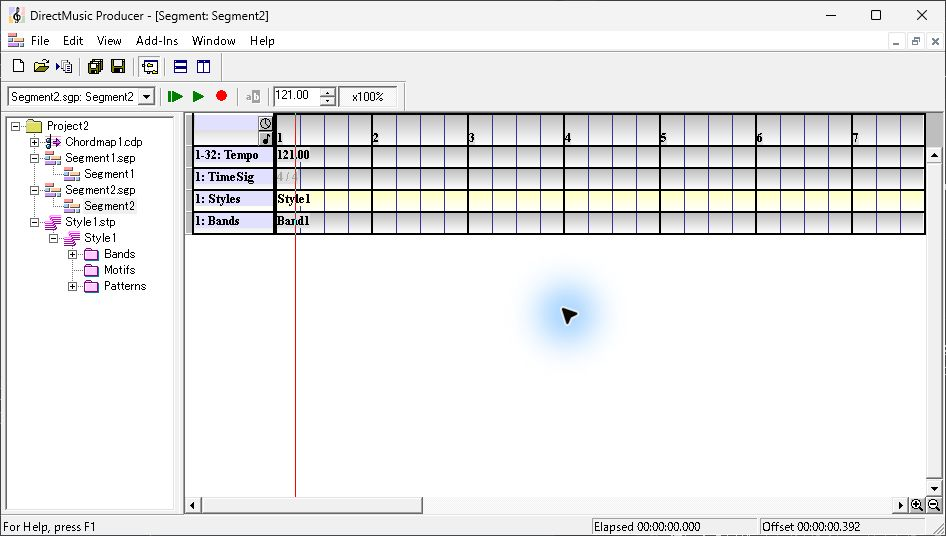

## ChordMap の候補不足

作業用 Project2 の Segment1 には、第1小節からの Chordmap1 参照、第2小節の Signpost **^F**、同じ小節の第2拍の **2DbM**、Pattern Track がある。Chordmap1.cdp の子ノードをダブルクリックすると ChordMap Designer が前面に出る。左は Chord Path、右の Signpost 表には **SP** 列の `<new>` だけがあり、既存の Signpost コードはなかった。

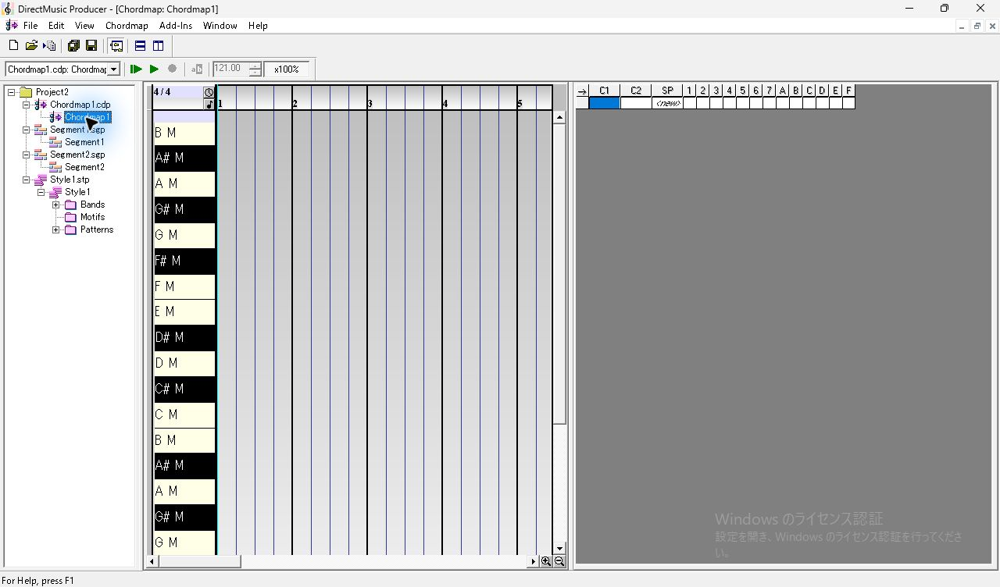

Segment1 の **Signposts** ヘッダー右端にある音符ボタン **Compose Chords** を押すと、Signpost Track の警告が出た。内容は ChordMap に Signpost と一致するコードが見つからないというもの。OK で閉じると既存の 2DbM が残った。[以前の試行](seg-14-chordmap-signpost.md) では Pattern と Style がない条件で、それらの追加を求める別の文面が出た。

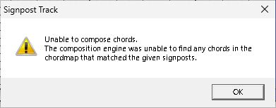

## グループ F を割り当てる

1. ChordMap Designer の **SP** 列で `<new>` をクリックする。**Signpost Chord Scale/Inversion Properties** が開き、右の表には既定の **2CM** が1行入る。
2. Properties を右上の × で閉じる。入力を変更しなくても 2CM は残り、その下に次の `<new>` が表示される。
3. 2CM の行の **F** 列をクリックする。クリックしたセルは青くなり、白い **X** が付く。Ctrl+S で Chordmap1.cdp を保存する。

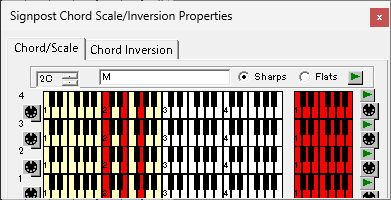
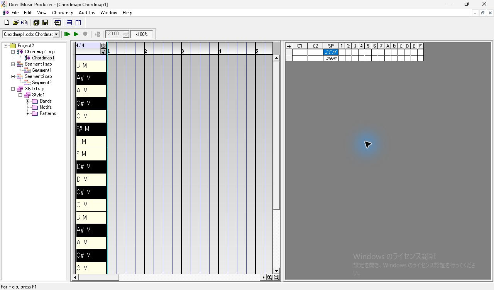
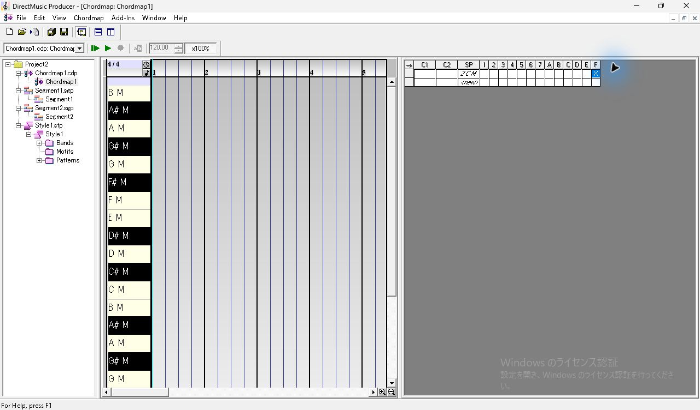

## Pattern を使った場合

Segment1 の子ノードから戻り、同じ Compose Chords ボタンを押した。追加の確認画面は出ず、第2小節第1拍に **2CM** が表示された。第2拍にあった **2DbM** は消えた。Signpost の **^F** と Pattern に入力済みの1音は維持された。

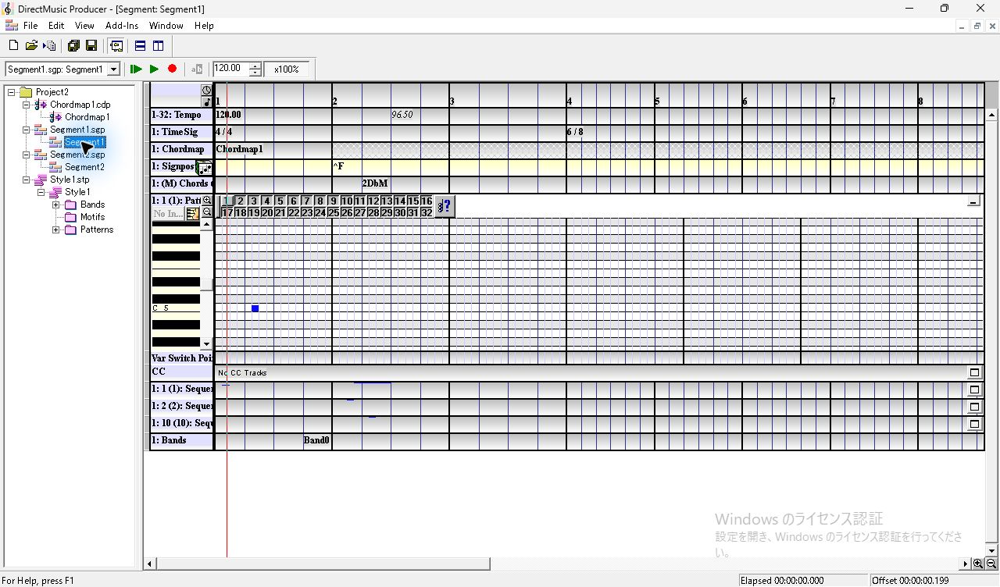
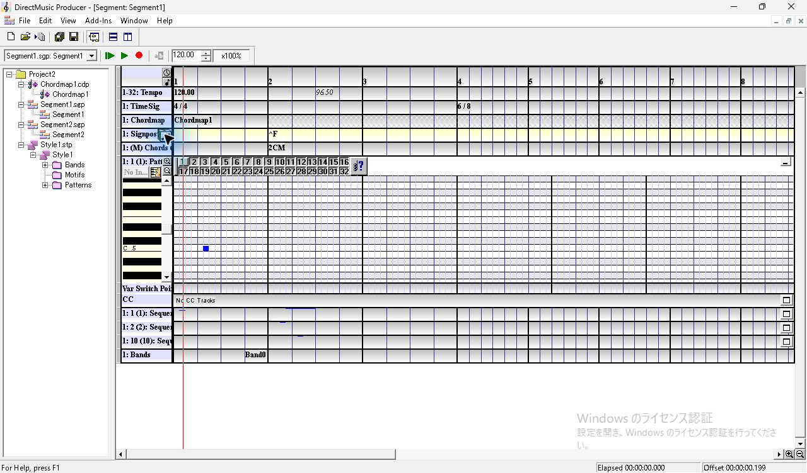

Timeline にフォーカスしたまま Ctrl+Z で 2DbM が第2拍に戻り、Ctrl+Y で 2CM が第1拍に戻った。生成・Undo・Redo の各状態で Ctrl+S し、保存値を比較した。

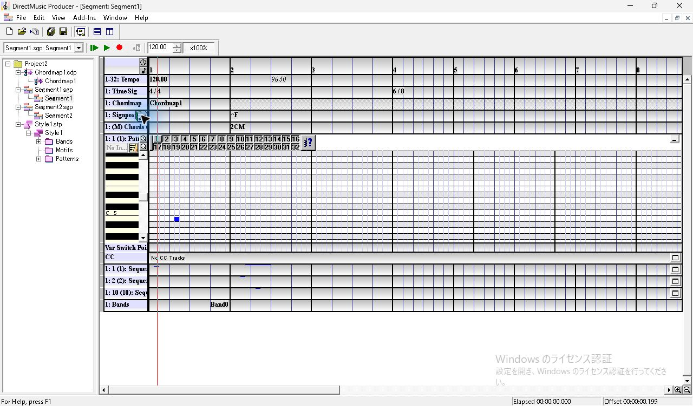

## Style を使った場合

Pattern と Chord Track がなく、Style1 を参照する Segment2 を使った。Chordmap Track と Signpost Track を追加する。Chordmap の第1小節で Insert を押し、候補 **Project2: Chordmap1 Major** を選ぶ。

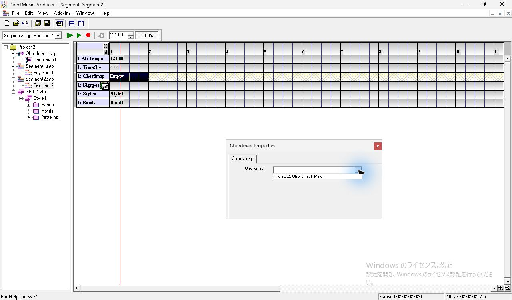

第2小節の Signpost セルを選ぶと、開いていたモデルレス Properties が **Signpost Group Properties** に切り替わった。挿入前は **None** で Cadence は灰色。Insert 後はグループ1が入って Cadence が有効になる。ドロップダウンを開き、End → Enter で **F** を選び、**Precede Signpost with Cadence** をオフのまま閉じた。

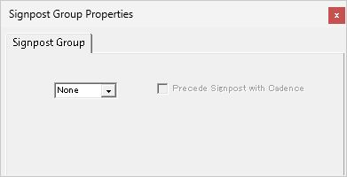
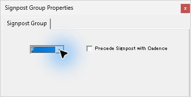

Compose Chords を押すと **Signposts** と **Styles** の間に **Chords** 行が現れ、第2小節第1拍に **2CM** が表示された。Ctrl+Z で Chords 行ごと消え、Ctrl+Y で行とコードが戻った。Style1、Tempo 121.00、Band1 は表示を維持した。

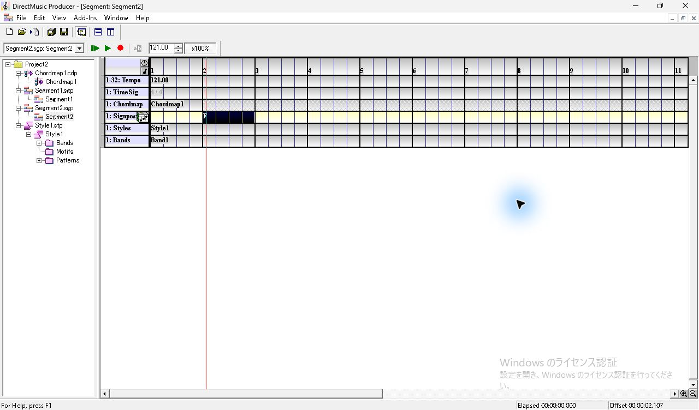
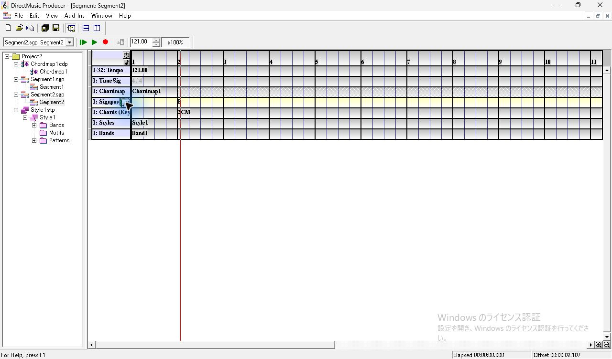
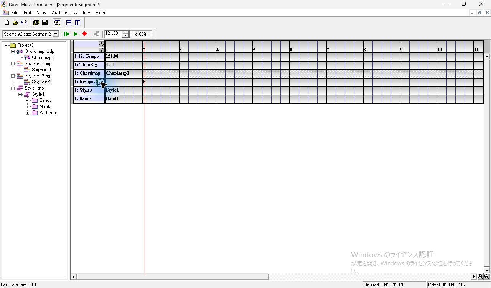
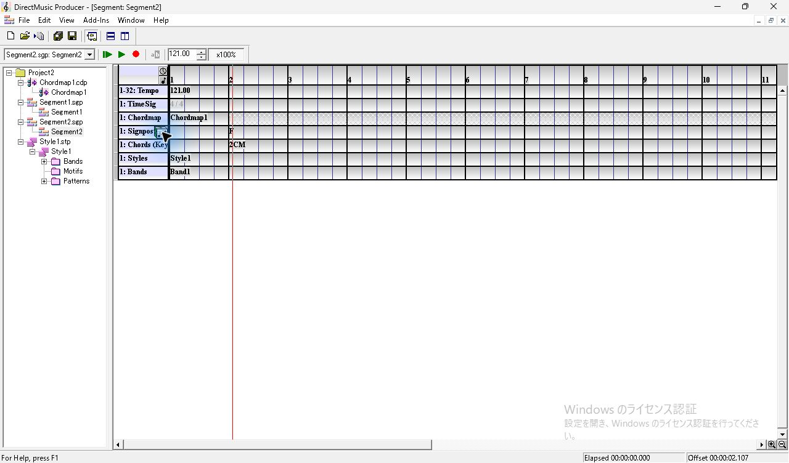

## 保存データの照合

| 条件 | 生成前 | 生成後 | Undo 後 | Redo 後 |
| --- | --- | --- | --- | --- |
| Pattern | 2DbM 1件。第2小節第2拍、3840 clocks、4サブコードの root 13 | 2CM 1件。第2小節第1拍、3072 clocks、4サブコードの root 12 | 2DbM 1件。位置と root が復元 | 2CM 1件。位置と root が復元 |
| Style | Chord Track なし | Chord Track を追加。2CM 1件、3072 clocks、4サブコードの root 12 | Chord Track が消え、生成前のファイルと全バイト一致 | Chord Track と 2CM が復元 |

Pattern の生成前と Undo 後ではコード名、拍、root が一致し、ChordMap 参照の日付とコードレコードの一部のバイトに差が残った。Redo で戻ったコードレコードも、初回生成との間で名前の終端より後ろのバイトが一部異なる。Style の Redo 後は同様の差に加え、トラック内に **trkx** が1件増えた。格納データの差分は JSON に残した。 [保存値・ハッシュ・差分](../../../work/original-gui/SEG-14-pattern-style/20261111T074828536163Z/compose-audit.json)

作業用 Project2 の5ファイルを追試用に凍結し、入力5ファイルのハッシュも照合した。このページは Signpost 1件と空の Chord Path の条件。追試では、複数の Signpost と同一グループの2候補、再生とループ時の自動生成、別プロセスでの再読込を確認した。Chord Path の接続と長さ、C1・C2、生成した和音による音高差も記録した。 [保存後の再現用素材](../../../work/original-gui/SEG-14-pattern-style/20261111T074828536163Z/inputs/compose-observed/manifest.json) · [複数 Signpost の追試](seg-14-compose-chords-followup.md) · [Chord Path と発音の比較](seg-14-chord-path.md)
