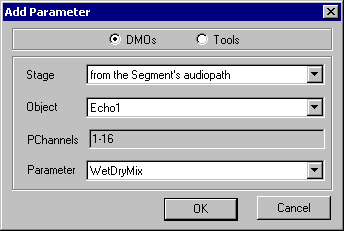
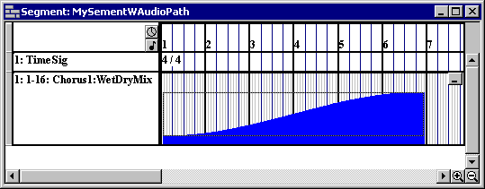
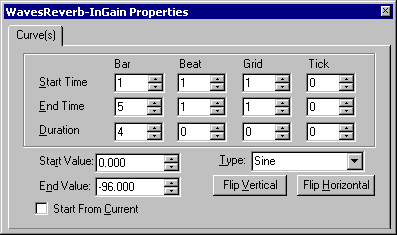
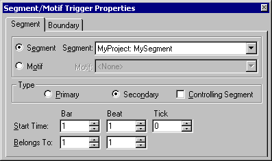
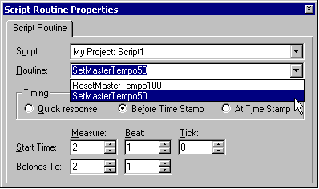
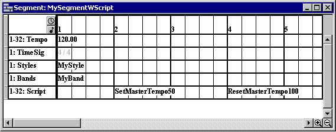

# SEG-14　Parameter Control、Segment Trigger、Script の入口と試験素材

[調査計画](README.md) · [Script Designer と Message Window](ui-10-script-designer.md) · [Pattern と Style の素材](seg-14-pattern-style.md)

`Add New Tracks` に `Parameter Control Track`、`Segment Trigger Track`、`Script Track` があることは原版の [トラック追加画面](seg-01-creation.md) で確認済み。この資料の図は原版同梱の HTML Help。現行調査用コピーで各ストリップを追加した後の外観と操作は追試待ち。 [画像対応表](../../../work/original-gui/SEG-14-control-triggers-script/20261111T081051527595Z/published-help-figures.json) · [FarmGame の保存値](../../../work/original-gui/SEG-14-control-triggers-script/20261111T081051527595Z/farmgame-script-and-audiopath.json)

## Parameter Control の追加と曲線

原版ヘルプの手順では、行を右クリックし `Add New Parameter` を選ぶ。 `Add Parameter` ダイアログの上部に `DMOs` と `Tools` のラジオ。 `Stage`、`Object`、読み取り専用の `PChannels`、`Parameter` が縦に並び、下部に OK と Cancel。図の設定は `from the Segment's audiopath`、`Echo1`、`1-16`、`WetDryMix`。Stage の選択によって参照する AudioPath や ToolGraph が変わり、Object の選択で対象チャンネルと Parameter の候補が決まる。 [パラメーター追加の手順](../../../../../work/analysis/original-manual-session/20261010T031624075Z/help-extracted/htm/toaddaparametertotheparametercontroltrack.htm)

追加した Parameter ごとに個別選択できるストリップが増える。Track Group Assignment と Flags はトラック内で共通。Object タブは選択中のストリップの対象名と PChannels を表示する。展開状態でストリップを右クリックし `Draw Curve` を選び、ドラッグで長方形を置く。ヘルプ図では `Chorus1:WetDryMix` の曲線が青い面で表示され、右端に折りたたみボタンがある。 [Parameter Control Track](../../../../../work/analysis/original-manual-session/20261010T031624075Z/help-extracted/htm/parametercontroltrack.htm) · [Track Properties](../../../../../work/analysis/original-manual-session/20261010T031624075Z/help-extracted/htm/parametercontroltrackproperties.htm) · [曲線の挿入](../../../../../work/analysis/original-manual-session/20261010T031624075Z/help-extracted/htm/toinsertaparametercontrolcurve.htm)

曲線の Properties には Start Time、End Time、Duration、Start Value、End Value、Start From Current、Type、Flip Vertical、Flip Horizontal。Type の候補は Sine、Logarithmic、Exponential、Instant、Linear。ヘルプでは Start Time を変えると長さを保って End Time が動き、End Time を変えると開始を保って長さが動く。Clock Time では時刻欄の末尾がミリ秒になる。複数選択で値が異なると数値欄は破線、チェック欄は中間状態になり、変更は選択中の曲線に適用される。 [Parameter Properties](../../../../../work/analysis/original-manual-session/20261010T031624075Z/help-extracted/htm/parameterproperties.htm)

追試では [FarmGame の作業コピー](../../../work/original-gui/SEG-14-pattern-style/20261111T074828536163Z/inputs/farmgame/manifest.json) の `APFarm.aup` を用意する。保存ファイルは AudioPath `APFarm` と Echo `Echo1` を含む。対象のバッファ GUID は先頭の Mix Group と一致する。図の PChannels 1–16 はヘルプの例で、FarmGame の対象表示は現行原版で確認する。AudioPath のない状態、既定・埋め込みの候補差、Cancel と OK、曲線1件と複数選択、端のホバー・ドラッグ、保存と別起動を記録する。

## Segment Trigger の参照と Boundary

ヘルプ図の `Segment/Motif Trigger Properties` は Segment と Boundary の2タブ。Segment ページの上段で Segment または Motif を選ぶ。Segment のときは参照先の Segment 一覧、Motif のときは Style と Motif を指定する。Type は Primary と Secondary、右に Controlling Segment。下の Start Time は Bar・Beat・Tick、Belongs To は Bar・Beat。Boundary はトリガー時の境界を上書きする設定。トリガーのプロパティは参照先文書の設定と独立している。 [Segment Trigger Track](../../../../../work/analysis/original-manual-session/20261010T031624075Z/help-extracted/htm/segmenttriggertrack.htm) · [Segment/Motif Trigger Properties](../../../../../work/analysis/original-manual-session/20261010T031624075Z/help-extracted/htm/segmentmotiftriggerproperties.htm) · [Track Properties](../../../../../work/analysis/original-manual-session/20261010T031624075Z/help-extracted/htm/segmenttriggertrackproperties.htm)

追試は専用 Project の2本の Segment から始め、元と参照先を別の名前・内容にする。参照未設定、候補の選択・取消、Secondary と Controlling Segment の有効状態、Start Time を変更したときの Belongs To、Boundary の既定と上書き、Undo・別起動の順に撮る。Motif は [QuickStart の Heartland](ui-04-style-motif.md) で候補がある状態を用意する。主従の再生、移動と音の開始は表示・保存とは別に観測する。

## Script Track の呼び出しと時刻

ヘルプでは、挿入直後に Script と Routine を選択するまでは Timeline のラベルが `<None>`。 `Script Routine Properties` の Script は Project 内のスクリプト、Routine は選択した Script のルーチン。Timing のラジオは `Quick response`、`Before Time Stamp`、`At Time Stamp`。Start Time は Measure・Beat・Tick、Belongs To は Measure・Beat。ヘルプの Timeline 例は小節2と4の先頭にルーチン名を表示する。ヘッダーからの Track Properties は Track Group Assignment と Flags。 [Script Track](../../../../../work/analysis/original-manual-session/20261010T031624075Z/help-extracted/htm/scripttrack.htm) · [Script Routine Properties](../../../../../work/analysis/original-manual-session/20261010T031624075Z/help-extracted/htm/scriptroutineproperties.htm) · [Track Properties](../../../../../work/analysis/original-manual-session/20261010T031624075Z/help-extracted/htm/scripttrackproperties.htm)

追試は [FarmGame の作業コピー](../../../work/original-gui/SEG-14-pattern-style/20261111T074828536163Z/inputs/farmgame/manifest.json) の `FarmMusic.spp` を利用する。静的に確認した12ルーチンのうち `dmSSBird` と `dmSfxAlarm` のように名前の異なる候補を使い、Script 選択前後の Routine 候補、ラベル、時刻、Undo と別起動を確認する。Timing の実行差はトレースのみを出す専用スクリプトを別に作り、再生時のメッセージを確認する。
