# SEG-14 DLS Region のループ方式と Note Off 後の再生

DirectMusic Producer 5.3.0.900 の調査用コピーで、FarmGame の **Ocarina** を Instrument Editor から開いた。Region の **Forward** と **Loop and Release** を原版で設定・保存し、同じ MIDI ノートで比較した。元の Ocarina と、区間ごとに周波数を変えた PCM の計5本の録音、1280×752 pxのスクリーンショット37枚を掲載する。 [入力と実行環境](../../../work/original-gui/SEG-14-dls-note-release/20261112T034510468273Z/run.json) · [以前の DLS Editor 調査](ui-07-dls-wave-instrument.md)

## Instrument、Region、Wave の入口

1. Project Tree の **FarmGame.dlp** をダブルクリックすると **FarmGame** の下に **Instruments** と **Waves** が出る。**Instruments** を展開して **Ocarina** をダブルクリックすると、Instrument Editor が開いた。
2. 上段にはレイヤー行と鍵盤。DLS1 行の **OCARINA** の矩形は鍵域 **C6〜D#9** を覆う。Instrument は **MSB 0、LSB 1、Patch 0**。Region には **Wave Ocarina、Root C#7、Velocity Range 0〜127、Note Overlap Allowed** が出る。下段の Instrument Articulation は **Volume** のエンベロープ、**Pitch**、**Mod LFO** など。初期画面では **DLS1 Articulation** がオンで、**Vib LFO** と **Filter** が灰色だった。
3. Instrument のツリーを展開すると **Articulation** と **Regions**。Regions の子を選択して **F11** を押すと、右下に **Region Properties** が開く。**Region** タブには Phase Group、Multichannel、Wave の Attenuation、Fine Tune、Root Note の個別上書きが並ぶ。この例では Root Note が **C#7**。
4. **Sample/Playback** タブの初期値は **Override Wave Settings** オフ。**Sample Length 81438、Loop オン、Forward、Start 29198、Length 23176** が灰色で見える。Override をオンにするとループ方式と数値欄が有効になった。
5. 鍵盤上の Region を右クリックして **Properties** を選ぶ入口も確認した。その試行のメニューでは **Insert Region**、**Insert Layer** と **Properties** が有効、**Delete Region** と **Delete Layer** は灰色だった。

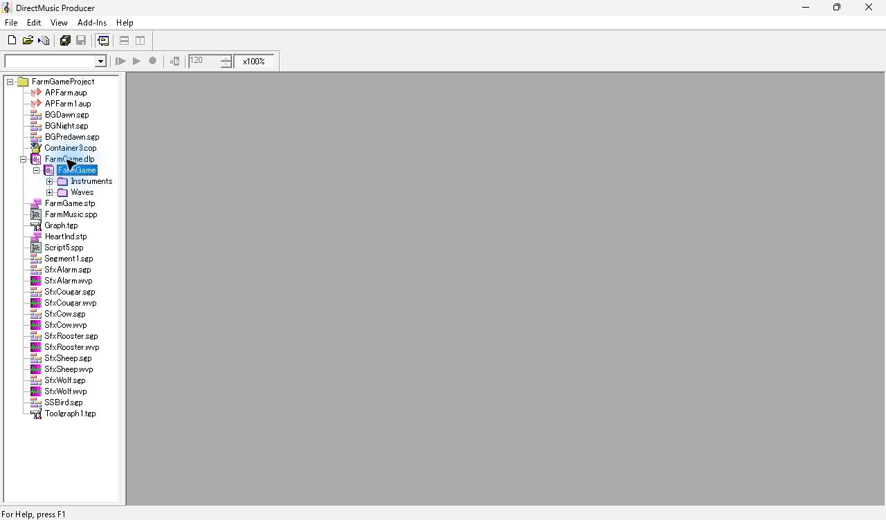
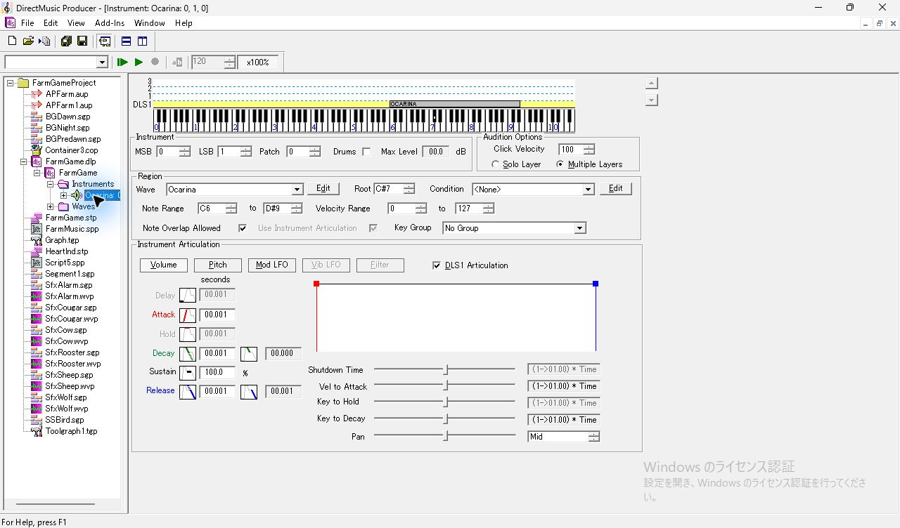
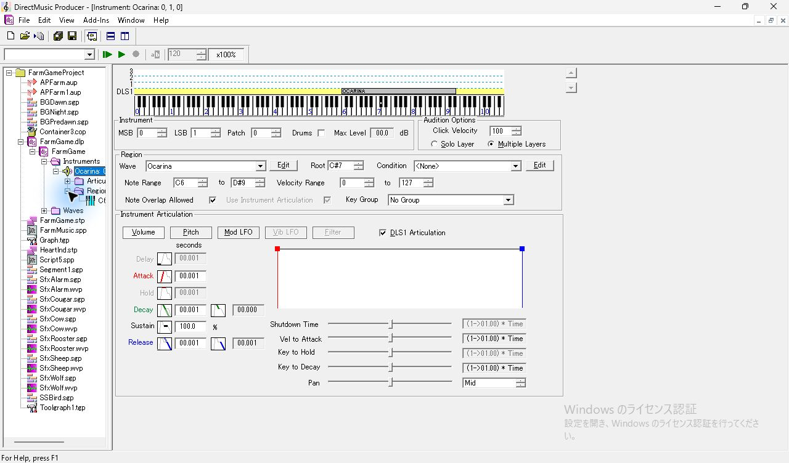
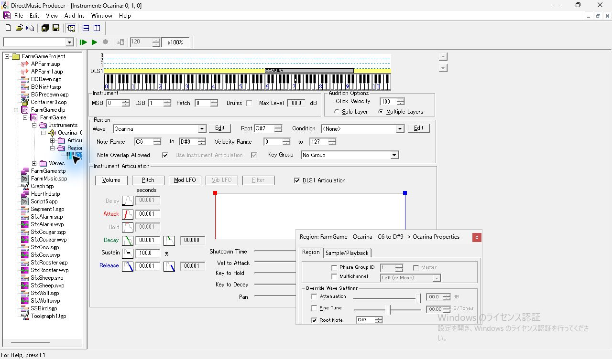
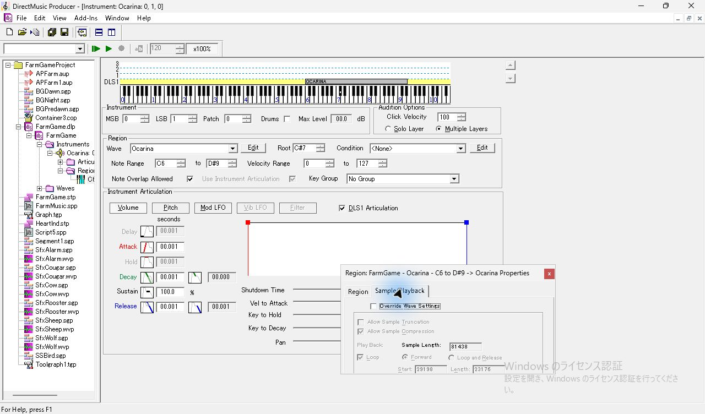
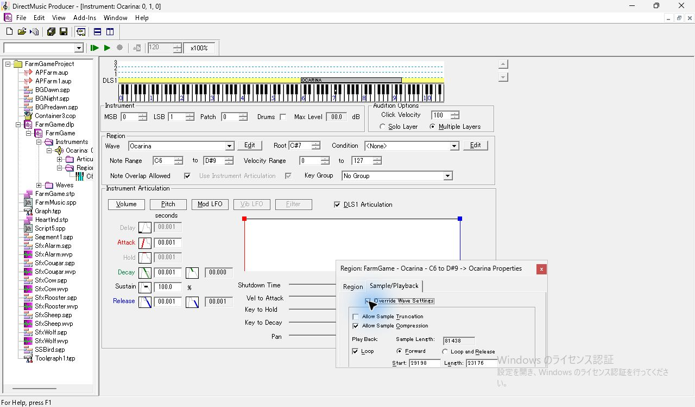
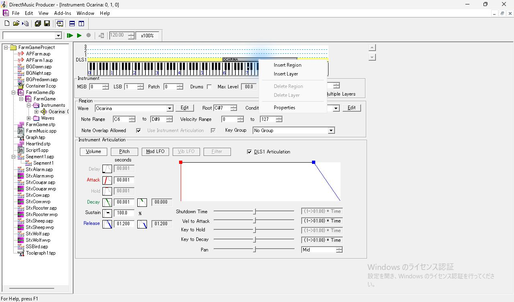

## 同じノートと範囲で保存・再生

原版の FarmGame.dlp を使い、Instrument Articulation の **Volume > Release** を **1.200秒** にした。Attack 欄は初期表示の **0.001秒** に戻してから録音した。保存値を秒へ換算すると Attack は約0.001499秒、Release は約1.199522秒。Forward と Loop and Release の両方に同じ保存値を使用した。Release の編集欄を確定すると、グラフ右側に青い減衰線が現れた。

**Ctrl+S** で Forward を保存。次に同じ Region の **Loop and Release** を選び、再び Ctrl+S。2つの DLP は163,628 bytesで、差は Region の `wsmp` 内のループ種別 **0 → 1** の1バイト（ファイル先頭から186バイト目、0起点）。両方とも Region Root 85、Start 29,198、Length 23,176。参照先 Wave の `wsmp` は Root 60、Forward のまま。PCM、Region の鍵域・速度域、Articulation、リンクは一致した。 [初期の DLP](../../../work/original-gui/SEG-14-dls-note-release/20261112T034510468273Z/inputs/FarmGameProject/FarmGame.dlp) · [原版が保存した Forward](../../../work/original-gui/SEG-14-dls-note-release/20261112T034510468273Z/captures/forward.dlp) · [原版が保存した Loop and Release](../../../work/original-gui/SEG-14-dls-note-release/20261112T034510468273Z/captures/loop-and-release.dlp)

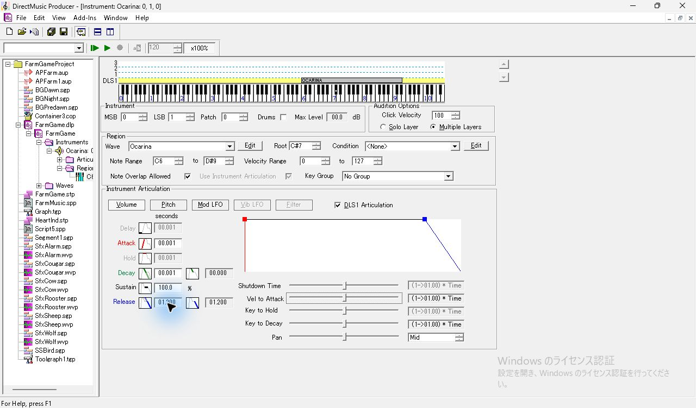
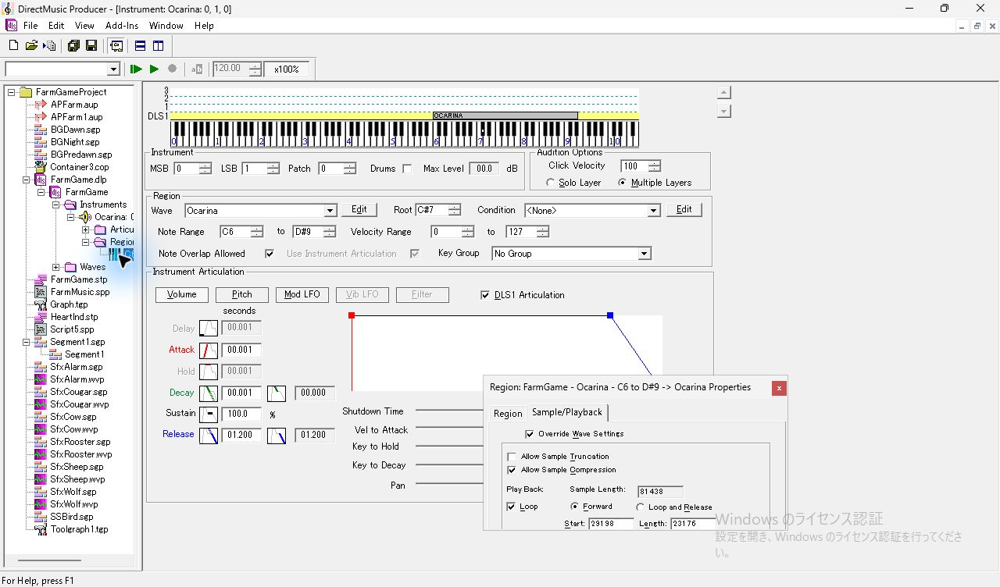
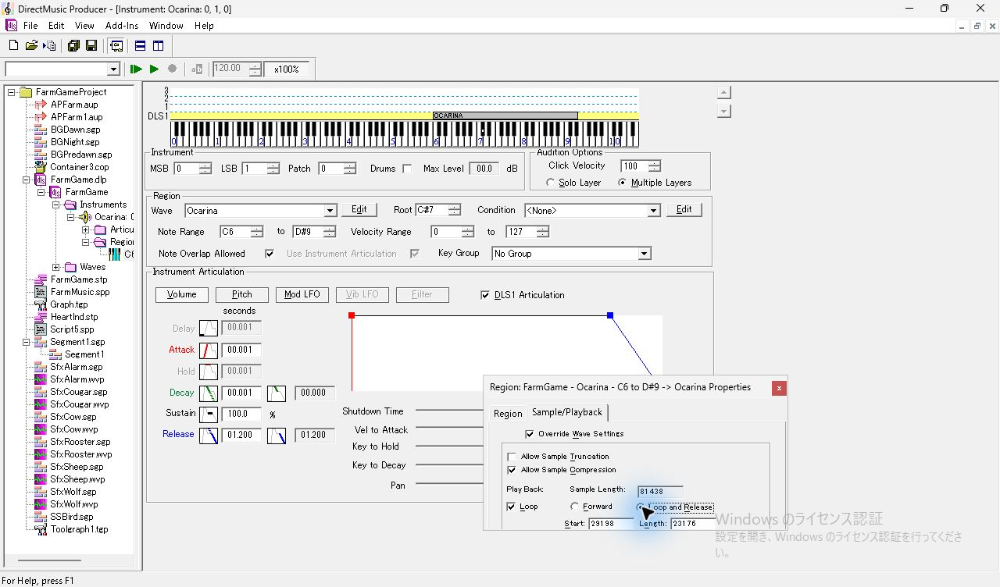
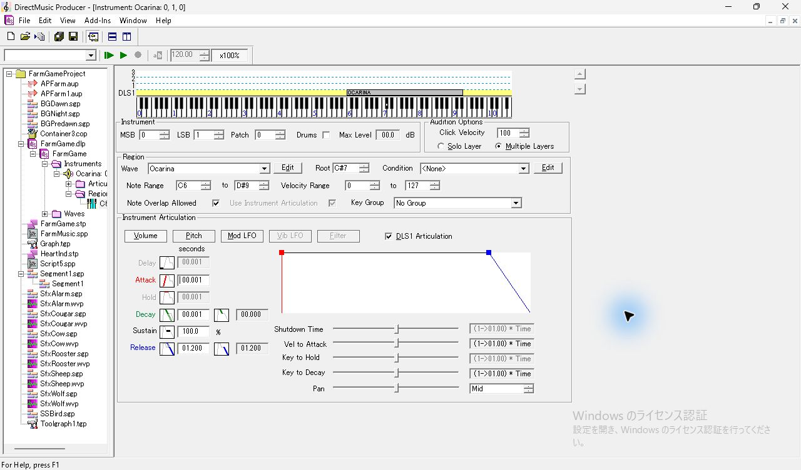

試験用の **Segment1** は120 BPM、4/4、5小節。Bands 行の最初に **DLS Note Off** を置き、**PChannel 1** に **Ocarina (DLS)** を割り当てた。Band 名の先頭付近をダブルクリックすると Band Editor の1行に割り当てが出た。Sequence のラベル上の PChannel 名は **Oboe**、楽器ボタンと鍵盤は Ocarina。鍵盤脇の縦スクロールつまみを上げると、C7の行のすぐ上に青い3ノートが見えた。 [入力 Segment1](../../../work/original-gui/SEG-14-dls-note-release/20261112T034510468273Z/inputs/FarmGameProject/Segment1.sgp) · [素材作成コード](../../../work/original-gui/SEG-14-dls-note-release/20261112T034510468273Z/prepare.py)

| ノート | Note On の音楽クロック | 長さ（クロック） | Note On | Note Off |
| --- | ---: | ---: | ---: | ---: |
| 1 | 768 | 576 | 0.500秒 | 0.875秒 |
| 2 | 5,376 | 2,304 | 3.500秒 | 5.000秒 |
| 3 | 9,984 | 2,688 | 6.500秒 | 8.250秒 |

各ノートは MIDI 85（原版表示 C#7）、Velocity 100、同じ Region のルート音。**Play From Start** から自然終了まで再生した。Note Off は Sequence のノート開始と長さから算出した位置。元の Ocarina で録音した両条件は、120.00と x100%、同じ3ノート、ほぼ10.01秒で自然終了。元 PCM の冒頭波形は6音で相関0.939以上。終端側の音を判別するため、続いて周波数の異なる試験 PCM を用いた。 [元の Ocarina・Forward](../../../work/original-gui/SEG-14-dls-note-release/20261112T034510468273Z/captures/forward-audio/output.wav) · [元の Ocarina・Loop and Release](../../../work/original-gui/SEG-14-dls-note-release/20261112T034510468273Z/captures/release-audio/output.wav) · [元の PCM の照合コード](../../../work/original-gui/SEG-14-dls-note-release/20261112T034510468273Z/diagnose-audio.py)

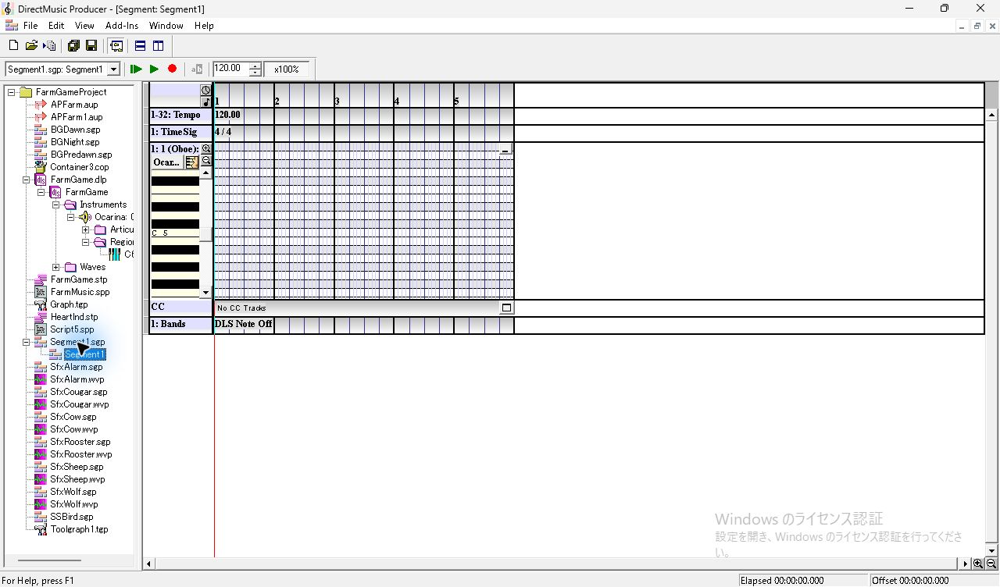
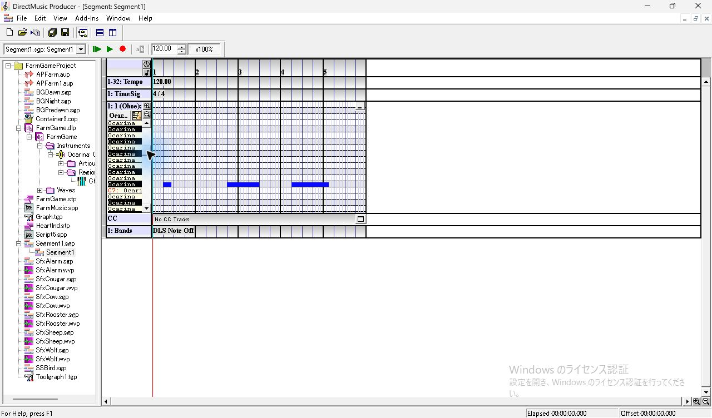
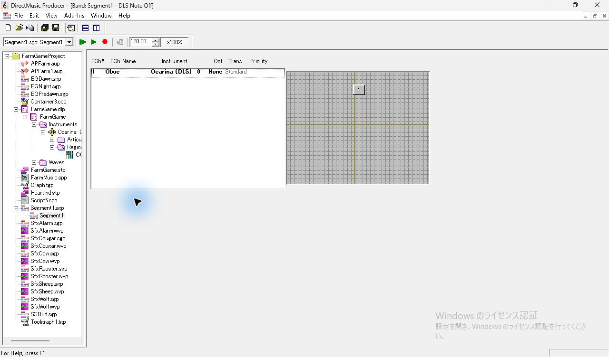
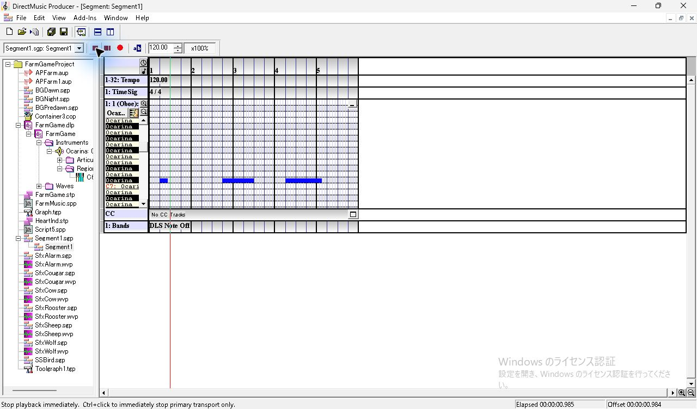
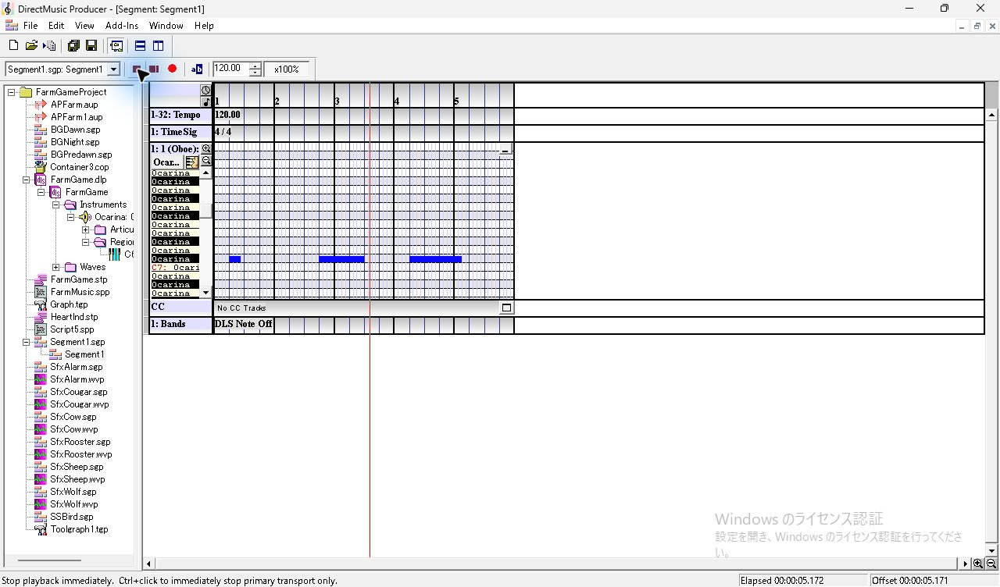
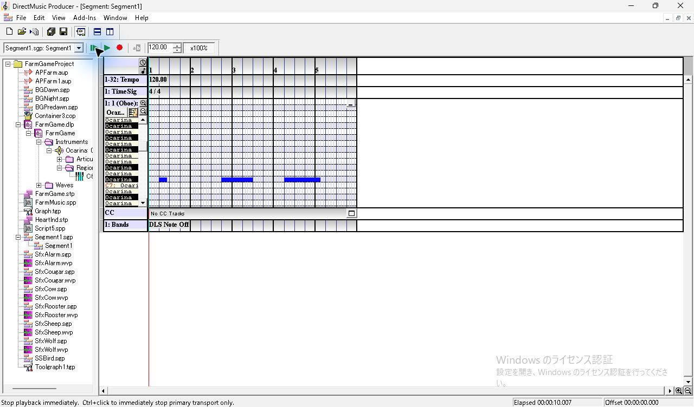
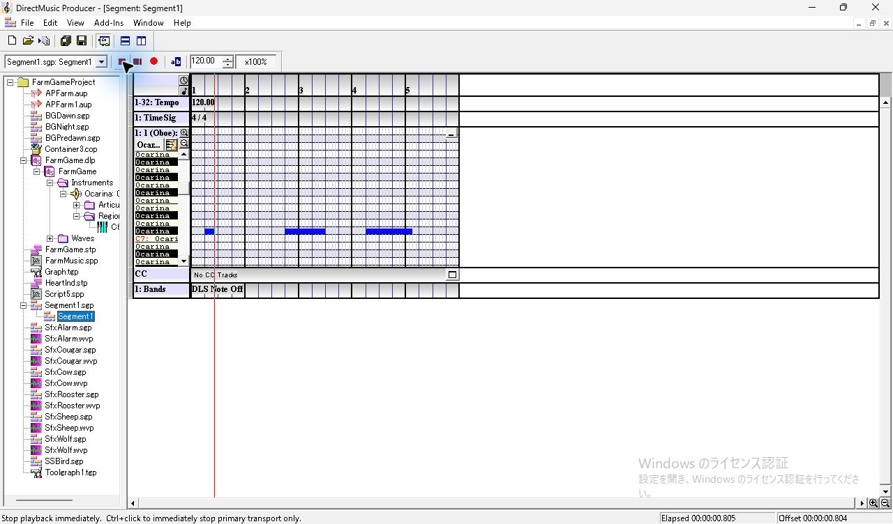

## Note Off 後に出る PCM の区間

元の DLP の **44,601 Hz、16-bit、Mono、81,438サンプル** とループ範囲を保ち、PCM のデータ領域に下表の3つの正弦波を入れた。各区間は同じ周波数の整数周期。Forward と Loop and Release は同じ PCM、同じ Segment と Articulation、別々の作業用 Project。Forward を閉じてから Loop and Release を開き、いずれも先頭から自然終了まで録音した。 [PCM と入力の生成条件](../../../work/original-gui/SEG-14-dls-note-release/20261112T034510468273Z/probe.json) · [PCM 生成コード](../../../work/original-gui/SEG-14-dls-note-release/20261112T034510468273Z/prepare-probe.py)

| PCM の区間 | サンプル範囲（終端を含む） | 周波数 |
| --- | ---: | ---: |
| 冒頭からループ開始の前 | 0〜29,197 | 432.293 Hz |
| ループ区間 | 29,198〜52,373 | 687.028 Hz |
| ループ終端の先 | 52,374〜81,437 | 1,134.054 Hz |

既定の Windows 出力を48 kHz、32-bit float、ステレオで録音した。各音の冒頭で2 ms窓の RMS が0.015を超えた位置を基準とし、左右平均を20 msの Hann 窓、5 ms間隔で3周波数に照合した。下表の「検出」は、1,134 Hz の振幅が0.0006を超え、同じ位置の Forward の8倍を超えた窓が4回連続した最初の窓の中心。理論上の終端は、初回のループ終端までの約1.174秒に、Note Off までに折り返した回数分の約0.520秒を加えた時刻。 [周波数の測定コード](../../../work/original-gui/SEG-14-dls-note-release/20261112T034510468273Z/measure-probe.py) · [各窓の振幅](../../../work/original-gui/SEG-14-dls-note-release/20261112T034510468273Z/frequency-probe-measurements.json)

| ノート長 | 発音開始からループ終端までの計算値 | Forward | Loop and Release |
| --- | ---: | --- | --- |
| 0.375秒 | 1.174秒 | 687 Hz が減衰。1,134 Hz は判定閾値未満 | 同じく687 Hz が減衰。終端より前にレベルが下がり、1,134 Hz は判定閾値未満 |
| 1.500秒 | 1.694秒 | 687 Hz が続いて減衰 | 1.690秒の窓から1,134 Hzを検出 |
| 1.750秒 | 2.214秒 | 687 Hz が続いて減衰 | 2.215秒の窓から1,134 Hzを検出 |

終端の計算値から10〜120 ms後の1,134 Hzの最大振幅は、1.500秒のノートで Forward **0.000149**、Loop and Release **0.020505**。1.750秒ではそれぞれ **0.000030**、**0.001650**。長い2音では Note Off の後も次のループ終端までは687 Hzが続き、Loop and Release でのみ終端側の成分が上の基準を満たした。録音から確認したのはこの PCM と Volume Release 1.200秒の組み合わせ。短いノートの終端以降と、聞こえるレベルで終端まで鳴り切る条件は未確認。 [試験波形・Forward](../../../work/original-gui/SEG-14-dls-note-release/20261112T034510468273Z/captures/probe-forward/output.wav) · [試験波形・Loop and Release](../../../work/original-gui/SEG-14-dls-note-release/20261112T034510468273Z/captures/probe-release/output.wav)

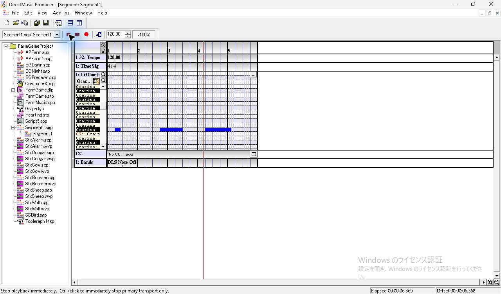

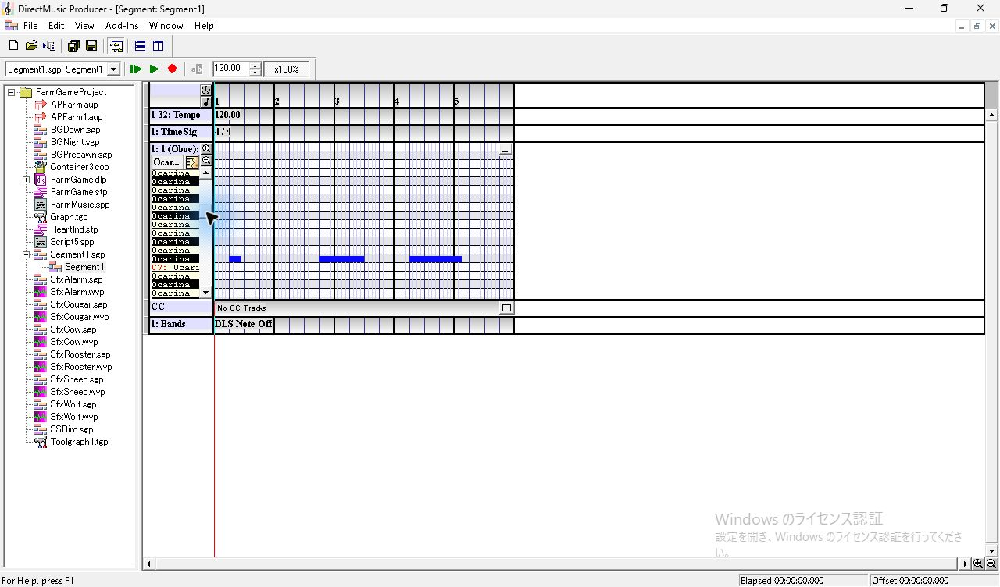

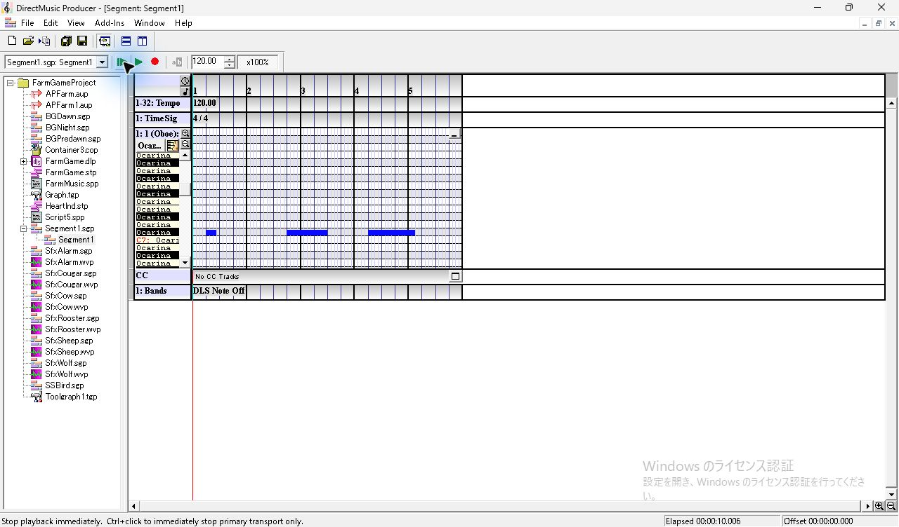

## 読み直した Region の表示と録音

Loop and Release の試験用 DLP を開いた直後の録音では、1.500秒と1.750秒のノートで1,134 Hzを検出した。その後に Region Properties を開くと、**Override Wave Settings はオフで、Forward のラジオボタンが灰色で選ばれていた**。鍵盤上の右クリックと Project Tree の Region 選択で同じ表示を確認した。DLP の Region のループ種別は1、Wave の既定値は0。

**Override Wave Settings** をオンにすると画面の **Forward** が有効になった。そのまま保存前に再度 Segment1 を再生したところ、1,134 Hzの成分は同じ1.690秒と2.215秒の窓から検出された。この操作後の DLP は保存せず、画面の Forward 表示から発音の方式を判定できない例として記録した。 [上書きを入れ直した直後の録音](../../../work/original-gui/SEG-14-dls-note-release/20261112T034510468273Z/captures/probe-reenabled/output.wav)

Region の Wave 欄の横にある **Edit** を押すと **Wave: Ocarina** が開き、Collection の **Waves** の子がツリーに出た。波形は白地に黒、緑の開始線と青の終端線。Zoom **1:128**。F11 で **Wave、Info、Compression/Streaming** を開ける。Wave タブの Root Note は **C5**、Forward、Start **29198**、End **52373**、Length **23176**。Info タブに **44601、16、81438** が並び、Compression/Streaming では **Compressed** がオフ、表示上の比率は **1:1.000000**、Streaming の下段は灰色だった。

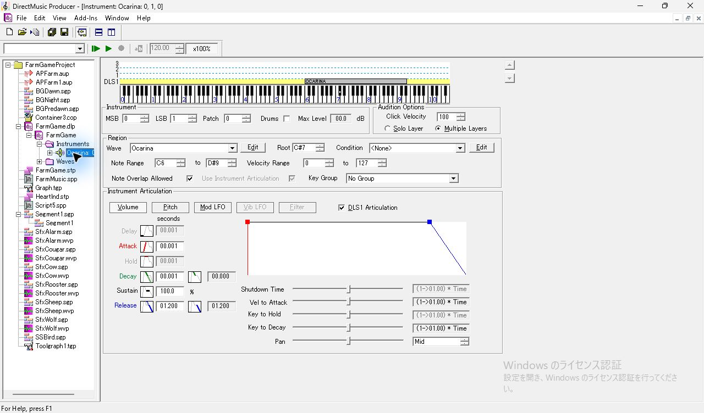
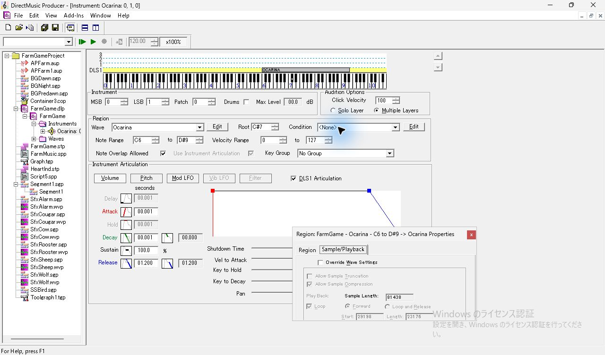
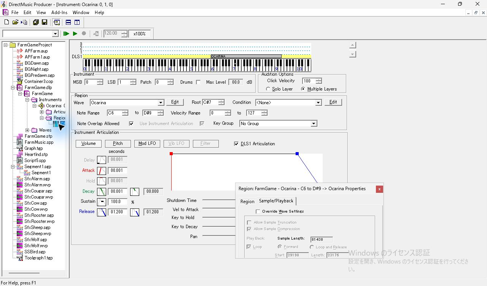
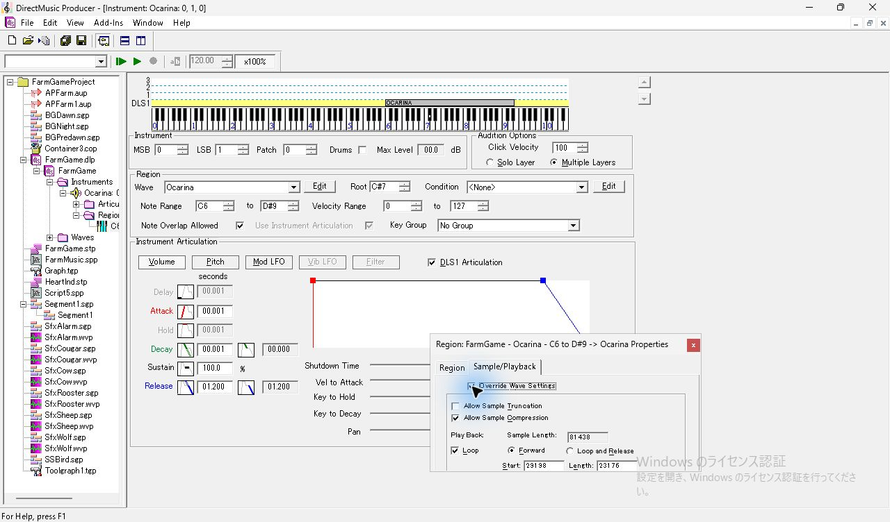

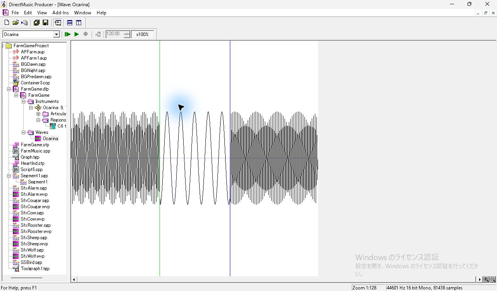
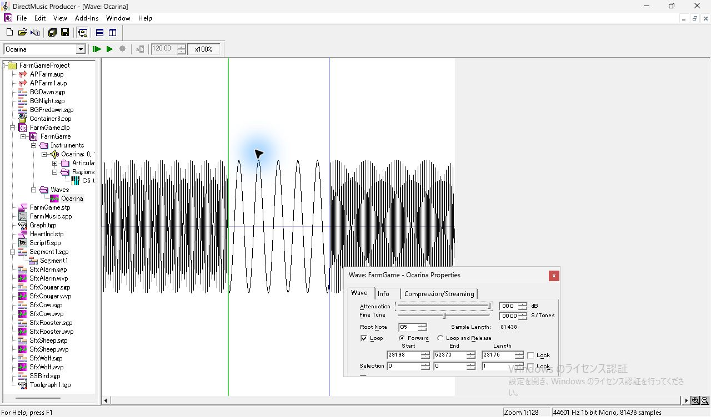
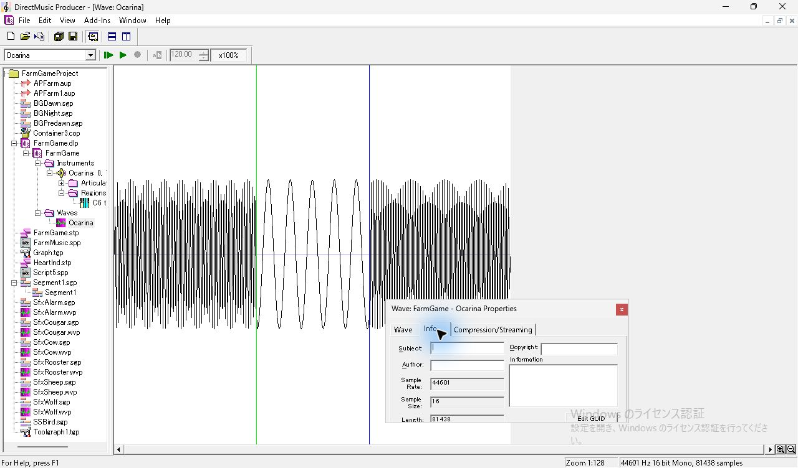
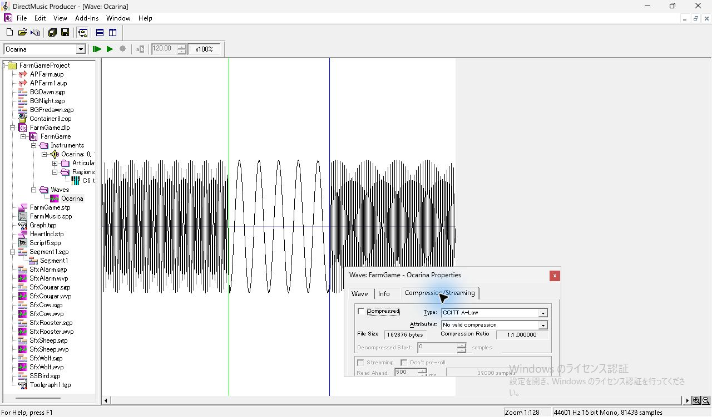

Close Project の保存確認では **No** を選択した。凍結した入力28ファイルと、各作業コピーで使った DLP・Segment を照合した。元の波形の作業コピーでは DLP と Project が変わり、周波数試験の作業コピーでは各 Project ファイルだけが変わった。最後は Producer 1件、Project を閉じ、x100%と View の標準4項目。青い光と黒い矢印は操作ツールの表示。 [保存・録音・素材の照合](../../../work/original-gui/SEG-14-dls-note-release/20261112T034510468273Z/audit.json) · [画像の出典とハッシュ](../../../work/original-gui/SEG-14-dls-note-release/20261112T034510468273Z/published-figures.json) · [最終ウィンドウ一覧](../../../work/original-gui/SEG-14-dls-note-release/20261112T034510468273Z/captures/80-final-windows.json)

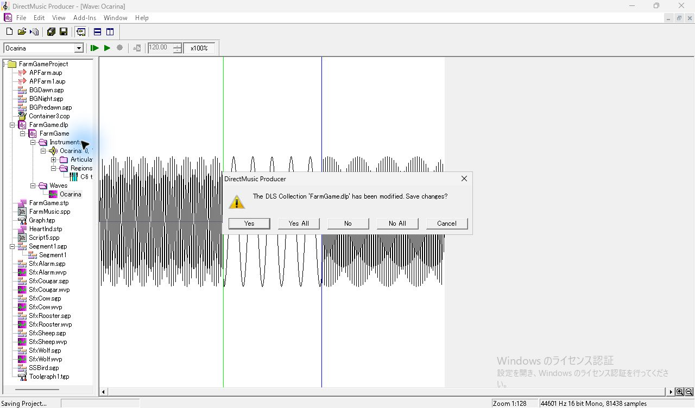
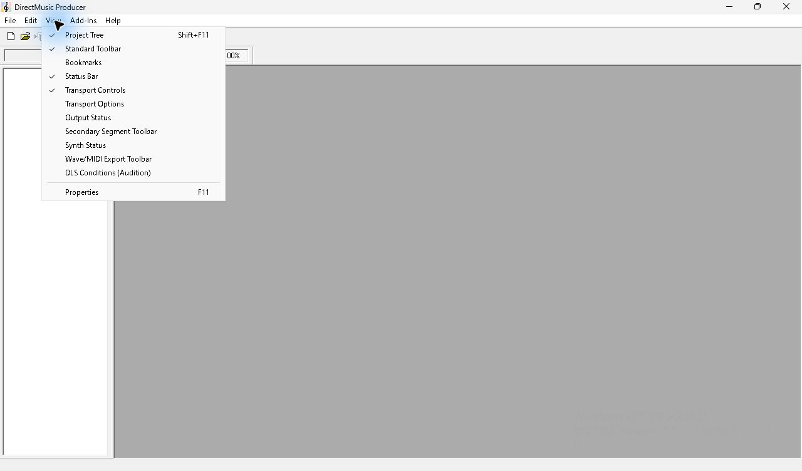
