# SEG-14　Script Track の FarmMusic とスクリプト言語

2026-11-12。DirectMusic Producer 5.3.0.900 の作業コピーで、同梱の FarmMusic が停止中の **Call Routine(s)** とタイムライン再生で異なる結果になる条件を調べた。**VBScript** の FarmMusic は手動で Trace と Alarm を出した。再生では、Play を含まないルーチンにも Trace が出なかった。**AudioVBScript** に切り替えて対応する構文に整えたコピーでは、再生中に Trace が出て Alarm も鳴った。 [前回の Timing 比較](seg-14-script-track-timing.md) · [実行ファイル、凍結入力、条件](../../../work/original-gui/SEG-14-farmmusic-playback/20261112T004434738685Z/run.json)

## 試験の組み立て

前回の BGPredawn を36小節に延長し、100 BPM、1/4、埋め込み AudioPath、先頭の Cougar の Wave を使った。Script 行の5件はすべて **Before Time Stamp**。各項目の論理・物理時刻は一致する。2種の Play には直前と直後に Trace を1行ずつ入れ、FarmMusic に Trace だけのルーチンを加えた。FarmMusic の Container と Script5 の Container は、それぞれ前回の参照を使った。 [試験素材の作成コード](../../../work/original-gui/SEG-14-farmmusic-playback/20261112T004434738685Z/prepare.py) · [凍結した試験用 Project](../../../work/original-gui/SEG-14-farmmusic-playback/20261112T004434738685Z/inputs/FarmGameProject/)

| 小節 | Script | Routine | ソース内の処理 | Cougar からの公称時刻 |
| ---: | --- | --- | --- | ---: |
| 8 | FarmMusic | `dmSfxAlarm` | Trace → `SfxAlarm.Play(IsSecondary)` → Trace | 4.2秒 |
| 14 | FarmMusic | `DmAlarmNow` | Trace → `SfxAlarm.Play(IsSecondary + AtImmediate)` → Trace | 7.8秒 |
| 20 | FarmMusic | `DmEntryOnly` | Trace 1行 | 11.4秒 |
| 26 | Script5 | `TrackRegular` | Trace → `SfxAlarm.Play(IsSecondary)` → Trace | 15.0秒 |
| 32 | Script5 | `TrackTrace` | Trace → `SfxAlarm.Play(IsSecondary + AtImmediate)` → Trace | 18.6秒 |

各 Project の Tree から **BGPredawn.sgp** を開き、右下の横ズーム縮小を4回押すと、左上から36小節と5件が見える。**Add-Ins > Message Window** を開き、タイトルバーで右下へ移してタイムラインを空けた。再生には Transport 左側の **Play From Start** を使い、毎回約21.6秒で自然終了した。赤い再生線の通過後、次の項目に達する前に撮影した。この環境の Trace は Message Window で連番だけが見える。掲載17枚は1280×752 px、青い光と黒い矢印は操作ツールの表示。 [全103枚の撮影記録](../../../work/original-gui/SEG-14-farmmusic-playback/20261112T004434738685Z/captures/) · [掲載画像の出典とハッシュ](../../../work/original-gui/SEG-14-farmmusic-playback/20261112T004434738685Z/published-figures.json)

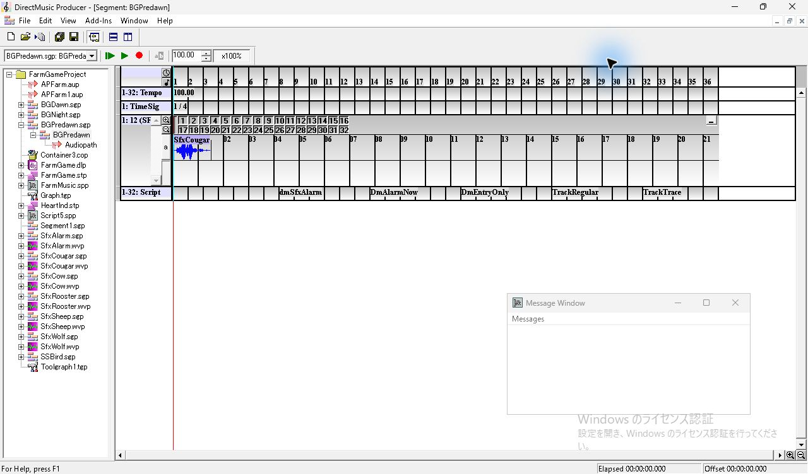

## 基準の言語指定と手動呼び出し

FarmMusic は **VBScript**、Script5 は **AudioVBScript**。FarmMusic の3件を通過した時点で Message Window は空。次の `TrackRegular` で2行、最後の `TrackTrace` で2行が増えた。録音では Script5 の2件の位置に Alarm の波形があり、FarmMusic の2件の Play 区間は RMS が最大 **0.0000610** だった。 [基準の録音](../../../work/original-gui/SEG-14-farmmusic-playback/20261112T004434738685Z/captures/audio-matrix/output.wav) · [波形照合と区間の RMS](../../../work/original-gui/SEG-14-farmmusic-playback/20261112T004434738685Z/audio-analysis.json)

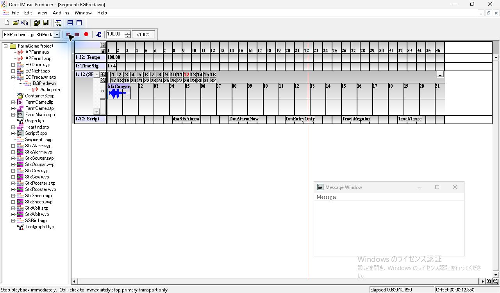

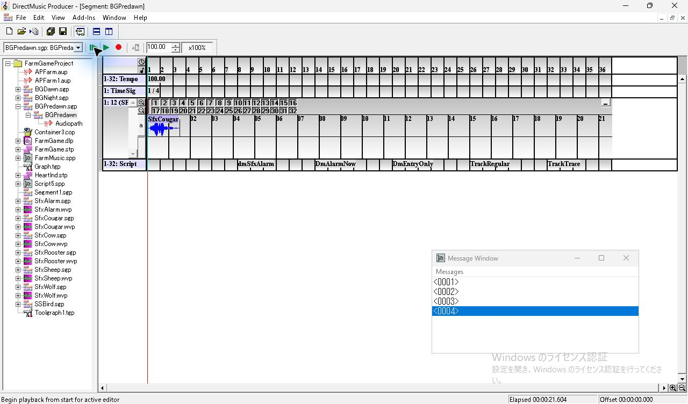

停止中に第8小節の `dmSfxAlarm` を右クリックすると、選択が濃紺になり **Call Routine(s)** が使える。同じ項目をメニューで呼び出すと **<0005>** と **<0006>** が増え、Alarm が鳴った。Alarm の元 Wave との相関は **0.99523**。 [手動呼び出しの録音](../../../work/original-gui/SEG-14-farmmusic-playback/20261112T004434738685Z/captures/audio-manual/output.wav)

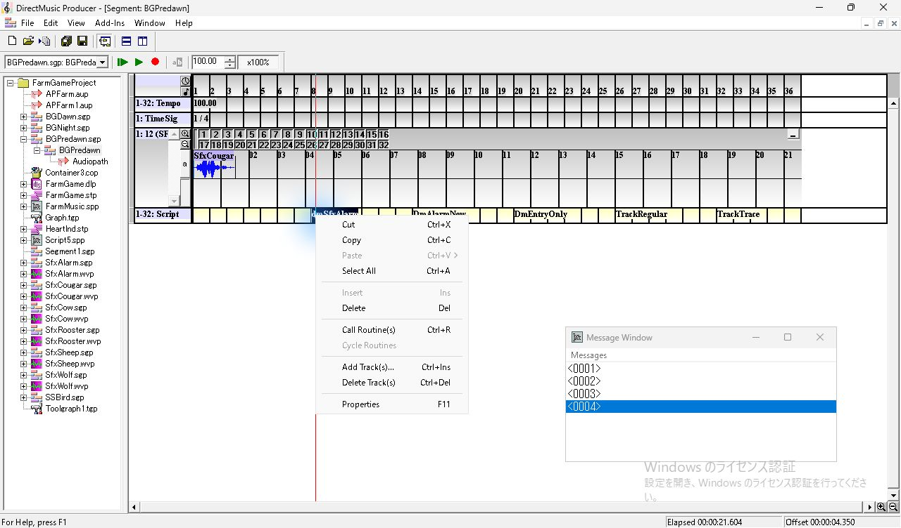

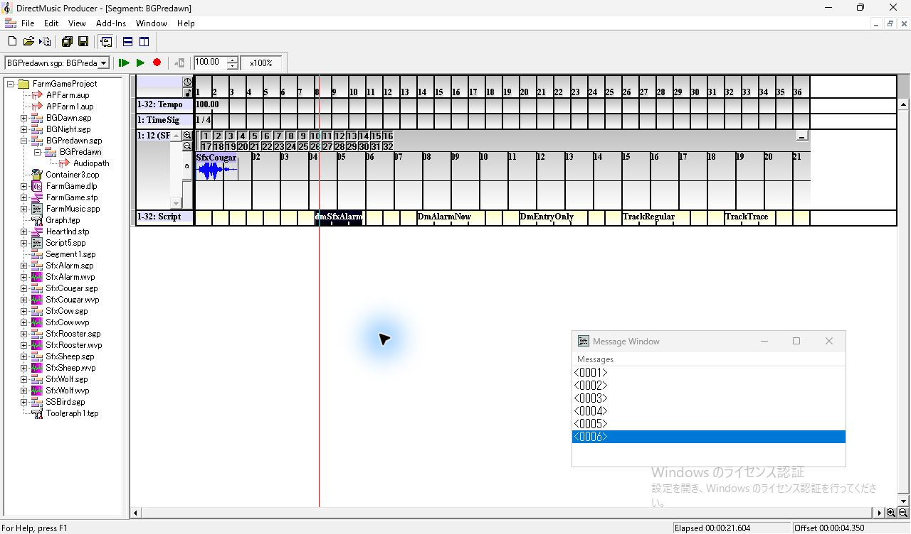

## 言語指定を入れ替えた場合

同じ Project のコピーで、FarmMusic と Script5 の `scla` だけを入れ替えた。Producer を終了し、該当ウィンドウが0件になったことを確認して同じ EXE を1件起動した。再生直後に **FarmMusic.spp の28行目**、**Near: PlayFlag**、**Microsoft AudioVBScript syntax error**、**0x88781223** が表示された。該当行は `Select Case PlayFlag`。この試行では5件の区間すべてで Alarm の波形が検出されず、後半の **VBScript** になった Script5 の2件を通過しても新しい Trace は出なかった。 [言語以外のチャンクが同一であることの照合](../../../work/original-gui/SEG-14-farmmusic-playback/20261112T004434738685Z/language-swap.json) · [言語指定変更のコード](../../../work/original-gui/SEG-14-farmmusic-playback/20261112T004434738685Z/swap_language.py) · [録音](../../../work/original-gui/SEG-14-farmmusic-playback/20261112T004434738685Z/captures/audio-swap/output.wav)

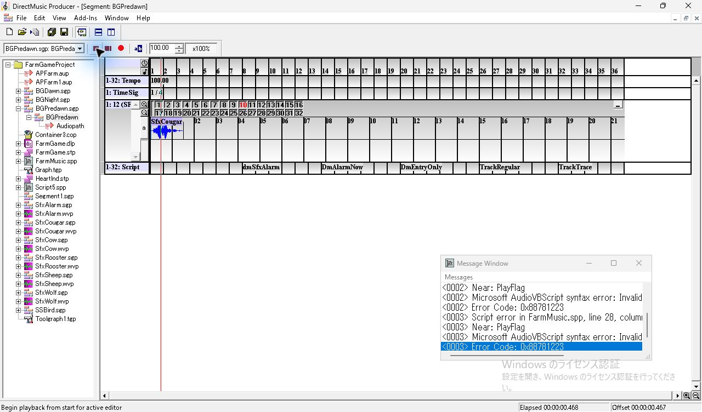

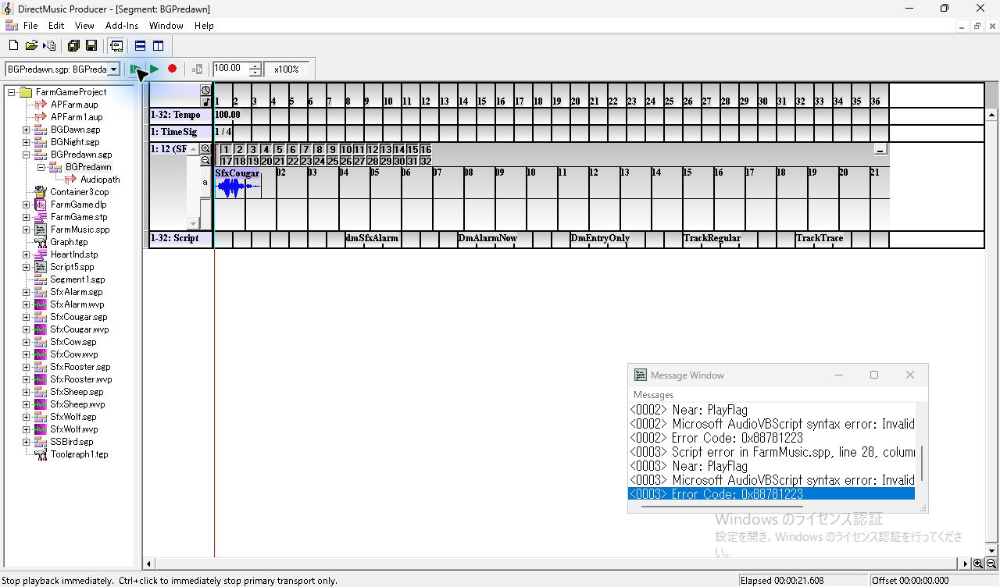

## FarmMusic を AudioVBScript で読み込める構文にした場合

さらにコピーし、`dmAllStop` の `Select Case` だけを複数行の `If`／`ElseIf`／`End If` に置き換えた。今回の3ルーチン、参照先、タイムラインは同一。Project を閉じた状態から Producer を再起動して読み込んだ。再生時、FarmMusic の2つの Play はそれぞれ **2行追加と Alarm の発音**、Trace 専用のルーチンは **1行追加**。Script5（VBScript）の2件を通過しても5行のまま、Alarm の波形も検出されなかった。 [構文差分と入力ハッシュ](../../../work/original-gui/SEG-14-farmmusic-playback/20261112T004434738685Z/audio-compatible.json) · [構文変更のコード](../../../work/original-gui/SEG-14-farmmusic-playback/20261112T004434738685Z/compatible_source.py) · [録音](../../../work/original-gui/SEG-14-farmmusic-playback/20261112T004434738685Z/captures/audio-compatible/output.wav) · [原版ヘルプの AudioVBScript 対応構文](../../../../../work/analysis/original-manual-session/20261010T031624075Z/help-extracted/htm/audiovbscriptlanguage.htm)

| ルーチン | 再生通過後の累積 Trace | Alarm 開始（Cougar から） | Alarm の相関 |
| --- | ---: | ---: | ---: |
| FarmMusic.dmSfxAlarm | 2 | 4.2000秒 | 0.98948 |
| FarmMusic.DmAlarmNow | 4 | 7.8000秒 | 0.98348 |
| FarmMusic.DmEntryOnly | 5 | — | — |
| Script5.TrackRegular | 5 | — | — |
| Script5.TrackTrace | 5 | — | — |

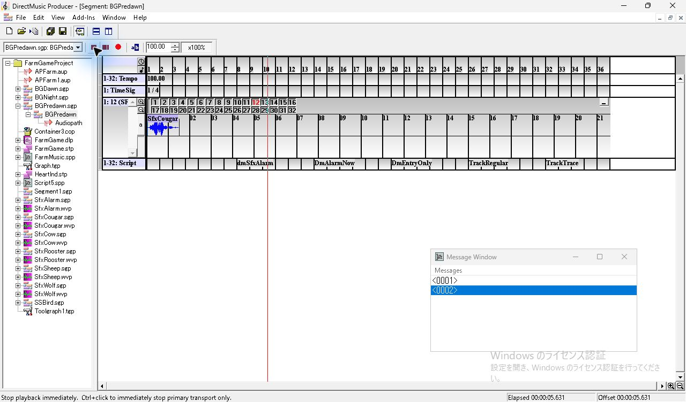

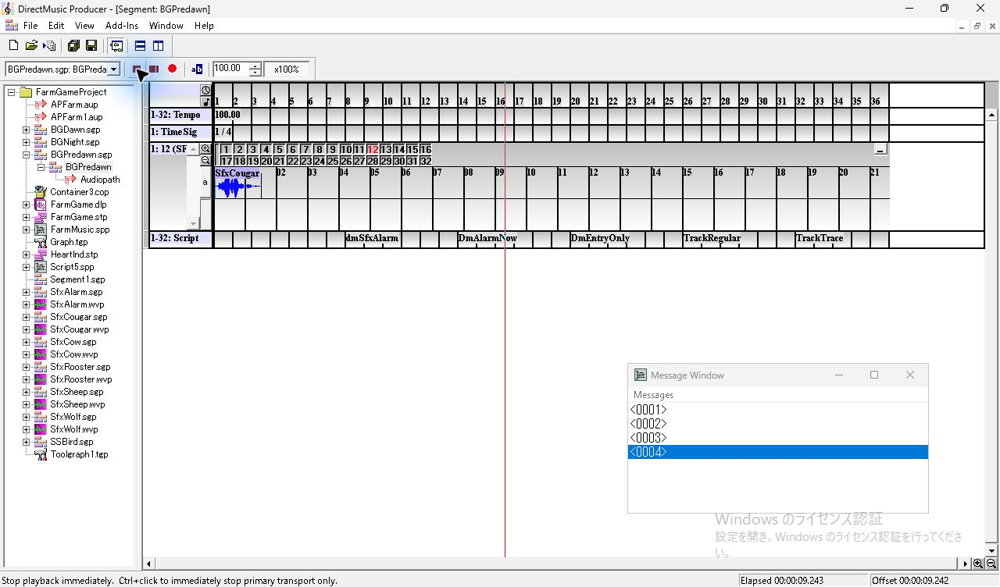

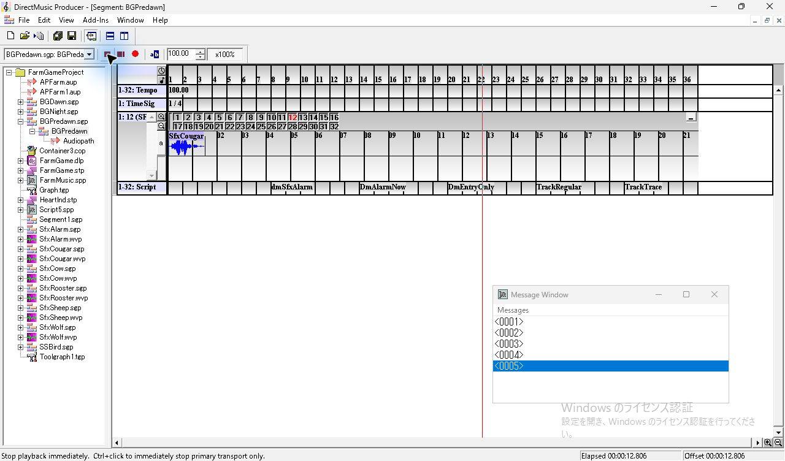

## Properties の切り替えと確認範囲

Project Tree の **FarmMusic.spp** を選んで F11 を押すと、外側の Script File Properties に Design と Runtime が出る。ファイル行を展開し、子の **FarmMusic** を選ぶと同じ位置の Properties が Script と Info の2タブへ切り替わる。Script タブの **Language** の矢印を押すと、現在値を青で示す `AudioVBScript` と `VBScript` の2行が開く。Escape で一覧を閉じると AudioVBScript が残った。2つのロード時のチェック欄はオン。Script 行の `dmSfxAlarm` をクリックすると、薄黄色の行に濃紺の項目が出て、浮動 Properties は Script Routine に切り替わる。 **Script** は `FarmGameProject: FarmMusic`、**Timing** は Before Time Stamp、**Start Time** は 8:1:0。

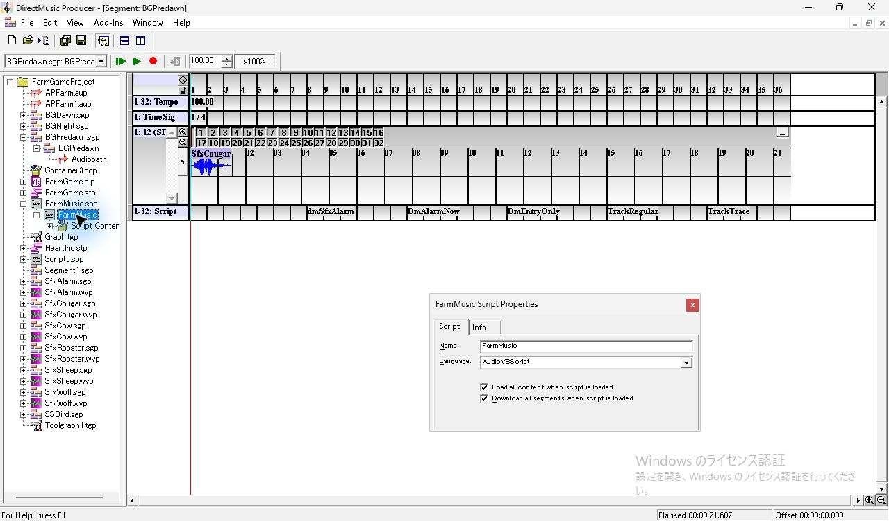

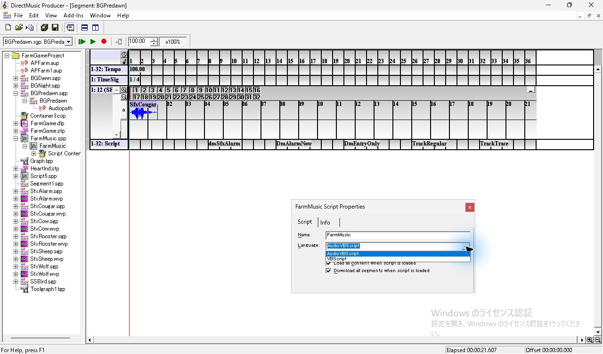

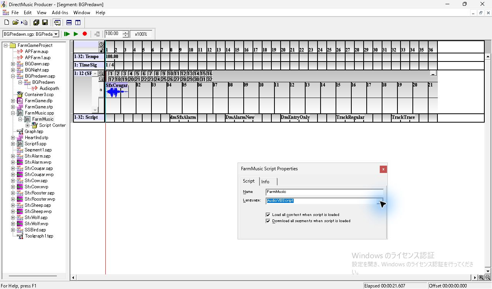

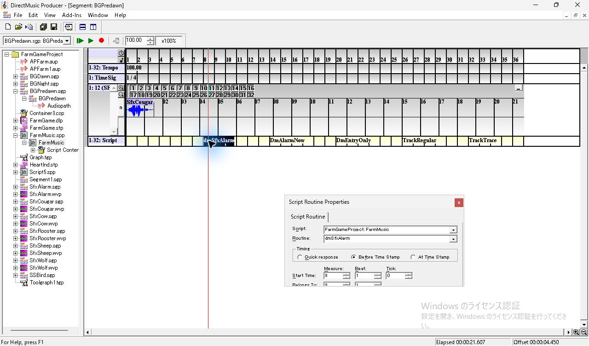

3回の再生と1回の手動呼び出しは既定の Windows 出力のループバックで録音した。Cougar と Alarm の元 Wave の冒頭130 msを48 kHzに合わせて照合し、相関0.90以上を一致とした。各項目の検索区間は Cougar を基準に公称時刻の0.90秒前〜1.50秒後。3回とも Cougar を検出した。検証範囲はこの Producer、親 Segment と Before Time Stamp の組み合わせ。別の環境での VBScript 再生、互換構文の `dmAllStop` の実行、言語指定を UI で確定した直後の挙動は、短い Trace 用 Script と Select Case を含む別の Script で後続調査した。 [Script の言語切替](seg-14-script-language-ui.md) [波形の計測コード](../../../work/original-gui/SEG-14-farmmusic-playback/20261112T004434738685Z/measure.py) · [計測結果](../../../work/original-gui/SEG-14-farmmusic-playback/20261112T004434738685Z/audio-analysis.json)

試験後に Project と Message Window を閉じ、Producer が1件であることを確認した。View の表示は **Project Tree、Standard Toolbar、Status Bar、Transport Controls**。凍結入力は全件で SHA-256 が一致した。開いた各 Project の作業コピーでは `.pro` が更新された。 [作業用ファイルの監査](../../../work/original-gui/SEG-14-farmmusic-playback/20261112T004434738685Z/fixture-audit.json) · [最後のウィンドウ一覧](../../../work/original-gui/SEG-14-farmmusic-playback/20261112T004434738685Z/captures/final-windows.json)

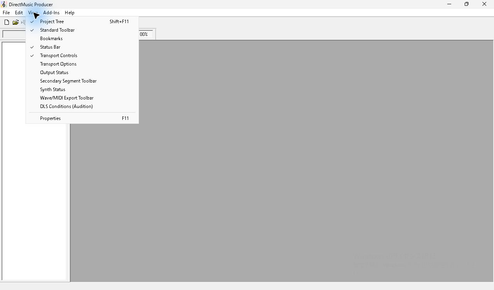
