# SEG-14　Groove と Lyric

[調査計画](README.md) · [Marker と Mute](seg-14-marker-mute.md) · [Tempo と Time Sig](seg-09-tempo-timesig.md)

2026-11-11。DirectMusic Producer 5.3.0.900 の調査用コピー `DmusGuiEventTracks.exe`（SHA-256 `c330bb2ca2c885f4157ec9dce060f64957e33e88192b6547630c2db5f1a65a22`）。[Tempo・Time Sig・Band0 入り素材](../../../work/original-gui/SEG-09/20261111T032540911033Z/inputs/timed-segment/manifest.json) を専用 Project2 に複製。Windows 11 25H2、1280×800、96 DPI。親子ウィンドウを最大化し、[ツールバーは2段](ui-01-view-toolbars.md)。本体画像は1280×752 px。座標は各画像の左上を原点とする。青い光と黒い矢印は操作ツールの表示。停止中に操作した。

[実行記録](../../../work/original-gui/SEG-14-events/20261111T042449369203Z/run.json) · [画像対応表](../../../work/original-gui/SEG-14-events/20261111T042449369203Z/published-images.json) · [保存値](../../../work/original-gui/SEG-14-events/20261111T042449369203Z/saved-event-tracks.json) · [保存した Segment](../../../work/original-gui/SEG-14-events/20261111T042449369203Z/captures/four-event-tracks.sgp)

## 4トラックの追加

1. Project2 の `Segment1.sgp` をダブルクリックする。最初の Sequence の右端のボタンでピアノロールを閉じると、追加する4行が一画面に収まる。
2. Timeline のルーラーを右クリックし、`Add Track(s)...` を開く。`Add New Tracks` で `Groove Track` をクリックし、Shift+↓を3回押すと Groove、Lyric、Marker、Mute の4項目が青くなる。
3. OK の後、4トラックはグループ1で追加される。表示順は TimeSig、Grooves、3本の Sequence、Bands、Mute、Lyric、Marker。追加ダイアログの順序と Timeline の順序は異なる。

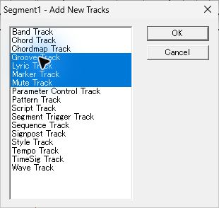

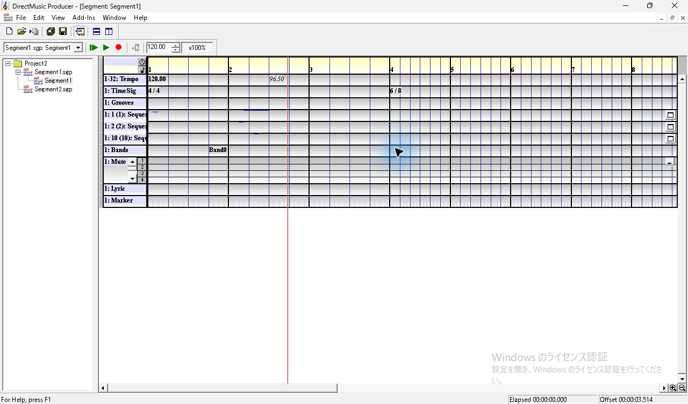

## Groove Level と繰り返し

| 操作 | 観測 |
| --- | --- |
| 空の第2小節の Grooves 行を右クリック | 行が淡黄色、選択した小節全体が黒。Insert は有効、Delete は灰色 |
| Insert を選ぶ | 391×200 px のモデルレス `Groove Level Properties` が開く。Embellishment はリストの `None`。Groove Level は 1、±は 0。レベル側にも別の `None` チェックがあり未選択。Custom Embellishment の入力は灰色 |
| Embellishment で Fill を選ぶ。Groove Level を 3、±を 1 にする | Embellishment の選択が青になり、それぞれのスピン欄に数値が出る |
| `Repeat Pattern` を開く | `Random (default)`、`Repeat Same`、`Sequential from First`、`Sequential from Random`、`Shuffle`、`No Repeats` の順 |
| `Sequential from First` を選び、プロパティ右上の × で閉じる | 第2小節の先頭から `Fill (2-4) [Seq]` が白字で表示される。黒い選択は第2小節の終わりまで |
| 同じ小節の第4拍の位置を右クリックし、Esc で閉じる | Insert が灰色、Delete が有効。既存ラベルは維持される |

追加一覧の名前は `Groove Track`、Timeline では `1: Grooves`。保存先は Command の `cmnd` チャンクで、行の選択と挿入はこの試験では小節単位だった。Embellishment の候補は Intro、Fill、Break、End、Custom、None。

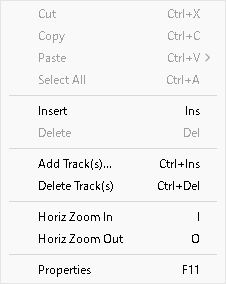

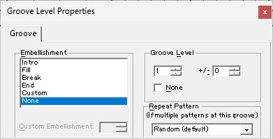

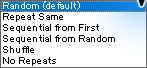

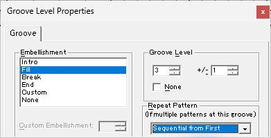

![第2小節の選択と Fill (2-4) [Seq] ラベル](figures/evt-20-groove-label.jpg)

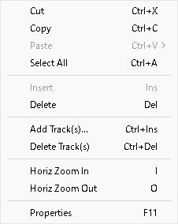

## Lyric の入力と表示

1. Lyric 行の第2小節第2拍を右クリックする。選択は1拍分。`Insert` が有効で `Cycle Lyrics` は灰色。挿入すると 391×200 px のモデルレス `Lyric Properties` が開く。Lyric は `Empty`、`Start Time` は Bar 2・Beat 2・Tick 0、`Belongs To` は Bar 2・Beat 2。各時刻欄に上下スピンがある。
2. `Empty` をダブルクリックし、`歌詞 A` を入力する。`Timing` は `Quick response`、`Before Time Stamp`、`At Time Stamp` の3択。最後の行はこのウィンドウ寸法では下端にかかる。`Before Time Stamp` を選んで × で閉じる。
3. Timeline では日本語部分が異なる字形で描画され、末尾の `A` は読める。入力欄で確認した文字列と後述の再読込の文字列はいずれも `歌詞 A`。

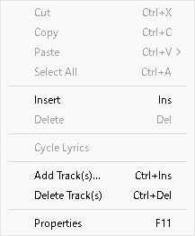

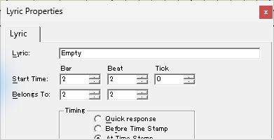

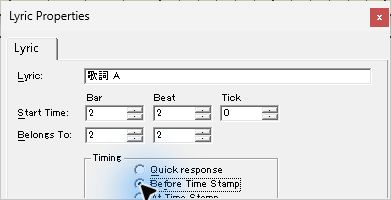

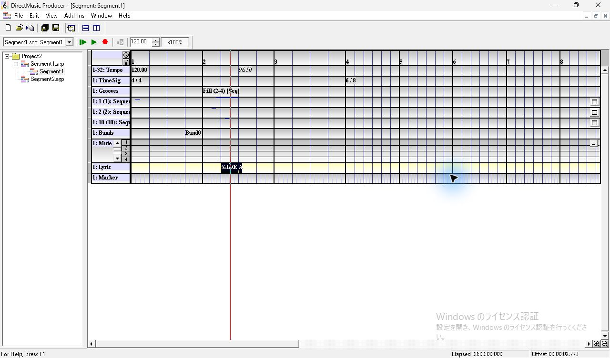

## Start Time と Belongs To、同じ拍の切り替え

| 順 | 2件目 `Lyric B` に対する操作 | Start Time | Belongs To | Timeline と入力欄 |
| --- | --- | --- | --- | --- |
| 1 | 第2小節第3拍を左クリックし、Insert。テキストを入力 | 2:3:0 | 2:3 | 第3拍に挿入 |
| 2 | Belongs To の Beat を1下げ、プロパティを閉じる | 2:3:0 | 2:2 | 1件目と別の位置に、2ラベルが並ぶ |
| 3 | F11 で開き、Start Time の Tick を1上げ、Beat を1下げる | 2:2:1 | 2:1 | Start Time の Beat を下げる操作に伴い、Belongs To の Beat も1下がった |
| 4 | Belongs To の Beat を1上げ、閉じる | 2:2:1 | 2:2 | 第2拍に斜体の `Lyric B` が出る。選択は1拍 |
| 5 | 第2拍を右クリックし `Cycle Lyrics` を選ぶ | 2:2:1 | 2:2 | メニューで Cycle Lyrics が有効、Insert は灰色。表示は同じ第2拍の1件目へ切り替わる |

行上の文字は Start Time が別の拍にある間は並び、同じ拍に揃えると今回の組では1件ずつ切り替わった。手順4の直後は選択セルが第2拍、赤い位置線は直前にクリックした第3拍付近に残った。

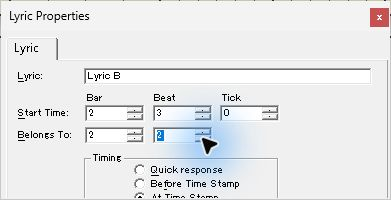

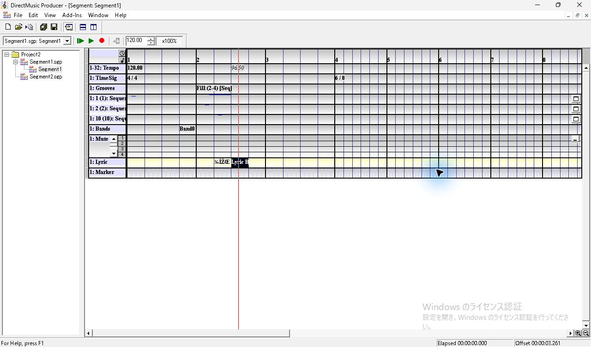

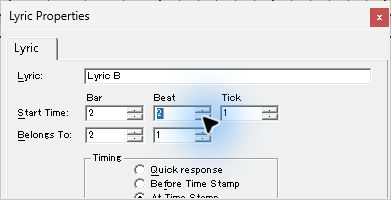

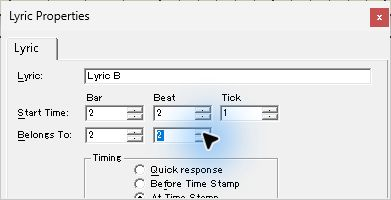

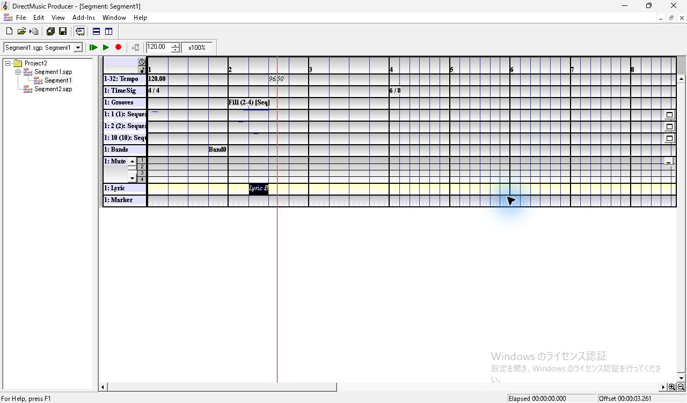

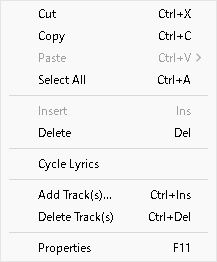

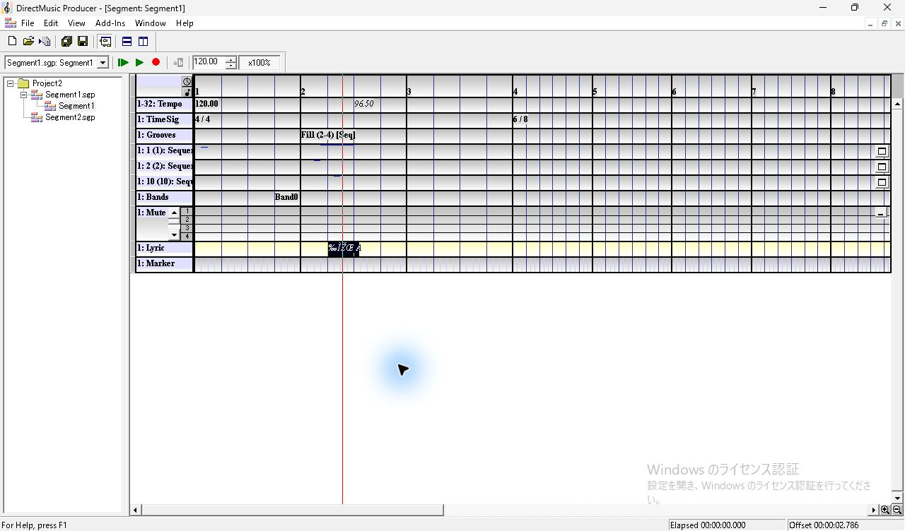

## 保存・別起動での照合

Ctrl+S で専用コピーの Segment1 を保存し、Producer を通常終了する。Producer のウィンドウとプロセスが空になってから、同じ調査用コピーを1件だけ起動する。Project2 を展開し、Segment1.sgp を開く。Grooves の `Fill (2-4) [Seq]` と Lyric のラベルが出る。Lyric を選び F11 を押すと、`歌詞 A`、2:2:0、Belongs To 2:2、Before Time Stamp が表示される。プロパティを開いたまま Grooves を選ぶと、Groove Level Properties に切り替わり、Fill、3、±1、Sequential from First が戻る。

- `cmnd` に第2小節先頭（3072 clocks）の1件。コマンド値1、レベル3、範囲の格納値2、繰り返しの格納値2。
- `lyrt` に2件。UTF-16LE のテキストは `歌詞 A` と `Lyric B`。開始はそれぞれ 3840、3841 clocks、Belongs To はともに 3840 clocks。Timing の格納値はそれぞれ 8、16。
- 保存物は2442 bytes。別起動で開いたファイルと SHA-256 が一致した。凍結入力3ファイルは元のハッシュと一致し、作業側の Segment2 も入力と同一。既存 Tempo・Time Sig・Band・Sequence のトラック内容を照合し、表示設定の `psqc` を除く末端チャンクは同一だった。

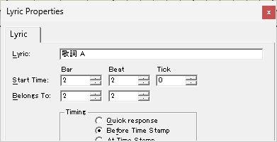

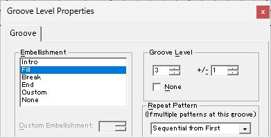

残りの観測は、Groove の Custom・None、複数小節選択、ドラッグ・履歴、Style 再生時の各 Repeat Pattern、Lyric のドラッグ、実行時の Timing と文字出力、表示文字の環境差、カーソルのホバー・押下中。使用した原版ヘルプの項目は `Groove Track` と `Lyric Track`。
