# SEG-14　Marker と Mute

[調査計画](README.md) · [Groove と Lyric・4トラックの追加](seg-14-groove-lyric.md) · [ループと境界停止](seg-12-loop-boundary.md)

2026-11-11。DirectMusic Producer 5.3.0.900 の調査用コピー `DmusGuiEventTracks.exe`（SHA-256 `c330bb2ca2c885f4157ec9dce060f64957e33e88192b6547630c2db5f1a65a22`）。[Tempo・Time Sig・Band0 入り素材](../../../work/original-gui/SEG-09/20261111T032540911033Z/inputs/timed-segment/manifest.json) を専用 Project2 に複製。Windows 11 25H2、1280×800、96 DPI。親子ウィンドウを最大化し、[ツールバーは2段](ui-01-view-toolbars.md)。本体画像は1280×752 px。座標は各画像の左上を原点とする。青い光と黒い矢印は操作ツールの表示。停止中に操作した。

[実行記録](../../../work/original-gui/SEG-14-events/20261111T042449369203Z/run.json) · [画像対応表](../../../work/original-gui/SEG-14-events/20261111T042449369203Z/published-images.json) · [保存値](../../../work/original-gui/SEG-14-events/20261111T042449369203Z/saved-event-tracks.json) · [保存した Segment](../../../work/original-gui/SEG-14-events/20261111T042449369203Z/captures/four-event-tracks.sgp)

## Marker と Enter Switch Point の上下段

`1: Marker` は約22 px 高で、同じ時間のセルが上下に分かれる。4/4 部分には拍線より細い縦線があり、1拍内の Grid を指定できる。対象は第2小節第2拍の第3 Grid（本体画像 x≈485、上段 y≈369、下段 y≈380）。

1. 空の上段を右クリックすると `Insert Marker` が有効。`Mark All`、`Mark Range`、`Unmark All`、`Unmark Range` にサブメニューがあり、`Cycle Markers` は灰色。
2. `Insert Marker` を押す。モデルレス `Marker/Enter Switch Point Properties` が開き、Type が `Marker`、Measure 2・Beat 2・Grid 3・Tick 0。時刻欄には上下スピン、Type 欄にはドロップダウン矢印がない。× で閉じると上段に赤い小矩形が残る。
3. 同じ x の下段を左クリックし、Insert を押す。同じプロパティの Type が `Enter Switch Point` になり、時刻は上段と同じ。× で閉じると、上が青、下が赤。上段を左クリックすると、上が赤、下が緑に切り替わる。プロパティで Type を切り替える入口は Timeline 上の上下段の選択だった。
4. 上段の既存イベントを右クリックすると `Insert Marker` が灰色、Delete が有効。`Mark Range` を開くと `Measures`、`Beats`、`Grids` の順に表示される。Esc 1回目でサブメニュー、2回目で親メニューが閉じ、2件の位置と上段の選択は維持される。

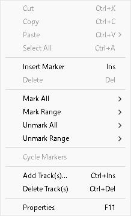

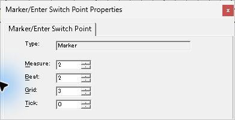

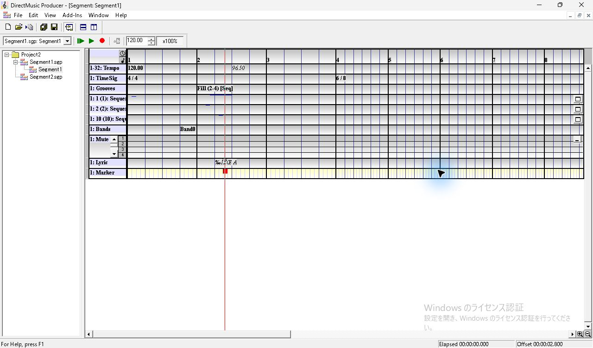

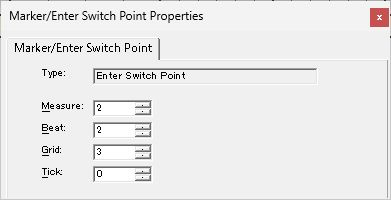

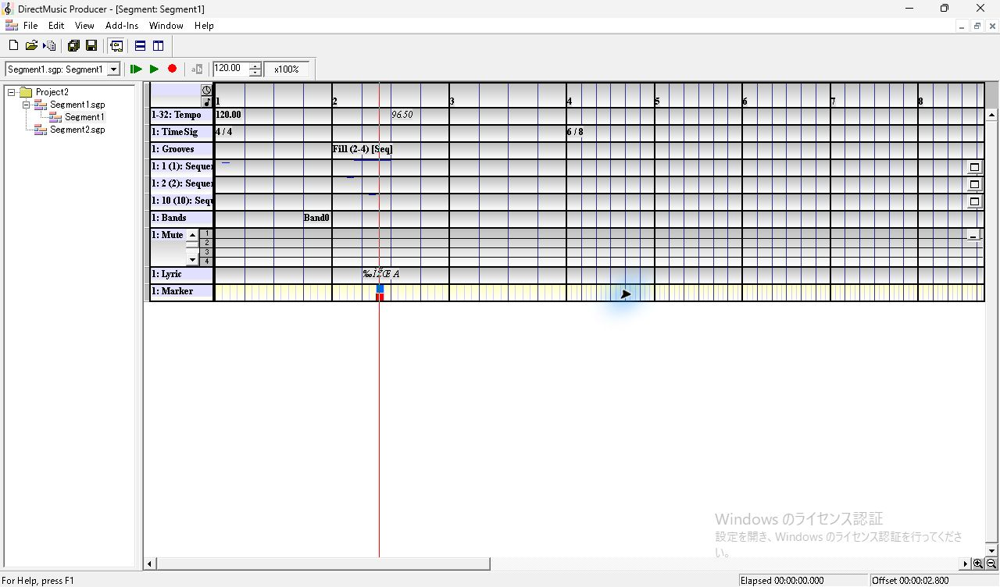

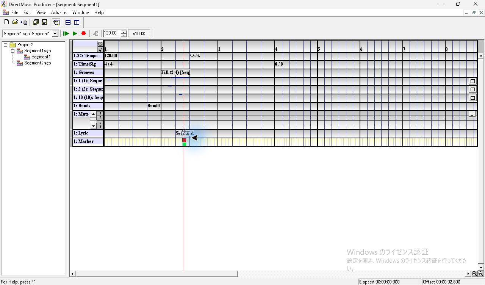

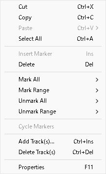

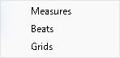

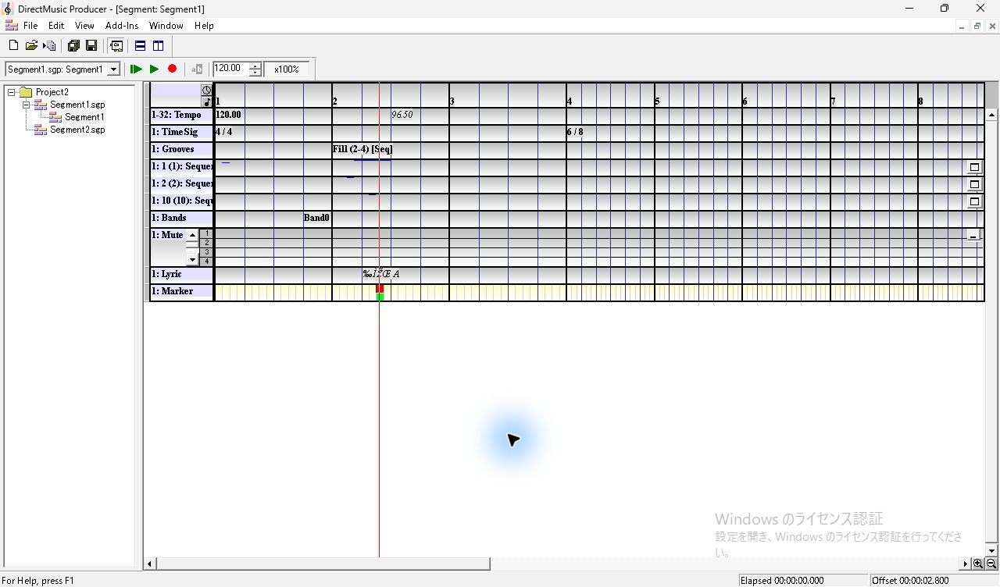

## Mute の拍セルとチャンネル全体

`1: Mute` の展開時の高さは約50 px。左側に PChannel 番号と専用の縦スクロール、右端に折りたたみボタンがある。初期表示は PChannel 1〜4。時間方向は拍セルの列で、第4小節の 6/8 以降は拍の表示幅が狭くなる。

1. 第2小節第2拍の PChannel 2 のセル（x≈483、y≈311）を右クリックする。メニューには `Add/Remove PChannels...`、`Remap PChannel...`、`Clear Remap`、`Mute PChannel 2`、`Unmute PChannel 2`、`Clear PChannel 2` がある。初期状態の `Clear Remap` は灰色。
2. `Mute PChannel 2` を選ぶ。右クリック位置より前の第1小節から、画面内の PChannel 2 全体に黒い `X` が並ぶ。
3. 同じセルを左クリックすると、第2小節第2拍だけ `X` が消える。前後の拍は `X` のまま。右クリックから `Clear PChannel 2` を選ぶと、全体から `X` が消える。
4. 同じ行の第2拍中央から第4拍中央へ1回ドラッグした試行では、第2・第4拍に `X` が出て、第3拍は空だった。記録した1回の入力は始点・終点だけに反映された。連続したマウス移動や押下中の反映は追試対象。

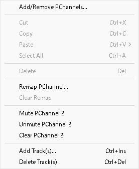

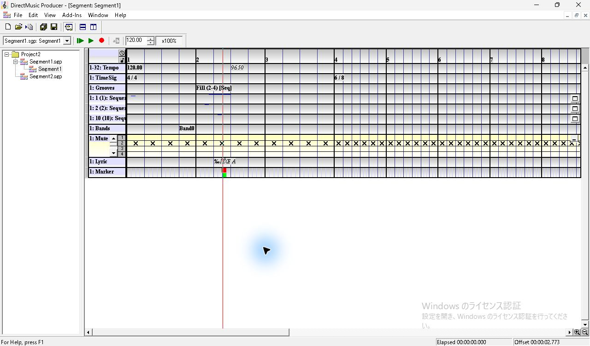

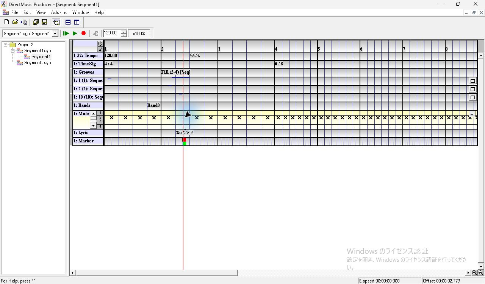

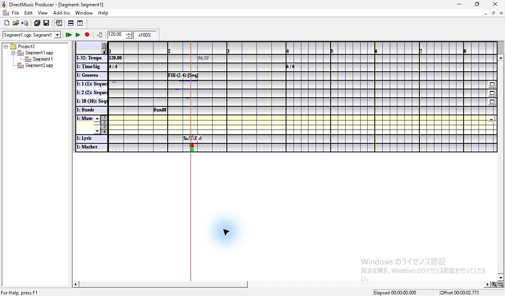

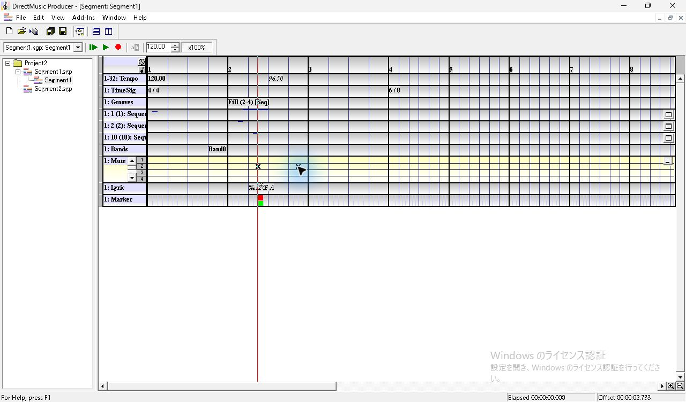

## Remap と PChannel 一覧

1. 第2小節第2拍の PChannel 3 のセル（x≈481、y≈323）を右クリックし `Remap PChannel...` を選ぶ。343×150 px のダイアログに `Remap PChannel 3 (3) to:` と `Starting at Measure 2, Beat 2.` が出る。初期値は 1 で、数字欄が選択されている。
2. 6 を入力して OK。選択位置から右の PChannel 3 の拍セルに小さい `6` が並ぶ。番号の大きい宛先もこの GUI で確定・保存できた。再割り当て済みセルのメニューでは `Clear Remap` が有効になる。
3. Mute 左端の下矢印を1回押すと、表示は PChannel 1〜4 から 2〜5 に移り、他のトラックと時間軸の位置はそのまま。右端のボタンで閉じると約22 px の1行になり、`PChannel(s): 1-16.` と表示される。再展開するとスクロール位置 2〜5 と `X`・`6` が戻る。
4. `Add/Remove PChannels...` を開くと448×227 px のダイアログが出る。左は PChannel 番号・スピン、`Add >>`、`Add Next 16 >>`、`<< Remove`、右は番号と名前の一覧。既定の入力候補 17 で `Add >>` を押すと `17 - 17` が一覧末尾に追加・選択され、入力候補は18に進む。Cancel で閉じた後、保存値のチャンネル一覧は1〜16のままだった。

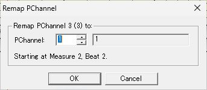

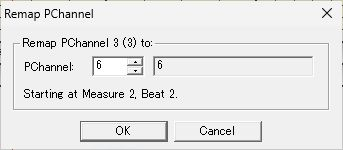

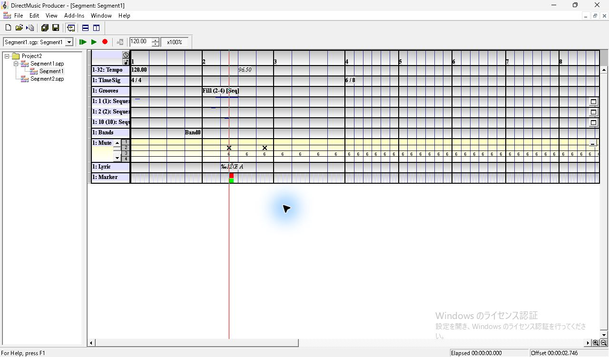

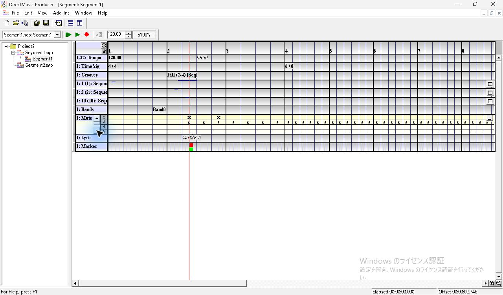

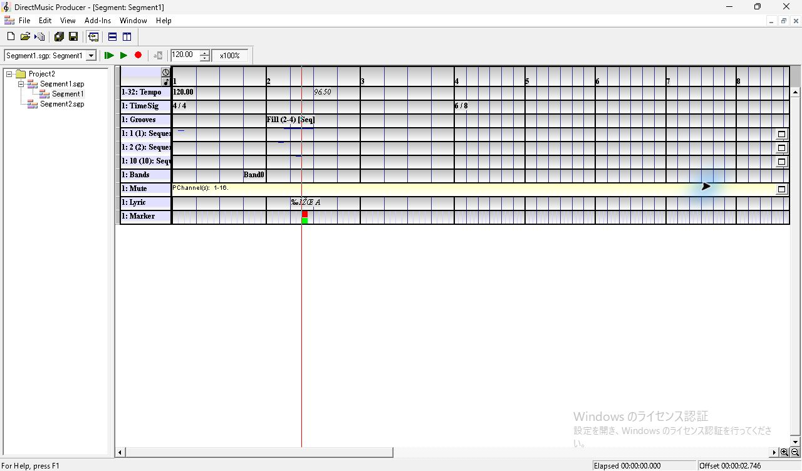

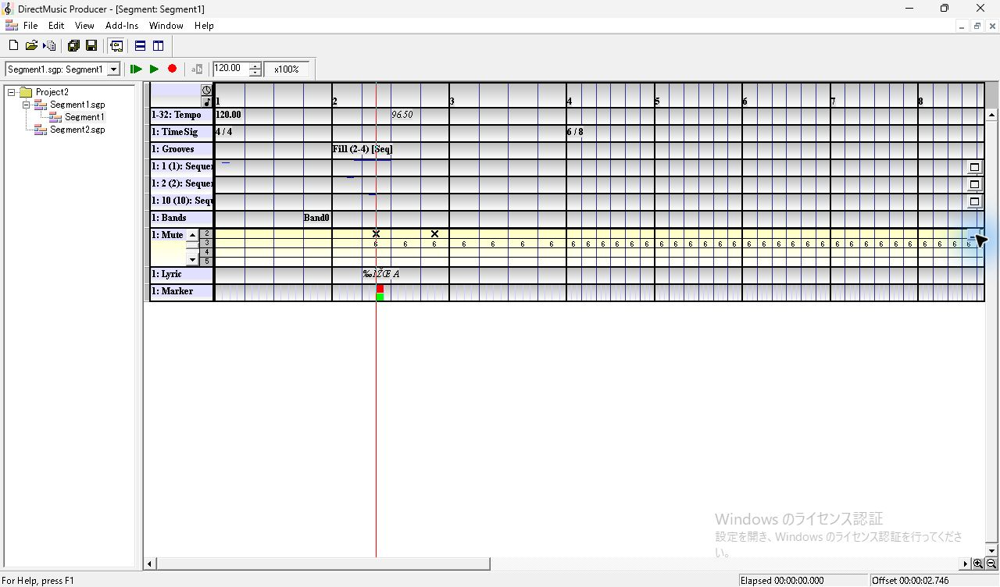

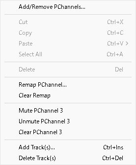

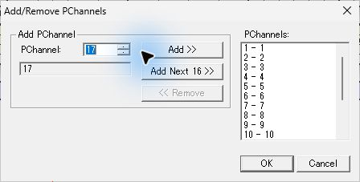

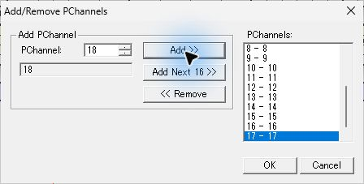

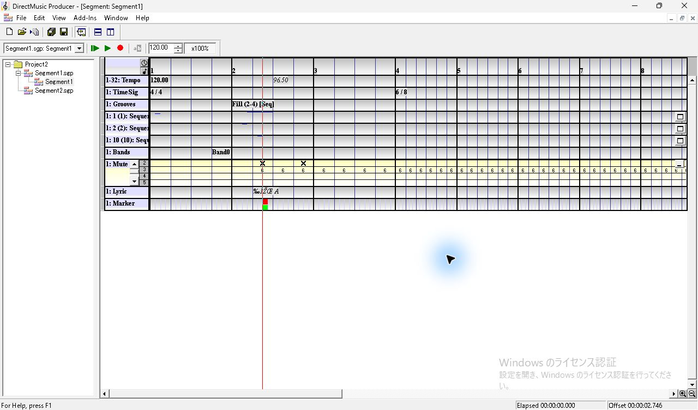

## 保存・別起動での照合

Ctrl+S で保存し、通常終了後に同じ調査用コピーを単独で起動した。Segment1 を開くと、位置線は先頭に戻り、Marker は上段青・下段緑、Mute は PChannel 2〜5 を表示した。PChannel 2 の2つの `X` と PChannel 3 の `6` が戻った。Lyric Properties を開いたまま同じ Grid の下段、上段を順に選ぶと、タイトルとページが Marker/Enter Switch Point に切り替わり、Type と時刻を再確認できた。

| 保存場所 | 観測した値 |
| --- | --- |
| `MARK` | `play` と `vals` に各1件、同じ 4224 clocks（第2小節第2拍第3 Grid） |
| `mute`、PChannel 2 | 3840〜4608 と 5376〜6144 clocks。区間先頭に `0xffffffff`、各区間末に自チャンネルへ戻すレコード |
| `mute`、PChannel 3 | 3840 clocks で 6 に再割り当て、Segment 末尾の 48384 clocks で自チャンネルへ戻るレコード。ファイル上のチャンネル番号は0起点 |
| `mutu` | 0起点の 0〜15 を保持。Cancel した PChannel 17 は含まれない |

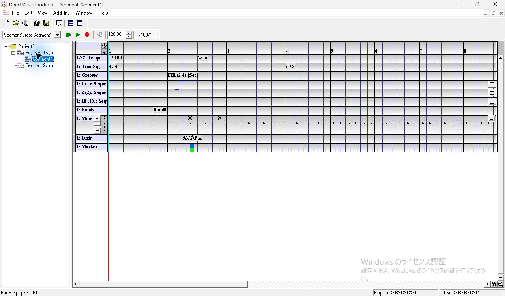

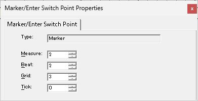

残りの観測は、Marker の時刻変更・ドラッグ、同種の重なりと Cycle Markers、範囲の確定と一括取り消し、遷移に対する各種マーカーの効き方、Mute のドラッグ中・履歴、Clear Remap の確定と境界、チャンネル追加・削除の確定、実音声。原版ヘルプの `Mute Track` では再割り当て方向の注意書きと掲載例が食い違うため、ここでは GUI・保存で確認した結果を記録した。
