# SEG-14　Parameter Control の複数曲線、時刻と Echo の発音

2026-11-11。DirectMusic Producer 5.3.0.900 の作業コピーで、[前回の SfxAlarm.sgp](seg-14-parameter-control.md#2つのパラメーターと再読込) を使用。埋め込み AudioPath に **Echo1**、Parameter Control Track に **Feedback** と **WetDryMix** がある。Segment の長さは表示上 **1.463秒**、保存値は2248音楽クロックと14,632,699 × 100 ns。画面は1280×752 px、View の標準4項目。採取160枚から38枚を掲載する。座標の原点は画像左上。画像の青い光と黒い矢印は操作ツールの表示。 [凍結入力28件](../../../work/original-gui/SEG-14-parameter-followup/20261111T152629035053Z/run.json) · [画像の出典と寸法](../../../work/original-gui/SEG-14-parameter-followup/20261111T152629035053Z/published-parameter-followup-figures.json)

## 同じストリップに2本描く

展開済みの **WetDryMix** に青い Linear が1本。Feedback は空。WetDryMix 内の (348,352) を右クリックし、**Draw Curve** を選ぶ。ステータスバーが **Start, End** に変わった。(348,352) から (484,402) へ左ドラッグすると、既存の上り直線に重なる下りの Sine が入った。新規曲線は赤、黒い枠とハンドル付き。F11 直後は **Parameter Control Track Properties** が開き、曲線をクリックすると **Echo1-WetDryMix Properties** に切り替わった。

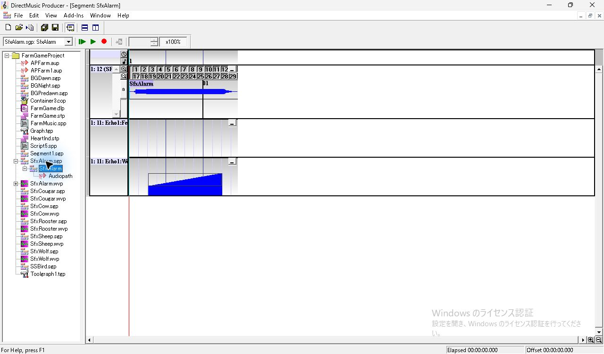

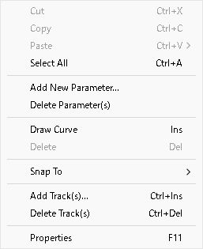

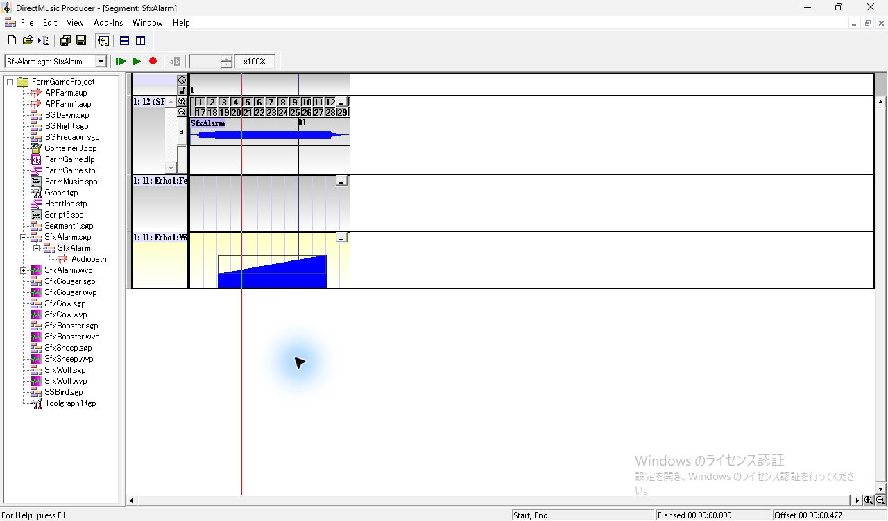

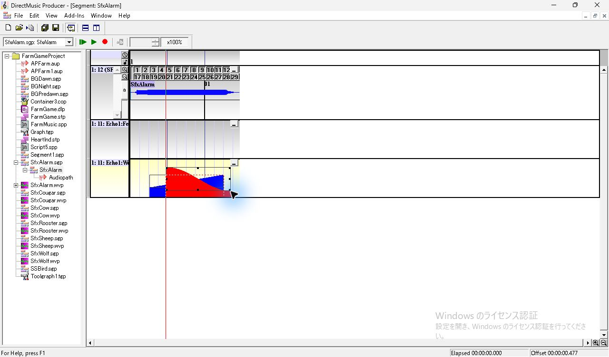

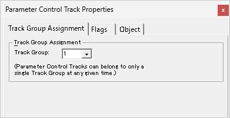

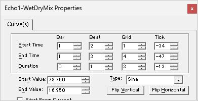

| 描画直後 | Start → End（Bar:Beat:Grid:Tick） | 保存時刻（clocks） | Start Value → End Value |
| --- | --- | --- | --- |
| 既存 Linear | 1:1:3:17 → 1:3:3:8 | 401 → 1928 | 25.000 → 59.000 |
| 追加 Sine | 1:2:1:−34 → 1:3:4:−47 | 734 → 2065 | 78.750 → 16.250 |

## 重なり、全選択と一括反転

Linear の左端寄り **(326,406)** は Sine の開始より左にあり、クリックすると Linear が赤に変わった。続いて2本の塗りが重なる **(383,405)** をクリックすると、Sine が赤、Linear が青になり、Properties に Sine が出た。同じ点をもう一度押しても Sine。青い Linear の塗りだけが見え、Sine の選択枠内にある **(455,380)** でも Sine が選択された。座標ごとの結果として記録し、重なりの全域での優先順位は引き続き確認対象とする。

WetDryMix をアクティブにして **Ctrl+A** を押すと、2本とも赤くなり、それぞれにハンドルが出た。既に開いていたパネルには直前の Sine の値が残った。**Flip Vertical** を押すと両方に **100 − 元の値** が適用され、パネルは共通の数値だけを表示した。異なる時刻の欄、両端の値、Type はダッシュ表示。空白をクリックすると青に戻り、編集欄と反転ボタンが無効になった。

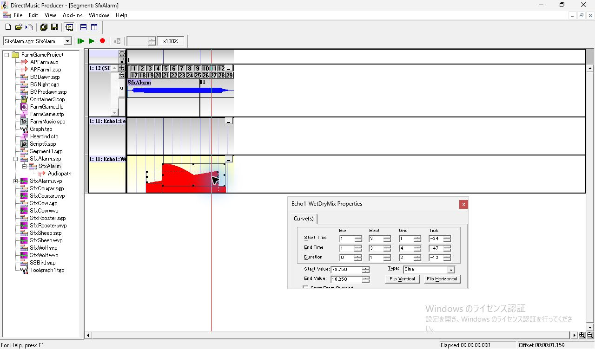

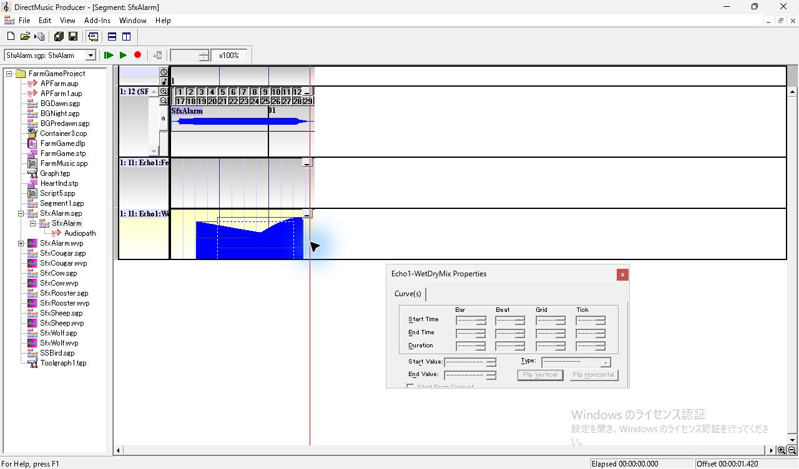

ツールバーで保存した直後、フレームにフォーカスがある状態で **Ctrl+Z** を押した回では反転が残った。WetDryMix の空白をクリックしてから Ctrl+Z を押すと、1回で両方の反転を取り消し、Properties は一時的に Audiopath に切り替わった。保存値では Linear は **75.000 → 41.000** から **25.000 → 59.000** に復帰。Sine は **21.250 → 83.750** から **79.000 → 16.000** になった。Sine の元の小数値と Undo 後の保存値には端点ごとに0.250の差がある。 [描画、反転、Undo の保存値](../../../work/original-gui/SEG-14-parameter-followup/20261111T152629035053Z/parameter-followup-audit.json)

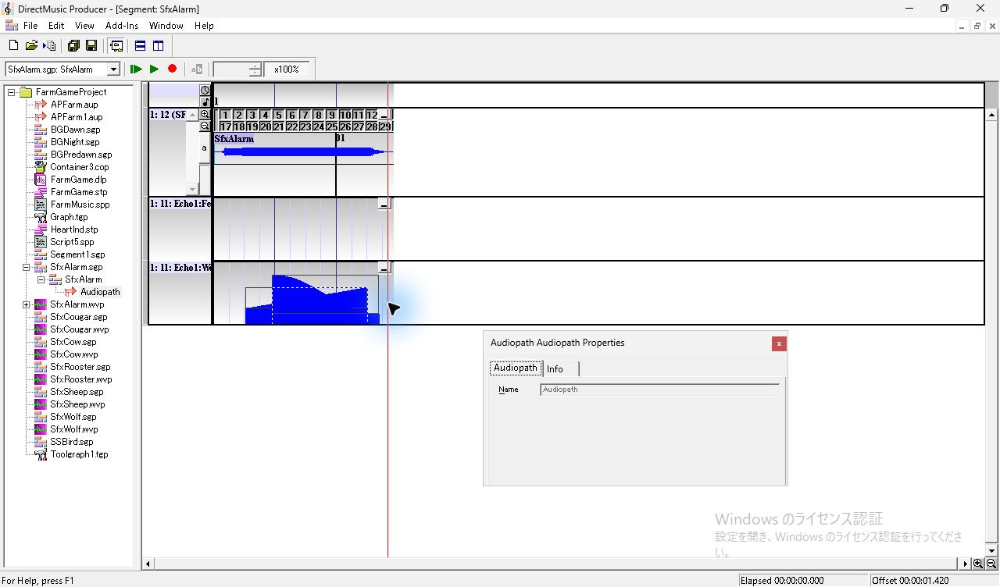

## 単独ハンドルの境界

試行時の有効時間領域は **x=273〜503付近**、値領域は **y=335〜415付近**。以下は解放直後の結果。開始端と終了端は Sine のハンドルを使用した。

| ドラッグ | 観測結果 |
| --- | --- |
| 終了端 (483,400) → (548,400) | 終了 **1:3:4:−47**、値 **16.000** のまま |
| 終了端 (483,399) → (497,388) | 開始は **1:2:1:−34**、終了は **1:4:1:−92**、終了値 **30.000** |
| 終了端 (497,389) → (548,389) | 終了と値は直前と同じ |
| 終了端 (497,389) → (497,458) | 値領域の下で解放。終了と値は直前と同じ |
| 終了端 (497,389) → (493,413) | 有効領域の下端付近。終了 **1:3:4:61**、終了値 **0.000** |
| 開始端 (349,353) → (240,353) | 左のヘッダー上で解放。開始 **1:1:1:0** に補正、終了と値は維持 |

終了端を有効領域内へ動かしたとき、Start Time は同じで Start Value は **79.000 → 78.750** と表示された。個別の境界試行では、終了端を右外・下外へ出した結果と、開始端を左外へ出した結果が異なる。

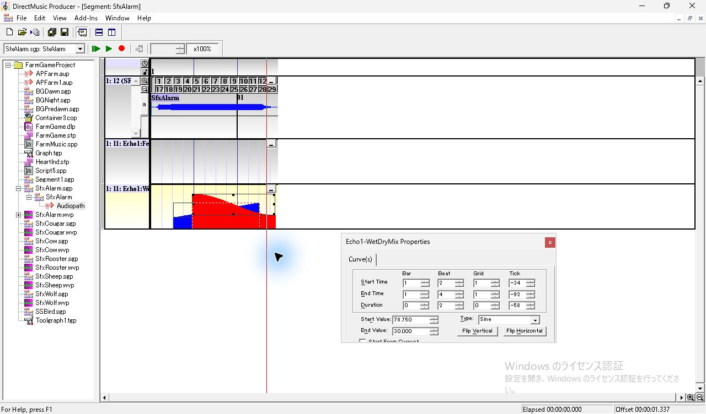

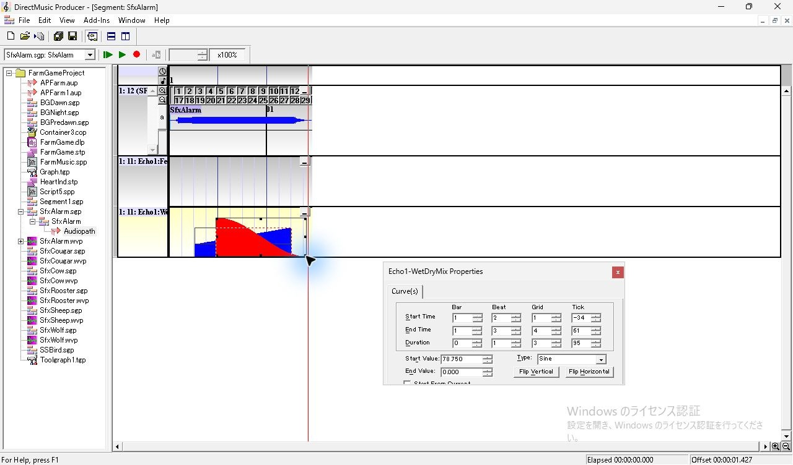

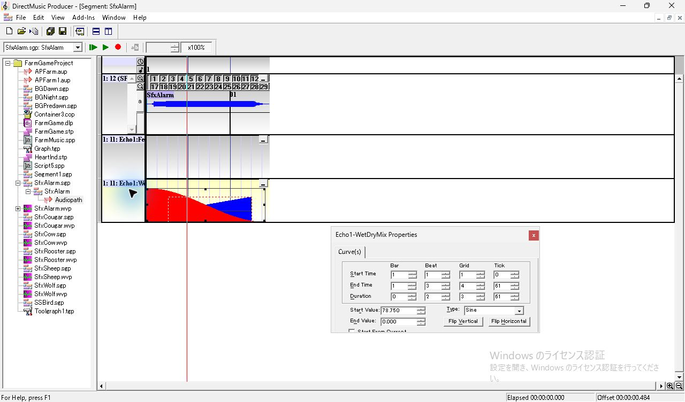

この状態で保存して通常終了し、別プロセスで開き直した。Feedback と WetDryMix は展開したまま、2本は青く未選択。Sine は **0〜2173クロック**、終了値0、開始値の画面表示は79.000。再読込前後で SfxAlarm.sgp の全バイトが一致し、保存ファイルの開始値は78.750だった。Linear は25.000→59.000。開始を0に変えた Sine と重なった状態では **(451,379)** で Linear、**(383,405)** で Sine を選択した。 [境界の保存ファイル](../../../work/original-gui/SEG-14-parameter-followup/20261111T152629035053Z/captures/boundary-SfxAlarm.sgp) · [再起動後の保存ファイル](../../../work/original-gui/SEG-14-parameter-followup/20261111T152629035053Z/captures/reopened-boundary-SfxAlarm.sgp)

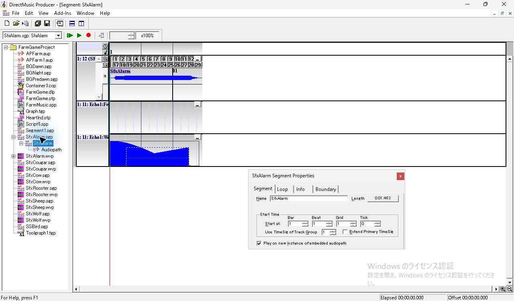

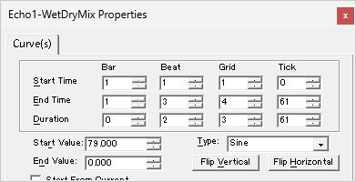

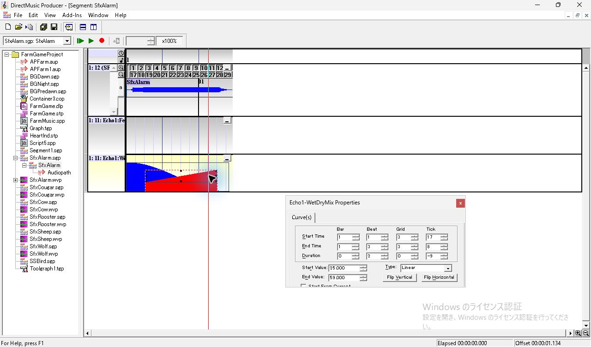

## Use Clocktime と複数曲線の移動

WetDryMix ヘッダーを選び、**Parameter Control Track Properties > Flags > Use Clocktime** をオンにした。同じトラックに属する Feedback と WetDryMix は両方とも、細い拍・Grid の線から秒境界 **00、01** の表示へ変わった。曲線を選ぶと **Min / Sec / Grid / Ms**。Grid は灰色。Sine の End Time は **1.414秒**。Ms の上スピンを1回押すと End Time と Duration が **1.415秒** になった。保存前後のファイルは全バイト一致し、終了は2173クロック。作業の最後に別プロセスで開くと Use Clocktime を保持し、End Time は **1.414秒** と表示された。

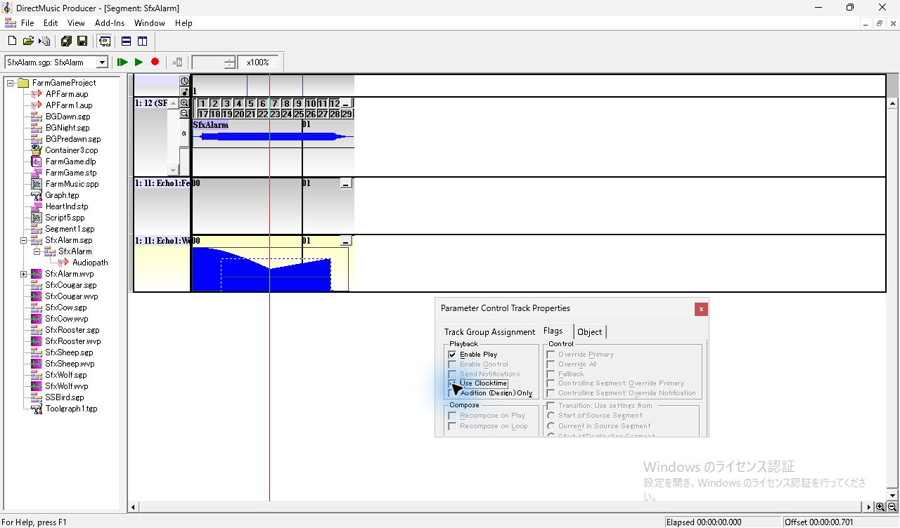

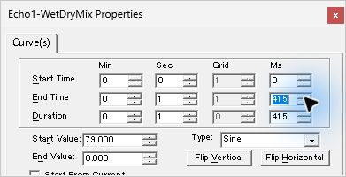

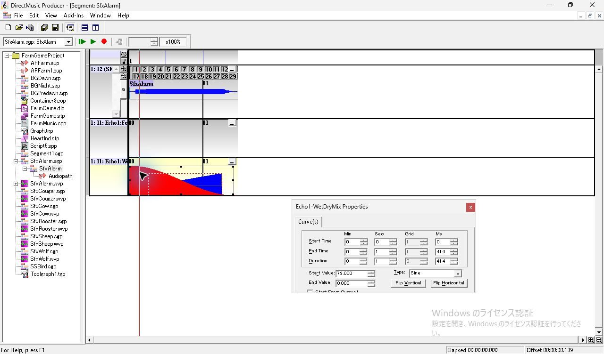

音声比較後、Clocktime の WetDryMix 内で **Ctrl+A**。2本の塗りが重なる **(378,399) → (384,392)** へドラッグすると、選択を保ったまま両方が右上へ動いた。続けて **(379,395) → (442,395)** へドラッグすると、右端が画面の Segment 終端で切れ、終了時刻は Segment を越えて保存された。2本を選んだまま曲線内を単独クリックしても、その試行では両方が赤いまま。空白をクリックしてから Sine を選ぶと、開始 **0.439秒**、終了 **1.867秒**、値 **87.500 → 8.750**。Segment Properties に表示された全長は1.463秒だった。

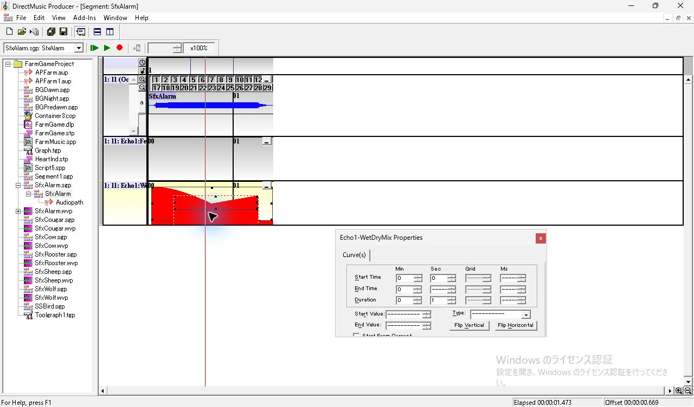

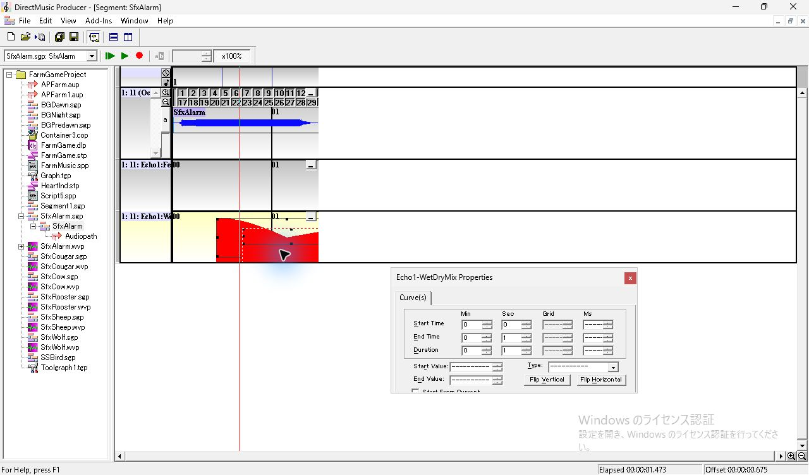

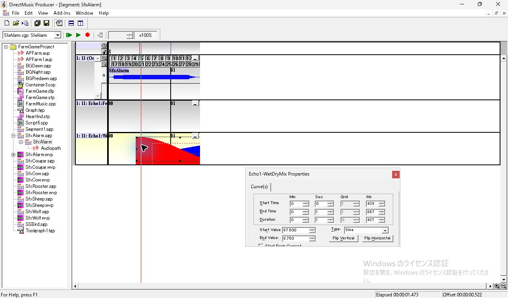

| 保存段階 | Sine 開始〜終了（clocks）と値 | Linear 開始〜終了（clocks）と値 |
| --- | --- | --- |
| Clocktime の移動前 | 0〜2173、79.000 → 0.000 | 401〜1928、25.000 → 59.000 |
| 2本を右上へ | 59〜2241、87.500 → 8.750 | 460〜1987、33.750 → 67.500 |
| さらに右へ | 675〜2868、87.500 → 8.750 | 1077〜2603、33.750 → 67.500 |

2本をまとめて動かした試行でも、保存された長さには小さな差が出た。たとえば Sine の長さは2173→2182→2193クロック。Ctrl+Z を2回実行して移動前の保存値に戻した。単独ハンドルの範囲外への移動と、塗りの内側からの一括移動は、別の結果として扱う。 [13版の時刻・値・トラックフラグの照合](../../../work/original-gui/SEG-14-parameter-followup/20261111T152629035053Z/parameter-followup-audit.json)

## Echo1 の出力と Enable Play

元の Wave Part は **PChannel 12 / SFX**。Parameter Control が指定する Echo1 は **PChannel 11** の別のミックスグループ。作業コピーの **Wave Track Properties > Wave Part** で下スピンを1回押すと **11 / Ocarina** に変わり、Wave 行と Parameter Control 行が PChannel 11 にそろった。埋め込み AudioPath の Echo1 の初期設定は WetDryMix **30**、Feedback **0**、左 **300 ms**、右 **600 ms**。保存ファイル上の各比較条件で埋め込み AudioPath のハッシュは一致した。

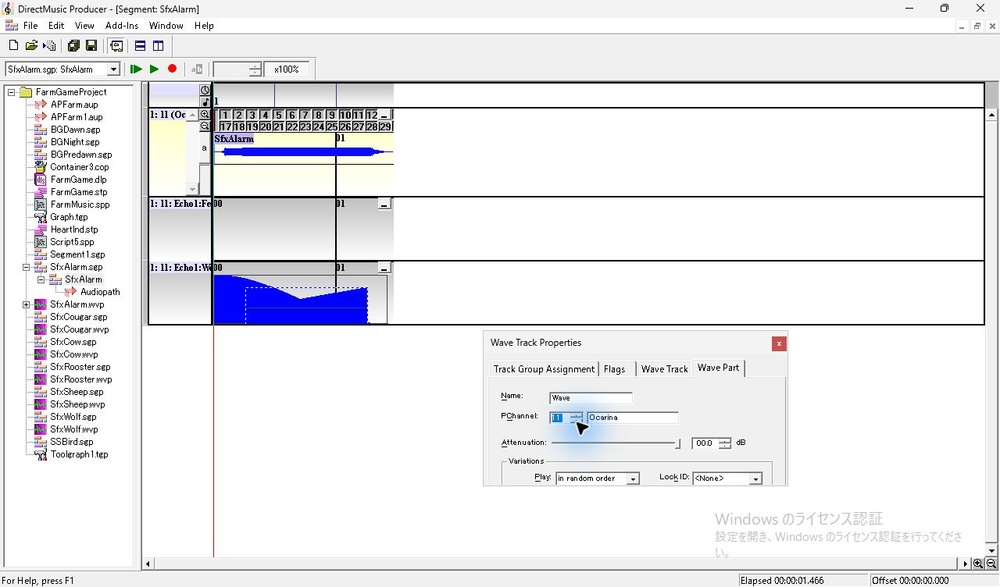

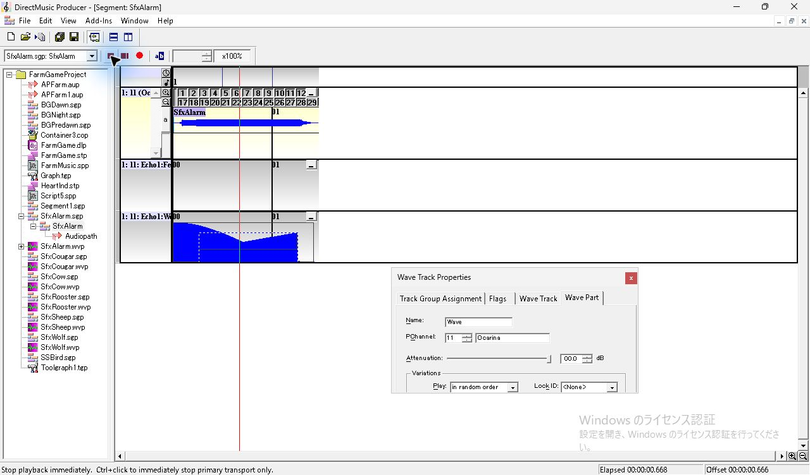

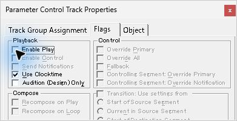

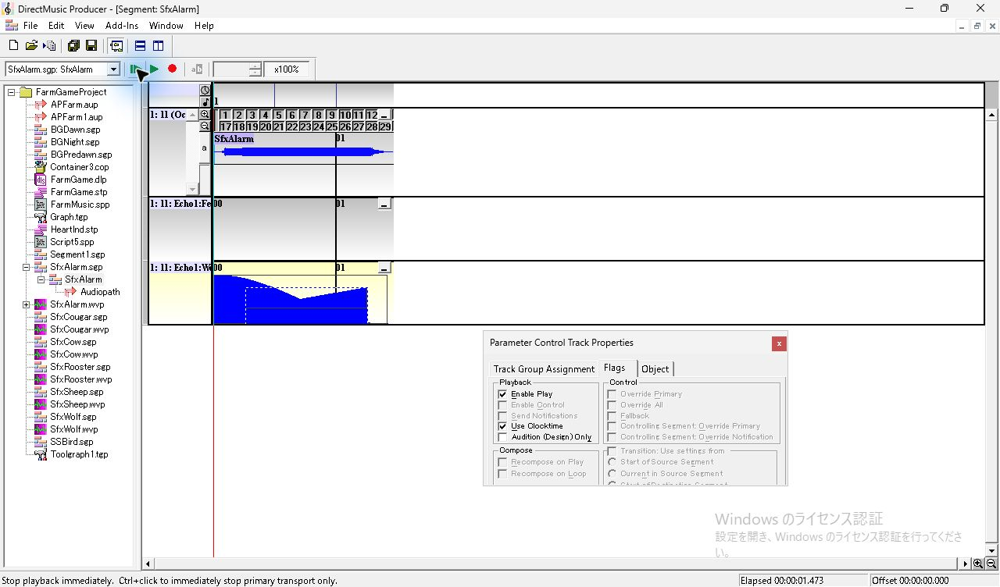

**Play From Start** を使い、PChannel 12 を2回、11で Enable Play オンを2回、オフを2回、オンへの復帰を1回録音した。既定出力の WASAPI ループバック、48 kHz、32-bit浮動小数点、ステレオ。元の **SfxAlarm.wvp** は44.1 kHz、16-bit PCM、64,528サンプル。元波形の冒頭0.18秒を使って7回を整列した。各チャンネルを、元の波形と指定時間だけ遅らせた波形の和として最小二乗で近似し、遅延成分の係数を求めた。表の範囲は両チャンネル・各試行の最小〜最大。 [150秒の録音](../../../work/original-gui/SEG-14-parameter-followup/20261111T152629035053Z/captures/audio-echo/output.wav) · [時刻、相関、遅延成分の照合](../../../work/original-gui/SEG-14-parameter-followup/20261111T152629035053Z/captures/echo-analysis.json) · [解析コード](../../../work/original-gui/SEG-14-parameter-followup/20261111T152629035053Z/measure-echo.py)

| Wave Part とトラックの設定 | 0.60〜0.76秒の遅延成分係数 | 1.27〜1.40秒の遅延成分係数 | 1.48〜1.80秒の残響 RMS |
| --- | ---: | ---: | ---: |
| 12 / Enable Play オン（2回） | −0.008〜0.004 | −0.002〜0.003 | 0.00000（5桁丸め） |
| 11 / Enable Play オン（復帰を含む3回） | 0.124〜0.150 | 0.198〜0.200 | 0.02865 |
| 11 / Enable Play オフ（2回） | 0.121〜0.131 | 0.128〜0.131 | 0.01652〜0.01653 |

PChannel 11 でトラックを有効にすると遅延成分が大きくなり、音源の長さを過ぎた残響も強まった。無効でも Echo1 の遅延音は出ており、係数はほぼ一定。オフの画面には曲線が残り、保存値は曲線の2件を保ってトラックの `trkx` が **0x50 → 0x40**。各曲線単独の係数や、2本が重なる時間のパラメーターの適用順は未測定。

最後に Wave Part を **12 / SFX** に戻して保存し、別プロセスで Clocktime の表示を確認した。作業コピーで変わった Project 内のファイルは **SfxAlarm.sgp、FarmGameProject.pro**。凍結入力28件はハッシュ一致。終了時は Project を閉じた Producer が1件で、View は標準4項目。 [終了時のウィンドウ](../../../work/original-gui/SEG-14-parameter-followup/20261111T152629035053Z/captures/87-final-windows.json)

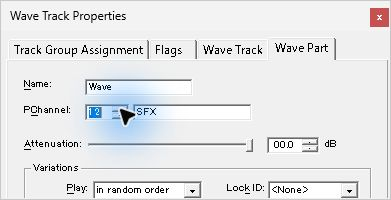

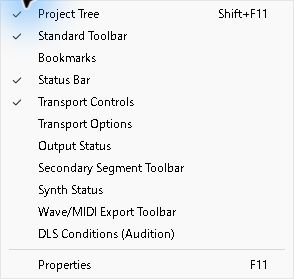

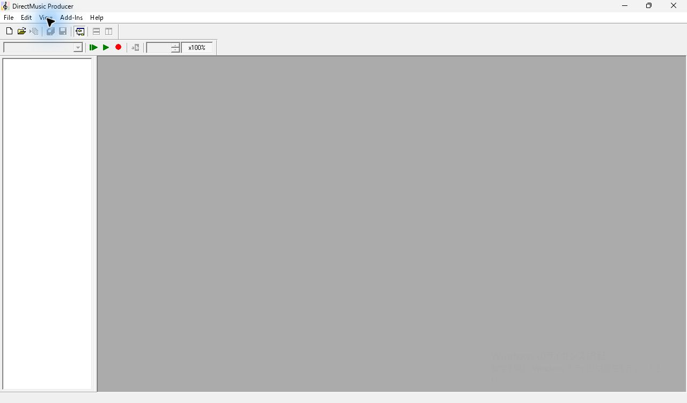

残る追試は、押下中のプレビューとネイティブカーソル、修飾キーによる追加選択、ペイン下端の Start From Current、埋め込み AudioPath に DMO がない場合、ToolGraph に対象がある場合、および1本ずつの発音と重なった時間の適用順。
