# SEG-14　Parameter Control Track と Echo の曲線

2026-11-11。DirectMusic Producer 5.3.0.900 の調査用コピーで、FarmGame の **SfxAlarm.sgp** を使った。Wave Track と **Echo1** を含む埋め込み AudioPath がある Segment。起動中の Producer を再利用し、親ウィンドウは1280×752 px、ツールバーは2段。画像上の座標は左上が原点。青い光と黒い矢印は操作ツールの表示。 [実行記録](../../../work/original-gui/SEG-14-pattern-style/20261111T074828536163Z/run.json) · [原版画像の対応表](../../../work/original-gui/SEG-14-pattern-style/20261111T074828536163Z/published-parameter-figures.json) · [作業コピーの入力ハッシュ](../../../work/original-gui/SEG-14-pattern-style/20261111T074828536163Z/session/FarmGameProject-before-open.json)

## 作業用プロジェクトを開く

**File > Open Project** から FarmGameProject.pro を開く。最初に用意したフォルダー名 **FarmGame** では、Producer が **FarmGameProject** という名前のフォルダーを要求した。21ファイルを同名フォルダーに再コピーすると開いた。コピー用のマニフェストをプロジェクト内に置いた回ではツリーに文書として出たため、外へ移した。プロジェクトを閉じてから .pro を元の内容に戻し、再読込時にツリーと作業ファイルのハッシュを照合した。 [保存と入力の照合](../../../work/original-gui/SEG-14-pattern-style/20261111T074828536163Z/parameter-control-audit.json)

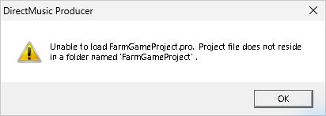
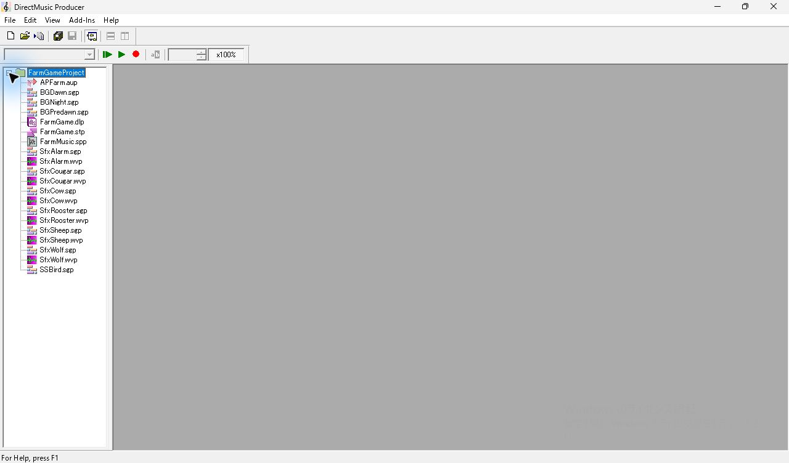

## 空のトラックと Add Parameter

Wave のヘッダーを右クリックし **Add Track(s)... > Parameter Control Track** を選ぶ。初期は約22 px の折りたたみ行。短い Segment では **No Parame** まで見え、直後に右端の四角がある。この状態で四角をクリックしても高さは変わらなかった。右クリックでは **Add New Parameter...** が有効、**Delete Parameter(s)** と **Draw Curve** は灰色だった。

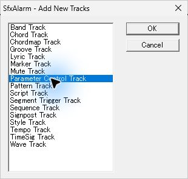
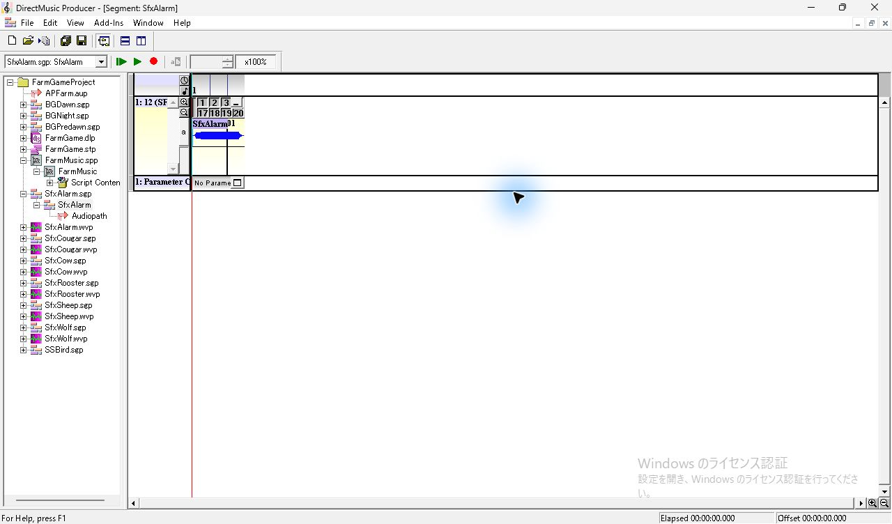
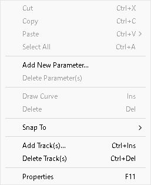

**Add New Parameter...** で396×218 px のダイアログ。初回の選択は **DMOs**。上段のラジオで **Tools** に替えると Stage と対象欄が切り替わる。この Segment での各表示は次のとおり。

| 種別と Stage | Object | PChannels | Parameter と OK |
| --- | --- | --- | --- |
| DMOs / from the Segment's audiopath | Echo1 | 11 | WetDryMix が初期選択。候補は WetDryMix と Feedback。OK 有効 |
| DMOs / from the Performance's active audiopath | WavesReverb | 空欄 | InGain が表示され、OK 有効 |
| Tools / from toolgraph in this segment | 空欄で無効 | 空欄 | Parameter と OK が無効 |

Tools の状態で Cancel すると空のトラックに戻った。Add Parameter を開き直した直後も Tools が選ばれていた。DMOs をクリックして **Echo1 / WetDryMix** を OK すると、折りたたみヘッダーが **1: 11: Echo1**、時間領域に **WetDryMix** が表示された。

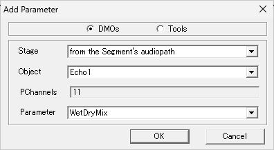
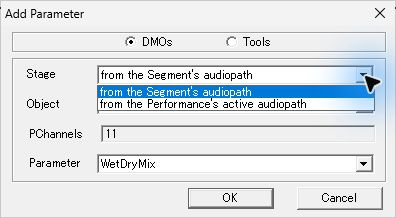
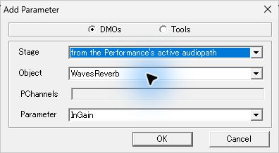
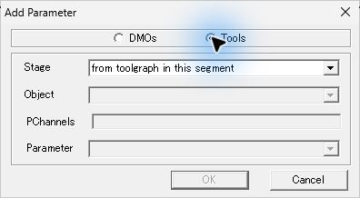
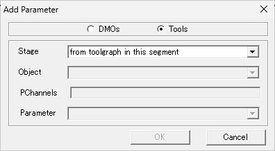
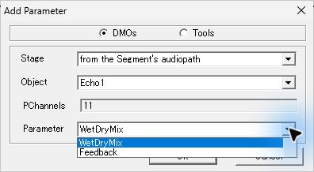
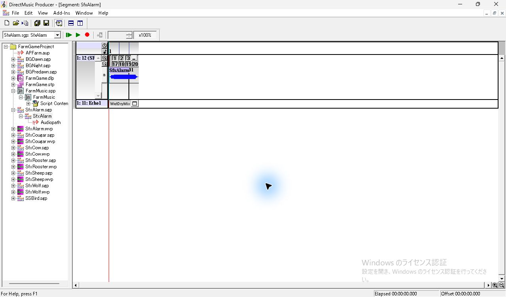

## 展開、曲線の入力、Properties

右端の四角をクリックすると約82 px 高に展開し、四角がマイナスに変わる。短い Segment の横幅を右下の横ズームで広げた。選択したストリップの値領域を右クリックすると **Draw Curve** が有効になった。選ぶとステータスバーに **Start, End** が出る。時間・値領域の左下 (316, 312) から右上 (447, 273) へドラッグすると曲線が1つできた。選択中は赤い塗り、黒い外枠と小さな黒いハンドルが見えた。選択を外した曲線は青。

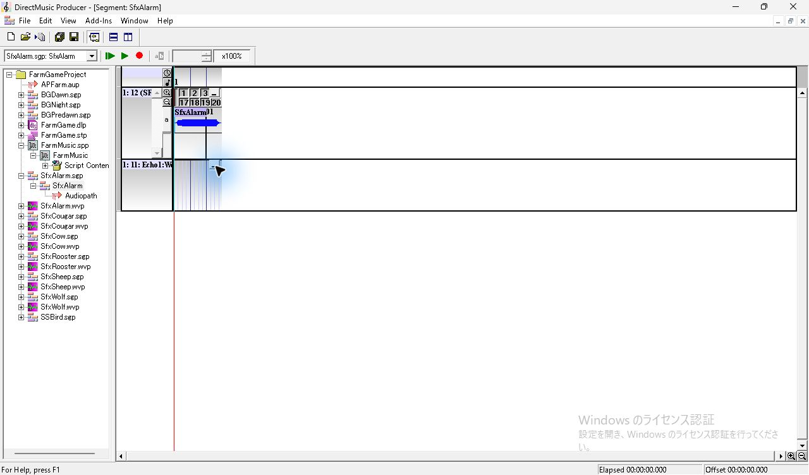
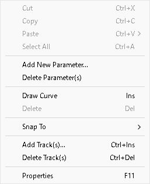
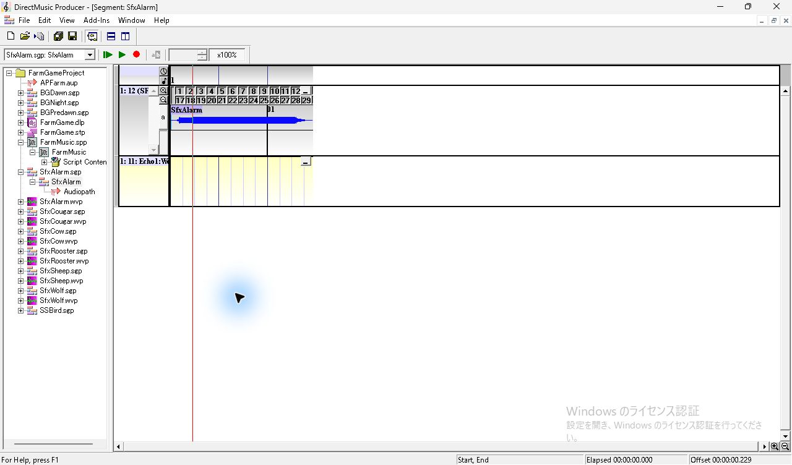
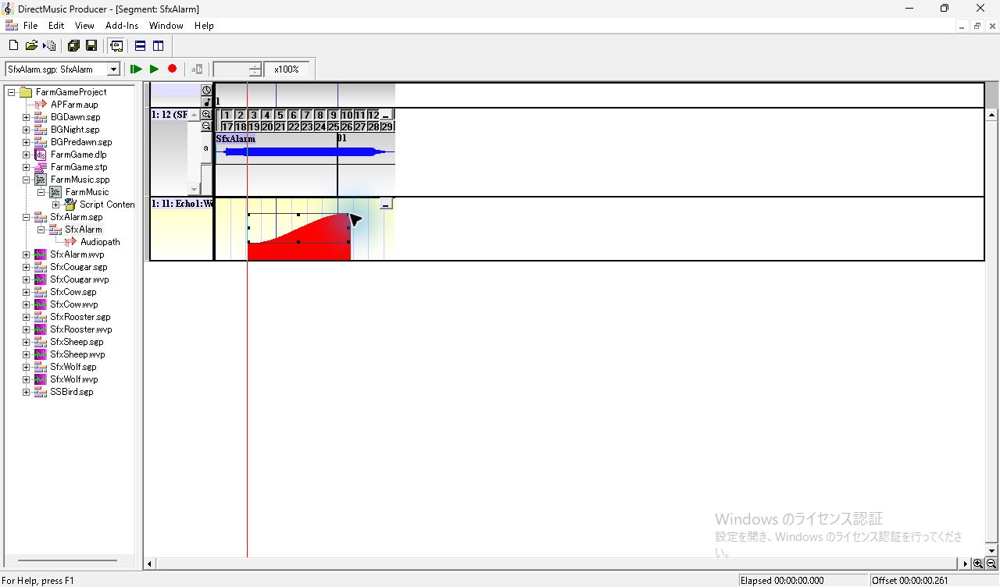

F11 で開いたモデルレス **Parameter Control Track Properties** は Track Group Assignment、Flags、Object の3タブ。グループは1、同時に1グループだけ選べる。Flags は **Enable Play** がオン。Object には Echo1 と PChannels 11 が表示された。

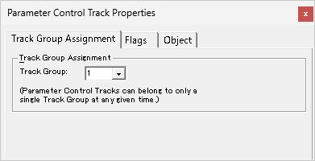
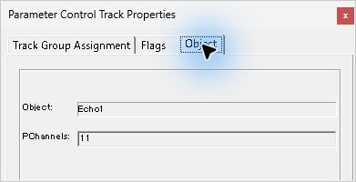
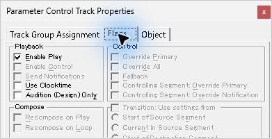

モデルレスを開いたまま曲線をクリックすると **Echo1-WetDryMix Properties** に切り替わる。Start Time、End Time、Duration は **Bar / Beat / Grid / Tick** の4列。初回描画の Type は Sine。Type の候補は Sine、Logarithmic、Exponential、Instant、Linear の順。ペイン下端では **Start From Current** が途中まで見えた。ペインの拡張可否と押下中のプレビュー、ネイティブのポインター形状は追試する。

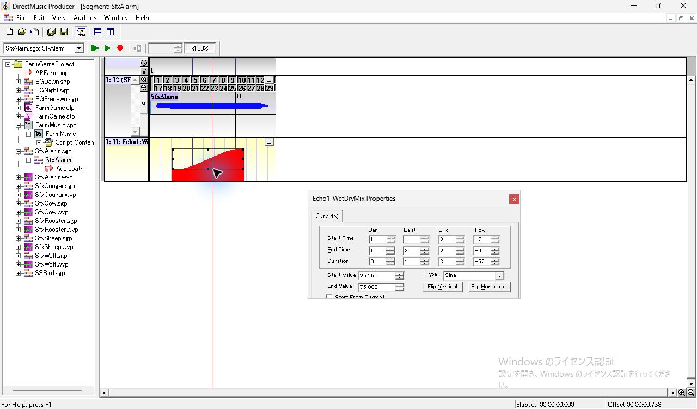
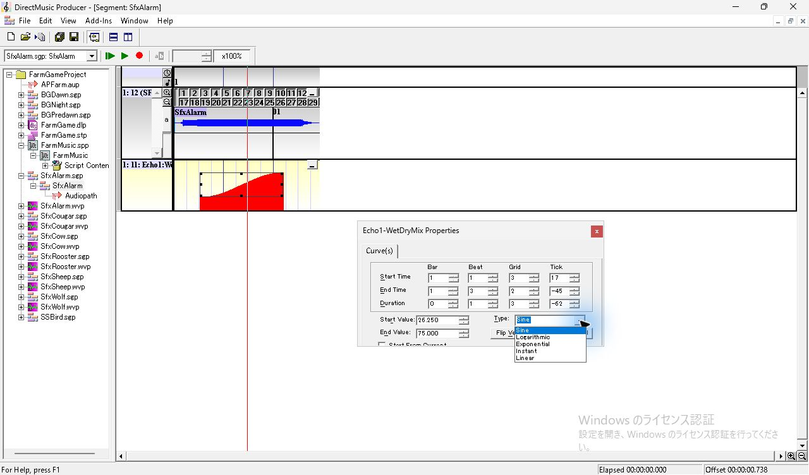

## 形状、反転、端点と移動

| 操作 | 開始と終了の時刻 | 開始値 → 終了値 | 画面の変化 |
| --- | --- | --- | --- |
| 初回描画 | 1:1:3:17 → 1:3:2:-45 | 26.250 → 75.000 | Sine の上り |
| Type を Linear に | 同上 | 26.250 → 75.000 | 曲線の上辺が直線になる |
| Flip Horizontal | 同上 | 75.000 → 26.250 | 端の値が入れ替わり下る |
| Flip Vertical | 同上 | 25.000 → 73.750 | 各値が 100 から元の値を引いた値になり上る |
| 右上ハンドルを (446, 275) から (470, 287) へ | 1:1:3:17 → 1:3:3:8 | 25.000 → 58.750 | 開始を保ち、終了が後ろへ動いて値が下がる |
| 内側を (400, 305) から (411, 309) へ | 1:1:4:-67 → 1:3:4:-76 | 20.000 → 53.750 | 表示上の Duration を保ち、全体が右下に動く |
| Ctrl+Z で全体移動を Undo | 1:1:3:17 → 1:3:3:8 | 25.000 → 59.000 | 時刻が全体移動の前へ戻る。終了値には 0.250 の差が残った |

Undo 直後は曲線の選択が外れて青くなり、開いたペインは一時的に **Audiopath Audiopath Properties** に切り替わった。曲線をクリックし直すと曲線の Properties と赤い塗りが戻った。

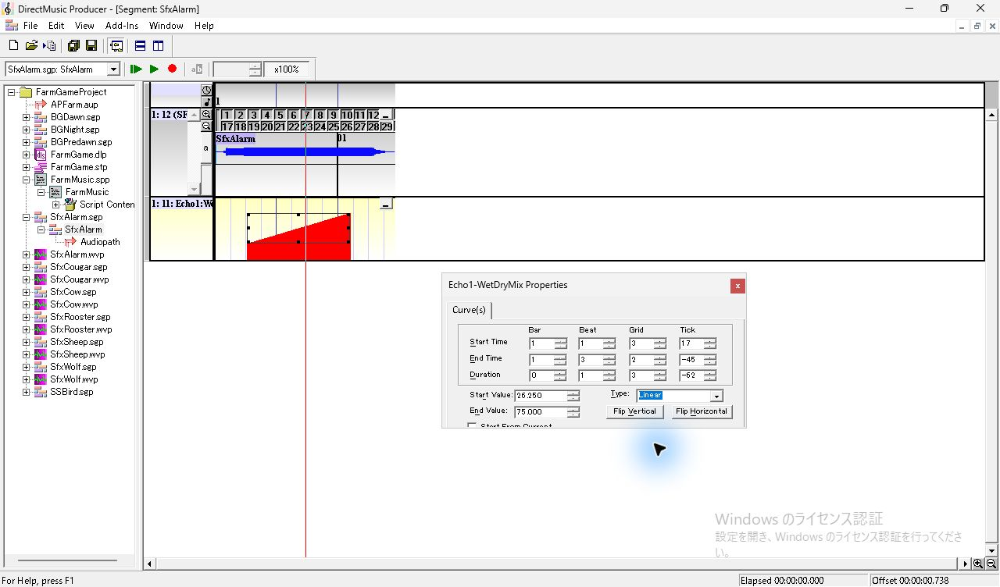
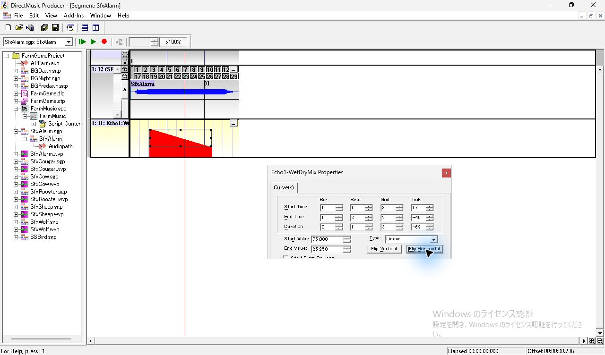
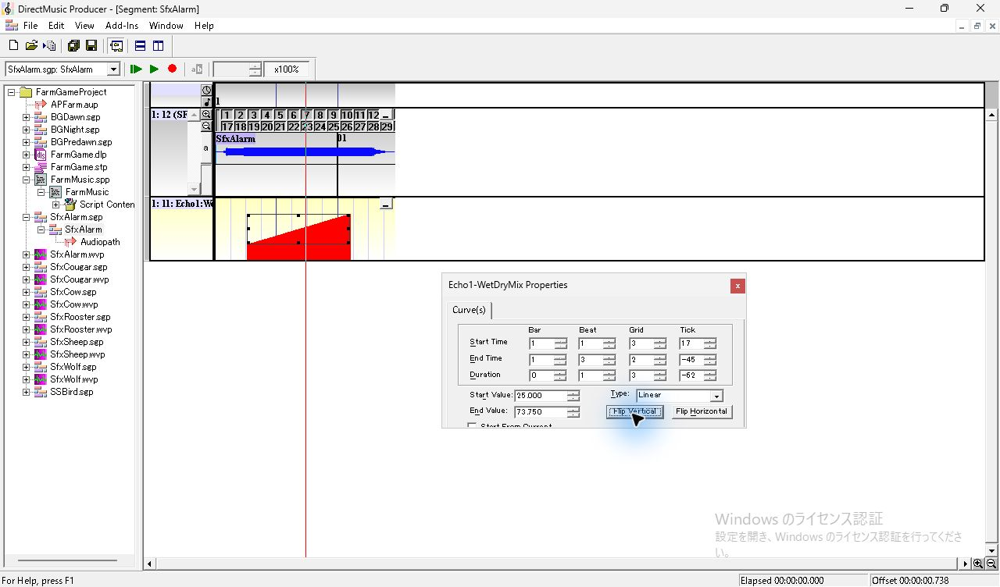
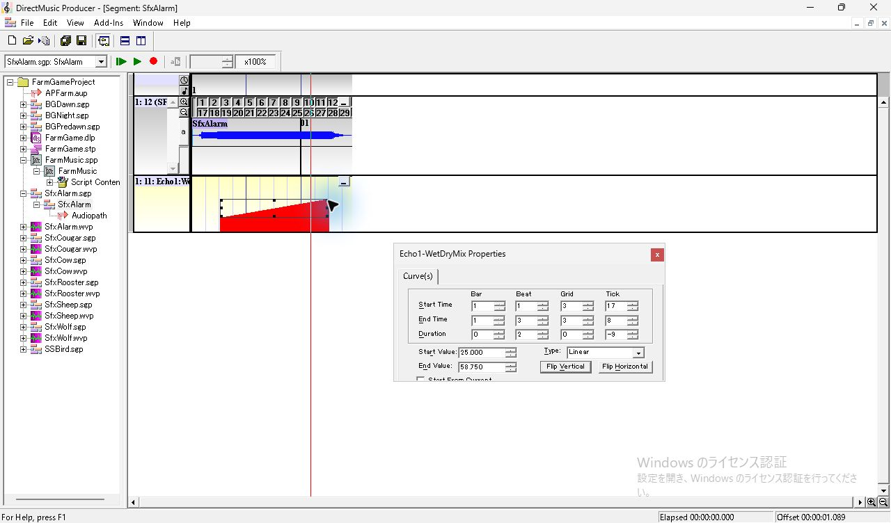
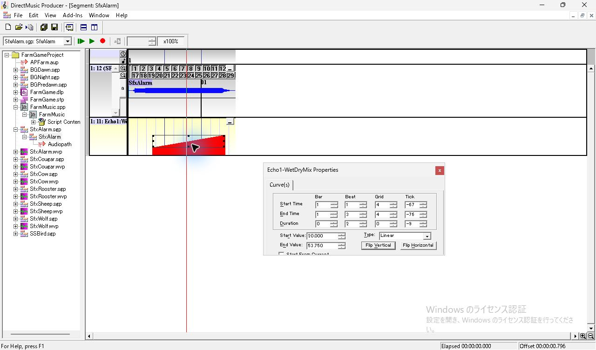
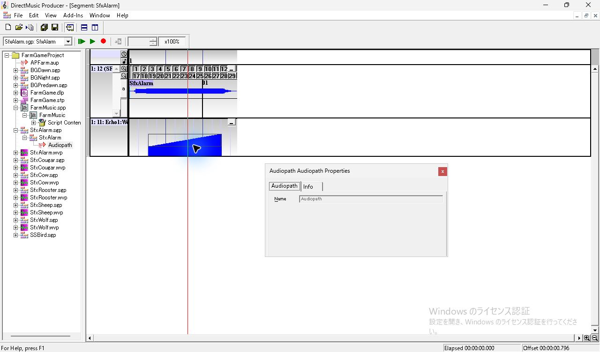
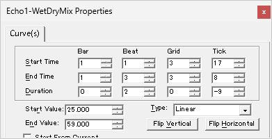

## 2つのパラメーターと再読込

同じ Echo1 の **Feedback** を追加すると、折りたたみ行は **Feedback,WetDryMix** と表示された。展開すると上に空の Feedback、下に曲線がある WetDryMix が並ぶ。Feedback 側のマイナスを押すと2行とも折りたたまれ、1行に戻った。

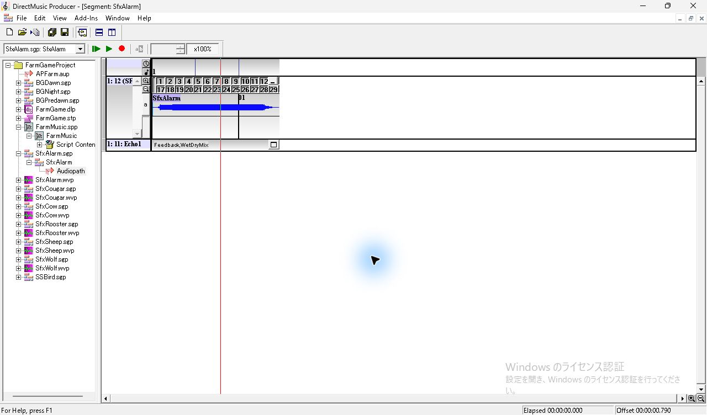
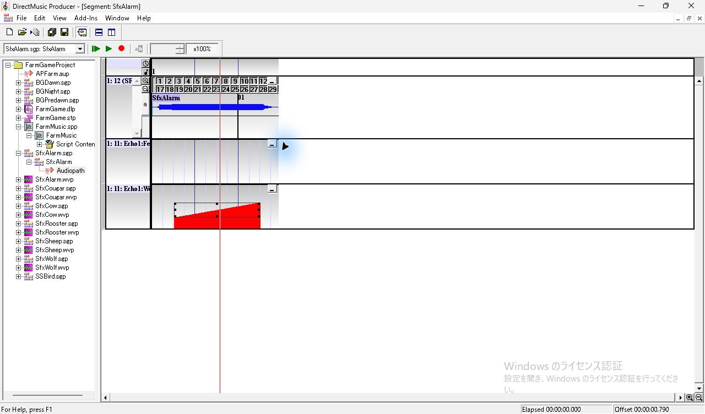

Ctrl+S で保存後、子ウィンドウを閉じて開き直すと折りたたみ状態を表示した。展開してからプロジェクトごと閉じると、SfxAlarm の変更を保存するか聞かれた。作業コピーに保存し、同じ Producer でプロジェクトを開き直した。SfxAlarm は展開状態で開き、2行と未選択の青い曲線が戻った。曲線の Properties を再表示すると、Linear、25.000→59.000 と、Undo 後の時刻が復元された。

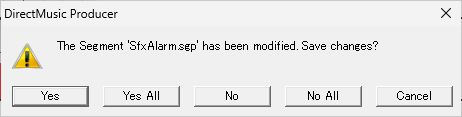
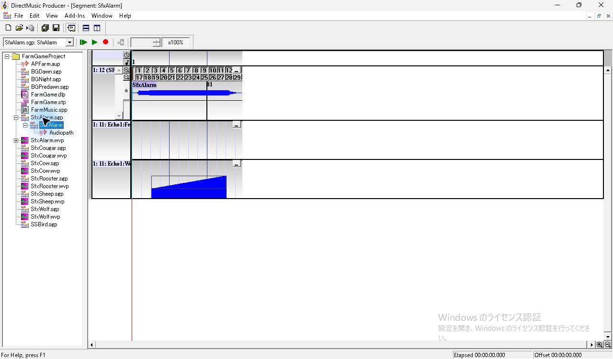
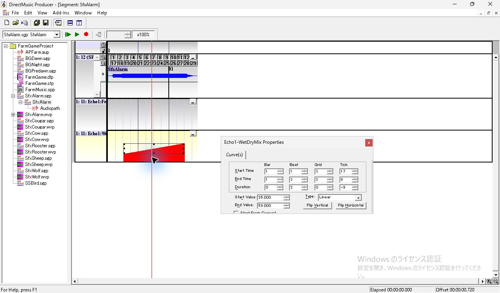

保存ファイルの Parameter Track は、埋め込み AudioPath の **Echo1** と同じ Effect GUID を持つ。PChannel は画面の11に対し保存値は0起点で10。Feedback と WetDryMix の2パラメーターがあり、曲線は WetDryMix の1件。開始401 clocks、終了1928 clocks、値25.0と59.0、形状IDは2。元の21ファイルをハッシュ照合し、再読込時の作業コピーで内容が異なるファイルは SfxAlarm.sgp だけだった。埋め込み AudioPath のチャンク内容は一致した。 [保存値とハッシュ](../../../work/original-gui/SEG-14-pattern-style/20261111T074828536163Z/parameter-control-audit.json)

別の試行で、同じパラメーターの複数選択、一括反転と Undo、境界を超えるドラッグ、Use Clocktime、別プロセスでの復元、Echo1 の実音声を照合した。押下中のプレビューとカーソル、修飾キー、Start From Current、埋め込み AudioPath に DMO がない場合、ToolGraph に対象がある場合、曲線ごとの発音と適用順は追試へ。 [Parameter Control の複数曲線、時刻と Echo の発音](seg-14-parameter-control-followup.md)
