# SEG-14　リンク中の Pattern Part の CC と Var Switch Point

2026-11-12。DirectMusic Producer 5.3.0.900 の作業コピーで、FarmGameProject の **SSBird.sgp** を使用。内蔵 Pattern の PChannel 11 と13がリンク済みの保存版から開始した。Segment は1/4、100 BPM、6小節。上の L11 は同一参照の別表示を含み、PChannel 12 は空。画面1280×752 px。撮影160枚から38枚を掲載。座標の原点は画面左上。青い光と太い黒矢印は操作ツールの表示。View は標準4項目、MIDI 書き出し中だけ Wave/MIDI Export Toolbar を表示した。 [前回のリンク作成](seg-14-pattern-part.md) · [作業入力28件と実行環境](../../../work/original-gui/SEG-14-pattern-controls/20261111T165909583325Z/run.json) · [画像の出典と寸法](../../../work/original-gui/SEG-14-pattern-controls/20261111T165909583325Z/published-pattern-controls-figures.json)

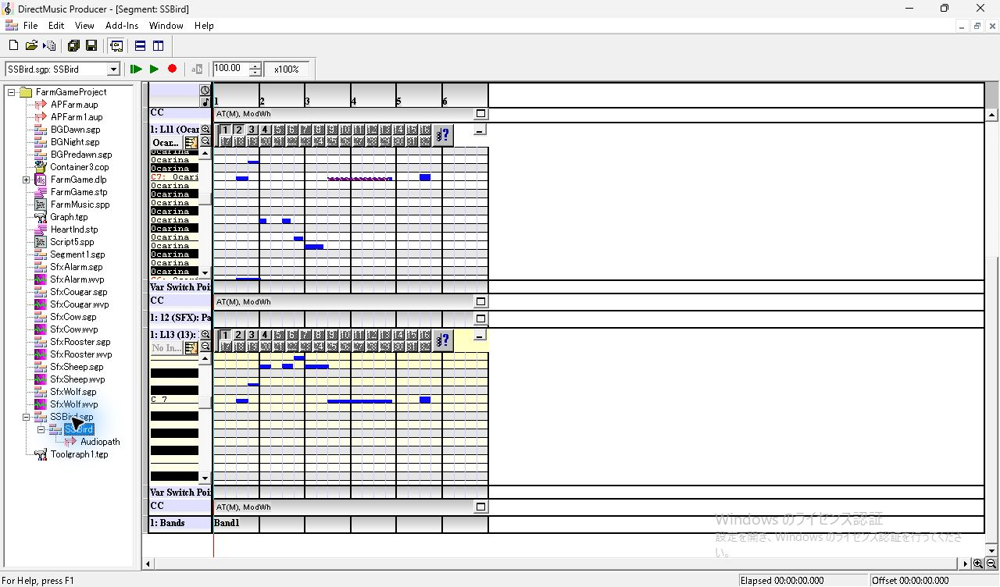

## L13 から Mod Wheel 曲線を追加

L13 の **CC** 要約には **AT(M), ModWh**。右端の四角を押すと **CC: Mono AT** と **CC: 1 Mod Wh** の2行に展開される。右端の縦スクロールバーを下へ動かすと下段の全体が見える。表示中の Variation 1 では既存の Mod Wheel が第5〜6小節付近にあり、今回使う第3小節は空。

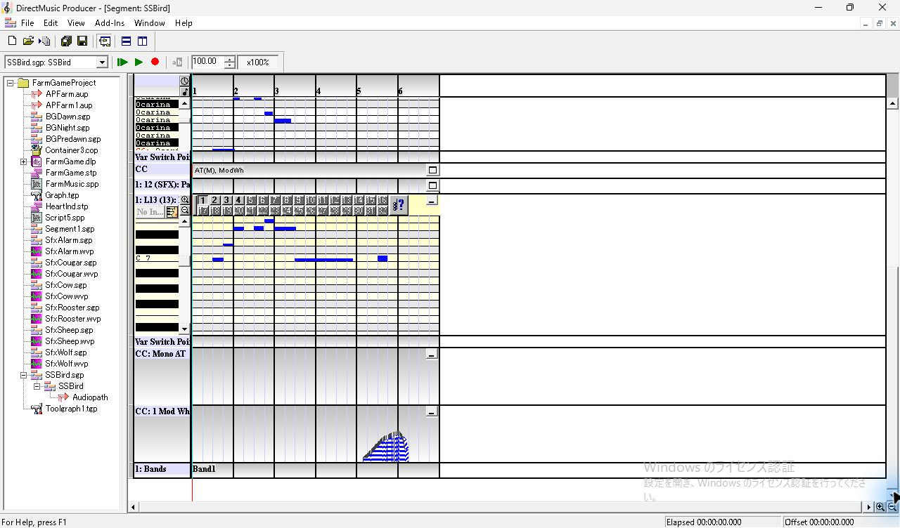

Mod Wheel 行の空白（`403,612`）を右クリック。**Draw Curve** は有効で、右端に **Ins**。選ぶと対象行が淡黄色になり、ステータス欄に **Start, End** が出る。第3小節の `395,642` から `439,591` へドラッグすると、上昇する赤い曲線と黒いハンドルが現れた。F11 の **1 Mod Wheel Curve Properties** には **Curve(s)、Reset、Variations** の3タブ。Curve(s) の表示は **Sine、25 → 106**、Start **3:1:1:63**、End **3:1:4:64**。 [同梱ヘルプの曲線挿入](../../../../../work/analysis/original-manual-session/20261010T031624075Z/help-extracted/htm/toinsertacontinuouscontrollercurve.htm)

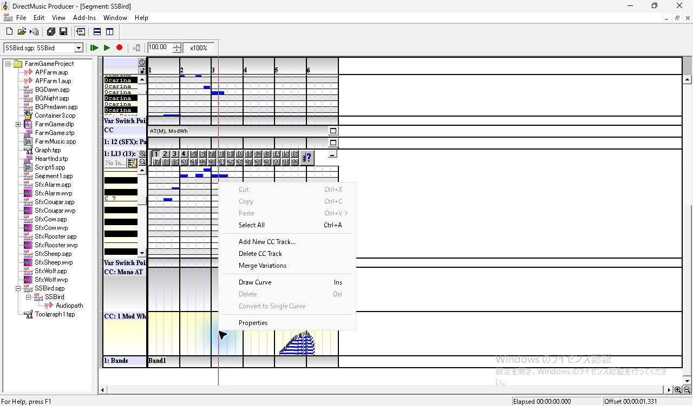

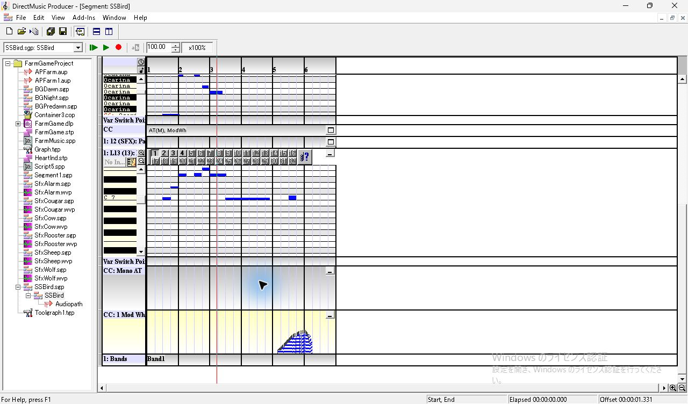

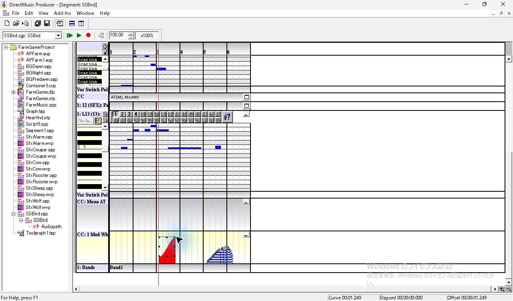

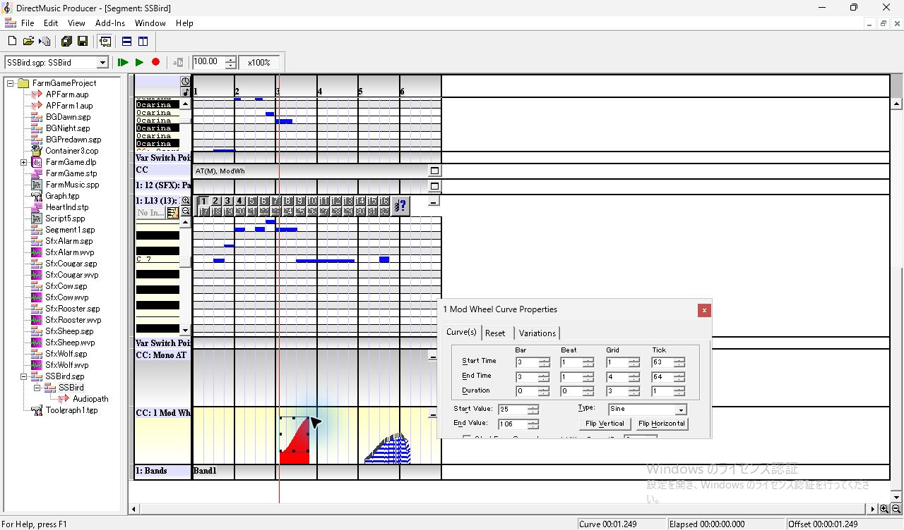

## リンク中の Var Switch Point と表示する Variation

L13 の **Var Switch Point** の第4小節先頭（`453,484`）で右クリック。**Insert Switch Point** に **Enter and Exit、Enter、Exit** とそれぞれの **Chord Trigger** 版がある。通常の **Enter and Exit** を選ぶと、L13 と画面上側の L11 の同じ時刻に、上が緑、下が赤のマーカーが現れた。挿入直後は Enter と Exit が両方オン、両方の Trigger only with Chord Change がオフ、Variation 1 だけオン。

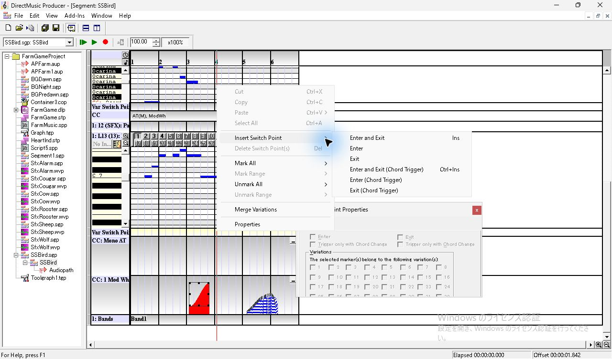

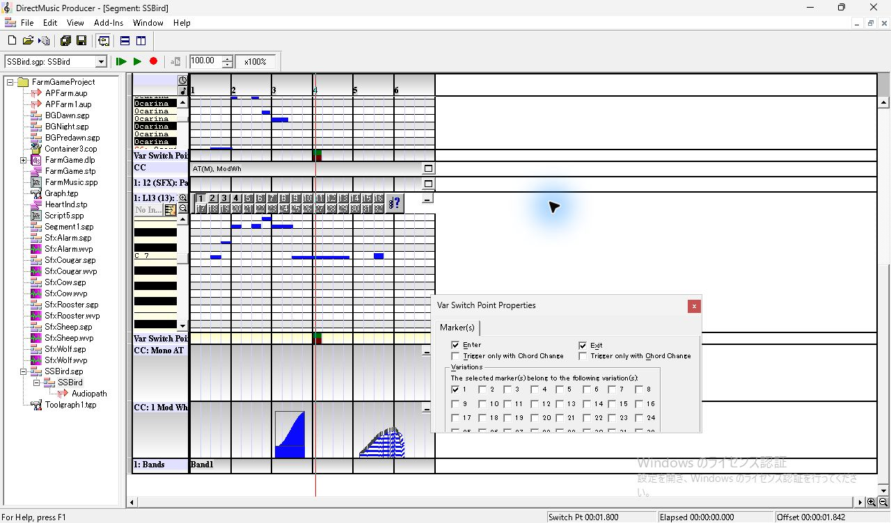

開いた **Var Switch Point Properties > Marker(s)** で **Exit 側だけ Trigger only with Chord Change** をオンにし、Variation **2** もチェック。第4小節のマーカーに斜線が入り、Exit 側に暗い縁が出た。L11 の CC も展開すると、先に L13 で描いた第3小節の曲線が同じ位置にあった。縦スクロールで、2つの Mod Wheel 行を同時に見られる。 [リンク中の保存版](../../../work/original-gui/SEG-14-pattern-controls/20261111T165909583325Z/captures/linked-controls-SSBird.sgp) · [同梱ヘルプのマーカー表示](../../../../../work/analysis/original-manual-session/20261010T031624075Z/help-extracted/htm/variationswitchpoints.htm) · [Marker(s) の項目](../../../../../work/analysis/original-manual-session/20261010T031624075Z/help-extracted/htm/variationswitchpointproperties.htm)

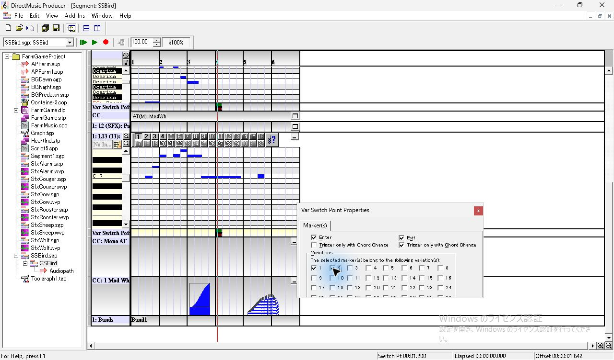

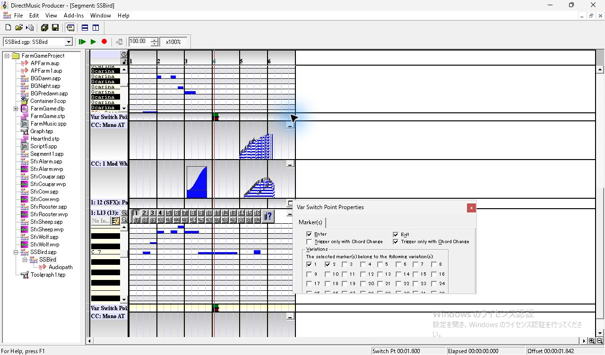

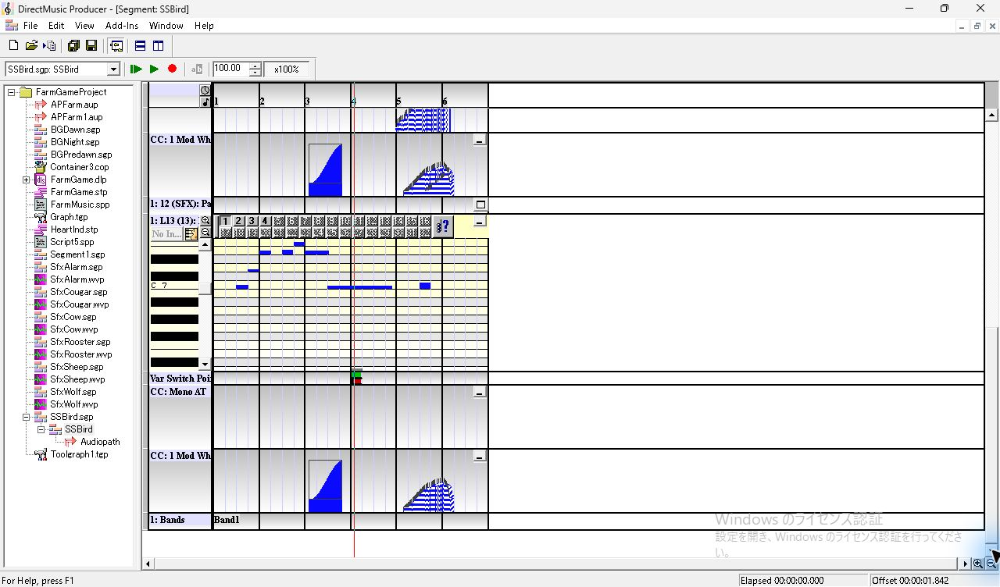

L13 の Variation **2** をダブルクリックすると、L13 では第3小節の追加曲線が隠れ、ピアノロールと既存 CC の表示も変わった。第4小節のマーカーは Variation 2 にも属するため残る。上側の L11 の曲線は見えたまま。保存では L11 の2表示のマスクは両方 **0x3** のまま、L13 は **0x1 → 0x2**。参照先は同じ Part GUID。曲線とマーカーのデータは一致した。 [L13 が Variation 2 の保存版](../../../work/original-gui/SEG-14-pattern-controls/20261111T165909583325Z/captures/linked-variation2-SSBird.sgp)

L13 を Variation 1 に戻して **Play From Start**。再生中は L13 の **1** が赤くなり、自然終了した。MIDI のチャンネル13に第3小節の上昇が出た。チャンネル11の音符列はこの試行では13と異なり、同じ時間帯の上昇は出なかった。後述の解除後の別の試行では、両チャンネルで同じ上昇が出た。 [リンク中の MIDI](../../../work/original-gui/SEG-14-pattern-controls/20261111T165909583325Z/captures/ssbird-linked.mid)

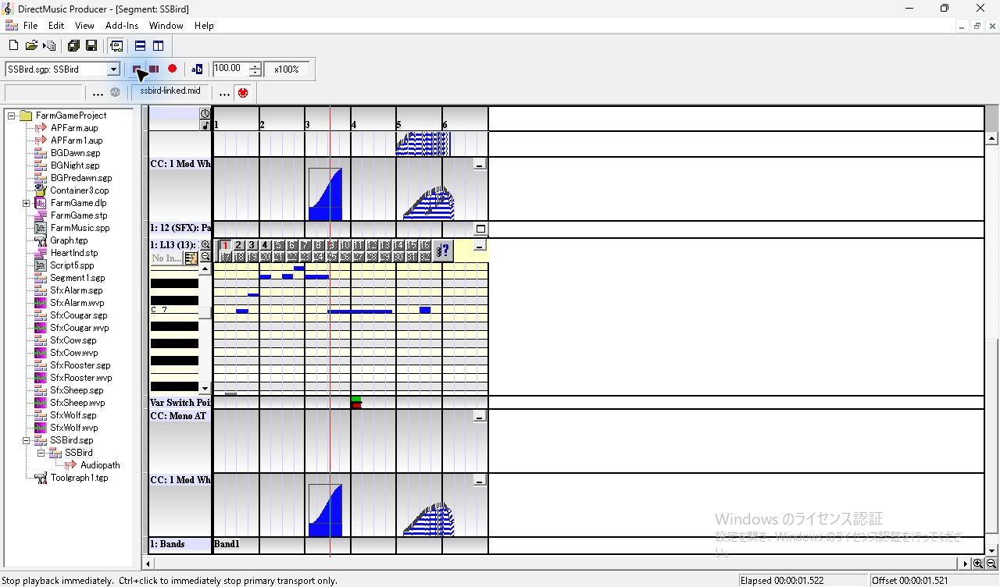

## リンク解除の直後と、解除後の独立編集

L13 のヘッダーを右クリックして **Unlink Part Reference**。行頭から **L** が消え、両方の曲線と第4小節のマーカーは見えたまま。直後の保存では、11・13とも編集リンクのフラグ `ppfd` が **1 → 0**。2つの参照が指す Part GUID は、この時点では同じだった。 [解除直後の保存版](../../../work/original-gui/SEG-14-pattern-controls/20261111T165909583325Z/captures/unlinked-copy-SSBird.sgp)

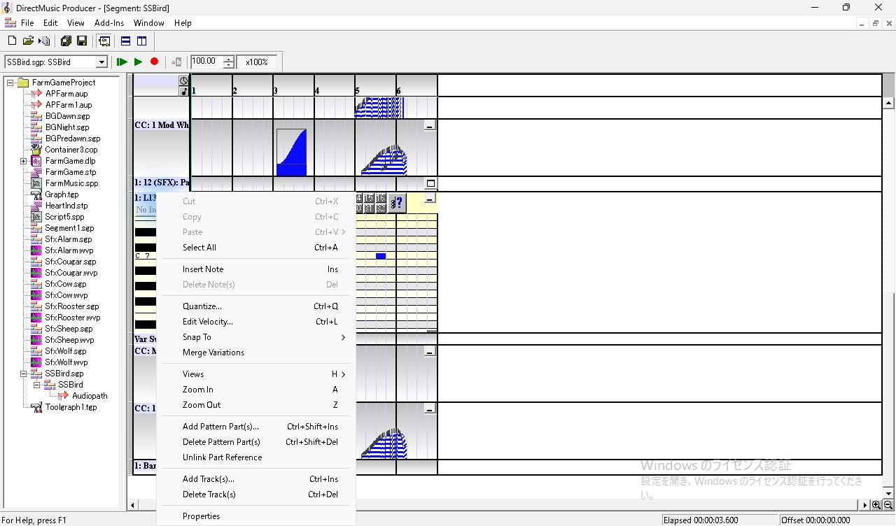

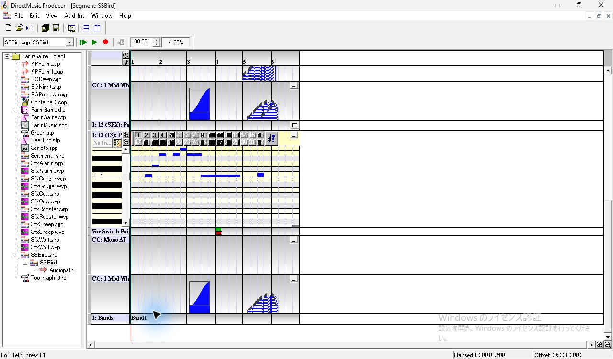

解除後の13で、Mod Wheel の第4小節（`459,584`）を選択して Insert。`459,584` から `500,644` へドラッグし、下降曲線を作った。上の11には出なかった。13の第5小節の Var Switch Point では、メニューに **Enter and Exit (Chord Trigger)** のショートカットとして Ctrl+Ins がある。セルをクリックして Ctrl+Ins を押した試行では **SSBird - Add New Tracks** が開いた。Esc で閉じ、同じ項目を右クリックメニューから選ぶと、13にだけ緑・赤のマーカーが入った。F11 では Enter・Exit と両方の Chord Change がオン、Variation 1 のみオン。 [独立編集の保存版](../../../work/original-gui/SEG-14-pattern-controls/20261111T165909583325Z/captures/unlinked-controls-SSBird.sgp)

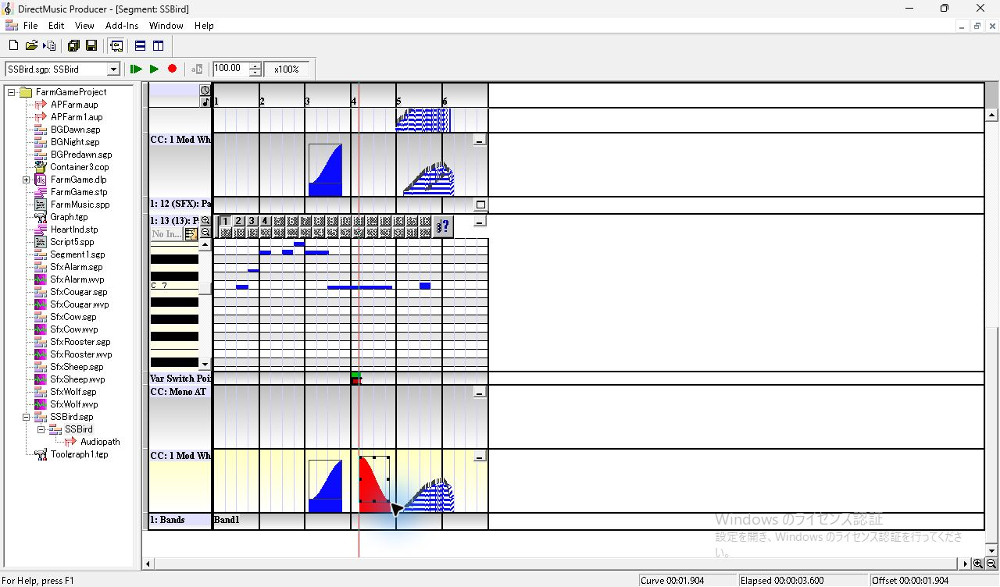

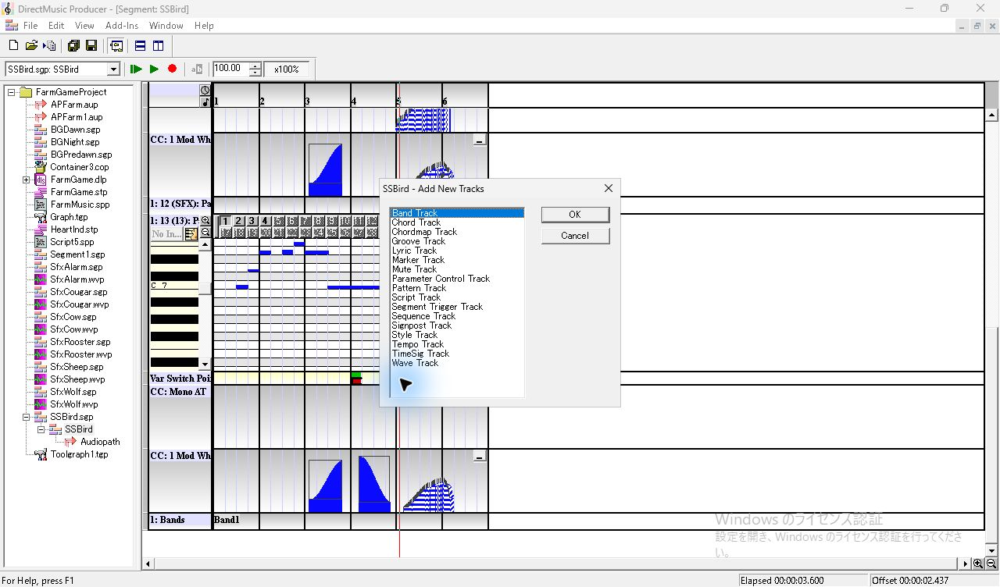

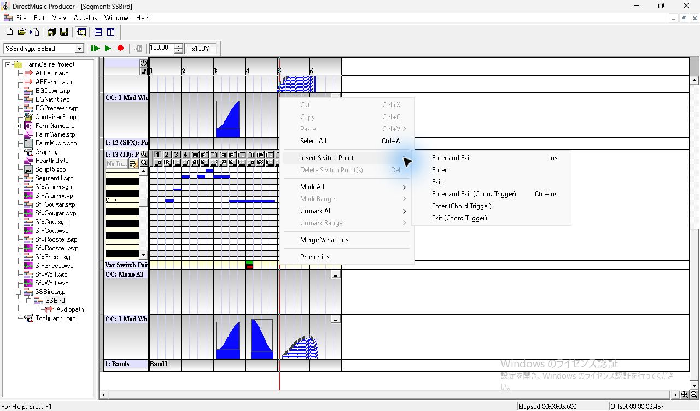

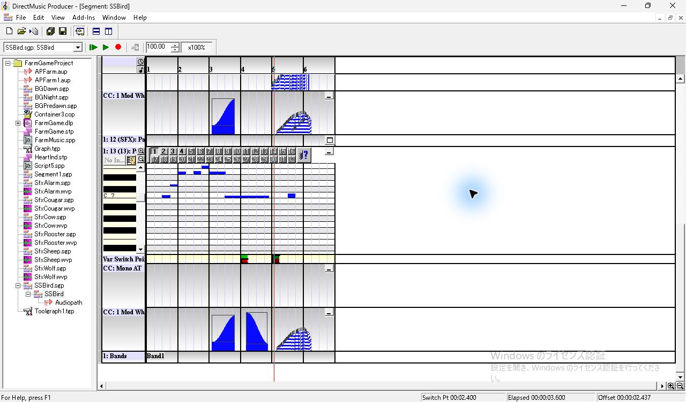

13のマーカー行にフォーカスして **Ctrl+A** を押すと、第4・5小節のマーカーを同時選択できた。共通の Enter、Exit、Exit 側の Chord Change、Variation 1 は黒いチェック。値が混在する Enter 側の Chord Change と Variation 2 は灰色のチェックになった。第5小節のマーカーを選び直し、`513,481` から `552,481` へドラッグした試行では、解放後も第5小節先頭に残った。保存したマーカーの時刻とフラグも一致した。押下中のポインターは未観測。 [ドラッグ後の保存版](../../../work/original-gui/SEG-14-pattern-controls/20261111T165909583325Z/captures/unlinked-after-drag-SSBird.sgp)

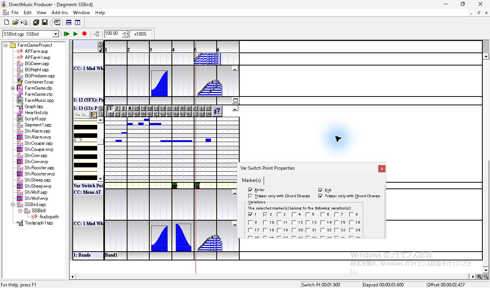

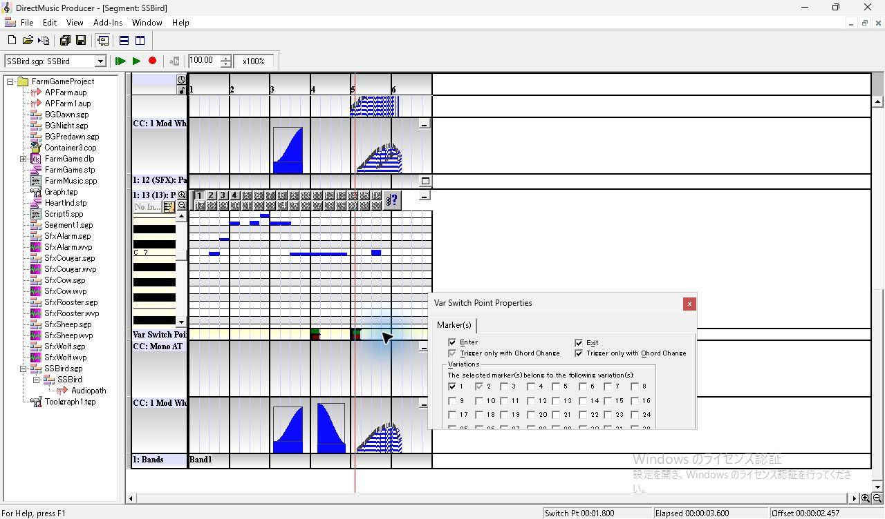

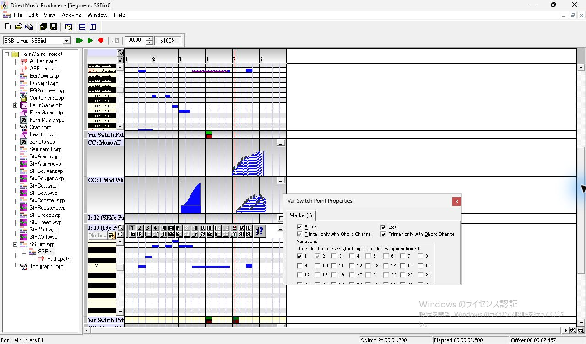

| 保存条件 | 11・13 の参照先 | 曲線数（11 / 13） | マーカーの位置（11 / 13） |
| --- | --- | ---: | --- |
| 凍結入力 | 同じ GUID、リンクフラグ1 | 230 / 230 | なし / なし |
| 共有編集後 | 同じ GUID、リンクフラグ1 | 231 / 231 | 第4小節 / 第4小節 |
| 解除直後 | 同じ GUID、リンクフラグ0 | 231 / 231 | 第4小節 / 第4小節 |
| 解除して13を編集した後 | 別の GUID、リンクフラグ0 | 231 / 232 | 第4小節 / 第4・5小節 |

第4小節の `mrkr` は Grid index **12** に2レコード。Variation mask **0x3** でフラグ **1（Enter）** と **6（Exit、Chord Change）**。第5小節は Grid index **16**、mask **0x1**、フラグ **5（Enter、Chord Change）** と **6**。上昇・下降曲線はどちらも Mod Wheel（CC1）、mask **0x1**。保存値の上昇は Grid index **8**、オフセット **63**、長さ **577** clocks、値 **25 → 106**。下降は Grid index **12**、オフセット **134**、長さ **537** clocks、値 **114 → 19**。27音符の集合は維持された。 [全7版の照合](../../../work/original-gui/SEG-14-pattern-controls/20261111T165909583325Z/pattern-controls-audit.json)

## 再生時の Variation と MIDI

解除後、13が Variation 1 の曲線を表示している状態で **1** を再度ダブルクリックした試行では、下段の追加曲線2本が一度隠れ、同じ操作を繰り返すと戻った。この途中状態の保存マスクは未採取。下記の試聴では、追加曲線2本が見える状態で開始し、赤い **1** を確認した。Variation 2 の試聴は **2** をダブルクリックして切り替え、赤い **2** を確認した。

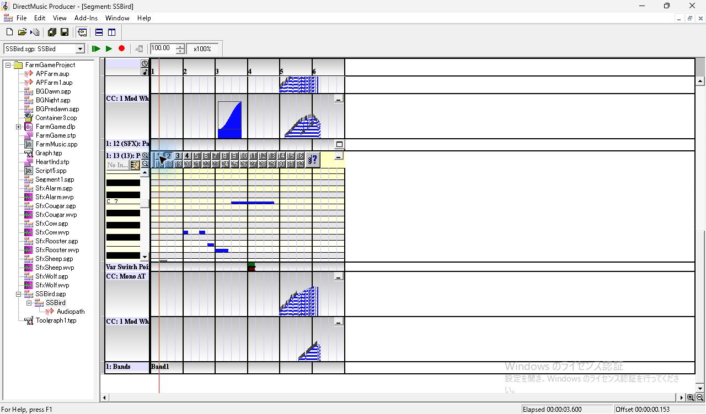

**View > Wave/MIDI Export Toolbar** の MIDI を待機させ、**Play From Start** から自然終了まで収録した。下表は MIDI チャンネル11と13の CC1 を、追加曲線の各時刻に絞った件数。自然終了で MIDI の出力名は空になった。 [リンク中](../../../work/original-gui/SEG-14-pattern-controls/20261111T165909583325Z/captures/ssbird-linked.mid) · [解除後 Variation 1](../../../work/original-gui/SEG-14-pattern-controls/20261111T165909583325Z/captures/ssbird-unlinked-var1.mid) · [解除後 Variation 2](../../../work/original-gui/SEG-14-pattern-controls/20261111T165909583325Z/captures/ssbird-unlinked-var2.mid)

| 13の再生表示 | 第3小節 1599〜2176 ticks（11 / 13） | 第4小節 2438〜2975 ticks（11 / 13） | チャンネル13の Note On |
| --- | ---: | ---: | ---: |
| リンク中、1 | 0 / 27 | 0 / 0 | 8 |
| 解除後、1 | 27 / 27 | 0 / 32 | 8 |
| 解除後、2 | 0 / 0 | 0 / 0 | 6 |

第3小節の出力があった3つのチャンネル・試行では、CC1 の時刻と値がすべて一致。解除後、Variation 1 の下降は13だけで **114 → 19**。Variation 2 のチャンネル13は Note On が6件で、Variation 1 に含まれた第5小節の **3456 ticks、キー84** が出なかった。録音は各22秒、48 kHz、32-bit float、2チャンネルの既定出力ループバックで、両条件に信号があった。録音はミックス出力。チャンネル別の差は MIDI で照合した。複数の Variation を許可した場合の途中切替は、無条件の Exit、コード変更条件、Exit 削除の対照試験を [Variation 再生順と途中切替](seg-14-variation-playback.md) に記録した。 [Variation 1 の WAV](../../../work/original-gui/SEG-14-pattern-controls/20261111T165909583325Z/captures/audio-unlinked-var1/output.wav) · [Variation 2 の WAV](../../../work/original-gui/SEG-14-pattern-controls/20261111T165909583325Z/captures/audio-unlinked-var2/output.wav)

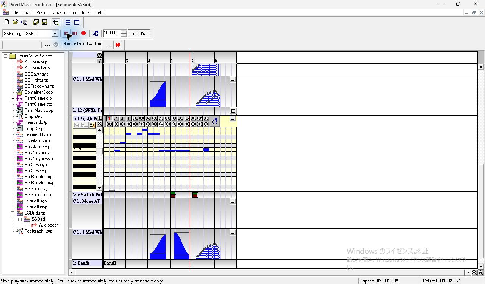

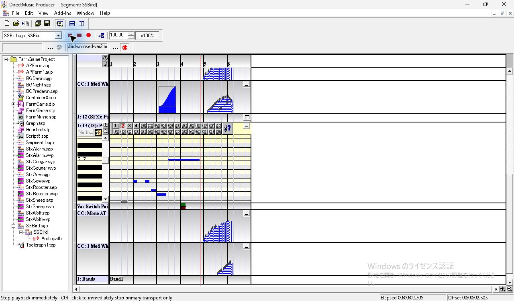

## 別プロセスでの復元と Part タブ下部

13の Variation 2 を表示して保存し、Wave/MIDI Export を隠して File > Exit。Producer が0件になったことを確認して同じ EXE を起動した。別起動で SSBird を開くと CC は展開、13は Variation 2 の表示で、第4小節のマーカーだけが見える。13を Variation 1 に戻すと、追加した曲線2本と第5小節のマーカーが再表示され、上の11に下降曲線はなかった。 [再起動前後](../../../work/original-gui/SEG-14-pattern-controls/20261111T165909583325Z/captures/82-relaunch.json) · [別起動で使った保存版](../../../work/original-gui/SEG-14-pattern-controls/20261111T165909583325Z/captures/unlinked-variation2-SSBird.sgp)

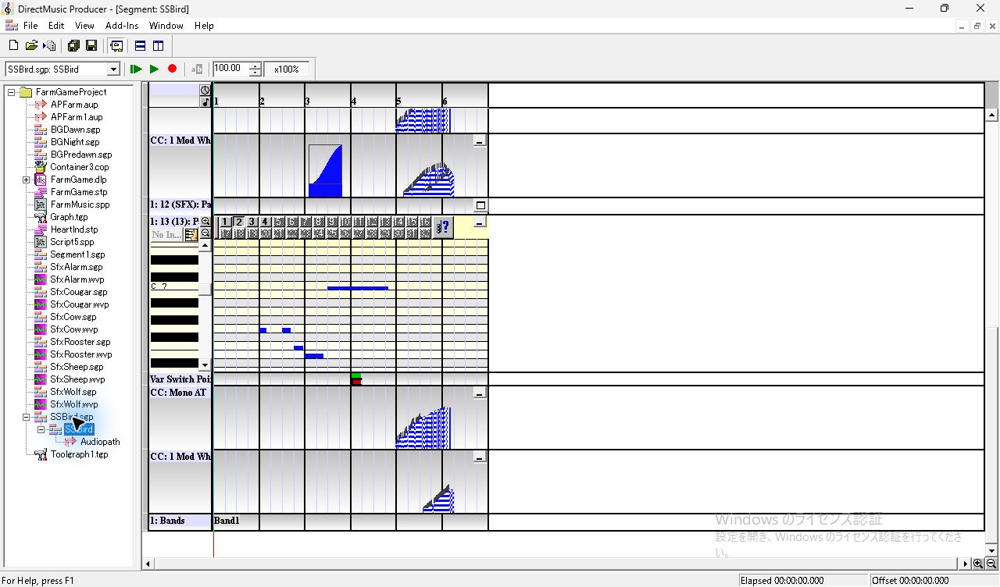

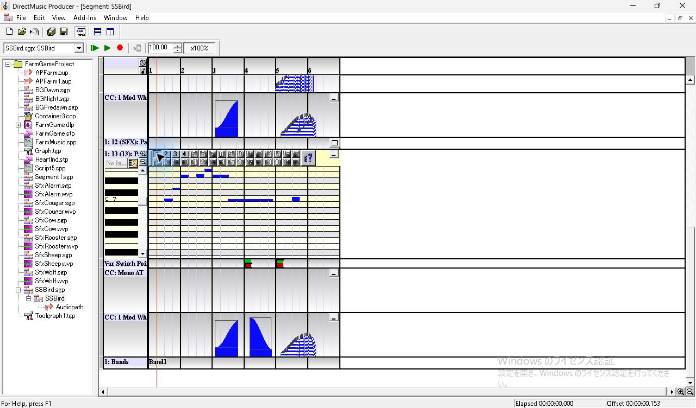

13のヘッダーで F11 を押すと **Pattern Track Properties > Part**。Time Sig **1/4**、Length **8 Bar(s)**、Lock ID **None**、Play **in random order**、Default Play Mode **Chord/Scale**、**Chord Level 1**。今回の Properties は391×200 px で最下段が途中で切れている。下端 `814,621` を80 px 下へドラッグした試行では全体が下へ移動し、高さは変わらなかった。タイトルをドラッグして上へ動かしても、同じ高さだった。 [下端ドラッグ後の記録](../../../work/original-gui/SEG-14-pattern-controls/20261111T165909583325Z/captures/89-resize-part-properties.json)

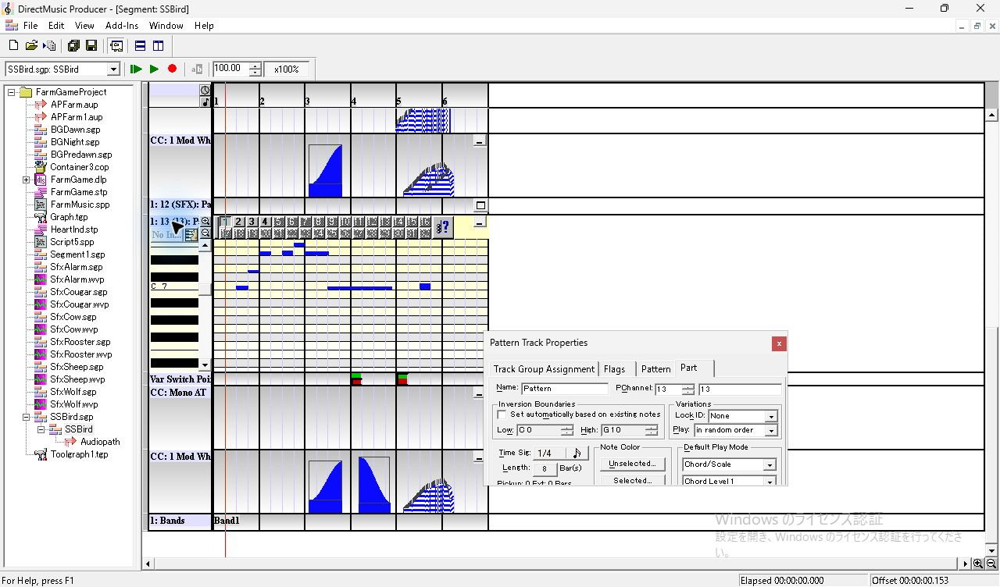

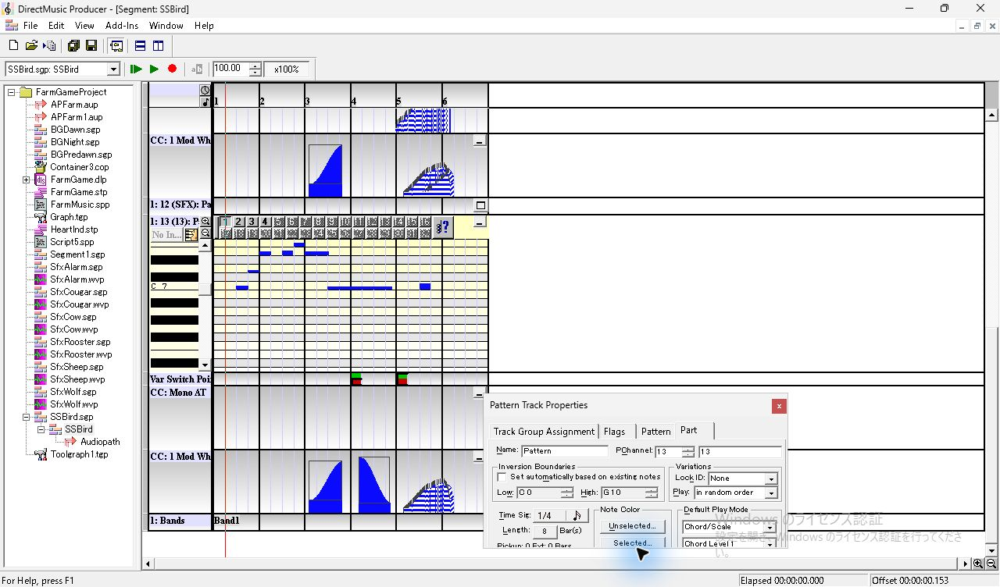

下部に一部見えているコンボボックスと色ボタンはクリックできた。各一覧は次の内容。確認後は Esc で閉じた。**Selected...** は日本語の **色の設定** を開き、赤の基本色が選択されていた。**キャンセル** で戻した。

| 項目 | 画面に出た候補 |
| --- | --- |
| Variations の Play | in random order、in order from first、in order from random、with no repeats、by shuffling |
| Default Play Mode | Chord/Scale、Chord、Scale、Pedal Point、Pedal Point Chord、Pedal Point Always、Fixed |
| Chord Level | Chord Level 4、3、2、1 |

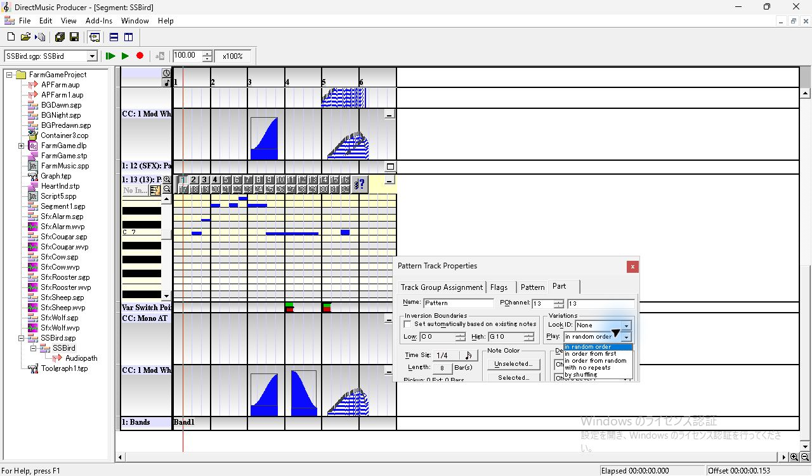

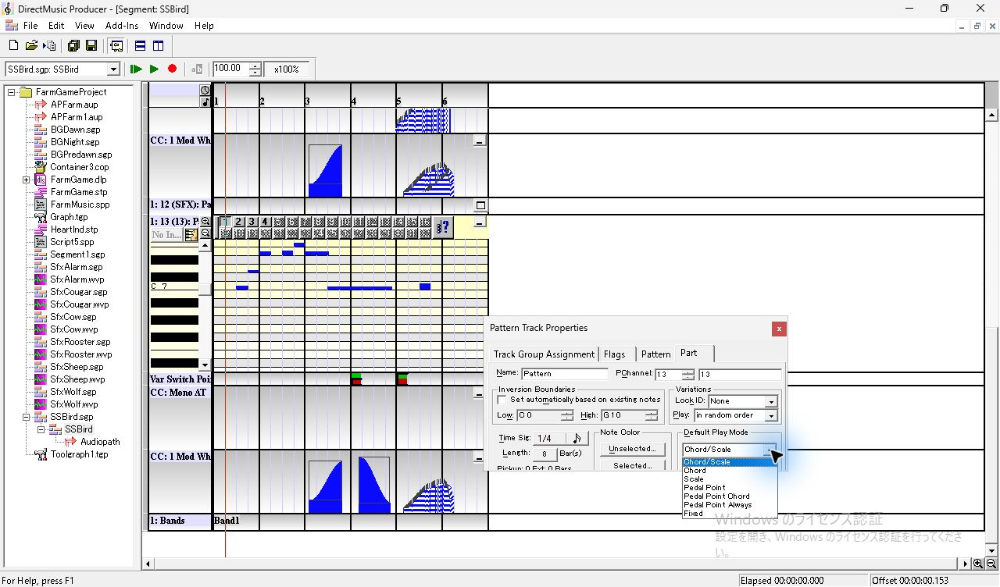

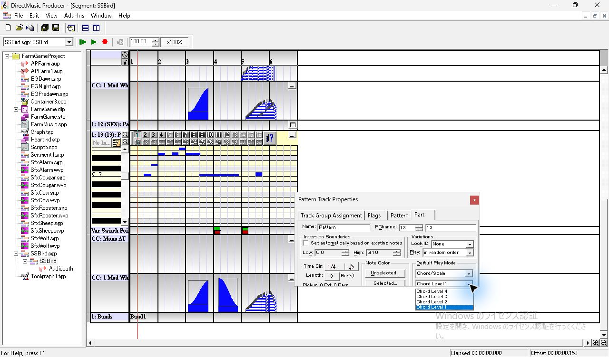

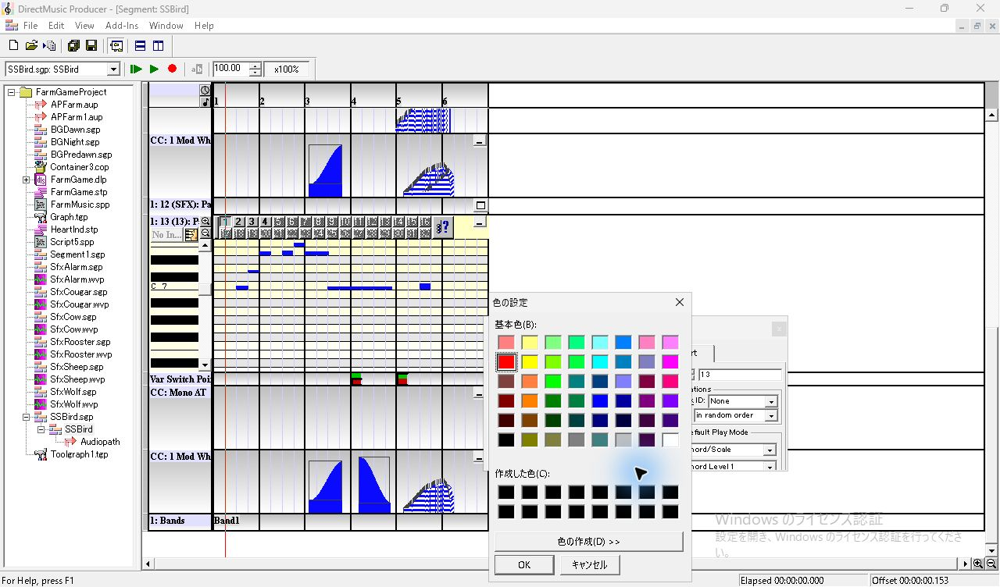

Properties を元の位置に戻して閉じ、Project を閉じる際の SSBird の確認は **No**。ディスク上は再起動前の Variation 2 の保存版と全バイト一致。終了時は Project を閉じた停止状態の Producer が1件、View は Project Tree、Standard Toolbar、Status Bar、Transport Controls の4項目。 [終了時のウィンドウ](../../../work/original-gui/SEG-14-pattern-controls/20261111T165909583325Z/captures/106-final-windows.json)

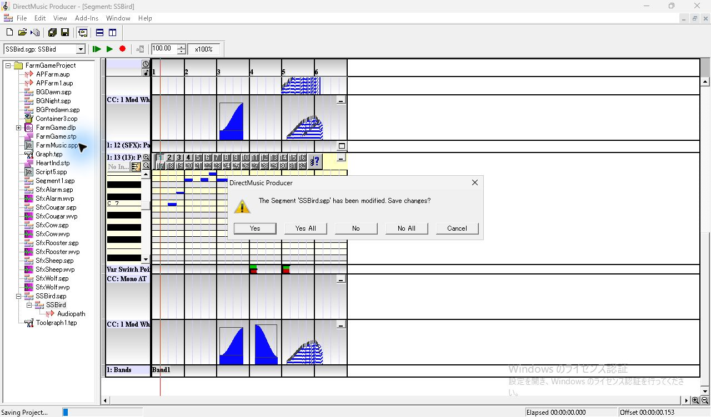

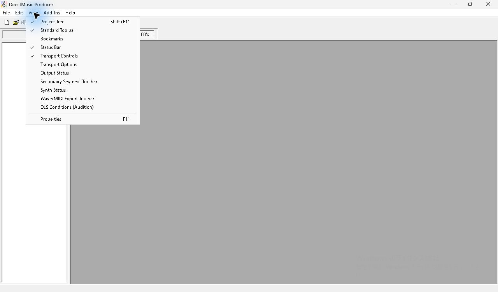

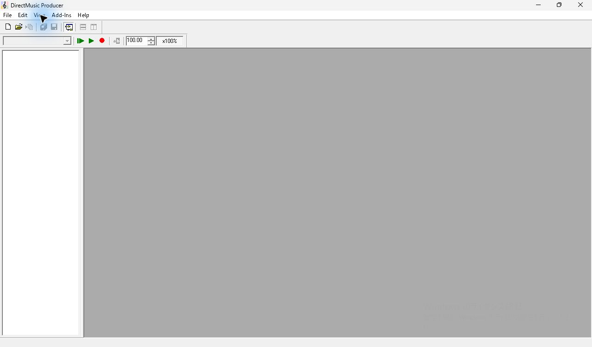
