# SEG-14　Pattern Part の表示、リンク、移動と Variation

2026-11-11。DirectMusic Producer 5.3.0.900 の作業コピーで、FarmGameProject の **SSBird.sgp** を使用。Segment は1/4、100 BPM、6小節。内蔵 Pattern と元の Part の長さは8小節。ウィンドウは1280×752 px、View の標準4項目。撮影164枚から40枚を掲載する。座標の原点は画面左上。画像の青い光と太い黒矢印は操作ツールの表示。 [凍結入力28件](../../../work/original-gui/SEG-14-pattern-part/20261111T154539029714Z/run.json) · [画像の出典と寸法](../../../work/original-gui/SEG-14-pattern-part/20261111T154539029714Z/published-pattern-part-figures.json)

## 既存の Part を別の行に表示

開いた直後は、Chord と Bands の間に **PChannel 11 / Ocarina** の折りたたみ行が1つ。青い細線のノート概要と右端の四角がある。四角 **(615,214)** を押すと、鍵盤、2段32個の Variation、Var Switch Point、CC の **AT(M), ModWh** が展開された。元の Part は26音符と230件のコントローラー曲線を持つ。

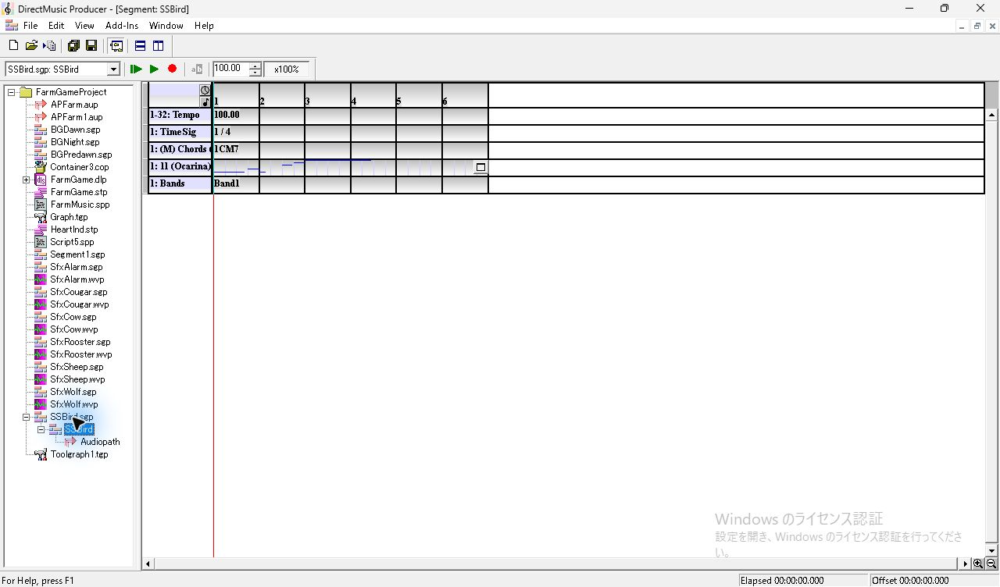

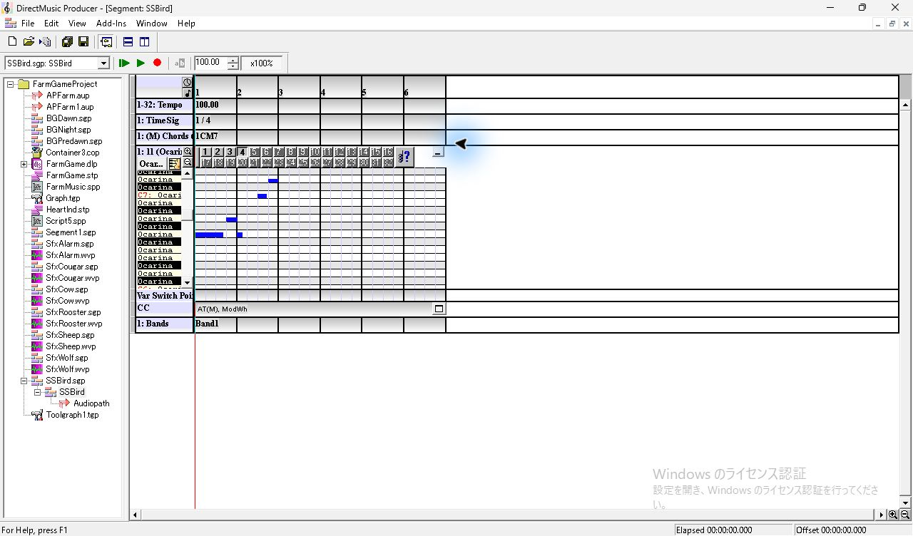

ヘッダーの右クリックから **Add Pattern Part(s)...** を開いた。メニューには **Ctrl+Shift+Ins** が表示され、後の操作でそのショートカットからも開けた。ダイアログ名は **Add New Part Display**。最初は **12 / SFX**、**PChannel is unused**。**Display Existing PartRef** は灰色。下スピンで **11 / Ocarina** にすると **PChannel has one Part Reference** に変わり、ボタンが有効になった。

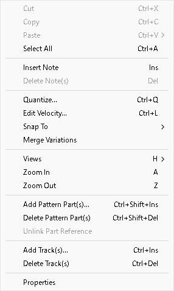

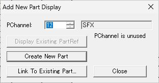

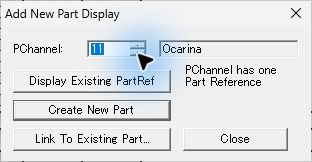

**Display Existing PartRef** を押すと、PChannel 11 のピアノロールが上下2段になった。追加ダイアログは開いたまま、PChannel が12に進んだ。閉じて保存すると、Part と PartRef は各1件で、同じ PartRef 内に表示設定 `pprc` が2件あった。元の表示は **0x00000008（Variation 4）**、追加表示は **0x00000001（Variation 1）**。表示されるノートが上下で異なり、音符26件の集合は入力と一致した。

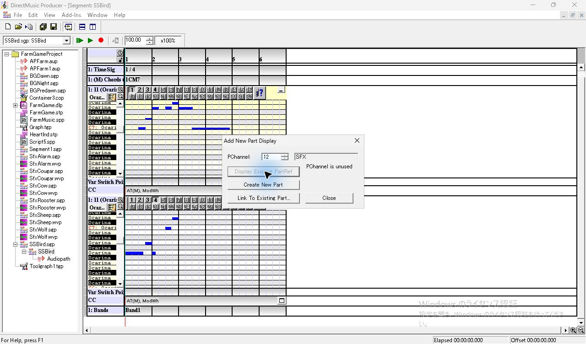

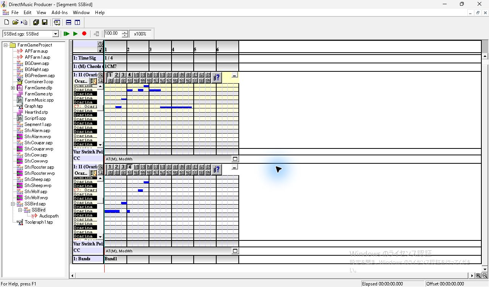

上段の Variation 1 を右クリックすると **Enable / Disable** が出た。Esc で閉じ、上段の **Variation 2** を1回クリックすると両段のノート表示が変わった。この試行の保存では両方が **0x00000003（Variation 1・2）**。音符データは引き続き26件で入力と一致した。 [表示追加直後の保存](../../../work/original-gui/SEG-14-pattern-part/20261111T154539029714Z/captures/displays-SSBird.sgp) · [Variation 切替後の保存](../../../work/original-gui/SEG-14-pattern-part/20261111T154539029714Z/captures/displays-variation-SSBird.sgp) · [同梱ヘルプの別表示](../../../../../work/analysis/original-manual-session/20261010T031624075Z/help-extracted/htm/creatingadditionalpartdisplays.htm)

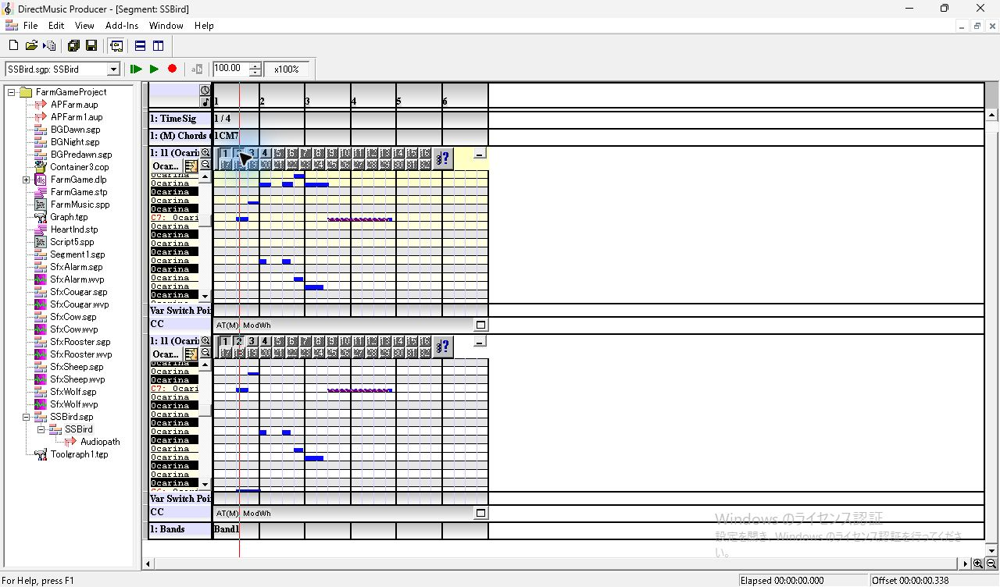

## 独立 Part とリンク済み PartRef を追加

同じダイアログを開き直し、未使用の **12 / SFX** で **Create New Part** を押した。空のピアノロール、灰色の Variation 数字、**No CC Tracks** が現れ、表示は新しい行へスクロールした。ダイアログは次の未使用 **13** に進んだ。

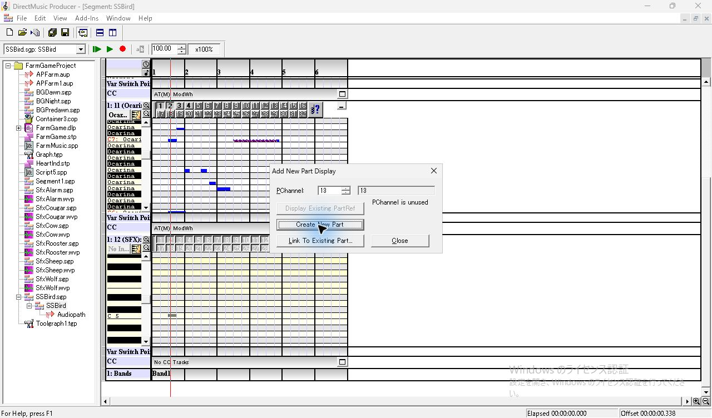

PChannel 13 で **Link To Existing Part...** を選ぶと、候補は **Pattern: Pattern(11)** と **Pattern: Pattern(12)**。11の候補は1件。Pattern(11) を選んで OK、親のダイアログを Close すると、**L13** の行に元のノートと **AT(M), ModWh** が出た。11の見出しにも **L11** が付いた。保存した3件の PartRef のうち、11と13は同じ Part GUID を指し、両方の `ppfd` は1。新規12は別の空 Part を参照していた。

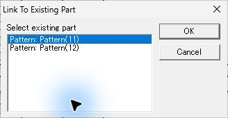

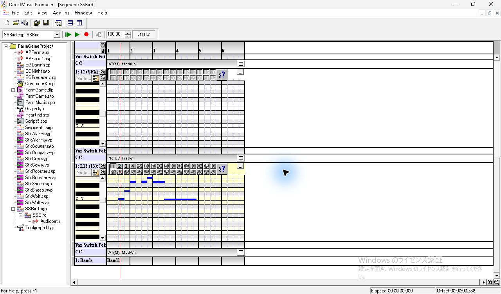

L13 の第5小節で **(537,510)** をクリックして **Insert**。追加した赤いノートは、12を折りたたんで同時に見えるようにすると **L11 と L13 の両方**に現れた。保存した追加音は Grid index 18、Variation mask **0x00000001**、長さ191クロック。挿入直後の画面ではノート付近に細い横の両矢印も写った。押下を続けている間のカーソルは未観測。

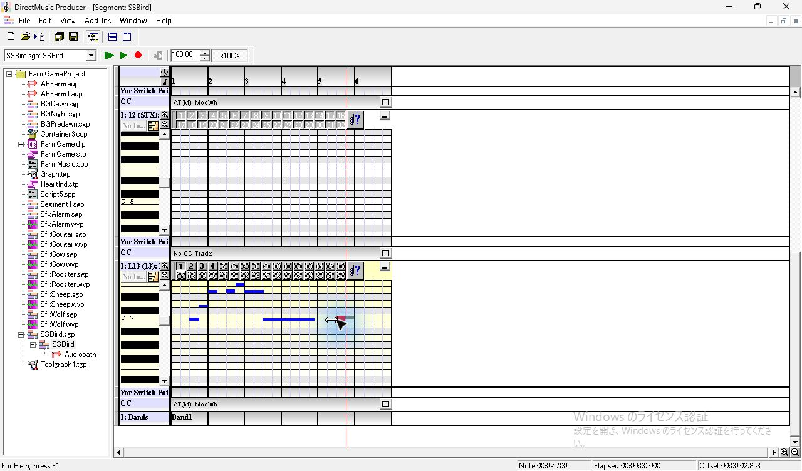

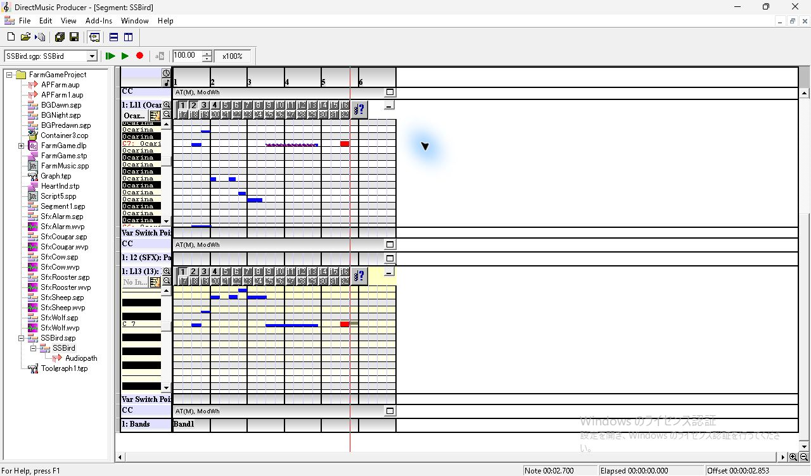

L13 ヘッダーの右クリックメニューでは **Unlink Part Reference** が有効。実行すると両側の **L** が消え、第5小節のノートは両側に残った。続けて PChannel 13 の第6小節で **(579,510)** を選び Insert。追加音は13だけに現れた。保存では11と13の GUID が別になり、`ppfd` は両方0。11は27音符、13は28音符で、各Partに230件の曲線が残った。第6小節の追加音は Grid index 20、Variation mask **0x00000001**、長さ191クロック。 [リンク中の編集](../../../work/original-gui/SEG-14-pattern-part/20261111T154539029714Z/captures/linked-edit-SSBird.sgp) · [リンク解除後の編集](../../../work/original-gui/SEG-14-pattern-part/20261111T154539029714Z/captures/unlinked-edit-SSBird.sgp)

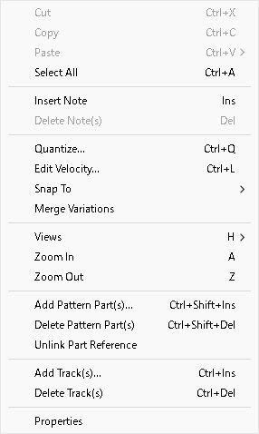

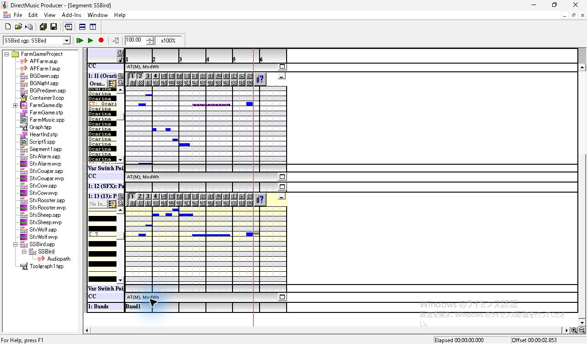

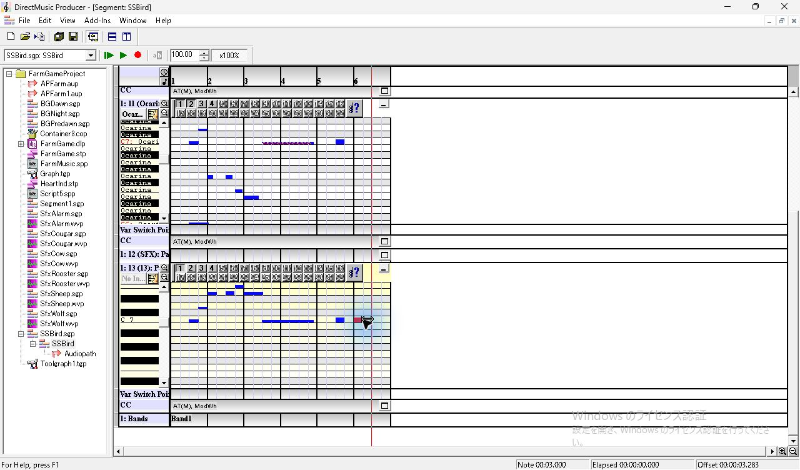

## 行の移動と同じ PChannel にある複数の参照

4行を折りたたむと上から **11、11、12、13**。13のヘッダー **(221,279)** から先頭11の **(221,210)** へドラッグした試行では、解放位置の11が選択され、上下順は変わらなかった。

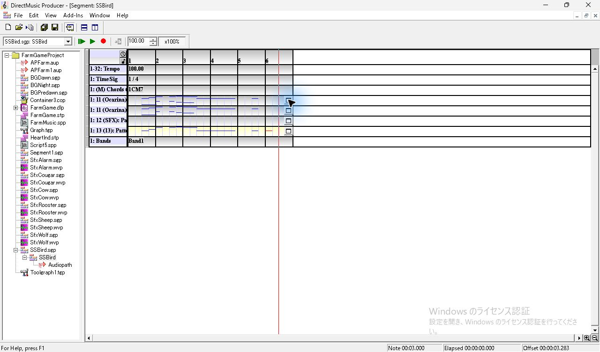

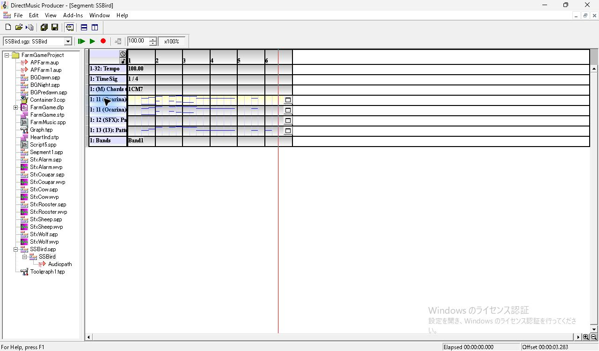

13を選んで F11。モデルレス **Pattern Track Properties > Part** の **PChannel** を下スピンで **13 → 12 → 11** と変更した。12にしたときはノートのある行が空の12の上、11にしたときは元の11の2表示より上へ移った。既存番号への変更は受け付けられ、参照は独立したまま。名前欄を **Bird Edit** に変更して Tab で確定した。

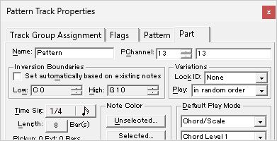

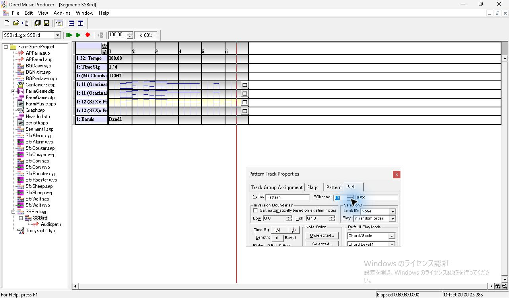

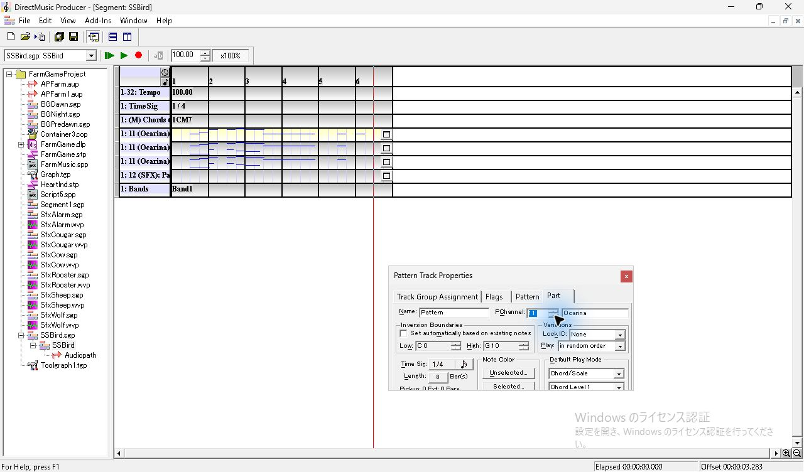

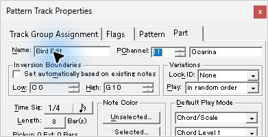

PChannel 11 に見える行は3つ。**Add New Part Display** で11を選ぶと、表示は **PChannel has multiple Part References**、ボタンは **Choose Existing PartRef...**。押すと **Select PartRef to display** に **Pattern** と **Bird Edit** の2候補が出た。Cancel で閉じ、行数を保持。Bird Edit の PChannel をさらに下げて **10** にすると、並びは **10、11、11、12** となった。保存した `prfc` の並びは **11、12、10** で、画面の順序とは異なった。 [同じ PChannel に2つの参照がある保存版](../../../work/original-gui/SEG-14-pattern-part/20261111T154539029714Z/captures/cochannel-SSBird.sgp)

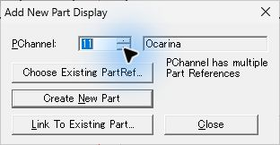

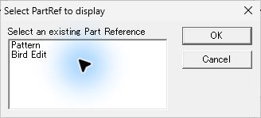

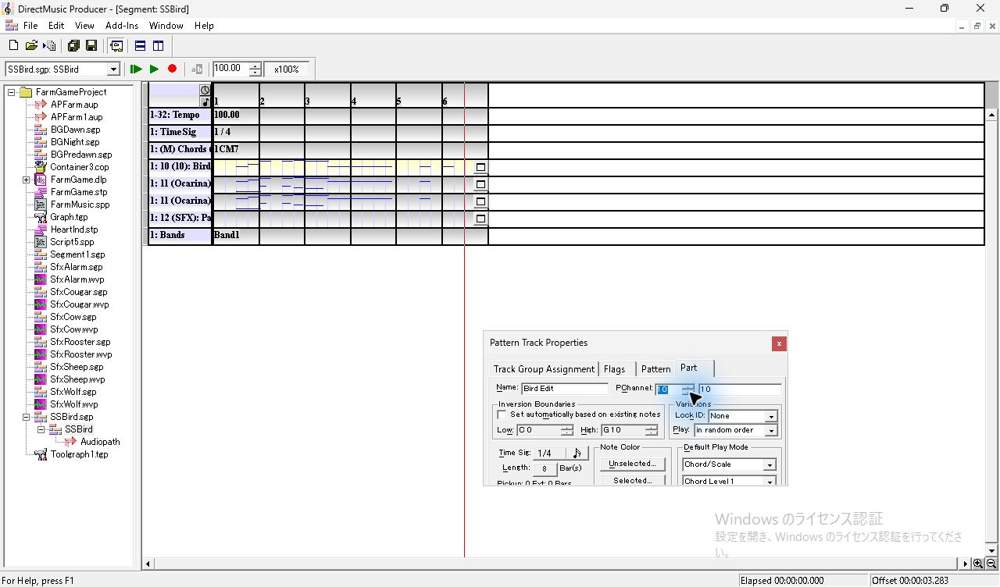

## 新規 Part の Variation と再生表示

新規 **PChannel 12** を展開。空の状態で Variation **3** をダブルクリックし、第3小節の C5 の高さ **(407,415)** をクリックして Insert を押した。3の数字は黒くなり、ノートが表示された。**4** をダブルクリックするとノートは消え、**3** に戻すと再表示された。保存したノートは Grid index 9、Variation mask **0x00000004**、長さ191クロック。3を表示した保存と4を表示した保存ではノートが一致し、表示設定の mask は **0x00000004 → 0x00000008** と変わった。

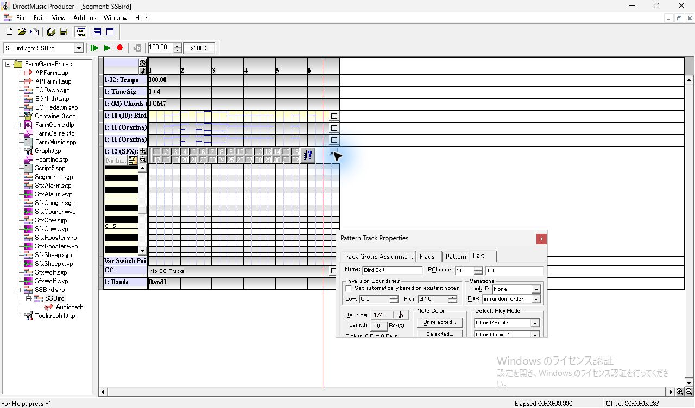

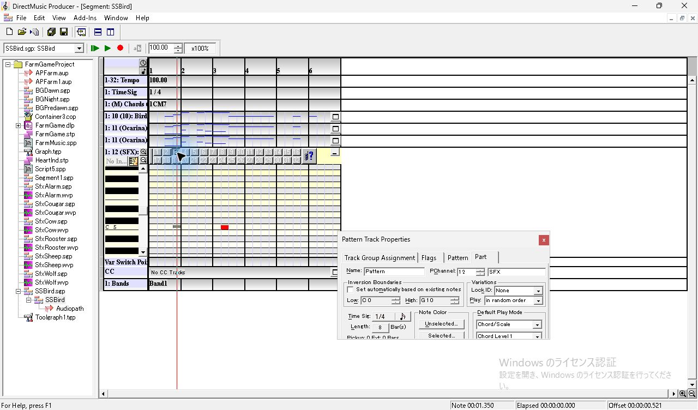

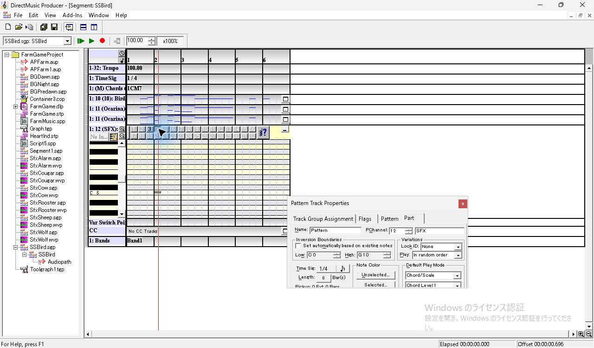

各 Variation を選んだまま **Play From Start**。3の試行では数字 **3**、空の4の試行では数字 **4** が赤くなり、両方で Segment の位置線が進んだ。どちらも自然終了して再生ボタンが復帰した。今回の比較は画面と保存値を対象とし、Part 別の発音は未測定。 [Variation 4 を表示した保存版](../../../work/original-gui/SEG-14-pattern-part/20261111T154539029714Z/captures/variation4-SSBird.sgp) · [同梱ヘルプの Variation ボタン](../../../../../work/analysis/original-manual-session/20261010T031624075Z/help-extracted/htm/variationbuttons.htm)

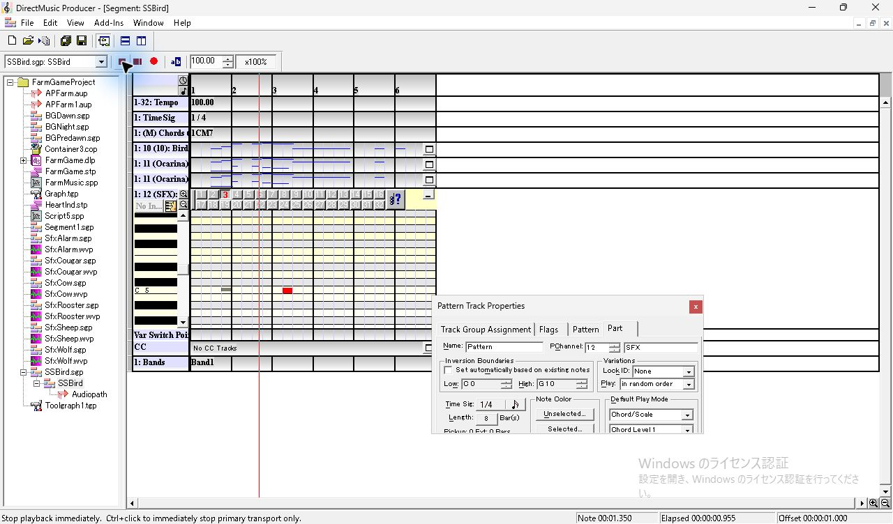

## Chord の Keep Constant

Variation 3 に戻した保存を比較の基準とした。Chord の第1小節の **1CM7** を右クリックし、**Keep Constant** を開く。**MIDI Notes (M)** にチェックがあり、ヘッダーは **(M) Chords**。Chord Properties のルートの上スピンを1回押して **1C♯M7** にすると、PChannel 12 の目印のノートは C5 の行（y=417付近）に残った。

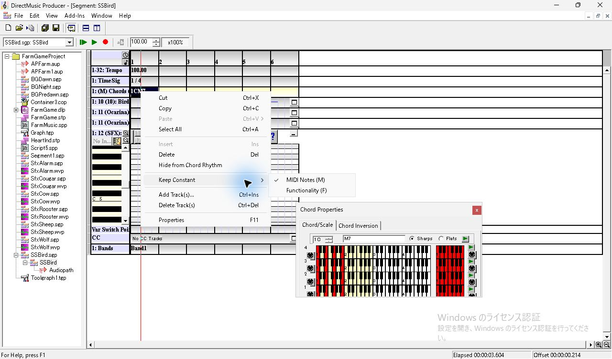

保存後に Chord 行へフォーカスを戻して Undo。コードは **1CM7** に戻った。同じメニューから **Functionality (F)** を選ぶと、見出しは **(F) Chords**。同じルートの上スピンを1回押して **1C♯M7** にすると、同じノートは1段上（y=406付近）へ動いた。

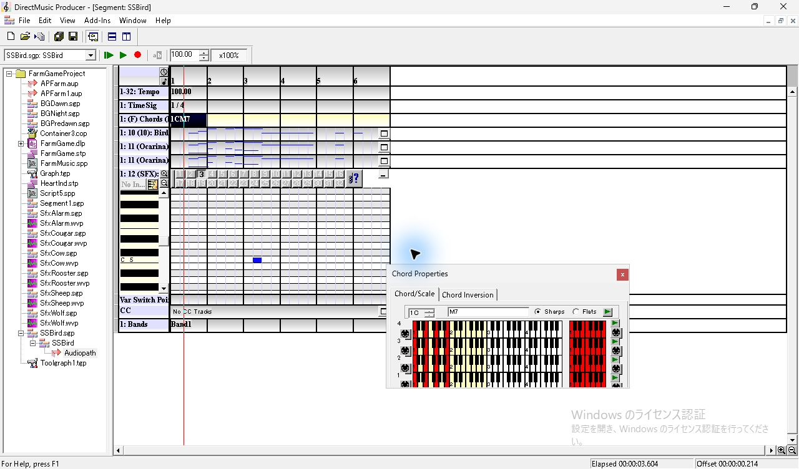

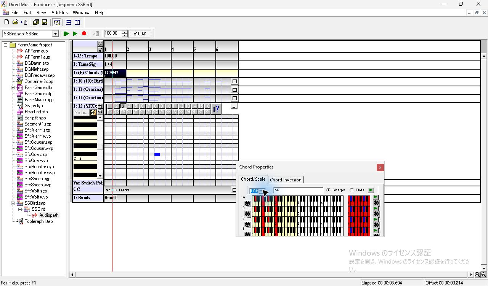

| 保存条件 | 4つのサブコードのルート値 | 保存した56件の音符レコード |
| --- | --- | --- |
| 基準と Undo 後 | 0、0、0、0 | 音符レコードの集合が一致 |
| MIDI Notes で C♯ | 1、1、1、1 | 56件で `wMusicValue` が変わった。時刻・長さ・Variation など他の音符フィールドは一致 |
| Functionality で C♯ | 1、1、1、1 | 音符レコードの集合が基準と一致 |

和音比較版と Undo 版では Part GUID が基準版から変わった。音符は PChannel と参照名を照合し、レコードの順番によらず比較した。 [13版の Part、参照、ノートの照合](../../../work/original-gui/SEG-14-pattern-part/20261111T154539029714Z/pattern-part-audit.json) · [同梱ヘルプの Pattern Track](../../../../../work/analysis/original-manual-session/20261010T031624075Z/help-extracted/htm/patterntrack.htm)

## 別プロセスで再読込

Producer を通常終了し、0件を確認してから、作業コピーの SSBird.sgp に和音比較前の保存版を戻した。同じ EXE を1件起動。SSBird を開くと、**10、11、11 は折りたたみ、12は展開**し、Variation 3 のノートは青く表示された。10のヘッダーを選ぶと **Bird Edit / PChannel 10** が戻っていた。再読込後のファイルは復元した保存版と全バイト一致した。 [プロセス確認](../../../work/original-gui/SEG-14-pattern-part/20261111T154539029714Z/captures/80-relaunch.json) · [再読込後のファイル](../../../work/original-gui/SEG-14-pattern-part/20261111T154539029714Z/captures/reopened-SSBird.sgp)

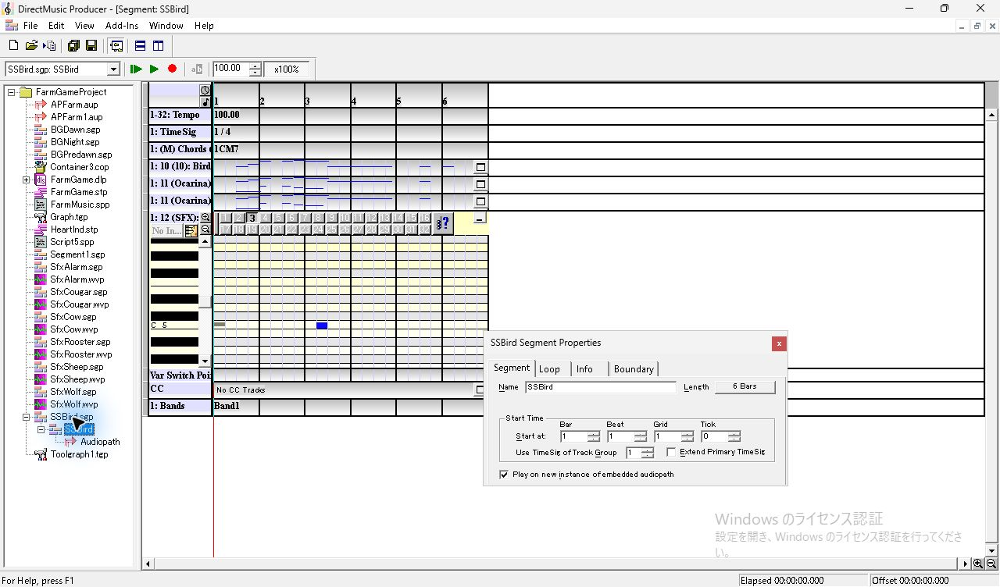

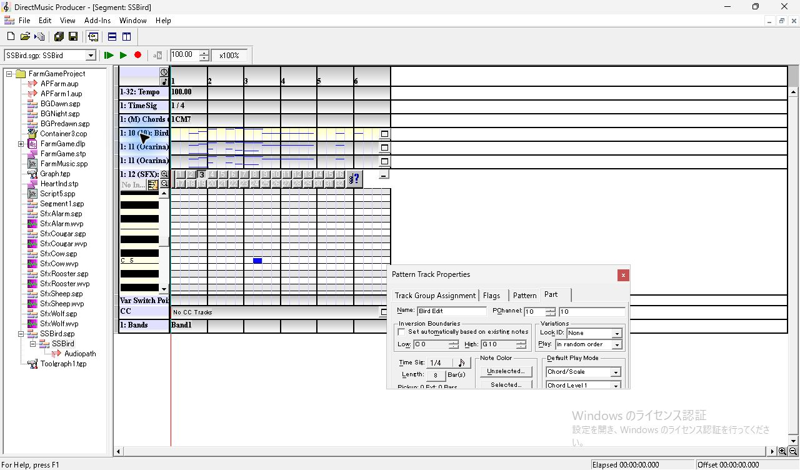

再読込後に先頭行を選んで Properties を閉じ、**Close Project** を実行した際に SSBird.sgp の保存確認が出た。**No** を選んで記録済みの保存版を保持。作業コピーの Project 内で更新されたのは **SSBird.sgp と FarmGameProject.pro**。凍結入力28件のハッシュは一致した。終了時は Project を閉じた停止状態の Producer が1件で、View は標準4項目。 [終了時のウィンドウ](../../../work/original-gui/SEG-14-pattern-part/20261111T154539029714Z/captures/91-final-windows.json)

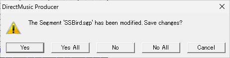

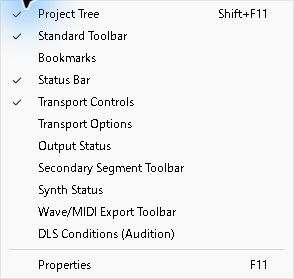

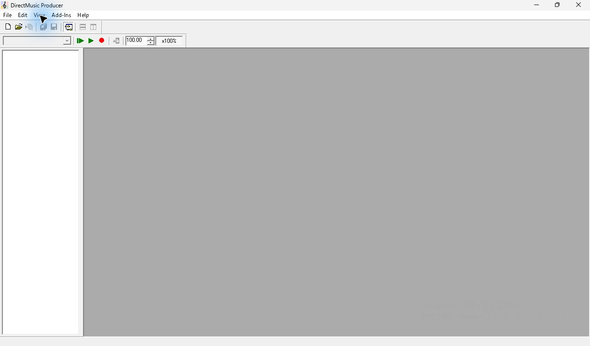

リンク中と解除後の CC・Var Switch Point、Variation 別の MIDI、別起動での再表示、Part タブ下部の候補は追試で照合した。残るのは、マーカーによる再生中の Variation 切替、Part ごとの録音と CC の発音差、修飾キーと押下中のカーソル、Part 下部の値変更、Style の Seed を変えたときの選択と再生。 [CC と Var Switch Point の追試](seg-14-pattern-controls.md)
