# SEG-14　Pattern Track と Style Track の調査素材と入口

[調査計画](README.md) · [Chordmap 参照と Signpost](seg-14-chordmap-signpost.md) · [Style Designer と Motif](ui-04-style-motif.md)

2026-11-11。初回は Computer Use の接続拒否で保留。再試行では Producer が終了していることを確認してから、同じ DirectMusic Producer 5.3.0.900 の専用コピーを起動した。PID 20620 の1プロセスで操作・撮影できた。Project Tree、Standard Toolbar、Transport Controls、Status Bar を表示。親ウィンドウは1280×752 px。画像の座標は各画像の左上が原点。青い光と黒い矢印は操作ツールの表示。 [実行記録](../../../work/original-gui/SEG-14-pattern-style/20261111T074828536163Z/run.json) · [原版撮影27枚の対応表](../../../work/original-gui/SEG-14-pattern-style/20261111T074828536163Z/published-live-figures.json)

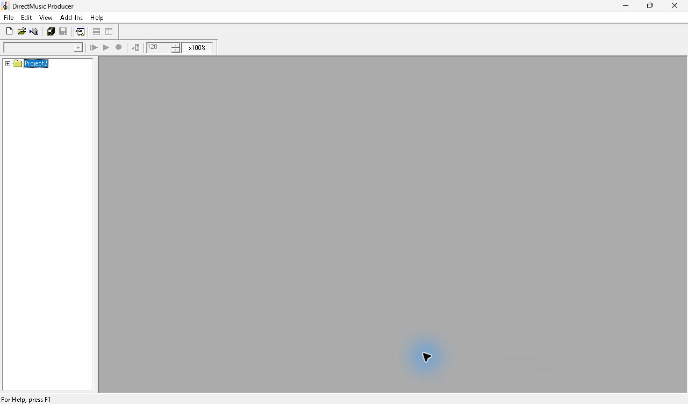

## 追試用のプロジェクト

| 用途 | 開く Project と文書 | ファイルから確認できた初期状態 |
| --- | --- | --- |
| Style 参照 | QuickStart の `QuickStart.pro > heartland.sgp` | `sttr` がグループ1にあり、`Heartlnd.stp` へのファイル名と GUID が一致。Style は4/4、1拍4 Grid、112 BPM。 `DemoStyle.stp` は4/4、1拍2 Grid、87 BPM。 [QuickStart 素材](../../../work/original-gui/SEG-14-pattern-style/20261111T074828536163Z/inputs/quickstart/manifest.json) |
| 内蔵 Pattern | FarmGame の `FarmGameProject.pro > SSBird.sgp` | グループ1の `DMPT` に名前 `Pattern`、1件の Part と Part 参照がある。Tempo・TimeSig・Chord・Band を同じ Segment に持つ。 [FarmGame 素材](../../../work/original-gui/SEG-14-pattern-style/20261111T074828536163Z/inputs/farmgame/manifest.json) |
| Wave・参照先の開閉 | 同じ FarmGame の `SfxAlarm.sgp` など6文書 | それぞれグループ1の `wavt` に1件。ファイル名と GUID が対応する6つの `.wvp` と一致。 [FarmGame 素材](../../../work/original-gui/SEG-14-pattern-style/20261111T074828536163Z/inputs/farmgame/manifest.json) |
| Compose Chords | `Project2.pro > Segment1.sgp` | グループ1の `Chordmap1`、第2小節先頭の `^F`、第2拍の `2DbM`。ChordMap Designer の Signpost 一覧は空。 [和声素材](../../../work/original-gui/SEG-14-harmony/20261111T044759384015Z/inputs/harmony-segment/manifest.json) |

元の QuickStart 5ファイルと FarmGame 21ファイルを複製し、全ファイルのサイズと SHA-256 を元ファイルと照合した。既存の QuickStart 解析に含まれた3ファイルは過去のハッシュとも一致。原版で開く際は各素材を別の作業ディレクトリに複製する。 [過去の Style 保存値](../../../../../work/analysis/style-inputs/20261002T152849031Z/observation.json)

## Pattern Track と Style Track の比較点

既存の [Add New Tracks 観測](seg-01-creation.md) では `Pattern Track` と `Style Track` がそれぞれ一覧にある。原版ヘルプでは Pattern Track は Segment 内で直接編集できる単一の Pattern を持ち、トラックの Properties に Track Group Assignment、Flags、Pattern、Part の各ページがある。Pattern ページには名前、Length、Time Signature and Grid、Reset Variation Order on Play。Chord トラックの `Keep Constant` の下に MIDI Notes と Functionality があるとされる。 [Pattern Track](../../../work/original-gui/SEG-14-pattern-style/20261111T074828536163Z/help/patterntrack.htm) · [Pattern Track Properties](../../../work/original-gui/SEG-14-pattern-style/20261111T074828536163Z/help/patterntrackproperties.htm)

Style Track は小節単位で Style を参照し、参照先の選択前に `Empty` と表示される。ヘルプでは Style の割り当てに伴い Bands と Tempo にイベントが入る。Style 本体の変更は参照先に届き、Segment に取り込んだ Band は別のデータとして扱う。Properties の `Seed Variations` には Enable、Generate New Seed、Edit Seed がある。 [Style Track](../../../work/original-gui/SEG-14-pattern-style/20261111T074828536163Z/help/styletrack.htm) · [Style Track Properties](../../../work/original-gui/SEG-14-pattern-style/20261111T074828536163Z/help/styletrackproperties.htm)

## 原版で観測した Pattern Track

和声素材の Segment1 を開き、TimeSig ヘッダーの右クリック → **Add Track(s)...** → **Pattern Track** → OK。Chord と Sequence の間にグループ1の Pattern 行が追加され、Chord 行の見出しに **(M)** が付いた。Pattern 行は初期状態では1行で、右端の四角を押すと展開する。

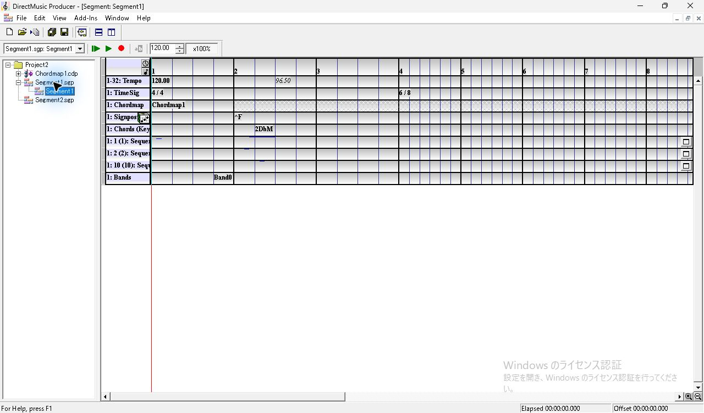
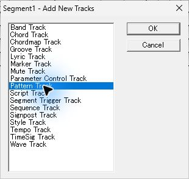
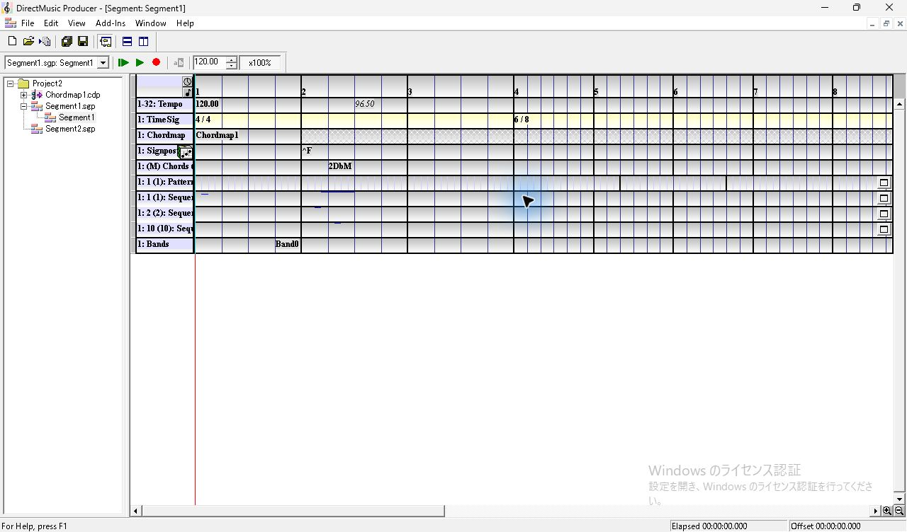

展開すると鍵盤、縦ズーム、2段32個の Variation ボタン、Var Switch Point、CC の行が現れ、既存の Sequence が下へ移動した。空の状態では Variation の番号が灰色で、CC は **No CC Tracks**。ヘッダーの右クリックで **Insert Note**、**Merge Variations**、**Add Pattern Part(s)...**、**Delete Pattern Part(s)**、**Properties** が並ぶ。今回の状態では **Unlink Part Reference** が灰色だった。

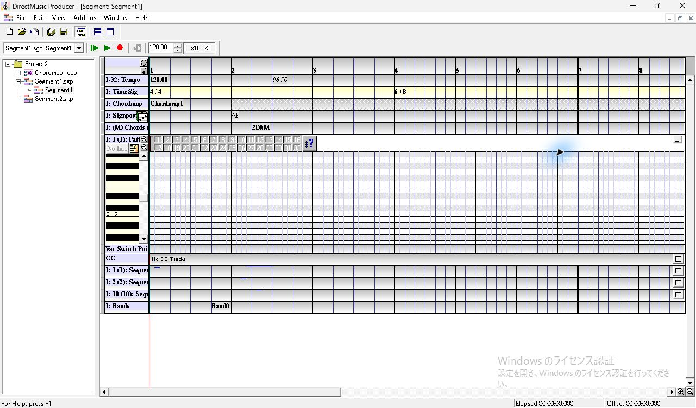
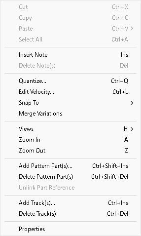

ヘッダーのメニューから開いた **Pattern Track Properties** は4タブ。今回の表示寸法では Part と Flags の下端がパネルの内側で途切れた。後続の追試では、Part の下端をドラッグするとパネル全体が移動し、一部見えていた下部の選択肢を開けた。Flags の下端は追試に残る。 [Part タブの下部](seg-14-pattern-controls.md#別プロセスでの復元と-part-タブ下部)

| タブ | 撮影時に見えた内容 |
| --- | --- |
| Track Group Assignment | グループ1。所属は同時に1グループ |
| Flags | Enable Play、Enable Control、Send Notifications がオン |
| Pattern | 名前 Pattern、16小節、4/4、Reset Variation Order on Play はオフ |
| Part | 名前 Pattern、PChannel 1、Inversion Boundaries、Variations、Note Color、Default Play Mode。Lock ID は None、Play は in random order、Default Play Mode は Chord/Scale |

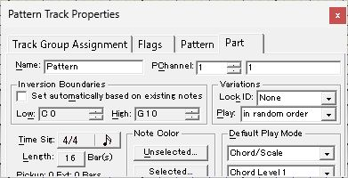
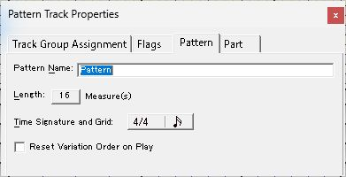
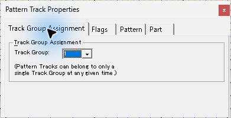
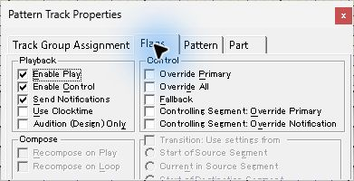

Length ボタンを押すと **Set Pattern Length** が開く。上スピンを1回押すと16→17。Cancel 後は Pattern タブが16を表示した。拍子とグリッドのボタンでは **Set Part Time Signature and Grid** が開き、拍数4、Beat 4、グリッドの音符アイコンを表示した。ここは値を変更せず Cancel した。

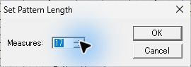
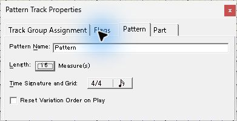
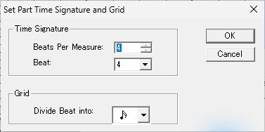

Properties を閉じ、第1小節の C5 表示と同じ高さのグリッドをクリックして Insert。クリックで赤い時刻線が移動し、Insert で赤い短いノートが1個現れた。Variation 1〜32 の数字は黒に変わった。Variation 1 のボタンをクリックした後もノートは見えていた。Ctrl+S 後の保存データに1音と全32ビットが立った Variation mask を確認した。

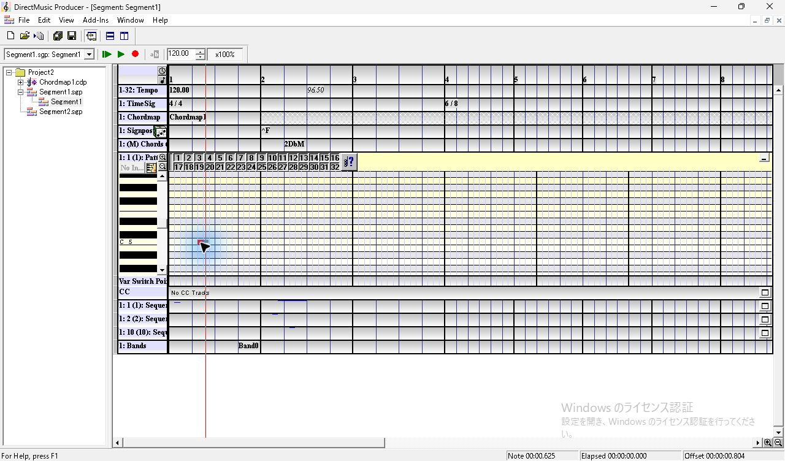
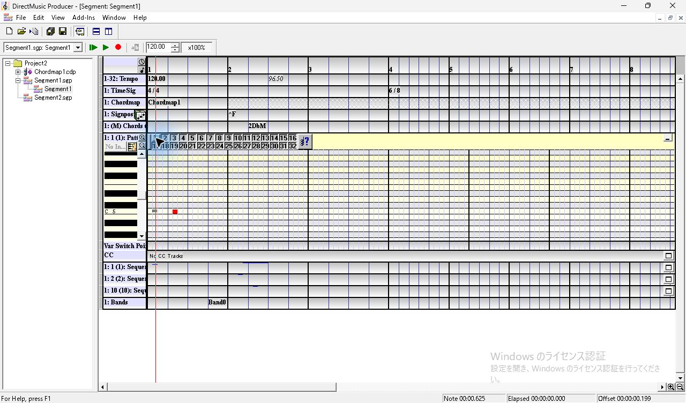

## 原版で観測した Style Track

同じ作業用 Project2 の別文書 Segment2 を使った。Segment2.sgp を開いた際に表示された **Add New Tracks** で **Style Track** を追加した。初期は TimeSig と Styles の2行で、Styles に文字はない。Styles の第1小節をクリックして Insert を押すと、選択中の小節に **Empty** が出て **Style Properties** が開いた。Measure は1。Project に Style 文書がない状態ではドロップダウンに候補がなかった。

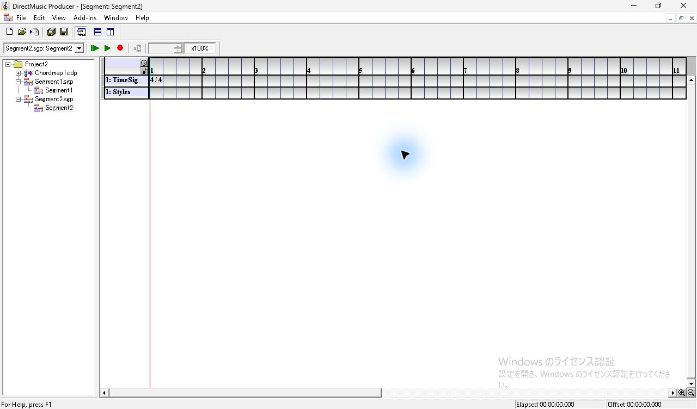
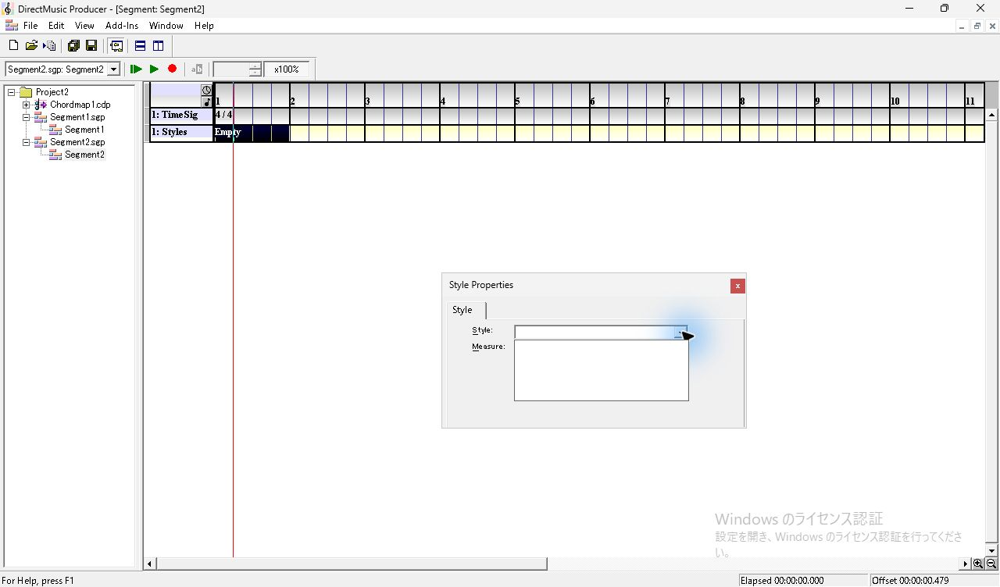

Ctrl+N → **Style** で既定名の Style1 を作った。既定の Band は Band1、Tempo は120.00。Tempo の上スピンを1回押して121.00とし、Style1 を保存した。Segment2 に戻って Empty をダブルクリックした試行では項目の選択だけが見えた。選択中に F11 で **Style Properties** を開くと、候補に **Project2: Style1 4/4** が出た。

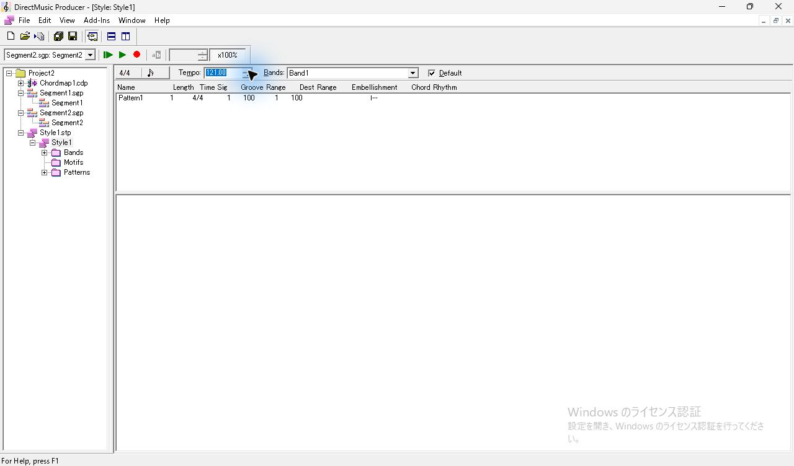
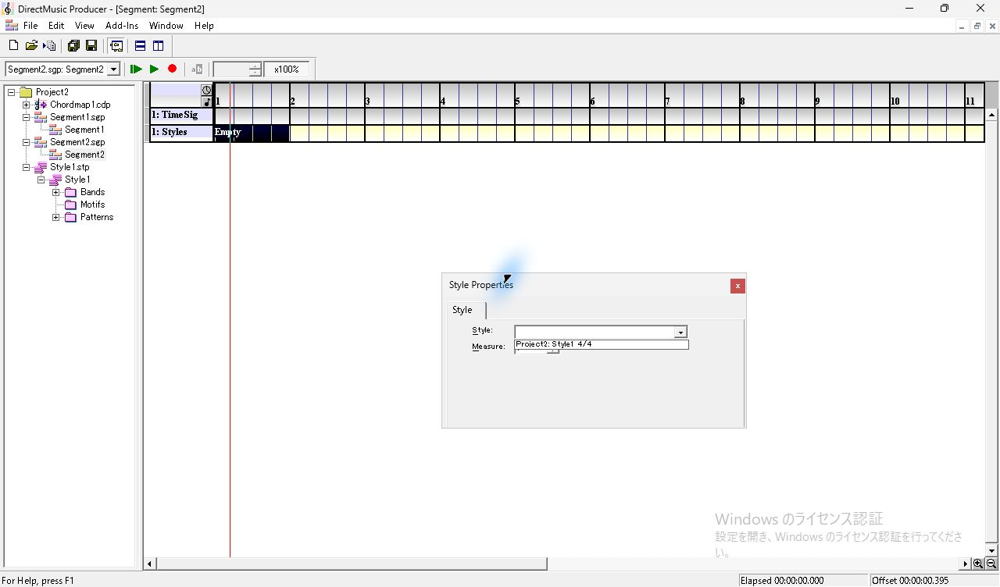

候補をクリックすると即座に Styles の第1小節が **Style1** になり、同じ位置に **Tempo 121.00** と **Band1** が自動追加された。TimeSig の4/4は灰色に変わり、Transport のテンポも121.00になった。Properties を閉じて Ctrl+Z すると参照が **Empty** に戻り、Tempo と Bands の行は消えた。Ctrl+Y で参照と2行が復元された。

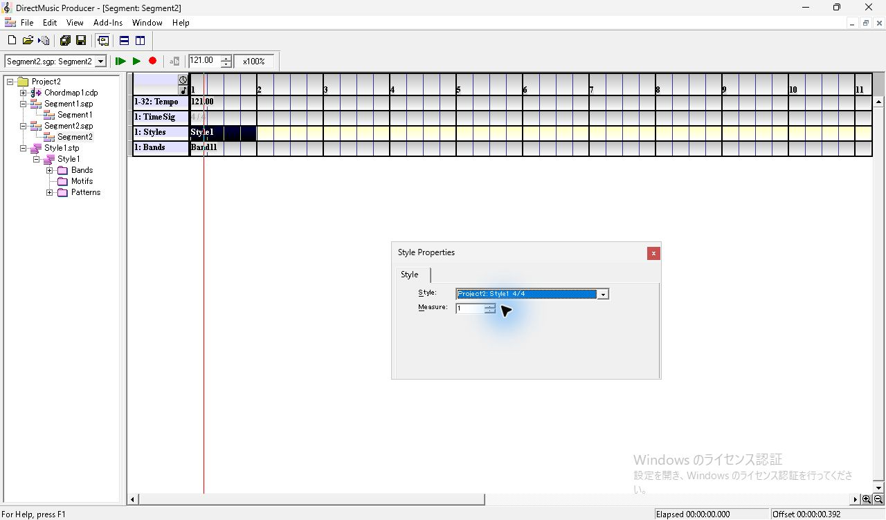
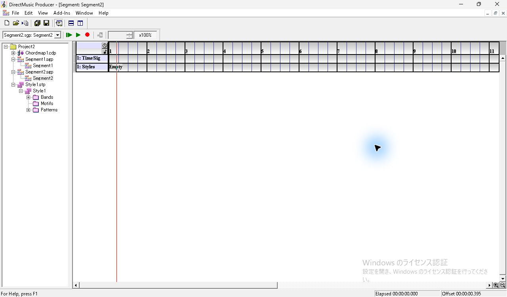
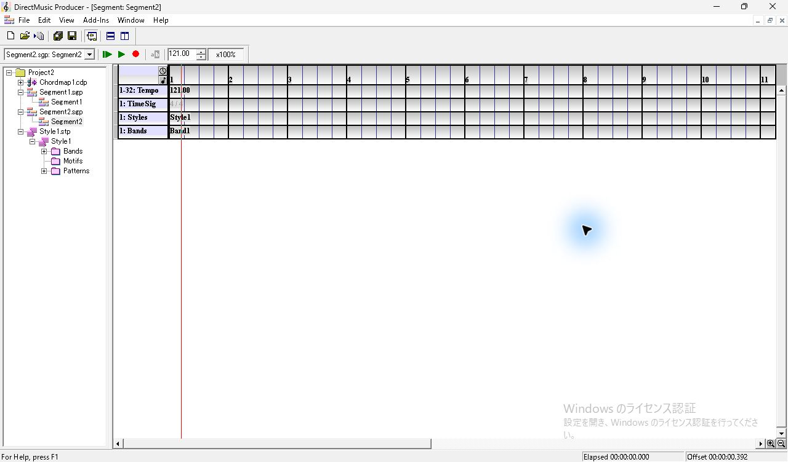

項目を選んだときは **Style Properties**、行のヘッダーを選んで F11 を押すと **Style Track Properties** が開く。トラック側は Track Group Assignment、Flags、Seed Variations の3タブ。Seed Variations は初期状態で Enable がオフで、2つのボタンが灰色。Enable をオンにすると両方が使える。**Edit Seed...** は別ダイアログで、値1が選択状態で表示された。Cancel 後も Enable はオンだった。

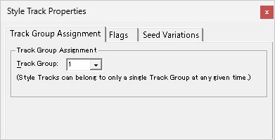
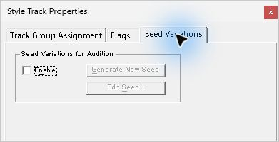
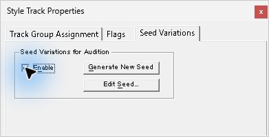
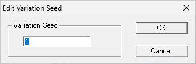

Ctrl+S で Segment2 を保存した後、**File > Save Project Project2** を選んだ。Segment1 の変更を保存する確認が出たので、作業用 Project2 で **Yes All** を選んだ。

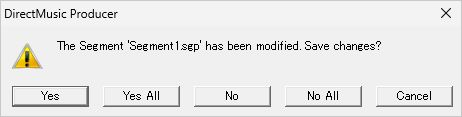

| 保存ファイル | 照合した値 |
| --- | --- |
| Segment1.sgp | DMPT 内に16小節の Pattern、Part の note 1件、Variation mask は 0xffffffff |
| Segment2.sgp | 第1小節先頭に Style1.stp の参照。参照 GUID が Style1 と一致。121 BPM と Band1 を保存し、Band の GUID も Style1 内の Band と一致。psrd の2値はともに1 |
| Project2.pro | Style1.stp の記録を含む |
| Chordmap1.cdp | 凍結した元入力と SHA-256 が一致 |

編集した5ファイルは試験素材として凍結した。元入力4ファイルも元の SHA-256 を維持している。 [保存値と次回用の素材](../../../work/original-gui/SEG-14-pattern-style/20261111T074828536163Z/inputs/pattern-style-observed/manifest.json)

## Compose Chords の確認順序

Pattern の追加・入力と Style の追加・参照は上で確認済み。下表の3は保存した作業用 Project2 から実行し、Pattern と Style それぞれの生成結果を記録した。別の追試では Part の追加・リンク・移動、CC と Var Switch Point の共有、Variation 別の MIDI、Keep Constant、別プロセスでの読込を照合した。再生中の Variation の切替と、内蔵 Pattern の単独試聴後の Reset は後続の試験で MIDI を照合した。Style の Seed は無効、固定値、自動生成、再読込の各条件で MIDI を照合した。Part ごとの録音、修飾キーと押下中のカーソル、Part タブ下部の値変更は追試する。 [Seed Variations の再生比較](seg-14-style-seed.md) · [Var Switch Point の再生](seg-14-variation-playback.md) · [Reset の比較](seg-14-variation-order.md) · [保存した作業用 Project2](../../../work/original-gui/SEG-14-pattern-style/20261111T074828536163Z/inputs/pattern-style-observed/manifest.json) · [Compose Chords の観測](seg-14-compose-chords.md) · [Pattern Part の追試](seg-14-pattern-part.md) · [CC と Var Switch Point](seg-14-pattern-controls.md)

[前回の原版撮影](seg-14-chordmap-signpost.md) では、Chordmap を割り当てた状態でボタンを押すと、Pattern Track または Style が割り当てられた Style Track を求める警告が出た。ヘルプの手順では、さらに Signpost Group の指定と、ChordMap 文書内でそのグループに属するコードが必要。今回の Project2 の Signpost は F なので、まず ChordMap Designer の `SP` 列の `<new>` で1件を追加し、F 列でグループを指定する。 [Compose Chords Button](../../../work/original-gui/SEG-14-pattern-style/20261111T074828536163Z/help/composechordsbutton.htm) · [Signpost List](../../../work/original-gui/SEG-14-pattern-style/20261111T074828536163Z/help/signpostlist.htm)

| 順 | 作業コピーで行うこと | 撮影・保存して確認すること |
| --- | --- | --- |
| 1 | Project2 の別コピーに Pattern Track を追加し、初期状態と F11 の各ページを確認する | ヘッダー、行の高さ、開閉、選択、入力可能な Part、Length と拍子設定の取消、Chord 行の Keep Constant |
| 2 | QuickStart で参照済みセルを観察し、別の Project2 では Style Track に既定の Style 文書を設定する | 未挿入、Empty、候補一覧、適用直後の Bands・Tempo、既存 Tempo・TimeSig との重なり、Seed の Enable と変更前後 |
| 3 | Project2 の Chordmap に Group F を割り当てたコードを用意し、Pattern Track の Segment1 と Style Track の Segment2 で Compose Chords を試す | 警告・確認の文面と閉じ方、第2小節先頭の生成、既存第2拍の扱い、Undo/Redo と `cord` の差分 |
| 4 | FarmGame の Pattern 内蔵 `SSBird.sgp` で Part と Variation を追試する | Part の追加、リンク、PChannel による順序、Variation、保存と別起動を照合。押下中のカーソルと Part ごとの発音は追試へ |
