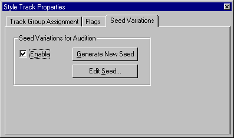
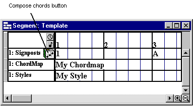

# SEG-14　Pattern Track と Style Track の調査素材と入口

[調査計画](README.md) · [Chordmap 参照と Signpost](seg-14-chordmap-signpost.md) · [Style Designer と Motif](ui-04-style-motif.md)

2026-11-11。DirectMusic Producer 5.3.0.900 の専用コピー `DmusGuiPatternStyle.exe` を起動した。Computer Use でこの実行ファイルへの接続を拒否されたため、この回の GUI 操作と新規撮影は接続前で保留。以下の GUI 参考は原版ヘルプと過去の撮影、保存値は現存する原版サンプルから採取した。 [実行記録](../../../work/original-gui/SEG-14-pattern-style/20261111T074828536163Z/run.json)

## 追試用のプロジェクト

| 用途 | 開く Project と文書 | ファイルから確認できた初期状態 |
| --- | --- | --- |
| Style 参照 | QuickStart の `QuickStart.pro > heartland.sgp` | `sttr` がグループ1にあり、`Heartlnd.stp` へのファイル名と GUID が一致。Style は4/4、1拍4 Grid、112 BPM。 `DemoStyle.stp` は4/4、1拍2 Grid、87 BPM。 [QuickStart 素材](../../../work/original-gui/SEG-14-pattern-style/20261111T074828536163Z/inputs/quickstart/manifest.json) |
| 内蔵 Pattern | FarmGame の `FarmGameProject.pro > SSBird.sgp` | グループ1の `DMPT` に名前 `Pattern`、1件の Part と Part 参照がある。Tempo・TimeSig・Chord・Band を同じ Segment に持つ。 [FarmGame 素材](../../../work/original-gui/SEG-14-pattern-style/20261111T074828536163Z/inputs/farmgame/manifest.json) |
| Wave・参照先の開閉 | 同じ FarmGame の `SfxAlarm.sgp` など6文書 | それぞれグループ1の `wavt` に1件。ファイル名と GUID が対応する6つの `.wvp` と一致。 [FarmGame 素材](../../../work/original-gui/SEG-14-pattern-style/20261111T074828536163Z/inputs/farmgame/manifest.json) |
| Compose Chords | `Project2.pro > Segment1.sgp` | グループ1の `Chordmap1`、第2小節先頭の `^F`、第2拍の `2DbM`。ChordMap Designer の Signpost 一覧は空。 [和声素材](../../../work/original-gui/SEG-14-harmony/20261111T044759384015Z/inputs/harmony-segment/manifest.json) |

元の QuickStart 5ファイルと FarmGame 21ファイルを複製し、全ファイルのサイズと SHA-256 を元ファイルと照合した。既存の QuickStart 解析に含まれた3ファイルは過去のハッシュとも一致。原版で開く際は各素材を別の作業ディレクトリに複製する。 [過去の Style 保存値](../../../../../work/analysis/style-inputs/20261002T152849031Z/observation.json)

## Pattern Track と Style Track の比較点

既存の [Add New Tracks 観測](seg-01-creation.md) では `Pattern Track` と `Style Track` がそれぞれ一覧にある。原版ヘルプでは Pattern Track は Segment 内で直接編集できる単一の Pattern を持ち、トラックの Properties に Track Group Assignment、Flags、Pattern、Part の各ページがある。Pattern ページには名前、Length、Time Signature and Grid、Reset Variation Order on Play。Chord トラックの `Keep Constant` の下に MIDI Notes と Functionality があるとされる。 [Pattern Track](../../../work/original-gui/SEG-14-pattern-style/20261111T074828536163Z/help/patterntrack.htm) · [Pattern Track Properties](../../../work/original-gui/SEG-14-pattern-style/20261111T074828536163Z/help/patterntrackproperties.htm)

Style Track は小節単位で Style を参照し、参照先の選択前に `Empty` と表示される。ヘルプでは Style の割り当てに伴い Bands と Tempo にイベントが入る。Style 本体の変更は参照先に届き、Segment に取り込んだ Band は別のデータとして扱う。Properties の `Seed Variations` には Enable、Generate New Seed、Edit Seed がある。 [Style Track](../../../work/original-gui/SEG-14-pattern-style/20261111T074828536163Z/help/styletrack.htm) · [Style Track Properties](../../../work/original-gui/SEG-14-pattern-style/20261111T074828536163Z/help/styletrackproperties.htm)

## Compose Chords の確認順序

[前回の原版撮影](seg-14-chordmap-signpost.md) では、Chordmap を割り当てた状態でボタンを押すと、Pattern Track または Style が割り当てられた Style Track を求める警告が出た。ヘルプの手順では、さらに Signpost Group の指定と、ChordMap 文書内でそのグループに属するコードが必要。今回の Project2 の Signpost は F なので、まず ChordMap Designer の `SP` 列の `<new>` で1件を追加し、F 列でグループを指定する。 [Compose Chords Button](../../../work/original-gui/SEG-14-pattern-style/20261111T074828536163Z/help/composechordsbutton.htm) · [Signpost List](../../../work/original-gui/SEG-14-pattern-style/20261111T074828536163Z/help/signpostlist.htm)

| 順 | 作業コピーで行うこと | 撮影・保存して確認すること |
| --- | --- | --- |
| 1 | Project2 の別コピーに Pattern Track を追加し、初期状態と F11 の各ページを確認する | ヘッダー、行の高さ、開閉、選択、入力可能な Part、Length と拍子設定の取消、Chord 行の Keep Constant |
| 2 | QuickStart で参照済みセルを観察し、別の Project2 では Style Track に既定の Style 文書を設定する | 未挿入、Empty、候補一覧、適用直後の Bands・Tempo、既存 Tempo・TimeSig との重なり、Seed の Enable と変更前後 |
| 3 | Project2 の Chordmap に Group F を割り当てたコードを用意し、Pattern Track ありで Compose Chords を試す。Style だけの別コピーでも試す | 警告・確認の文面と閉じ方、第2小節先頭の生成、既存第2拍の扱い、Undo/Redo と `cord` の差分 |
| 4 | 込み入った表示は FarmGame の Pattern 内蔵 `SSBird.sgp` で追試する | Part や Variation のある状態、境界・ホバー・ドラッグ、保存と別起動 |
