# SEG-14 Script Routine の Belongs To と発音・Trace

2026-11-12。DirectMusic Producer 5.3.0.900 の作業コピーで、同じ **Script5.TrackTrace** の **Start Time 8:1:0** を固定し、**Belongs To 8:1 / 9:1** を Timing 3方式で比較した。通常の先頭再生で、保存された時刻、Windows 出力の発音、Message Window に行が増える時点を測った。主ウィンドウの246枚から27枚を掲載する。黒い矢印と青い光は操作ツールの表示。 [実行ファイルと入力](../../../work/original-gui/SEG-14-script-belongs/20261112T042524480786Z/run.json) · [掲載画像の出典とハッシュ](../../../work/original-gui/SEG-14-script-belongs/20261112T042524480786Z/published-figures.json) · [前回の Timing 比較](seg-14-script-track-timing.md)

## 入力と操作

1. 前回の AudioVBScript 試験で使った **BGPredawn.sgp** と **Script5.spp** を、複製した FarmGameProject に入れる。BGPredawn は **12小節、100.00 BPM、1/4、x100%**。Wave 行の先頭 **1:1:0** の **SfxCougar** を基準音にする。第8小節の Script 行に **TrackTrace** が1件ある。TrackTrace は `SfxAlarm.Play(IsSecondary + AtImmediate)` を呼び出し、次の行で `Trace` を呼ぶ。第8小節の先頭は基準から **4.2秒**、第9小節は **4.8秒**。 [使用した SGP](../../../work/original-gui/SEG-14-script-belongs/20261112T042524480786Z/inputs/FarmGameProject/BGPredawn.sgp) · [使用した SPP](../../../work/original-gui/SEG-14-script-belongs/20261112T042524480786Z/inputs/FarmGameProject/Script5.spp)
2. 第8小節の TrackTrace を選択して **F11**。Script Routine Properties の **Start Time** に **8 / 1 / 0**、**Belongs To** に **8 / 1**。**Add-Ins > Message Window** を開き、タイムラインと Properties に重ならない位置へ移動する。本体が通常サイズへ戻った場合は最大化し、TrackTrace を選び直す。
3. Properties の **Belongs To** の Measure の上矢印を1回押すと **8→9**。この環境ではウィンドウ下端で欄の下側が切れていても、見えている上矢印は反応する。Start Time、濃紺セルと白い TrackTrace、赤い位置線はそのまま。数値入力で8に戻す場合は、Measure 欄の数値を置き換えて **Tab** を押すと、フォーカスが同じ段の Beat に移る。
4. Timing のラジオボタンを選び、各設定の SGP を保存する。Transport の左の緑の **Play From Start** を押し、毎回自然終了まで待つ。再生中は同じボタンが停止用に切り替わり、赤い位置線が進む。終了時に緑のボタンに戻り、Offset は **00:00:00.000**。Trace の新しい行は Message Window の末尾に追加され、青く選択される。

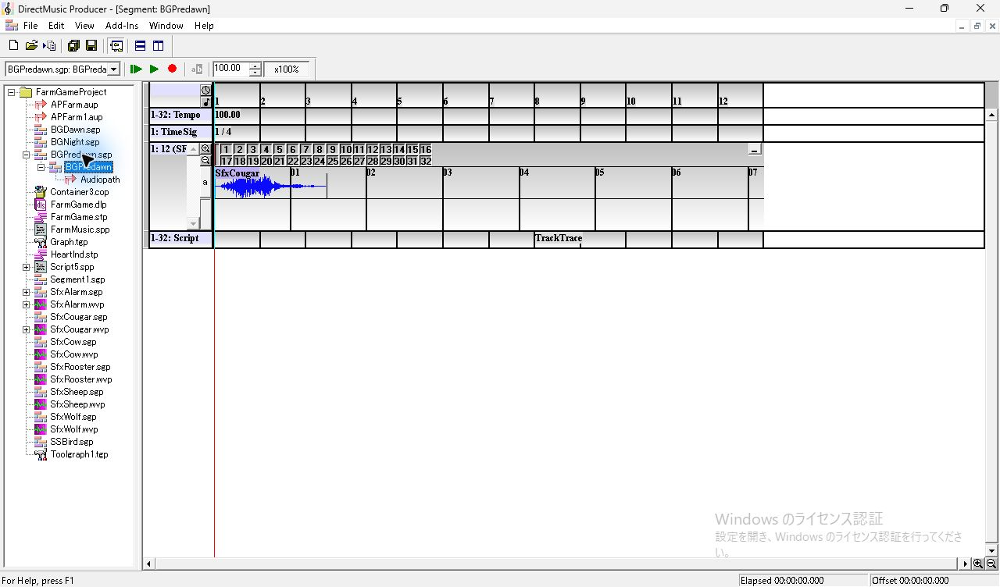

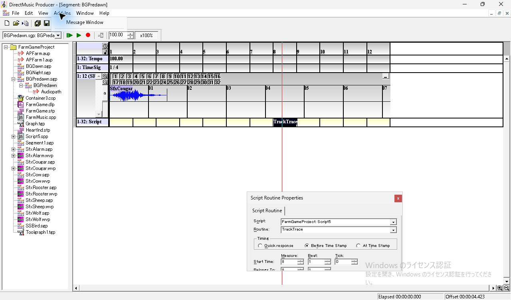

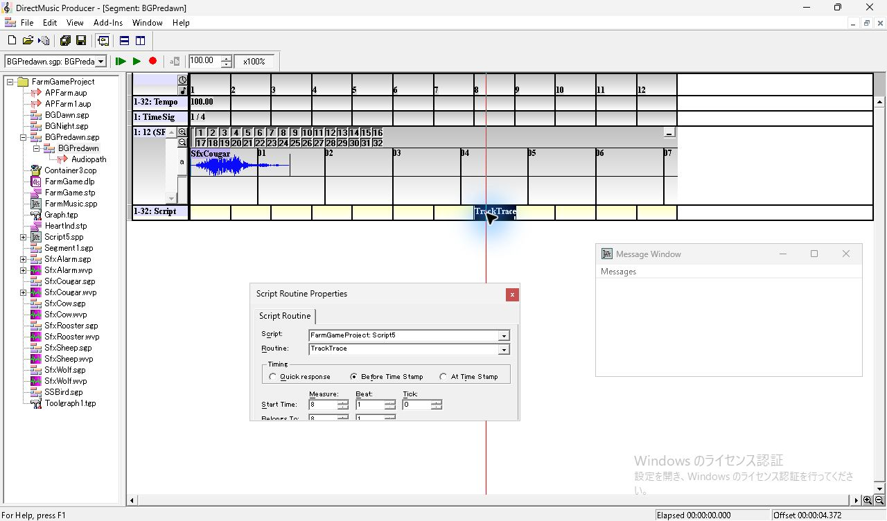

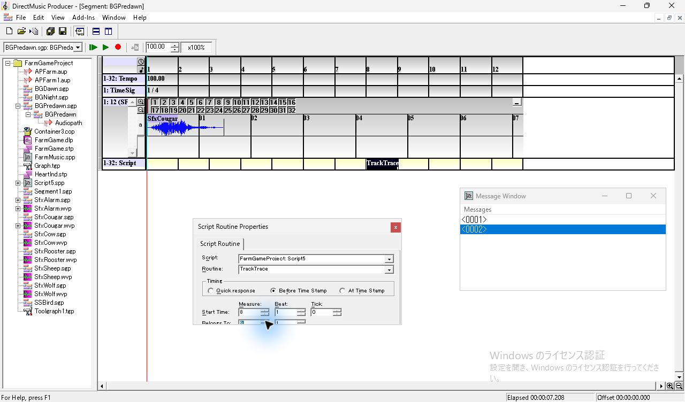

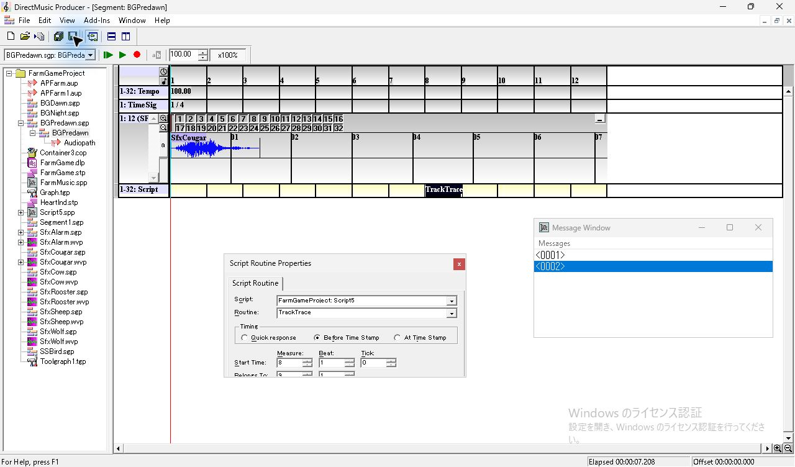

## 録音で比較した発音時刻

既定出力を **WASAPI ループバック、48 kHz、32-bit 浮動小数点、ステレオ**で240秒録音した。開始操作の時刻から基準音を探し、基準音の2.75〜6.15秒後に Alarm を探した。両音の開始位置は元の Wave の冒頭130 msを48 kHzに合わせ、左右平均の波形で正規化相関が最大になる位置を採用した。12回の相関は **Cougar 0.9941〜0.9963、Alarm 0.9846〜0.9922**。パケット時刻エラーは0。開始から646フレーム目に不連続が1件あり、最初の測定音は28.751秒に始まった。 [録音 WAV](../../../work/original-gui/SEG-14-script-belongs/20261112T042524480786Z/captures/audio-verified/output.wav) · [各音のフレーム位置と相関](../../../work/original-gui/SEG-14-script-belongs/20261112T042524480786Z/captures/audio-verified/analysis.json) · [照合コード](../../../work/original-gui/SEG-14-script-belongs/20261112T042524480786Z/measure.py)

下表は同一の再生内で **Cougar の開始から Alarm の開始まで**を測った値。括弧内は録音ファイルでの Cougar 開始位置。

| Timing | Belongs To 8:1、2回 | Belongs To 9:1、2回 |
| --- | --- | --- |
| Quick response | 4.2000秒（158.582）、4.1997秒（170.052） | 4.1999秒（60.351）、4.2000秒（71.811） |
| Before Time Stamp | 4.2000秒（130.261）、4.2000秒（141.771） | 4.2000秒（87.732）、4.2000秒（100.582） |
| At Time Stamp | 4.3000秒（188.162）、4.3301秒（217.281） | 4.3300秒（28.751）、4.3200秒（40.381） |

**全条件で Alarm は Start Time 側の約4.2秒付近**に鳴り、Belongs To を第9小節にしても0.6秒の発音移動は見られなかった。Quick と Before は **4.1997〜4.2000秒**。At の4回は Start Time から **100〜130 ms後**に鳴った。各有効試行で Trace が1行増えた。音の間隔にはこのルーチンの再生経路が含まれる。

最初の撮影中は録音プロセスが終了して WAV が生成されなかったため、終了を確認できるコマンドの実行セッションで録り直した。撮影・録音中に **Play From Start** を押しても再生が始まらない操作が各1回あった。録音中の該当区間では基準音が検出されず、ピークは **0.0000954**、Trace は前の `<0023>` のまま。TrackTrace をクリックして選び直し、再生して `<0024>` になった回を採用した。 [再生が始まらなかった操作](../../../work/original-gui/SEG-14-script-belongs/20261112T042524480786Z/captures/62-audio-at-8-b-start.json) · [録音器の終了記録](../../../work/original-gui/SEG-14-script-belongs/20261112T042524480786Z/captures/audio-verified/capture.json)

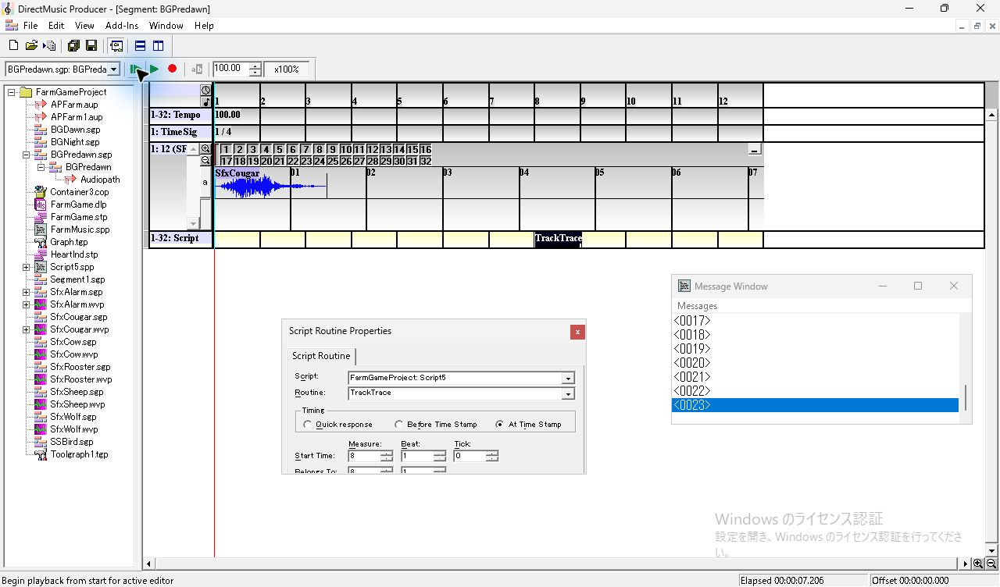

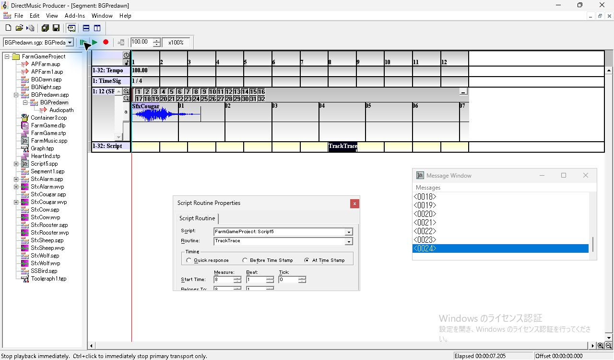

## Message Window の更新区間

赤い位置線と Message Window を同時に撮影し、新しい行が見えない最後の画像と、見える最初の画像の **Elapsed** を読んだ。下表の区間は画面を観測した時刻で、内部の実行時刻や録音上の発音時刻とは計測方法が異なる。 [使用した画像と行番号の一覧](../../../work/original-gui/SEG-14-script-belongs/20261112T042524480786Z/script-belongs-audit.json)

| Timing | Belongs To 8:1 の更新前→更新後 | Belongs To 9:1 の更新前→更新後 |
| --- | --- | --- |
| Quick response、1回目 | **3.285→3.518秒**（2→3行） | **3.814→4.093秒**（0→1行） |
| Quick response、2回目 | **3.296→3.575秒**（3→4行） | **3.813→4.048秒**（1→2行） |
| Before Time Stamp | 3.840→4.134秒（4→5行） | 3.810→4.086秒（7→8行） |
| At Time Stamp | 4.373→4.712秒（5→6行） | 4.138→4.371秒（6→7行） |

**Quick response は Belongs To 9:1 の方が Trace の表示が遅れた。** 両条件とも第8小節の先頭より前に行が増え、2回ずつの更新区間は重ならなかった。撮影間隔の範囲では、差は0.6秒と両立する。Before は両条件で第8小節に入る直前までに行が増えた。At は採取したどちらの条件でも第8小節中に行が増え、第9小節先頭の4.8秒より前に表示された。Before と At の細かな条件差は、この撮影間隔と試行数では確定していない。

### Quick response

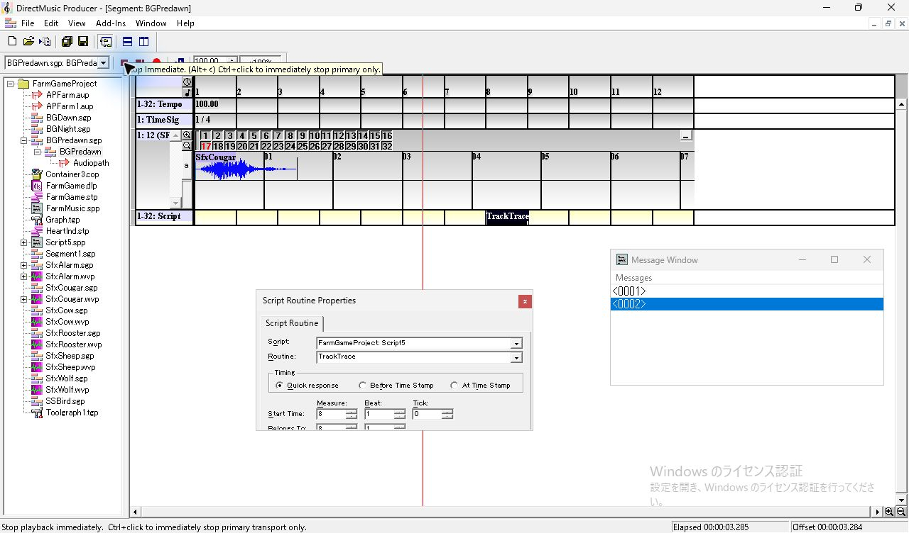

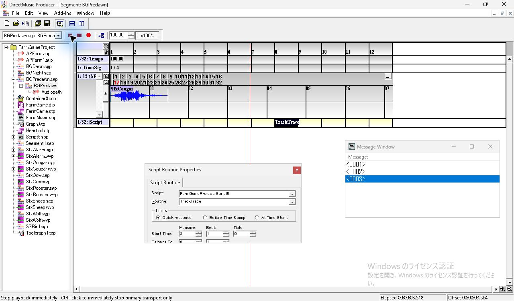

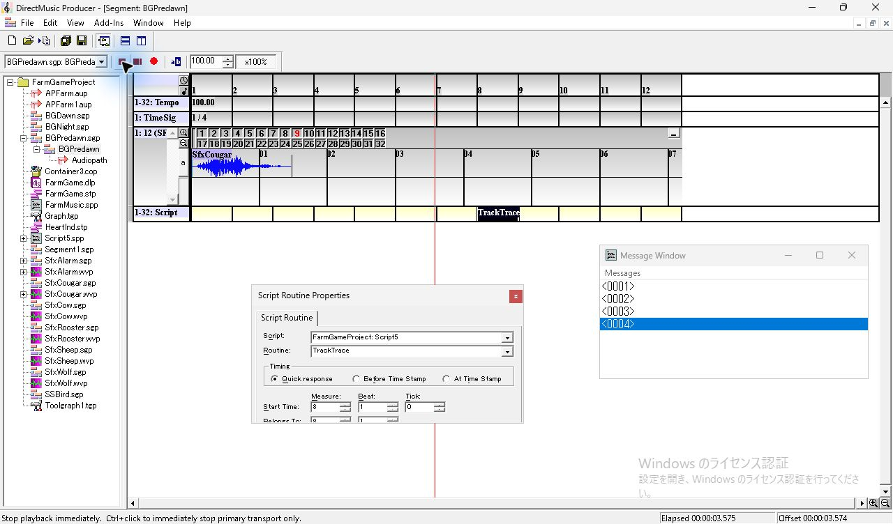

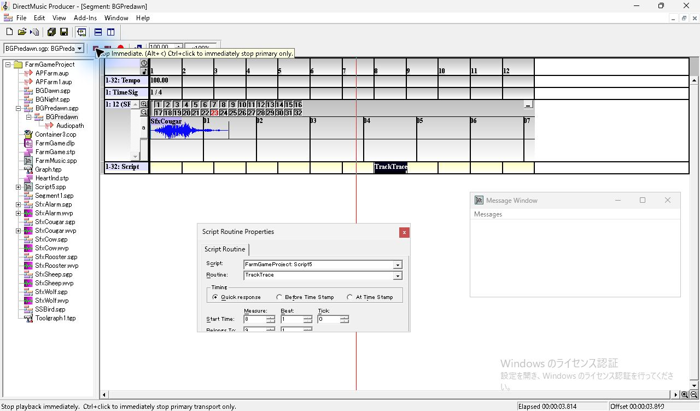

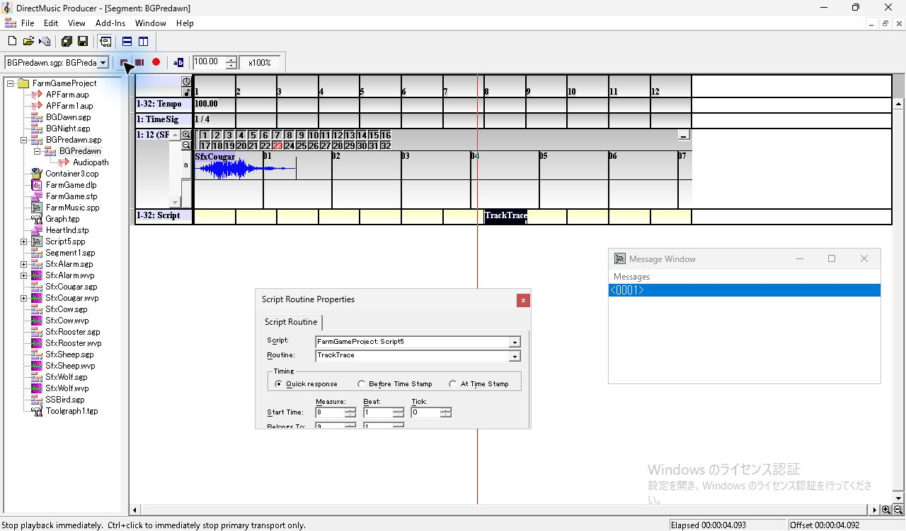

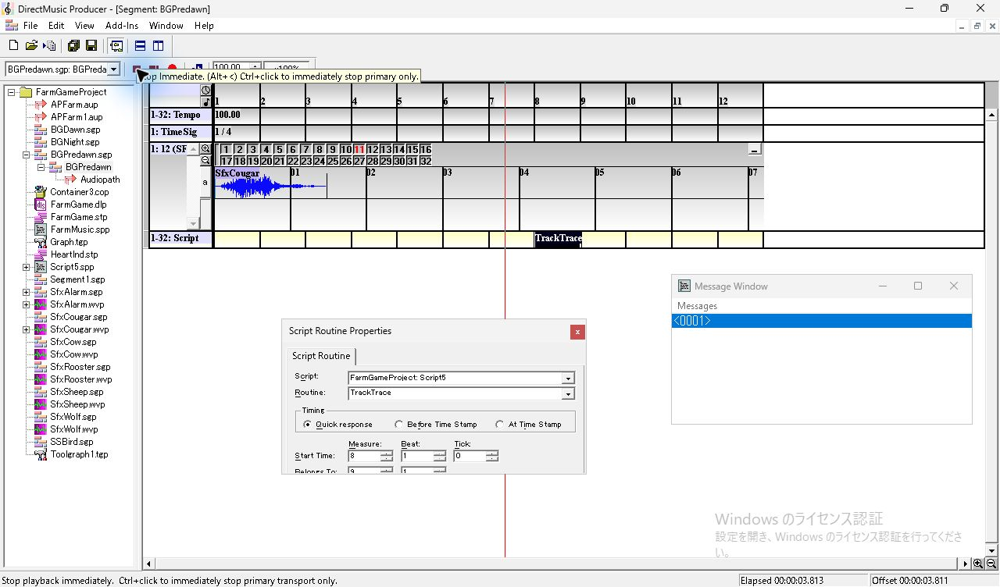

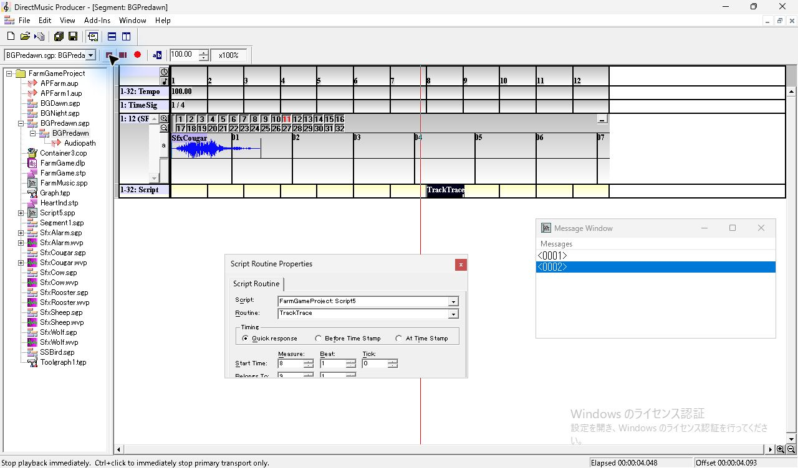

### Before Time Stamp

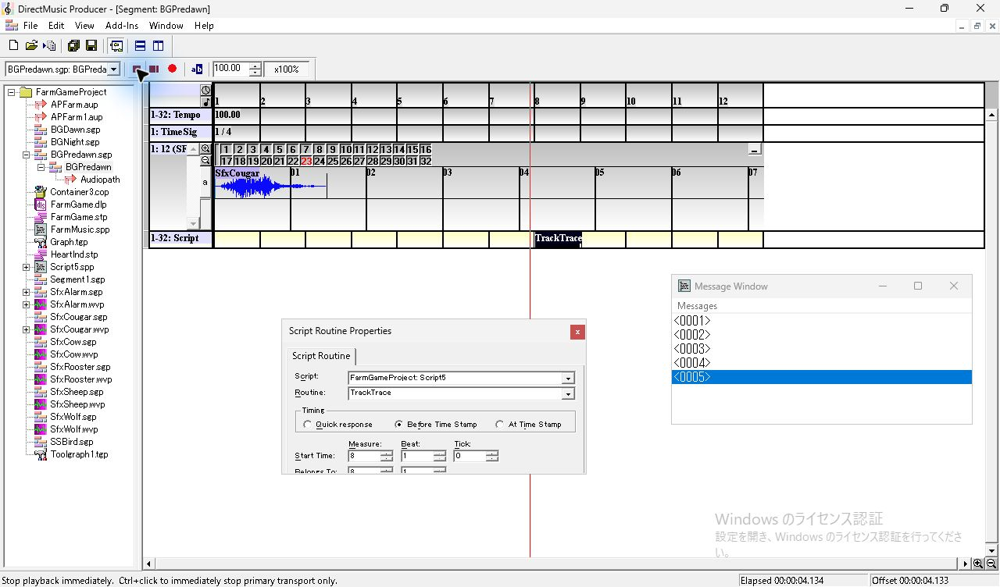

### At Time Stamp

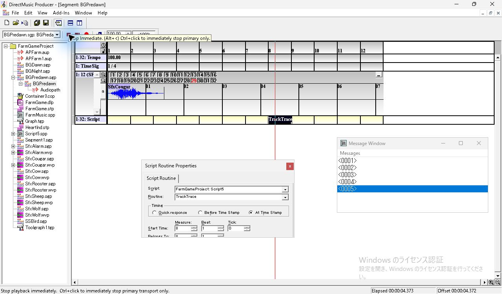

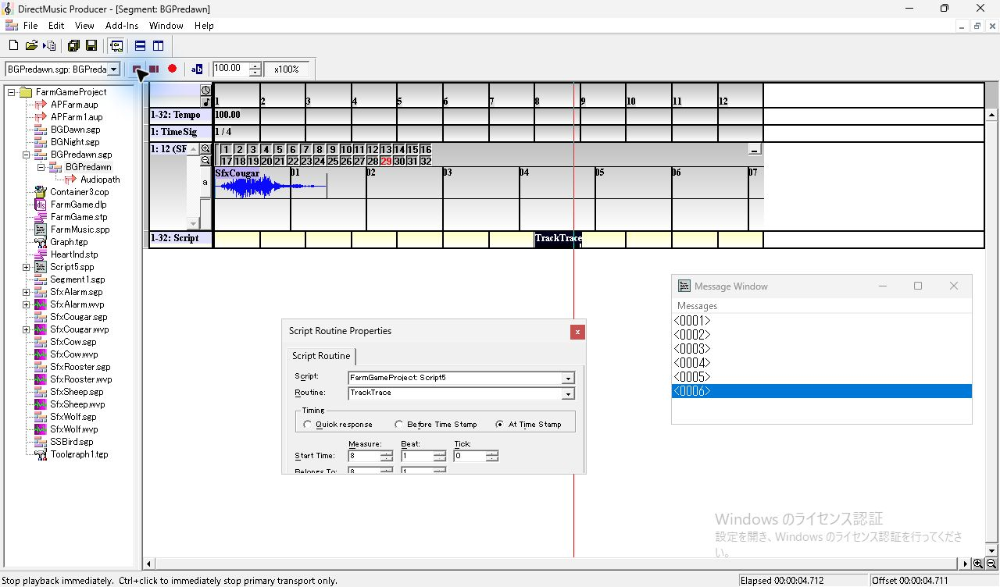

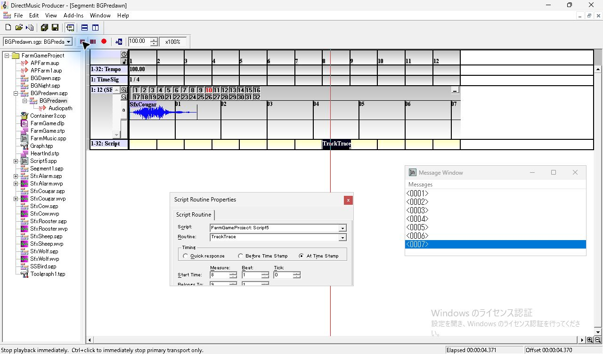

## 保存値と再表示

同じ Timing 内の2つの SGP は、`scrh` の論理クロックの **5376→6144** だけが変わった。論理クロックのフィールドはファイル先頭を0とする **1178** から4バイト。物理クロックは **5376**、グループは **0xFFFFFFFF**、Routine と Script 参照 GUID は全条件で一致する。同じ Belongs To 内での3方式は Timing 値の1バイト（**1174**）のみが **Quick 0x01、Before 0x02、At 0x04** に変わった。 [Quick 8](../../../work/original-gui/SEG-14-script-belongs/20261112T042524480786Z/captures/32-quick-8-save.sgp) · [Quick 9](../../../work/original-gui/SEG-14-script-belongs/20261112T042524480786Z/captures/26-quick-9-save.sgp) · [Before 8](../../../work/original-gui/SEG-14-script-belongs/20261112T042524480786Z/captures/18-before-8-save.sgp) · [Before 9](../../../work/original-gui/SEG-14-script-belongs/20261112T042524480786Z/captures/22-before-9-save.sgp) · [At 8](../../../work/original-gui/SEG-14-script-belongs/20261112T042524480786Z/captures/36-at-8-save.sgp) · [At 9](../../../work/original-gui/SEG-14-script-belongs/20261112T042524480786Z/captures/40-at-9-save.sgp)

**At Time Stamp、Belongs To 9:1** を保存し、子ウィンドウを閉じて Project Tree の BGPredawn から開き直した。第8小節の TrackTrace を選ぶと **Start Time 8:1:0 / Belongs To 9:1** と同じ Timing が表示される。追加撮影後、同じ値に戻して再保存したところ、Script Track と他の Track のバイト列は再表示前と一致。SGP のデザイン用 `segd` で1バイトだけ **38→12** の差があった。Message Window は閉じて開き直すと、前と同じ位置に空の一覧で現れた。 [再表示後の SGP](../../../work/original-gui/SEG-14-script-belongs/20261112T042524480786Z/captures/93-restored-at-9-save.sgp) · [保存値と差分の照合](../../../work/original-gui/SEG-14-script-belongs/20261112T042524480786Z/script-belongs-audit.json) · [照合コード](../../../work/original-gui/SEG-14-script-belongs/20261112T042524480786Z/audit.py)

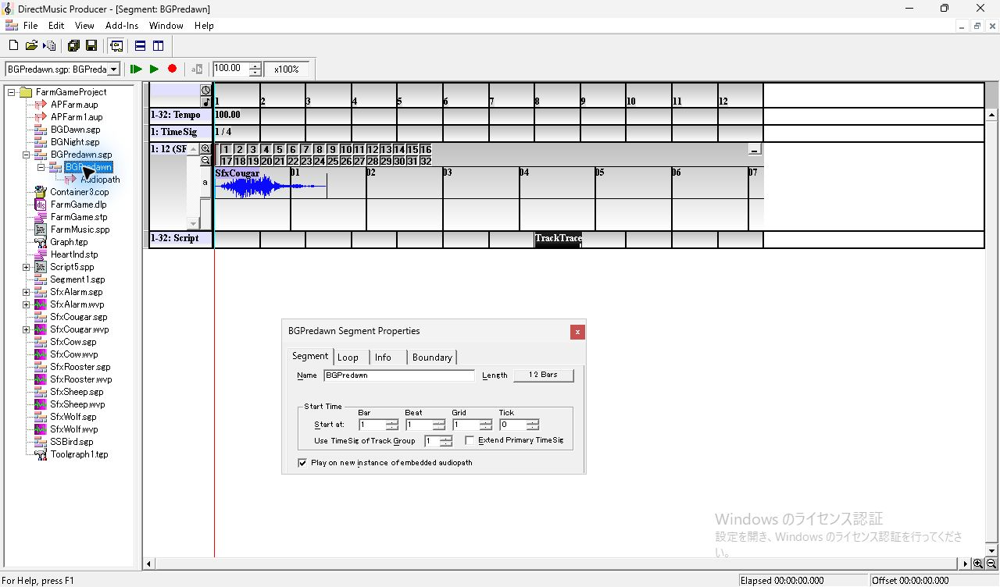

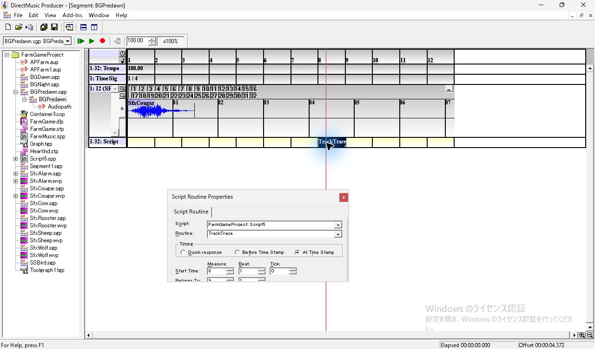

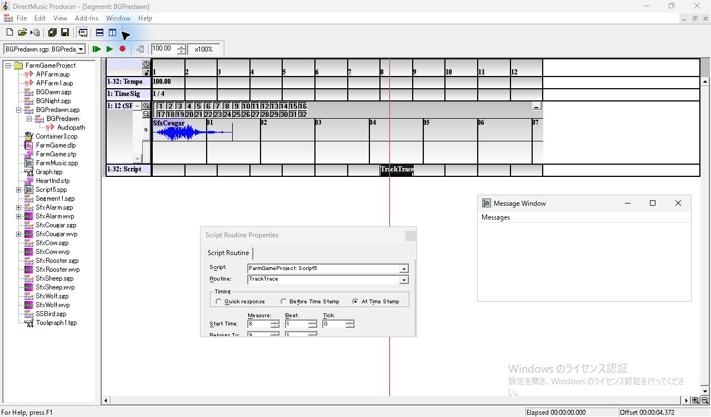

終了時は試験 Project、Properties、Message Window を閉じた。最初と最後で Producer は同じ1件。View は **Project Tree、Standard Toolbar、Status Bar、Transport Controls** の4項目。凍結した入力28ファイルは開始時の SHA-256 と一致し、作業用 Project で変わったのは **BGPredawn.sgp** と **FarmGameProject.pro**。 [終了時のウィンドウ一覧](../../../work/original-gui/SEG-14-script-belongs/20261112T042524480786Z/captures/100-final-windows.json)

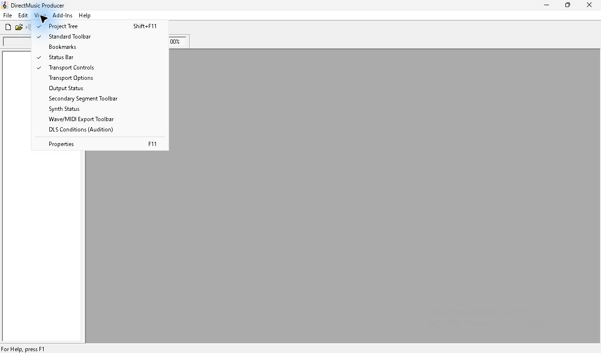
