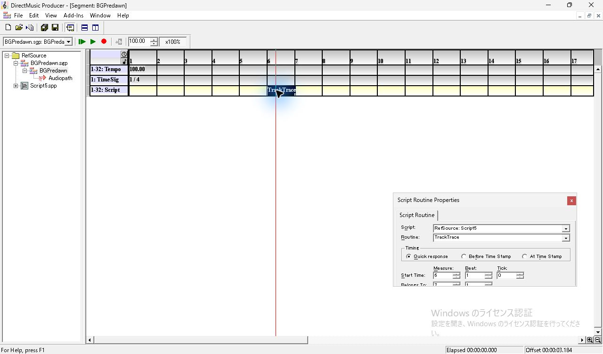
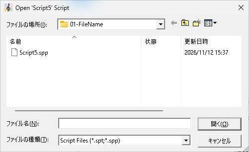
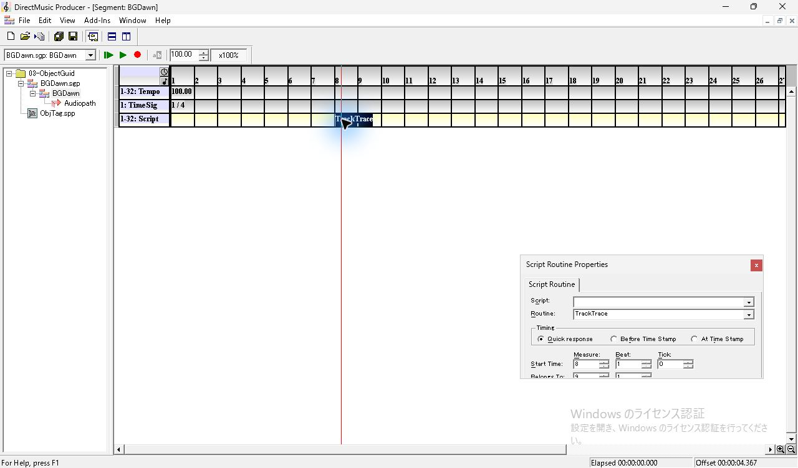
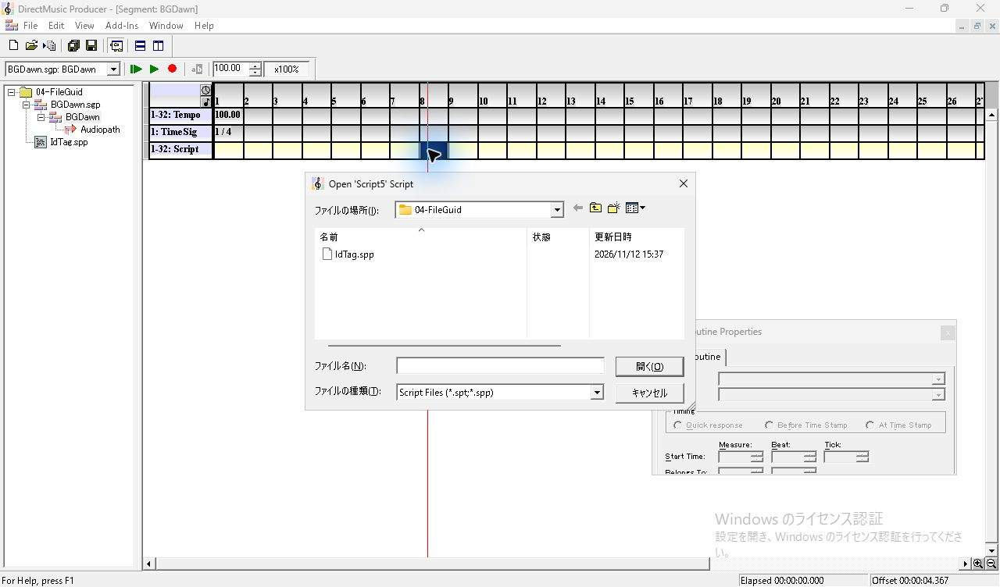
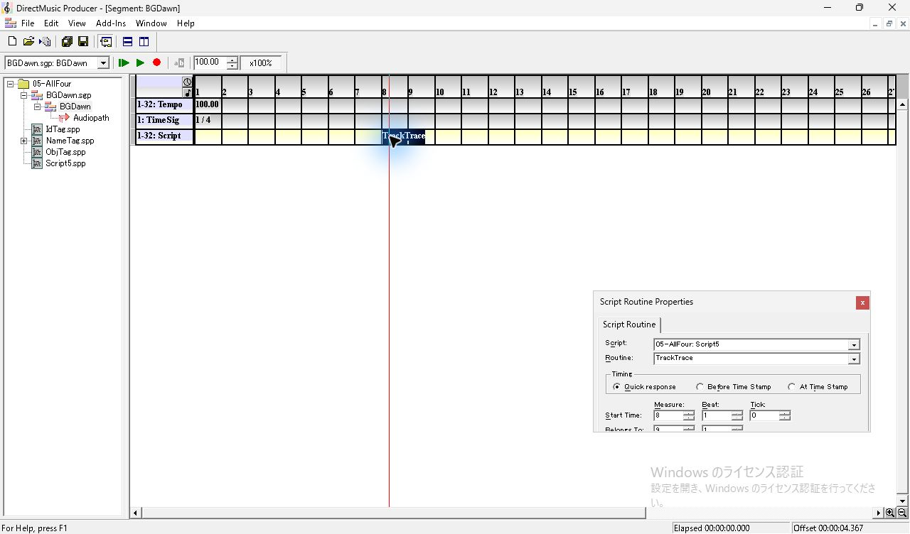
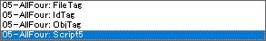
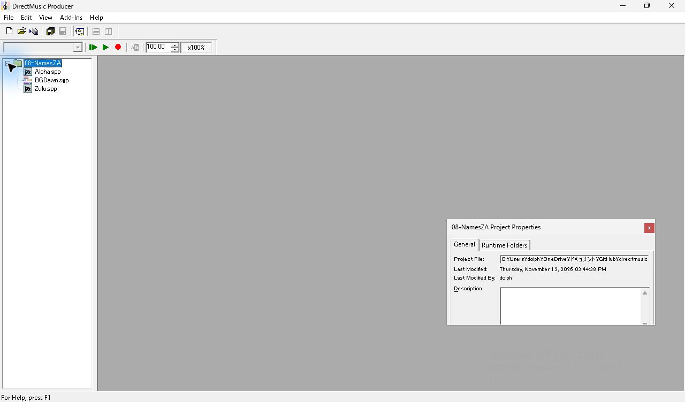
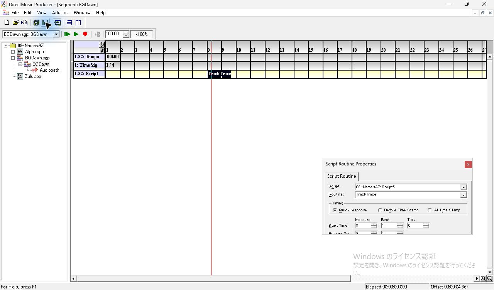
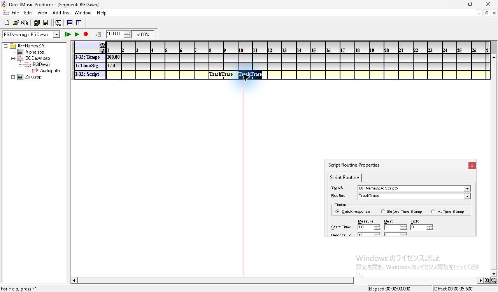
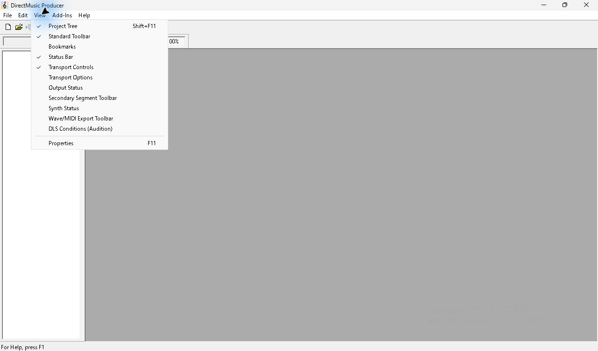

# SEG-14 別 Project に貼り付ける際の Script 候補の自動選択

観測日 2026-11-12。コピー元 Project を閉じてから貼り付け先を単独で開く条件で、Script Routine の参照先がどの一致項目から選ばれるかを調べた。既に登録されている `.spp` の内部 Script 名が一致すると自動で参照される。今回の9条件では、ファイル名、Script オブジェクト GUID、Producer のファイル GUID がそれぞれ単独で一致する場合、ファイル指定が開いた。内部名が一致する候補が2件のケースでは、Project ファイルで先に登録されていた候補が選ばれた。 [別 Project の参照解決](seg-14-script-project-reference.md) · [Script ファイルの手動指定](seg-14-script-file-picker.md)

## 条件と操作

1. 起動中の原版コピー `DmusGuiPatternStyle.exe` 1件で、調査用の `RefSource.pro` を開く。`BGPredawn.sgp` の Script Track で Start Time `6:1:0`、Belongs To `7:1` の `TrackTrace` を選択して `Ctrl+C`。Properties の Script は `RefSource: Script5`、Timing は `Quick response`。元の Script ファイルは `Script5.spp`。
2. `RefSource` を閉じる。貼り付け先を1件ずつ Open Project で開き、各 `BGDawn.sgp` の Script Track の8小節目をクリックして同じクリップボードから `Ctrl+V`。9件とも開始時の Script Track は空で、Tempo 100、拍子 1/4、候補は Project 直下に登録済み。候補の Script 本文は同一で、どれも `TrackTrace` を持つ。
3. `Open 'Script5' Script` が開いた場合はファイルを選ばずにキャンセルする。8小節目のセルと Properties を確認して `.sgp` を保存し、貼り付け先を閉じて次を開く。選択された Script は保存ファイル中の参照で特定する。

比較した内部名は `.spp` の `DMSC/UNFO/UNAM` と `.pro` の各ファイルの `UNFO/nnam` に同じ値を入れた。ファイル GUID は `.pro` の `filh` の先頭16バイト。オブジェクト GUID は `.spp` の `DMSC/guid` と対応する `filh` 内の値。各候補は次表に記載した項目だけがコピー元と一致する。 [素材作成コード](../../../work/original-gui/SEG-14-script-candidate-order/20261112T063744102794Z/prepare.py) · [入力、候補の GUID とハッシュ](../../../work/original-gui/SEG-14-script-candidate-order/20261112T063744102794Z/run.json)

*図1 コピー元の Script は RefSource: Script5、Routine は TrackTrace。*

## 貼り付け直後と保存結果

`.pro` に入れた Script 候補を登録順に示す。ファイル名の後の括弧内は、コピー元と一致する項目。

| Project | Script 候補と一致項目 | ファイル指定 | 保存された参照先 |
| --- | --- | --- | --- |
| 01-FileName | `Script5.spp`（ファイル名） | 開く。キャンセル | 参照なし |
| 02-ScriptName | `NameTag.spp`（内部名） | 開かない | `NameTag.spp` |
| 03-ObjectGuid | `ObjTag.spp`（オブジェクト GUID） | 開く。キャンセル | 参照なし |
| 04-FileGuid | `IdTag.spp`（ファイル GUID） | 開く。キャンセル | 参照なし |
| 05-AllFour | `Script5.spp`（ファイル名）、`NameTag.spp`（内部名）、`ObjTag.spp`（オブジェクト GUID）、`IdTag.spp`（ファイル GUID） | 開かない | `NameTag.spp` |
| 06-WithoutFileGuid | `NameTag.spp`（内部名）、`Script5.spp`（ファイル名）、`ObjTag.spp`（オブジェクト GUID） | 開かない | `NameTag.spp` |
| 07-Names | `Script5.spp`（ファイル名）、`NameTag.spp`（内部名） | 開かない | `NameTag.spp` |
| 08-NamesZA | `Zulu.spp`（内部名）、`Alpha.spp`（内部名） | 開かない | `Zulu.spp` |
| 09-NamesAZ | `Alpha.spp`（内部名）、`Zulu.spp`（内部名） | 開かない | `Alpha.spp` |

### ファイル指定が開く場合

ダイアログのタイトルは `Open 'Script5' Script`。今回の各試行では貼り付け先のフォルダーを表示し、候補が一覧に現れた。ファイル名一致のケースでは `Script5.spp` が見えていてもファイル名欄は空。キャンセルしても貼り付けは成立し、8小節目に `TrackTrace` が入る。セルを選択すると Properties の Script 欄は空、Routine 欄は `TrackTrace`、Timing は `Quick response`。01-FileName の再読込時はダイアログが開かず、同じセルを選択すると空の Script 欄と Routine 名が復元された。

*図2 ファイル名だけが一致する場合。Tree とファイル一覧に Script5.spp があり、ファイル指定が開く。*

*図3 ファイル名欄は空で、Script5.spp の行に選択表示がない。ファイル形式欄には .spt と .spp が並ぶ。*

*図4 キャンセル後に8小節目を選ぶと、セルと Routine 欄には TrackTrace があり、Script 欄が空になる。*

*図5 オブジェクト GUID だけが一致する ObjTag.spp がある場合もファイル指定が開く。*

*図6 オブジェクト GUID 一致のケースでキャンセルした後のセルと Properties。*

*図7 ファイル GUID だけが一致する IdTag.spp がある場合もファイル指定が開く。*

*図8 ファイル GUID 一致のケースでキャンセルした後のセルと Properties。*

*図9 01-FileName を開き直して Routine を選択すると、Script 欄は空のまま。*

### 内部名で自動選択する場合

02-ScriptName ではファイル名が `NameTag.spp` でも Properties は `02-ScriptName: Script5` と表示した。05-AllFour の一覧を開くと、ファイル名一致の候補は `FileTag`、ファイル GUID 一致は `IdTag`、オブジェクト GUID 一致は `ObjTag`、内部名一致は `Script5` と表示され、最後の行が選択されていた。一覧は選択を変更せず `Esc` で閉じた。4種類から3種類、2種類へ候補を減らしても、保存された参照先は `NameTag.spp` だった。

*図10 Script 名だけが一致する NameTag.spp。貼り付け後の Script 欄は 02-ScriptName: Script5。*

*図11 4種類の一致候補がある場合。選択中の Script 欄は 05-AllFour: Script5。*

*図12 Script 欄を開くと内部名が4行に並び、Script5 が選択されている。*

*図13 ファイル GUID 一致の候補を省いた場合も、選択中の Script は Script5。*

*図14 ファイル名一致と Script 名一致の2候補がある場合も、選択中の Script は Script5。*

### 同じ内部名の候補が2件ある場合

`Zulu.spp` と `Alpha.spp` の内部名をともに `Script5` にし、どちらのファイル GUID とオブジェクト GUID もコピー元やもう一方の候補とは別の値を用いた。2つの Project で Script の登録順を入れ替えた。Tree のファイル名表示順は両方で `Alpha.spp`、`Zulu.spp`。08-NamesZA の Script 欄の一覧には `08-NamesZA: Script5` が2行並ぶ。選択中の行の文言からはファイルを区別できる情報が得られないため、保存した `DMRF/file` と両 GUID を確認した。結果は登録順 `Zulu → Alpha` で `Zulu.spp`、`Alpha → Zulu` で `Alpha.spp`。

08-NamesZA を閉じて開き直すと、8小節目のセルと Properties の参照表示が復元された。同じクリップボードから10小節目にも貼り付けて保存すると、8小節目と10小節目の両方が `Zulu.spp` を参照した。開き直しと再保存の後も `.pro` の登録順は同じだった。

*図15 08-NamesZA を開いた直後。Tree では Alpha.spp が Zulu.spp より上にある。*

*図16 08-NamesZA の貼り付け直後。Properties は Script5 と表示し、保存先の参照は Zulu.spp。*

*図17 08-NamesZA の Script 欄。上下が同じ文言で、下の行に選択色が付く。*

*図18 09-NamesAZ を開いた直後。Tree の2ファイルの表示順は 08-NamesZA と同じ。*

*図19 09-NamesAZ の保存後。Properties は Script5 と表示し、保存先の参照は Alpha.spp。*

*図20 08-NamesZA を開き直し、保存済みの8小節目の Routine を選択。*

*図21 開き直した 08-NamesZA で10小節目にも貼り付け。8小節目と10小節目に TrackTrace が並ぶ。*

## 保存値の照合

10個の `.sgp` を保存し、9件の貼り付け直後と、08-NamesZA の10小節目に再貼り付けした状態を照合した。8小節目の `scrh` は Timing 1、物理5376、論理6144。10小節目は Timing 1、物理6912、論理7680。いずれも `scrn` は `TrackTrace`。選ばれた候補のファイル GUID は `scre/jzfr`、オブジェクト GUID は `DMRF/guid` に入り、`DMRF/file` はファイル名に一致した。ダイアログをキャンセルした3件では `jzfr` と `DMRF` がともに無かった。 [照合コード](../../../work/original-gui/SEG-14-script-candidate-order/20261112T063744102794Z/audit.py) · [10保存状態と候補の照合結果](../../../work/original-gui/SEG-14-script-candidate-order/20261112T063744102794Z/script-candidate-order-audit.json) · [公開画像の取得元とハッシュ](../../../work/original-gui/SEG-14-script-candidate-order/20261112T063744102794Z/published-figures.json)

`inputs/` の凍結素材、コピー元の Segment と Script、候補の `.spp`、候補登録順と GUID、Script Track 以外のトラックも照合した。今回の自動選択は、コピー元を閉じ、`.spp` の候補を貼り付け先 Project 直下に置いた場合の観測。`.spt` を手動指定した際の取込と保存は後続試験で確認した。 [Runtime Script の取込](seg-14-script-runtime-picker.md) [保存した候補順 Zulu → Alpha](../../../work/original-gui/SEG-14-script-candidate-order/20261112T063744102794Z/captures/81-tie-za-save.sgp) · [保存した候補順 Alpha → Zulu](../../../work/original-gui/SEG-14-script-candidate-order/20261112T063744102794Z/captures/88-tie-az-save.sgp) · [再読込と再貼り付け後の保存](../../../work/original-gui/SEG-14-script-candidate-order/20261112T063744102794Z/captures/101-za-reopen-second-save.sgp)

終了時に調査用 Project を閉じた。開始時と終了時の Producer は同じ1件。View の表示は **Project Tree、Standard Toolbar、Status Bar、Transport Controls**。 [開始時のウィンドウ一覧](../../../work/original-gui/SEG-14-script-candidate-order/20261112T063744102794Z/captures/00-start-windows.json) · [終了時のウィンドウ一覧](../../../work/original-gui/SEG-14-script-candidate-order/20261112T063744102794Z/captures/115-end-windows.json)

*図22 調査終了時の View。Project Tree は空で、4項目にチェックがある。*
