# SEG-14 同じ Segment 内の Script Track 間のドラッグと貼り付け

2026-11-12。DirectMusic Producer 5.3.0.900 の作業コピーで、同じ **BGPredawn** 内に2本の Script Track を置き、行をまたぐ通常ドラッグと貼り付けを比較した。選択色、赤い位置線、Properties、Edit の履歴、保存した SGP を照合した。本体は1280×752 px、Transport は x100%。主ウィンドウの撮影68枚から27枚を掲載する。画像の黒い矢印と青い光は操作ツールの表示。ネイティブカーソルのマウス押下中の形状は未採取。 [入力と実行ファイル](../../../work/original-gui/SEG-14-script-cross-track/20261112T040831586691Z/run.json) · [掲載画像の出典とハッシュ](../../../work/original-gui/SEG-14-script-cross-track/20261112T040831586691Z/published-figures.json) · [前回の別文書間の試験](seg-14-script-track-cross-document.md)

## Script Track をもう1本追加する

1. 試験用 Project の **BGPredawn.sgp** を Project Tree から開く。100.00 BPM、1/4、38小節。既存 Script 行の第3小節には同じ拍に **dmSfxAlarm** と **dmSSBird** があり、第6小節に **TrackTrace** がある。TrackTrace の Start Time は **6:1:0**、Belongs To は **7:1**。
2. Script 行を選択して **Ctrl+Insert**。**BGPredawn - Add New Tracks** で **Script Track** を選択して OK を押す。既存行の上に空の Script 行が追加され、どちらも **1-32: Script** と表示される。
3. 追加した行の左ヘッダーをクリックして **F11**。**Script Track Properties** に **Track Group Assignment** と **Flags** がある。Group Assignment の全32項目は灰色でチェック済み。左上の **1** をクリックしても同じ表示。
4. **Ctrl+S** で保存し、右上の子ウィンドウの閉じるボタンを押す。Project Tree の BGPredawn 文書ノードを開き直すと、空の上段と既存の下段が同じ順序で表示される。Edit には **Undo Add Track(s)** が残る。 [入力の SGP](../../../work/original-gui/SEG-14-script-cross-track/20261112T040831586691Z/inputs/FarmGameProject/BGPredawn.sgp) · [2本にした直後の SGP](../../../work/original-gui/SEG-14-script-cross-track/20261112T040831586691Z/captures/14-save-two-tracks.sgp)

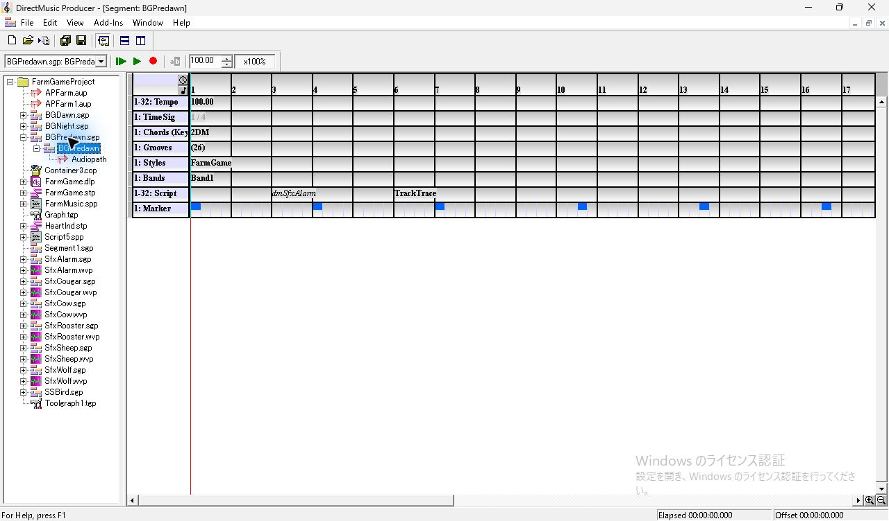

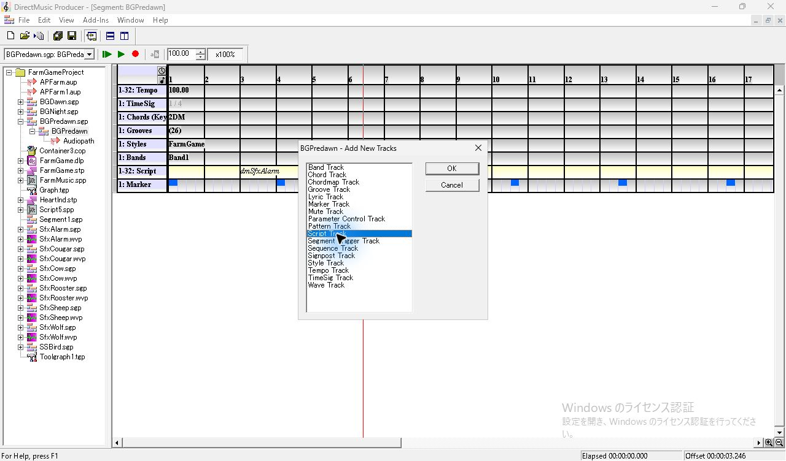

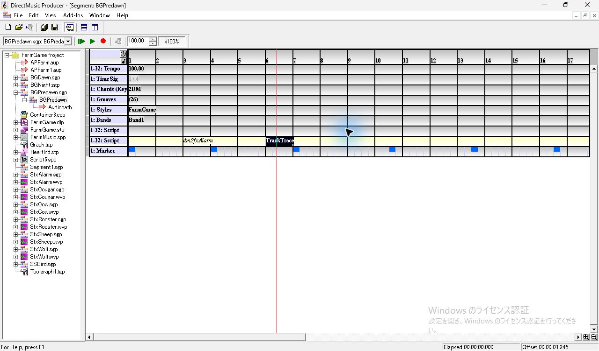

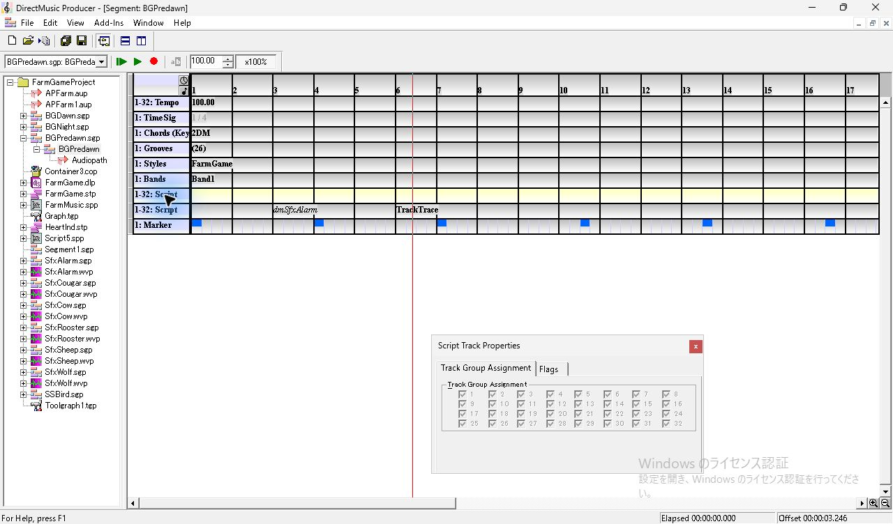

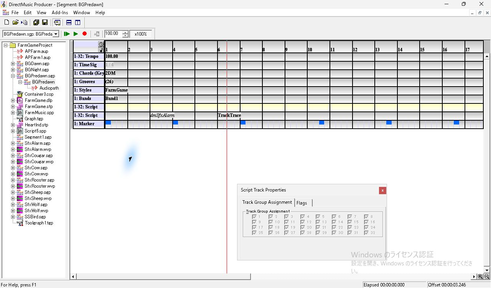

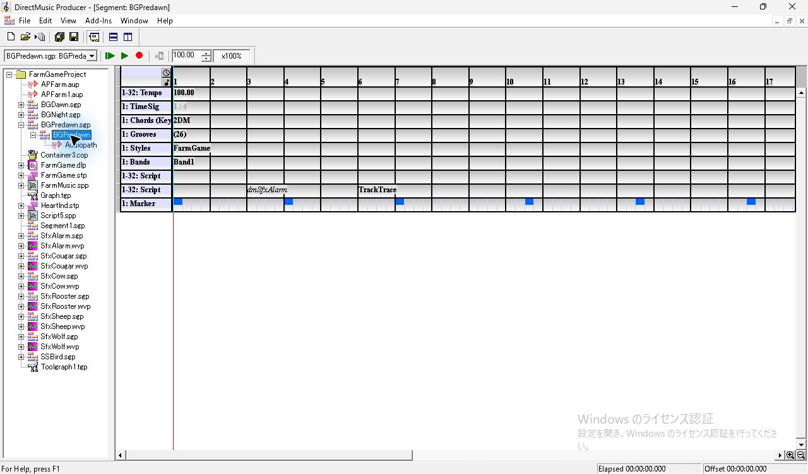

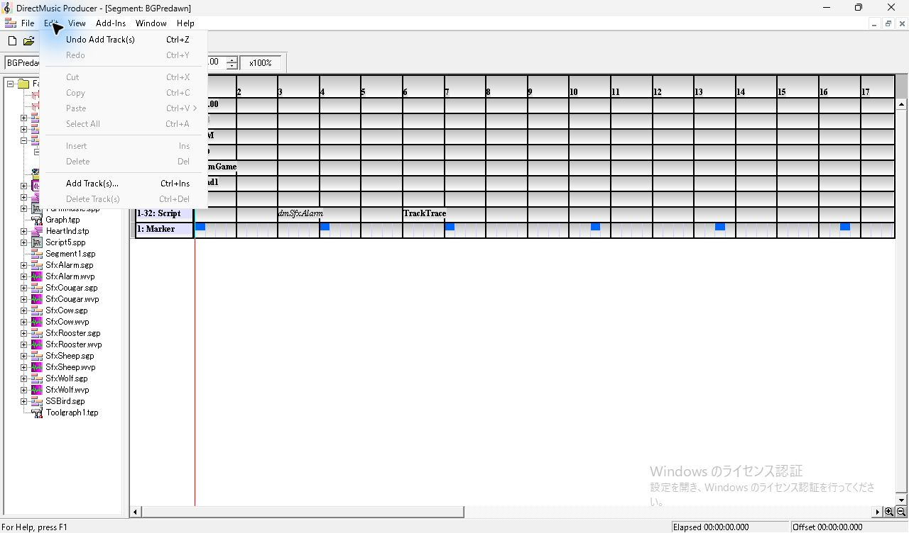

## 空の上段への通常ドラッグ

下段の第6小節の TrackTrace をクリックし、**Script Routine Properties** を開いた。文字は白、セルは濃紺、行の残りは薄い黄色。Properties に **FarmGameProject: Script5**、**TrackTrace**、**Quick response**、Start Time **6:1:0**、Belongs To **7:1** が表示される。以降の座標は親ウィンドウの画像上で左上を原点とする。修飾キーを使わず、上から順に試した。

| 開始時の選択 | ドラッグの始点と終点（px） | 操作後の状態 |
| --- | --- | --- |
| 下段第6小節の TrackTrace | `(585,301) → (585,280)`、上段第6小節 | 直後は下段の選択と汎用の空の **Properties**。表示が落ち着くと上段第6小節が濃紺になり、**Script Routine Properties** の欄は空で灰色。下段には TrackTrace の黒い文字が残る |
| 上段第6小節の空セル | `(585,301) → (699,281)`、下段の未選択項目から上段第8小節 | 選択は上段第6小節。第8小節は空 |
| 下段第6小節の TrackTrace を選び直した状態 | `(571,301) → (694,279)`、下段の文字の左端から上段第8小節 | 上段第6小節が濃紺で第8小節は空。赤い位置線は始点付近の x=571 |

3回の操作後も Edit の最上段は **Undo Add Track(s)**、Redo は無効。保存した SGP の全バイトが追加直後の SGP と一致した。上段の空セルへの選択切り替えと、イベントの保存上の配置を個別に確認できる。 [空セルへのドラッグ後の SGP](../../../work/original-gui/SEG-14-script-cross-track/20261112T040831586691Z/captures/29-save-after-empty-drags.sgp) · [バイト比較](../../../work/original-gui/SEG-14-script-cross-track/20261112T040831586691Z/script-cross-track-audit.json)

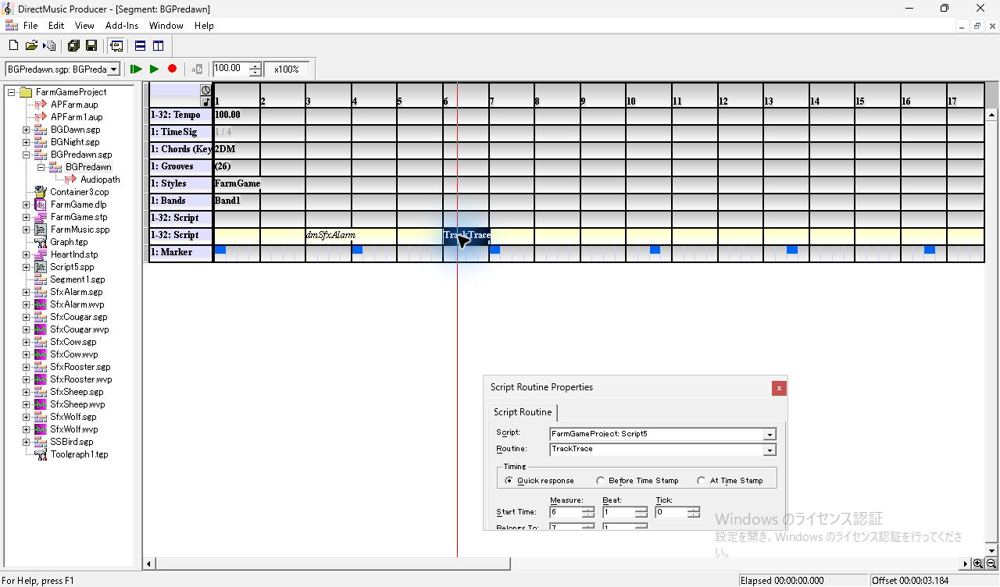

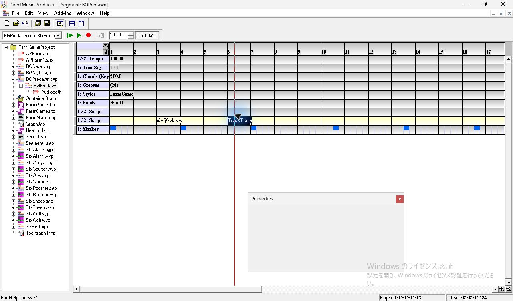

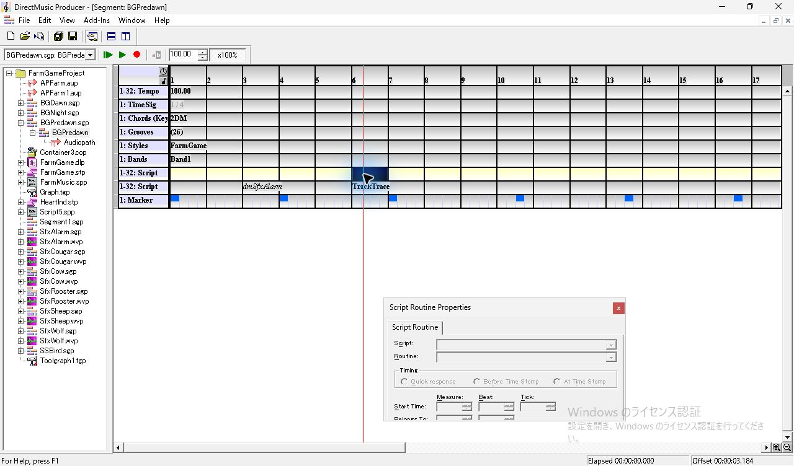

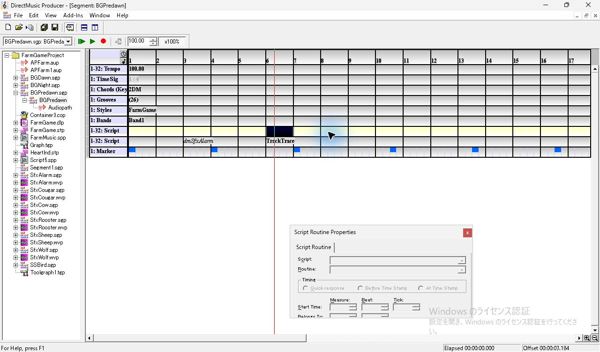

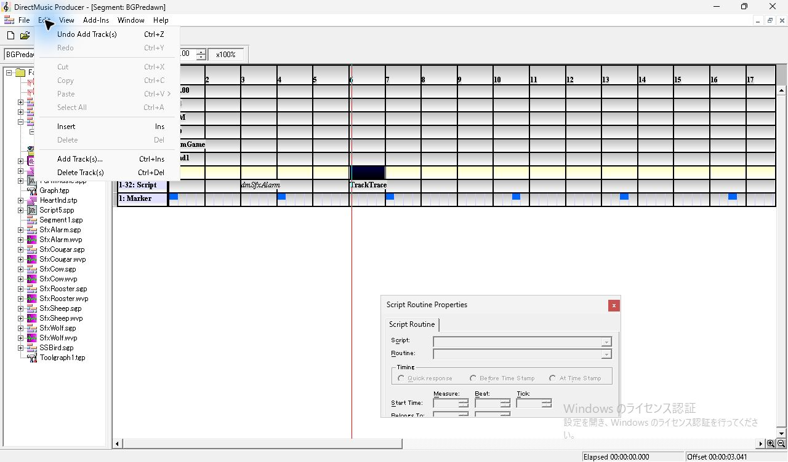

## 貼り付け、既存イベントへのドラッグ、履歴

下段の TrackTrace を選択して **Ctrl+C**。上段第8小節を1回クリックし、**Ctrl+V** を押す。上段第8小節に TrackTrace が白文字で現れ、濃紺で選択される。下段第6小節の元の項目は残る。Script5 の参照 GUID と Timing は元の項目と一致し、開始時刻と所属時刻の間隔は1小節のまま。

| 位置 | Start Time | Belongs To | 保存された物理クロック | 保存された論理クロック | Timing |
| --- | --- | --- | ---: | ---: | --- |
| 下段、コピー元 | 6:1:0 | 7:1 | 3840 | 4608 | Quick response |
| 上段、貼り付け先 | 8:1:0 | 9:1 | 5376 | 6144 | Quick response |

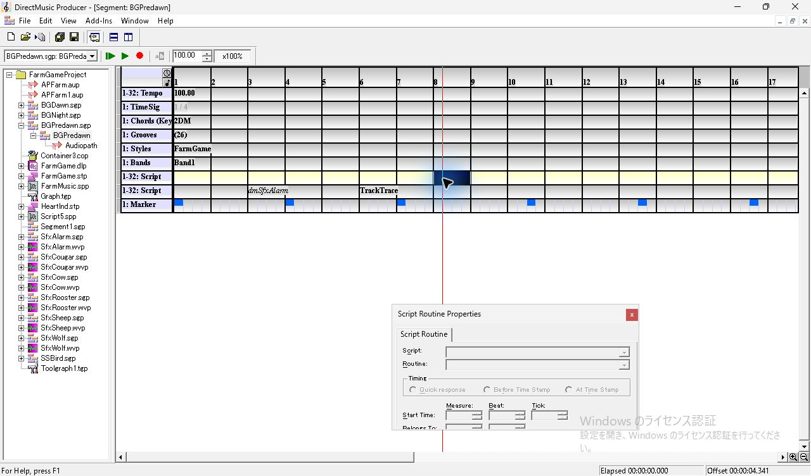

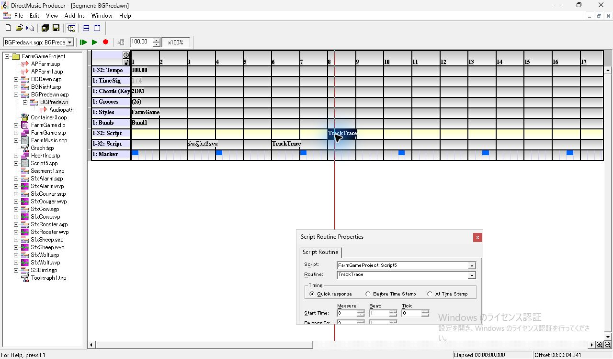

選択中の上段 TrackTrace から下段第3小節の既存イベントへ `(700,279) → (405,302)` とドラッグした。下段第3小節が濃紺になり、Properties はそこにあった **FarmMusic.dmSfxAlarm、Before Time Stamp、3:1:0、Belongs To 3:1** に切り替わる。赤い位置線は上段 TrackTrace の始点付近の x=700 に残る。両行の項目はそのまま残り、保存ファイルは貼り付け直後と全バイトが一致。Undo の最上段は **Undo Paste Routine(s)**。 [貼り付け後の SGP](../../../work/original-gui/SEG-14-script-cross-track/20261112T040831586691Z/captures/34-save-paste.sgp) · [既存イベントへのドラッグ後の SGP](../../../work/original-gui/SEG-14-script-cross-track/20261112T040831586691Z/captures/36-save-after-occupied-drag.sgp)

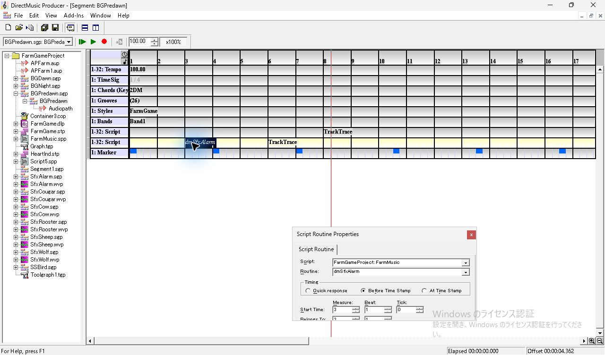

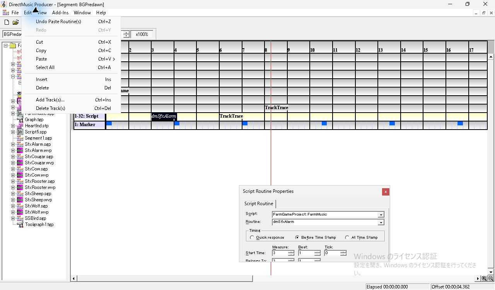

Edit から **Undo Paste Routine(s)** を選ぶと上段が空になり、下段の3件は残る。選択色は消え、浮動ウィンドウは **Audiopath Audiopath Properties** に切り替わる。赤い位置線は第8小節に残る。この状態で **Ctrl+Y** を1回送った時点では表示に変化がなく、Edit の **Redo Paste Routine(s)** は有効。メニューから実行すると上段第8小節の TrackTrace が戻り、文字は黒で濃紺の選択は付かない。Audiopath Properties は開いたまま。

Undo の保存では追加直後、Redo の保存では貼り付け直後と、Script Track 2本のバイト列がそれぞれ一致した。SGP 全体では、Undo の比較で Chord の `crdb` に2バイト、Redo の比較で同じ場所と Marker の `MARK` の個数（6→7）に差があった。 [Undo の SGP](../../../work/original-gui/SEG-14-script-cross-track/20261112T040831586691Z/captures/39-save-undo.sgp) · [Redo の SGP](../../../work/original-gui/SEG-14-script-cross-track/20261112T040831586691Z/captures/43-save-redo.sgp) · [チャンク単位の比較](../../../work/original-gui/SEG-14-script-cross-track/20261112T040831586691Z/script-cross-track-audit.json)

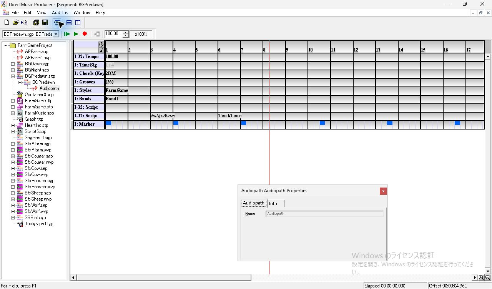

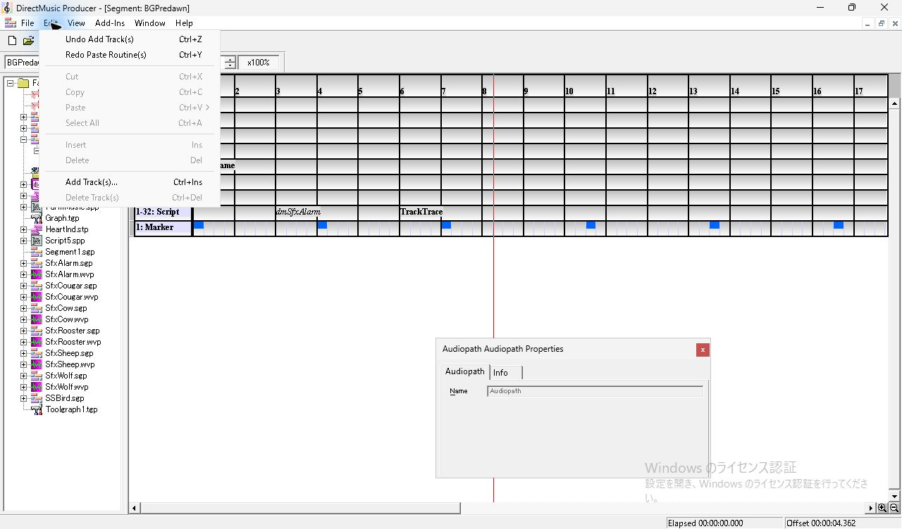

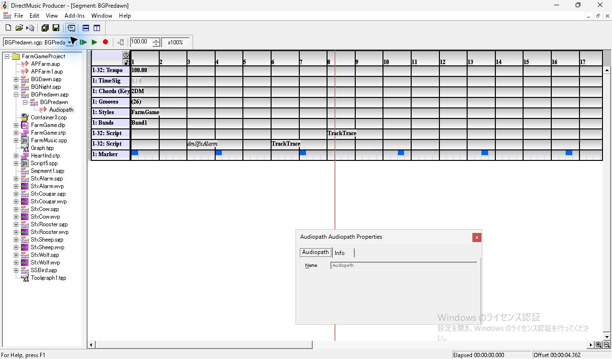

## グループ1と2を指定した SGP を読み込む

Redo 後の SGP から別の試験用 Project を用意し、Script の2つの `trkh` にある Group Bits のみを書き換えた。保存順で先の既存下段を **1**（`0x00000001`）、後の上段を **2**（`0x00000002`）とした。読み込み直後から画面では上下とも **1-32: Script**。どちらの **Track Group Assignment** も32個すべて灰色でチェック済み。再保存した SGP の両方のマスクは `0xFFFFFFFF`。参照、時刻、Timing は書き換え前の状態と一致した。この入力で画面上のグループを分けて保持することはできなかった。 [作成時の変更位置と入力ハッシュ](../../../work/original-gui/SEG-14-script-cross-track/20261112T040831586691Z/mask-test.json) · [グループを指定した入力 SGP](../../../work/original-gui/SEG-14-script-cross-track/20261112T040831586691Z/mask-test/inputs/FarmGameProject/BGPredawn.sgp) · [開いた後に保存した SGP](../../../work/original-gui/SEG-14-script-cross-track/20261112T040831586691Z/captures/55-mask-save-before-drag.sgp)

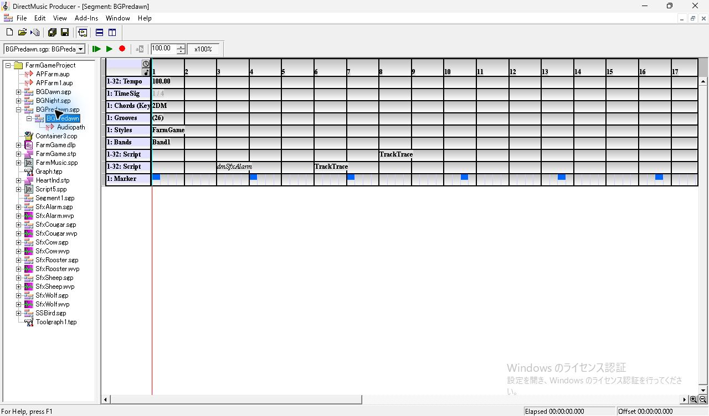

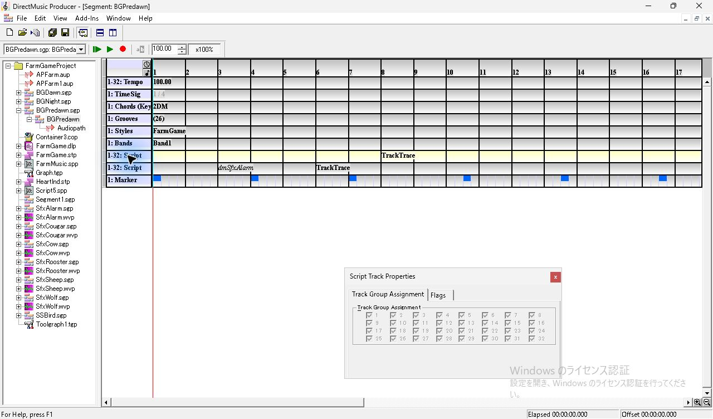

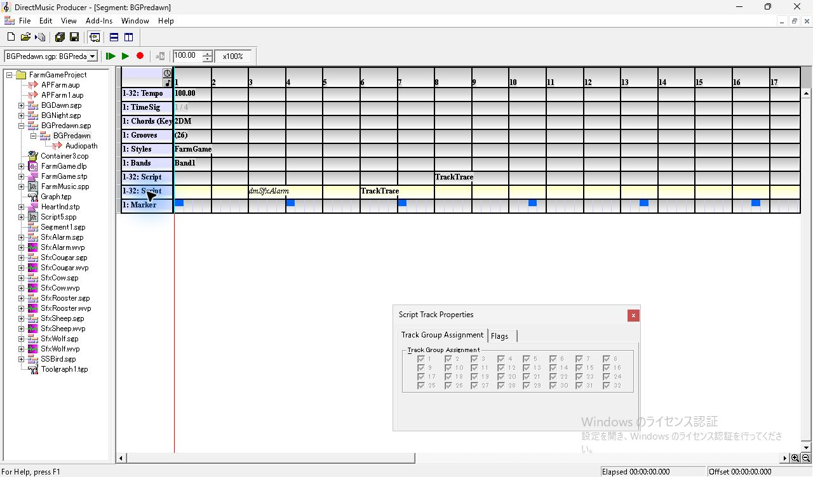

読み込み後に下段の Alarm から上段の TrackTrace へ `(406,301) → (695,280)` とドラッグすると、上段第8小節が選択され、もとからある TrackTrace の **8:1:0 / 9:1** が表示された。次に上段の TrackTrace から下段の空の第10小節へ `(699,280) → (814,302)` とドラッグすると、下段の空の第8小節が選択され、Properties は空で灰色。赤い位置線は両試行ともドラッグの開始位置付近。Edit の Undo と Redo は無効で、2回のドラッグ前後で保存ファイルは全バイトが一致した。試行時はどちらの行もグループ1〜32であり、グループが分かれた状態での挙動は未確認。 [2回のドラッグ後の SGP](../../../work/original-gui/SEG-14-script-cross-track/20261112T040831586691Z/captures/62-mask-save-after-drags.sgp)

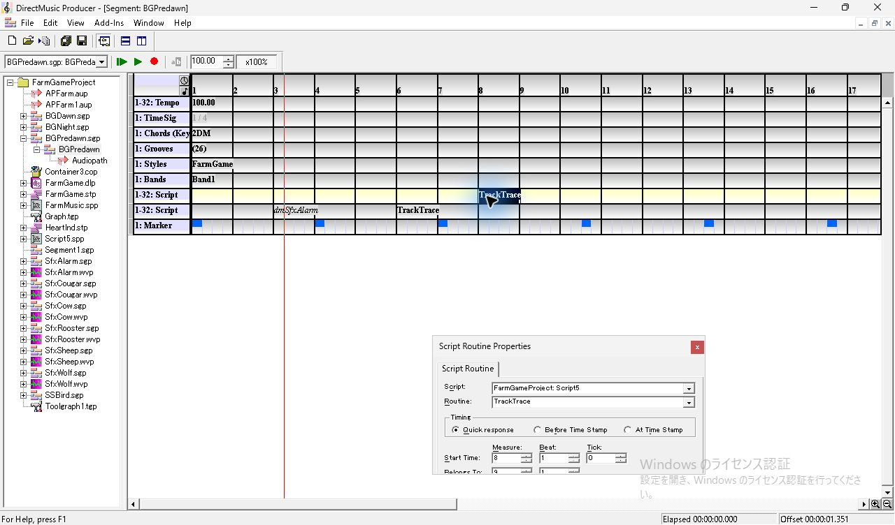

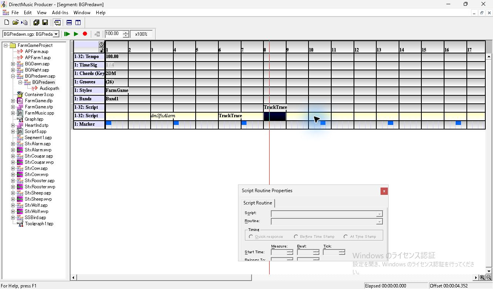

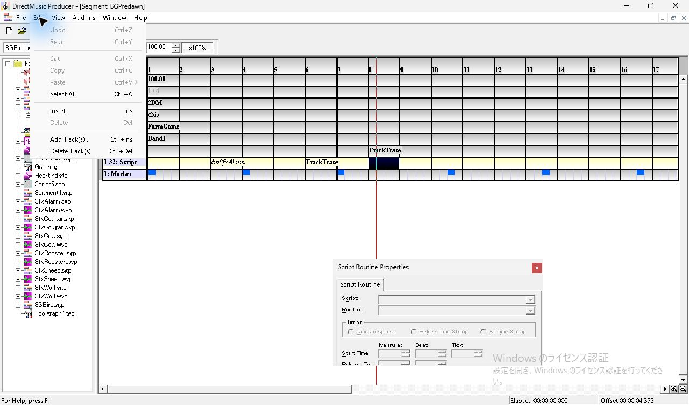

## 終了状態

試験用 Project を両方閉じ、開始と終了で同じ Producer のウィンドウ1件を確認した。View の表示は **Project Tree、Standard Toolbar、Status Bar、Transport Controls**。凍結した28ファイルはすべて開始時の SHA-256 と一致し、作業用 Project で変わったファイルは各 **BGPredawn.sgp** と **FarmGameProject.pro**。 [保存ファイルと参照の照合](../../../work/original-gui/SEG-14-script-cross-track/20261112T040831586691Z/script-cross-track-audit.json) · [照合コード](../../../work/original-gui/SEG-14-script-cross-track/20261112T040831586691Z/audit.py) · [終了時のウィンドウ一覧](../../../work/original-gui/SEG-14-script-cross-track/20261112T040831586691Z/captures/68-final-windows.json)

