# SEG-14 貼り付け時に指定した Script ファイルの取込

2026-11-12。DirectMusic Producer 5.3.0.900 の作業コピーで、別 Project に Script Routine を貼り付け、**Open 'Script5' Script** にファイルを指定した。3条件の貼り付け前後、Undo/Redo、欠損 Routine の呼出しと修復、Project の再読込を記録した。掲載は27枚。アプリ全体の画像は1280×752 pxで、図3・12はダイアログ、図19は Properties の画像。黒い矢印と青い光は操作ツールによる。 [実行条件と入力](../../../work/original-gui/SEG-14-script-file-picker/20261112T061810881596Z/run.json) · [入力作成手順](../../../work/original-gui/SEG-14-script-file-picker/20261112T061810881596Z/prepare.py) · [画像の出典とハッシュ](../../../work/original-gui/SEG-14-script-file-picker/20261112T061810881596Z/published-figures.json)

## 試験素材と操作

コピー元 **PickerSource / BGPredawn** の Script 行には **Script5.TrackTrace** が1件ある。**Quick response、Start Time 6:1:0、Belongs To 7:1**。貼り付け先の3 Project はそれぞれ **BGDawn** の空の Script 行を持ち、事前に Script を登録していない。両 Segment とも38小節、100 BPM、1/4。

各試行で PickerSource と受け側を開き、BGPredawn の第6小節をクリックして **Ctrl+C**。受け側の BGDawn を開き、第8小節の空セルをクリックして **Ctrl+V**。**Open 'Script5' Script** が開き、初期フォルダーはその受け側 Project、ファイル名欄は空、ファイルの種類は **Script Files (*.spt;*.spp)**。別フォルダーにある候補のパスをファイル名欄に入力して **開く** を押した。前回は同じダイアログをキャンセルし、Script 欄が空の項目が保存されることを確認している。 [前回のキャンセルと再読込](seg-14-script-project-reference.md#貼り付け先に-script-がない場合)

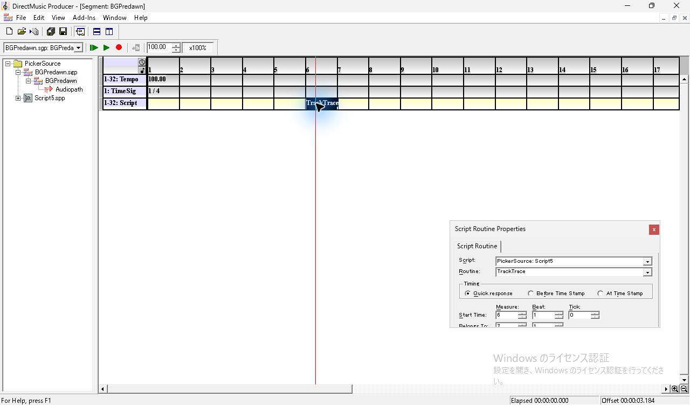

*図1 コピー元の PickerSource。第6小節の TrackTrace、Quick response、Start Time と Belongs To。*

*図2 第8小節への貼り付けで表示された Open 'Script5' Script。*

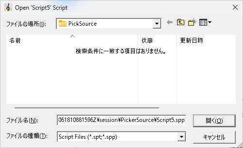

*図3 ファイル名欄にコピー元 Project の Script5.spp のパスを入力。*

| 貼り付け先 | ダイアログで指定したファイル | Properties の Script と Routine |
| --- | --- | --- |
| PickSource | 開いているコピー元 Project 内の `Script5.spp` | `PickSource: Script5` / `TrackTrace` |
| PickAlternate | 別フォルダーの `Other55.spp`。Script 名・オブジェクト GUID が異なり、TrackTrace を含む | `PickAlternate: Other55` / `TrackTrace` |
| PickNoRoutine | 別フォルダーの `Absent5.spp`。TrackTrace を GhostTrace に替えた候補 | `PickNoRoutine: Absent5` / `TrackTrace` |

## コピー元の Script5.spp を指定

**開く** を押すとダイアログが閉じ、受け側のルートに **Script5.spp → Script5 → Script Content** が追加され、Script5 の文書ノードが選ばれた。タイムラインの第8小節に **TrackTrace** が選択状態で入った。Properties が一度トラックの画面へ切り替わったので、貼り付けたセルをクリックして **PickSource: Script5、TrackTrace、Quick response、8:1:0、9:1** を確認した。

取り込んだ `Script5.spp` は PickSource のフォルダーに保存され、元の Script は PickerSource の Tree にも残った。受け側のファイル GUID と Script オブジェクト GUID は両方ともコピー元と異なる。候補の `.spp` と取り込んだ `.spp` のバイト差は先頭の `DMSC/guid` だけで、Script 本文は一致した。 [貼り付け後の BGDawn.sgp](../../../work/original-gui/SEG-14-script-file-picker/20261112T061810881596Z/captures/25-exact-save.sgp) · [GUID とハッシュ](../../../work/original-gui/SEG-14-script-file-picker/20261112T061810881596Z/script-file-picker-audit.json)

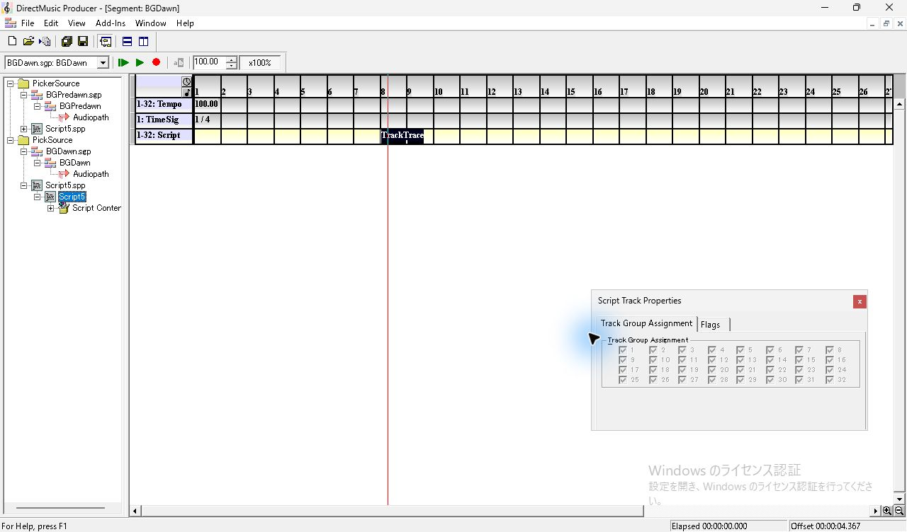

*図4 ファイルを開いた直後。受け側 Tree に Script5.spp と子ノードが追加される。*

*図5 第8小節を選択し直すと Script 欄は PickSource: Script5。*

### Undo と Redo

**Edit > Undo Paste Routine(s)** を選ぶとタイムラインから TrackTrace が消えた。Tree には取り込んだ Script が残った。この状態で BGDawn を保存し、Project ルートの **Save PickSource** も選ぶと、保存した `.pro` に Script の登録があり、`.spp` も残っていた。**Edit > Redo Paste Routine(s)** で同じ参照を持つ項目が戻り、最初の貼り付け直後と同じ SGP を保存できた。両 Project を閉じ、後で PickSource だけを開き直して同じ参照を確認した。 [Undo 後の空の BGDawn](../../../work/original-gui/SEG-14-script-file-picker/20261112T061810881596Z/captures/30-exact-undo-save.sgp) · [Undo 後の Project](../../../work/original-gui/SEG-14-script-file-picker/20261112T061810881596Z/captures/34-exact-undo-PickSource.pro) · [Redo 後の BGDawn](../../../work/original-gui/SEG-14-script-file-picker/20261112T061810881596Z/captures/39-exact-redo-save.sgp)

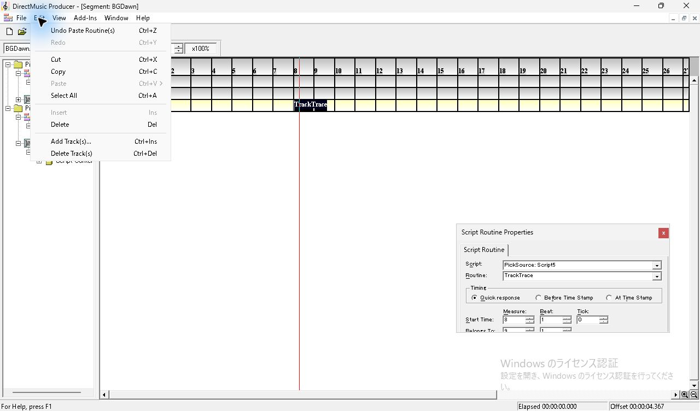

*図6 Edit に Undo Paste Routine(s) が表示される。*

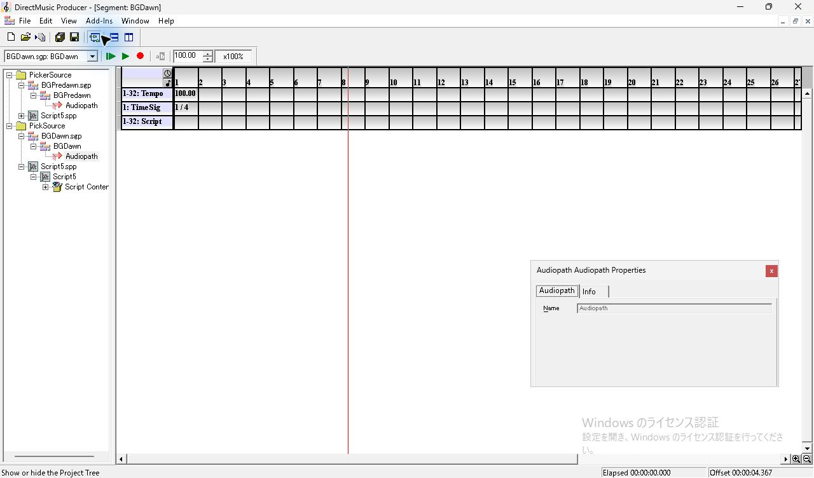

*図7 Undo 後。第8小節の Routine は消え、受け側の Script5.spp は Tree に残る。*

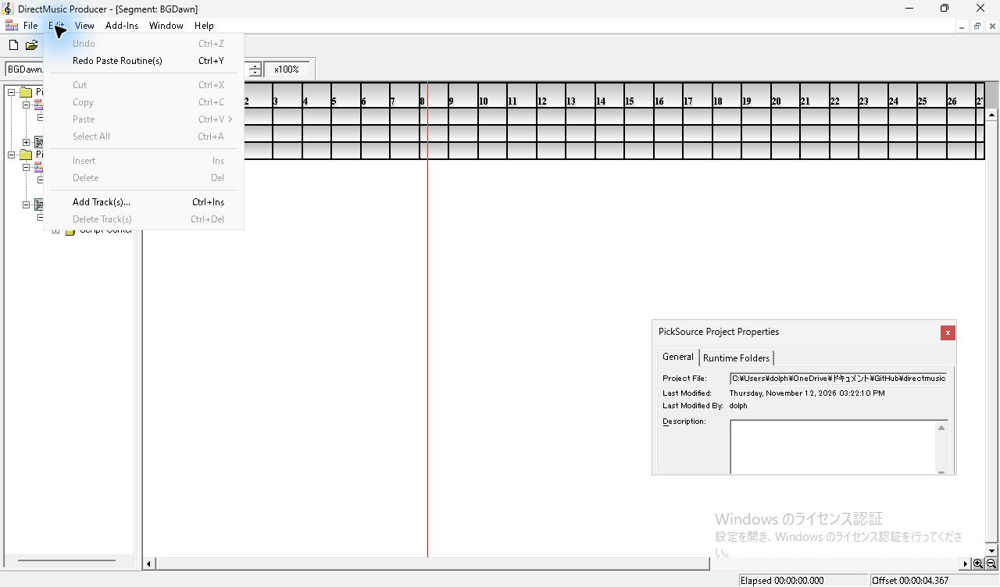

*図8 Undo 状態を Project に保存した後も、Edit の Redo Paste Routine(s) が有効。*

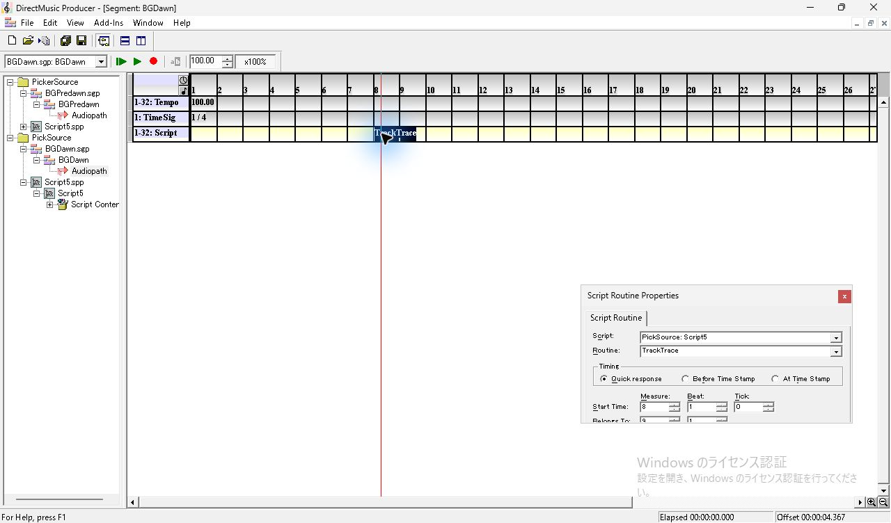

*図9 Redo 後に第8小節を選択し、同じ参照を確認。*

*図10 コピー元を閉じて PickSource だけを開き直しても同じ参照を表示。*

## 名前の異なる Other55.spp を指定

ダイアログのタイトルには元の **Script5** が表示されたまま、別名の **Other55.spp** のパスを入力して開けた。Project ルートに **Other55.spp** が追加され、第8小節の Properties は **PickAlternate: Other55 / TrackTrace** になった。取り込んだ `.spp` は指定した候補と全バイトが一致し、Project のファイル GUID が割り当てられた。PickAlternate だけを再読込すると、同じ名前、Routine、時刻が表示された。 [候補ファイル](../../../work/original-gui/SEG-14-script-file-picker/20261112T061810881596Z/candidates/Other55.spp) · [保存した BGDawn](../../../work/original-gui/SEG-14-script-file-picker/20261112T061810881596Z/captures/60-alt-save.sgp)

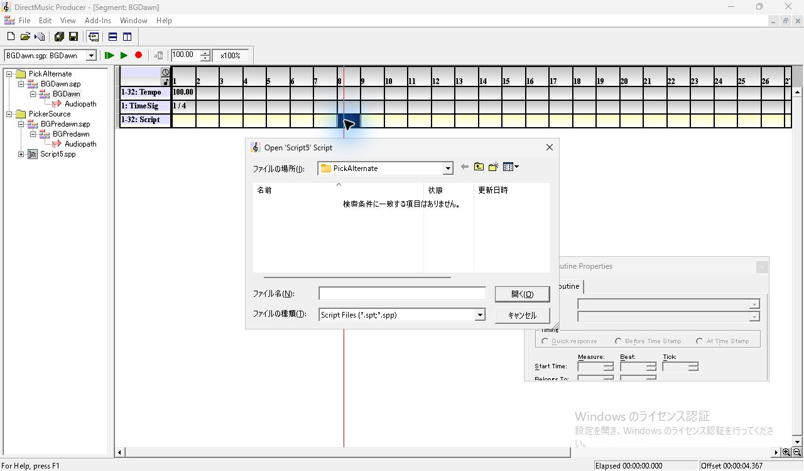

*図11 別名候補を使う試行でも、貼り付け時のダイアログは Script5 を求める。*

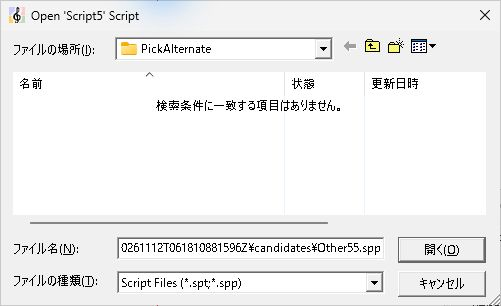

*図12 名前が異なる Other55.spp のパスを入力。*

*図13 Other55.spp が貼り付け先の Tree に追加され、TrackTrace が残る。*

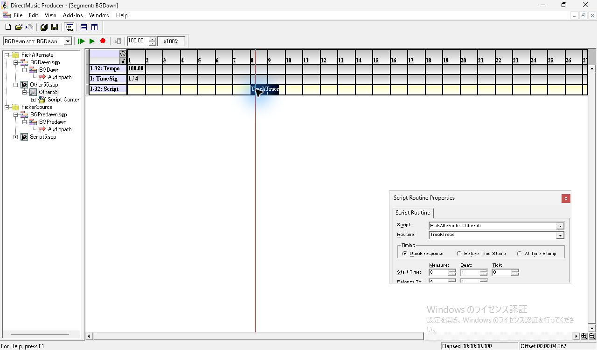

*図14 別名 Script の Properties。Script は PickAlternate: Other55。*

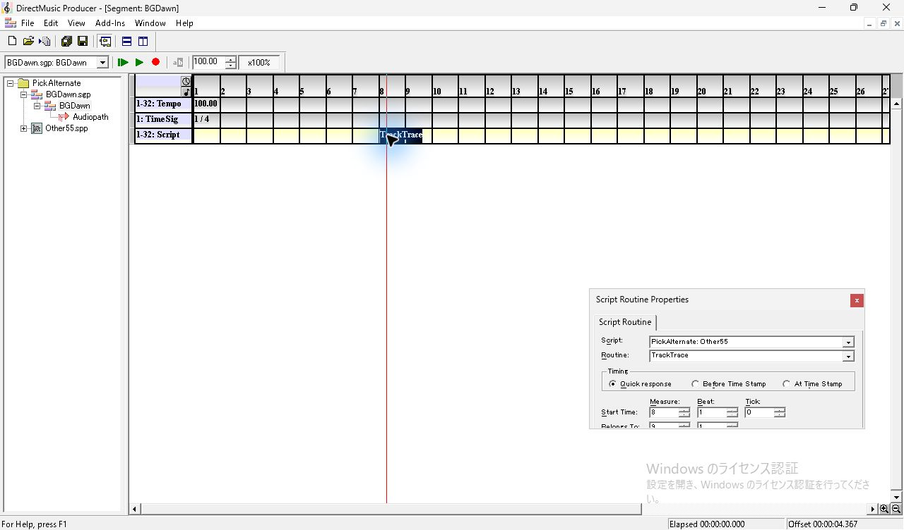

*図15 PickAlternate だけを再読込し、Other55 への参照を確認。*

## 元の Routine を持たない Absent5.spp を指定

**Absent5.spp** を指定しても取込と貼り付けは進み、**PickNoRoutine: Absent5** に紐づいた。セルと Properties の Routine 欄にはコピー元の **TrackTrace** が残った。Routine の矢印を押すと **GhostTrace、ManualTrace** が表示され、TrackTrace は一覧にない。**Escape** で一覧を閉じ、PickNoRoutine を単独で開き直すと、選び直す前の TrackTrace が再表示された。保存データにも Absent5 への参照と TrackTrace の名前が入っていた。 [候補ファイル](../../../work/original-gui/SEG-14-script-file-picker/20261112T061810881596Z/candidates/Absent5.spp) · [修復前の BGDawn](../../../work/original-gui/SEG-14-script-file-picker/20261112T061810881596Z/captures/81-absent-save.sgp)

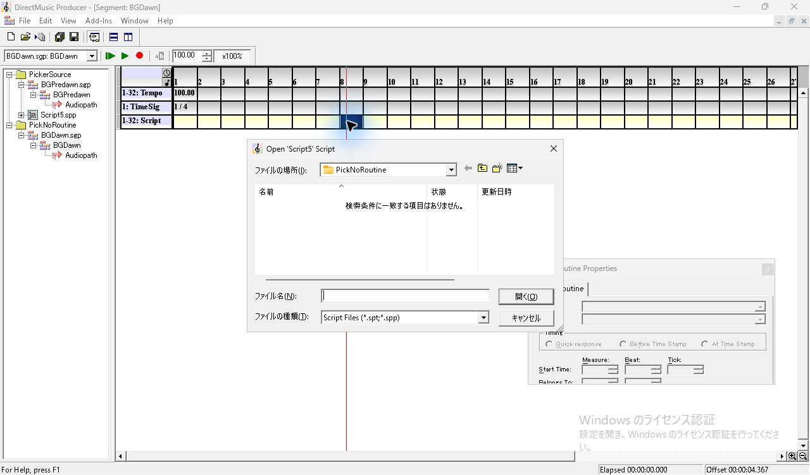

*図16 元の Routine を持たない候補を指定する試行の Open Script。*

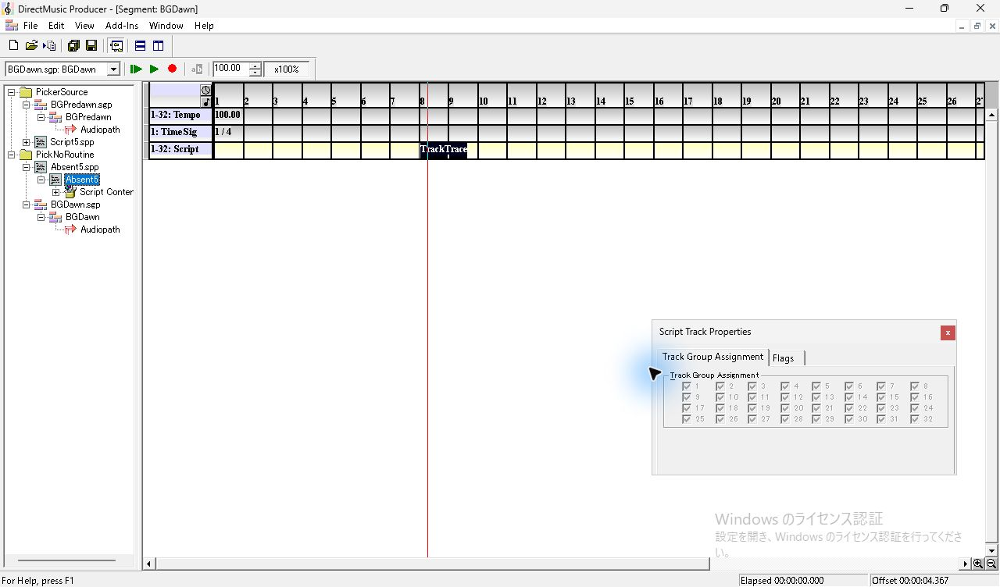

*図17 Absent5.spp と TrackTrace が追加された直後。*

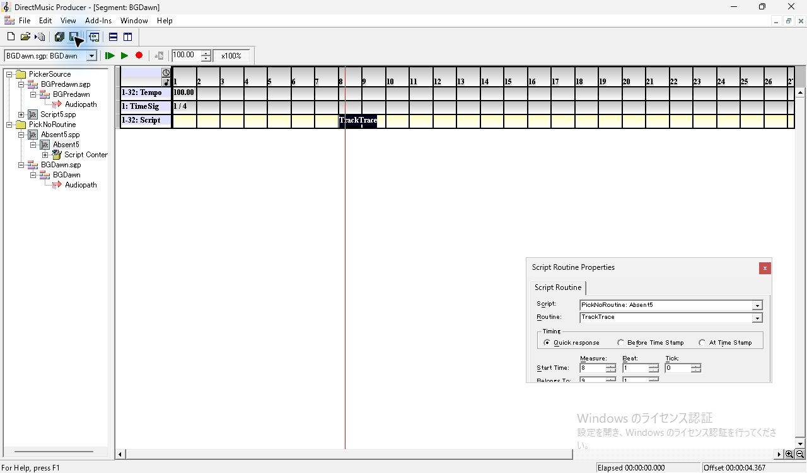

*図18 Script は PickNoRoutine: Absent5、Routine 欄とセルは TrackTrace。*

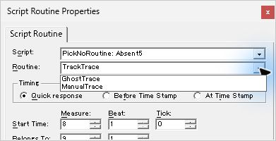

*図19 Routine の候補には GhostTrace と ManualTrace が並ぶ。*

*図20 PickNoRoutine だけを再読込しても、TrackTrace と Absent5 の組み合わせが残る。*

### 手動呼出しと修復

**Add-Ins > Message Window** を開くと一覧は空だった。本体が通常サイズへ戻ったため、最大化して第8小節を選び直した。停止中にセルを右クリックすると **Call Routine(s)** が有効。選ぶと Message Window に **`<0001> Script error in , line 0.`** と **`<0001> Error Code: 0x00000000`** が追加され、2行目が青く選択された。

Routine のドロップダウンで **GhostTrace** を選ぶと、セルと Properties の名前が切り替わった。手動で呼び出すと、先のエラー行の下に Trace の **`<0002>`** が1行増えた。この環境ではその行の本文は画面に見えなかった。保存のバイト差は `scrn` の名前だけ。Project を閉じて開き直した後も **GhostTrace、Quick response、8:1:0、9:1** を確認した。 [修復後の BGDawn](../../../work/original-gui/SEG-14-script-file-picker/20261112T061810881596Z/captures/116-repaired-save.sgp)

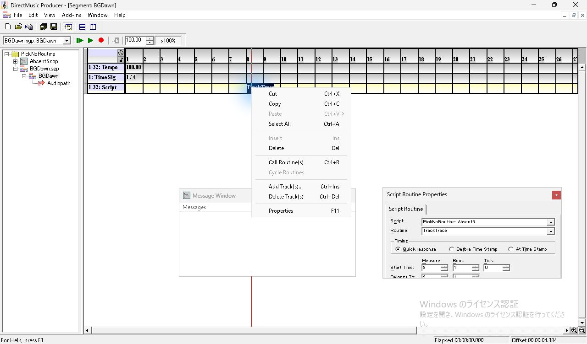

*図21 存在しない Routine のセルでも Call Routine(s) が有効。*

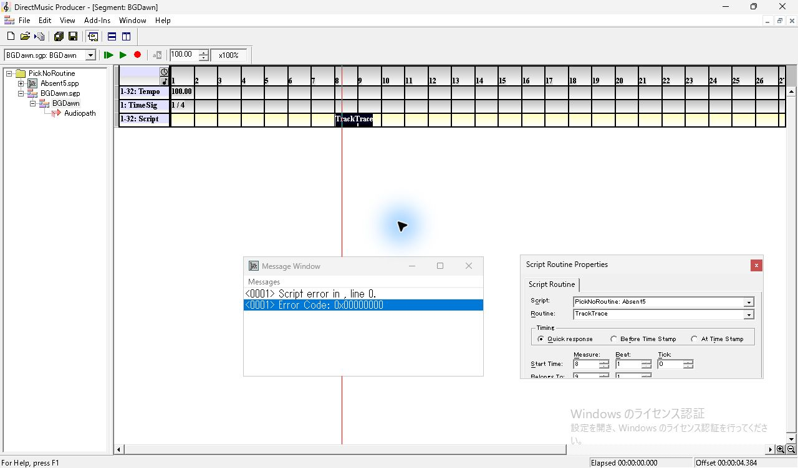

*図22 欠損した TrackTrace の手動呼出し。Message Window にエラーが2行追加される。*

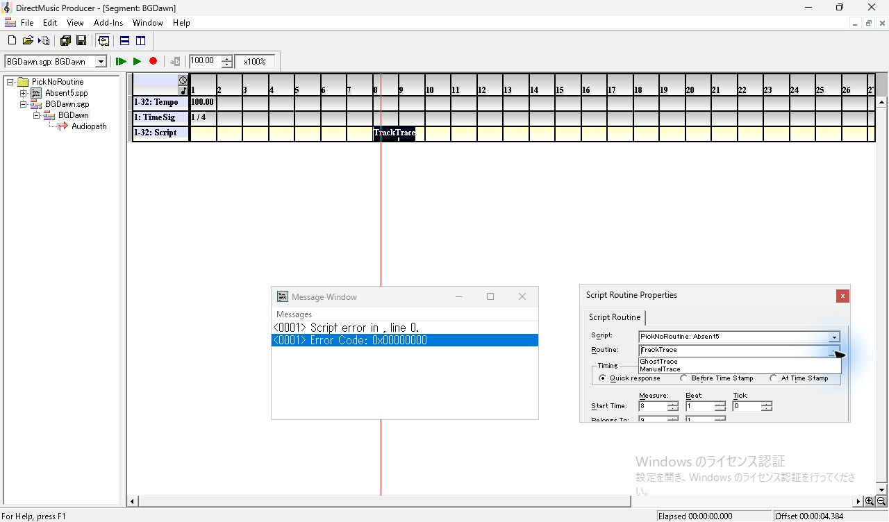

*図23 エラーの確認後に Routine の一覧を開く。*

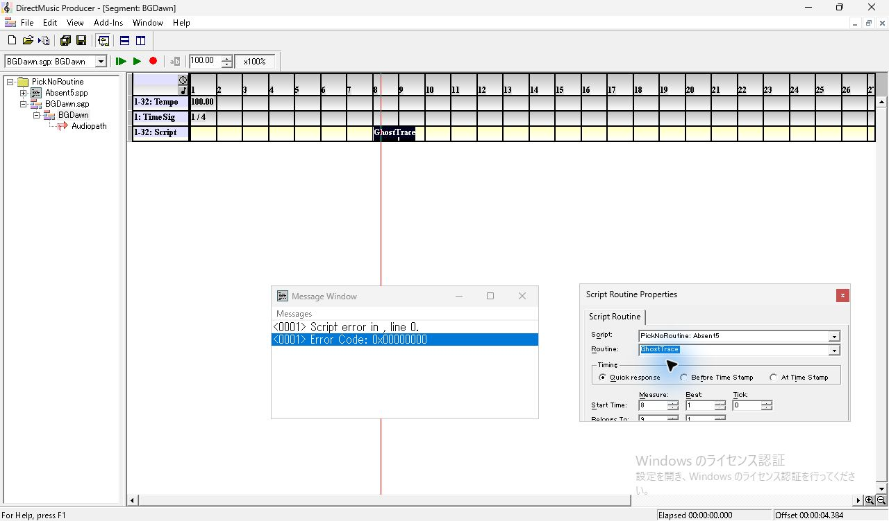

*図24 GhostTrace を選ぶとセルと Routine 欄の名前が切り替わる。*

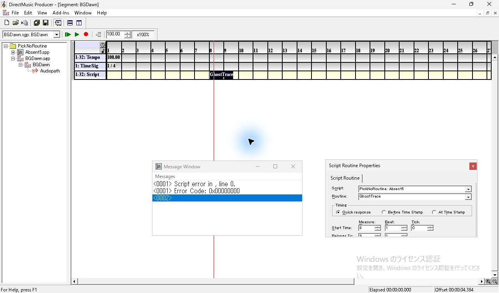

*図25 GhostTrace の呼出し後、既存のエラー行の下に 0002 が増える。*

*図26 修復後の Project を再読込し、GhostTrace を確認。*

## 保存値と調査の範囲

3件とも `scre/jzfr` のファイル GUID と `DMRF/guid` のオブジェクト GUID は、貼り付け先 `.pro` の `filh` と取り込まれた `.spp` に一致した。`DMRF/file` は選んだファイル名。貼り付け後の `scrh` は Timing 1、物理5376、論理6144。凍結した入力、候補ファイル、PickerSource の `.sgp` と `.spp` のハッシュも照合した。 [保存値の照合コード](../../../work/original-gui/SEG-14-script-file-picker/20261112T061810881596Z/audit.py) · [3条件の照合結果](../../../work/original-gui/SEG-14-script-file-picker/20261112T061810881596Z/script-file-picker-audit.json)

今回の指定対象は `.spp`。登録済みの候補が複数ある場合の自動選択は後続試験に記録した。`.spt` の取込と再読込は原版で書き出したファイルを使って後続試験で確認した。 [Script 候補の自動選択](seg-14-script-candidate-order.md) · [Runtime Script の取込](seg-14-script-runtime-picker.md)

調査後に Project を閉じ、Producer は開始時と同じ1件。View の **Project Tree、Standard Toolbar、Status Bar、Transport Controls** を確認した。 [開始時](../../../work/original-gui/SEG-14-script-file-picker/20261112T061810881596Z/captures/00-start-windows.json) · [終了時](../../../work/original-gui/SEG-14-script-file-picker/20261112T061810881596Z/captures/159-end-windows.json)

*図27 終了時の View。空の Project Tree と有効な4項目。*
