# SEG-14 Script Properties の Language 切替と Script Track

観測日 2026-11-12。DirectMusic Producer 5.3.0.900 の原版コピーで、Script Properties の **Language** を変更した。候補一覧を開いて下キーで `VBScript` に移動すると変更が適用され、Escape を押して一覧を閉じても元に戻らなかった。同じ Trace 用ソースを使った比較では、どちらの言語も手動呼び出しで出力し、タイムライン再生で Trace が増えたのは `AudioVBScript` の場合だった。`Select Case` を含むソースで `AudioVBScript` を選ぶと、その場で構文エラーが出て Routine 一覧が空になった。 [以前の FarmMusic の言語と再生](seg-14-farmmusic-playback.md) · [Script Designer と Message Window](ui-10-script-designer.md)

## 素材と観測方法

`LangTraceTest` は、以前の試験用 `Script5.spp` とその参照を含む `BGPredawn.sgp` の作業コピー。Segment は **10小節、100 BPM、1/4、繰り返し0** にして、既存の `TrackTrace` を使う。**Quick response、Start Time 6:1:0、Belongs To 7:1**。Script の `ManualTrace` と `TrackTrace` はそれぞれ `Trace` 1回だけを実行する。`LangProbeTest` は別 Project で、`ManualTrace` に `Select Case 1` を含めた。`TrackTrace` の本文、時刻、Segment の長さとテンポは比較側と同じ。 [LangTraceTest の入力と環境](../../../work/original-gui/SEG-14-script-language-ui/20261112T071404262537Z/run.json) · [LangProbeTest のソースと入力](../../../work/original-gui/SEG-14-script-language-ui/20261112T071404262537Z/probe.json) · [基準素材作成](../../../work/original-gui/SEG-14-script-language-ui/20261112T071404262537Z/prepare.py) · [構文差の素材作成](../../../work/original-gui/SEG-14-script-language-ui/20261112T071404262537Z/prepare_probe.py)

Project Tree の Script ファイルをダブルクリックし、子の **Script5** が選ばれた状態で **F11**。Properties の **Script** タブに Name、Language、ロード時のチェック欄2つが並ぶ。両欄ともオンの状態で比較した。**Add-Ins > Message Window** を開き、連番とエラー行を観測する。独立ウィンドウを表示すると本体が通常サイズに戻ることがあり、最大化し直して操作した。再起動後は、左上に出た Message Window をタイトルバーでタイムラインより下へ移した。掲載の全体画像は32枚、1280×752 px。黒い矢印と青い光は操作ツールの表示。 [画像の取得元とハッシュ](../../../work/original-gui/SEG-14-script-language-ui/20261112T071404262537Z/published-figures.json)

## 同じソースでの切替、実行、再起動

### AudioVBScript の基準

Designer の右上で `ManualTrace` をダブルクリックして、空のログに `<0001>` が出ることを確認した。Segment を開いて6小節目の `TrackTrace` を右クリックし **Call Routine(s)** を押すと `<0002>` が増えた。Transport の **Play From Start** で先頭から約6秒再生し、自然終了後は `<0003>`。Transport の再生ボタンと Offset が停止状態に戻った。

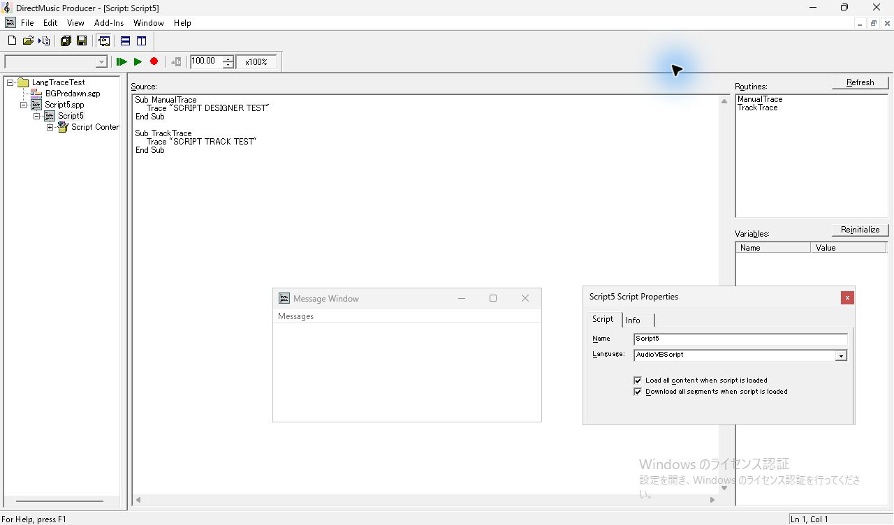

*図1 AudioVBScript の初期状態。Designer に2件の Routine、Message Window に出力なし。*


*図2 AudioVBScript の ManualTrace をダブルクリックすると `<0001>` が追加される。*

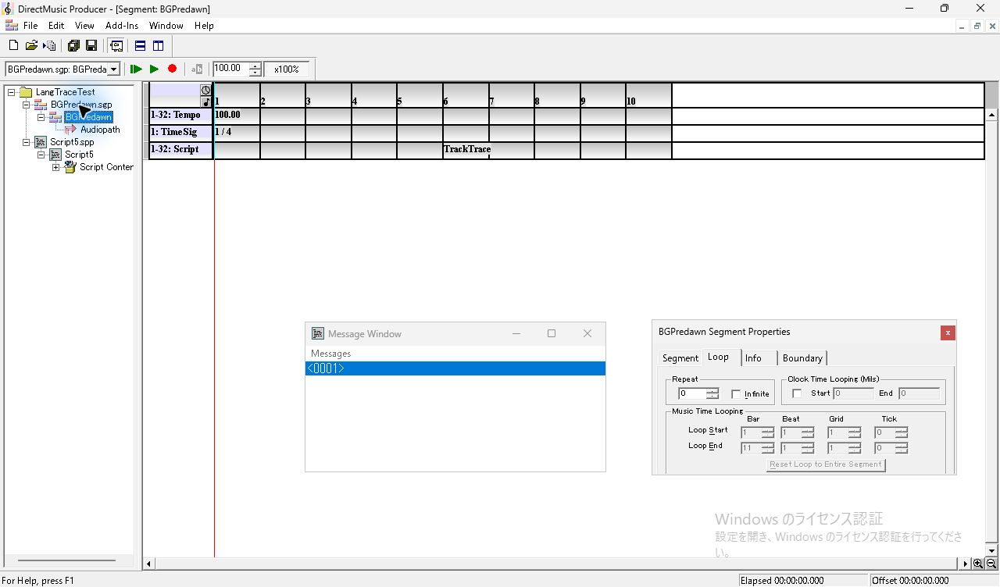

*図3 比較用 Segment は10小節。Loop の Repeat は0で、6小節目に TrackTrace がある。*

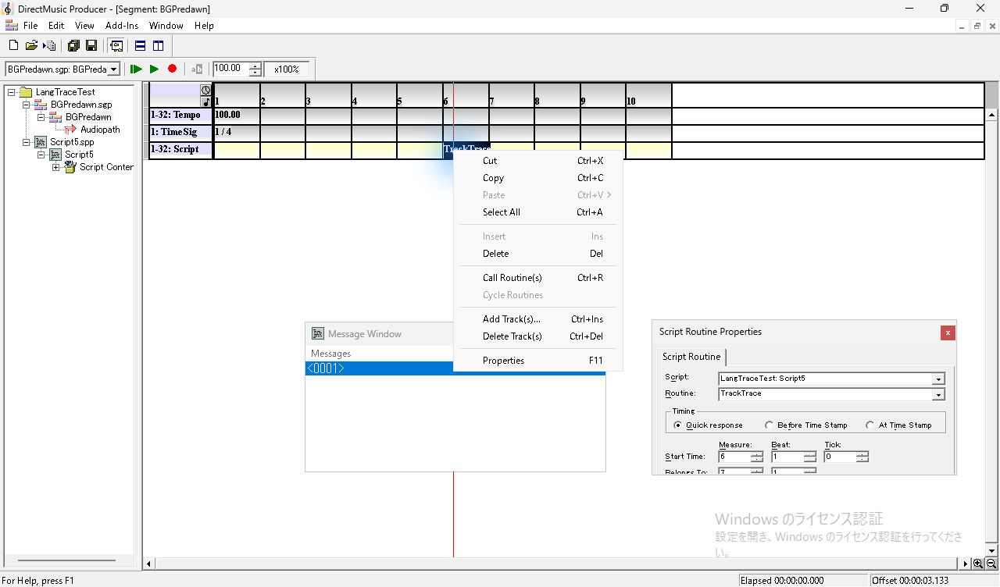

*図4 TrackTrace の右クリックメニュー。Call Routine(s) を選択できる。*

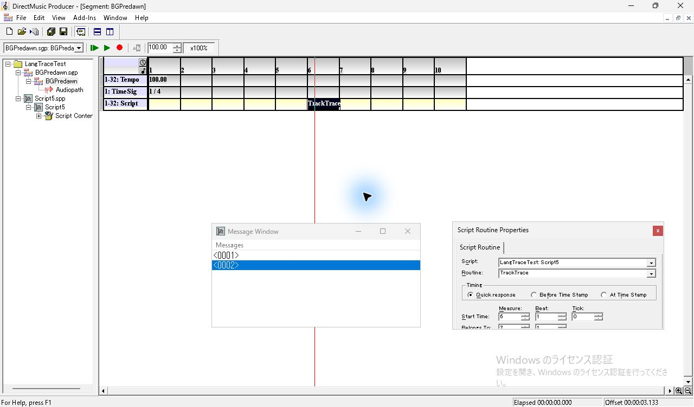

*図5 手動で TrackTrace を呼ぶと `<0002>` が追加される。*

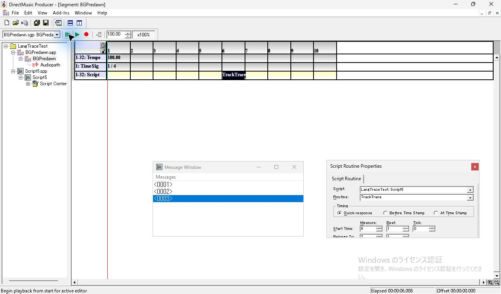

*図6 AudioVBScript での先頭再生が終了すると `<0003>` が追加されている。*

### キー選択と Escape

1. Language 欄の右端の矢印を押すと、欄の直下に `AudioVBScript` と `VBScript` の2行が開く。現在値が青い。
2. 一覧が開いたまま下キーを1回押す。下の `VBScript` に選択色が移り、Language 欄も `VBScript` と表示する。
3. Escape で一覧を閉じる。欄の表示は `VBScript`。Script5.spp ファイル行を選んで **Design / Runtime** の Properties を出し、子の Script5 に戻っても `VBScript` だった。
4. この時点のディスク上の `.spp` はまだ `AudioVBScript`。Designer で `ManualTrace` を実行してから Standard Toolbar の **Save** を押すと、`VBScript` が保存された。明示的な Refresh はこの後に試した。

切替直後も Designer に `ManualTrace` と `TrackTrace` があり、ソースとログに切替によるエラーは見えなかった。Designer の手動呼び出しで `<0004>`、Segment の手動呼び出しで `<0005>` が増えた。VBScript で先頭再生すると、約6秒で自然終了した時点も `<0005>`。Designer の **Refresh** でも一覧の2件は変わらず、新しい行は出なかった。 [Escape の後、保存前のファイル](../../../work/original-gui/SEG-14-script-language-ui/20261112T071404262537Z/captures/42-after-cancel-Script5.spp) · [VBScript を保存したファイル](../../../work/original-gui/SEG-14-script-language-ui/20261112T071404262537Z/captures/50-vb-Script5.spp)

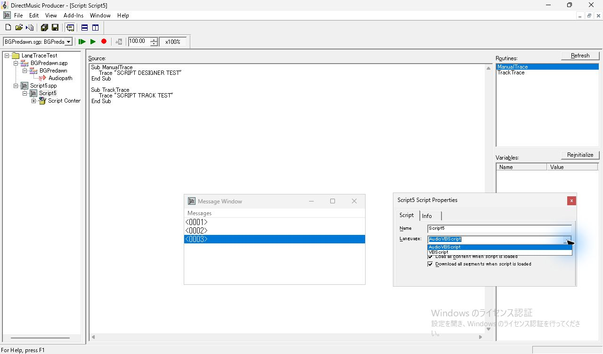

*図7 Language を展開すると AudioVBScript と VBScript が並び、現在値が青い。*

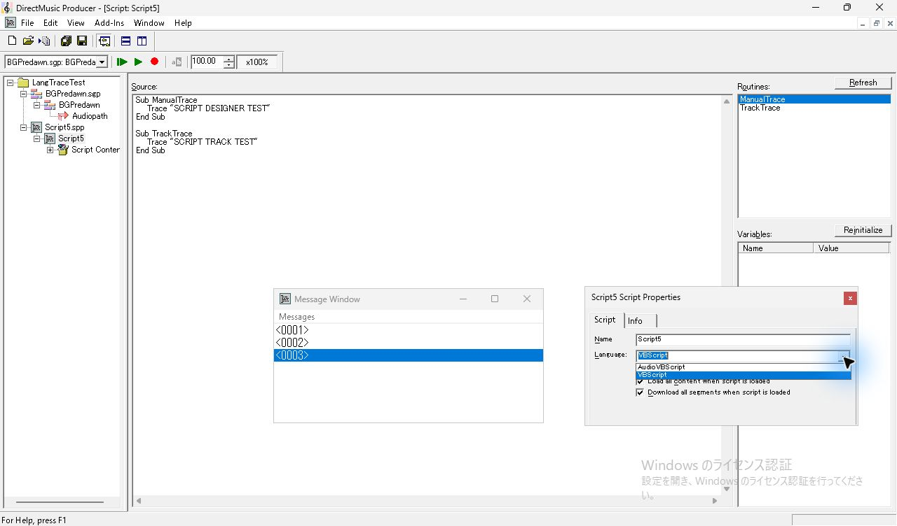

*図8 下キーで VBScript を選ぶと、一覧の選択色と入力欄が同時に変わる。*

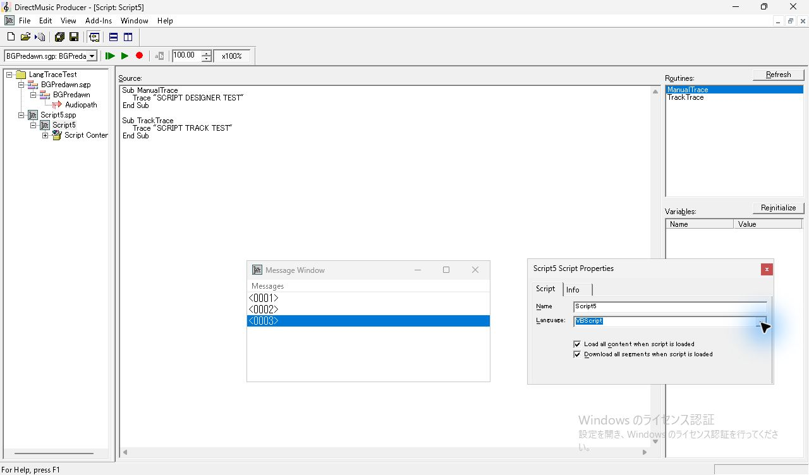

*図9 Escape で一覧を閉じた直後も、Language 欄は VBScript。*

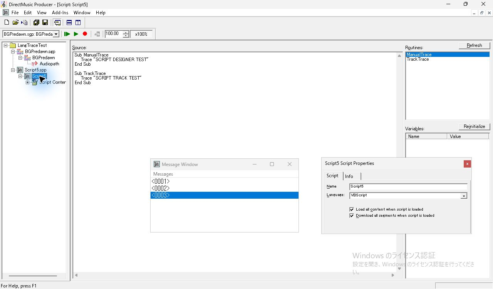

*図10 ファイル行の Properties を経由して Script 文書を選び直しても VBScript。*

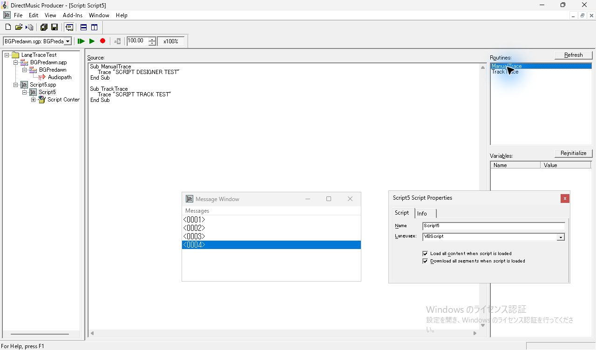

*図11 保存と Refresh の前に ManualTrace を呼び出すと `<0004>` が追加される。*

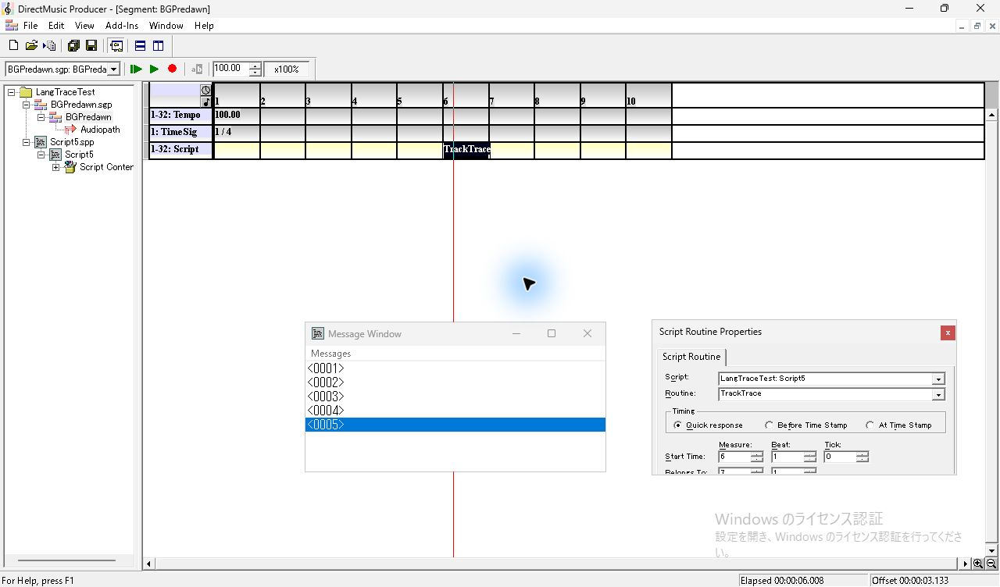

*図12 VBScript の TrackTrace を手動で呼ぶと `<0005>` が追加される。*

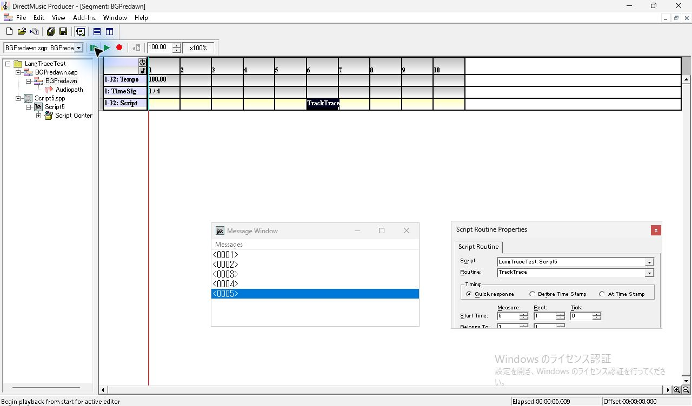

*図13 VBScript での先頭再生が自然終了し、最後の Trace は `<0005>` のまま。*

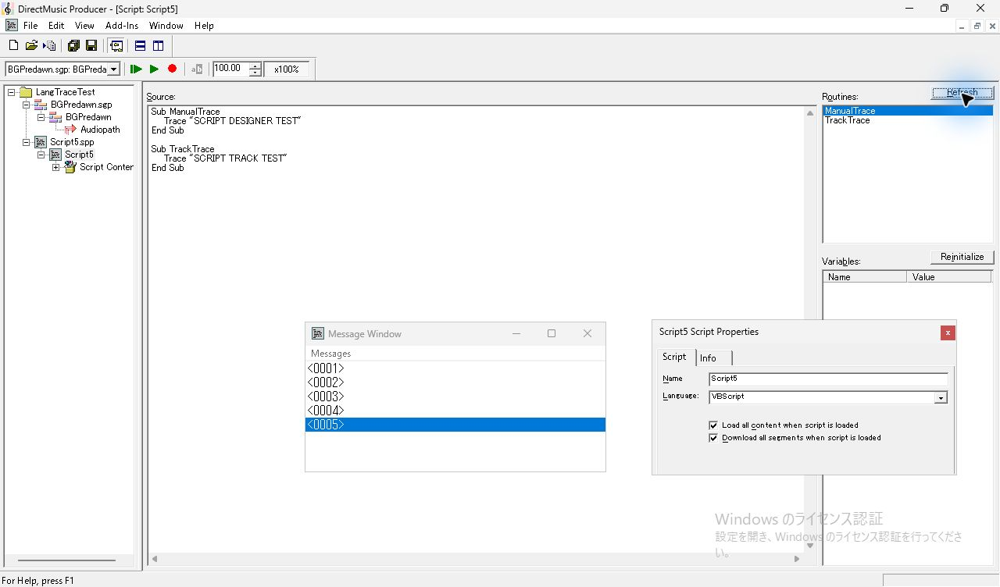

*図14 VBScript で Refresh した後も Routines は2件で、Trace 行は増えない。*

### 再起動とマウスによる逆方向の切替

Project と補助ウィンドウを閉じてから Producer を終了した。対象ウィンドウが0件になった後で同じ実行ファイルを起動し、新しいウィンドウ1件を確認した。Project を開き直すと **VBScript** と2件の Routine が復元された。別起動の Message Window は空から始まり、Designer の手動呼び出しで `<0001>` が出た。その後のタイムライン再生では、赤い線が6小節目を通過し、約6秒で自然終了しても1行だった。 [起動前の0件](../../../work/original-gui/SEG-14-script-language-ui/20261112T071404262537Z/captures/72-before-launch.json) · [再起動後の1件](../../../work/original-gui/SEG-14-script-language-ui/20261112T071404262537Z/captures/73-restart-windows.json) · [再読込した VBScript ファイル](../../../work/original-gui/SEG-14-script-language-ui/20261112T071404262537Z/captures/84-vb-reopened-Script5.spp)

Language の上の行 `AudioVBScript` をマウスで押すと、一覧が閉じて表示が切り替わった。**Save や Refresh の前**に Segment を開き、先頭から再生すると `<0002>` が追加された。その時点のディスク上の言語はまだ `VBScript`。Script を選び直して Save を押すと `AudioVBScript` が保存された。 [AudioVBScript を選んだ後、保存前のファイル](../../../work/original-gui/SEG-14-script-language-ui/20261112T071404262537Z/captures/105-audio-before-save-Script5.spp) · [AudioVBScript を保存したファイル](../../../work/original-gui/SEG-14-script-language-ui/20261112T071404262537Z/captures/113-audio-Script5.spp)

| 状態 | Designer の手動呼び出し | Script Track の手動呼び出し | Play From Start で増えた Trace |
| --- | --- | --- | --- |
| 初回 AudioVBScript | +1 | +1 | +1 |
| 下キーと Escape の後の VBScript | +1 | +1 | 0 |
| 再起動後の VBScript | +1 | 未実施 | 0 |
| 再起動後、マウスで AudioVBScript に戻した直後 | 未実施 | 未実施 | +1 |

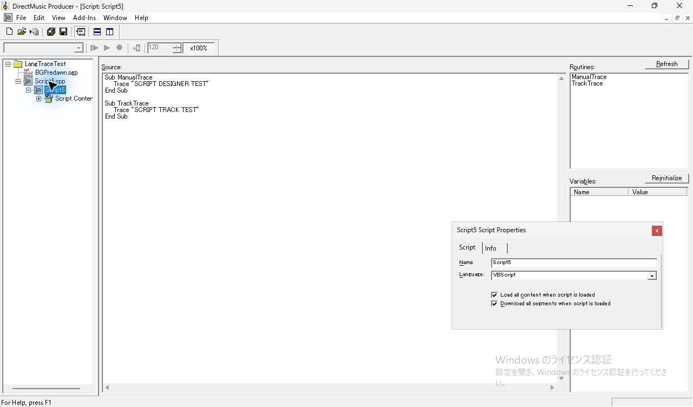

*図15 Producer を再起動して開くと、保存した VBScript と2件の Routine が出る。*

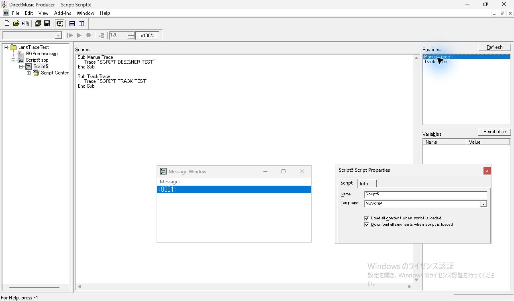

*図16 別起動の新しいログで ManualTrace を呼び出すと `<0001>` が出る。*

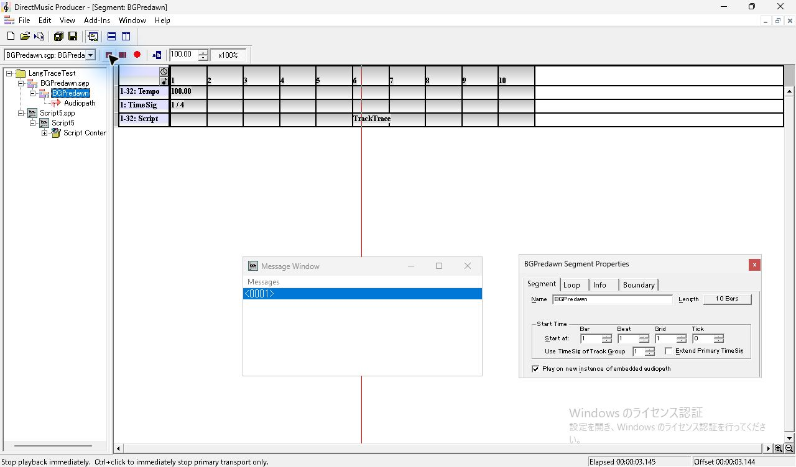

*図17 VBScript で再生中。赤い位置線が TrackTrace のセルにあり、Trace は `<0001>` のまま。*

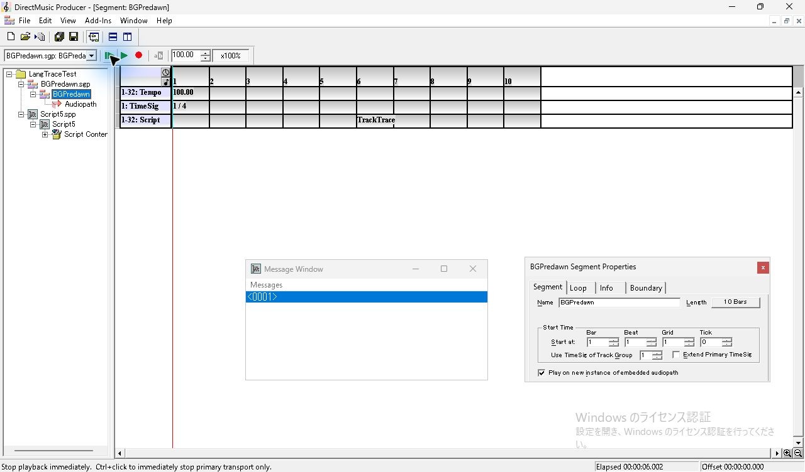

*図18 再起動後の VBScript で先頭再生が自然終了しても、Trace は1行。*

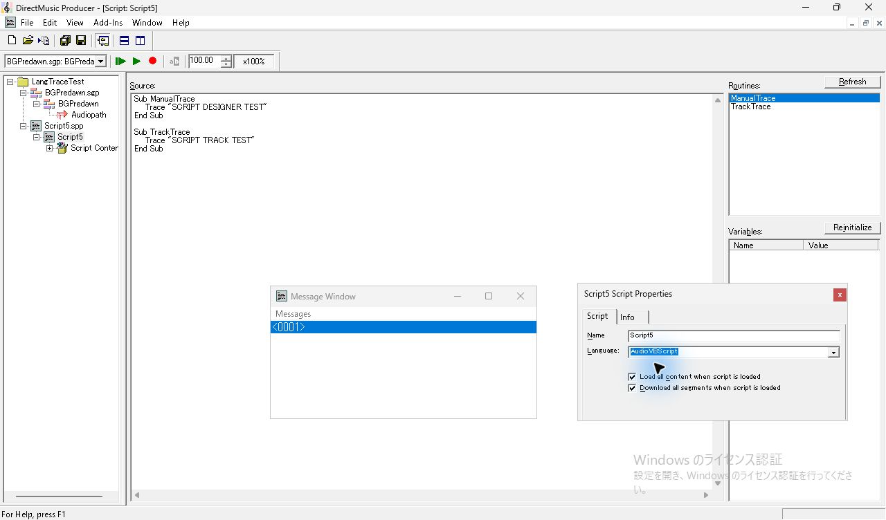

*図19 マウスで AudioVBScript を選んだ直後。Routine 一覧は2件。*

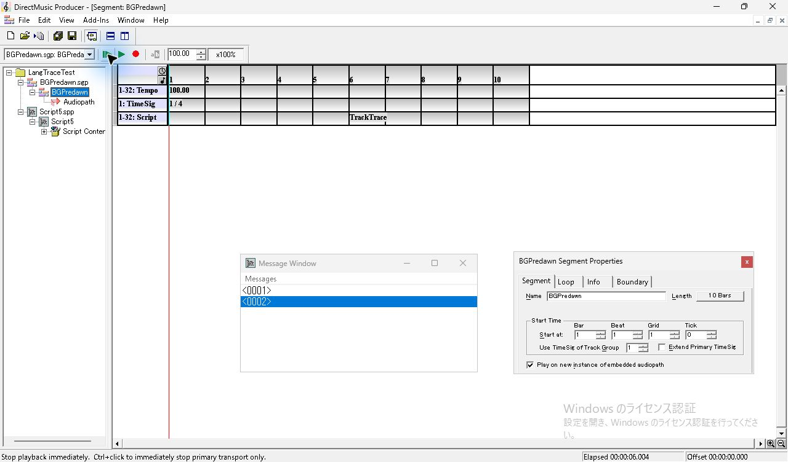

*図20 AudioVBScript に戻し、保存前の再生で `<0002>` が追加される。*

## Select Case を含む場合のエラーと復帰

`LangProbeTest` の初期言語は **VBScript**。`ManualTrace` の2行目に `Select Case 1` があり、VBScript のままダブルクリックすると `<0003>` が追加された。Language 一覧から **AudioVBScript** をクリックすると、直後に Routines の2件が消え、Message Window に `<0004>` の4行が追加された。Source と Language 欄は表示されたまま。操作直後のエラー行は次のとおり。 [エラー全文のアクセシビリティ取得結果](../../../work/original-gui/SEG-14-script-language-ui/20261112T071404262537Z/captures/136-probe-error-text.json)

```text
Script error in Script5.spp, line 2, column 17.
Near: 1
Microsoft AudioVBScript syntax error: Invalid expression or missing line break
Error Code: 0x88781223
```

この状態で Save を押すと同じ構文エラーが `<0005>` として増えた。Script は `AudioVBScript` として保存できた。Project を閉じて開き直し、Script ファイルを開くと `<0006>` が出て一覧は空だった。再読込時のエラー先頭行ではファイル名が空欄で、行・列番号、Near、エラー文とコードは同じ。 [エラーがある状態の保存ファイル](../../../work/original-gui/SEG-14-script-language-ui/20261112T071404262537Z/captures/143-probe-invalid-Script5.spp) · [再読込時のエラー全文](../../../work/original-gui/SEG-14-script-language-ui/20261112T071404262537Z/captures/156-probe-reopened-error-text.json)

Segment の `TrackTrace` を選ぶと、Properties の Script 欄には `LangProbeTest: Script5`、Routine 欄には `TrackTrace` が残っていた。Routine の矢印を押すと空の一覧が開く。セルの右クリックでは **Call Routine(s)** が有効で、押すと `<0007>` の **Script error in , line 0.** と **Error Code: 0x00000000** が増えた。

Designer に戻って Language の **VBScript** をクリックすると、ソース編集や Refresh の前に `ManualTrace` と `TrackTrace` が戻った。Designer で `ManualTrace` を呼ぶと `<0008>` が増え、過去のエラー行はログに残った。保存して Segment に戻ると、同じ項目の Routine 一覧に2件が出て、`TrackTrace` が選ばれていた。 [VBScript に復帰した保存ファイル](../../../work/original-gui/SEG-14-script-language-ui/20261112T071404262537Z/captures/180-probe-restored-Script5.spp)

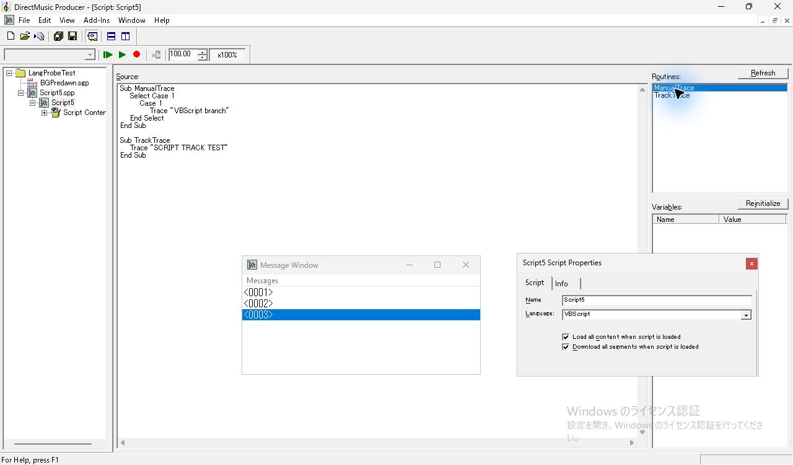

*図21 Select Case を含む VBScript では、Designer の ManualTrace で `<0003>` が増える。*

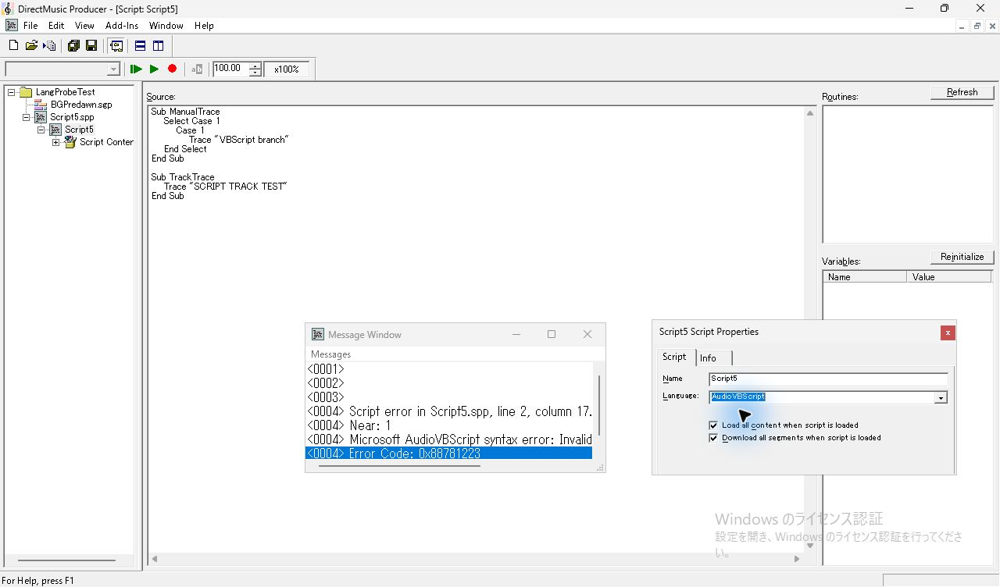

*図22 AudioVBScript をクリックした直後。エラー4行が追加され、Routines が空になる。*

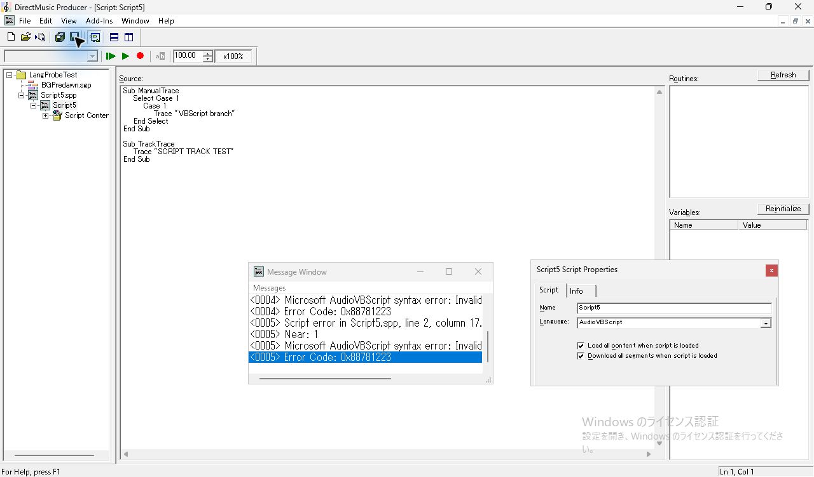

*図23 エラー状態のまま Save を押すと、エラーがもう1組出る。*

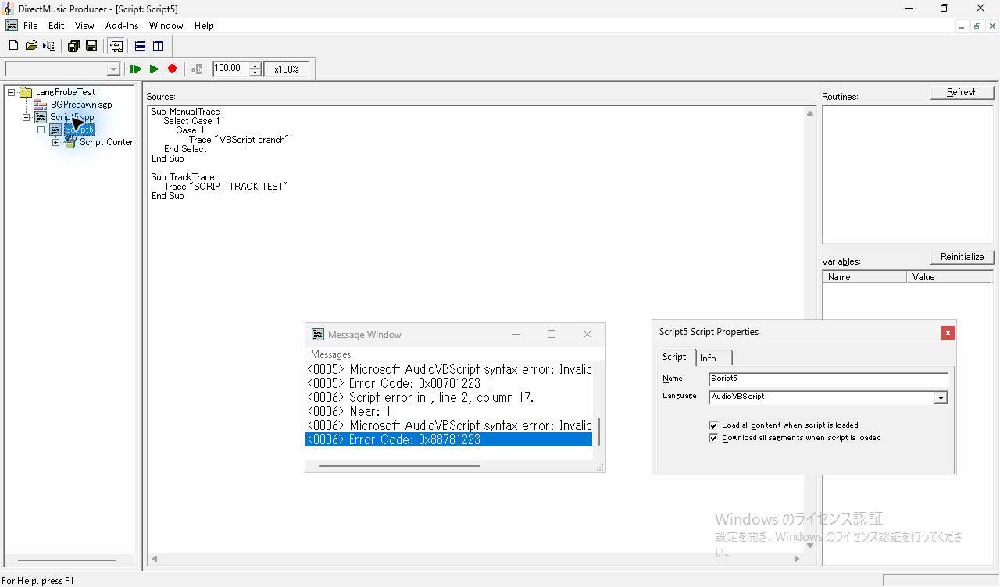

*図24 Project を開き直して Script を開くと、AudioVBScript のままエラーが再現する。*

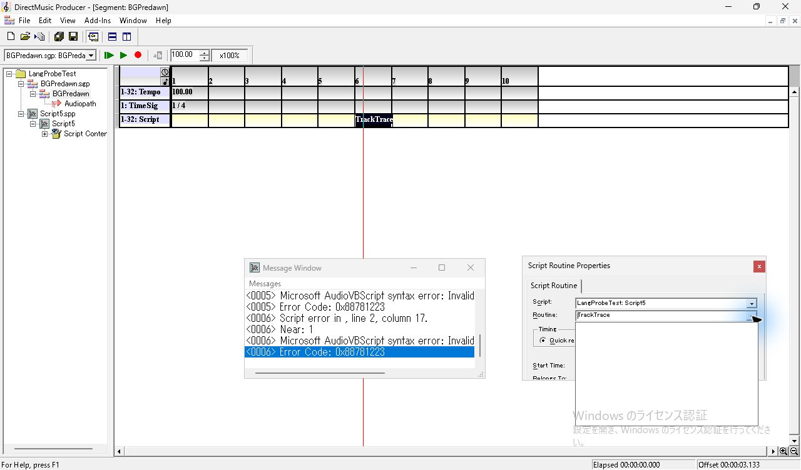

*図25 Segment の TrackTrace には Script 参照と Routine 名が残る。開いた候補一覧は空。*

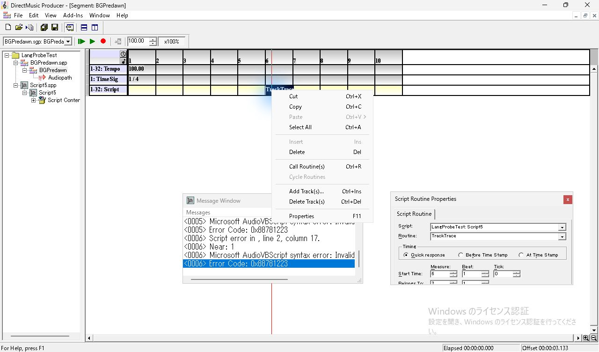

*図26 候補一覧が空でも Call Routine(s) は選べる。*

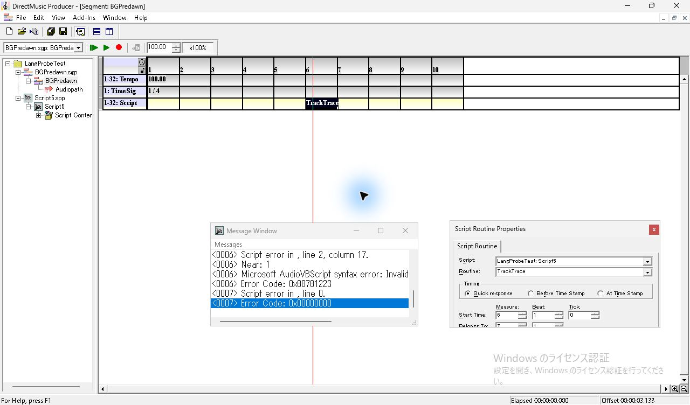

*図27 手動呼び出し後に line 0 と Error Code 0x00000000 の2行が増える。*

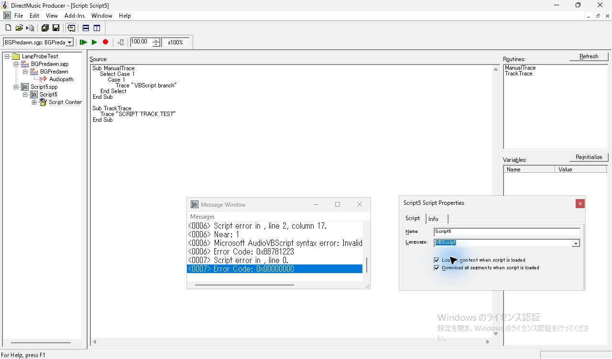

*図28 VBScript を選び直すと、Refresh 前に Designer の2件が戻る。*

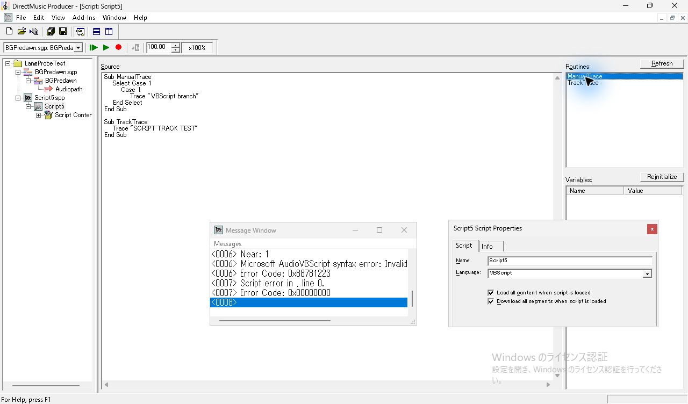

*図29 復帰後の ManualTrace で `<0008>` が追加される。以前のエラーは残る。*

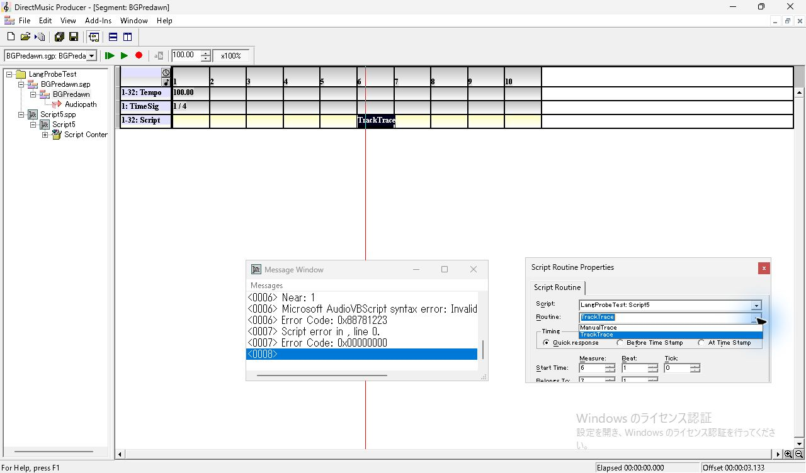

*図30 同じ Segment 項目で Routine を開くと ManualTrace と TrackTrace が並ぶ。*

## 保存内容と観測範囲

`.spp` の8時点の控えを照合した。各 Project の言語変更で差が出た Script 内チャンクは `scla`。ソースを含む `scsr`、オブジェクト GUID、他のチャンクは一致し、元の言語へ戻して保存した両ファイルは入力と全バイト一致した。両方の Project で、`.pro` のファイル・オブジェクト GUID と `.sgp` の `jzfr`・`DMRF/guid` が一致した。6小節目のイベントは `scrh` が Timing 1、物理3840、論理4608。`scrn` は `TrackTrace`。Project 終了時に Segment の保存確認が出た場合は **No** を選び、両方の `.sgp` の全バイトを入力と照合した。 [照合コード](../../../work/original-gui/SEG-14-script-language-ui/20261112T071404262537Z/audit.py) · [保存値、エラーと再起動の照合結果](../../../work/original-gui/SEG-14-script-language-ui/20261112T071404262537Z/script-language-ui-audit.json)

実行結果の比較は、短いソースと Quick response の試験で Message Window に増えた行を用いた。音声出力は測定していない。Project と補助ウィンドウを閉じ、原版コピーは1件。View の **Project Tree、Standard Toolbar、Status Bar、Transport Controls** を確認した。 [開始時のウィンドウ](../../../work/original-gui/SEG-14-script-language-ui/20261112T071404262537Z/captures/00-start-windows.json) · [終了時のウィンドウ](../../../work/original-gui/SEG-14-script-language-ui/20261112T071404262537Z/captures/end-windows.json)

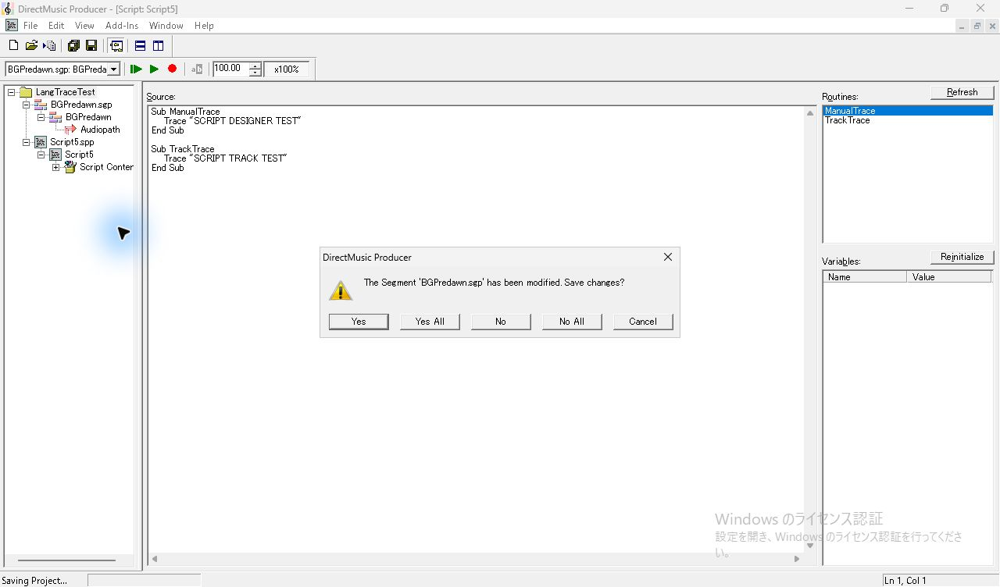

*図31 Script を保存済みでも、Project を閉じると Segment の保存確認が開いた。*


*図32 終了時の View。Project Tree は空で、指定の4項目が表示されている。*
