# SEG-14 貼り付けた Script Routine の発音と Trace

2026-11-12。DirectMusic Producer 5.3.0.900 の作業コピーで、**コピー元、同じ Project の別 Segment、別 Project の同名 Script** の3条件を比較した。停止中の手動呼出し3回、発音間隔を測定できた先頭再生7回、貼り付け前の対照1回を録音で照合した。掲載は21枚で、すべて1280×752 px。黒い矢印と青い光は操作ツールの表示。 [入力と実行条件](../../../work/original-gui/SEG-14-script-paste-audio/20261112T053245876155Z/run.json) · [入力の作成手順](../../../work/original-gui/SEG-14-script-paste-audio/20261112T053245876155Z/prepare.py) · [画像の出典とハッシュ](../../../work/original-gui/SEG-14-script-paste-audio/20261112T053245876155Z/published-figures.json)

## 入力と操作

コピー元の **AudioSource / BGPredawn** と貼り付け先の **CopyLocal、CopyCross** は **12小節、100 BPM、1/4、x100%**。Wave 行の **SfxCougar** が先頭の基準音になる。コピー元の **Script5.TrackTrace** は第8小節に1件あり、**Quick response、Start Time 8:1:0、Belongs To 9:1**。既存の発音試験と同じ `SfxAlarm.Play(IsSecondary + AtImmediate)` に続けて `Trace` を呼ぶ。貼り付け先は同じ構成で Script 行を空にした。別 Project の **AudioTarget** では Script、Wave と依存する Segment に別のファイル GUID とオブジェクト GUID を割り当てた。Wave の PCM を揃え、Trace 文字列はコピー元を `SCRIPT TRACK TEST`、AudioTarget を `SCRIPT CROSS TEST` とした。 [元の発音試験](seg-14-script-belongs.md) · [入力ハッシュと GUID](../../../work/original-gui/SEG-14-script-paste-audio/20261112T053245876155Z/paste-audio-audit.json)

1. Segment の第8小節の Routine を選び、**F11** で Properties を出す。**Add-Ins > Message Window** を開き、Properties と重ならないようタイトルバーをドラッグする。この環境では Message Window の表示や移動に伴い本体が通常サイズへ戻ることがあり、最大化して選び直した。
2. 手動試験では停止中に Routine を右クリックし **Call Routine(s)** を選ぶ。先頭再生は Transport の左の緑のボタン **Play From Start** を押し、自然終了まで待つ。再生中は同じボタンが **Stop Immediate** に切り替わり、赤い位置線が右に進む。自然終了時には緑のボタンに戻り、Offset は0。
3. 貼り付け試験はコピー元の第8小節で **Ctrl+C**、貼り付け先の空の第8小節をクリックして **Ctrl+V**。別 Project では移動先を開いてからコピーし、貼り付け・保存の後に両 Project を閉じて **AudioTarget だけ**を開き直した。

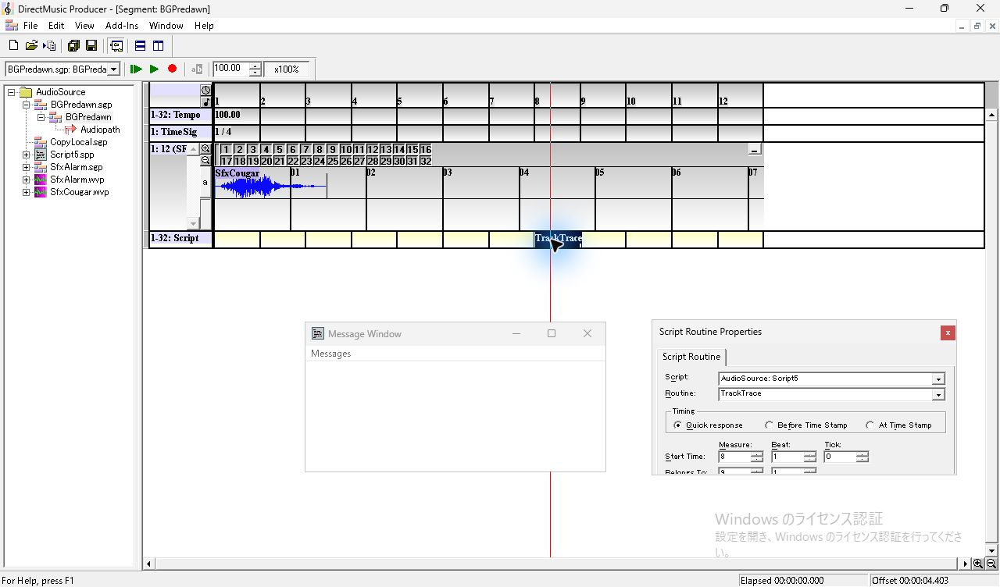

*図1 コピー元 BGPredawn。先頭の SfxCougar、第8小節の TrackTrace、Properties、空の Message Window。*

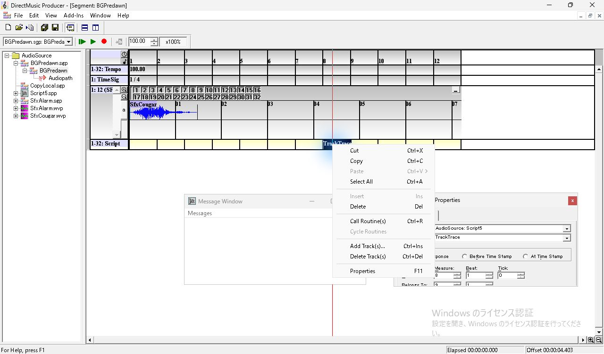

*図2 コピー元の右クリックメニュー。Call Routine(s) が有効。*

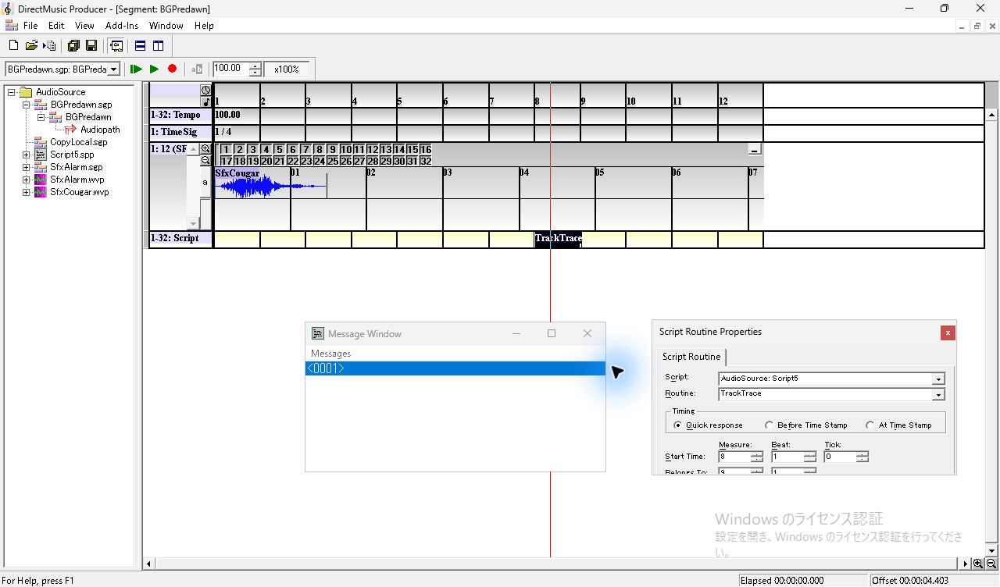

*図3 コピー元を手動で呼び出した後。停止中の Message Window に0001が追加される。*

## 同じ Project 内の貼り付け

CopyLocal の空セルを選ぶと青く表示され、Routine の Properties の欄は空で無効になる。先頭から再生すると Cougar が検出され、後半区間のピークは **0.0001254**、Message Window の末尾は **0003** のまま。貼り付けるとセルに **TrackTrace**、Properties に **AudioSource: Script5** が表示され、Quick response と2つの時刻を保持した。手動呼出しと先頭再生で Alarm が検出され、実行ごとに1行増えた。保存後に Project を再読込し、CopyLocal の参照と先頭再生を再確認した。 [CopyLocal の保存ファイル](../../../work/original-gui/SEG-14-script-paste-audio/20261112T053245876155Z/captures/63-local-save.sgp)

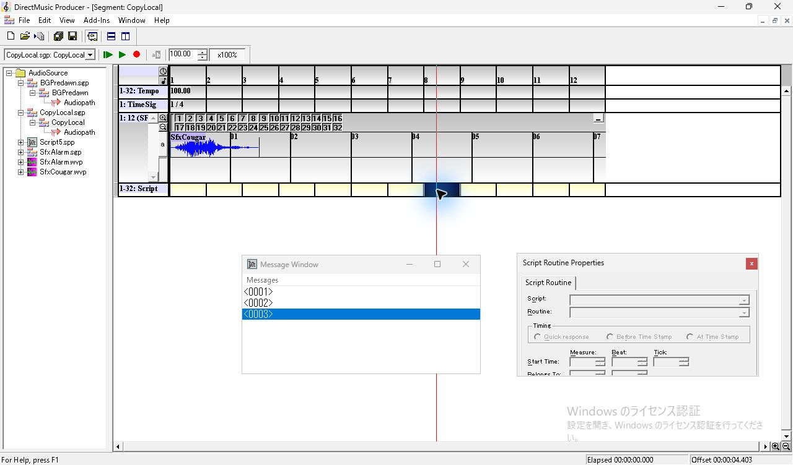

*図4 貼り付け前の CopyLocal。第8小節の空セルと無効な Properties。*

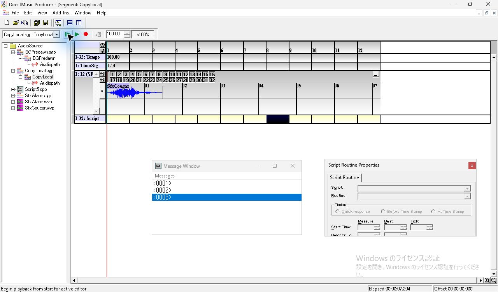

*図5 空の CopyLocal の先頭再生が終了。Message Window の末尾は0003。*

*図6 同じ Project 内の CopyLocal に貼り付けた直後。Script は AudioSource の Script5。*

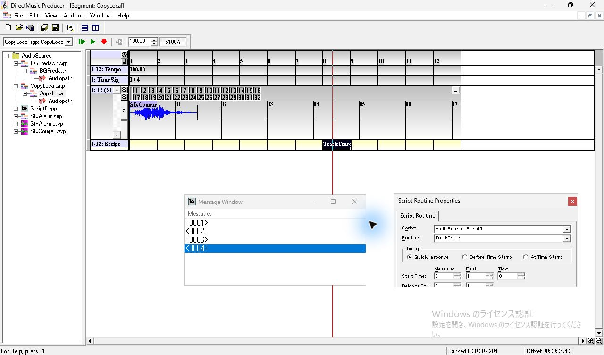

*図7 CopyLocal の手動呼出し後。末尾に0004が追加される。*

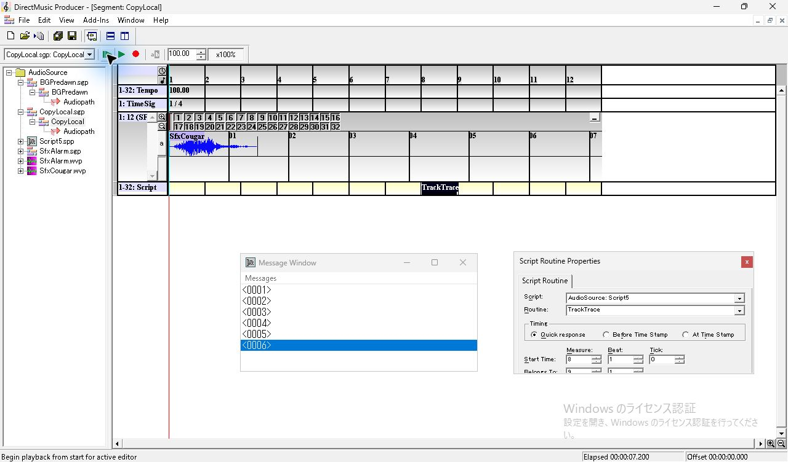

*図8 CopyLocal の先頭再生をやり直した後。末尾に0006が追加される。*

## 別 Project での貼り付けと再読込

貼り付け直後の Properties は **AudioTarget: Script5、TrackTrace、Quick response、8:1:0、9:1**。同じ時点で Transport の対象欄には **SfxAlarm** が表示された。保存後は **CopyCross** に戻った。Source を閉じた直後には **SfxCougar** が表示されたので、再読込後の録音では、CopyCross を開いてタイトルと Transport の対象が CopyCross であることを確認した。AudioTarget だけの状態で、手動呼出し1回と先頭再生3回すべてで Alarm が検出され、各回で1行増えた。 [CopyCross の保存ファイル](../../../work/original-gui/SEG-14-script-paste-audio/20261112T053245876155Z/captures/79-cross-save.sgp) · [別 Project の参照解決](seg-14-script-project-reference.md)

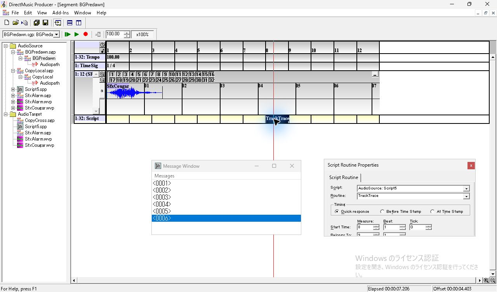

*図9 二つの Project を開き、BGPredawn から第8小節の Routine をコピー。*

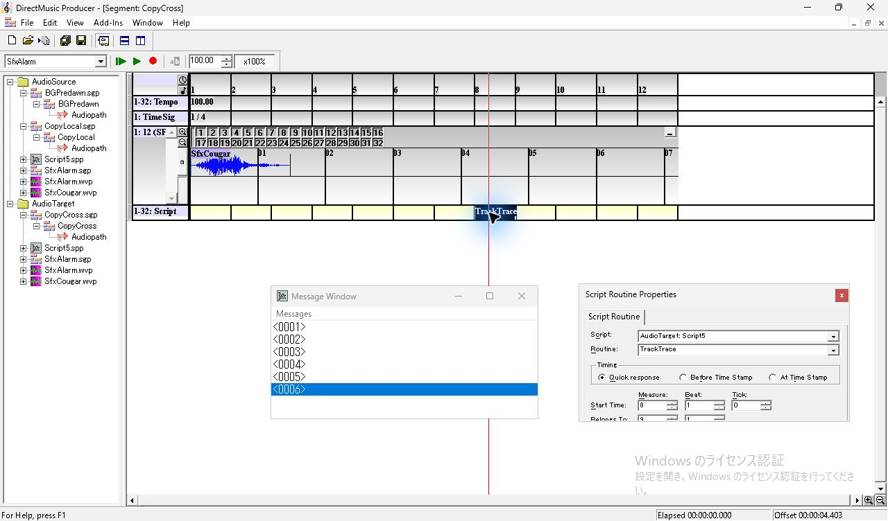

*図10 CopyCross に貼り付けた直後。Script は AudioTarget の Script5、Transport の対象欄は SfxAlarm。*

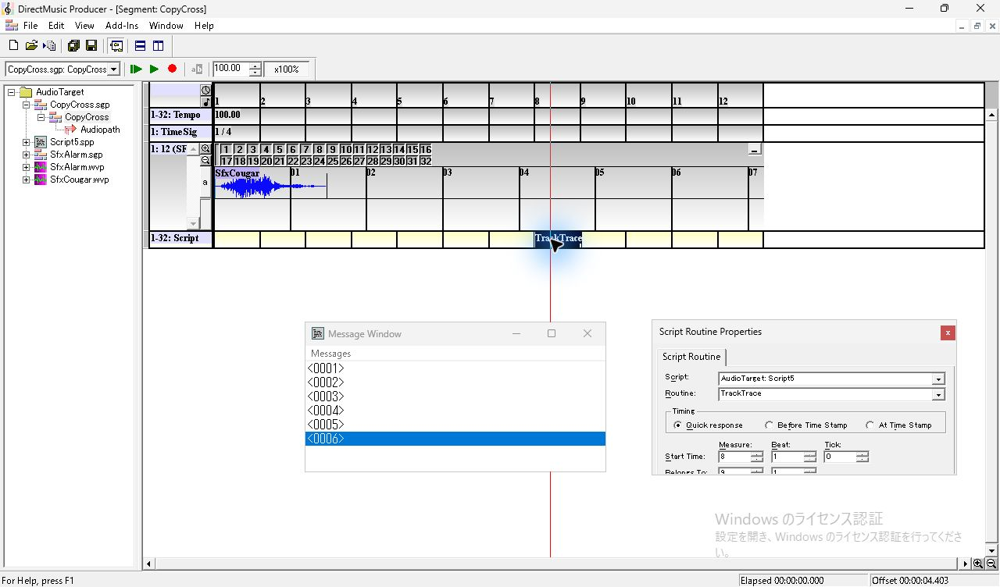

*図11 AudioTarget だけを再読込した後。CopyCross の参照、Timing と時刻を確認。*

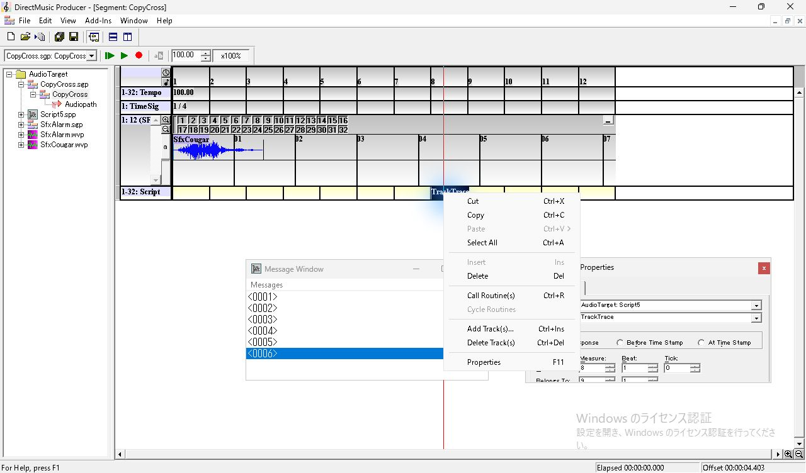

*図12 再読込した CopyCross の Call Routine(s) が有効。*

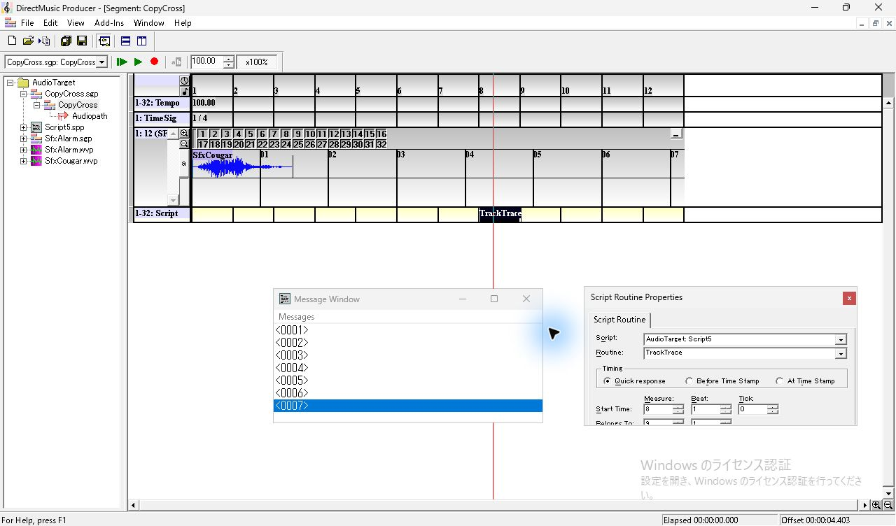

*図13 CopyCross の手動呼出し後。末尾に0007が追加される。*

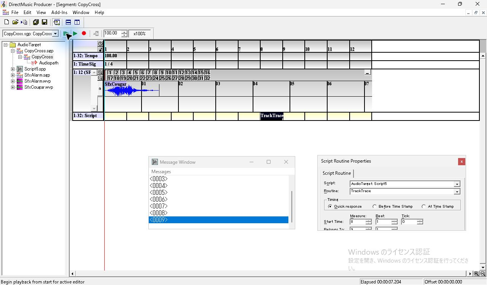

*図14 CopyCross の2回目の先頭再生終了。末尾は0009、Offset は0。*

## 録音で確認した発音

既定の Windows 出力を **WASAPI ループバック、48 kHz、32-bit 浮動小数点、ステレオ**で録音した。先頭再生では Cougar の開始を操作ログの開始時刻から1.20秒の範囲で探し、基準から **2.75〜6.15秒後**に Alarm を探した。各 Wave の冒頭130 msを48 kHzに変換し、左右平均の録音波形との正規化相関で開始フレームを照合した。採用した7回は Cougar **0.9925〜0.9966**、Alarm **0.9852〜0.9935**。停止中の手動呼出しは Alarm の相関が **0.9892〜0.9931**。録音4本のパケット時刻エラーは0。各録音の不連続は試行の開始前にある。 [録音と測定値の一覧](../../../work/original-gui/SEG-14-script-paste-audio/20261112T053245876155Z/audio-trials.json) · [波形の照合コード](../../../work/original-gui/SEG-14-script-paste-audio/20261112T053245876155Z/measure.py)

| 条件 | 手動の Alarm と Trace | 先頭再生で Cougar から Alarm まで | 先頭再生で増えた Trace |
| --- | --- | --- | --- |
| コピー元 BGPredawn | Alarm、0→1行 | 4.19960秒、4.20000秒 | 各1行 |
| 同じ Project の CopyLocal | Alarm、3→4行 | 4.19958秒、4.19963秒 | 各1行 |
| 別 Project の CopyCross | Alarm、6→7行 | 4.20000秒、4.19996秒、4.19967秒 | 各1行 |
| 貼り付け前の CopyLocal | 操作なし | Cougar のみ | 3→3行 |

7回とも Alarm は基準から約 **4.200秒**で始まった。このテンポと拍子では **Start Time 8:1:0** が4.2秒、**Belongs To 9:1** が4.8秒。手動呼出しの直後に先頭再生した2回は、開始前80 msに先行音が残り、Cougar の相関が **0.7094、0.2369** だった。この2回を発音間隔の集計から外し、手動呼出しをせずに録り直した。CopyLocal の1回は先頭再生が始まらず、ピーク **0.0000984**、Trace は末尾0005のまま。第8小節を選び直して再生すると末尾0006になった。 [開始しなかった操作](../../../work/original-gui/SEG-14-script-paste-audio/20261112T053245876155Z/captures/58-local-play-b-0.jpg) · [録音と先行音の照合](../../../work/original-gui/SEG-14-script-paste-audio/20261112T053245876155Z/paste-audio-audit.json)

録音原本と測定値は、[コピー元 WAV](../../../work/original-gui/SEG-14-script-paste-audio/20261112T053245876155Z/captures/audio-source/output.wav) · [測定](../../../work/original-gui/SEG-14-script-paste-audio/20261112T053245876155Z/captures/audio-source/analysis.json)、[CopyLocal WAV](../../../work/original-gui/SEG-14-script-paste-audio/20261112T053245876155Z/captures/audio-local/output.wav) · [測定](../../../work/original-gui/SEG-14-script-paste-audio/20261112T053245876155Z/captures/audio-local/analysis.json)、[CopyCross WAV](../../../work/original-gui/SEG-14-script-paste-audio/20261112T053245876155Z/captures/audio-cross/output.wav) · [測定](../../../work/original-gui/SEG-14-script-paste-audio/20261112T053245876155Z/captures/audio-cross/analysis.json)、[先頭再生の録り直し WAV](../../../work/original-gui/SEG-14-script-paste-audio/20261112T053245876155Z/captures/audio-repeat/output.wav) · [測定](../../../work/original-gui/SEG-14-script-paste-audio/20261112T053245876155Z/captures/audio-repeat/analysis.json)。

## Message Window の更新区間

新しい行がまだ見えない最後の画像と、見える最初の画像の **Elapsed** を読んだ。撮影した各1回で、行が増えた画像は第8小節の先頭より前。3条件の観測区間は重なり、撮影間隔内の差は未確定。Message Window で読めたのは行番号で、保存したソースにある Trace 本文は画面上で確認できなかった。閉じた Message Window を開き直した録り直しでは一覧が空で、最初の行は0001だった。

| 条件 | 更新前 → 更新後の Elapsed | 末尾 |
| --- | --- | --- |
| コピー元 BGPredawn | 3.790 → 4.061秒 | 空 → 0001 |
| 同じ Project の CopyLocal | 3.479 → 3.803秒 | 0001 → 0002 |
| 別 Project の CopyCross | 3.735 → 4.013秒 | 0009 → 0010 |

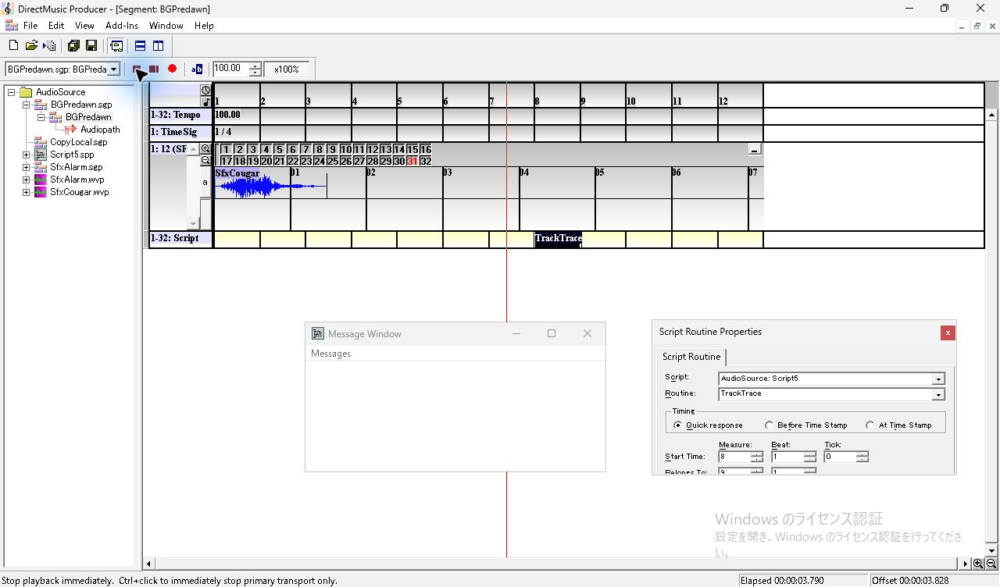

*図15 コピー元の再生中、Elapsed 3.790秒。Message Window は空。*

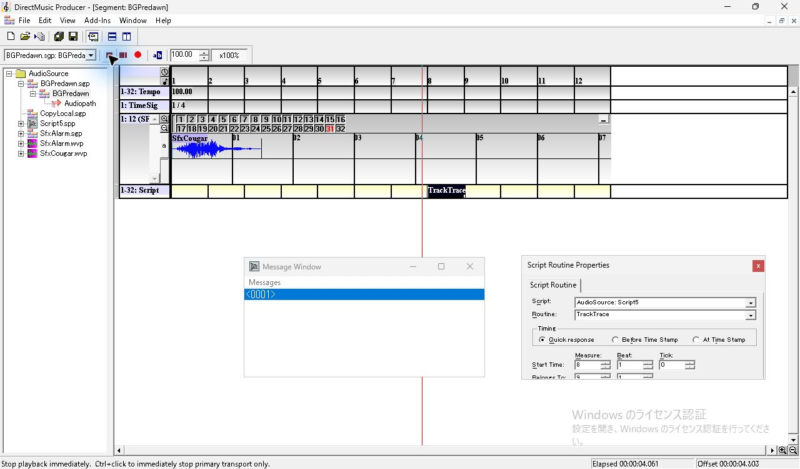

*図16 コピー元の再生中、Elapsed 4.061秒。0001が表示される。*

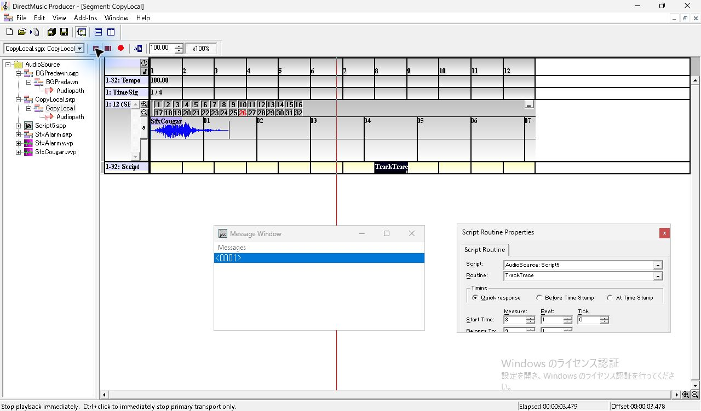

*図17 CopyLocal の再生中、Elapsed 3.479秒。末尾は0001。*

*図18 CopyLocal の再生中、Elapsed 3.803秒。0002が表示される。*

*図19 CopyCross の再生中、Elapsed 3.735秒。末尾は0009。*

*図20 CopyCross の再生中、Elapsed 4.013秒。0010が表示される。*

## 保存値と終了状態

コピー元と両貼り付け先で、`scrh` の値は **Timing 1、物理5376、論理6144**。グループマスクは **0xFFFFFFFF**。CopyLocal の `scre/jzfr` と `DMRF/guid` はそれぞれ AudioSource の Script ファイル GUID とオブジェクト GUID に一致し、CopyCross では両方が AudioTarget の Script に一致した。各 Project の `.pro` と貼り付け先の `.sgp` が更新され、凍結入力、BGPredawn と Script、音声素材のハッシュを照合した。 [保存値と音声の検証コード](../../../work/original-gui/SEG-14-script-paste-audio/20261112T053245876155Z/audit.py) · [照合結果](../../../work/original-gui/SEG-14-script-paste-audio/20261112T053245876155Z/paste-audio-audit.json)

対象は解決済みの単独 Routine、Quick response、通常の先頭再生。参照なしの発音、複数 Routine、他の Timing に貼り付けた後の発音は追加試験の候補。調査用 Project を閉じ、Producer のウィンドウは開始時と同じ1件。View の **Project Tree、Standard Toolbar、Status Bar、Transport Controls** を確認した。 [開始時](../../../work/original-gui/SEG-14-script-paste-audio/20261112T053245876155Z/captures/00-start-windows.json) · [終了時](../../../work/original-gui/SEG-14-script-paste-audio/20261112T053245876155Z/captures/152-end-windows.json)

*図21 終了時の View。空の Project Tree と検証用の4項目。*
