# SEG-14 Script Track の複数ルーチンの貼り付けと Overwrite の範囲端

2026-11-12。DirectMusic Producer 5.3.0.900 の作業コピーで、**BGPredawn の Script 行を Ctrl+A → Ctrl+C** でコピーし、別文書 **BGDawn** で **Paste > Merge / Overwrite** を比較した。貼り付け前後の画面、Properties、Undo/Redo、保存した物理・論理クロックを照合した。本体は1280×752 px。101枚の本体画像から32枚を掲載する。黒い矢印と青い光は操作ツールの表示。 [実行ファイルと入力](../../../work/original-gui/SEG-14-script-paste-range/20261112T044832281403Z/run.json) · [掲載画像の出典とハッシュ](../../../work/original-gui/SEG-14-script-paste-range/20261112T044832281403Z/published-figures.json) · [前回の別文書への貼り付け](seg-14-script-track-cross-document.md)

## 試験素材と貼り付け位置

同じ FarmGameProject 内で **Window > Tile Horizontally** を実行し、上段に BGDawn、下段に BGPredawn を置く。両方とも **100 BPM、1/4、38小節**。グループは入力 SGP で BGPredawn に1、BGDawn に2を指定していたが、原版の両行は **1-32: Script**。BGDawn の先行保存で 15 件とグループマスク `0xFFFFFFFF` を確認した。上段の横ズームを2段階上げ、両方の小節幅を約59 px に揃えた。 [入力を作ったコード](../../../work/original-gui/SEG-14-script-paste-range/20261112T044832281403Z/prepare.py) · [コピー元 SGP](../../../work/original-gui/SEG-14-script-paste-range/20261112T044832281403Z/inputs/FarmGameProject/BGPredawn.sgp) · [貼り付け先の入力 SGP](../../../work/original-gui/SEG-14-script-paste-range/20261112T044832281403Z/inputs/FarmGameProject/BGDawn.sgp) · [先行保存](../../../work/original-gui/SEG-14-script-paste-range/20261112T044832281403Z/captures/11-baseline-save.sgp)

下段にあるのは **3:1:0 の dmSfxAlarm、3:1:1 の dmSSBird、6:1:0 の TrackTrace** の3件。TrackTrace は **Quick response** で **Belongs To 7:1**。上段には、貼り付ける3件と同じ Tick、各境界の近く、間の空白区間、末尾より先に既存項目を配置した。1/4 の1小節は768クロック。物理クロック **5375** は第8小節のセルに入り、Properties は **Start Time 8:1:−1、Belongs To 7:1**。同じように、物理クロック **7679** は第11小節の **11:1:−1 / 10:1** と表示された。

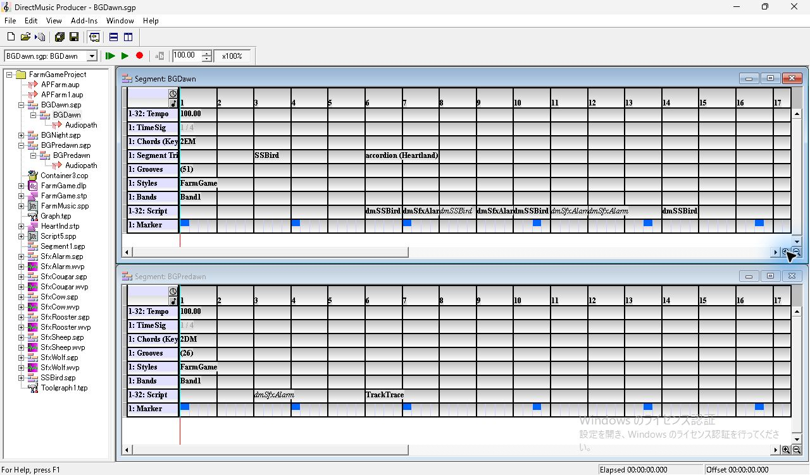

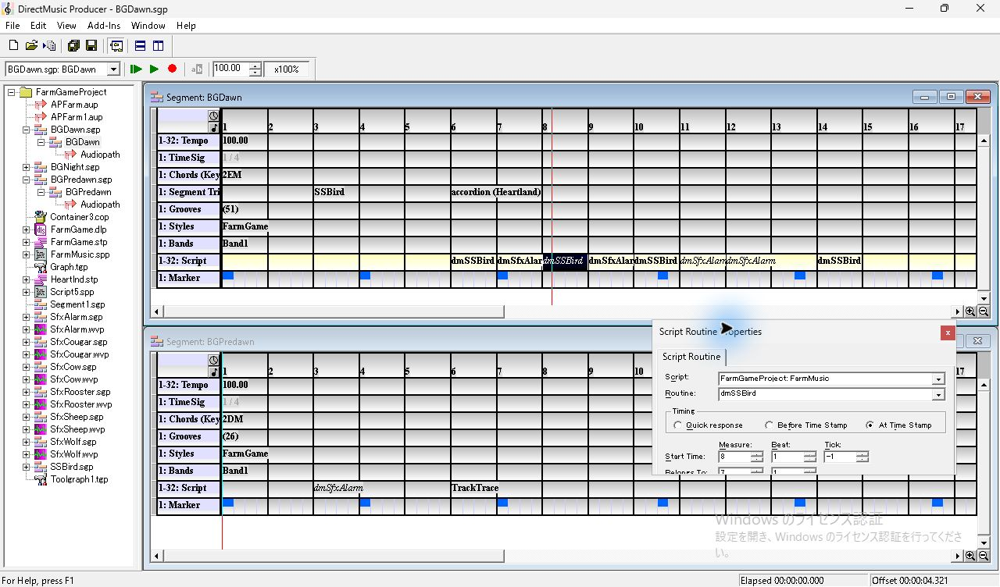

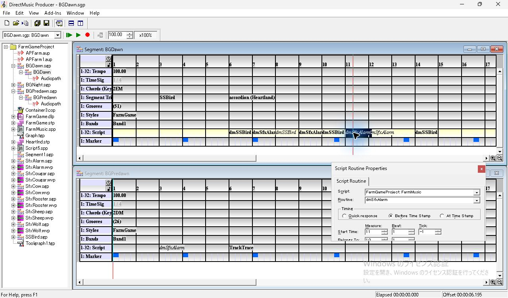

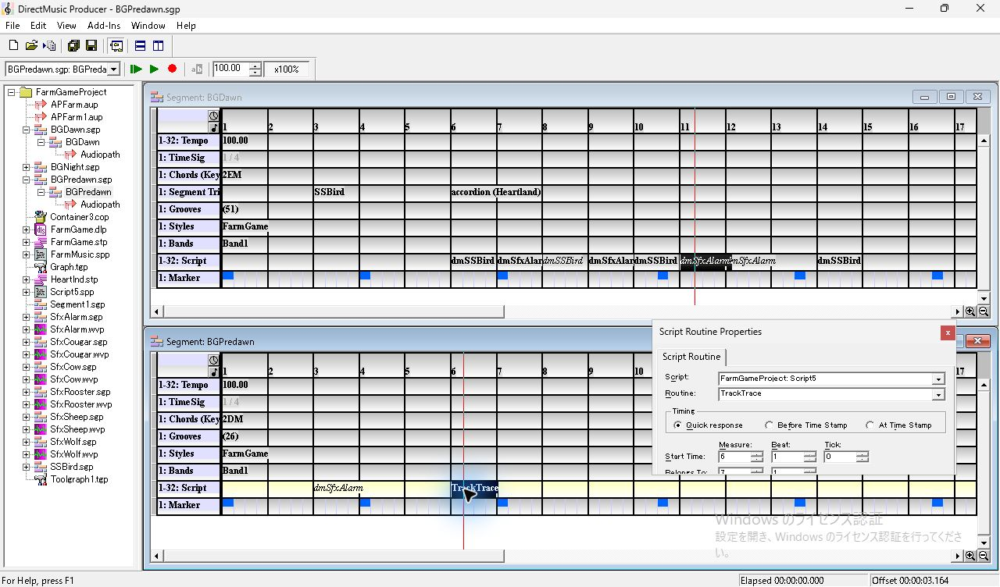

下段の Script 行を選んで **Ctrl+A**。既存イベントの前後と間にある空セルまで濃紺になり、Properties は **Multiple Routines Selected**。**Ctrl+C** の後、上段の第8小節を右クリックする。本体左上の Transport は BGDawn に切り替わり、下段の選択は黒いまま残る。**Paste** のサブメニューに **Merge** と **Overwrite** がある。両方式でコピー元の最初の物理クロック1536が上段第8小節の5376に揃い、物理・論理クロックはすべて **3840** 進んだ。第8小節の2件の1 Tick差と、TrackTrace の **Start Time 11:1:0 / Belongs To 12:1** を保存で確認した。

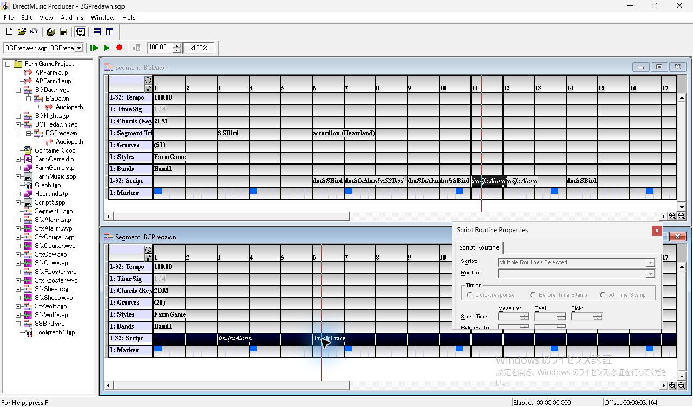

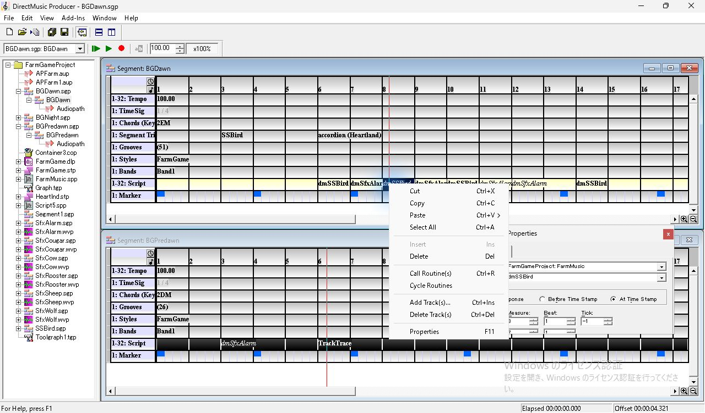

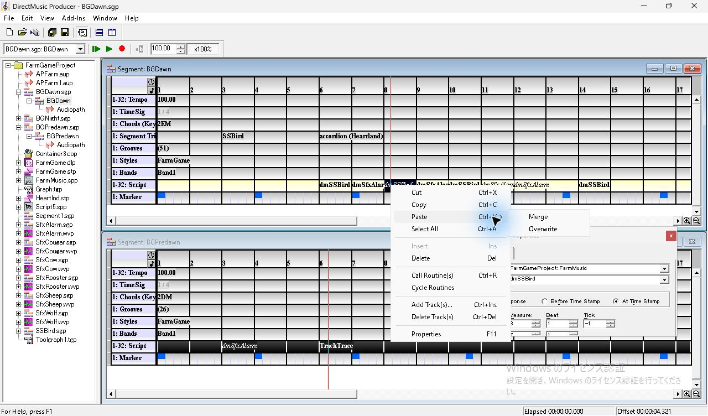

## 38小節のコピー元で Merge と Overwrite を比較

**Merge** は貼り付けた3件と物理クロックが一致する既存3件を置き換えた。残る12件は、参照 GUID、Timing、物理・論理クロックまで入力と一致した。上段の第8・11小節が濃紺、Properties は複数選択の表示。第11小節をクリックして **Cycle Routines** を1回実行すると、貼り付けた TrackTrace から元の **dmSSBird、11:1:1、At Time Stamp** に切り替わった。 [Merge 後の SGP](../../../work/original-gui/SEG-14-script-paste-range/20261112T044832281403Z/captures/29-merge-save.sgp)

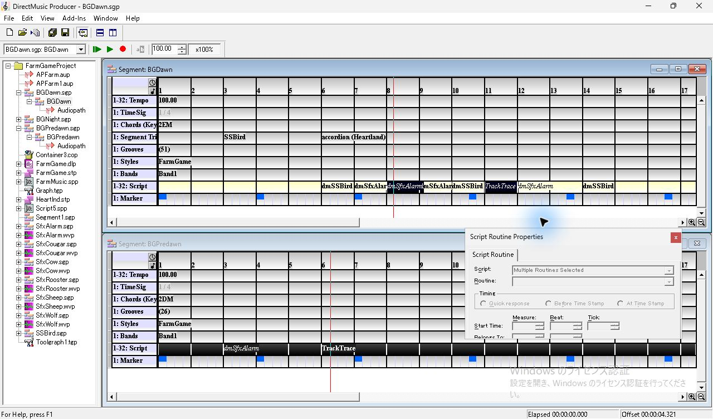

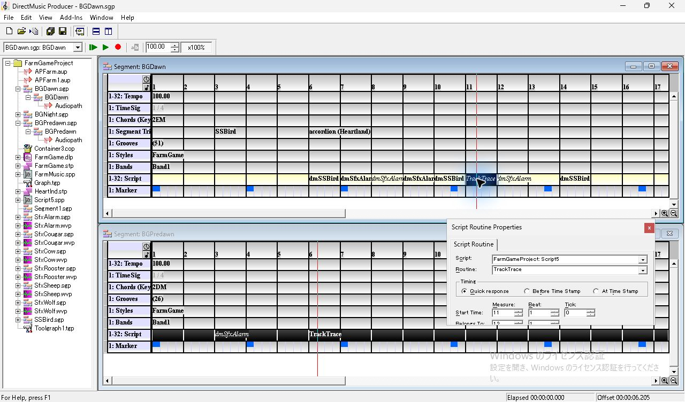

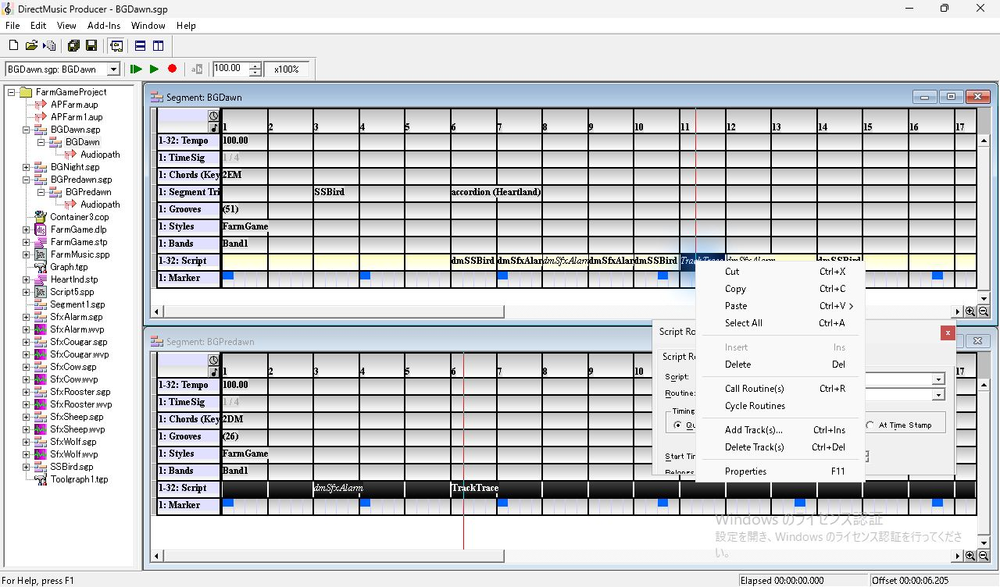

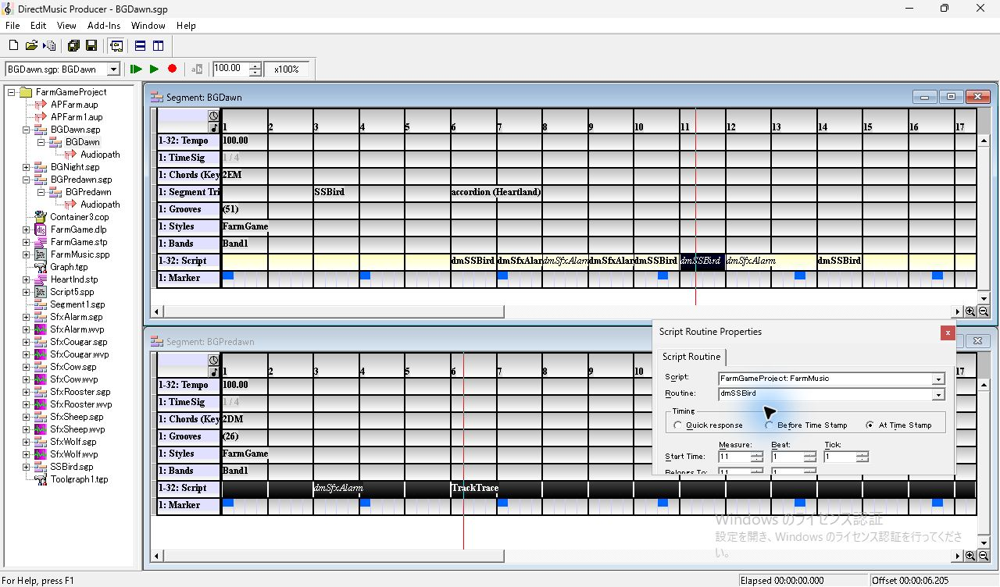

**Overwrite** は Merge の Undo で戻した同じ15件に、同じ貼り付け位置で実行した。第9・10小節の空白区間にあった項目が消え、第11小節は TrackTrace 1件になって **Cycle Routines** が灰色になった。第8小節より1 Tick 前で第8小節に表示される項目と、最後に貼り付けた第11小節を過ぎた **第14小節** の項目も消えた。第6・7小節先頭の既存2件が残り、貼り付けた3件を合わせて計5件。第14小節より後の消去端はこの試料では測っていない。 [Overwrite 直前の SGP](../../../work/original-gui/SEG-14-script-paste-range/20261112T044832281403Z/captures/41-reset-baseline-save.sgp) · [Overwrite 後の SGP](../../../work/original-gui/SEG-14-script-paste-range/20261112T044832281403Z/captures/45-overwrite-save.sgp)

| 位置 | 物理クロック | 元の項目 | Merge 後 | Overwrite 後 |
| --- | ---: | --- | --- | --- |
| 6:1:0 | 3840 | dmSSBird | 残る | 残る |
| 7:1:0 | 4608 | dmSfxAlarm | 残る | 残る |
| 8:1:−1 | 5375 | dmSSBird | 残る | 消える |
| 8:1:0 | 5376 | ManualTrace | dmSfxAlarm に置換 | dmSfxAlarm に置換 |
| 8:1:1 | 5377 | dmSfxAlarm | dmSSBird に置換 | dmSSBird に置換 |
| 8:1:2 | 5378 | dmSSBird | 残る | 消える |
| 9:1:0 | 6144 | dmSfxAlarm | 残る | 消える |
| 10:1:0 | 6912 | dmSSBird | 残る | 消える |
| 11:1:−1 | 7679 | dmSfxAlarm | 残る | 消える |
| 11:1:0 | 7680 | ManualTrace | TrackTrace に置換 | TrackTrace に置換 |
| 11:1:1 | 7681 | dmSSBird | 残る | 消える |
| 12:1:−1 | 8447 | dmSfxAlarm | 残る | 消える |
| 12:1:0 | 8448 | dmSSBird | 残る | 消える |
| 12:1:1 | 8449 | dmSfxAlarm | 残る | 消える |
| 14:1:0 | 9984 | dmSSBird | 残る | 消える |

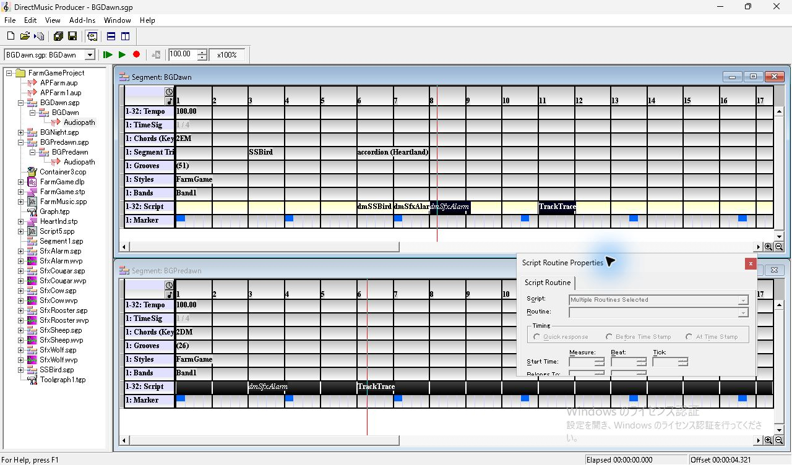

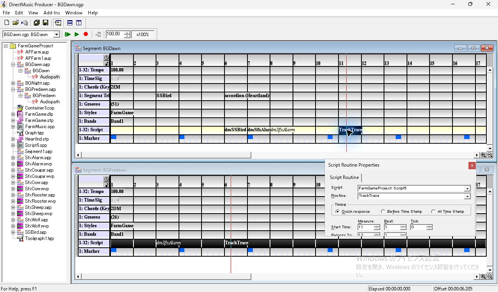

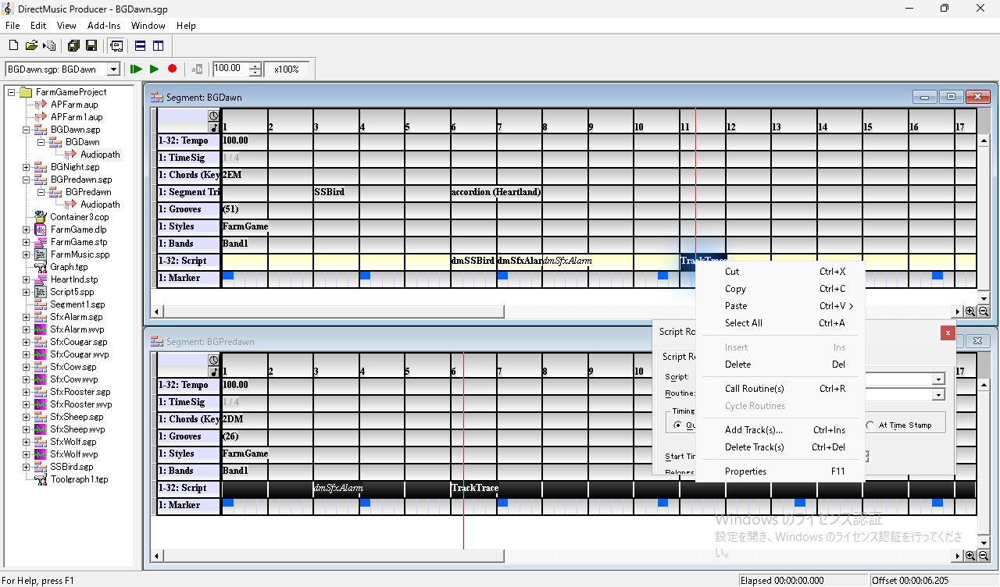

## 取り消しとやり直し

**Edit > Undo Paste Routine(s)** で、Merge 前の15件を復元した。Overwrite も上段の Script 行にフォーカスを置き **Ctrl+Z** で取り消すと15件が戻った。いずれも上段のセル選択が外れ、Properties は **Audiopath Audiopath Properties** に切り替わり、赤い位置線は操作前の位置に残った。下段の全選択は維持された。**Edit > Redo Paste Routine(s)** で、両方式とも貼り付け直後と同じ Script Track のバイト列に戻った。Merge の Redo 後は第11小節の見出しに元の −1 Tick の項目名が出るため、TrackTrace の復元は保存値で照合した。Overwrite の Redo 後は第11小節に TrackTrace が選択色なしで表示された。

SGP 全体では、Undo/Redo の保存間で Segment デザイン情報、Chord または Marker のチャンクにも差がある。Overwrite の直前と直後の差分は Script Track のみだった。 [Merge の Undo](../../../work/original-gui/SEG-14-script-paste-range/20261112T044832281403Z/captures/35-undo-merge-save.sgp) · [Merge の Redo](../../../work/original-gui/SEG-14-script-paste-range/20261112T044832281403Z/captures/38-redo-merge-save.sgp) · [Overwrite の Undo](../../../work/original-gui/SEG-14-script-paste-range/20261112T044832281403Z/captures/50-undo-overwrite-save.sgp) · [Overwrite の Redo](../../../work/original-gui/SEG-14-script-paste-range/20261112T044832281403Z/captures/53-redo-overwrite-save.sgp) · [チャンク単位の比較](../../../work/original-gui/SEG-14-script-paste-range/20261112T044832281403Z/paste-range-audit.json)

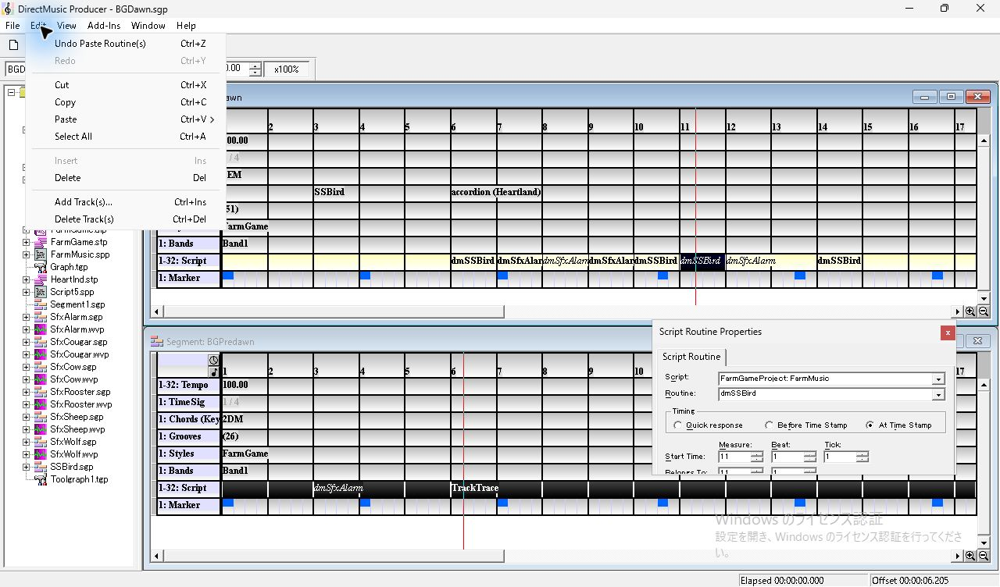

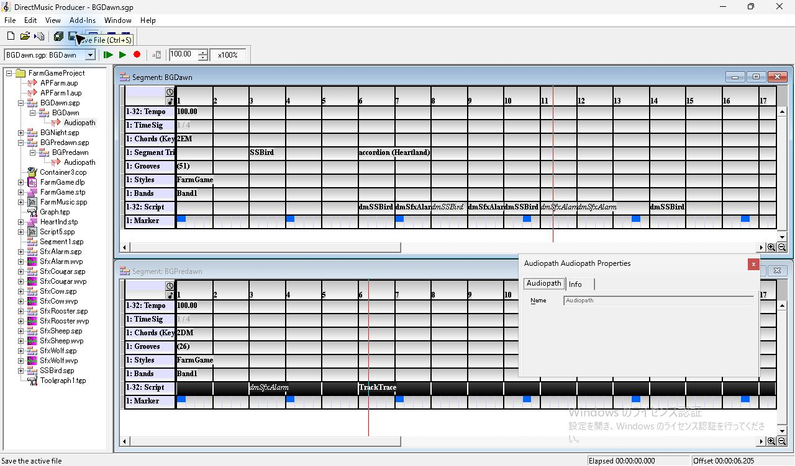

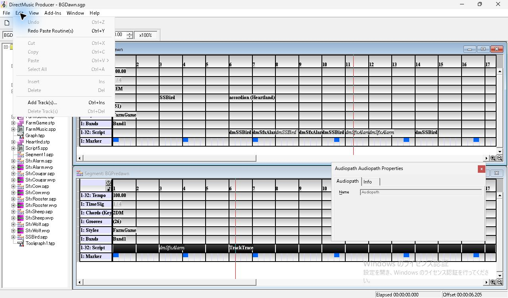

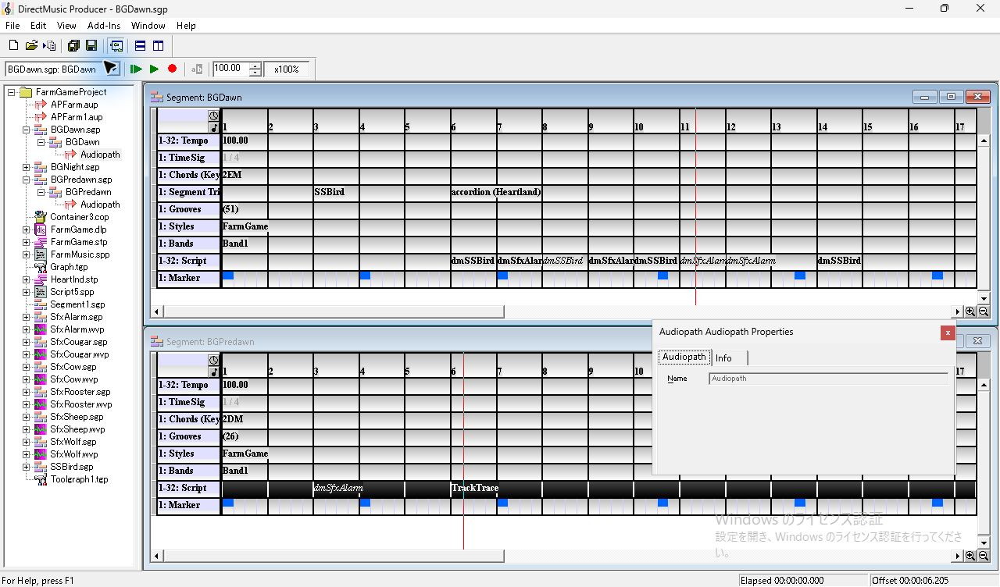

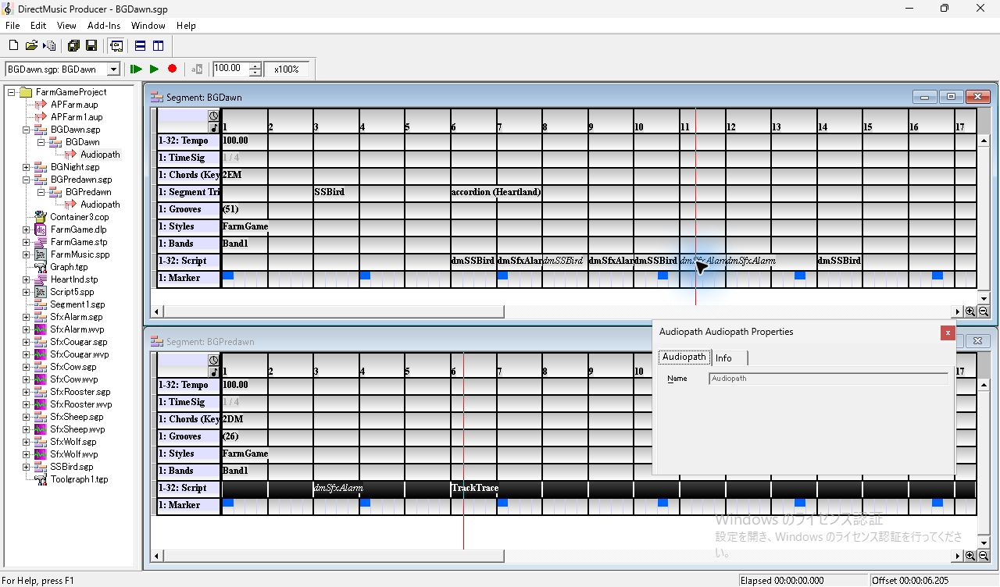

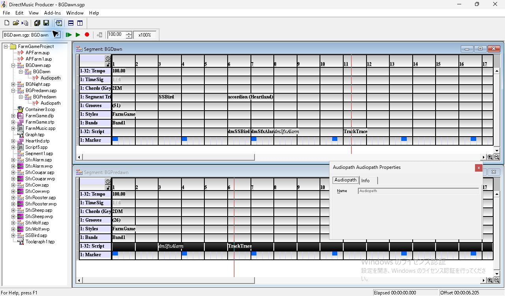

## コピー元を7小節にしたときの消去端

別の試験用 Project では BGDawn の元の15件をすべて残し、境界付近に26件を追加した。受け側は **38小節**。BGPredawn は同じ入力を開き、**Segment Properties > Length > Number Measures** を **38→7** に設定して保存した。コピー元の3件の参照、Timing、物理・論理クロックは38小節の試験と一致した。**Ctrl+A** では7小節目の空セルまで濃紺になった。 [受け側41件の入力とハッシュ](../../../work/original-gui/SEG-14-script-paste-range/20261112T044832281403Z/short-donor/run.json) · [入力を作ったコード](../../../work/original-gui/SEG-14-script-paste-range/20261112T044832281403Z/short-donor/prepare.py) · [7小節にしたコピー元](../../../work/original-gui/SEG-14-script-paste-range/20261112T044832281403Z/captures/68-seven-bar-donor-save.sgp) · [受け側の先行保存](../../../work/original-gui/SEG-14-script-paste-range/20261112T044832281403Z/captures/78-short-receiver-baseline-save.sgp)

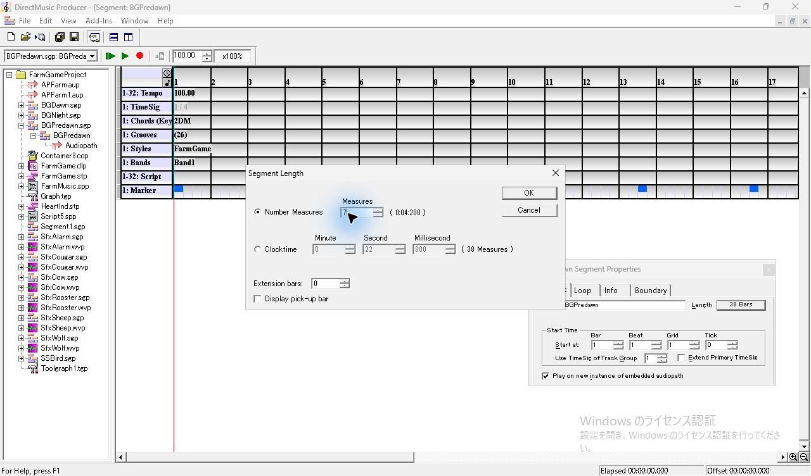

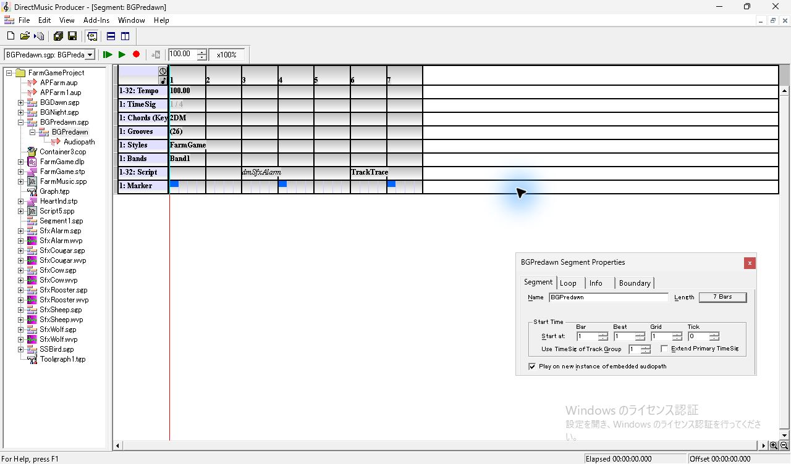

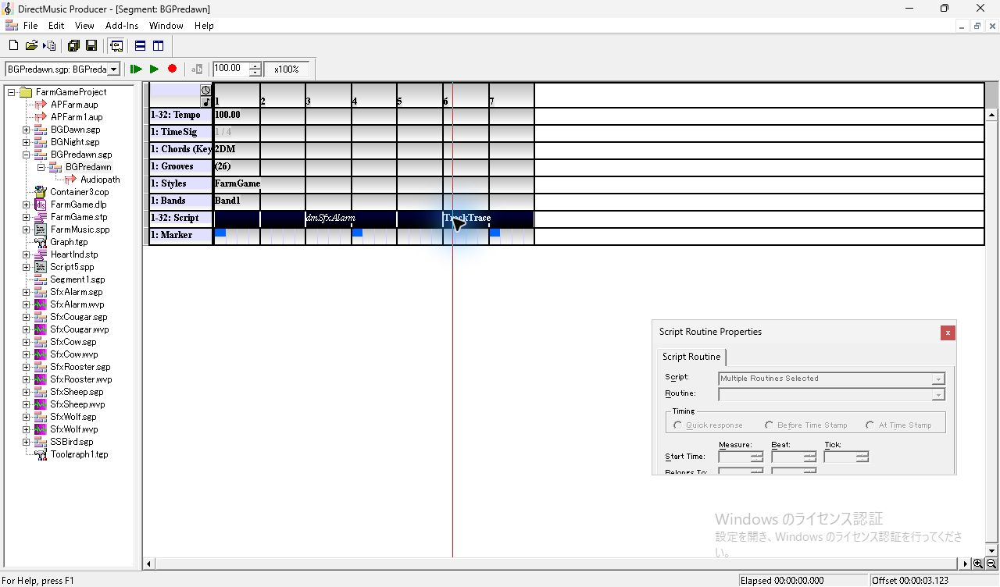

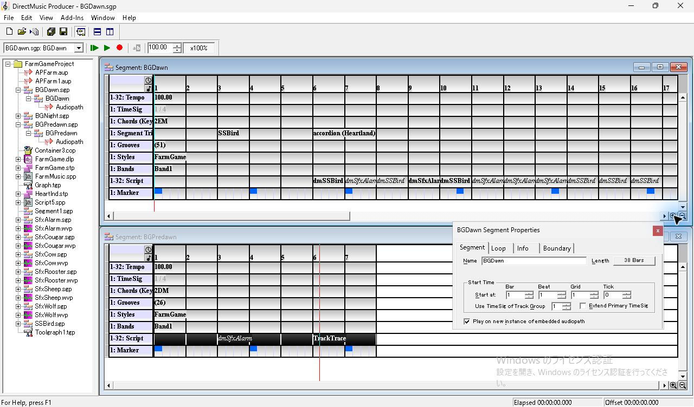

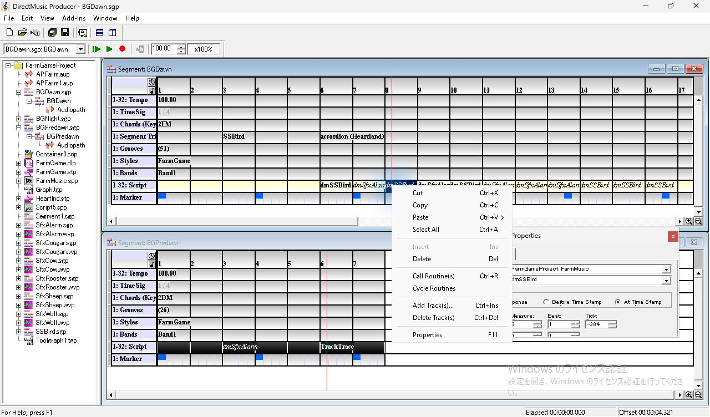

### 第8小節へ貼り付け

**Overwrite** 後の保存は17件。貼り付けた3件の配置は38小節の条件と同じ。左端では **物理4991（第7小節の先頭＋383 Tick）が残り、次の4992（＋384 Tick、画面の 8:1:−384）が消えた**。右端側では第14小節先頭とその1 Tick 後（物理9984・9985）が消え、第15小節に表示される最初の観測点 **15:1:−1（物理10751、Belongs To 14:1）** は残った。物理9985から10751の間に追加の観測点は置いていない。 [第8小節への Overwrite 後](../../../work/original-gui/SEG-14-script-paste-range/20261112T044832281403Z/captures/82-seven-bar-overwrite-save.sgp)

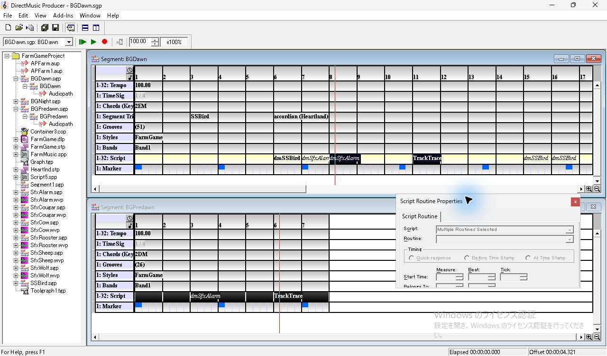

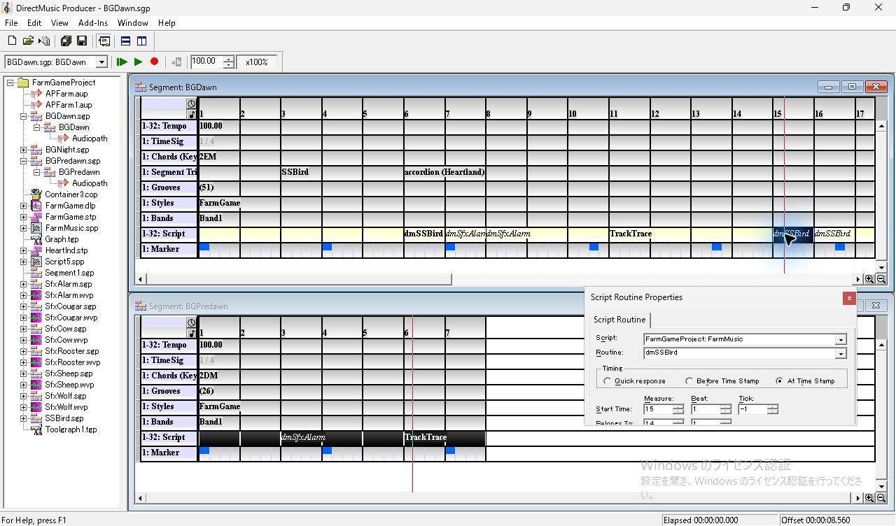

### 第9小節へ貼り付け

Undo で同じ41件に戻し、同じ7小節のコピー内容を第9小節へ Overwrite した。3件は **9:1:0、9:1:1、12:1:0** に入り、保存は23件。**物理11135（第15小節先頭＋383 Tick）が消え、次の11136（＋384 Tick、画面の 16:1:−384）が残った**。11137 と第16小節先頭も残った。最初の貼付時刻6144には同じ参照・Timing・時刻の Alarm が元からあり、保存値は一致した。 [Undo で戻した41件](../../../work/original-gui/SEG-14-script-paste-range/20261112T044832281403Z/captures/85-short-undo-baseline-save.sgp) · [第9小節への Overwrite 後](../../../work/original-gui/SEG-14-script-paste-range/20261112T044832281403Z/captures/89-short-anchor-nine-save.sgp)

| 7小節のコピー元 | 貼り付けた物理クロック | 消去端付近で残った位置 | 消去端付近で消えた位置 |
| --- | --- | --- | --- |
| 第8小節に貼り付け | 5376、5377、7680 | 左4991、右10751 | 左4992、右9985 |
| 第9小節に貼り付け | 6144、6145、8448 | 右11136 | 右11135 |

この1/4の試料では、Overwrite は **貼り付け先のセルからコピー元の全選択に対応する7セル分**を対象にしたと考えられる。第8小節起点では画面の第8〜14小節、第9小節起点では第9〜15小節に入る観測項目が消えた。拍の中間の **＋384 Tick** から次のセルの負の Tick として扱われる挙動とも一致する。第8小節起点の左端と第9小節起点の右端は隣接する物理クロックで確認した。選択方式や拍子が異なる場合は追試対象。

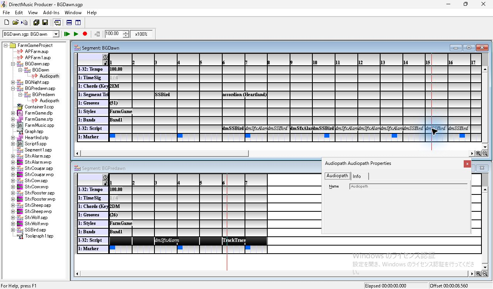

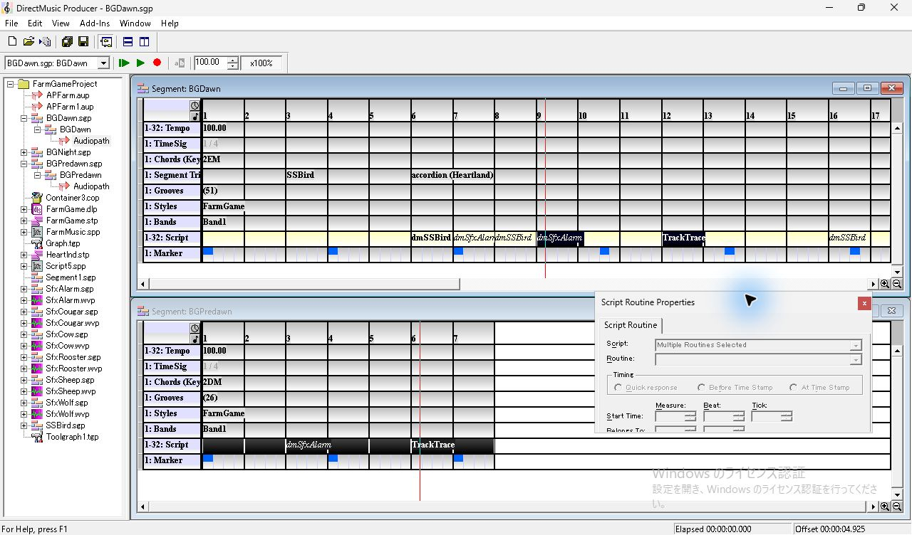

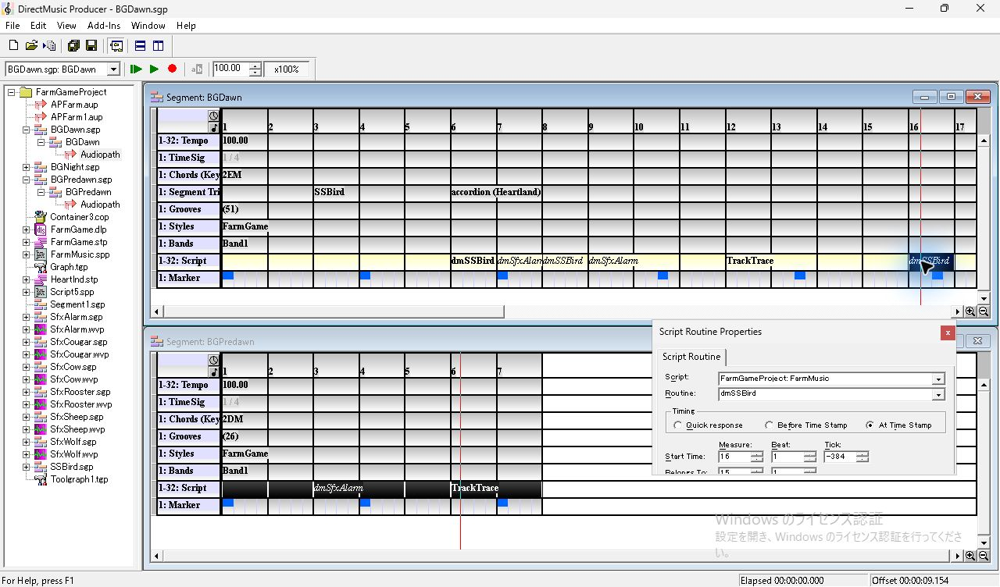

## 開き直しと終了状態

第9小節への結果を保存し、BGDawn の子ウィンドウを閉じて Tree から開き直した。上段で第12小節の TrackTrace を選ぶと **Quick response、12:1:0 / 13:1**。再保存した Script Track のバイト列は再表示前と一致し、Chord のチャンクに差があった。凍結入力は各 Project の28ファイルが開始時の SHA-256 と一致。作業コピーでは両方の **BGDawn.sgp** と **FarmGameProject.pro**、短縮条件の **BGPredawn.sgp** が変わった。 [再表示後の SGP](../../../work/original-gui/SEG-14-script-paste-range/20261112T044832281403Z/captures/95-reopened-anchor-nine-save.sgp) · [全項目と差分の照合](../../../work/original-gui/SEG-14-script-paste-range/20261112T044832281403Z/paste-range-audit.json) · [照合コード](../../../work/original-gui/SEG-14-script-paste-range/20261112T044832281403Z/audit.py)

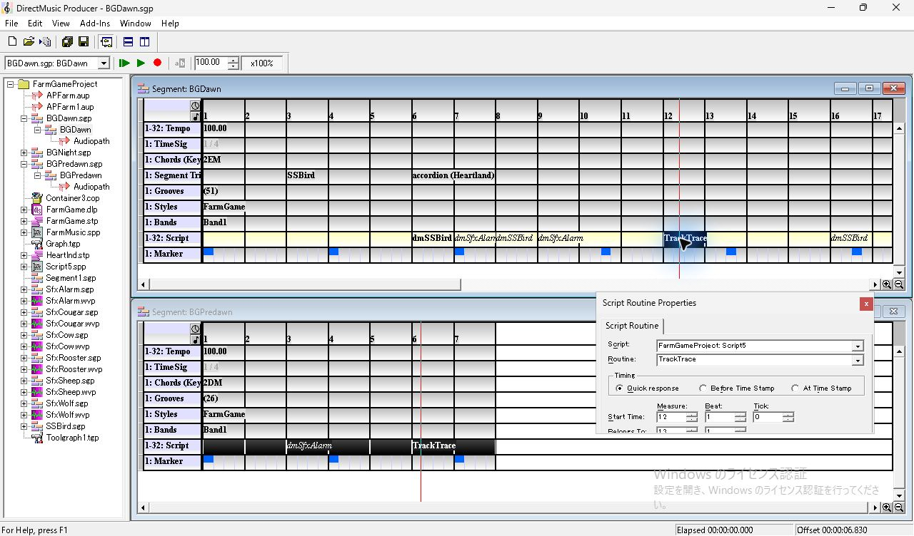

両方の試験 Project を閉じ、同じ Producer 1件を確認した。View は **Project Tree、Standard Toolbar、Status Bar、Transport Controls** の4項目。 [終了時のウィンドウ一覧](../../../work/original-gui/SEG-14-script-paste-range/20261112T044832281403Z/captures/101-final-windows.json)

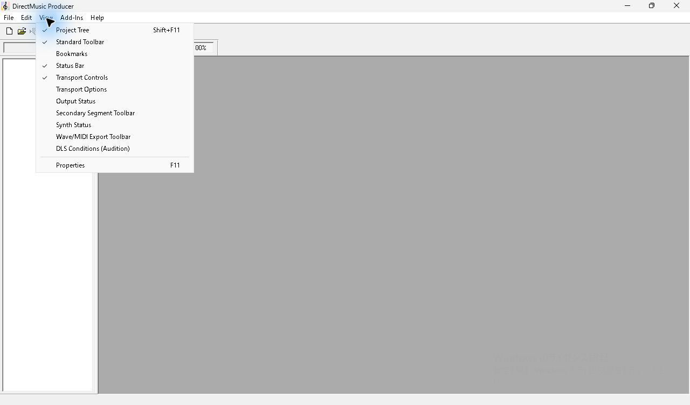
