# SEG-14 別 Project へ貼り付けた Script Routine の参照

2026-11-12。DirectMusic Producer 5.3.0.900 の作業コピーで、別 Project の Segment に Script Routine を貼り付けた。4条件について、貼り付け直後、Properties、保存したファイル、開き直したときの表示を照合した。掲載は16枚。アプリ全体の画像は1280×752 pxで、図4と図6は個別ウィンドウ。黒い矢印と青い光は操作ツールによる。 [実行条件と入力](../../../work/original-gui/SEG-14-script-project-reference/20261112T051629909984Z/run.json) · [入力の作成手順](../../../work/original-gui/SEG-14-script-project-reference/20261112T051629909984Z/prepare.py) · [画像の出典とハッシュ](../../../work/original-gui/SEG-14-script-project-reference/20261112T051629909984Z/published-figures.json)

## 試験素材と操作

前回の試験素材から、Tempo、Time Sig、Script の3トラックと埋め込み AudioPath がある検証用 Segment を用意した。コピー元の **Source / BGPredawn** と貼り付け先の **BGDawn** は、いずれも100 BPM、1/4、38小節。Source には **Script5.TrackTrace** 1件があり、**Quick response、Start Time 6:1:0、Belongs To 7:1**。BGDawn の Script 行は空。各試行で Source の Routine をクリックして **Ctrl+C**、貼り付け先の Script 行の第8小節をクリックして **Ctrl+V**。選択中の Routine は右下の **Script Routine Properties** で確認した。

入力の GUID は、Project の `.pro` の `filh` にある **ファイル GUID** と、`.spp` の `DMSC/guid` にある **Script オブジェクト GUID** を区別した。Script を置いた3条件では、Project 内に1件の `Script5.spp` があり、Script 名と Routine の内容を揃えた。Match は Source を閉じてからフォルダー一覧で開いた。他の3条件は Source を開いたまま、パスの入力後に改めてコピーした。 [同じ Project 内の別文書への貼り付け](seg-14-script-track-cross-document.md)

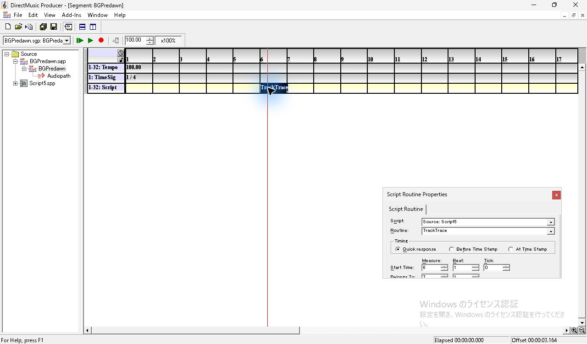

*図1 コピー元。BGPredawn の第6小節を選択し、Source の Script5 と Quick response を表示。*

| 貼り付け先 | 入力の GUID（ファイル／オブジェクト） | 貼り付け時 | 開き直し |
| --- | --- | --- | --- |
| Missing | Script なし | ファイル指定が開く。キャンセル後、Script 欄が空の TrackTrace が残る | Project を再読込しても同じ。Script の候補リストは空 |
| Match | 同じ／同じ | ダイアログなしで `Match: Script5` | Project を再読込しても同じ |
| NameOnly | 異なる／異なる | ダイアログなしで `NameOnly: Script5` | Segment の子ウィンドウを再表示しても同じ |
| ObjectOnly | 異なる／同じ | ダイアログなしで `ObjectOnly: Script5` | Segment の子ウィンドウを再表示しても同じ。Project を閉じる際に Script の保存確認が出る |

## 貼り付け先に Script がない場合

第8小節の空セルをクリックすると青く選択され、Properties の Script、Routine、Timing、Start Time は無効。**Ctrl+V** で中央に **Open 'Script5' Script** が開いた。初期フォルダーは **Missing**、ファイル名は空、ファイルの種類は **Script Files (*.spt;*.spp)**。Source の Tree に `Script5.spp` が見える状態でも、ここでは自動で割り当たらなかった。

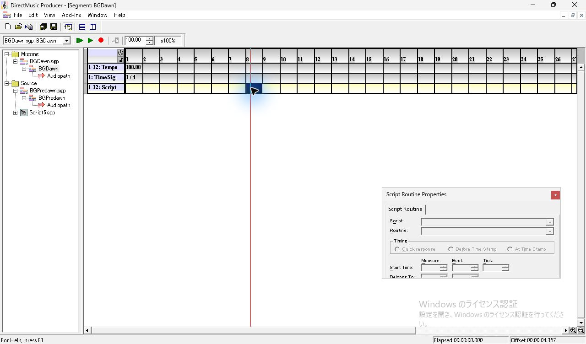

*図2 Missing の空の Script 行。第8小節を選ぶと青く表示され、Properties の入力欄は無効。*

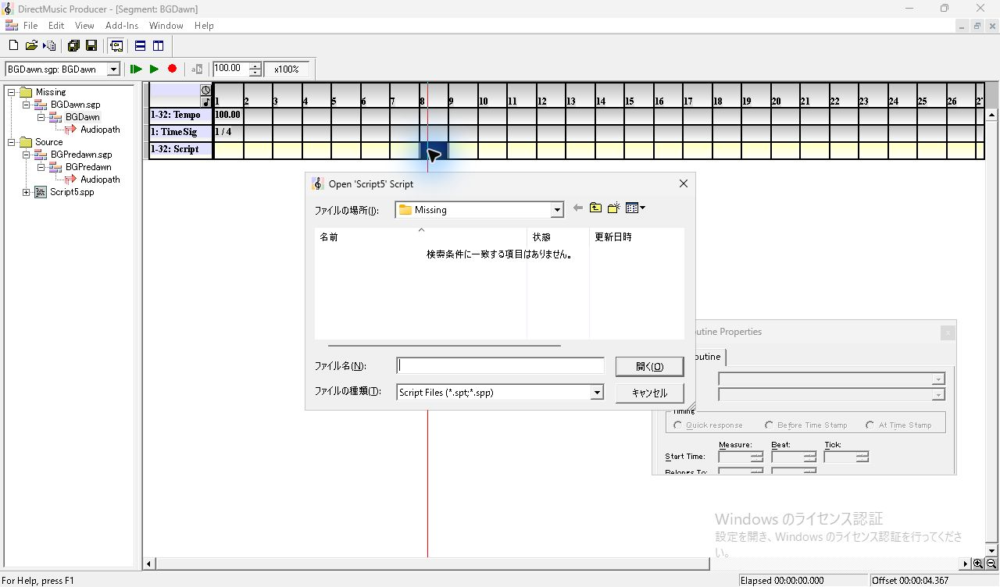

*図3 Source を開いたまま Missing へ貼り付けると、Segment の前面に Script 指定ダイアログが表示される。*

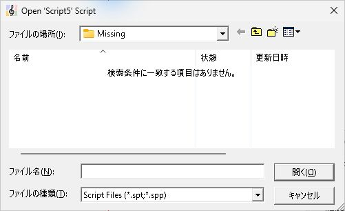

*図4 Script 指定ダイアログの詳細。開始フォルダーは Missing、ファイル名は空、ファイルの種類は Script Files。*

**キャンセル**を押すと、選択された **TrackTrace** が第8小節から表示された。Properties は一度トラックのグループ画面に切り替わり、項目をクリックすると Routine の画面に戻った。**Script 欄は空、Routine は TrackTrace、Timing は Quick response、Start Time は 8:1:0、Belongs To は 9:1**。保存後に Missing と Source を閉じ、Missing だけを開いて確認すると、ファイル指定は出ず同じ状態が再現された。Script のドロップダウンは開けるが、リストに項目がない。 [保存した BGDawn.sgp](../../../work/original-gui/SEG-14-script-project-reference/20261112T051629909984Z/captures/32-missing-unresolved-save.sgp)

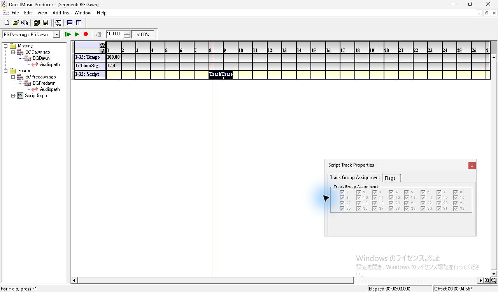

*図5 キャンセル直後。選択された TrackTrace がタイムラインに追加され、Properties は Script Track Properties に切り替わる。*

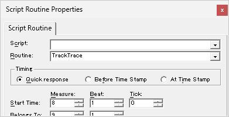

*図6 追加された Routine をクリック。Script 欄は空で、Routine 名と Quick response、Start Time が表示される。*

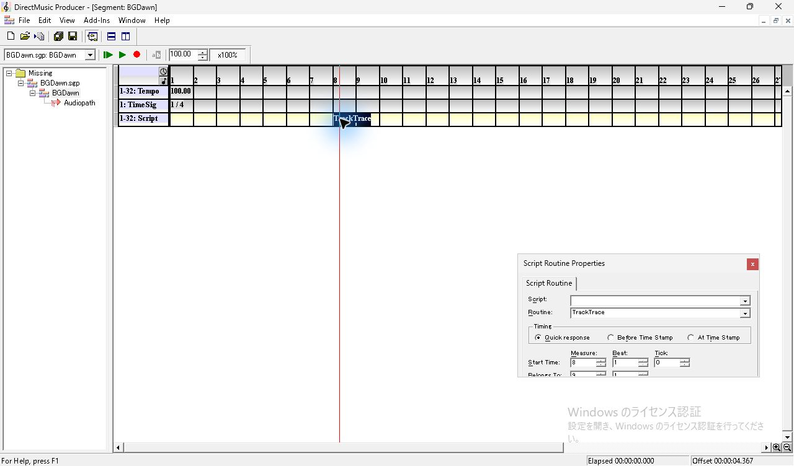

*図7 Source を閉じた状態で Missing Project を再読込。貼り付けた Routine と空の Script 欄が残る。*

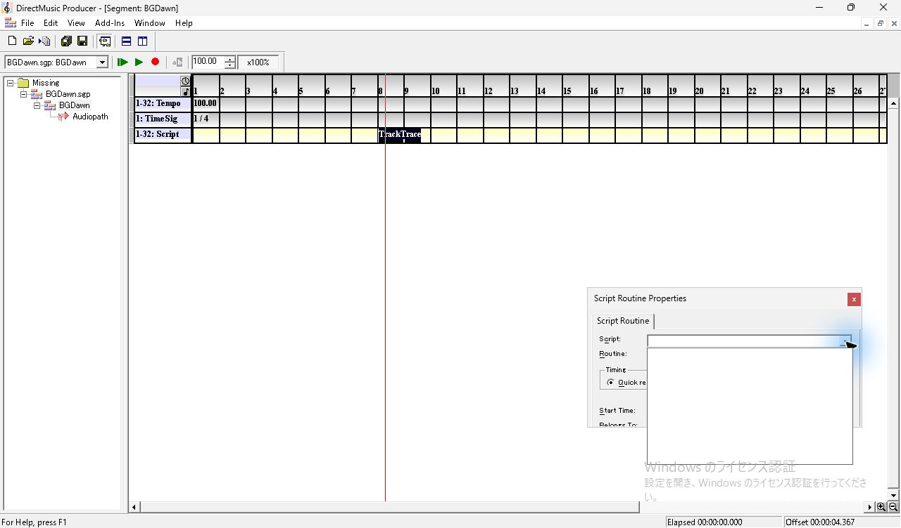

*図8 再読込後に Script 欄の矢印を押すと、空のリストが開く。*

## 貼り付け先に同名の Script がある場合

**Match** ではコピー後に Source を閉じても、Ctrl+V で **Match: Script5** が割り当たった。Project を閉じて再度開き、第8小節を選ぶと同じ表示に戻った。 [保存した BGDawn.sgp](../../../work/original-gui/SEG-14-script-project-reference/20261112T051629909984Z/captures/100-match-save.sgp)

*図9 Source を閉じてから Match に貼り付けた直後。Match の Script5 が表示される。*

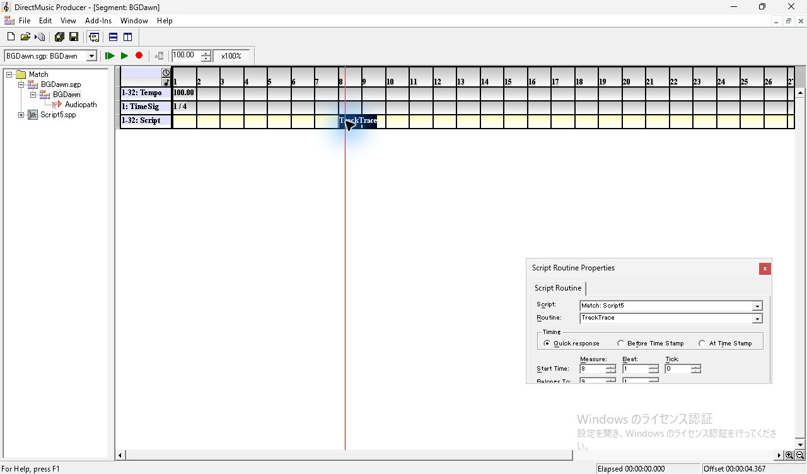

*図10 Match Project を閉じて開き直した後も、Match の Script5 が表示される。*

**NameOnly** では、ファイル GUID と Script オブジェクト GUID がどちらも Source と異なっていても、**NameOnly: Script5** が割り当たった。保存した参照には NameOnly 側のオブジェクト GUID が入った。貼り付け先に同名の候補が1件ある場合は、両 GUID が異なっていても解決した。 [保存した BGDawn.sgp](../../../work/original-gui/SEG-14-script-project-reference/20261112T051629909984Z/captures/76-name-save.sgp)

*図11 両 GUID が異なる同名 Script がある NameOnly。貼り付け直後に NameOnly の Script5 が表示される。*

*図12 NameOnly の Segment 子ウィンドウを開き直した後も貼り付け先の Script が表示される。*

**ObjectOnly** では、貼り付け先を開く前の入力ファイルで Script オブジェクト GUID が Source と一致していた。Source を開いたまま貼り付けると **ObjectOnly: Script5** が割り当たり、先に保存した BGDawn は新しいオブジェクト GUID を参照した。後で ObjectOnly を閉じると **The Script 'Script5.spp' has been modified. Save changes?** が表示され、調査用 Script に **Yes** を選んだ。保存後の `.spp` と `.pro` には BGDawn の参照と同じ新しいオブジェクト GUID が入った。`.pro` のファイル GUID は入力と一致した。この試行では同名の候補も存在し、貼り付けにおけるオブジェクト GUID 単独の効果と、GUID が変わった正確な時点は未確認。 [保存した BGDawn.sgp](../../../work/original-gui/SEG-14-script-project-reference/20261112T051629909984Z/captures/52-object-save.sgp) · [GUID の比較](../../../work/original-gui/SEG-14-script-project-reference/20261112T051629909984Z/reference-audit.json)

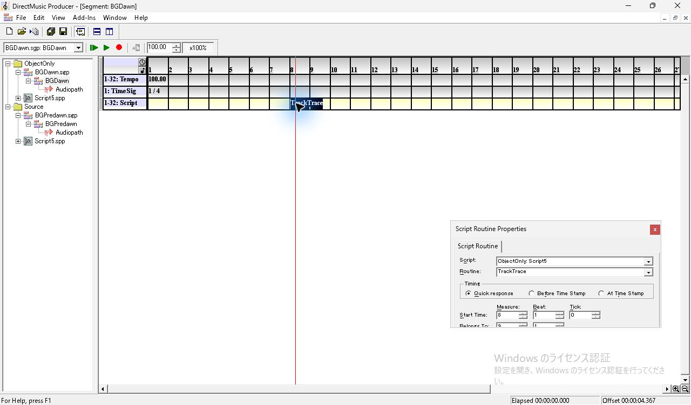

*図13 入力で Script 内の GUID だけが一致した ObjectOnly。貼り付け先の Script5 が表示される。*

*図14 ObjectOnly の Segment 子ウィンドウを開き直した後も参照が表示される。*

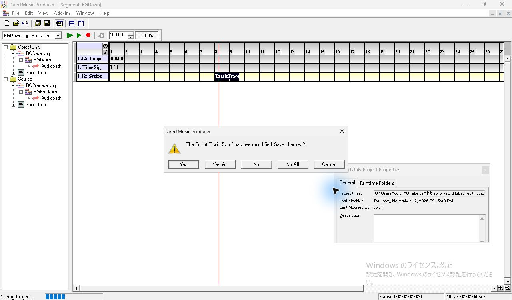

*図15 ObjectOnly を閉じる際、調査用 Script5.spp の変更を保存するか尋ねられる。*

## 保存値と調査の範囲

4件の保存ファイルを RIFF チャンクで照合した。`scrh` はすべて Timing の値が1、物理時刻が5376、論理時刻が6144。`scrn` は TrackTrace。コピー元から物理・論理時刻がともに1536クロック進み、Start Time と Belongs To の1小節差を保持した。参照が解決した3件の `LIST DMRF` は、いずれも貼り付け先の Script オブジェクト GUID と `Script5.spp` を持つ。Missing の `scre` は `LIST DMRF` を含まない。Tempo と Time Sig のトラック、凍結した5組の入力、コピー元の `.sgp` と `.spp` はハッシュを照合した。 [保存値の検証コード](../../../work/original-gui/SEG-14-script-project-reference/20261112T051629909984Z/audit.py) · [照合結果](../../../work/original-gui/SEG-14-script-project-reference/20261112T051629909984Z/reference-audit.json)

今回は各貼り付け先に Script 候補を最大1件置き、Missing ではファイル選択をキャンセルした。別名・複数候補の自動選択は、4種類の一致項目を分けて後続試験で確認した。 [Script 候補の自動選択](seg-14-script-candidate-order.md)調査には既に起動していた1件を使用した。終了時に調査用 Project を閉じ、View の **Project Tree、Standard Toolbar、Status Bar、Transport Controls** を確認した。 [開始時のウィンドウ一覧](../../../work/original-gui/SEG-14-script-project-reference/20261112T051629909984Z/captures/00-start-windows.json) · [終了時のウィンドウ一覧](../../../work/original-gui/SEG-14-script-project-reference/20261112T051629909984Z/captures/131-end-windows.json)

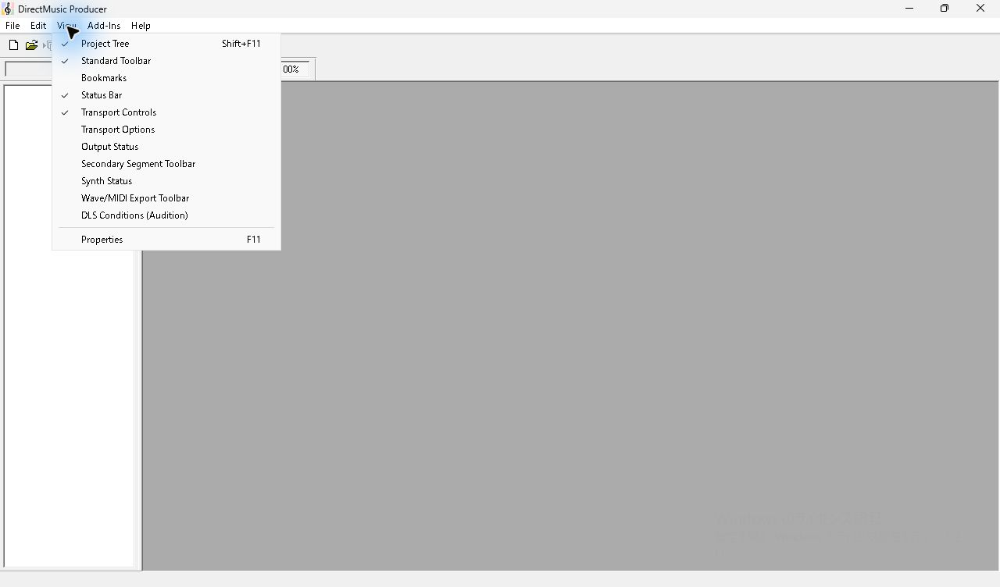

*図16 調査終了時の View。標準4項目にチェックがあり、Project Tree は空。*

同名 Script に解決した単独 Routine は、貼り付け先の Project だけを再読込して発音と Trace を確認した。 [貼り付け後の発音と Trace](seg-14-script-paste-audio.md)

ファイル指定を確定した場合は、受け側への取込、Undo 後に残る Script、欠損 Routine の手動呼出しと修復を後続試験で確認した。 [Script ファイルの取込](seg-14-script-file-picker.md)
