# SEG-14 Script Routine 貼り付け時の Runtime Script の取込

観測日 2026-11-12。起動中の DirectMusic Producer 5.3.0.900 の作業コピーを使用。**Runtime Save As…** で作成した `Script5.spt` を、別 Project への貼り付け時に **Open 'Script5' Script** から選んだ。貼り付け先には設計用の `Script5.spp` が追加され、保存した Segment はそのファイルを参照した。元の `.spp` を指定した対照でも同じ取込結果だった。 [設計用 Script の手動指定](seg-14-script-file-picker.md) · [登録済み候補の自動選択](seg-14-script-candidate-order.md)

掲載23枚。全体画面は1280×752 pxで、ファイル指定2枚はダイアログ部分のキャプチャ。青い光と黒い矢印は操作ツールの表示。 [実行条件と凍結素材](../../../work/original-gui/SEG-14-script-runtime-picker/20261112T065725398150Z/run.json) · [素材の作成コード](../../../work/original-gui/SEG-14-script-runtime-picker/20261112T065725398150Z/prepare.py) · [画像の取得元とハッシュ](../../../work/original-gui/SEG-14-script-runtime-picker/20261112T065725398150Z/published-figures.json)

## 原版で Runtime Script を書き出す

1. 調査用 `RuntimeSource.pro` を開き、Project Tree の `Script5.spp` ファイル行を右クリックする。文書を開く前は **Save、Save As…、Revert to Saved、Runtime Save As…** が灰色。
2. メニューを閉じ、`Script5.spp` をダブルクリックする。子の `Script5` と `Script Container` が展開され、Script Designer に本文と2件の Routine が出る。ファイル行を再度右クリックし、今度は選べる **Runtime Save As…** を選ぶ。
3. 保存ダイアログの初期フォルダーは **RuntimeFiles**、選択済みのファイル名は **Script5.spt**、種類は **Script Files (*.spt)**。調査フォルダー内の別のパスを入力して保存。
4. **Confirm Runtime Default Destination** には元と新しいフルパスが表示される。**いいえ** で既定先を保ったまま別のパスへ出力された。この条件の `Script5.spt` は508バイトで、元の `Script5.spp` とバイト単位で一致した。 [原版で出力した Script5.spt](../../../work/original-gui/SEG-14-script-runtime-picker/20261112T065725398150Z/runtime/Script5.spt) · [出力元の Script5.spp](../../../work/original-gui/SEG-14-script-runtime-picker/20261112T065725398150Z/inputs/RuntimeSource/Script5.spp)

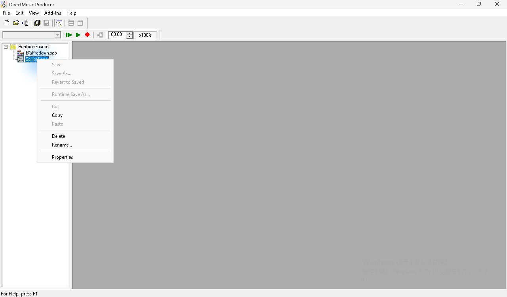

*図1 Project を開いた直後。未読込の Script5.spp では Runtime Save As… が無効。*

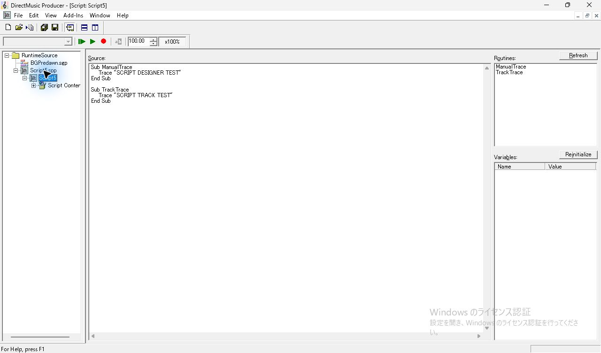

*図2 Script5.spp を開くと、Script Designer に本文と ManualTrace、TrackTrace が表示される。*

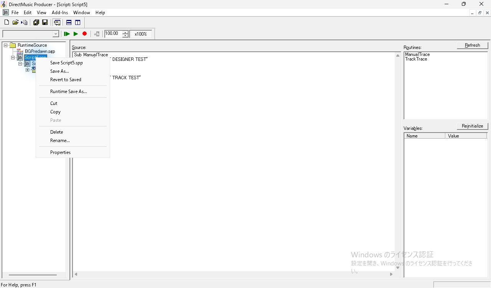

*図3 読込後にファイル行を右クリックすると Runtime Save As… が有効。*

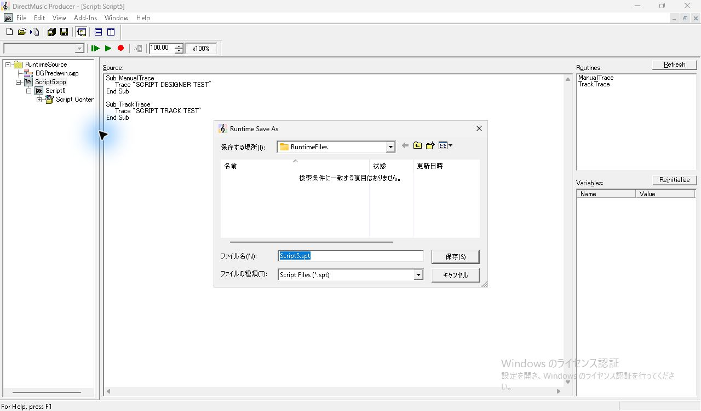

*図4 Runtime Save As の初期状態。保存先は RuntimeFiles、ファイル名は Script5.spt。*

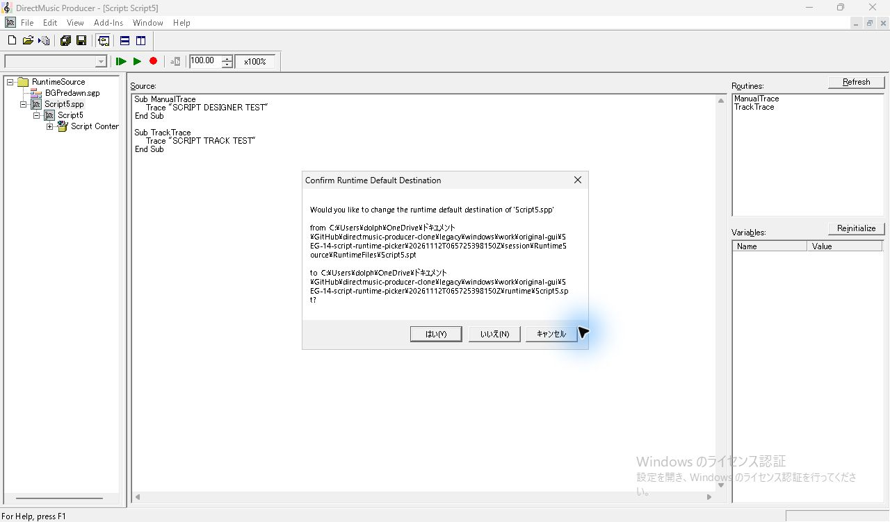

*図5 別フォルダーを指定すると、既定出力先も変更するか確認される。*

## ファイル指定と取込直後

`RuntimeSource` の `BGPredawn.sgp` で **Start Time 6:1:0、Belongs To 7:1、Quick response** の `TrackTrace` をコピーし、Project を閉じる。貼り付け先の `RuntimePaste` だけを開き、`BGDawn.sgp` の空の Script Track の8小節目を選んで `Ctrl+V`。対照の `DesignPaste` でも同じ Routine をコピーし直し、コピー元を閉じてから同じ操作を行う。両方の貼り付け先は38小節、100 BPM、1/4で、Script ファイルは未登録。

ダイアログのタイトルは **Open 'Script5' Script**。初期フォルダーは貼り付け先 Project、ファイル名欄は空、フィルターは **Script Files (*.spt;*.spp)**。RuntimePaste は書き出した `Script5.spt` を、DesignPaste は凍結した `Script5.spp` をフルパスで指定する。ファイルを開くとダイアログが閉じ、エラー表示を挟まず、Project 直下に `Script5.spp` が出る。RuntimePaste のファイル行に付く拡張子は `.spp`。子の `Script5` と `Script Container` が展開され、8小節目のセルに `TrackTrace` が入る。

確定直後の Properties は **Script Track Properties**。8小節目のセルをクリックすると **Script Routine Properties** に変わる。Script 欄は `RuntimePaste: Script5`、Routine は `TrackTrace`、Timing は **Quick response**、Start Time は **8:1:0**、Belongs To は **9:1**。Routine 一覧には **ManualTrace** と **TrackTrace** があり、選択は変更せず Escape で閉じた。DesignPaste の同じ操作では Script 欄が `DesignPaste: Script5` になった。

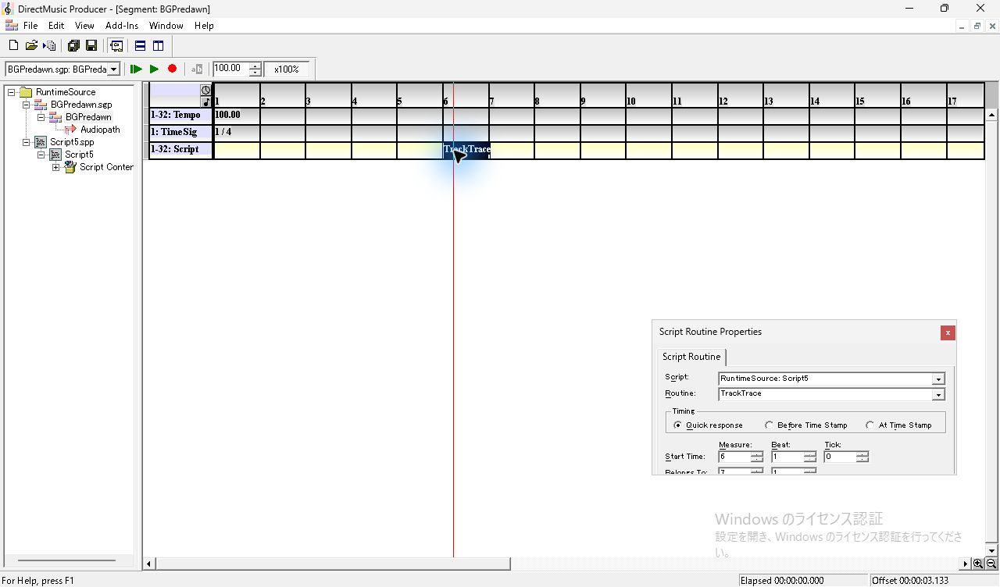

*図6 コピー元の6小節目。選択した項目は RuntimeSource の TrackTrace。*

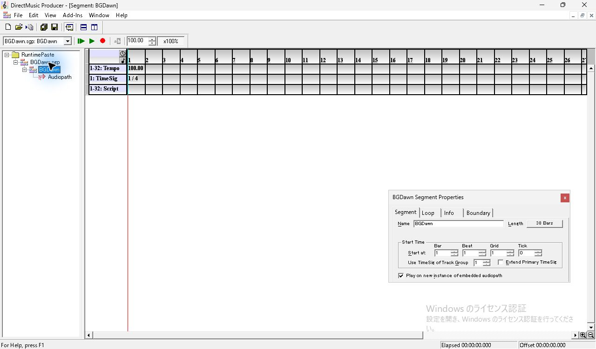

*図7 RuntimePaste の BGDawn。Tree に Script ファイルがなく、Script Track が空。*

*図8 8小節目への貼り付けで Open 'Script5' Script が開く。*

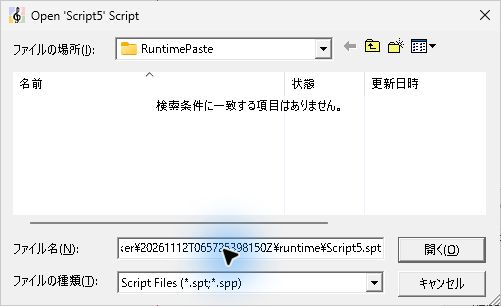

*図9 ファイル名欄に、書き出した Script5.spt のパスを入力。*

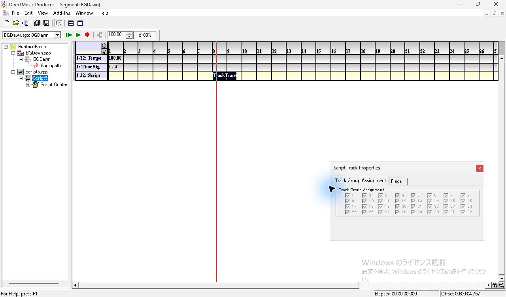

*図10 開くを押した直後。Tree に Script5.spp とその子が追加され、8小節目に TrackTrace が出る。*

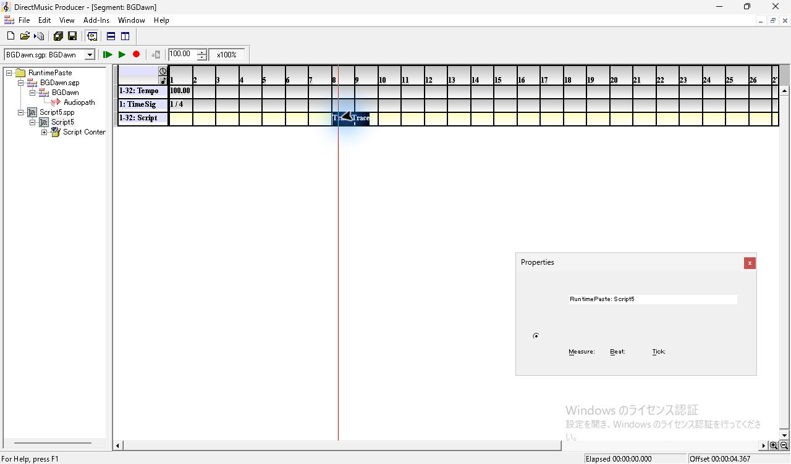

*図11 TrackTrace のセルを選択すると Script Routine Properties に RuntimePaste: Script5 が出る。*

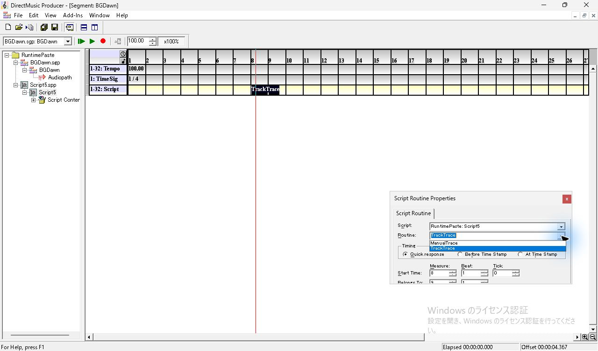

*図12 Routine 欄を開くと ManualTrace と TrackTrace が選べる。*

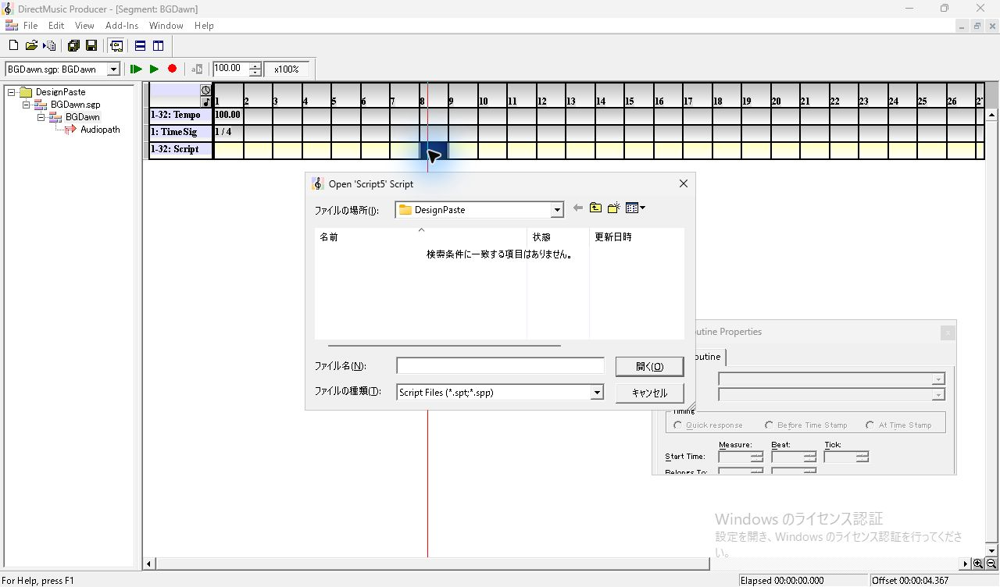

*図13 DesignPaste でも同じファイル指定が開く。*

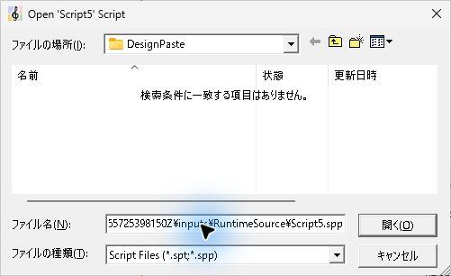

*図14 対照では元の Script5.spp のパスを入力。*

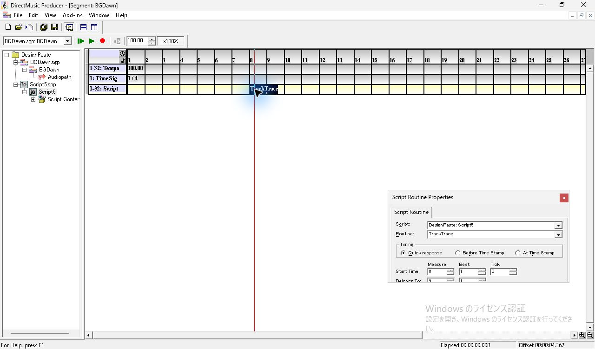

*図15 対照でも Script5.spp が追加され、8小節目の TrackTrace が参照する。*

## 保存、再読込、実行

それぞれ Standard Toolbar の Save で Segment を保存し、Project を閉じてから再び単独で開いた。8小節目の `TrackTrace` を選択すると、両方で Project 内の `Script5` への参照と時刻が復元された。再読込時にファイル指定は開かなかった。 [RuntimePaste の保存 Segment](../../../work/original-gui/SEG-14-script-runtime-picker/20261112T065725398150Z/captures/49-runtime-linked-save.sgp) · [DesignPaste の保存 Segment](../../../work/original-gui/SEG-14-script-runtime-picker/20261112T065725398150Z/captures/102-design-linked-save.sgp)

RuntimePaste の再読込後、**Add-Ins > Message Window** でログを表示した。Message Window を開いた後、本体が通常サイズに戻ったため最大化し、8小節目の `TrackTrace` を右クリックした。停止中の **Call Routine(s)** を押すと、空だったログに `<0001>` が追加された。続いて Transport の **Play From Start** を使うと、左のボタンが **Stop Immediate** に切り替わり、再生中のログに `<0002>` から `<0004>` が順に増えた。素材の **Loop > Repeat** は **Infinite**、範囲は1小節目の頭から39小節目の頭まで。3周目の途中で Stop Immediate を押した。今回は Message Window の連番を実行の観測値とした。

*図16 RuntimePaste を再読込し、セルを選択すると参照が復元される。*

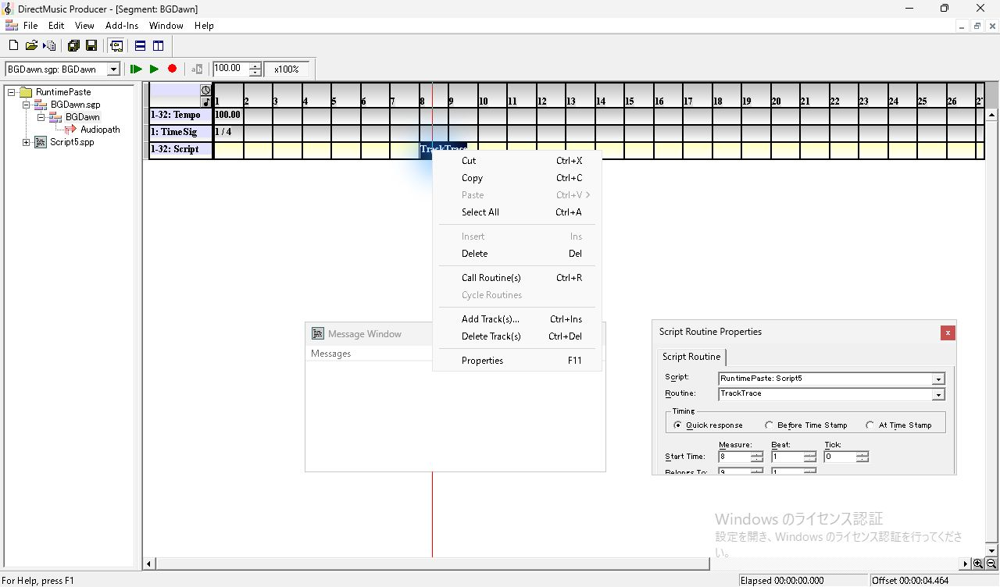

*図17 再読込後の右クリックメニュー。Call Routine(s) が有効で、Message Window は空。*

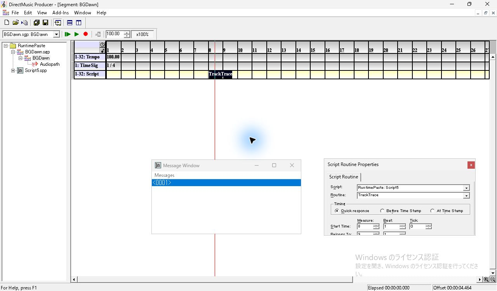

*図18 Call Routine(s) を押すと Message Window に `<0001>` が追加される。*

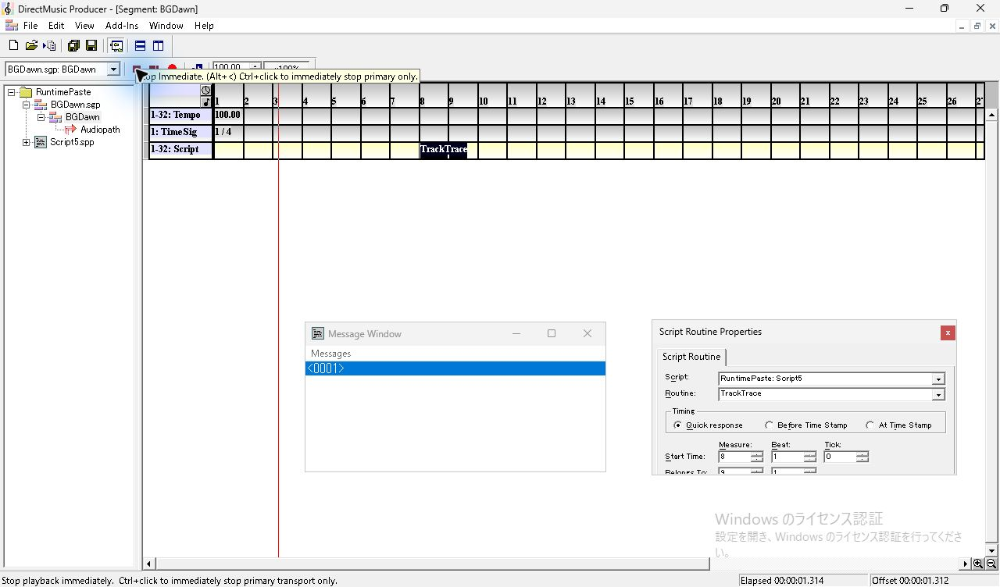

*図19 Play From Start の直後。再生位置が進み、左のボタンが Stop Immediate になる。*

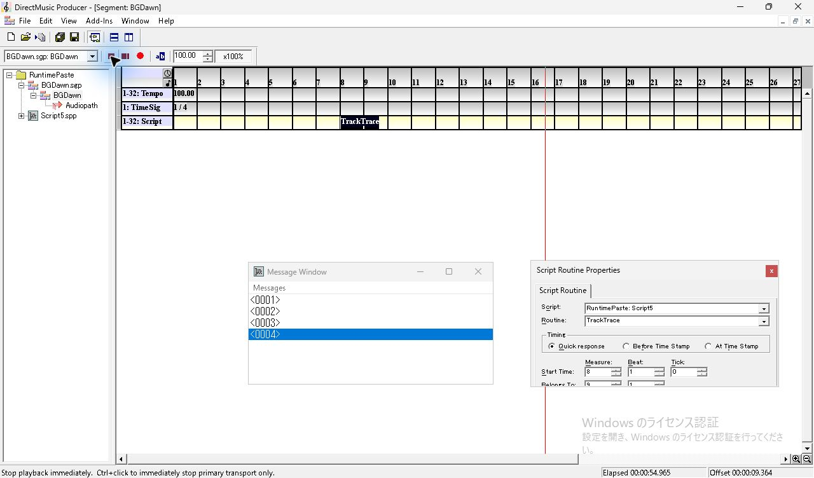

*図20 ループ再生中に `<0002>`、`<0003>`、`<0004>` が追加された。*

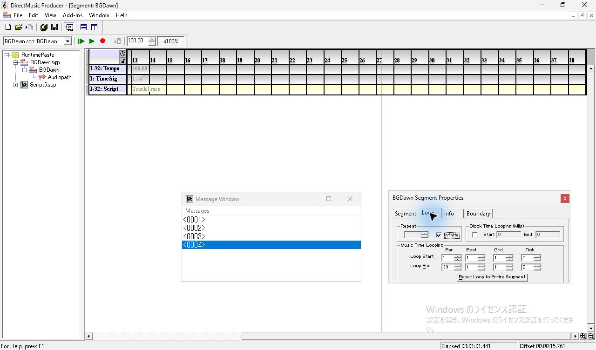

*図21 停止後の Segment Properties。Loop の Repeat は Infinite。*

*図22 DesignPaste を再読込した後の参照と Start Time。*

## 保存内容の照合

| 指定ファイル | Project 内のファイル | ファイル GUID | Script オブジェクト GUID |
| --- | --- | --- | --- |
| `Script5.spt` | `RuntimePaste/Script5.spp` | `f1780c7a-f036-4db0-bbfc-9487e1501333` | `77f4df2e-d5c8-425f-bea3-da0c89c2cccb` |
| `Script5.spp` | `DesignPaste/Script5.spp` | `14b94b0c-c2a2-4155-96eb-7e44c0506a55` | `77f4df2e-d5c8-425f-bea3-da0c89c2cccb` |

取込後の2ファイルは、出力した `.spt` および元の `.spp` とバイト単位で一致した。両方で元の Script オブジェクト GUID を保持し、Project のファイル GUID は元と別の値が割り当てられた。`.sgp` の `scre/jzfr` は各 Project のファイル GUID、`DMRF/guid` は Script オブジェクト GUID、`DMRF/file` は `Script5.spp`。時刻は `scrh` の Timing 1、物理5376、論理6144で、`scrn` は `TrackTrace`。保存後の Script Track のグループマスクは両方で `0xffffffff`。凍結入力の値は `0x00000002`。Segment ヘッダーと他のトラックも照合した。 [照合コード](../../../work/original-gui/SEG-14-script-runtime-picker/20261112T065725398150Z/audit.py) · [ファイル、GUID、保存値の照合結果](../../../work/original-gui/SEG-14-script-runtime-picker/20261112T065725398150Z/script-runtime-picker-audit.json)

確認範囲は、この Producer が同一内容で出力した `.spt` 1件。設計用とバイナリ内容が異なる Runtime Script や、外部依存がある Runtime Script の取込は未検証。対照の初回はパス入力の後にクリップボードを再利用して貼り付けが成立しなかったため、同じ Routine をコピーし直した結果を採用した。

調査後に Project、Properties、Message Window を閉じた。開始時と同じ Producer 1件で、**Project Tree、Standard Toolbar、Status Bar、Transport Controls** が表示されている。 [開始時のウィンドウ一覧](../../../work/original-gui/SEG-14-script-runtime-picker/20261112T065725398150Z/captures/00-start-windows.json) · [終了時のウィンドウ一覧](../../../work/original-gui/SEG-14-script-runtime-picker/20261112T065725398150Z/captures/end-windows.json)

*図23 終了時の View。Project Tree は空で、標準4項目にチェックがある。*
