# SEG-14 Script Track の同一拍の選択、ルーラーとドラッグ

2026-11-12。DirectMusic Producer 5.3.0.900 の作業コピーで、通常選択、Cycle Routines、矢印キー、ルーラーの範囲、全選択とドラッグを比較した。24枚の画像、保存した11状態、開き直した両 Segment を照合した。本体は1280×752 px。黒い矢印や青い光は操作ツールの表示で、カーソル形状はその下に写る白い輪郭を確認した。 [実行条件と入力](../../../work/original-gui/SEG-14-script-modifiers/20261112T055543432842Z/run.json) · [入力作成コード](../../../work/original-gui/SEG-14-script-modifiers/20261112T055543432842Z/prepare.py) · [画像の出典とハッシュ](../../../work/original-gui/SEG-14-script-modifiers/20261112T055543432842Z/published-figures.json)

## 入力と表示

同じ **Modifiers** Project に **BGPredawn** と **BGDawn** を用意した。両方とも **38小節、100 BPM、1/4、x100%**。BGPredawn の Script5 参照は下表の5件で、間に空の小節がある。BGDawn は空の Script 行を持つ。両 Segment の横ズームが異なるため、操作位置はそれぞれのルーラーの小節番号で確認した。 [試験用 BGPredawn](../../../work/original-gui/SEG-14-script-modifiers/20261112T055543432842Z/inputs/Modifiers/BGPredawn.sgp) · [試験用 BGDawn](../../../work/original-gui/SEG-14-script-modifiers/20261112T055543432842Z/inputs/Modifiers/BGDawn.sgp)

| Routine | Start Time | Belongs To | Timing |
| --- | --- | --- | --- |
| ManualTrace | 3:1:0 | 3:1 | Before Time Stamp |
| TrackTrace | 3:1:1 | 3:1 | At Time Stamp |
| ManualTrace | 5:1:0 | 5:1 | Before Time Stamp |
| TrackTrace | 6:1:0 | 7:1 | Quick response |
| ManualTrace | 9:1:0 | 9:1 | Before Time Stamp |

## 同じ拍の2件と単独コピー

第3小節を左クリックして **F11**。行は薄黄色、選択箇所は濃紺、名前は白い斜体。斜体の名前は2件が重なる位置に表示される。この条件では選択中の **ManualTrace** の名前が第4小節の境界を越えて見え、Properties は **Before Time Stamp、3:1:0**。第3小節で **Ctrl+C**、BGDawn の第12小節の空セルで **Ctrl+V** を使うと ManualTrace 1件が入った。

第3小節を右クリックして **Cycle Routines** を選ぶと、表示名と Properties が **TrackTrace、At Time Stamp、3:1:1** に切り替わる。同じ手順で BGDawn の第15小節に貼り付けると TrackTrace 1件が入った。保存した Start Time は **15:1:1**、Belongs To は **15:1**。2つの操作で、そのとき Properties に表示された1件ずつをコピーできた。 [1件目の保存](../../../work/original-gui/SEG-14-script-modifiers/20261112T055543432842Z/captures/30-visible-save.sgp) · [2件目の保存](../../../work/original-gui/SEG-14-script-modifiers/20261112T055543432842Z/captures/39-cycled-save.sgp)

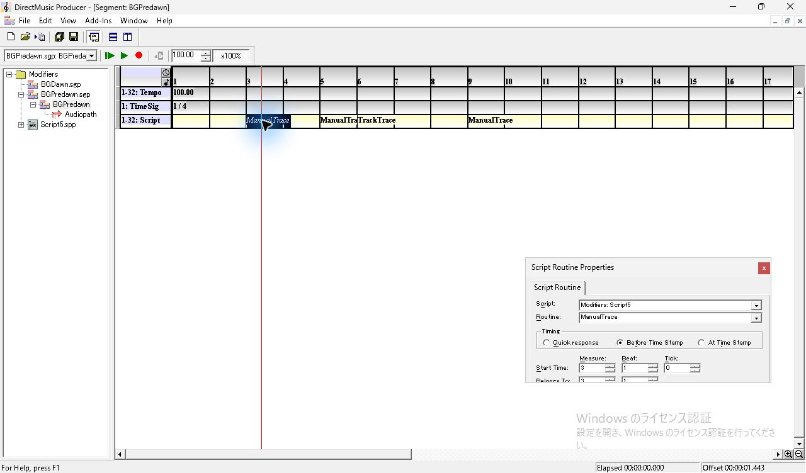

*図1 第3小節を通常クリック。斜体の ManualTrace と単独の Properties。*

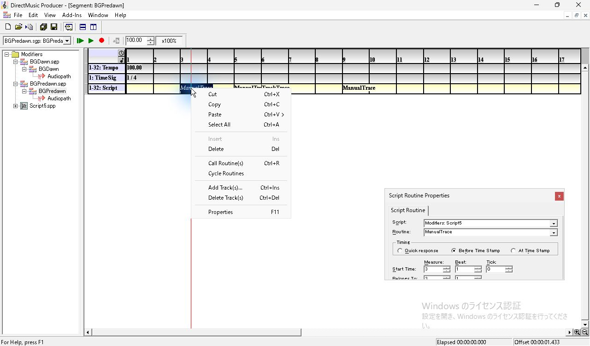

*図2 第3小節のメニュー。Cycle Routines が有効。*

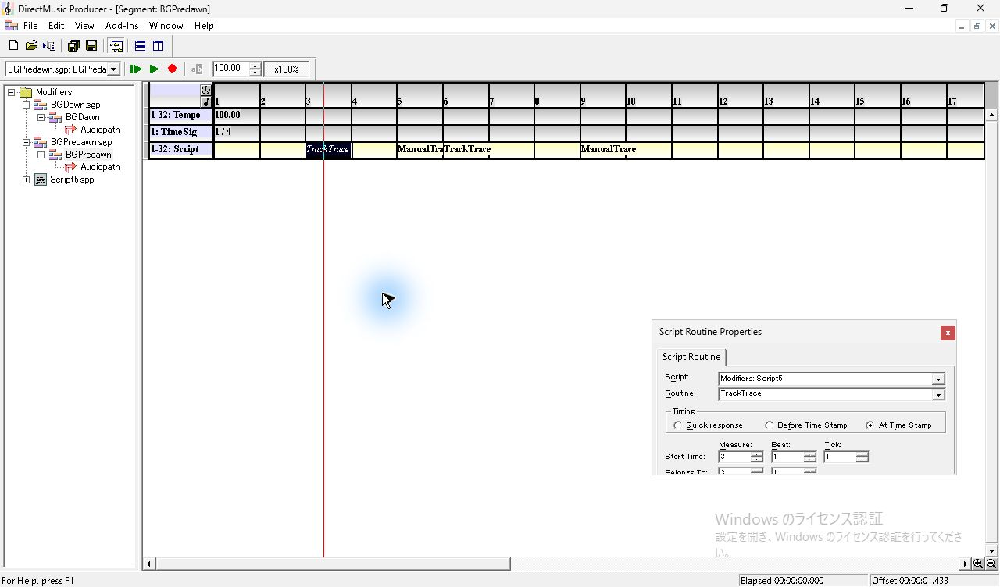

*図3 Cycle Routines の直後。第3小節の TrackTrace と At Time Stamp、Tick 1。*

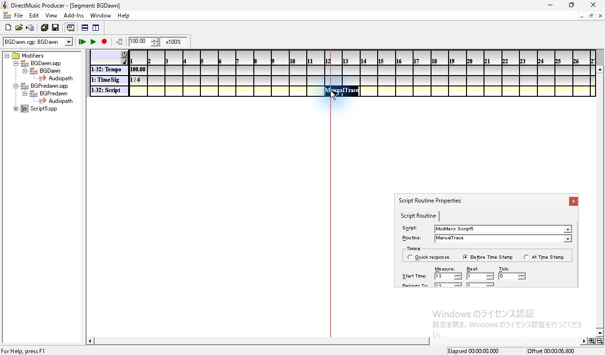

*図4 通常選択から貼り付けた ManualTrace。第12小節の Tick 0。*

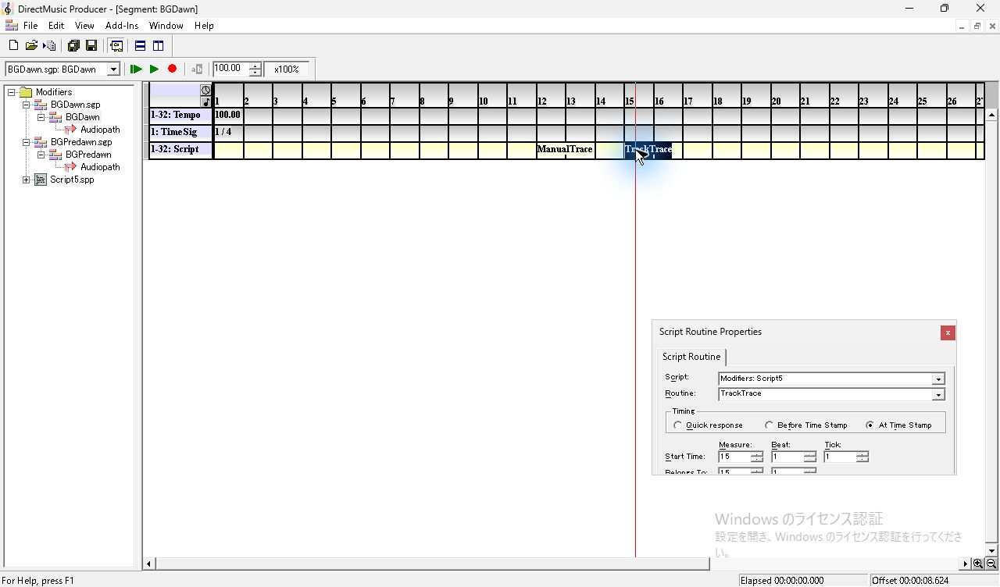

*図5 切り替え後に貼り付けた TrackTrace。第15小節の Tick 1。*

## 位置線、ルーラー範囲、Script 行の選択

第3小節の選択中に **Shift+右** を押すと Offset が **1.443→1.593秒**。続けて **Ctrl+右** では **1.593→2.193秒**。後者は1小節分の0.600秒で、位置線は第4小節に入る。どちらも濃紺の選択と Properties は第3小節の ManualTrace のまま。

ルーラーの **(393,127) → (626,127)** を通常ドラッグすると、第3〜6小節のルーラーだけが濃紺になり、第3小節の先頭に位置線が来た。Script 行は灰色で、F11 の画面は **BGPredawn Segment Properties** に切り替わる。**Edit > Copy / Select All** は灰色。ドラッグ直後の画像には右端の白い左右矢印が写る。確定後にポインターをいったん範囲の内側に置いて同じ右端へ戻すと白い通常矢印だった。元の右端 **(626,127)** から **(685,127)** へドラッグした回は、第7小節だけが濃紺になり、Offset は3.600秒になった。座標は親ウィンドウの左上を原点とする。

*図6 Shift+右の直後。濃紺は第3小節、Offset は1.593秒。*

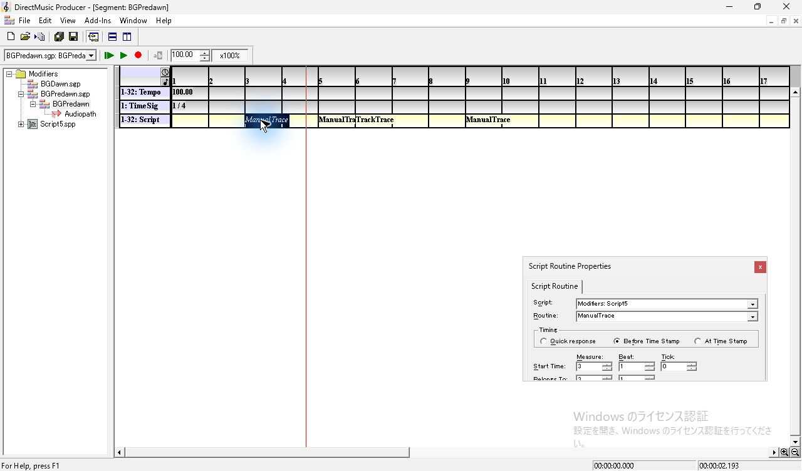

*図7 Ctrl+右の直後。位置線が第4小節へ移り、濃紺の選択は第3小節。*

*図8 第3〜6小節のルーラーだけが濃紺。右端に左右矢印、Properties は Segment。*

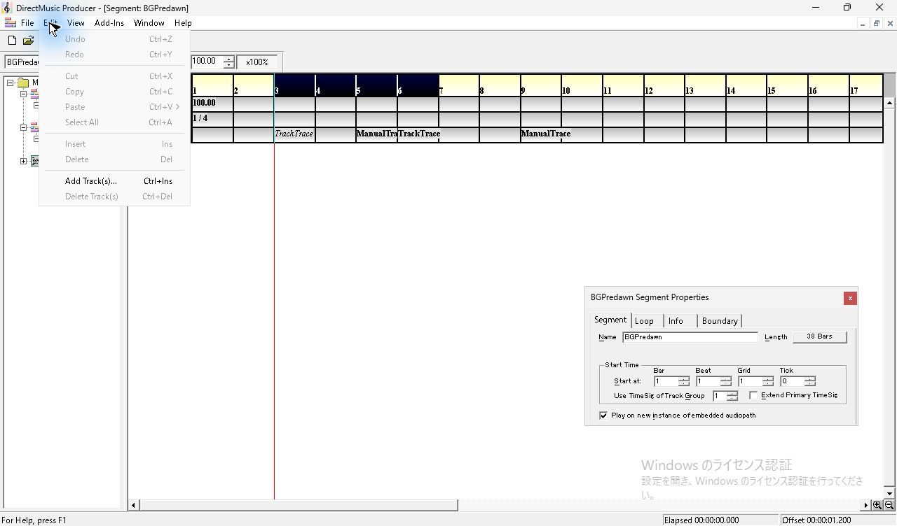

*図9 ルーラーにフォーカスがあると Edit の Copy と Select All は灰色。*

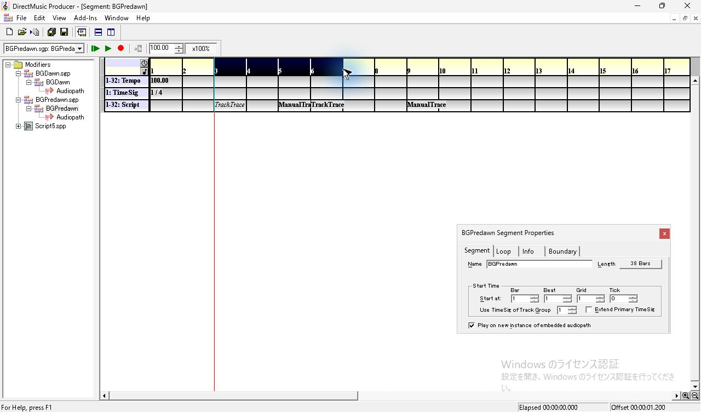

*図10 範囲確定後に同じ右境界へ置いたポインターは通常の矢印。*

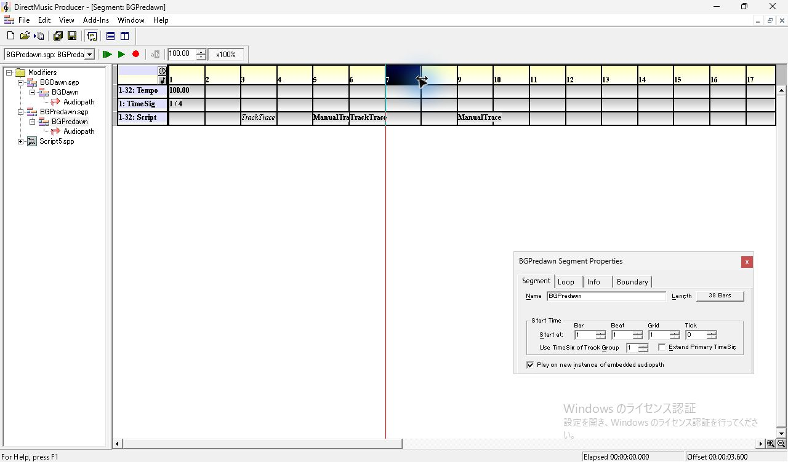

*図11 元の右境界からドラッグした後。新しい範囲は第7小節。*

Script 行の第6小節をクリックすると、ルーラーの色が消えて Script 行が選択される。そこで **Ctrl+A** を押すと、画面内で空セルまで濃紺になり、Properties は **Multiple Routines Selected**。この状態から **Ctrl+C** し、BGDawn の第20小節へ **Ctrl+V** すると、第20小節の2件と第22・23・26小節の各1件を追加した。最初の2件は物理クロック **14592と14593**、第23小節の TrackTrace は **Start Time 23:1:0、Belongs To 24:1**。開き直しても貼り付けたラベルが表示された。 [7件の保存](../../../work/original-gui/SEG-14-script-modifiers/20261112T055543432842Z/captures/85-all-paste-save.sgp)

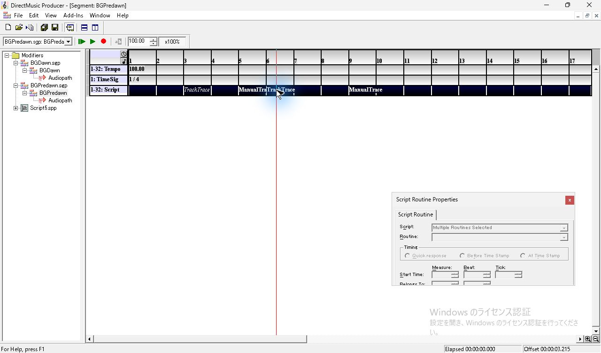

*図12 Script 行の Ctrl+A。空セルも濃紺、Properties に Multiple Routines Selected。*

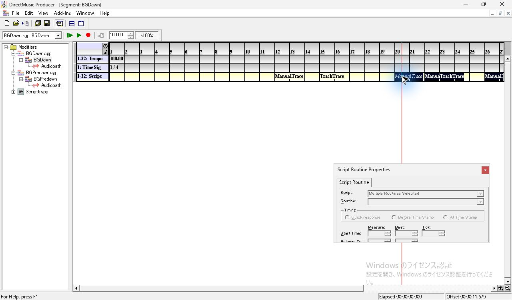

*図13 全選択から第20小節に貼り付けた5件。貼り付けたセルが濃紺。*

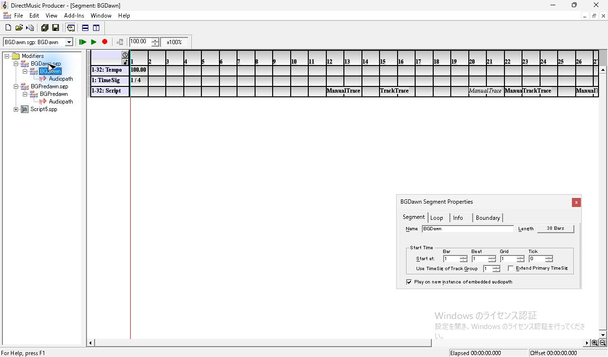

*図14 再読込した BGDawn。第12・15小節と第20〜26小節の貼り付け結果。*

## Script 行のドラッグと履歴

ルーラーを第7小節の範囲にしたあと、Script 行の第6小節 **(588,191)** をクリックし、**Ctrl+A**。同じ座標から第7小節の **(654,191)** へ左ボタンで通常ドラッグした1回で、**5件全部が1小節後ろへ移動**した。解放後は項目のある第4・6・7・10小節が濃紺になり、Properties は複数選択。物理・論理クロックは全件 **+768**。同一拍の1 Tick差、Timing、Script 参照、Start Time と Belongs To の差を保持した。 [移動後の SGP](../../../work/original-gui/SEG-14-script-modifiers/20261112T055543432842Z/captures/52-multidrag-save.sgp)

**Edit > Undo Move Routine(s)** で元の5件に戻り、**Edit > Redo Move Routine(s)** で移動を再適用した。Undo 後の画面では Script 行の選択が外れ、Properties は Audiopath だった。そこで送った **Ctrl+Y** では位置が変わらず、Edit の Redo を選ぶと戻った。Redo の保存ファイルは移動直後と同じ SHA-256。Project を閉じて開き直し、第7小節の TrackTrace の **7:1:0 / 8:1** を確認した。 [Undo](../../../work/original-gui/SEG-14-script-modifiers/20261112T055543432842Z/captures/55-multidrag-undo-save.sgp) · [Redo](../../../work/original-gui/SEG-14-script-modifiers/20261112T055543432842Z/captures/59-multidrag-redo-save.sgp)

同じ第6→7小節の座標で単独選択からドラッグした回は移動せず、全選択からの再試行でも移動しなかった。最初と同様に第7小節のルーラー範囲を作ってから全選択した再試行も移動しなかった。移動後の第7→8小節でも、単独選択と全選択の両方で動かなかった。成立した1回の結果と履歴は保存・再読込で確認できた。成立に必要な条件は追試が必要。 [再試行の保存値](../../../work/original-gui/SEG-14-script-modifiers/20261112T055543432842Z/script-selection-audit.json) · [以前の通常ドラッグの記録](seg-14-script-track-gestures.md)

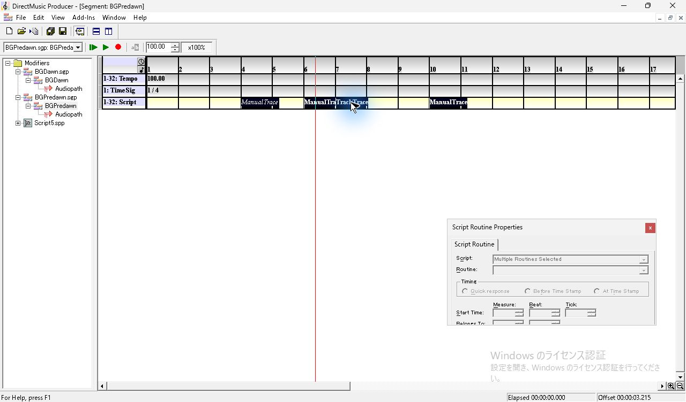

*図15 5件が第4・6・7・10小節へ移動し、項目のあるセルが選択される。*

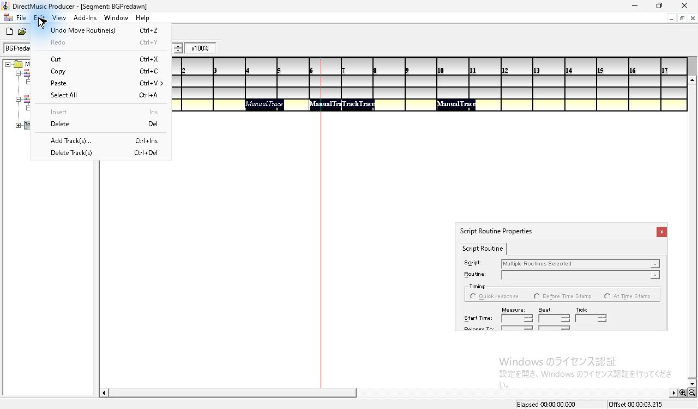

*図16 移動後の Edit に Undo Move Routine(s) が出る。*

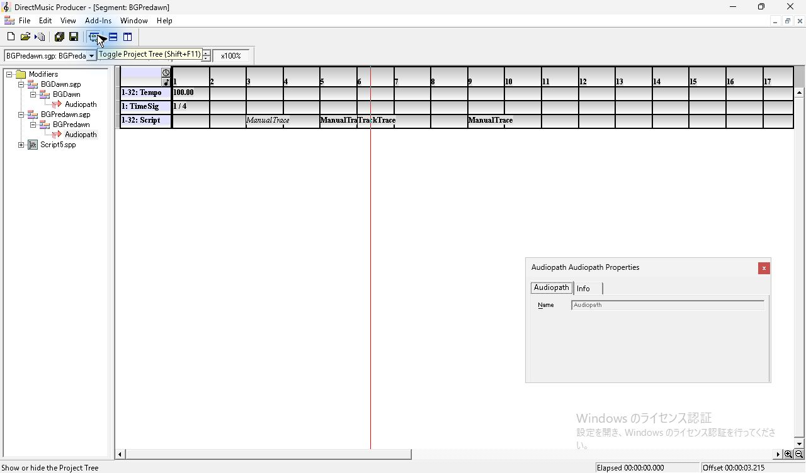

*図17 Undo 後。第3・5・6・9小節に戻り、Script 行の濃紺選択が外れる。*

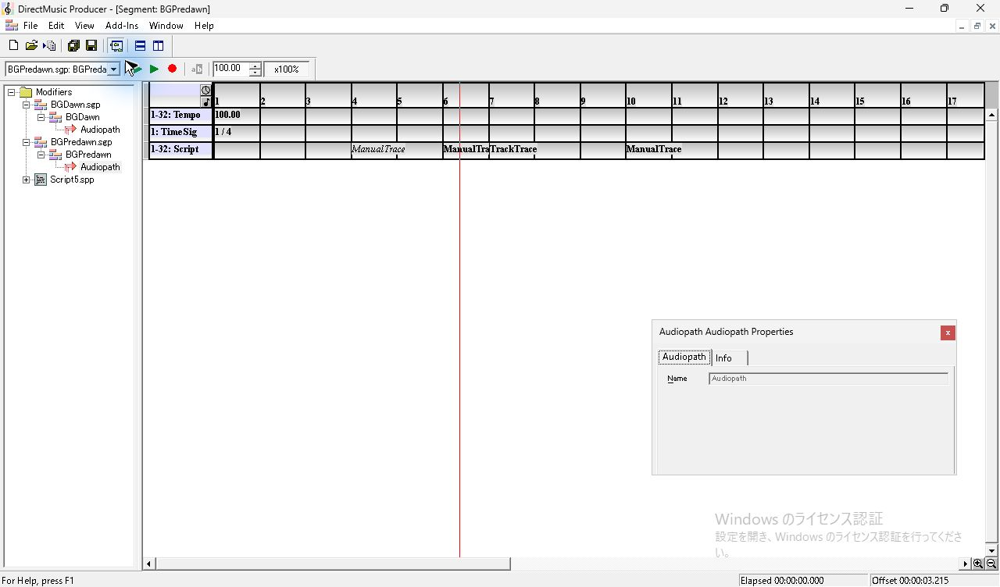

*図18 Redo 後。移動先の小節に戻る。*

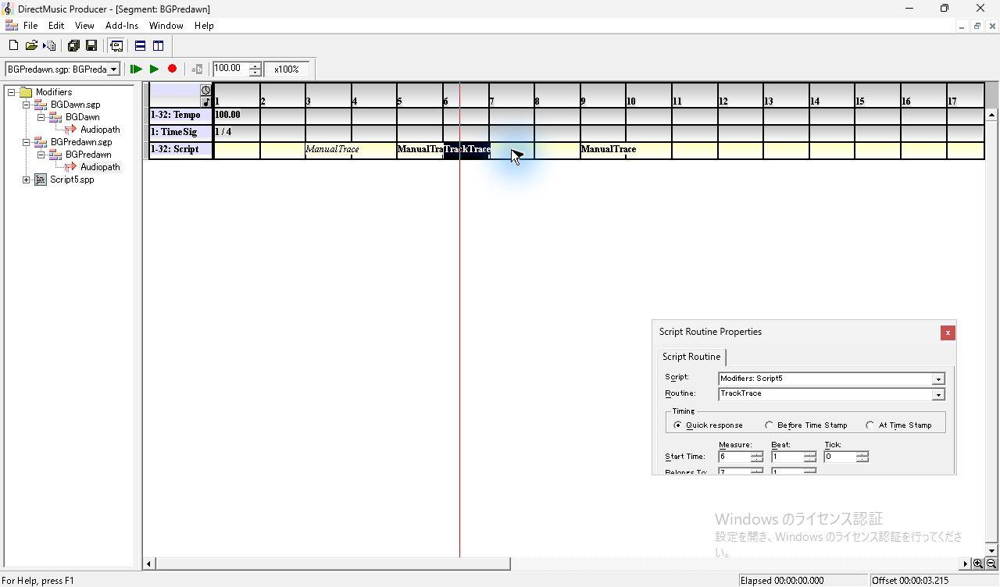

*図19 第6→7小節の単独ドラッグ後。第6小節が選択されたまま。*

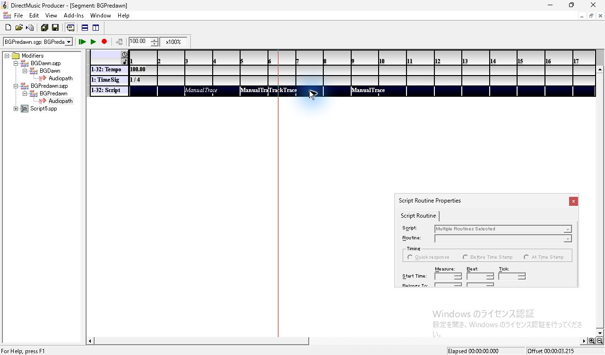

*図20 同じ座標で全選択から再試行した回。第3・5・6・9小節と全選択が残る。*

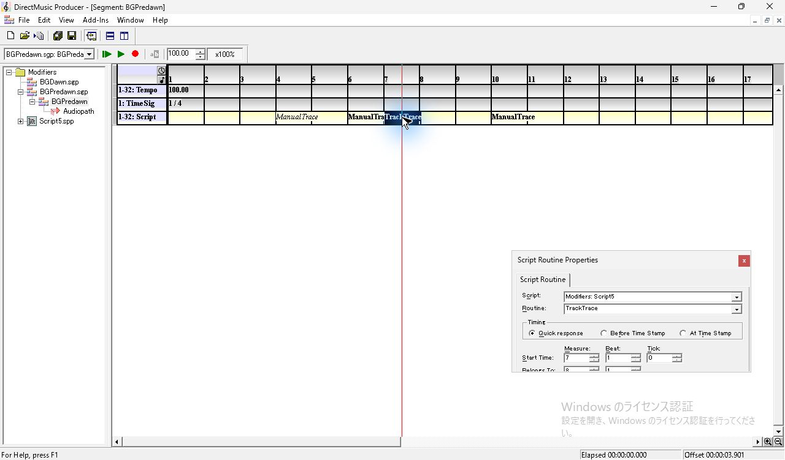

*図21 Project 再読込後の第7小節。TrackTrace の Start Time 7:1:0、Belongs To 8:1。*

## 修飾キーと押下中の観測範囲

Windows の Computer Use API は、ネイティブアプリでクリックと一緒に修飾キーを保持する入力を提供していない。**マウス キー**を一時的に有効にし、ポインターを第6小節に置いて、テンキー5、Ctrl+テンキー5、Num Lock を切り替えた状態でテンキー5を試した。無修飾のテンキー5でもクリックが Producer に届いたことを確認できず、Ctrl・Shift 付きのクリックやドラッグによる選択は未観測。マウス キーの設定値は **62→63→62**、Num Lock は試験時と復元時に1回ずつ切り替えた。 [設定値の記録](../../../work/original-gui/SEG-14-script-modifiers/20261112T055543432842Z/mouse-keys.json) · [Microsoft のマウス キーの説明](https://support.microsoft.com/en-us/accessibility/windows/use-mouse-keys-to-move-the-mouse-pointer)

通常ドラッグでは、入力要求から約53 ms後に撮影を要求した試行で、応答がドラッグ終了の応答をまたいだ。得られた画像では移動先に通常の白い矢印が写る。画像がマウスボタンの押下中だったことを確定できず、押下保持中の Script 行の形状は追試対象。 [ドラッグと撮影の時刻](../../../work/original-gui/SEG-14-script-modifiers/20261112T055543432842Z/script-selection-audit.json)

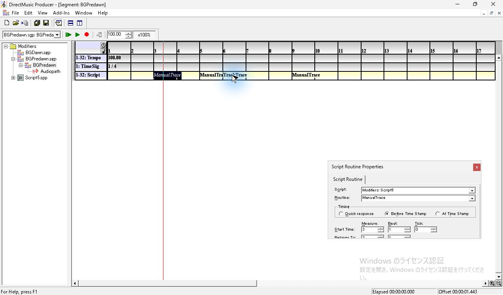

*図22 マウス キーを有効にしてテンキー5を送った後。第6小節にポインター、第3小節に選択。*

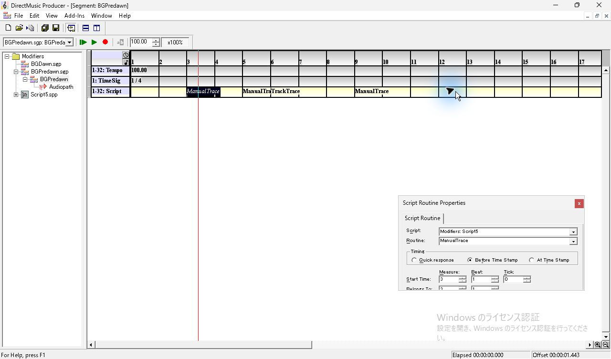

*図23 通常ドラッグの応答前に要求した画像。ポインターは移動先にあり、押下の有無は判別できない。*

## 保存範囲と終了状態

凍結した4ファイル、作業コピーの Script5、両 Segment の Tempo と Time Sig のトラックを照合した。更新したのは作業コピーの両 SGP と `.pro`。開始と終了の Producer ウィンドウは同じ1件で、Project を閉じて **Project Tree、Standard Toolbar、Status Bar、Transport Controls** の4項目を確認した。 [照合コード](../../../work/original-gui/SEG-14-script-modifiers/20261112T055543432842Z/audit.py) · [開始時](../../../work/original-gui/SEG-14-script-modifiers/20261112T055543432842Z/captures/00-start-windows.json) · [終了時](../../../work/original-gui/SEG-14-script-modifiers/20261112T055543432842Z/captures/105-end-windows.json)

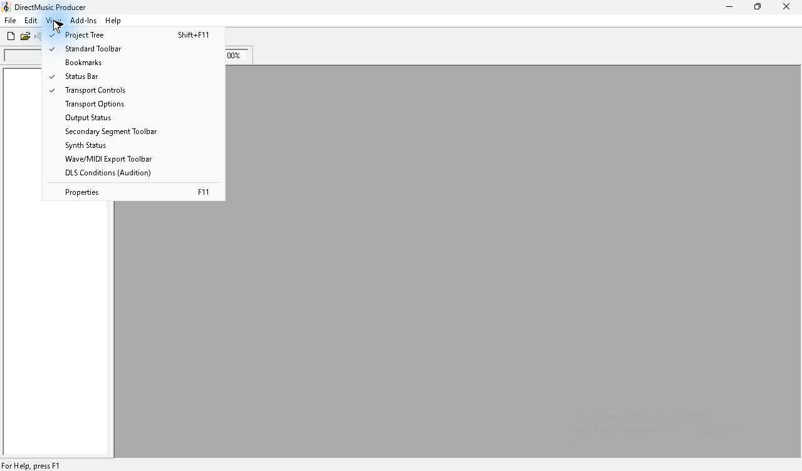

*図24 終了時の View。空の Project Tree と検証用の4項目。*
